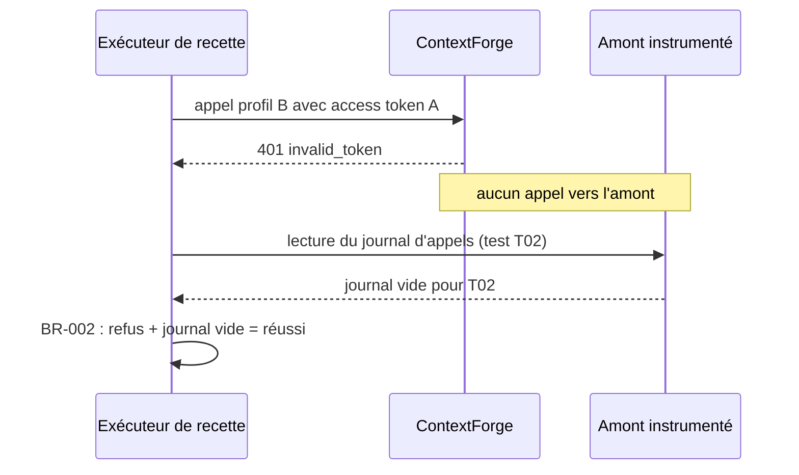

# F-001 · Trial of ContextForge against the isolation acceptance run

## Metadata

| Field | Value |
|-------|-------|
| **Priority** | First part of the brief: decides the stack (parts 1 to 4) |
| **Branch** | `feat/HULL-2-essai-contextforge` |
| **Last updated** | 2026-10-27 |

## 1. Context & Objective

### Current State

The gateway specification proposes Go for a new development, and a Python overlay on ContextForge "if ContextForge passes the acceptance run". No measurement allows a decision today: the technical review of 26 October 2026 proposes an acceptance run of 16 tests (section 6), "not executed in this study". Without execution, the stack choice rests on vendor documentation, which validates connectivity, not isolation.

### Objective

Produce a go / no-go verdict on ContextForge, based on running the 16 tests of the acceptance run against a pinned deployment, with, for each test, the evidence that no upstream call took place after a refusal, and, for each gap, its cause, its fix and its estimated cost. The deliverable is a reusable bench and a report; it does not choose the stack (BR-008).

### Expected Impact

- 16 tests out of 16 played, each with a result (réussi, échoué or non jouable) and evidence.
- A go / no-go verdict on a written criterion (BR-007), instead of a stack choice by preference.
- A bench replayable with one command (BR-005), reusable against the Go POC (HULL-5) and then v1 (BR-006).

### Open Product Questions

- None open. The Phase 2 decisions are in §9.
- Transposition: no tension. The gateway specification reserves the "transposed to the role" reading for the gateway itself (Go POC, v1) and writes: "For the ContextForge trial, which has users, the acceptance run applies without transposition." The bench therefore plays the acceptance run as the review writes it (BR-001); the users ↔ roles mapping, already tabulated by the gateway specification, is a parameter of the runner (BR-006), not a section of the report.

## 2. Scope

- Deployment of ContextForge (published Docker image, pinned by digest) in an isolated bench.
- Instrumented upstream MCP server, written for the bench, with its own OAuth authorization server, two test accounts of the same provider, and a call log.
- Two users U1/U2, two profiles A/B accessible to U1.
- Acceptance run runner: 16 tests T01..T16, talking to the gateway only over HTTP/OAuth.
- Report `docs/trials/contextforge.md`: 16 rows, gaps, verdict.
- Early commit of the bench and of a partial report, for resumption (decision F).

## Out of Scope

- Fixing the gaps, fix prototype: only the cost is estimated (decision D); candidate: overlay ticket if the verdict is go.
- Choice of the stack, writing `project.stack` (BR-008): decision of part 4 / of the maintainer.
- Go POC (HULL-5): the bench is reusable there, its implementation is out of scope.
- Behavior of real Claude clients (part 2) and matrix of official servers (part 3): the MCP clients of T15 are bench clients, not Claude.
- Performance, high availability, hosting on the production server/Traefik (part 5).
- Replaying the acceptance run on a later version of ContextForge or after a change of identity policy (the review asks for it): the bench allows it (BR-005), the trial plays only one.

## 3. Functional Spec

### 3.1 The bench (SCR-01)

Set of containers launched by a single command (BR-005), in `poc/isolation-bench/`.

- **ContextForge**: most recent published image, pinned by digest, configured with U1, U2, two profiles A/B (virtual servers), two connections to the upstream provider.
- **Instrumented upstream**: bench MCP server exposing tools with distinct test data per account; it logs each call (timestamp, account, tool, test identifier) without token or secret, and its own OAuth authorization server issues the provider tokens of two test accounts.
- **Acceptance run runner**: launches T01..T16, reads the upstream log after each test and applies BR-002.

#### Visual States

- **SCR-01**: bench started, health green, test accounts provisioned.
- **SCR-01.error**: component unavailable or provisioning incomplete; the acceptance run does not start and says so.
- **SCR-01.teardown**: end of session, test secrets destroyed (BR-003).

### 3.2 The acceptance run (SCR-02)

Sixteen tests, taken from the technical review of 26 October 2026 (section 6), without transposition (BR-001). Dated finding: 2026-10-27, source = OpenAI technical review, section 6; the bench count must stay at 16 (prescribed sweep: the runner compares the number of declared tests to 16 and fails otherwise).

| Id | Test | Required result |
|----|------|-----------------|
| T01 | Access token A on A, authorized action | Success, right provider account |
| T02 | Access token A on B | 401 `invalid_token`, no provider call |
| T03 | Refresh token A with resource B | Refusal at the authorization server, no token B |
| T04 | Refresh A without resource or with A+B | No implicit widening to B; ambiguous requests refused according to the chosen policy |
| T05 | Token with audiences A and B | Refusal by the single-audience token policy |
| T06 | Invalid signature, issuer or expiration | Refusal before routing; ID token refused in place of an access token |
| T07 | Call from A with `connection_id` of B | Refusal before consulting or using the secrets of B |
| T08 | U1 supplies a connection identifier of U2 | Refusal even if the identifier is valid and known |
| T09 | Hidden tool called directly | Execution refused; no bypass through a generic call tool |
| T10 | Account added after profile creation | No silent change of account |
| T11 | Two simultaneous renewals | One consistent rotation; no loss of the new refresh token |
| T12 | Revocation or deletion of the profile | Access cut within the defined delay, including caches and persistent connections |
| T13 | Vault / revocation check unavailable (failure test) | Behavior consistent with the chosen refusal for protected operations |
| T14 | OAuth discovery on A and B | Resource-specific metadata, without silent fallback to a global audience |
| T15 | Two generations of MCP clients | Negotiation and authorization work in the explicitly supported versions |
| T16 | Recovery after provider error | No fallback to another account and no unintended double write |

Evidence to keep (review, "Expected evidence"): version and digest, identity configuration, test accounts, HTTP/OAuth results, upstream call traces; check of `aud`, `iss`, `exp` and of authorizations without publishing the secrets; for an opaque token, introspection data and the server's decision.

The terms "chosen policy" (T04, T13) and "defined delay" (T12) are not chosen by the bench: they are set by BR-011 (refusal of ambiguous requests, refusal by default on failure, bounded delay), before the acceptance run.

### 3.3 The report (SCR-03)

`docs/trials/contextforge.md`: header (version, digest, date, bench commit), table of exactly 16 rows (id, result réussi / échoué / non jouable, evidence), gaps section (cause, fix classified overlay or in-core, estimated cost per gap, BR-004), total cost of the overlays set against the estimate of the Go POC and of v1 (gateway specification), go / no-go verdict justified by BR-007.

#### Visual States

- **SCR-03.partial**: partial report committed early, unplayed rows marked « non joué » (bench state, distinct from « non jouable », BR-009); it is not a verdict (BR-007).
- **SCR-03.final**: 16 rows filled in, verdict present.

## 4. Business Rules

### Naming Convention

`BR-NNN`, sequential and global.

### BR-001 · The acceptance run plays the 16 tests of the review, without transposition

> **Extracted on 2026-10-27.** Current version: [`business-rules/BR-001.md`](../business-rules/BR-001.md).
> The content below reflects the state of this BR at the time of feature F-001 (v1).

*`behavioral` · `blocking` · Candidate state: `verified` — the number of tests of the acceptance run is 16.*

**Rule** — The acceptance run that is executed includes the 16 tests of section 6 of the technical review, with profiles A/B and users U1/U2 as the review writes them, including the failure test (T13).

**Clarifications**
- No test is removed, merged or rewritten to fit the gateway's model; a test that the product does not allow to be played is « non jouable » (BR-009) and becomes a gap (BR-004).
- The count of 16 is necessary, not sufficient: each test's fidelity to its line of the review is read by hand in PR review.

### BR-002 · A refusal is proven by the absence of an upstream call

> **Extracted on 2026-10-27.** Current version: [`business-rules/BR-002.md`](../business-rules/BR-002.md).
> The content below reflects the state of this BR at the time of feature F-001 (v1).

*`behavioral` · `strict` · Candidate state: `verified` — assertion on the upstream log in each refusal test.*

**Rule** — A refusal counts as « réussi » only if the upstream log contains no entry in the test's window; otherwise the test is « échoué », even if the HTTP response is a refusal.

**Clarifications**
- The upstream log covers the upstream MCP server **and** its authorization server (provider token exchange or renewal = provider call).
- Attribution by time window: tests are played one after the other, and any entry between the start and the end of a test is attributed to it, whether or not it carries its identifier.
- Positive check: T01 must produce at least one entry, for the right account. Without it, the log is deemed mute, no refusal is counted « réussi », and the acceptance run stops (SCR-01.error).
- Refusal tests: T02 to T09, T12 (after the cut), T13. For T01, T10 and T16, the log is read for the provider account called.

**Example**
- **Given** T02 (token A on B)
- **When** the gateway answers 401 `invalid_token`
- **Then** the test is « réussi » only if the upstream log has no entry for T02.

### BR-003 · No secret in the evidence

> **Extracted on 2026-10-27.** Current version: [`business-rules/BR-003.md`](../business-rules/BR-003.md).
> The content below reflects the state of this BR at the time of feature F-001 (v1).

*`behavioral` · `strict` · Candidate state: `verified` — sweep of the committed artifacts for the generated secrets.*

**Rule** — No retained artifact (committed file, evidence, log, report) contains a token or a secret; a positive scan blocks the commit.

**Clarifications**
- Scanned population: the secrets generated by the bench, ContextForge's configuration secrets, and any token received by the runner or issued by ContextForge during the session (read by the bench), not a fixed list of patterns.
- The scan precedes every commit, including early commits (decision F), not only the last one.
- Evidence about a token shows its decoded claims (`aud`, `iss`, `exp`), never the compact form or the signature.

### BR-004 · Every « échoué » or « non jouable » test is a documented gap

> **Extracted on 2026-10-27.** Current version: [`business-rules/BR-004.md`](../business-rules/BR-004.md).
> The content below reflects the state of this BR at the time of feature F-001 (v1).

*`behavioral` · `blocking` · Candidate state: `verified` — check of the report structure.*

**Rule** — The report contains exactly 16 test lines; each « échoué » or « non jouable » test carries a gap with its cause, its fix classed "overlay" or "in-core" (in the sense of BR-007), and its estimated cost in development days; an incomplete gap is a report structure error.

### BR-005 · Bench reproducible with one command

> **Extracted on 2026-10-27.** Current version: [`business-rules/BR-005.md`](../business-rules/BR-005.md).
> The content below reflects the state of this BR at the time of feature F-001 (v1).

*`behavioral` · `blocking` · Candidate state: `verified` — run on a clean bench.*

**Rule** — A single command builds the bench from zero and plays the acceptance run; versions are pinned, ContextForge by digest.

### BR-006 · The acceptance run knows the gateway only through HTTP/OAuth

> **Extracted on 2026-10-27.** Current version: [`business-rules/BR-006.md`](../business-rules/BR-006.md).
> The content below reflects the state of this BR at the time of feature F-001 (v1).

*`behavioral` · `warning` · Candidate state: `deferred` — ticket HULL-5 (Go POC).*

**Rule** — The runner's tests reach the gateway only through HTTP/OAuth, with no dependency on ContextForge, so that they can be reused without modification against the Go POC (HULL-5) and against v1.

**Clarifications**
- The administration actions that some tests require (provisioning, account addition T10, revocation T12, failure T13) go through a gateway adapter, the only ContextForge-specific component, replaced for the Go POC.
- Identities (U1/U2 here, role tokens for the transposed gateway) are runner parameters.

### BR-007 · "go" criterion

> **Extracted on 2026-10-27.** Current version: [`business-rules/BR-007.md`](../business-rules/BR-007.md).
> The content below reflects the state of this BR at the time of feature F-001 (v1).

*`behavioral` · `blocking` · Candidate state: `not-mechanisable` — judgment on the fixability of the gaps.*

**Rule** — The verdict is "go" if the 16 tests are « réussi », or if every gap can be fixed in an overlay; otherwise "no-go". No verdict is rendered as long as a line is « non joué ».

**Clarifications**
- Overlay: code or configuration added around the published image, without modifying either ContextForge's code or its image.
- In-core: a fix that modifies ContextForge, or an overlay that replaces an isolation function it should provide (authorization server for MCP clients, audience check, per-profile routing, revocation, refusal on failure). Such a gap makes the verdict "no-go".
- The total cost of the overlays is reported against the estimate for the Go POC and for v1; weighing it belongs to the stack choice (BR-008), not to the verdict.

### BR-008 · The recommendation does not decide the stack

> **Extracted on 2026-10-27.** Current version: [`business-rules/BR-008.md`](../business-rules/BR-008.md).
> The content below reflects the state of this BR at the time of feature F-001 (v1).

*`behavioral` · `strict` · Candidate state: `verified` — the PR diff does not touch `project.stack`.*

**Rule** — The trial writes neither `project.stack` nor a stack choice (neither an ADR nor a stack decision in the repository); it produces a verdict and a recommendation.

### BR-009 · « Non jouable » is proven and never « réussi »

> **Extracted on 2026-10-27.** Current version: [`business-rules/BR-009.md`](../business-rules/BR-009.md).
> The content below reflects the state of this BR at the time of feature F-001 (v1).

*`behavioral` · `blocking` · Candidate state: `verified` — check of the report structure: every non jouable row cites its evidence.*

**Rule** — A test is « non jouable » only if the product does not offer the tested function, with evidence cited (ContextForge documentation, API or response); a « non jouable » test is a gap and never counts as « réussi ». Without this evidence, the line is « échoué ».

**Clarifications**
- A bench difficulty (tooling, budget, failure) is not « non jouable »: the line stays « non joué » and blocks the verdict (BR-007).
- A test whose function is not found after reading the documentation and the API goes to « non jouable » with this evidence, and the acceptance run continues (decision C); this is the per-test effort bound under the token budget (decision F).

### BR-010 · Disposable test secrets

> **Extracted on 2026-10-27.** Current version: [`business-rules/BR-010.md`](../business-rules/BR-010.md).
> The content below reflects the state of this BR at the time of feature F-001 (v1).

*`behavioral` · `strict` · Candidate state: `verified` — the teardown destroys the volumes and secret files; no external secret is a parameter of the bench.*

**Rule** — Every bench secret is generated in the bench at each launch and destroyed at teardown; no real secret (real provider account, personal token, project secret) enters the bench.

**Clarifications**
- After an interruption, the resumption regenerates the secrets; those of a previous session are not reused.
- Only SHA-256 fingerprints of the destroyed secrets survive teardown (folder ignored by git): they cannot be decrypted and allow the BR-003 scan for a commit made after the destruction.

### BR-011 · Acceptance run policies fixed before it

> **Extracted on 2026-10-27.** Current version: [`business-rules/BR-011.md`](../business-rules/BR-011.md).
> The content below reflects the state of this BR at the time of feature F-001 (v1).

*`behavioral` · `blocking` · Candidate state: `verified` — the policy file and the ContextForge configuration are committed before the first test and unchanged until the last.*

**Rule** — Before the first test, the bench fixes and commits: refusal of ambiguous requests (T04), default refusal of protected operations when the vault or the revocation check is unavailable (T13), cut delay (T12) strictly shorter than the configured access token lifetime, and a single ContextForge configuration for the 16 tests; a change during the acceptance run invalidates the acceptance run.

**Clarifications**
- These policies are those of the gateway specification; a ContextForge that "fails open" (§9) fails T13, it does not change the policy.

## 5. Acceptance Criteria

Bench (SCR-01)
- [x] BR-005: on a clean workstation, a single command builds the bench and plays the acceptance run; the ContextForge image is referenced by digest.
- [x] The bench starts U1, U2, the profiles A/B and the two test accounts of the same provider.

Acceptance run (SCR-02)
- [x] BR-001: the runner declares 16 tests T01..T16 and fails if it declares any other number; the fidelity of each test to the review is read by hand in PR review.
- [x] BR-011: the policy file and the ContextForge configuration are committed before the first test (`git log` shows them earlier than the first result) and unchanged until the last.
- [x] BR-002: each refusal test (T02 to T09, T12, T13) reads the upstream log (MCP server and authorization server) and fails if an entry exists in its window; without an entry for T01, the acceptance run stops.
- [x] BR-006: the tests import no ContextForge code and read no ContextForge configuration; only the gateway URL, its OAuth credentials and the identities are parameters; the administration actions go through the gateway adapter.

Report (SCR-03)
- [x] BR-004: the report has exactly 16 rows; each échoué or non jouable row points to a gap with cause, fix classified overlay / in-core and cost in days.
- [x] BR-009: each non jouable row cites its evidence; no « non joué » row in the final report.
- [x] BR-003: before each commit, the sweep of the kept artifacts finds no secret of the defined population (generated, configuration, tokens received or issued).
- [x] BR-010: after teardown, no bench volume or secret file remains; no external secret is a parameter of the bench.
- [x] BR-007: the verdict cites the criterion and, in the case of a go with gaps, establishes for each gap that an overlay suffices in the sense of BR-007 (read by hand).
- [x] BR-008: the PR diff does not touch `project.stack` of `.cairn/project-context.yaml`.
- [x] Decision C: a test blocked along the way does not interrupt the acceptance run; all 16 are attempted.
- [x] Decision F: the bench and a partial report are committed before the end of the acceptance run.

## 6. Diagrams

### Selection Matrix

| Type | Decision |
|------|----------|
| Userflow | Omitted: no user journey, the bench is a non-interactive trial tool. |
| Sequence | Included (6.2): three layers exchange (client, ContextForge, upstream). |
| State machine | Omitted: no component with explicit states is built; the token state is that of ContextForge, the subject of the trial. |
| ER / Class | Omitted: no data schema or object hierarchy is introduced. |

### 6.2 Sequence — refusal path (T02)

## 7. States & Captures

- **Freeze marker**: not applicable
- **Package-status**: absent

## 9. Implementation Notes

### Dependencies (prerequisite features)

- None. Feeds part 4 (Go POC, HULL-5), which is conditional on the verdict.

### Technical Constraints

Sources consulted on 2026-10-27 (GitHub README and published documentation of IBM/mcp-context-forge, read through automatic page summary, hence second-hand). Proposed mapping to the concepts of the acceptance run:

- **Profile A/B**: virtual server of ContextForge. Confirmed: tools are grouped into a "virtual server" via `associated_tools`, created by the `/servers` API (README). Tokens can be limited to specific servers by a `server_id` scope ("Securing ContextForge" page).
- **Users U1/U2**: ContextForge users attached to teams. Confirmed: a `teams` claim gives team + public access; without a `teams` claim, public access only ("Securing ContextForge" page). The private / team / public visibility levels: not verified ("Team Management", "RBAC Configuration" pages not read).
- **Token scope**: claims `teams`, `server_id` and `permissions` (for example `tools.read`, `tools.execute`), `jti` for revocation; `REQUIRE_JTI` and `REQUIRE_TOKEN_EXPIRATION` at `true` by default (documentation). Whether the `server_id` scope covers T02 (token A on B): hypothesis, not verified.
- **OAuth on the provider (upstream) side**: ContextForge describes itself as an OAuth client relying on external identity providers; it sends the `resource` parameter (RFC 8707), configures it per gateway (`oauth_config.resource`) and checks `aud` of the token received ("OAuth Resource (Audience) Configuration" page). Confirmed by the documentation; actual behavior: to be measured. "User-scoped" OAuth tokens: confirmed (README), per-account nuance for T10: not verified.
- **Authorization server on the MCP client side** (T03, T04, T05, T14): the documentation read does not say that ContextForge issues OAuth tokens for MCP clients, nor that it exposes resource metadata per virtual server. Hypothesis: not verified; probably the main source of gaps. The README mentions Basic, JWT, or custom authentication and SSO (Google, GitHub, Entra ID).
- **Revocation and failure** (T12, T13): the documentation indicates that the revocation and user lookup checks "fail open" on database failure to preserve availability. This probably contradicts T13 if refusal is chosen for protected operations: to be measured, not verified in practice.
- **Version and image**: image `ghcr.io/ibm/mcp-context-forge`; the latest version read on the releases page is v1.1.0 (20 October 2026), according to a page summary: not verified. The digest is resolved once, then hard-coded in the committed composition; subsequent launches use only this digest (BR-005).
- Host: development in the session's dockerd (execution mode of the project); no production hosting. Shared disk (89% used): bench footprint targeted ≤ 5 GB, images purged at teardown.
- Language of the bench and of the runner: to be chosen at implementation, subject to BR-006 (HTTP/OAuth only).

### Architecture Decisions

| Question | Decision | Rationale |
|----------|----------|-----------|
| A. Which version of ContextForge? | Latest published Docker image, pinned by digest | Evaluates what we would adopt today; the digest makes the trial reproducible (BR-005). |
| B. Which upstream? | Instrumented MCP server written for the bench, with its OAuth authorization server, two test accounts of the same provider, call log | Only a controlled upstream proves the absence of a call after a refusal (BR-002) and avoids the secrets of real services. |
| C. What to do on a blocking gap? | Play the 16 tests anyway and document each gap | A complete report is worth more than a stop at the first failure; the total cost of the gaps decides the go. |
| D. What to do with the gaps? | Estimate the cost of the fix only, without a prototype | Bounds the budget; the go/no-go criterion (BR-007) rests on an estimate, not on a fix carried out. |
| E. What stays in the repository? | Report `docs/trials/contextforge.md`, bench and acceptance run in `poc/isolation-bench/`, merged to `main` | The bench serves the Go POC (HULL-5) and v1; the report traces the decision. |
| F. Duration? | No duration cap; constraint = the operator's token budget; bench and partial report committed early | Allows resuming the trial after an interruption. |

### Data Model Impact

- Migration: no
- No project table; the state of the bench (ContextForge database, upstream log) is disposable.

### Components to Create / Modify

**Created**
- `poc/isolation-bench/` — bench (container composition), instrumented upstream and its OAuth authorization server, acceptance run runner T01..T16, single command
- `docs/trials/contextforge.md` — report
- `business-rules/BR-001..BR-011.md` — rules extracted at closure (`close-feature` phase 3)

**Modified**
- No existing file expected (BR-008: `project.stack` intact).

### Pitfalls Discovered

Measurements of 2026-10-27 (ContextForge 1.1.0, pinned digest) against the hypotheses of "Technical Constraints":

- **Authorization server for MCP clients**: confirmed absent (hypothesis held). No `/authorize`, `/token`, `/register` endpoint nor authorization server metadata; the "access tokens" are API JWTs issued to an authenticated user. T03 and T04 are non jouable.
- **`server_id` scope and T02**: the scope covers T02 (no upstream call, including through `/rpc`), but the refusal is a 403 `Access denied`, not a 401 `invalid_token`.
- **Fail open on failure (T13)**: hypothesis **not confirmed** for a tool call. With the database stopped, the call is refused with 401 (fail closed) and the service recovers in less than a second on restart.
- **Revocation (T12)**: cut in 30.5 s, which matches the 30 s TTL of the default revocation cache; profile deletion: immediate.
- **Protected resource metadata**: served only for a public virtual server (404 for a team server).
- **Upstream OAuth renewal**: observed with a provider token of 300 s: one renewal per call; ContextForge does not serialize renewals; two simultaneous calls lose the session (E-05 of the report).
- **Visibility and permissions**: an ordinary user has only `platform_viewer`; the bench creates a global role `bench-user` (`tools.execute`, `tokens.*`) and assigns the role `developer` on the personal team to create connections and profiles. The `.test` and `.example` addresses are refused by address validation (the bench uses `bench-isolation.dev`).
- **Acceptance run policies (BR-011)**: cut delay set to 60 s, access token lifetime to 86,400 s (1 day, product minimum), ambiguous requests refused, refusal by default on failure.
- **Environment guards**: the administration secret must be at least 12 characters (the product refuses at startup a default password that is shorter).

## 10. Phases

### Phase 1 — Bench and upstream

- [x] ContextForge starts from the image pinned by digest
- [x] Instrumented upstream, OAuth authorization server, two test accounts and call log
- [x] U1, U2, profiles A/B provisioned
- [x] Bench and report skeleton committed (decision F)

### Phase 2 — Acceptance run

- [x] T01..T16 implemented, count equal to 16 (BR-001)
- [x] Upstream log assertion in each refusal test (BR-002)
- [x] Runner limited to HTTP/OAuth (BR-006)
- [x] One command builds the bench and plays the acceptance run (BR-005)

### Phase 3 — Execution and report

- [x] The 16 tests played, gaps documented with cause, fix and cost (BR-004)
- [x] Secret sweep on the committed artifacts (BR-003)
- [x] Go / no-go verdict according to BR-007, without touching `project.stack` (BR-008)
- [x] Report and bench merged to `main`

## 11. Tests

### Isolation acceptance run

| Test | BR / Concern | File |
|------|-------------|------|
| T01..T16 | BR-001 | `poc/isolation-bench/runner/recette.py` |
| log assertion in T02 to T09, T12, T13; positive check on T01 | BR-002 | `poc/isolation-bench/runner/recette.py` |
| policy and configuration committed before the first test | BR-011 | `poc/isolation-bench/runner/run_bench.py` |

### Bench checks

| Test | BR | File |
|------|-----|------|
| test count = 16 | BR-001 | `poc/isolation-bench/runner/recette.py` |
| secret sweep before each commit | BR-003 | `poc/isolation-bench/runner/secrets_guard.py` |
| destruction of the secrets at teardown | BR-010 | `poc/isolation-bench/runner/run_bench.py` |
| evidence cited on each non jouable row | BR-009 | `poc/isolation-bench/runner/report_check.py` |
| report structure (16 rows, complete gaps) | BR-004 | `poc/isolation-bench/runner/report_check.py` |
| run on a clean bench | BR-005 | `poc/isolation-bench/bench.sh` |
| diff without `project.stack` | BR-008 | `poc/isolation-bench/runner/check_scope.py` (and PR review) |

BR-006 (deferred, ticket HULL-5) and BR-007 (judgment) are not tested mechanically.

## 12. Risks & Watchpoints

- **Technical risk**: ContextForge may not be an OAuth authorization server for MCP clients (hypothesis, §9); several tests (T03, T04, T05, T14) would then be non jouable as written, and the verdict will depend on reading "non jouable" as a gap (BR-004).
- **Dependency risk**: `latest` image is a moving target; the pinned digest freezes the trial, at the price of a version possibly outdated when the report is read.
- **Budget risk**: no duration cap, the token budget bounds the trial; hence the early commits.
- **Privacy / security risk**: the test secrets remain in the evidence if the sweep fails; BR-003.
- **Functional risk**: ContextForge "fails open" on database failure (documentation, §9); T13 will then be échoué and, being an isolation function, the gap is in-core (BR-007).
- **Planning risk**: the gateway specification estimates the trial at 1 to 2 days; decision F removes the duration cap. Accepted at stress-test: the token budget bounds the trial, BR-009 bounds the per-test effort.

## Stress-test

**Passe du 2026-10-27** — Claude (product, BR review sub-agent delegated by the operator), six axes.
**18 findings — 4 critical, 8 major, 6 minor ; 17 retenus, 1 écartés.**

Critical:
- **S1** · axis A · §BR-007 — "fixable in an overlay" and "in-core" not defined: an overlay that reimplements the authorization server makes every gap fixable, the go is acquired in advance. Sort : corrigé — overlay and in-core defined; replacing an isolation function is in-core, hence no-go.
- **S2** · axis B · §BR-002 — a mute log makes every refusal succeed; the calls to the upstream authorization server and those without a test identifier escaped attribution. Sort : corrigé — log extended to the authorization server, attribution by window, positive check on T01, list of refusal tests.
- **S3** · axis A · §3.2 "chosen policy", "defined delay" — the bench chose the policy: a "fail open" choice or a long delay made T13 and T12 succeed, and the ContextForge configuration could vary per test. Sort : corrigé — BR-011 added (policies of the gateway specification, committed before the acceptance run).
- **S4** · axis B · §BR-001, §BR-004 — "non jouable" not defined: absent function and bench difficulty confused; nothing prevented classifying an expensive test as non jouable nor counting it réussi. Sort : corrigé — BR-009 added.

Majors:
- **S5** · axis F · §BR-006 vs T10, T12, T13 — these tests require administration actions specific to ContextForge; "HTTP/OAuth only" was untenable. Sort : corrigé — gateway adapter, identities as parameter.
- **S6** · axis F · §1, §12 — the tension on transposition does not exist: the gateway specification writes "For the ContextForge trial, which has users, the acceptance run applies without transposition". Sort : corrigé — §1 rewritten, risk removed from §12.
- **S7** · axis A · §BR-003 — two joined obligations (no secret in the evidence; secret lifecycle). Sort : corrigé — rule split, BR-010 added.
- **S8** · axis B · §BR-003 — population limited to the secrets generated by the bench (tokens issued by ContextForge and configuration secrets absent), final sweep only whereas decision F commits early. Sort : corrigé — population widened, sweep before each commit, decoded claims only.
- **S9** · axis F · §BR-005 vs §9 — digest "read at first launch" from the most recent image: each clean bench resolves a different one. Sort : corrigé — digest hard-coded in the composition.
- **S10** · axis A · §BR-004 — cost without unit, fix not classified: BR-007 cannot be read on the report. Sort : corrigé — fix classified overlay / in-core, cost in days.
- **S11** · axis F · §9 decision C vs BR-007 — the rationale of C says "the total cost of the gaps decides the go", BR-007 ignores cost. Sort : corrigé — total cost reported against the estimate of the Go POC and of v1, weighing referred to the stack choice (BR-008); a cost threshold in the verdict remains for the operator to decide at the freeze.
- **S12** · axis B · §9 decision F — nothing said what to deliver if the token budget runs out before the end. Sort : corrigé — no verdict as long as a row is « non joué » (BR-007), per-test effort bound (BR-009).

Minors:
- **S13** · axis A · §5 BR-001 — the instrument (count = 16) does not read the fidelity of the tests. Sort : corrigé — read by hand in PR review.
- **S14** · axis A · §BR-008 — "stack choice" without a location. Sort : corrigé — no ADR and no stack decision in the repository.
- **S15** · axis C · §3.3 — section "U1/U2 ↔ roles mapping" redundant with the table of the gateway specification. Sort : corrigé — section removed, identities as parameter (BR-006).
- **S16** · axis D · §Out of Scope — replay on a later version (asked for by the review) was not excluded. Sort : différé — line added in §Out of Scope.
- **S17** · axis B · §9 — shared disk 89% used, bench footprint unbounded. Sort : corrigé — ≤ 5 GB, images purged at teardown.
- **S18** · axis E · §9 decision F vs gateway specification (1 to 2 days) — the trial no longer has a duration cap. Sort : accepté — explicit decision of the operator; risk in §12.

## 13. Changelog

| Date | Author | Change |
|------|--------|--------|
| 2026-10-27 | Claude (product) | Spec creation (draft) |
| 2026-10-27 | Claude (product, stress-test) | Stress-test: BR-002, 003, 004, 006, 007, 008 reworded; BR-009, 010, 011 added; ready-for-freeze |
| 2026-10-27 | Claude (implementation) | Closure: BR-001..011 extracted; BR-010 clarified (SHA-256 fingerprints kept, not reversible); §9 Pitfalls filled in; status `implemented` |
| 2026-11-16 | Codex (implementation-coder, model:gpt-6-astra) | F-022 slice 2, freeze `10d166e` (retouch 2 `7aac9e6`): §3.2 substitutions only; inline rule clarifications without version where applicable. |
| 2026-11-24 | Claude (implementation, model:claude-opus-5-5) | F-025 §3.8 rewrite pass, freeze `1427c98`: private-forge `#N` written `HULL-N`, citation form only. |
