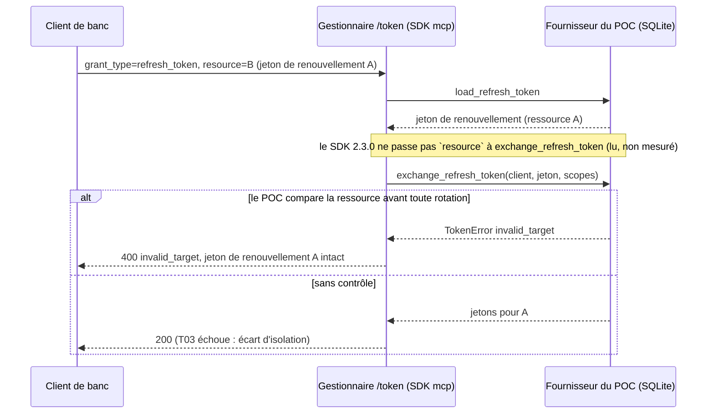

# F-003 · Comparison Python POC, judged on the Go POC's bench

## Metadata

| Field | Value |
|-------|-------|
| **Priority** | P1 — stack comparison, milestone "Stack choice" |
| **Branch** | `feat/HULL-16-poc-python` |
| **Last updated** | 2026-10-28 |

## 1. Context & Objective

### Current State

The Go POC (F-002, HULL-5, PR #15 merged as `bc19e72`, accepted on 2026-10-28) returned "go, Claude.ai / iOS reservation open": acceptance run 16/16 on bench `bc87ce9`, eleven isolation lines passed, 3.5 d of remaining gaps (E-01 in-house MCP entry 2 d, E-02 in-memory OAuth storage 1 d, E-03 renewal margin 0.5 d; E-04 DCR/CIMD 1.5 d outside the sum), 1,030 lines of Go. The cost concentrated in the **glue** around the building blocks: `fosite` v0.49.0 ignores `resource` (RFC 8707) at renewal, does not touch JWT access tokens at revocation, provides only in-memory storage, has neither DCR nor CIMD, and answers 200 to `/revoke` when revocation fails or `token` is missing; the `go-sdk` v1.4.0 does not serve 2026-07-28. The review also deferred to the v1 core (#7) four requirements the Go POC does not meet: N1 (`client_id`), N2 (scope, `403 insufficient_scope`), N4 (recreated role) and N13 (`/revoke` without `token`).

On 2026-10-28 (around 00:50), the operator decided to launch a comparison Python POC, judged on the same bench: "it's a useful POC, we may discover useful things to carry back to Go for what follows". The stack decision remains his (BR-008 v2).

### Objective

Build a throwaway Python POC with the **same functional scope** as the Go POC, judge it by **the same acceptance run, the same bench, the same checks outside the acceptance run and the same criterion** (BR-023), make it meet the known core requirements (BR-026), and deliver a figure-backed **Go vs Python comparison**, point by point (BR-024), with what is **to carry over to Go** (BR-027). The deliverable is a POC, a bench target and a report; it does not choose the stack (BR-008 v2).

### Expected Impact

- 16 tests out of 16 played against the Python POC by **the same runner code** as the Go POC (strict test-by-test comparison, H6).
- The Go POC's three checks outside the acceptance run replayed without any change of assertion (BR-025) and the four core requirements measured (BR-026).
- A comparison in which every line carries the cited Go measurement and the proven Python measurement, on each of the points where `fosite` or the `go-sdk` required glue or in-house code (BR-024).
- A "To carry over to Go" list (BR-027) tied to the Go POC's files or to #7's requirements, usable by HULL-7 (core) if Go is chosen.

### Open Product Questions

None open: the operator is asleep and asked for an autonomous act. The framing axes were settled by the recommended value below and are repeated in §9 (Architecture Decisions) **for contestation at the freeze**. Phase 2 of `create-feature-spec` (grouped questions, waiting for an answer) was not held: gap reported at the freeze.

- **H1 — Claude.ai / iOS**: out of autonomous scope, like F-002. The Python POC takes up the Go POC's operator contract **identically** (paths, `client_id` `claude-operator`, scope `mcp`, redirect `https://claude.ai/api/mcp/auth_callback`, authorization secret `AUTHORIZE_SECRET`); the Go runbooks then apply, and the report gives only the Python POC's launch block, ready to paste. If one of these values differs, two dedicated runbooks are written (BR-020, clarification). Line H-7 stays "awaiting operator" (BR-023).
- **H2 — Protocol versions**: the five that T15 plays (2024-11-05, 2025-03-26, 2025-06-18, 2025-11-25 with session; 2026-07-28 without session). The Python `mcp` SDK 2.3.0 declares them all (verification in §9); T15 measures it.
- **H3 — Gitea upstream**: identical to F-002 — `gitea-mcp-server:1.11.0` over HTTP behind the logging front, facing a throwaway Gitea instance, launched **without a token** so that the connection token passed per request is the only path (learnings of 2026-10-27, BR-022).
- **H4 — OAuth plan B**: if the chosen OAuth building block (`mcp.server.auth`) does not hold a point, the POC writes it (glue or in-house); the "OAuth building block maturity" line becomes "not met" with the measured cost, and the plan B made and played is not a gap in the verdict (BR-023).
- **H5 — Effort**: benchmark 3 to 5 person-day equivalents, like F-002; exit at 8 person-day equivalents without the isolation lines played: partial report, verdict "not rendered", back to the operator.
- **H6 — Runner unchanged**: `recette.py`, `adapter_gateway.py`, `oauth_checks.py`, `mapping.json` and `policy.json` (values) remain those of bench `bc87ce9`; only the target selection and the target's own files change. Any other change is listed in the report and makes the comparison of the tests it touches non-strict (BR-024).
- **H7 — Python stack**: `mcp` 2.3.0 (official SDK: MCP entry, relay client, authorization server `mcp.server.auth`), `authlib` 1.9.1 (outbound OAuth client), `PyJWT` (RFC 9068 JWT, already a dependency of `mcp`), standard-library `sqlite3`, `uv` 0.13 with `uv.lock`. Verifications and discarded alternatives in §9.
- **H8 — Container contract identical to the Go POC**: same ports (8080 public, 8081 administration), same variables (`DB_PATH`, `PUBLIC_BASE`, `ADMIN_TOKEN`, `ACCESS_TTL_SECONDS`, `AUTHORIZE_SECRET`), same administration API (`/admin/roles`, `/admin/connections`, `/admin/roles/<id>/expose`, `/admin/revoke`, `/admin/store`, `/admin/key`, `/admin/connections/<id>/authorize`), SQLite vault at path `DB_PATH` with a 5 s lock wait timeout. This is what allows reusing the adapter and the harnesses without rewriting them.
- **H9 — Core requirements**: met by the Python POC; an unmet requirement is a quantified gap (line H-9), measured and carried into the comparison (BR-024), **not counted** in BR-023's sum and **not** an isolation line — the Go POC received its "go" without N1, N2, N4, N13 counting, and the comparison applies the same criterion to both (operator decision at the freeze, 2026-10-28).
- **H10 — Source of the Go measurement**: `docs/trials/poc-go.md`, `poc/isolation-bench/evidence/results-gateway.json` and the review harnesses' results (`.cairn/runs/acts/HULL-5-*-results.json`) at `7287af4`; the Go POC is not replayed.

## 2. Scope

- **POC gateway in Python** (`poc/py-gateway/`), containerized, under H8's contract; same functional scope as F-002 §2 and §3.1: two access points `/p/acme/app/prod/role-a/mcp` and `…/role-b/mcp` (the bench's paths), tokens bound to a role.
- **Authorization server per access point**: RFC 9728 metadata specific to each resource and RFC 8414; code + PKCE S256; `resource` (RFC 8707) at authorization **and** at renewal; single-audience JWT access token (RFC 9068, with `client_id`, BR-026); renewal with rotation; RFC 7009 revocation that fails closed (503 if not persisted); pre-registered clients (`bench-gw-client`, `claude-operator`); DCR (RFC 7591) measured by a dedicated check (`socle_checks.py`, sub-check `dcr`) since the SDK provides it, **disabled** in the acceptance run's configuration; a registered client goes through the same authorization barrier as `claude-operator`; CIMD noted (no server support read in the SDK), not implemented.
- **`ping` tool** served by the gateway.
- **Relay of the bench's instrumented upstream** with outbound OAuth to its authorization server (accounts `witness-1`, `witness-2`), renewal with rotation, including simultaneous (T11).
- **End-to-end relay** to the throwaway Gitea MCP server (H3), prefixed tools, write tool hidden from role B.
- **Two protocol generations** on the way in (H2).
- **Operator mode** identical to the Go POC (H1, H8).
- **Bench target `py-gateway`**: `./bench.sh --target py-gateway`; dedicated compose file, results `evidence/results-py-gateway.json`, `report_check.py --target py-gateway`.
- **Checks outside the acceptance run** replayed (BR-025) and **core requirements** verified (BR-026, `runner/socle_checks.py`).
- **Report** `docs/trials/poc-python.md`: go / no-go table (BR-018 v2), 16 lines, gaps, verdict (BR-023), sections "Go vs Python" (BR-024) and "To carry over to Go" (BR-027), operator launch block or runbooks (BR-020).

## Out of Scope

- **Server-side CIMD**: noted in the comparison, not implemented (the Go POC does not have it either; writing it would be in-house code with no comparison point).
- **POC code quality** (lint, typing, coverage): throwaway POC, empty `quality-gate`; only the acceptance run, the checks and the comparison count.
- **Running the runbooks against the Python POC**: the operator chooses in HULL-3 which POC he exposes; the Python POC's line H-7 stays "awaiting operator" until he has done so.
- **Replay of the Go POC**: the Go measurement is cited (H10); no fix to the Go POC, even for a lesson drawn from the Python POC — it goes into "To carry over to Go".
- **Fixes or extensions of the runner** (`recette.py`, `adapter_gateway.py`, `oauth_checks.py`, `mapping.json`) beyond the target selection (H6).
- **Claude.ai web, Claude iOS, public HTTPS URL, tunnel, Claude Desktop**: operator step, HULL-3 (BR-020).
- **Behavior of Claude clients, matrix of official servers**: HULL-3, HULL-4.
- **Outbound OAuth to a real provider, connection library, encryption of secrets at rest**: v1 (HULL-8).
- **Performance, load, compared memory consumption, multi-architecture images**: no target; the compared cost is a development cost (lines, agent time, person-day equivalents).
- **Comparison with a third language** (Rust mentioned by the specification): not requested.
- **Full tree, web administration, full policy**: v1 (HULL-7, 9, 10, 11, 12).
- **Hosting, Traefik, deployment**: foundation (HULL-6); no action toward `prod-gateway`.
- **Reuse of the Python POC's code**: throwaway.
- **Stack choice, `project.stack`, ADR**: the operator (BR-008 v2).

## 3. Functional Spec

### 3.1 The Python POC gateway (SCR-01)

An ASGI application (Starlette, served by `uvicorn`) in a container, built by `uv` from `pyproject.toml` and `uv.lock`, SQLite vault (`sqlite3`) for roles, connections, clients, codes, renewal tokens and issued or revoked `jti` — **persistent from the start** (no in-memory storage, the Go POC's point E-02).

Expected behavior: that of F-002 §3.1, point by point (access points, authorization, RFC 9068 JWT format with a signing key generated at launch and read by the adapter, tools, relay with the connection's token, local administration not exposed), with three content differences, all coming from the v1 core (BR-026): `client_id` claim in the access token, scope `mcp` required at the access point, permanent role deletion for its tokens; and `/revoke` compliant with RFC 7009 on the cases measured by the harnesses (BR-025, BR-026).

#### Visual States

- **SCR-01**: nominal, two healthy access points.
- **SCR-01.error**: upstream unavailable or vault down: explicit refusal (401 or 503 per `policy.json`), never a silent open; `/revoke` 503 if the revocation is not persisted.
- **SCR-01.revoked**: role deleted (including recreated afterwards) or token revoked: tokens invalid, sessions cut.

### 3.2 The acceptance run and the checks (SCR-02)

The acceptance run is F-002 §3.2's, played by the same code (H6): 16 tests read at the role (BR-012), T03 / T04 / T14 with authorization server, BR-014's variants, union of the two logs (BR-002, BR-013), `policy.json` policies unchanged (BR-011). A test whose function the POC does not implement is « échoué » with a gap, never « non jouable » (BR-012).

Outside the acceptance run:

| Check | Instrument | Reference Go measurement |
|-------|------------|--------------------------|
| Inbound OAuth (H-2) | `runner/oauth_checks.py` (unchanged) | réussi (`results-gateway.json`) |
| Revocation and issuance on vault failure (N3) | harness `HULL-5-review-2-n3-test.py`, transposed copy (BR-025) | 16/16 after fix (`HULL-5-apply-findings-2-n3-results.json`) |
| Nominal path of `/revoke` | harness `HULL-5-review-3-revoke-nominal-test.py`, transposed copy (BR-025) | 13/14, N13 not met (`HULL-5-review-3-revoke-nominal-results.json`) |
| Core requirements N1, N2, N4 | `runner/socle_checks.py` (new, BR-026) | not met (review 397 of PR #15) |
| Requirement N13 | assertion `sans_token_400_invalid_request` of the nominal harness (BR-026) | not met |
| DCR (BR-024's comparison point) | `runner/socle_checks.py`, sub-check `dcr`: registration, then the registered client hits the authorization barrier | not measured (absent from `fosite`, E-04) |
| Bench checks (BR-013, BR-015/BR-022, BR-022, BR-016, BR-003) | `run_bench.py`, like F-002 | passed |

### 3.3 The bench (SCR-03)

`poc/isolation-bench/` remains the only entry point. Additions: target `py-gateway` in `run_bench.py` (compose file, list of the target's configuration files, module versions read from `uv.lock`, clean state of the `../py-gateway` source, results file), `py-gateway.compose.yaml` (copy of `gateway.compose.yaml` of which only the `gateway` service changes: image built from `../py-gateway`), `report_check.py --target py-gateway` (BR-004's classes, BR-018 v2's table, BR-023's verdict, BR-024's sections, BR-020's operator referral), `runner/socle_checks.py`, transposed copies of the two harnesses. The network, the front, Gitea, the Gitea MCP server, the bench's upstream, the pre-commit hook, the disk measurement and cleanup are F-002's (BR-013, BR-016, BR-003, BR-021, BR-010).

### 3.4 The report (SCR-04)

`docs/trials/poc-python.md`, same structure as `docs/trials/poc-go.md` (header with digests, package versions read from `uv.lock`, bench and table commits; go / no-go table; 16 lines; checks outside the acceptance run; hypotheses; classified gaps; measured cost; verdict), plus:

- **Go vs Python** (BR-024): one line per point of BR-024's closed list, cited Go measurement (H10), proven Python measurement, nature of the means (library, glue, in-house), direction;
- **To carry over to Go** (BR-027);
- **Operator step**: the Python POC's launch block ready to paste and a pointer to the Go runbooks, or dedicated runbooks (BR-020 clarified).

#### Visual States

- **SCR-04.partial**: partial report committed early, go / no-go table first; state delivered on exit from H5, verdict "not rendered".
- **SCR-04.final**: 16 lines, checks, comparison, verdict.

## 4. Business Rules

### Naming Convention

`BR-NNN`, global: `conventions/br-identifiers.md`. Ceiling read on 2026-10-28: rules index (22 lines, BR-001 to BR-023 without BR-019) and `ls business-rules/BR-*.md` (the same 22 files); unclosed specs: none (F-001 and F-002 `implemented`). First rule allocated: **BR-024**; BR-027 allocated at the stress test (split of BR-024), ceiling re-read. Number 019 remains a hole, never reassigned.

### Overlap report (br-identifiers §Overlap)

Index loaded: **22 rules**. Filter on the `Statement` column per candidate rule:

- **BR-024** (comparison; terms: report, compar, gap, verdict, recommend, table): **5 lines retained out of 22** — BR-003 off topic (secrets); BR-004 **neighbor** — new rule (C1: the report can hold its 16 classified lines without a comparison, and the reverse); BR-007 off topic (ContextForge criterion); BR-018 **neighbor** — new rule (C1: hypothesis table fixed in advance versus after-the-fact confrontation); BR-023 **neighbor** — new rule (C1: the comparison does not change the verdict, and a verdict is rendered without a comparison).
- **BR-025** (checks outside the acceptance run; terms: check, revoc, harness, outside the acceptance run, replay, log): **3 lines retained out of 22** — BR-002 **neighbor** — new rule (C1: evidence of the acceptance run's refusals by the log, versus replay of checks outside the acceptance run); BR-003 off topic; BR-013 off topic (log completeness).
- **BR-026** (core requirements; terms: token, scope, role, client_id, revoc, core): **7 lines retained out of 22** — BR-003, BR-010, BR-015, BR-016, BR-022 off topic; BR-012 **neighbor** — new rule (C1: the acceptance run can pass 16/16 with the four requirements unmet, which is the Go POC's case); BR-014 **neighbor** — new rule (C1: BR-014 bounds the variants of T05 / T06; N2's forged token follows its discipline without falling under it).

- **BR-027** (to carry over to Go; terms: carry over, recommend, core, target): **0 lines retained out of 22** (the `Statement` column is truncated). Reading outside the filter of BR-008 v2, whose full rule contains "recommendation": **neighbor** — new rule (C1: the list can exist without deciding the stack, and the stack can be undecided without a list); BR-027's clarification keeps the boundary.

Existing rules touched by this POC:

- BR-018 — overlap — **new version v2 (C2)**: v1 names the lines "`fosite` maturity" and "`go-sdk` API"; a Python table ("`mcp.server.auth` maturity", "`mcp` SDK API") does not satisfy it to the letter, and satisfies it after adoption. The Go POC's table satisfies v2.
- BR-023 — overlap — **clarification (C3)**: the rule ("on the delivered POC") holds for any stack POC; the clarifications list the Go building blocks for the "library" class: addition of the Python building blocks and of lines H-9, H-10. No assertion of `report_check.py` changes (C4: one case added).
- BR-004 — overlap — **clarification (C3)**: "library" or "in-house" "for the Go POC"; the Python POC takes the same classes, case added (C4).
- BR-020 — overlap — **clarification (C3)**: the rule requires a runbook per journey covering the launch of the POC; the clarification says when a previous POC's runbooks hold (identical operator contract) and that only the launch block changes. One assertion added to `report_check.py` for target `py-gateway`, none changed (C4: case added).

Applied as they stand (reading verified, neither `br-introduced` nor `br-touched`): BR-001 v2 ("against a gateway with roles (Go POC, v1)": enumeration of examples, the Python gateway is one), BR-002, BR-003, BR-005, BR-006, BR-008 v2 ("a stack-choice trial or POC", examples in parentheses), BR-009, BR-010, BR-011, BR-012, BR-013, BR-014, BR-015, BR-016, BR-017, BR-021, BR-022. BR-007 does not apply (ContextForge criterion).

### Existing rules touched (extracted at closure)

#### BR-018 · The go / no-go table has criteria written in advance (v2, C2)

> **Extracted on 2026-10-28.** Current version: [`business-rules/BR-018.md`](../business-rules/BR-018.md).
> The content below reflects the state of this BR at the time of feature F-003 (v2).

*`behavioral` · `blocking` · Candidate state: `verified` — `report_check.py --target py-gateway`: one line per hypothesis, criterion and expected evidence per line; the SHA of the table's commit is an ancestor of the `bench_commit` of `results-py-gateway.json`.*

**Rule** — Before the first probative test, the bench fixes and commits the go / no-go table: one line per POC hypothesis, at minimum acceptance run 16/16; inbound OAuth; Gitea relay; two generations; maturity of the chosen OAuth building block; API of the chosen MCP SDK; Claude.ai and iOS; measured cost — each with its success criterion and the expected evidence; a criterion changed after the first probative result invalidates the acceptance run, like a policy (BR-011).

**Clarifications**
- The evidence of anteriority is the commit SHA recorded in the report and in the results file, not `git log` on `main` (unreadable after a squashed merge, learnings of 2026-10-27).
- Building blocks: Go POC, `fosite` and `go-sdk`; Python POC, `mcp.server.auth` and the `mcp` SDK.
- The Python POC adds two lines: H-9 core requirements (BR-026), H-10 checks outside the acceptance run (BR-025).

#### BR-023 · The POC's "go" criterion (C3)

> **Extracted on 2026-10-28.** Current version: [`business-rules/BR-023.md`](../business-rules/BR-023.md).
> The content below reflects the state of this BR at the time of feature F-003 (v2).

Clarifications added (the rule does not change):
- "Library" class of the Python POC: obtained by `mcp` (server, client, `mcp.server.auth`), `authlib`, `PyJWT`, `sqlite3` or their configuration; "in-house": POC code in place of a building block.
- Line H-10 (checks outside the acceptance run) not met: remaining gap, counted in the sum. Line H-9 (core requirements) not met: quantified gap in the comparison, **outside the sum**, as for the Go POC (operator decision at the freeze, 2026-10-28). Neither is an isolation line.
- OAuth plan B (H4): the "OAuth building block maturity" line is "not met" with the measured cost of plan B.

#### BR-004 · Every échoué or non jouable test is a documented gap (C3)

> **Extracted on 2026-10-28.** Current version: [`business-rules/BR-004.md`](../business-rules/BR-004.md).
> The content below reflects the state of this BR at the time of feature F-003 (v3).

Clarification added: "library" or "in-house" holds for any stack POC (Go POC, Python POC), according to BR-023's building blocks.

#### BR-020 · The Claude.ai and iOS operator step is traced, never simulated, and delivered as copy-paste runbooks (C3)

> **Extracted on 2026-10-28.** Current version: [`business-rules/BR-020.md`](../business-rules/BR-020.md).
> The content below reflects the state of this BR at the time of feature F-003 (v2).

Clarification added: for a following POC (Python POC), a previous POC's runbooks hold if the operator values are identical — access point paths, `client_id`, scopes, redirect URI, authorization secret variable, public port; the report then gives the new POC's launch block ready to paste, its expected result and its course of action if the result differs, and points to the runbooks for the other steps. A single differing value requires two dedicated runbooks (`docs/runbooks/poc-python-claude-ai.md`, `poc-python-ios.md`). The comparison of the values appears in the report.

### BR-024 · The comparison POC report sets Go against Python point by point

> **Extracted on 2026-10-28.** Current version: [`business-rules/BR-024.md`](../business-rules/BR-024.md).
> The content below reflects the state of this BR at the time of feature F-003 (v1).

*`behavioral` · `blocking` · Candidate state: `verified` — `report_check.py --target py-gateway`: section "Go vs Python" with one line per point of the closed list, each with Go measurement, Python measurement, evidence, means and direction. The correctness of each measurement is read by hand in PR review.*

**Rule** — The report `docs/trials/poc-python.md` contains a "Go vs Python" section with one line per point of a closed list — result of the 16 tests (test by test), isolation lines, gaps one by one and their sum, measured cost (lines of code, agent time, day-equivalents), and, for each point where the Go POC had to complete `fosite` or the `go-sdk`: `resource` (RFC 8707) at authorization, at code exchange and at renewal; revocation of JWT access tokens; persistent storage; DCR and CIMD; 2026-07-28 on input; tool list per authenticated role; responses of `/revoke` (503 on persistence failure, 400 without `token`, `invalid_client` for an unknown client); requirements N1, N2, N4 — each line carrying the Go measurement cited, the Python measurement with its evidence, the means on the Python side (library, glue, in-house) and the direction (Python better, equivalent, Go better). A missing line, or one lacking either of the two measurements, is a report structure error.

**Clarifications**
- Go measurement: cited from the H10 source, never replayed; "not measured in the Go POC" is a measurement, with its reason (e.g. DCR, absent from `fosite`). Python measurement: a request result (acceptance run, check, harness); a source reading alone is written "read, not measured" and does not set the direction (learnings of 2026-10-28: a response read in a handler is a hypothesis as long as no request has been sent).
- Means: "library" = configuration of the building block; "glue" = code around the building block that fixes or completes it; "in-house" = code in place of the building block. The comparison distinguishes the glue, which the BR-023 classes (library / in-house) file under in-house.
- Test comparison is strict only for the tests whose runner code is identical to that of the bench `bc87ce9` (H6); otherwise the line is marked "not strict".
- A "Python better" line is not a stack recommendation (BR-008 v2).

**Example**
- **Given** the Go POC had to compare `resource` itself at renewal (glue, `oauth.go`)
- **When** the Python POC passes T03 and the H-2 check
- **Then** the line "`resource` at renewal" carries "Go: glue before `NewAccessResponse`" and "Python: <means>, evidence T03 / H-2", with its direction.

### BR-027 · The comparison POC report says what to take over in Go

> **Extracted on 2026-10-28.** Current version: [`business-rules/BR-027.md`](../business-rules/BR-027.md).
> The content below reflects the state of this BR at the time of feature F-003 (v1).

*`behavioral` · `blocking` · Candidate state: `verified` — `report_check.py --target py-gateway`: section "To carry over to Go" present; each entry cites an existing line of "Go vs Python" and a target, or the section writes "nothing" with its reason. Relevance is read by hand in PR review.*

**Rule** — The report `docs/trials/poc-python.md` contains a "To carry over to Go" section in which each entry cites the "Go vs Python" line (BR-024) that grounds it, what is to be taken over (a way of doing things, a configuration, a test) and its target — a file of the Go POC or a core requirement (#7); a "Python better" line without an entry carries the reason for its absence; an empty section writes "nothing" with its reason. An entry without a line or without a target is a report structure error.

**Clarifications**
- Conditional on Go being kept, the section is not a stack recommendation (BR-008 v2); it feeds HULL-7 if Go is chosen.
- A lesson drawn from a failure of the Python POC ("Go better") can also give an entry: a test or a check to keep in the core.

**Example**
- **Given** the line "400 without `token` at `/revoke`" is "Python better" (building block) and "Go: not met (N13)"
- **When** the report is written
- **Then** an entry cites this line, takes over "presence check of `token` before `NewRevocationRequest`" and targets `poc/go-gateway/oauth.go` and requirement N13 of #7.

### BR-025 · The Go POC's checks outside the acceptance run are replayed against the Python POC

> **Extracted on 2026-10-28.** Current version: [`business-rules/BR-025.md`](../business-rules/BR-025.md).
> The content below reflects the state of this BR at the time of feature F-003 (v1).

*`behavioral` · `blocking` · Candidate state: `verified` — three recorded results: check H-2 in `results-py-gateway.json`, `evidence/py-gateway-n3-results.json` (16 checks), `evidence/py-gateway-revoke-nominal-results.json` (14 checks); the diff of each harness copy with its original touches only the image, container name and port constants.*

**Rule** — Before the verdict, the bench replays against the Python POC, without changing a single assertion, the Go POC's checks outside the acceptance run: the inbound OAuth check (`runner/oauth_checks.py`), the revocation harness on vault failure (`.cairn/runs/acts/HULL-5-review-2-n3-test.py`: simulated failure and real SQLite write failure) and the harness of the nominal `/revoke` path (`.cairn/runs/acts/HULL-5-review-3-revoke-nominal-test.py`); their results are recorded as evidence and in the report; a check that is « échoué » is a costed gap (line H-10), never removed, skipped or rewritten.

**Clarifications**
- The harnesses are copied into `poc/isolation-bench/runner/harness/`; only the image, container name and port constants change; the container contract (H8) does the rest. The diff of each copy is in the report.
- Reference assertions: those of the files at `7287af4`, including the one the Go POC did not meet (`sans_token_400_invalid_request`, N13).
- An assertion that fails remains a costed H-10 gap, even if the failure seems due to a Go-specific detail (error text, path); the gap can then be costed at 0 d **only** if a recorded request shows the behavior expected by the cited RFC, and the review reads it. The assertion is never modified.
- The harness image is the POC's image built by the bench; the harnesses run during the bench launch, before teardown, so that the disk measurement and cleanup (BR-021) cover them; their containers and base folders are deleted at the end of each harness.
- The Go POC is not replayed (H10).

### BR-026 · The Python POC meets the known v1 core requirements

> **Extracted on 2026-10-28.** Current version: [`business-rules/BR-026.md`](../business-rules/BR-026.md).
> The content below reflects the state of this BR at the time of feature F-003 (v1).

*`behavioral` · `blocking` · Candidate state: `verified` — `runner/socle_checks.py`: one verification per request for N1, N2, N4, with a positive check; N13 read on the assertion `sans_token_400_invalid_request` of the nominal harness (BR-025); results in `results-py-gateway.json`.*

**Rule** — The Python POC meets the v1 core requirements noted on the Go POC (#7): N1 — the access token carries the `client_id` claim (RFC 9068 §2.2); N2 — a token without scope `mcp` is refused at the access point with `403` and `WWW-Authenticate: Bearer error="insufficient_scope"` (RFC 6750 §3.1); N4 — a role deleted then recreated under the same identifier makes no access or renewal token issued before the deletion valid; N13 — `POST /revoke` without a `token` parameter answers `400 invalid_request` (RFC 7009 §2.1). An unmet requirement is a quantified gap (line H-9), counted in BR-023's sum.

**Clarifications**
- N2: the scope is carried by the `scope` claim (RFC 9068 §2.2.3, space-separated string); token forged by the adapter with the test key, with only `mcp` removed from `scope` (one property, BR-014 discipline); positive check: the reference token, re-signed, is accepted.
- N4: played on a dedicated role, created by the adapter (`clone_profile`), so as not to touch the acceptance run's roles; access and renewal tokens issued, deletion, recreation under the same identifier; expected: 401 at the access point and `invalid_grant` at renewal.
- These are not isolation lines (H9).
- Reason: the comparison looks for what is done better elsewhere; a requirement that the Python building block meets without code is a "Python better" of BR-024.

## 5. Acceptance Criteria

Bench (SCR-03)
- [x] BR-005: `./bench.sh --target py-gateway` builds the POC from scratch (base image by digest, `uv.lock`, `uv sync --locked`) and plays the acceptance run; `results-py-gateway.json` records the versions read from `uv.lock`.
- [x] H6: `git diff bc87ce9 -- poc/isolation-bench/runner/recette.py poc/isolation-bench/runner/adapter_gateway.py poc/isolation-bench/runner/oauth_checks.py poc/isolation-bench/mapping.json` is empty, and `policy.json` differs only by the target's list of configuration files; otherwise each change is listed in the report with the tests rendered "non-strict".
- [x] BR-021: refusal under 10 GB free; growth ≤ 4 GB; after teardown, `docker image ls -a` (identifiers and tags) and the list of volumes equal those from before, `gitea-mcp-server:1.11.0` included.
- [x] BR-013, BR-016, BR-003: F-002's bench checks passed on target `py-gateway` (`results-py-gateway.json`, `controls`).

Gateway and acceptance run (SCR-01, SCR-02)
- [x] BR-012 / BR-001 v2: 16 tests declared and played, none « non jouable »; BR-002: union of the two logs read in each refusal test, T01 positive check.
- [x] BR-015 / BR-022: end-to-end Gitea check passed; no incoming token fingerprint in the upstream logs.
- [x] BR-017: T15 negotiates the five versions, or each failure is a quantified gap; unknown version: `error.data.supported` lists the set.
- [x] Tokens: decoded claims of an access token (`iss`, single `aud`, `exp`, `iat`, `jti`, `client_id`) recorded; `exp - iat` equals the duration in `policy.json`.
- [x] BR-025: `oauth_checks.py` replayed (check H-2); `evidence/py-gateway-n3-results.json` (16 checks) and `evidence/py-gateway-revoke-nominal-results.json` (14 checks) committed; `diff` of each harness copy with its original limited to the image, name and port constants, cited in the report; any failure carries a gap (H-10).
- [x] BR-026: `socle_checks.py` records N1, N2 (with positive check), N4 (access 401, renewal `invalid_grant`); N13 read on `sans_token_400_invalid_request`; any failure carries a gap (H-9).

Report (SCR-04)
- [x] BR-018 v2: table committed before the first conclusive result (`git merge-base --is-ancestor <commit du tableau> <bench_commit>`, recorded), lines H-1 to H-10, criterion and evidence per line.
- [x] BR-004: 16 lines, none « non joué » in the final; each failure carries cause, fix classified "library" or "in-house", days; `report_check.py --target py-gateway` passes.
- [x] BR-023: the verdict cites the eleven isolation lines and the sum against 5 d; a "go" carries "Claude.ai / iOS reservation open"; fixability is read by hand in review.
- [x] BR-024: section "Go vs Python" with each of the points of the closed list, two measurements, evidence, means and direction per line; `report_check.py --target py-gateway` checks the structure; correctness is read by hand in review.
- [x] BR-027: section "To carry over to Go", each entry with its line and its target, or "nothing" and its reason; each "Python better" line has an entry or the reason for its absence; `report_check.py` checks the structure, relevance is read by hand.
- [x] DCR: the `dcr` sub-check is recorded; the acceptance run's configuration (committed before the first conclusive result) has registration disabled.
- [x] BR-020 (clarified): the report compares the Go and Python operator values; if identical, launch block ready to paste (command, expected result, course of action if different) and pointer to the Go runbooks; otherwise `docs/runbooks/poc-python-claude-ai.md` and `poc-python-ios.md`; line H-7 "awaiting operator". The identity of the values is read by hand on the report's comparison table; `report_check.py` checks the presence of the table and of the block, or of the two files.
- [x] BR-008 v2: `check_scope.py` passes (neither `project.stack` nor ADR).
- [x] Measured cost (lines of Python, agent time, person-day equivalents) against the Go POC (1,030 lines, ≈ 1 h 15, 3 to 4 person-day eq.).
- [x] BR-010: after teardown, no bench secret remains.

## 6. Diagrams

### Selection Matrix

| Type | Decision |
|------|----------|
| Userflow | Omitted: no user journey; the operator step falls under BR-020. |
| Sequence | Included (6.2): renewal with `resource`, a known glue point of the Go POC. The relay is F-002 §6.2's, unchanged. |
| State machine | Omitted: the token's OAuth states, objects of the acceptance run. |
| ER / Class | Omitted: throwaway SQLite schema, not specified. |

### 6.2 Sequence — renewal toward another resource (T03), where the glue goes

## 7. States & Captures

- **Freeze marker**: not applicable
- **Package-status**: absent

## 8. Design & Prototypes

Not applicable: no interface.

## 9. Implementation Notes

### Dependencies (prerequisite features)

- **F-002 / HULL-5** — Go POC (implemented, accepted): bench `bc87ce9`, adapter, harnesses, reference Go measurement (H10).
- **F-001 / HULL-2** — ContextForge trial (implemented): original bench.
- **HULL-3** — Claude clients (open): operator step; planned, non-blocking.
- **#7 (core)** — requirements N1, N2, N4, N13 (comments 9557 and 9582); downstream: "To carry over to Go" feeds it if Go is chosen.
- Tools: the session's dockerd; `uv` and Python **in a container** (no installation on the host); outbound network to PyPI during the image build (verified on 2026-10-28: `pypi.org` answers from the session).

### Python stack verifications (2026-10-28, `technical-proposals.md`)

Done from the session: version and publication date through `https://pypi.org/pypi/<paquet>/json`; capabilities read in the wheels downloaded and unpacked in the scratchpad (no code executed). **Read, not measured**: each capability below is a hypothesis until the bench's request.

| Package | Version (published on) | What was read | Role in the POC |
|---------|------------------------|---------------|-----------------|
| `mcp` | 2.3.0 (2026-10-02), Python ≥ 3.10 | `mcp_types/version.py` (package `mcp-types` 2.3.0): `HANDSHAKE_PROTOCOL_VERSIONS` = 2024-11-05, 2025-03-26, 2025-06-18, 2025-11-25; `MODERN_PROTOCOL_VERSIONS` = 2026-07-28; transport `_streamable_http_modern.py`, `stateless` mode of the HTTP handler. `mcp/server/auth/`: handlers `authorize`, `token`, `revoke`, `register` (RFC 7591), metadata; PKCE S256 only (`Literal["S256"]`); `resource` (RFC 8707) received at `/authorize` and forwarded to the provider; bearer middleware with `required_scopes` → `403 insufficient_scope` and `resource_metadata` in the challenge; `AuthSettings.resource_server_url` **single** per application. Client side: `client_id_metadata_document_supported` (CIMD) in `shared/auth.py`, nothing server side. Dependencies: `starlette`, `uvicorn`, `pyjwt[crypto]`, `httpx2`, `pydantic`. | MCP entry (five versions), relay client, authorization server |
| `authlib` | 1.9.1 (2026-10-14) | `oauth2/`: RFC 6749, 6750, 7009, 7591, 7592, 7636, 7662, 8414, 9068; `rfc9068/token.py`: `# TODO: Implement this with RFC8707` (no `resource`); Flask and Django server integrations only, client `httpx_client` and `starlette_client`. `rfc7009`: `token` absent → `InvalidRequestError`. | outbound OAuth client (`AsyncOAuth2Client`); discarded as an authorization server (below) |
| `PyJWT` | 2.15.1 (2026-09-28) | dependency of `mcp` | signing and reading RFC 9068 JWTs |
| `starlette` / `uvicorn` | 1.10.0 (Python ≥ 3.11) / 0.54.0 | dependencies of `mcp` | ASGI application, server |
| `uv` | 0.13.6 (2026-10-27) | — | build, `uv.lock` committed, `uv sync --locked` in the image |
| `oauthlib` | 4.0.0 (2026-09-28) | not inspected | discarded: lower level than Authlib, no ASGI integration |

Findings read in `mcp` 2.3.0, to be confirmed by request (they predict glue):
- `TokenHandler`: for `refresh_token`, `resource` is received but **not forwarded** to `exchange_refresh_token(client, refresh_token, scopes)` — same defect as `fosite` (T03); for `authorization_code`, the token request's `resource` is not compared to the code's (check H-2 "code bound to A exchanged for B refused").
- `RevocationHandler`: `token` absent → 400 `invalid_request` (N13 met by the building block); unauthenticated client → 401 `unauthorized_client`, whereas RFC 7009 §2.2.1 refers to RFC 6749 §5.2's errors (`invalid_client`) and the nominal harness's assertion `client_inconnu_invalid_client` expects it; an exception from `revoke_token` is not translated into 503 `temporarily_unavailable`.
- No storage provided: the provider is an interface, written on SQLite (no "memory only" trap).

### Technical Constraints

- H7's stack, versions pinned by `uv.lock`; Python base image by digest (reuse the bench's digest `python@sha256:b3575dcf…c3b2` if its version is ≥ 3.11, which saves a pull — otherwise a `python:3.13-slim` digest; version noted in the report); `uv` copied from its official image pinned by digest, or installed at a fixed version.
- H8 container contract; SQLite vault with a 5 s lock timeout (the harness N3's injection S2 depends on it).
- Everything in containers in the session's dockerd (sysbox); bench internal network (BR-016).
- Disk: 22 GB free measured on 2026-10-28 (`df -h /var/lib/docker`), images present 123 MB; growth ceiling 4 GB (BR-021). Estimated size, not measured: Python POC image 0.2 to 0.4 GB, Gitea and the bench's Python as F-002 (2.08 GB measured with the Go base ≈ 0.8 GB which this POC does not pull).
- Throwaway test secrets (BR-010); no action toward `prod-gateway`, no tunnel, no token displayed or committed.
- Session isolated by worktree: no heredoc, one simple Bash call per command, Python scripts under the scratchpad (learnings of 2026-10-27).

### Architecture Decisions

| Question | Decision | Rationale |
|----------|----------|-----------|
| H1. Operator runbooks | Operator contract identical to Go; launch block in the report and pointer to the Go runbooks; dedicated runbooks if a value differs | Operator's request ("only if the OAuth input gap differs"); limits his manipulations. |
| H2. Versions | The five of T15 | Same comparison; the Python SDK declares the five. |
| H3. Gitea upstream | Identical to F-002, Gitea MCP server without a token at startup | Same bench, BR-022 measurement meaningful. |
| H4. OAuth plan B | Allowed, quantified | As F-002. |
| H5. Effort | 3 to 5 d benchmark, exit at 8 person-day eq. | As F-002. |
| H6. Runner | Unchanged since `bc87ce9` | Only way to get a strict test-by-test comparison. |
| H7. Authorization server | `mcp.server.auth` + SQLite provider + `PyJWT` | Building block of the official SDK, MCP-aware (RFC 8707 at `/authorize`, RFC 9728, `insufficient_scope`, DCR); Authlib, more complete in RFCs, has neither RFC 8707 nor an ASGI server integration: it would impose an in-house Starlette layer. Authlib is described in the comparison as "read, not measured". |
| H7. Outbound OAuth | `authlib` `AsyncOAuth2Client` | Equivalent of `x/oauth2` (building block, not glue); automatic renewal; per-connection serialization for T11 (in-house, like Go). |
| H7. Tooling | `uv` + `uv.lock` + `pyproject.toml` | 2026 Python idiom (project, lock, `uv sync --locked`); no global installation. |
| H8. Container contract | Identical to the Go POC | Adapter and harnesses reused without rewriting (BR-006, BR-025). |
| DCR | Measured by a dedicated check; disabled during the acceptance run; registered client subject to the authorization barrier | The SDK provides it (the Go POC's point E-04); open during the acceptance run, it would add a token issuance path that the acceptance run was not written to judge. |
| H9. Core requirements | Met; failure = quantified gap, not an isolation line | Same criterion as the one that judged the Go POC. |
| H10. Go measurement | Cited, not replayed | The Go POC is accepted; replaying it costs without changing its measurement. |
| Verdict threshold | 5 d (BR-023, unchanged) | Confirmed by the operator at the freeze of F-002. |
| `capabilities` (proposed, written at the freeze) | `extends: [Recette d'isolation de passerelle MCP]`, `introduces: []` | The target and the checks are added to the acceptance run; the POC is throwaway. |
| Where does the code go? | `poc/py-gateway/`, throwaway | Separate from the bench and the Go POC. |

### Pitfalls (found at implementation)

- `mcp` 2.3.0: `RevocationRequest.client_secret` without a default, hence mandatory: every `/revoke` from a public client answers 400 (glue); `/revoke` from an unknown client → `unauthorized_client`; provider exception → 500; `dict(form)` reduces several `resource` values to the last one; `unsupported_protocol_version_rejection` lists only the modern versions.
- `mcp` 2.3.0 client: one session per call costs seven upstream requests (`server/discover` probe, `initialize`, notification, GET stream, `tools/list` for the output schema, call, `DELETE`); the GET stream and the `DELETE` arrive uncounted and make T10 fail: session held per connection and GET stream cut.
- PyJWT accepts an audience list that contains the expected audience (T05): single audience verified by hand.

### Data Model Impact

- Migration: no. Throwaway SQLite of the POC, deleted at teardown.

### Components to Create / Modify

**Created**
- `poc/py-gateway/` — `pyproject.toml`, `uv.lock`, source, `Dockerfile`
- `poc/isolation-bench/py-gateway.compose.yaml`
- `poc/isolation-bench/runner/socle_checks.py` (BR-026)
- `poc/isolation-bench/runner/harness/` — transposed copies of the two harnesses (BR-025)
- `docs/trials/poc-python.md`
- `docs/runbooks/poc-python-*.md` — only if an operator value differs (BR-020)

**Modified**
- `poc/isolation-bench/runner/run_bench.py` — target `py-gateway`, versions read from `uv.lock`, results `results-py-gateway.json`
- `poc/isolation-bench/runner/report_check.py` — `--target py-gateway` (BR-004, BR-018 v2, BR-020, BR-023, BR-024, BR-027)
- `poc/isolation-bench/policy.json` — the target's list of configuration files (policy values unchanged, BR-011)
- `poc/isolation-bench/README.md` — the target's usage instructions
- `business-rules/BR-018.md` (v2); `BR-004.md`, `BR-020.md`, `BR-023.md` (clarifications) — at closure

## 10. Phases

### Phase 1 — Target and table
- [x] Target `py-gateway` in the bench, composition, `socle_checks.py`, harness copies
- [x] Go / no-go table (H-1 to H-10), policies, report skeleton committed (BR-018 v2)

### Phase 2 — Gateway and OAuth
- [x] Two access points, authorization server, `ping`, renewal, revocation, SQLite vault
- [x] Relay of the bench's upstream with outbound OAuth; T01..T14 playable

### Phase 3 — Gitea relay and generations
- [x] Gitea relay, hidden tool (BR-015, BR-016, BR-022); five versions (BR-017), T15, T16

### Phase 4 — Full acceptance run, checks, comparison
- [x] 16 tests, bench checks, BR-025, BR-026; teardown; measured cost
- [x] Comparison (BR-024) and "To carry over to Go" (BR-027); operator step (BR-020); verdict (BR-023); `project.stack` intact (BR-008 v2)

## 11. Tests

| Test | BR | File |
|------|----|------|
| T01..T16 against the Python POC | BR-012, BR-001 v2, BR-002, BR-014, BR-017 | `poc/isolation-bench/runner/recette.py` (unchanged) |
| bench checks (log, Gitea, real host, incoming token, hook) | BR-013, BR-015, BR-016, BR-022, BR-003 | `poc/isolation-bench/runner/run_bench.py` |
| inbound OAuth | BR-025 | `poc/isolation-bench/runner/oauth_checks.py` (unchanged) |
| N3 and nominal harnesses | BR-025 | `poc/isolation-bench/runner/harness/` |
| requirements N1, N2, N4 (N13 by the nominal harness); DCR | BR-026, BR-024 | `poc/isolation-bench/runner/socle_checks.py` |
| disk | BR-021 | `poc/isolation-bench/runner/run_bench.py` |
| prior table, classes, verdict, comparison, to carry over, operator referral | BR-018, BR-004, BR-023, BR-024, BR-027, BR-020 | `poc/isolation-bench/runner/report_check.py` |
| undecided stack | BR-008 v2 | `poc/isolation-bench/runner/check_scope.py` |

BR-023 (fixability), the correctness of BR-024's measurements, the relevance of BR-027 and BR-020's operator feedback are read by hand; `report_check.py` checks only their structure (regression guard).

## 12. Risks & Watchpoints

- **Technical risk**: `mcp.server.auth` is designed for **one** resource per application (single `resource_server_url`); two access points with their own resource require two mounts or glue. Measured by T14; cost in the comparison.
- **Technical risk**: three glues predicted by reading the SDK (`resource` at renewal and at code exchange, `invalid_client` at `/revoke`, 503 on revocation failure) — as many points where Python might not do better than Go; that is a result, not a failure of the POC.
- **Technical risk**: two HTTP clients in the image (`httpx2` for `mcp`, `httpx` for `authlib`); if one gets in the way, outbound OAuth written on `httpx2` (in-house, quantified).
- **Comparability risk**: a change to the runner makes the comparison non-strict (H6); mitigation: empty diff required (§5), otherwise list and marking.
- **Comparability risk**: the Go measurement is frozen at `bc87ce9` (H10); an environment difference (date, disk) is not neutralized; the agent-time cost compares different executors and remains indicative.
- **Planning risk**: exit of H5 at 8 person-day eq.; the scope adds BR-025, BR-026, the DCR check and the comparison (BR-024, BR-027) to F-002's scope.
- **Dependency risk**: build dependent on PyPI (BR-005); `uv.lock` pins versions and fingerprints.
- **Resource risk**: 22 GB free on a shared disk (BR-021); the `uv` cache in a build stage must be purged with the intermediates (`docker image ls -a`).
- **Privacy / security risk**: tokens and signing key in the evidence (BR-003); no contact with the real Gitea (BR-016).
- **Verdict risk** (accepted at the stress test): a failure of the Python POC on the revocation harnesses (`/revoke` answering 200 without revoking) or on N4 counts as a quantified gap (H-10 in the sum; H-9 outside the sum, in the comparison), not as an isolation line; a "go" remains possible with such a defect if it is quantified under the threshold. That is the criterion that judged the Go POC (N4 not met, N3 fixed in review); the comparison (BR-024) makes the defect visible, and the operator can harden the criterion at the freeze.
- **Functional risk**: "go" without Claude.ai / iOS, reservation worded (BR-023); if the operator contract diverges, two more runbooks (BR-020).

## Stress-test

**Passe du 2026-10-28** — Claude Opus 5.5 (product, same session as the drafting, separate adversarial pass), six axes; corrections applied by the author in autonomous mode, operator absent.
**15 findings — 0 critical, 6 major, 9 minor ; 10 retenus, 5 écartés.**

Critical:
- none.

Majors:
- **X1** · axis A · §BR-024 — the rule joined two obligations (the comparison; the "To carry over to Go" list): one is violated without the other. Sort : corrigé — split, BR-027 allocated (ceiling re-read: BR-026 + 1), overlap completed.
- **X2** · axis B · §BR-025 — the review's harnesses launch their own container outside the bench's cycle: original image unstated, disk not measured by BR-021, remaining containers and folders. Sort : corrigé — POC image built by the bench, harnesses played during the launch before the teardown, cleanup per harness.
- **X3** · axis B · §2 — DCR open during the acceptance run adds a token issuance path that the acceptance run was not written to judge. Sort : corrigé — dedicated `dcr` check, disabled in the acceptance run's configuration, registered client subject to the authorization barrier; decision in §9; criterion in §5.
- **X4** · axis F · §BR-025 — the "bench gap" clarification contradicted "never rewritten" and opened an exit door for any failure attributed to a Go detail. Sort : corrigé — the failure remains an H-10 gap; 0 d only on a recorded request conforming to the RFC, read in review.
- **X5** · axis A · §BR-026 — N2 forges a token "with the scope alone changed" without naming the claim; the variant was not defined down to one property. Sort : corrigé — `scope` claim of RFC 9068 §2.2.3, `mcp` alone removed, reference token re-signed as a positive check.
- **X6** · axis B · §BR-023, §BR-025, §BR-026 — a `/revoke` that answers 200 without revoking, or an unmet N4, counts as a quantified gap and not as an isolation line: a "go" remains possible with this defect. Sort : accepté — that is the criterion that judged the Go POC ("same BR-023 criterion" requested by the operator); the comparison makes the defect visible; risk in §12, the operator can harden at the freeze.

Minors:
- **X7** · axis C · §2 — CIMD "measured if obtainable in 0.5 d": in-house code with no comparison point (the Go POC does not have it). Sort : différé — §Out of Scope; noted in the comparison.
- **X8** · axis D · §Out of Scope — code quality (lint, typing) not excluded. Sort : différé — line added.
- **X9** · axis D · §Out of Scope — nobody plays the runbooks against the Python POC: reservation H-7 can stay open indefinitely. Sort : différé — line added (operator's choice in HULL-3).
- **X10** · axis A · §5 BR-020 — the identity of the operator values had no instrument. Sort : corrigé — table in the report, read by hand; `report_check.py` checks its presence.
- **X11** · axis B · §BR-026 — N4 played on the acceptance run's roles would disturb T12 and the log windows. Sort : corrigé — dedicated role (`clone_profile`).
- **X12** · axis E · §H10 — Go measurement frozen at `bc87ce9`, environment not neutralized, agent time from different executors. Sort : accepté — replaying the Go POC costs without changing its measurement; indicative, risk in §12.
- **X13** · axis F · §4 — BR-001 v2 and BR-008 v2 name "Go POC" in parentheses and are applied without `br-touched`. Sort : rejeté — enumerations of examples, each rule's subject ("a gateway with roles", "a stack-choice trial or POC") covers the Python POC; reading written in §4.
- **X14** · axis A · §1 — hypotheses H1 to H10 were not submitted in phase 2 (operator absent). Sort : accepté — autonomous act requested by the operator; each hypothesis is contestable at the freeze (§9), skill gap reported.
- **X15** · axis E · §9 — the build from scratch depends on PyPI (BR-005); an outage breaks the single command. Sort : accepté — same dependency as the Go POC on the Go modules proxy; `uv.lock` pins the fingerprints; risk in §12.

## 13. Changelog

| Date | Author | Change |
|------|--------|--------|
| 2026-10-28 | Claude (product) | Spec creation (draft), ticket HULL-16 created, readiness verdict `ready` (comment 9595) |
| 2026-10-28 | Claude (product, stress-test) | Stress test: BR-024 split (BR-027), harnesses in the bench's cycle, DCR disabled during the acceptance run, `scope` claim named, N4 on a dedicated role, CIMD deferred |
| 2026-10-28 | human:sstolz (freeze) | Freeze: `ready-for-dev`. Arbitration: core requirements (H-9) measured and carried into the comparison, outside BR-023's sum, as for the Go POC; BR-025, BR-026, BR-027 and the rewordings of BR-004, BR-018 v2, BR-020, BR-023 accepted. Merge: AI; Cut: no. |
| 2026-10-28 | Claude (implementation) | Implemented (HULL-16): acceptance run 16/16 at `a8faea7`, ten checks passed, verdict "go, Claude.ai / iOS reservation open", gaps 1.0 d. BR-024..027 extracted; BR-018 v2; BR-004, BR-020, BR-023 clarified. Correction at extraction: the last sentence of rule BR-026 ("counted in BR-023's sum") contradicted the freeze arbitration and BR-023's clarification (H-9 outside the sum); extracted "outside the sum", in line with the freeze. `capabilities` written in the frontmatter (proposed in §9, absent at the freeze). |
| 2026-11-16 | Codex (implementation-coder, model:gpt-6-astra) | F-022 slice 2, freeze `10d166e` (retouch 2 `7aac9e6`): §3.2 substitutions only; inline rule clarifications without version where applicable. |
