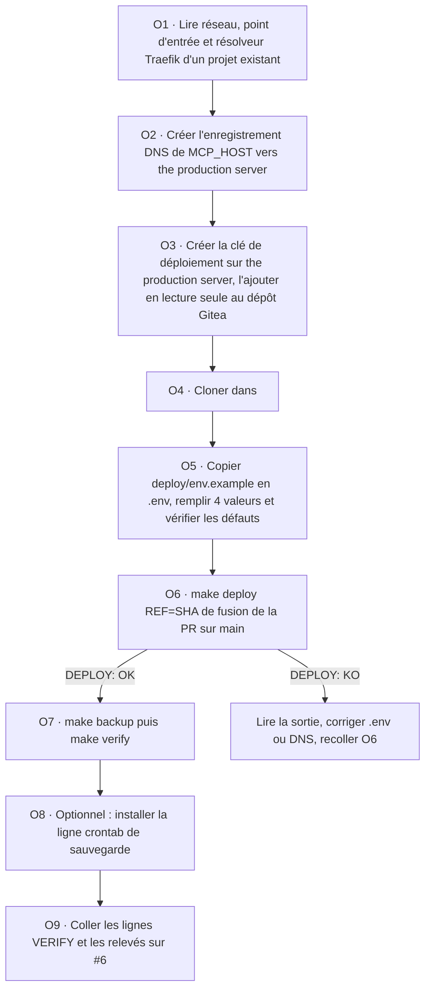

# F-004 · Foundation — image, quality gate, hosting and deployment on the production server

## Metadata

| Field | Value |
|-------|-------|
| **Priority** | P1 |
| **Branch** | `feat/HULL-6-fondation` |
| **Last updated** | 2026-10-28 |

## 1. Context & Objective

### Current State

The stack is decided: Python 3.13, `uv`, SDK `mcp==2.3.0` pinned (ADR-001, operator's decision of 2026-10-28). The repository contains only disposable POCs (`poc/go-gateway/`, `poc/py-gateway/`) and the isolation bench (`poc/isolation-bench/`). There is no v1 Python project, no quality gate (`quality-gate.*` and `test-categories` empty in `.cairn/project-context.yaml`), no image and no deployment: no construction feature (#7 to #13) can start on a tooled base. The session currently has no `uv`, no `make` and no `docker buildx` plugin (observed on 2026-10-28: `command -v` empty for the three).

### Objective

Deliver the usable skeleton of v1: a tooled Python project whose quality gate fits in one command, a single multi-architecture image that complies with the "Operations" section of the original specification (non-root, read-only except `/data`, configuration by environment variables, probes `/healthz` and `/readyz`), and a compose project ready to deploy on the production server behind Traefik with a Makefile (deployment, `VACUUM INTO` backup, restore check), together with the operator's copy-paste runbooks. The isolation bench becomes the non-regression guard of the `mcp` SDK version (condition 2 of ADR-001).

### Expected Impact

- Features #7 to #13 start on a green `make gate`, with no tooling decision to revisit.
- The first deployment on the production server is done through operator actions copied and pasted (estimate: 45 min, not measured), with no action from the session toward production.
- An `mcp` SDK version upgrade cannot pass the quality gate without a conclusive replay of the isolation bench.
- The size of the Python image, not measured by the POCs (ADR-001, "Neutral"), is measured and recorded.

### Open Product Questions

None open: the open points were settled by the recommended value (hypotheses H1 to H13 of §9, to be confirmed or corrected at the freeze).

Declaration term: F-004 coins none (the project has no domain glossary; "SDK guard" and "check value" are terms of the spec, not of the domain).

## 2. Scope

- **v1 Python project**: `hullgate` package in `src/` layout, described by `pyproject.toml`, committed `uv.lock` lock, SDK `mcp==2.3.0` declared as an exact dependency. Minimal application: two HTTP listeners (public and administration) serving the probes, a SQLite database opened under `/data`. No business function (tree, OAuth, relay: #7 and following).
- **Quality gate**: `make gate` = consistent lock, format, lint, strict typing, unit and integration tests, SDK version guard. Fills in `quality-gate.*`, `quality-gate.tools` and `test-categories`.
- **SDK non-regression guard**: mechanical check, in the gate, that the `mcp` version of the v1 lock is that of a recorded conclusive replay of the isolation bench; upgrade procedure documented.
- **Image**: a single multi-stage `Dockerfile`, building `linux/amd64` and `linux/arm64`, base pinned by digest, non-root, file system read-only except `/data`.
- **Hosting**: production compose project (`deploy/compose.prod.yaml`) behind the production server's existing Traefik, public MCP name in TLS by Traefik, separate administration port published on the production server's `127.0.0.1` only.
- **Deployment**: Makefile at the repository root, which also serves as the compose project in `<install-dir>` (clone of the repository): `deploy`, `backup`, `restore-check`, `status`, `logs`, `verify`.
- **Local evidence**: `make prod-smoke` plays the production composition in the session's dockerd with a local Traefik, without touching the production server.
- **Copy-paste operator runbooks**: installation on the production server, update, backup and restore check.

## Out of Scope

- **CI**: absent (`infra.ci: none`, ticket #6); the gate is run by the session. A Gitea Actions repository is a future feature if the operator asks for it.
- **Image registry**: the image is built on the production server from the clone (hypothesis H3); no publication on the Gitea registry or elsewhere.
- **Session action on the production server** during F-004 (BR-043); later deployments by the session under `access.production: autonomous`: decision to take after the acceptance of F-004 (backlog candidate).
- **Business functions**: tree, tokens, inbound OAuth, connections, relay, policy, web administration, audit (#7 to #13). In particular, no administration Traefik router and no public administration name: they arrive with the passkey (web administration, #11 or equivalent).
- **Application secrets** (per-organisation encryption key, `AUTHORIZE_SECRET`, signing keys): none in F-004; their way of being provided ("mounted secrets") is set by the core (#7).
- **Complete probes**: `/readyz` does not yet check "key loaded" (no key in F-004); the core adds it.
- **Off-site copy of the backups**, imposed scheduling (the runbook proposes a `crontab` line, the operator chooses), litestream (rejected, §9).
- **In-place restore on the production server**: procedure documented in the runbook, never played at acceptance (destructive); only the non-destructive restore check (`restore-check`) is played.
- **Load and memory footprint measurement** under traffic: outside the foundation (ADR-001, "Neutral"); only the image size is measured.
- **Test coverage threshold**, `pre-commit` framework, Renovate / automatic upgrades.
- **Docker log rotation** on the production server: configuration of the production server's daemon, operator action; structured logging: audit (#12).
- **External monitoring** of `/readyz` (availability probe, alert): audit, statistics and alerts (#12).
- **Trust in the `X-Forwarded-*` headers of the declared proxies**: core (#7), when a client address or a URL derived from the request becomes useful.
- **Turning the bench into a v1 target** (adapter `adapter_gateway.py` pointed at the v1 application): it presupposes OAuth and roles, hence the core (#7).

## 3. Functional Spec

### 3.1 Project and development commands (SCR-01)

Tree added at the root:

| Path | Role |
|--------|------|
| `pyproject.toml`, `uv.lock`, `.python-version` | `hullgate` project, Python 3.13, pinned dependencies |
| `src/hullgate/` | application: configuration, two listeners, probes, SQLite database, backup |
| `tests/unit/`, `tests/integration/`, `tests/container/` | three test categories |
| `Dockerfile` | single image (stages `build` and `runtime`) |
| `compose.yaml` | development composition (session) |
| `deploy/compose.prod.yaml`, `deploy/env.example`, `deploy/smoke/` | production deployment and its local evidence |
| `Makefile` | development, gate and operations targets |
| `scripts/sdk_guard.py` | SDK version guard (BR-037) |
| `docs/runbooks/fondation-*.md` | operator runbooks (BR-042) |

Makefile targets (the list is part of the deliverable; each target prints what it does):

| Target | Where | Effect |
|-------|----|-------|
| `make gate` | session | full quality gate (BR-035) |
| `make fmt` | session | format and lint fix (`ruff format`, `ruff check --fix`) |
| `make test` | session | unit and integration tests |
| `make test-container` | session | tests of the built image (BR-029 to BR-034, BR-039) |
| `make image` / `make image-multiarch` | session | local image / evidence of both architectures (BR-028) |
| `make prod-smoke` | session | production composition + local Traefik (BR-041) |
| `make bench-sdk` | session | replay of the isolation bench for an SDK upgrade (BR-037) |
| `make deploy REF=<ref>` | the production server | backup, build, start, wait for `/readyz` (BR-040) |
| `make backup` | the production server | consistent hot backup (BR-038) |
| `make restore-check [FILE=…]` | the production server or session | non-destructive check of a backup (BR-039) |
| `make verify` | the production server | acceptance checks readable by the operator (§5, AC-OP) |
| `make status`, `make logs` | the production server | state and logs of the service |

### 3.2 Minimal application (SCR-02)

- **Public listener** (`PUBLIC_PORT`, 4790 by default, original specification): `GET /healthz`, `GET /readyz`; any other path, `/admin` included, answers 404.
- **Administration listener** (`ADMIN_PORT`, 4791 by default): `GET /healthz`; any other path 404 in F-004.
- **Database**: SQLite file `${DATA_DIR}/hullgate.db` (`DATA_DIR=/data`), WAL mode, opened at startup.
- **Configuration**: environment variables `PUBLIC_URL`, `ADMIN_URL`, `PUBLIC_PORT`, `ADMIN_PORT`, `DATA_DIR` (BR-032).

#### Visual States

No interface: probe states only.

- **SCR-02.ready**: `/healthz` 200, `/readyz` 200.
- **SCR-02.db-unavailable**: `/healthz` 200, `/readyz` 503 (database not opened or not writable).
- **SCR-02.misconfigured**: the process does not start, exit code ≠ 0, message naming the variable.

### 3.3 Operations on the production server (SCR-03)

`<install-dir>` is a clone of the repository (read-only through a deploy key, H4); `.env` (not versioned, copied from `deploy/env.example`) carries `MCP_HOST`, `TRAEFIK_NETWORK`, `TRAEFIK_ENTRYPOINT`, `TRAEFIK_CERTRESOLVER`, `TRAEFIK_HTTPS_PORT` (443 by default), `ADMIN_LOCAL_PORT`. The database lives in the named volume `hullgate_data`; the backups in `<install-dir>/backups/` (not versioned). `.deployed-ref` keeps the deployed reference and the previous one.

### 3.4 Operator runbooks (SCR-04)

Three files, each step = one block to paste, the expected result, what to do if it differs (form of the F-002 runbooks):

- `docs/guides/install.md` — operator steps O1 to O9 (§6.1).
- `docs/guides/update.md` — `make deploy REF=<nouvelle>`, reading of the result, rollback `make deploy REF=<précédente>`.
- `docs/guides/backup-restore.md` — manual backup, proposed `crontab` line, `restore-check`, in-place restore (documented, destructive, never played at acceptance).

## 4. Business Rules

### Naming Convention

`BR-NNN`, global: `conventions/br-identifiers.md`. Allocation: highest BR identifier BR-027 (`business-rules/index.md`, 26 rows, `ls business-rules/BR-*.md` matching; no unclosed spec); F-004 allocates BR-028 to BR-043.

**Overlap (§Overlap)**: filter on the Statement column of the index (26 rows) with the terms "image", "secret", "sauvegarde", "déploi", "runbook", "version", "banc", "reproductible", "opérateur", "production": **5 rows retenues out of 26**. BR-003 (no secret in the evidence) — hors sujet: concerns the bench's artefacts; F-004 introduces no application secret. BR-005 (bench reproducible in one command, pinned versions) — overlap — **new rule (C1)**: BR-029 concerns the v1 image, violable independently of the bench. BR-010 (disposable test secrets) — hors sujet. BR-020 (copy-paste Claude.ai / iOS runbooks) — overlap — **new rule (C1)**: BR-042 concerns the production server's operation paths; one can be missing without the other. BR-021 (disk footprint of the bench) — hors sujet (bench only; F-004's disk risk in §12).

### BR-028 · A single image for amd64 and arm64

> **Extracted on 2026-10-28.** Current version: [`business-rules/BR-028.md`](../business-rules/BR-028.md).
> The content below reflects the state of this BR at the time of feature F-004 (v1).

*`behavioral` · `blocking` · Candidate state: `verified` — `make image-multiarch`: two builds `docker buildx build --platform linux/amd64 --load` and `--platform linux/arm64 --load` of the same `Dockerfile` exit with 0 (or one multi-platform build if the session's buildx driver allows it); `tests/container/test_br_028_platforms.py` reads `Architecture` = `amd64` and `arm64` in `docker image inspect` of both images.*

**Rule** — A single `Dockerfile` produces the gateway image for `linux/amd64` and `linux/arm64`, with no architecture-specific step or file; a build failure of either turns `make image-multiarch` red and blocks the PR.

**Clarifications**
- On the production server, the image is built for the host's architecture (H3). The multi-architecture evidence is produced in the session **without emulation**: the `build` stage runs on `$BUILDPLATFORM` and installs the wheels of `$TARGETARCH` (`uv sync --locked --no-dev --python-platform`), the `runtime` stage contains no `RUN` instruction. *Correction at implementation*: the session is amd64 and has no emulation registered in `binfmt_misc` (finding of 2026-10-28, `ls /proc/sys/fs/binfmt_misc`: `register`, `status`); the arm64 image is built and inspected (architecture, aarch64 native extensions), not executed.
- The size of the `linux/amd64` and `linux/arm64` image is recorded in the PR (reading, no threshold): 159,280,670 and 183,398,062 bytes (`docker image inspect`, buildx v0.38.1, commit `f89e9ce`).

### BR-029 · Reproducible image: pinned base, dependencies from the lock only

> **Extracted on 2026-10-28.** Current version: [`business-rules/BR-029.md`](../business-rules/BR-029.md).
> The content below reflects the state of this BR at the time of feature F-004 (v1).

*`behavioral` · `blocking` · Candidate state: `verified` — `tests/container/test_br_029_reproducible.py`: every `FROM` of the `Dockerfile` carries `@sha256:`; the build calls `uv sync --locked --no-dev`; `uv` is absent from the `runtime` image (`docker run --entrypoint sh … -c 'command -v uv'` exits ≠ 0).*

**Rule** — The image is built from base images pinned by multi-architecture index digest and installs only the dependencies frozen by `uv.lock` (`uv sync --locked`); the build tool `uv` does not remain in the runtime image. A `FROM` without a digest or an out-of-sync lock makes the build or the test fail.

### BR-030 · The container never runs as root

> **Extracted on 2026-10-28.** Current version: [`business-rules/BR-030.md`](../business-rules/BR-030.md).
> The content below reflects the state of this BR at the time of feature F-004 (v1).

*`behavioral` · `strict` · Candidate state: `verified` — `tests/container/test_br_030_non_root.py`: numeric `USER` ≠ 0 in the image (`docker image inspect`), `id -u` in the container ≠ 0; `deploy/compose.prod.yaml` does not override `user`.*

**Rule** — The image declares a numeric non-root user (UID and GID 10001) and the gateway process runs under that user, in development as on the production server; a process running as root makes the test fail and blocks the PR.

### BR-031 · Read-only file system except /data

> **Extracted on 2026-10-28.** Current version: [`business-rules/BR-031.md`](../business-rules/BR-031.md).
> The content below reflects the state of this BR at the time of feature F-004 (v1).

*`behavioral` · `strict` · Candidate state: `verified` — `tests/container/test_br_031_read_only.py`: container launched `--read-only` with a volume on `/data`: `/readyz` 200; a write under `/app`, `/` or `/home` fails (EROFS); a write under `/data` succeeds; `deploy/compose.prod.yaml` carries `read_only: true`.*

**Rule** — The gateway works with a read-only root file system; `/data` is its only persistent write location. A component that requires another write location makes the test fail.

**Clarifications**
- A `tmpfs` on `/tmp` (non-persistent, bounded size) is allowed only if a dependency requires it; it is then declared in `compose.prod.yaml` and named in the PR's gaps. Recommended value: none (`PYTHONDONTWRITEBYTECODE=1`).

### BR-032 · Configuration by environment variables, refusal at startup

> **Extracted on 2026-10-28.** Current version: [`business-rules/BR-032.md`](../business-rules/BR-032.md).
> The content below reflects the state of this BR at the time of feature F-004 (v1).

*`behavioral` · `blocking` · Candidate state: `verified` — `tests/unit/test_br_032_config.py`: missing or invalid required variable (non-absolute URL, port outside 1–65535, equal public and admin ports) → exception naming the variable; `tests/container/test_br_032_startup.py`: container without `PUBLIC_URL` exits ≠ 0 in < 10 s, error output naming `PUBLIC_URL`.*

**Rule** — All of the gateway's configuration comes from environment variables (`PUBLIC_URL`, `ADMIN_URL`, `PUBLIC_PORT`, `ADMIN_PORT`, `DATA_DIR`); a required variable that is absent or invalid prevents startup, with an exit code ≠ 0 and a message that names the variable.

**Clarifications**
- `PUBLIC_PORT` (4790) and `ADMIN_PORT` (4791) have default values; `PUBLIC_URL` and `ADMIN_URL` do not. `DATA_DIR` defaults to `/data`.
- No configuration file is read; no secret in F-004.

### BR-033 · /healthz and /readyz probes without authentication

> **Extracted on 2026-10-28.** Current version: [`business-rules/BR-033.md`](../business-rules/BR-033.md).
> The content below reflects the state of this BR at the time of feature F-004 (v1).

*`behavioral` · `blocking` · Candidate state: `verified` — `tests/integration/test_br_033_probes.py`: `/healthz` 200; `/readyz` 200 with the database open and writable, 503 with the database absent, read-only or write-locked; no authentication header required.*

**Rule** — The public listener serves `GET /healthz` (200 as long as the process responds) and `GET /readyz` (200 if the database in `DATA_DIR` is open and accepts a write lock, 503 otherwise), without authentication; the admin listener serves `GET /healthz`. A gap fails the integration test.

**Clarifications**
- Writability is checked without writing: `BEGIN IMMEDIATE` then `ROLLBACK`, wait timeout bounded to 1 s. In WAL mode the write lock lives in `-shm` and is obtained even on a read-only file: the right to write the file is checked separately (`os.access`, reason `db_read_only`); a file deleted after opening gives `db_unavailable`.
- Response bodies: JSON `{"status": "ok"}` or `{"status": "unavailable", "reason": "<code>"}`; no file path or exception message in the body.
- The core (#7) adds "key loaded" to `/readyz` (§Out of Scope).
- Database missing at startup: created empty; opening impossible: the process starts anyway, `/healthz` 200 and `/readyz` 503 (SCR-02.db-unavailable).

### BR-034 · Administration has its own port, never behind Traefik in F-004

> **Extracted on 2026-10-28.** Current version: [`business-rules/BR-034.md`](../business-rules/BR-034.md).
> The content below reflects the state of this BR at the time of feature F-004 (v1).

*`behavioral` · `strict` · Candidate state: `verified` — `tests/integration/test_br_034_admin_port.py`: `/admin` and `/admin/…` answer 404 on the public listener; `make prod-smoke`: through Traefik, no router leads to `ADMIN_PORT` (the admin listener's `/healthz` unreachable by the public name); `deploy/compose.prod.yaml` publishes `ADMIN_PORT` on `127.0.0.1` only and carries no Traefik label that targets it.*

**Rule** — Administration listens on a port distinct from the public listener; in F-004, this port is published only on the production server's local interface (`127.0.0.1`) and no Traefik router serves it.

**Clarifications**
- The public administration name and its router arrive with passkey authentication (original specification: "exposed on the Internet, it requires a passkey"); `ADMIN_URL` is already a variable so that this change touches only the configuration.
- Operator access: SSH tunnel to `127.0.0.1:${ADMIN_LOCAL_PORT}` (runbook).

### BR-035 · The quality gate fits in one command

> **Extracted on 2026-10-28.** Current version: [`business-rules/BR-035.md`](../business-rules/BR-035.md).
> The content below reflects the state of this BR at the time of feature F-004 (v1).

*`behavioral` · `blocking` · Candidate state: `verified` — `make gate` runs in order `uv lock --check`, `ruff format --check`, `ruff check`, `mypy --strict`, `pytest tests/unit tests/integration`, `python scripts/sdk_guard.py`; each step prints the tool and its version; the output ends on `GATE: OK` or `GATE: KO <étape>`; exit code ≠ 0 as soon as a step fails. Check: `tests/unit/test_br_035_gate.py` reads the `gate` recipe of the Makefile and verifies the list and order of the six steps.*

**Rule** — The v1 quality gate is the single command `make gate`; it fails as soon as the lock is out of sync, the format or lint reports a gap, strict typing finds an error, a unit or integration test fails, or the SDK guard refuses.

**Clarifications**
- Tests of the `container` category (Docker required, several minutes) are not in `make gate`; they are required before a PR when the diff touches `Dockerfile`, `compose*.yaml`, `deploy/` or `Makefile` (`make test-container`), and reported in the PR.
- The target starts with `uv sync --locked` (network on first run only). The exact options (`uv lock --check` or its equivalent) are those of the pinned `uv` version, verified at implementation.
- The runbook check (BR-042) is a unit test: it goes through the pytest step.
- `uv lock --check` exists in `uv` 0.13.6 (`uv lock --help`). No unit test replays the guard on the repository itself: a loosened constraint exits with `GATE: KO sdk-guard`, not `GATE: KO tests` (AC-02).

### BR-036 · The mcp SDK version is pinned

> **Extracted on 2026-10-28.** Current version: [`business-rules/BR-036.md`](../business-rules/BR-036.md).
> The content below reflects the state of this BR at the time of feature F-004 (v1).

*`behavioral` · `strict` · Candidate state: `verified` — `scripts/sdk_guard.py`, "pin" step: the `mcp` dependency of `pyproject.toml` is written `mcp==X.Y.Z` (no range, no version extra) and `uv.lock` resolves `mcp` to `X.Y.Z`; otherwise exit ≠ 0 naming the gap.*

**Rule** — `pyproject.toml` declares the `mcp` SDK by an exact equality and `uv.lock` resolves it to that same version (condition 1 of ADR-001); any other form fails the gate.

### BR-037 · An mcp SDK version only enters replayed by the isolation bench

> **Extracted on 2026-10-28.** Current version: [`business-rules/BR-037.md`](../business-rules/BR-037.md).
> The content below reflects the state of this BR at the time of feature F-004 (v1).

*`behavioral` · `strict` · Candidate state: `verified` — `scripts/sdk_guard.py`, "bench" step: reads `module_versions.mcp` and `module_versions.mcp-types` of `poc/isolation-bench/evidence/results-py-gateway.json` and requires that they equal the versions of `mcp` and `mcp-types` in `uv.lock` (root) **and** in `poc/py-gateway/uv.lock`, that the SHA-256 fingerprint of `poc/py-gateway/uv.lock` equal `config_sha256_start["../py-gateway/uv.lock"]` of the evidence, that `dev_mode` and `partial_run` be false, that the 16 tests T01..T16 be present and that the eleven isolation rows (T02 to T09, T12, T13, T14) be passed; otherwise exit ≠ 0 naming the missed condition. `tests/unit/test_br_037_sdk_guard.py` plays each condition on fabricated files.*

**Rule** — The gate refuses an `mcp` SDK version (packages `mcp` and `mcp-types`) that is not that of a conclusive replay of the isolation bench recorded in the repository (condition 2 of ADR-001).

**Clarifications**
- Upgrade procedure (README and `make bench-sdk`): change the version in the `pyproject.toml` of v1 **and** of `poc/py-gateway/`, `uv lock` in both, `./bench.sh --target py-gateway` (conclusive, not `--dev`), commit the evidence, PR. As long as the core (#7) has not made v1 a bench target, the `py-gateway` target (POC built on the new version) is the witness; the core replaces the target read by the guard.
- The checks outside the acceptance run (N3 and nominal `/revoke` harnesses, T10) are replayed at each upgrade and cited in the PR (reading in review); the guard reads only `results-py-gateway.json`.
- Current state: the POC's `uv.lock` and the evidence say `mcp` and `mcp-types` 2.3.0 (`bench_commit` `a8faea7`); v1 is born compliant.
- Consequence: `poc/py-gateway/` and `poc/isolation-bench/` stop being disposable; they are kept and maintained as a witness until the core makes v1 the bench target. Deleting them fails the guard.

### BR-038 · Consistent hot backup, verified, without losing the previous ones

> **Extracted on 2026-10-28.** Current version: [`business-rules/BR-038.md`](../business-rules/BR-038.md).
> The content below reflects the state of this BR at the time of feature F-004 (v1).

*`behavioral` · `blocking` · Candidate state: `verified` — `tests/container/test_br_038_backup.py`: service started, concurrent writes in progress, `make backup` produces `backups/hullgate-<horodatage UTC>.db` whose `PRAGMA integrity_check` is `ok` and which contains the rows written before the backup started; the 15th backup deletes the oldest; a backup forced to fail exits ≠ 0 without deleting any existing backup.*

**Rule** — `make backup` copies the live database with `VACUUM INTO`, without stopping, checks the copy's integrity (`PRAGMA integrity_check` = `ok`) before storing it in `backups/`, keeps the 14 most recent; a failure at any step exits ≠ 0, leaves the existing backups intact and stores no partial file.

**Clarifications**
- Database missing (first deployment): `make backup` prints it and exits 0 without a file.
- Service stopped: the copy is made in a disposable container of the same image mounted on `hullgate_data` (no writer), same check.
- Exclusion: `deploy`, `backup` and `restore-check` take an exclusive lock (`flock backups/.lock`); a second command during the first exits ≠ 0 with a message, doing nothing (case of a scheduled backup during a deployment).
- Backups stay on the production server; their off-site copy is out of scope.
- The copy is made by `docker exec` in the service (or the disposable container) to `/data/.backup/`, then `docker cp` to `backups/<nom>.partial`, renamed after the copy is complete; `PRAGMA temp_store=MEMORY` (no temporary file outside `/data`).

### BR-039 · A backup is checked by restoring it, without touching production

> **Extracted on 2026-10-28.** Current version: [`business-rules/BR-039.md`](../business-rules/BR-039.md).
> The content below reflects the state of this BR at the time of feature F-004 (v1).

*`behavioral` · `blocking` · Candidate state: `verified` — `tests/container/test_br_039_restore_check.py`: `make restore-check FILE=<sauvegarde>` restores into a disposable volume, starts a disposable read-only container of the same image, gets `/readyz` 200 and the same number of rows per table as the backup, destroys volume and container, and touches neither `hullgate_data` nor the running service; a corrupted file exits ≠ 0.*

**Rule** — `make restore-check` proves that a backup (the most recent by default) restarts the gateway, in a disposable volume and container, without stopping or modifying the service and its database; a failing check exits ≠ 0 naming the step.

**Clarifications**
- The backup enters through the standard input of a disposable container (`python -m hullgate.backup restore -`), checked under a working name before being put in place: no host mount.

### BR-040 · Deployment on the production server is one command, and it stops with a readable failure

> **Extracted on 2026-10-28.** Current version: [`business-rules/BR-040.md`](../business-rules/BR-040.md).
> The content below reflects the state of this BR at the time of feature F-004 (v1).

*`behavioral` · `blocking` · Candidate state: `verified` — `make prod-smoke` plays `make deploy REF=<sha local>` against the local production composition: prior backup (if a database exists), build, start, wait for `/readyz` ≤ 60 s, line `DEPLOY: OK <ref>` and `.deployed-ref` updated; with an image whose `/readyz` stays 503, `DEPLOY: KO <ref>`, code ≠ 0, `.deployed-ref` unchanged and the return command (`make deploy REF=<précédente>`) printed.*

**Rule** — `make deploy REF=<ref>` chains backup (if a database exists), extraction of `REF` in the clone, image build, container replacement and waiting for `/readyz`; it writes `.deployed-ref` only after `/readyz` 200, and on failure it exits ≠ 0 printing the command to return to the previous reference, with no automatic rollback.

**Clarifications**
- `REF` is a tag, a remote branch or a SHA; a modified working tree in the clone makes the deployment refused (code ≠ 0, no action).
- A failing prior backup stops the deployment before the build (code ≠ 0, service unchanged).
- First deployment (`.deployed-ref` absent): on failure, the output says `Rollback: no previous ref (first deployment)` instead of a return command.
- The output prints `DOWNTIME <s>`, measured from the old container's stop to the new one's first `/readyz` 200.
- The service interruption during the container replacement is accepted (a single container, SQLite database); its duration is recorded at the acceptance (reading).
- "`/readyz` 200" is understood as seen by the container's healthcheck (state `healthy`, probe `/readyz`, `start_interval` 1 s) **and** by a direct probe: Traefik routes a container that has a healthcheck only once it is healthy, so `DEPLOY: OK` means routable; `DOWNTIME` runs from the start of `docker compose up -d` (stop of the old container) to that state. Docker ≥ 25 on the production server (runbook O1).
- `REF` is resolved first as `origin/REF`, then as is. In `make prod-smoke`, the image whose `/readyz` stays 503 comes from a disposable commit of the proof clone, and the wait is reduced to 20 s (`DEPLOY_READY_TIMEOUT`).

### BR-041 · Only the public listener is routed by Traefik, in TLS, under a dedicated name

> **Extracted on 2026-10-28.** Current version: [`business-rules/BR-041.md`](../business-rules/BR-041.md).
> The content below reflects the state of this BR at the time of feature F-004 (v1).

*`behavioral` · `strict` · Candidate state: `verified` — `make prod-smoke`: local Traefik (pinned image) and unchanged `deploy/compose.prod.yaml`, test `.env`: a `Host: ${MCP_HOST}` request on Traefik's entry point reaches `/healthz` 200; the declared router carries `tls.certresolver=${TRAEFIK_CERTRESOLVER}` and `entrypoints=${TRAEFIK_ENTRYPOINT}`; no public host port is published for `PUBLIC_PORT` (`docker compose config`: no `ports` for it).*

**Rule** — On the production server, the gateway is reachable from outside only through the existing Traefik, on the name `MCP_HOST` in TLS, toward its public listener; the container joins Traefik's network and publishes no public port on the host. A gap fails `make prod-smoke`.

**Clarifications**
- The names and values specific to the production server (`MCP_HOST`, network, entry point, certificate resolver) come from `.env`, read by the operator from their configuration (runbook O1); none is written in the repository.
- `make verify` reaches Traefik with `curl --connect-to ${MCP_HOST}:443:127.0.0.1:${TRAEFIK_HTTPS_PORT} https://${MCP_HOST}/…`: name, SNI and `Host` header without a port. With a port other than 443, the `--resolve` form initially written in AC-OP sends `Host: ${MCP_HOST}:<port>`, which the `Host()` rule does not route (404 measured in `make prod-smoke`); with 443 the two forms are equivalent.
- `X-Forwarded-*` headers: F-004 does not trust them (uvicorn's default setting, which accepts them only from `127.0.0.1`); no URL is deduced from a request, `PUBLIC_URL` and `ADMIN_URL` come from the configuration (BR-032). Trusting only declared proxies arrives with the core (§Out of Scope).

### BR-042 · Every operator action on the production server is a copy-paste runbook

> **Extracted on 2026-10-28.** Current version: [`business-rules/BR-042.md`](../business-rules/BR-042.md).
> The content below reflects the state of this BR at the time of feature F-004 (v1).

*`behavioral` · `blocking` · Candidate state: `verified` — `tests/unit/test_br_042_runbooks.py` (pytest step of `make gate`): the three files `docs/guides/install.md`, `docs/guides/update.md` and `docs/guides/backup-restore.md` exist; each step has a code block, an "Expected result" line and an "If the result differs" line; the installation covers O1 to O9 of §6.1. The correctness of the commands is read in review and at acceptance (AC-OP).*

**Rule** — Every action on the production server that F-004 assumes (reading the Traefik configuration, DNS, deploy key, clone, `.env`, deployment, verification, backup, scheduling, update, restore) is delivered in a runbook where each step is a block to paste, its expected result and what to do if it differs; an incomplete step fails the test.

**Clarifications**
- Each step also carries a "To report on #6" line (operator instruction, checked by the test).

### BR-043 · The session does not act on the production server during F-004

> **Extracted on 2026-10-28.** Current version: [`business-rules/BR-043.md`](../business-rules/BR-043.md).
> The content below reflects the state of this BR at the time of feature F-004 (v1).

*`behavioral` · `strict` · Candidate state: `not-mechanisable` — read in review: no `ssh … prod-gateway`, `rsync`, `scp` command and no network call toward `server.example.test` in the reports of the implementation, review and findings-application acts; the deployment evidence comes from `make prod-smoke` (session) and from the operator's report (AC-OP).*

**Rule** — During F-004, no session act (implementation, review, applying findings, acceptance) performs an action toward the `prod-gateway` server, reading included, despite `access.production: autonomous`; the first deployment and its verification are the operator's gestures. An act that targeted `prod-gateway` is a blocking review finding.

**Clarifications**
- Reason: first deployment of an empty database, Traefik and DNS values specific to the operator, deploy key created on the production server; operator preference for copy-paste runbooks. The question of a deployment by the session for the following features is out of scope.

## 5. Acceptance Criteria

### Build and quality gate (session)

- [x] **AC-01** (BR-035, BR-036, BR-037) — `make gate` on the branch: last line `GATE: OK`, code 0; output pasted in the PR with the printed tool versions.
- [x] **AC-02** (BR-036) — `pyproject.toml` modified to `mcp>=2.3.0` on a disposable copy: `make gate` → `GATE: KO sdk-guard`, code ≠ 0 (reported in the PR, copy not committed).
- [x] **AC-03** (BR-037) — `tests/unit/test_br_037_sdk_guard.py` green, with one case per condition (different `mcp` or `mcp-types` versions, different POC lock fingerprint, `dev_mode` true, `partial_run` true, 15 tests, one failed isolation row).
- [x] **AC-04** (BR-028) — `make image-multiarch` code 0; `linux/amd64` and `linux/arm64` sizes recorded in the PR (reading).
- [x] **AC-05** (BR-029 to BR-034, BR-038, BR-039) — `make test-container`: `pytest` summary line with no failure and no skipped test, pasted in the PR.
- [x] **AC-06** (BR-040, BR-041, BR-034) — `make prod-smoke`: lines `DEPLOY: OK <sha>`, `SMOKE traefik-route OK`, `SMOKE admin-not-routed OK`, `SMOKE deploy-ko-readable OK`, then `SMOKE: 4/4 OK`; pasted in the PR.
- [x] **AC-07** (BR-042) — `tests/unit/test_br_042_runbooks.py` green (in `make gate`); the three runbooks reread in review.
- [x] **AC-08** (cairn configuration) — `.cairn/project-context.yaml`: `quality-gate.full: "make gate"`, `static-analysis`, `code-style`, `code-style-fix`, `test` filled in according to §9, `quality-gate.tools` (make, uv, docker, docker buildx with their version command), `test-categories` (unit, integration, container); `cairn check` without `fail`.
- [ ] **AC-09** (BR-043) — read in review: no act targeted `prod-gateway` (act reports).

### On the production server (operator, after merge)

- [ ] **AC-OP** (BR-040, BR-041, BR-034, BR-038, BR-039, BR-042) — the operator plays `install.md` from O1 to O9. **Bounded instrument**: `make verify` on the production server, which plays only the F-004 checks and prints one line per check of the form `VERIFY <id> OK|KO <valeur>` then the banner `VERIFY: n/6 OK`. The six checks: `deployed-ref` (reference read from `.deployed-ref`), `readyz-public` (`https://${MCP_HOST}/readyz` 200 through Traefik, reached from the production server by `curl --connect-to ${MCP_HOST}:443:127.0.0.1:${TRAEFIK_HTTPS_PORT}` — equivalent to `curl --resolve ${MCP_HOST}:443:127.0.0.1` when `TRAEFIK_HTTPS_PORT` is 443, see BR-041 —, without depending on DNS or NAT return), `admin-local` (`http://127.0.0.1:${ADMIN_LOCAL_PORT}/healthz` 200), `admin-not-public` (`https://${MCP_HOST}/admin` 404, counted only if `readyz-public` is OK: without a router, Traefik also answers 404), `backup` (file produced by `make backup`, integrity `ok`), `restore-check` (code 0). **Readings to record, without threshold**: duration of `make deploy` (s), `DOWNTIME` read from its output, response of `curl -s https://<MCP_HOST>/readyz` from the operator's Mac (DNS and TLS end to end), image size on the production server (`docker image ls` of `hullgate`), the production server's architecture (`uname -m`). **To paste on #6**: the 7 lines from the first `VERIFY ` line to the banner, and the five readings; the name `MCP_HOST` is reread from the output of `make verify`, never imposed by the runbook. A banner `VERIFY: 6/6 OK` means the criterion is met; any other banner points back to the runbook step named in the `KO` line.

## 6. Diagrams

### Selection Matrix

| Type | Included | Reason |
|------|--------|--------|
| Userflow | yes | operator's path for the installation (6.1) |
| Sequence | yes | `make deploy` goes through Makefile, git, Docker, container and Traefik (6.2) |
| State machine | no | no component with explicit states outside the probes (SCR-02 states listed in §3.2) |
| ER / Class | no | no business table; the database carries no schema in F-004 |

### 6.1 Userflow — installation on the production server (runbook O1 to O9)



### 6.2 Sequence — `make deploy REF=<ref>`

```mermaid
sequenceDiagram
  participant Op as Opérateur
  participant Mk as Makefile
  participant G as git (clone)
  participant D as docker compose
  participant C as conteneur hullgate
  participant T as Traefik
  Op->>Mk: make deploy REF=<sha de main>
  Mk->>G: arbre propre ? fetch, checkout REF
  Mk->>D: base présente ? make backup (VACUUM INTO, integrity_check)
  Mk->>D: build (Dockerfile, uv.lock)
  Mk->>D: up -d (remplacement du conteneur)
  loop ≤ 60 s
    Mk->>C: GET /readyz (réseau local)
  end
  alt 200
    Mk->>Mk: écrire .deployed-ref ; DEPLOY: OK
    T->>C: trafic Host MCP_HOST → PUBLIC_PORT
  else 503 / délai
    Mk-->>Op: DEPLOY: KO, commande de retour REF précédente, code ≠ 0
  end
```

## 7. States & Captures

- **Package-status**: absent — foundation without interface (`drivers.design.type: none`).

## 8. Design & Prototypes

Not applicable: no visual element.

## 9. Implementation Notes

### Dependencies (prerequisite features)

- ADR-001 — Python stack (accepted, 2026-10-28): upstream, done.
- F-003 / HULL-16 — Python POC (implemented): `poc/py-gateway/uv.lock` and `evidence/results-py-gateway.json` are read by the guard (BR-037).
- **Missing session tools**: `uv`, `make`, `docker buildx` plugin (observed on 2026-10-28). The implementation act applies `ai-vademecum/missing-tool-handshake.md` first (installation if there is a path to root, otherwise a command for the operator); this is a planned dependency, not a freeze blocker.
- Downstream: #7 (core) replaces the target read by `sdk_guard.py` and adds "key loaded" to `/readyz`; #8 to #13 inherit the gate.

### Technical Constraints

- Stack: ADR-001. Python 3.13 (as the POC; 3.14 not retained so as not to change the interpreter judged by the bench).
- Shared VM disk: 22 GB free (89% used, observed on 2026-10-28); clean the multi-architecture build images after the evidence (`make clean-images`).
- Session writes outside `.cairn/`: on the branch `feat/HULL-6-fondation`, PR `Refs #6`, never a closing keyword.

### Selected tooling (2026, versions read on PyPI on 2026-10-28)

| Need | Tool | Version | Rationale |
|--------|-------|---------|---------------|
| Project, lock, environments | `uv` | 0.13.6 (stable) | already used and pinned by the POC; `pyproject.toml` + multi-platform `uv.lock` project; `uv sync --locked` in the image; `required-version` pinned in `[tool.uv]` |
| Format and lint | `ruff` | 0.17.3 (stable) | a single tool replaces black, isort, flake8 and pyupgrade; default of the Astral ecosystem, same publisher as `uv` |
| Typing | `mypy --strict` | 2.4.0 (stable) | stable reference checker; `ty` (Astral) is still in beta (0.0.93): ruled out for a blocking gate, to be reassessed at its first stable version; `pyright` would require Node in the session image |
| Tests | `pytest` | 9.2.0 (mature) | standard; asynchronous tests through the `anyio` plugin already pulled in by Starlette, no extra `pytest-asyncio` |
| HTTP tests | `httpx` / `starlette.testclient` | from the lock | same stack as the application |
| Server | `uvicorn` + Starlette | from the lock (POC versions) | those of the `mcp` SDK; two `uvicorn.Server` in one loop for the two listeners |
| Image | `docker buildx` + `qemu` | from the workstation | multi-architecture from a single `Dockerfile` |

`quality-gate` values to write (AC-08): `full: "make gate"`, `static-analysis: "make typecheck"`, `code-style: "make lint"`, `code-style-fix: "make fmt"`, `test: "make test"`; `test-categories`: `unit` (pytest, `tests/unit/**`, `test_br_NNN_*`), `integration` (pytest + ASGI client, `tests/integration/**`), `container` (pytest + Docker, `tests/container/**`).

### Architecture Decisions

| Question | Decision | Rationale |
|----------|----------|-----------|
| Splitting of the ticket (readiness verdict, "one feature" check) | one spec for build, gate, hosting and deployment | four parts, but the operator's brief commands one F-004 spec for #6; they hold together: deployment requires the image, the gate verifies the image and the composition |
| Backup | `VACUUM INTO` by `make backup` | zero dependency, consistent when hot, already the form foreseen by the specification; litestream rejected in v1: one more process or sidecar and an S3 target to provide |
| Administration exposure | separate port, the production server's `127.0.0.1`, no Traefik router | no administration function nor passkey in F-004; the ticket says "domain **or** port" |
| SDK non-regression guard | consistency check lock ↔ conclusive evidence in the gate; replay of the bench at upgrade (`make bench-sdk`) | the full bench takes several minutes and ~1 GB: outside the routine gate; the guard makes an upgrade impossible without it |
| Who deploys | the operator, by runbook (BR-043) | operator's brief, copy-paste preference; `access.production: autonomous` not used in F-004 |
| Production image build | on the production server, from the clone | no registry to operate; the production server has 8 CPUs and 193 GB free |

### Settled hypotheses (recommended value, to be confirmed at the freeze)

- **H1** — Python 3.13, as the POC (ADR-001).
- **H2** — Ports: public 4790 (original specification), administration 4791; `ADMIN_LOCAL_PORT` on the production server: 14791.
- **H3** — No registry: image built on the production server for its architecture; multi-architecture evidence in the session.
- **H4** — The production server's clone reads the repository through a **read-only deploy key** created on the production server by the operator (the private key does not leave the production server); Gitea's SSH address and port read by the operator on the repository's "SSH" button.
- **H5** — A dedicated DNS name `MCP_HOST` chosen by the operator (for example a subdomain), certificate by the ACME resolver already configured in Traefik.
- **H6** — The Traefik values (network, HTTPS entry point, resolver) are read on an existing compose project of `<compose-root>` (runbook O1).
- **H7** — The operator has on the production server an account member of the `docker` group and `make`, `git`, `curl` installed (runbook O1 verifies it).
- **H8** — Database in the named volume `hullgate_data` (UID 10001 ownership inherited from the image), backups on the host in `<install-dir>/backups/`, 14 kept.
- **H9** — No imposed scheduling; the runbook proposes `15 3 * * * cd <install-dir> && make backup >> backups/backup.log 2>&1`.
- **H10** — No automatic rollback: the return command is printed (BR-040).
- **H11** — Typing: `mypy --strict` (not `ty`, beta).
- **H12** — `container` tests outside `make gate`, required when the diff touches the image or the composition (BR-035).
- **H13** — The SDK guard covers `mcp` and `mcp-types` only (ADR-001); the other packages that carry isolation (PyJWT, Starlette, Authlib) are upgraded without an imposed replay (risk §12).

### Data Model Impact

- Migration: no. File `hullgate.db` created empty in WAL mode; no business schema.

### Components to Create / Modify

**Created**
- `pyproject.toml`, `uv.lock`, `.python-version`, `src/hullgate/{__init__,__main__,config,app,db,backup}.py`
- `tests/unit/`, `tests/integration/`, `tests/container/` (one file per tested BR, `test_br_NNN_*`)
- `Dockerfile`, `.dockerignore`, `compose.yaml`, `deploy/compose.prod.yaml`, `deploy/env.example`, `deploy/smoke/` (local Traefik and test `.env`)
- `Makefile`, `scripts/sdk_guard.py`
- `docs/guides/install.md`, `update.md`, `backup-restore.md`
- `README.md` (development, gate, SDK upgrade)

**Modified**
- `.gitignore` — `.venv/`, `.env`, `backups/`, `.deployed-ref`
- `.cairn/project-context.yaml` — `quality-gate.*`, `quality-gate.tools`, `test-categories` (*at implementation*: on the branch, not on `main` — declaring `make gate` on `main` before the Makefile gets there would make the declared gate unplayable)
- `.cairn/docker/Dockerfile.project` — *not modified at implementation*: path to root "none", no installation verified in the session container (§Pitfalls)

**Created at implementation, beyond the list** — `deploy/ops.sh` (operations logic called by the Makefile), `deploy/smoke/{smoke.sh,probe.py,compose.traefik.yaml,env.test}`, `tests/container/conftest.py`, `tests/unit/test_br_038_backup_module.py`, `src/hullgate/py.typed`, `.cairn/runs/acts/HULL-6-toolbox.Dockerfile`

### Pitfalls Discovered

- **Session tools**: path to root "none" (`id -u` = 1000; `docker exec --user root cairn-project-45290 true` → "No such container", session-specific Sysbox dockerd). `make`, `uv` and `docker buildx` are provided by a toolbox played on the session dockerd (`.cairn/runs/acts/HULL-6-toolbox.Dockerfile`: Python 3.13.18, uv 0.13.6, GNU Make 4.4.1, Docker CLI 29 with buildx v0.38.1 and compose v5.6.1); `.cairn/docker/Dockerfile.project` is not modified (no installation verified in the session container).
- **Worktree file system**: an absolute symbolic link is unreadable there (`Operation not permitted`) — a `.venv` created in `/workspace` is unusable; the environment lives outside the repository (`UV_PROJECT_ENVIRONMENT`, toolbox volume). `sed -i` also fails to copy the permissions there (the file is rewritten anyway).
- **No emulation in the session**: amd64 session, empty `binfmt_misc`; the arm64 build is therefore a cross-compilation (`--platform=$BUILDPLATFORM` on the `build` stage **and** on the stage that provides `uv`, otherwise `uv: Exec format error`).
- **WAL and read-only**: `BEGIN IMMEDIATE` succeeds on a read-only SQLite file in WAL mode (the lock lives in `-shm`); the probe checks the write permission separately.
- **Traefik and healthcheck**: Traefik does not route a container whose healthcheck is not "healthy"; with `interval: 30s`, the public route answered 404 for ~30 s after `DEPLOY: OK` (measured in `make prod-smoke`). Fix: `start_interval: 1s` and wait for the `healthy` state by `make deploy`.
- **Traefik and port in Host**: `curl --resolve host:18443:127.0.0.1 https://host:18443/` sends `Host: host:18443`, which the `Host()` rule does not route (404); `--connect-to host:443:127.0.0.1:<port>` keeps `Host: host`.
- **`ruff format .` at the root** reformatted `poc/` and the act scripts: `extend-exclude = ["poc", ".cairn", "docs"]` (files restored before any commit).
- **Worktree guard**: `git` in a name (`gitea`, `github.com`) or `{{…}}` in a compound Bash command is refused; `docker inspect -f` formats passed through scripts.

## 10. Phases

### Phase 1 — Project and gate

- [x] Session tools installed (missing tool protocol)
- [x] `uv` project, minimal application, unit and integration tests
- [x] Green `make gate`, SDK guard and runbook check included

### Phase 2 — Image and operations

- [x] `Dockerfile`, `container` tests, multi-architecture evidence
- [x] `deploy/compose.prod.yaml`, operations Makefile, `make prod-smoke` 4/4
- [x] Runbooks, `project-context.yaml` filled in, PR `Refs #6`

## 11. Tests

### unit

| Test | BR / Concern | File |
|------|-------------|------|
| `test_br_032_*` | BR-032 | `tests/unit/test_br_032_config.py` |
| `test_br_035_*` | BR-035 | `tests/unit/test_br_035_gate.py` |
| `test_br_036_*`, `test_br_037_*` | BR-036, BR-037 | `tests/unit/test_br_037_sdk_guard.py` |
| `test_br_042_*` | BR-042 | `tests/unit/test_br_042_runbooks.py` |

### integration

| Test | BR | File |
|------|-----|------|
| `test_br_033_*` | BR-033 | `tests/integration/test_br_033_probes.py` |
| `test_br_034_*` | BR-034 | `tests/integration/test_br_034_admin_port.py` |

### container

| Test | BR | File |
|------|-----|------|
| `test_br_028_*` … `test_br_032_startup` | BR-028 to BR-032 | `tests/container/` |
| `test_br_038_*`, `test_br_039_*` | BR-038, BR-039 | `tests/container/` |

`make prod-smoke` covers BR-040, BR-041 and the Traefik part of BR-034. BR-043 has no test (reading in review).

## 12. Risks & Watchpoints

- **Technical — emulation**: the `linux/amd64` build under `qemu` from an arm64 host can be slow (dependencies with native wheels: `cryptography`, `pydantic-core`); all have `manylinux` wheels for both architectures in the POC's lock, to be confirmed at build.
- **Technical — disk**: shared VM at 89%; a multi-architecture build and the local Traefik add ~1 to 2 GB; clean up after the evidence.
- **Dependency — the production server**: architecture, Docker / compose version, Traefik configuration unknown to the session (BR-043); `make verify` and the AC-OP readings report them. A Traefik in v2 and in v3 accepts the same labels used here (router, entrypoint, certresolver, service).
- **Dependency — Gitea access over SSH from the production server** (H4): if Gitea's SSH port is not reachable from the production server, fallback documented in the runbook: read-only HTTPS token (secret created by the operator, stored on the production server only).
- **Security**: the public listener is on the Internet from F-004; it serves only two probes without data (no path or exception in the bodies, BR-033).
- **Procedure**: an SDK upgrade also touches `poc/py-gateway/` (BR-037); to be documented clearly to avoid an upgrade PR that modifies only v1.
- **Technical — buildx driver**: the default `docker` driver loads a multi-platform image only with the containerd image store; hence two single-platform `--load` builds admitted by BR-028. The `docker-container` driver in the Sysbox dockerd is untested.
- **Isolation — dependencies outside the SDK** (H13, accepted finding of the stress-test): an upgrade of PyJWT, Starlette or Authlib can change an isolation check (known example: PyJWT accepts an `aud` list containing the resource) without the guard requiring it; to be taken up by the core, which will make v1 the bench target.

## Stress-test

**Passe du 2026-10-28** — Claude (model:claude-opus-5-5), adversarial role, separate pass after the draft, six axes.
**22 findings — 0 critical, 8 major, 14 minor ; 20 retenus, 2 écartés.**

Critical:
- none.

Major:
- **M1** · axis A · §BR-037 — the SDK is delivered in two packages (`mcp`, `mcp-types`); the guard read only `mcp`, an upgrade of `mcp-types` alone passed without a bench. Sort : corrigé — guard and rule cover both packages; AC-03 has one case per package.
- **M2** · axis A · §BR-037 — equality of version numbers with no link to the lock actually played by the bench. Sort : corrigé — the fingerprint of `poc/py-gateway/uv.lock` must equal `config_sha256_start` of the evidence.
- **M3** · axis B · §5 AC-OP — `curl https://MCP_HOST` from the production server depends on NAT return and DNS: a red criterion on a healthy service. Sort : corrigé — `curl --resolve` toward the local Traefik, `TRAEFIK_HTTPS_PORT` in `.env`, and a reading from the Mac for end-to-end DNS and TLS.
- **M4** · axis F · §BR-035 vs AC-07 — AC-07 placed `runbook_check.py` in the gate, absent from the six steps of BR-035. Sort : corrigé — the runbook check becomes the unit test `test_br_042_runbooks.py`, in the pytest step; script removed from the components.
- **M5** · axis B · §BR-038, BR-040 — backup scheduled during a deployment: `exec` on a container being replaced, two concurrent operations. Sort : corrigé — exclusive `flock` lock shared by `deploy`, `backup`, `restore-check`.
- **M6** · axis E · §BR-037 — the guard reads `poc/py-gateway/` and the bench evidence, deemed disposable: deleting them would break the gate. Sort : corrigé — clarification: witnesses maintained until the core.
- **M7** · axis B · §BR-038, BR-040 — unstated behavior if the service is stopped during `make backup`, or if the deployment's prior backup fails. Sort : corrigé — copy by disposable container if the service is stopped; backup failure = deployment stops before the build.
- **M8** · axis E · §BR-028 — multi-platform `buildx` requires the containerd store or the `docker-container` driver, untested in the session's Sysbox dockerd. Sort : corrigé — instrument admitted as two single-platform `--load` builds; risk in §12.

Minor:
- **m1** · axis A · §BR-030, BR-033, BR-039, BR-041, BR-042, BR-043 — `behavioral` rules with no answer to their violation. Sort : corrigé — each rule names the failure (test, smoke, exit ≠ 0, blocking review finding).
- **m2** · axis A · §BR-041 — "subnet of the Traefik network read at startup": fuzzy mechanism for a need absent in F-004. Sort : corrigé — no trust in `X-Forwarded-*` in F-004 (configuration URLs); trust in the declared proxies deferred to the core (§Out of Scope).
- **m3** · axis A · §5 AC-OP — outage duration "read from its output" that BR-040 did not produce. Sort : corrigé — `DOWNTIME <s>` line required.
- **m4** · axis B · §BR-040 — first deployment failing: no previous reference to print. Sort : corrigé — "aucune référence précédente".
- **m5** · axis A · §1 — the spec did not say whether it coins a declaration term. Sort : corrigé — none, stated in §1.
- **m6** · axis D · §Out of Scope — Docker log rotation on the production server not mentioned. Sort : différé.
- **m7** · axis D · §Out of Scope — external monitoring of `/readyz`. Sort : différé (audit and alerts, #12).
- **m8** · axis F · §6.1 — "merge tag" although no cut is planned. Sort : corrigé — merge SHA on `main`.
- **m9** · axis A · §1 Expected Impact — "≤ 45 min" presented as a bound, never measured. Sort : corrigé — estimate.
- **m10** · axis A · §BR-029, BR-038, BR-040 — several clauses per rule. Sort : rejeté — each rule enumerates the parts of a single object (image content; backup act; deployment act), `templates/business-rule.md` §Rule.
- **m11** · axis B · §BR-037 — PyJWT, Starlette, Authlib also carry isolation and are upgraded without replay. Sort : accepté — the ADR-001 condition targets the SDK; H13 and risk §12, to be taken up by the core.
- **m12** · axis C · §3.4 — three runbooks rather than one. Sort : rejeté — one file per path, F-002 form that the operator asked for.
- **m13** · axis A · §BR-035 — `uv lock --check` cited without verifying the option in `uv` 0.13.6. Sort : corrigé — the option is that of the pinned version, verified at implementation.
- **m14** · axis A · §5 AC-OP — criterion protocol played on a real host (`accept-feature` step 4a): bounded instrument, readings without threshold, frozen list, identifier reread, pattern and banner. Sort : corrigé — `make verify`, 6 `VERIFY` lines + banner, five readings, `MCP_HOST` reread from the output.

## 13. Changelog

| Date | Author | Change |
|------|--------|--------|
| 2026-10-28 | Claude (product, model:claude-opus-5-5) | Draft created from #6, ADR-001 and the original specification ("Operations", "Storage") |
| 2026-10-28 | Claude (product, model:claude-opus-5-5) | Stress-test (22 findings, 17 fixed); status left `draft` at the operator's request, human freeze |
| 2026-10-28 | human:sstolz (freeze) | Freeze: `ready-for-dev`, hypotheses H1–H13 accepted as written. Merge: AI; Cut: no. |
| 2026-10-28 | Claude (implementation, model:claude-opus-5-5) | Implemented (HULL-6): `make gate` OK, `make test-container` 36 passed, `make image-multiarch` (159,280,670 / 183,398,062 bytes), `make prod-smoke` 4/4 and `make verify` 6/6 locally, at `f89e9ce`. BR-028..043 extracted (v1). Corrections at implementation: BR-028, false emulation finding (amd64 session, empty `binfmt_misc`) → cross-build without emulation; BR-033, read-only detected by `os.access` (WAL); BR-040, wait for the `healthy` state (Traefik routing); BR-041 and AC-OP, `curl --connect-to` instead of `--resolve` (`Host` header without port) and `admin-not-public` tied to `readyz-public`; BR-035, BR-038, BR-039, BR-042, implementation clarifications. `project-context.yaml` modified on the branch, `Dockerfile.project` unchanged (path to root "none"). `capabilities` written in the frontmatter (absent at the freeze, INV-047). |
| 2026-11-16 | Codex (implementation-coder, model:gpt-6-astra) | F-022 slice 1, freeze `10d166e`: S11 guide references, P1 private trial references and F1 private procedure mentions only where applicable. |
| 2026-11-16 | Codex (implementation-coder, model:gpt-6-astra) | F-022 slice 2, freeze `10d166e` (retouch 2 `7aac9e6`): §3.2 substitutions only; inline rule clarifications without version where applicable. |
