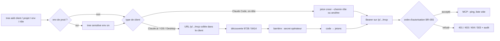
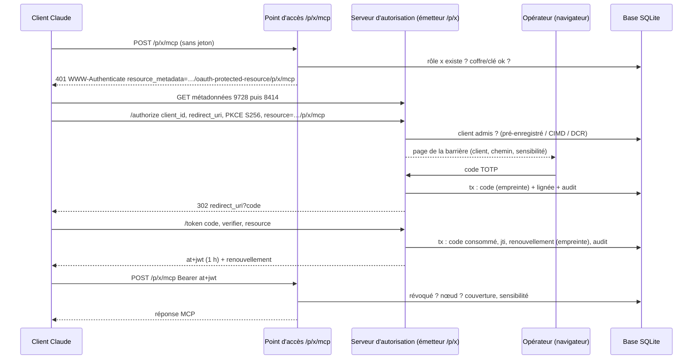
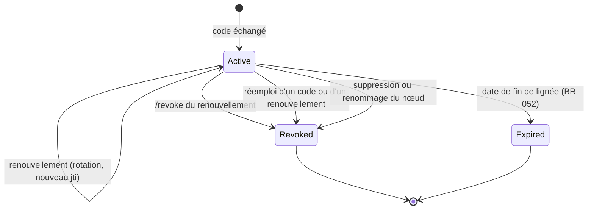
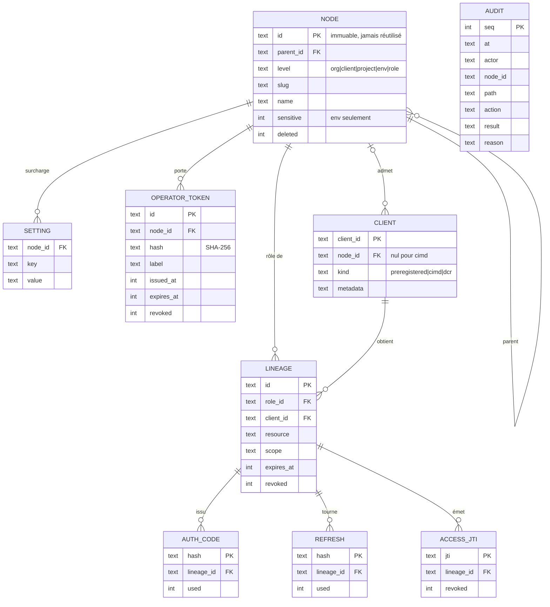

# F-005 · Core — tree, tokens, inbound OAuth, authorization order

## Metadata

| Field | Value |
|-------|-------|
| **Priority** | P2 |
| **Branch** | one branch per batch (§10): `feat/HULL-7-socle-lot-a` (batch A, PR HULL-20), `feat/HULL-7-socle-lot-b` (batch B) |
| **Last updated** | 2026-10-28 |

## 1. Context & Objective

### Current State

The foundation (F-004, `implemented`) delivers a Python skeleton (`src/hullgate/`, 458 lines): two listeners (public 4790: `/healthz`, `/readyz`; administration 4791: `/healthz`), a SQLite database in WAL mode without a schema, the `make gate` quality gate, the image and the deployment on the production server. No business function: no tree, no token, no OAuth, no MCP access point.

The Python POC (F-003, accepted 16/16) showed that the `mcp==2.3.0` SDK (pinned, ADR-001, BR-036) carries the MCP entry point (five versions, including 2026-07-28 without a session) and the OAuth handlers, at the price of a measured glue (`docs/trials/poc-python.md` H-5, E-02): `resource` not compared to the code or to the renewal, `RevocationRequest.client_secret` required, unknown client in `unauthorized_client`, provider exception not translated, `AuthorizationHandler` that turns an outage into a 302 `server_error`. The POC had only one level (the role), a single authorization server, and an HTTP administration protected by a header.

The F-004 review measured that the administration port 4791 answers any container of the production server's shared Traefik network (`.cairn/learnings/inbox/F-004-review.md`): harmless as long as it serves only `/healthz`.

**Source.** The original specification (PDF v3, attachment 45 of ticket HULL-1), whose text was extracted after the first draft; the references "spec line N" point to the lines of that extraction (`scratchpad/spec/spec.txt` of the drafting session, 1,545 lines, not committed). To it are added `brief.md`, the validated prototype HULL-18 (`design/prototype-admin/`), the POCs (`poc/py-gateway/`, `docs/trials/poc-*.md`), F-004 (§Out of Scope), ticket HULL-7 and its comments. The assumptions of the first draft were checked against the specification (§9, assumptions table).

### Objective

Give the gateway its isolation model: a tree organisation › client › project › environment › role in which each role is an MCP access point with its own URL, tokens that are valid only for the node where they are placed and its subtree (sensitive environments requiring a token placed on the role), one OAuth 2.1 authorization server per access point for the Claude clients, and a single authorization order, closed by default, proven by the isolation bench replayed against the v1.

### Expected Impact

- Ticket criterion: a token placed on `mpx/cairn` is refused on every role of `mpx/cairn/prod` (sensitive environment) — integration test and bench line.
- The requirements carried over from the POCs (N1, N2, N4, N13, N1 of the F-003 review, R-01 to R-07) are met by the v1, each by a test named `test_br_NNN_*`.
- The isolation bench has a `v1` target; in F-005 the OAuth checks, the core requirements and the revocation harnesses succeed against the v1, and none of the 16 tests fails (those with a step that calls a relayed tool are proven « non jouables », BR-009, pending HULL-9).
- Features HULL-8 to HULL-13 start from an existing tree, inheritance engine, audit log and authorization order, without going back to them.

### Open Product Questions

No blocking question. Two gaps between the specification and the validated prototype are settled here and flagged to HULL-11: the prototype's test message ("token issued on the environment or below") contradicts the specification (spec line 407-409), which prevails (BR-051); the prototype's "frozen" (lock of the subtree) is not the specification's "pinning" (tool definitions, spec line 415, 952-953): the core calls it **lock** (BR-049) and leaves "pinning" to HULL-10.

## 2. Scope

- **Tree**: five fixed levels, one organisation per instance, segments validated on input, URL per role `/p/<client>/<projet>/<env>/<rôle>/mcp`, creation, renaming, moving, deletion, sensitive marking of environments, lock, inherited settings with origin.
- **Storage**: SQLite schema in the F-004 database, forward migrations at startup.
- **CLI management** in the container (`hullgate admin …`): tree, settings, operator tokens, OAuth clients, dynamic registration, audit (minimal reading), YAML export. No HTTP administration route (the web interface is HULL-11).
- **Operator tokens**: opaque tokens placed on a node, value displayed once, only the fingerprint kept, inherited duration, revocable.
- **Inbound OAuth 2.1, one authorization server per access point**: RFC 9728 and RFC 8414 metadata, PKCE S256, RFC 8707 `resource` at authorization, at code exchange and at renewal, operator barrier, pre-registered clients, CIMD, DCR behind the barrier (disabled by default), RFC 9068 JWT access tokens (`typ at+jwt`, `client_id`, `scope`), rotation and reuse detection, RFC 7009 revocation.
- **Authorization order** at the access point, refusal by default under a vault or key outage (explicit 503).
- **Minimal MCP access point** per role: five protocol versions, `ping`, empty tool list, every tool call refused.
- **Audit** of issuances, revocations, refusals and tree changes, without any secret value.
- **Mounted secrets** (mode referred to the core by F-004): signing key and barrier TOTP secret read from files; `/readyz` checks "key loaded".
- **Isolation bench**: `v1` target, checks outside the OAuth acceptance run, core requirements and revocation harnesses replayed against the v1.
- **Runbook**: operator's actions on the production server for the mounted secrets and the CLI (practice of BR-042).

## Out of Scope

- **Connections and placements** (HULL-8): connection library, outbound OAuth, short tool prefix per connection unique in the organisation, placement of a connection on a role, **warning and traced confirmation of a connection shared between a sensitive and a non-sensitive environment** (operator decision of 2026-10-28). Boundary: the core provides the effective sensitivity of a role (BR-047), the lock of the lock (BR-049) and an audit log that accepts administration events carrying a confirmation (BR-066); HULL-8 writes the placement, the warning and the confirmation trace.
- **Relay** (HULL-9): tool aggregation, prefixed renaming, upstream sessions, upstream types. The **16/16 of the acceptance run against the v1** is a criterion of HULL-9 (BR-071).
- **Action policy** (HULL-10): read / write / destructive modes, allow / deny lists, writes closed by default in sensitive environments and opened tool by tool, **rules on an argument's value** (advanced in v1 by the operator), grouped tools. The "mode" setting will plug into the inheritance engine of BR-048; the core does not declare it.
- **Web administration** (HULL-11): interface of prototype HULL-18, passkey authentication, public administration name and Traefik router; YAML import.
- **Full audit** (HULL-12): filtered consultation, statistics, alerts, retention, structured logging, client address (trust in the `X-Forwarded-*` headers of the declared proxies, referred to the core by F-004: **deferred to HULL-12**, the core needs no client address nor any URL derived from the request, `PUBLIC_URL` being authoritative).
- **Signing key rotation** (several active keys, `kid`, JWKS publication): a single key in v1; changing it invalidates all OAuth access tokens in progress (they renew).
- **Per-organisation encryption key**: its supply mode is that of BR-032 v2 (mounted secret), the key itself arrives with the connections (HULL-8), which alone have secrets to encrypt.
- **Differentiated administration roles**, several organisations per instance, several operators: v2 (brief).
- **SDK guard witness** (BR-037): it remains the Python POC; switching the witness to the bench's `v1` target is a backlog candidate, not a deliverable of F-005.
- **Undoing a change** (spec line 334-335: "can be undone") and **YAML import with a diff preview** (spec line 336-337): HULL-11; the core logs before / after (BR-066) and exports what the import will read back (BR-070).
- **Configurable `/p` prefix** (spec line 218): deferred; `/p` fixed in F-005, backlog candidate (new variable of BR-032).
- **"Last use" of a token** (Tokens screen, spec line 293-295): HULL-12 (a write per request has no place in the core).
- **`list_changed` notification on every change** (immediate application, spec line 332-333): HULL-9; the core applies immediately (no cache, BR-055).
- **Rate limiting** anywhere but at the barrier (BR-073): none at the access point or at `/token` (256-bit tokens, PKCE); to reconsider with HULL-12.
- **Performance objectives**: none in F-005 (load measurement outside the foundation, ADR-001 "Neutral").
- **Carrying over the POC data**: none; the v1 starts from an empty database.
- **Change of `PUBLIC_URL`**: invalidates all OAuth authorizations (audience and issuer change); no migration planned, the clients reauthorize (§12).
- **Confidential OAuth clients (with a secret)**: F-005 admits only public clients (BR-061); a client with a secret would be a v2 of BR-061 (CLI `--secret-file`, SHA-256 fingerprint in BR-072, verification at `/token` and `/revoke`). Operator decision of 2026-10-28 (S1).
- **Domain glossary**: the file `domain-glossary.md` does not exist; the terms that F-005 coins are proposed at its birth (AC-10), the operator decides at the freeze.

## 3. Functional Spec

### 3.1 Tree model (SCR-01)

| Level | In the URL | Can be sensitive | Can carry an operator token |
|--------|-----------|--------------------|-------------------------------|
| organisation (one, root) | no | no | yes, root token `*` with `--confirm '*'` (H5 corrected, BR-050) |
| client | yes | no | yes |
| project | yes | no | yes |
| environment | yes | **yes** | yes |
| role (MCP access point) | yes, followed by `/mcp` | inherits from its environment | yes |

- Each node has an **immutable identifier** (never reused), a free **display name** (1–80 characters) and a **segment** (the "slug") that forms the path. The segment is derived from the name (lowercase, accents removed, any run of other characters becomes `-`, `-` at the edges removed — prototype rule) or given explicitly.
- **Path** of a node: its segments from client to itself, joined by `/` (e.g. `mpx/cairn/prod/dev`). **Access point URL** of a role: `${PUBLIC_URL}/p/<chemin>/mcp`.
- **Inherited settings** declared by the core: `duree_jetons` (default `30d` on the organisation) and `verrou` (default false). The engine is generic: HULL-8 and HULL-10 will declare their settings there (`mode`, …).

### 3.2 Administration CLI (SCR-02)

Entry point: `hullgate <groupe> <commande>` (the specification names `passerelle jeton creer|lister|revoquer`, spec line 446-448; the binary carries the name of the product), played in the container (`docker compose exec hullgate hullgate …` on the production server, runbook). Audit actor: `operator-cli`. Readable output; `--json` for the read commands. Exit code 0 on success, 2 on refusal (message naming the violated constraint), 1 on internal error.

| Group | Commands |
|--------|----------|
| `tree` | `add <parent-chemin|/> <niveau> <nom> [--slug s]`, `rename <chemin> <nom> [--slug s]`, `move <chemin> <nouveau-parent> --confirm <chemin>`, `delete <chemin> --confirm <chemin>`, `show [<chemin>]`, `sensitive <chemin> on|off`, `lock <chemin>`, `unlock <chemin>` |
| `settings` | `get <chemin>` (effective value + origin of each setting), `set <chemin> <clé> <valeur>`, `unset <chemin> <clé>` (restore inheritance) |
| `jeton` | `creer --chemin <chemin|/> --label <libellé> [--duree <n>h|<n>d]` (value printed once; `/` designates the organisation, as for `tree add`), `lister [<chemin>] [--client <segment>]` (operator tokens **and** OAuth lineages: identifier, type, client or label, path, dates, state), `revoquer <id>` (operator token or whole OAuth lineage) |
| `client` | `add <client_id> --chemin <nœud> --redirect-uri <uri>…` (public client: no secret exists or is set; bound to the node and its roles, BR-061), `list`, `remove <client_id>` (revokes the client's lineages, BR-061); `dcr on|off` |
| `audit` | `tail [-n N]` (minimal reading; full consultation is HULL-12) |
| `export` | YAML of the tree on standard output (BR-070) |

`tree show` displays, for each role, its access point URL, its effective sensitivity and the origin of the lock if it is locked.

#### Visual States

- **SCR-02**: command accepted, code 0.
- **SCR-02.refused**: constraint violated (invalid segment, duplicate, level, locked, sensitive outside an environment), code 2, message naming the constraint and, for a lock, the node that locked; nothing is written.
- **SCR-02.store-unavailable**: database unavailable, code 1, nothing is written, no token printed.

### 3.3 MCP access point of a role (SCR-03)

`POST|GET|DELETE ${PUBLIC_URL}/p/<chemin>/mcp`: authorization order (BR-055), then the SDK's MCP entry point in stateless mode. In F-005: `ping`, `tools/list` → empty list, `tools/call` → "unknown tool" error; no resources, prompts or subscriptions (brief: outside v1).

### 3.4 Authorization server of an access point (SCR-04)

Layout fixed by the specification (spec line 749-753: one logical authorization server per access point, under `/oauth/p/<chemin>`, a single code, parameterized URLs):

| Route | Role |
|-------|------|
| `/.well-known/oauth-protected-resource/p/<chemin>/mcp` | RFC 9728: `resource` = access point URL, `authorization_servers` = [`${PUBLIC_URL}/oauth/p/<chemin>`], `scopes_supported` = [`mcp`] |
| `/.well-known/oauth-authorization-server/oauth/p/<chemin>` | RFC 8414 (path insertion): `issuer` = `${PUBLIC_URL}/oauth/p/<chemin>`, endpoints below, `code_challenge_methods_supported` = [`S256`], `client_id_metadata_document_supported` = true, `registration_endpoint` only if DCR is active |
| `/oauth/p/<chemin>/authorize` | authorization; redirects to the barrier |
| `/oauth/p/<chemin>/consent` | operator barrier (TOTP code, BR-060) |
| `/oauth/p/<chemin>/token` | code exchange, renewal |
| `/oauth/p/<chemin>/revoke` | RFC 7009 |
| `/oauth/p/<chemin>/register` | RFC 7591, 404 if DCR inactive |

#### Visual States

- **SCR-04.consent**: barrier page: client name (or `client_id`), path of the requested role, sensitivity, secret field, Authorize / Deny buttons. No data of any other node.
- **SCR-04.consent-denied**: TOTP code wrong or already used: same page, generic message, failure counter incremented (BR-073).
- **SCR-04.consent-locked**: 5 failures in the last 15 minutes: 429, refusal without evaluating the secret (BR-073).
- **SCR-04.unavailable**: vault or key unavailable: 503 JSON `temporarily_unavailable` (BR-064), never a redirect.

### 3.5 Listeners

- **Public (4790)**: `/healthz`, `/readyz` (BR-033 v2), the `/p/…` routes above and the two `/.well-known/…` families; any other path, `/admin` included, 404.
- **Administration (4791)**: `/healthz` only (BR-068).

## 4. Business Rules

**Overlap scan** (`br-identifiers.md` §Overlap), 42-line index, filter on token, revocation, audience, scope, role, tree, sensitive, secret, audit, migration, export, administration, version, probe, configuration: **17 lines retained**. Overlaps: BR-032 — new version (C2: a configuration without the mounted-secret variables no longer satisfies it); BR-033 — new version (C2: a healthy database without a key no longer makes `/readyz` 200); BR-026 — new rule (C1: the v1 can violate N1/N2/N4/N13 whereas the POC meets them) for BR-045, BR-054, BR-055, BR-063; BR-017 — new rule (C1) for BR-067; BR-034 — new rule (C1: isolated port but an open route is possible) for BR-068; BR-012 — new rule (C1: the v1 target can be missing whereas the acceptance run holds against the POCs) for BR-071. Off topic after reading: BR-003, BR-005, BR-010, BR-014, BR-015, BR-016, BR-022, BR-025, BR-036, BR-037, BR-042 (runbook practice followed without a new rule).

### BR-044 · The tree has five fixed levels and one URL per role

> **Extracted on 2026-10-29.** Current version: [`business-rules/BR-044.md`](../business-rules/BR-044.md).
> The content below reflects the state of this BR at the time of feature F-005 (v1).

*`behavioral` · `strict` · Candidate state: `verified` — `tests/unit/test_br_044_tree.py`.*

**Rule** — The tree (spec lines 138-139, 210-214) has a root organisation, then exactly the levels client, project, environment and role, each node having as parent only a node of the immediately higher level; each role is served at the URL `${PUBLIC_URL}/p/<client>/<projet>/<env>/<rôle>/mcp`. A creation, rename or move that would violate the level, the segment format or the uniqueness of the segment among siblings is refused with a message naming the constraint, writing nothing.

**Clarifications**
- Segment: `^[a-z0-9]+(-[a-z0-9]+)*$`, 1 to 40 characters (H3); display name: 1 to 80 characters, without control characters. An empty derived segment is refused (no silent fallback to `x` as in the prototype).
- Uniqueness among siblings only: `acme/api` and `mpx/api` coexist.
- No reserved segment: the `/p` prefix separates the access points from the technical routes (`/.well-known`, `/oauth`, `/admin`, `/healthz`), spec lines 216-217.
- Creating an environment creates with it a `principal` role (spec lines 188-189); it is renamed or deleted like any role.
- A single organisation per instance (H2), created by the first migration, display name modifiable, without a segment; it is not deleted (refusal, code 2).

**Example**
- **Given** the project `mpx/cairn` has an environment `prod`
- **When** the operator adds under `mpx/cairn` an environment named "Prod"
- **Then** the derived segment `prod` is already taken: refusal "segment already used under mpx/cairn: prod", code 2, nothing written.

### BR-045 · A deleted node never comes back to life, nor do its tokens

> **Extracted on 2026-10-29.** Current version: [`business-rules/BR-045.md`](../business-rules/BR-045.md).
> The content below reflects the state of this BR at the time of feature F-005 (v1).

*`behavioral` · `strict` · Candidate state: `verified` — `tests/integration/test_br_045_delete_recreate.py`.*

**Rule** — Deleting a node deletes its subtree and revokes, in the same transaction, every operator token placed in that subtree and every OAuth lineage of one of its roles; a node recreated at the same path receives a new identifier and makes valid no token, code or renewal issued before the deletion (N4).

**Clarifications**
- Tokens and lineages are bound to the node's **identifier**, never to its path; an identifier is never reused (no `insert or replace`, cause of N4 on the Go POC).
- After deletion, the old URL answers 404 at the access point and its OAuth routes; a presented renewal answers `invalid_grant`.
- Deletion requires `--confirm <chemin>` repeated (destructive gesture) and displays before acting the number of descendants, active tokens and URLs that will stop answering (as in the prototype).
- Deletion refused if the node, an ancestor **or a descendant** is locked (BR-049): deleting an ancestor would make a locked subtree disappear.

**Example**
- **Given** a valid OAuth access token and renewal on `mpx/cairn/dev/agent`
- **When** the operator deletes `mpx/cairn/dev/agent` then recreates a role `agent` under `mpx/cairn/dev`
- **Then** the old access token receives 401 `invalid_token` on the new URL and the renewal `invalid_grant`; a fresh authorization works.

### BR-046 · Changing a path revokes the subtree's OAuth lineages, and only them

> **Extracted on 2026-10-29.** Current version: [`business-rules/BR-046.md`](../business-rules/BR-046.md).
> The content below reflects the state of this BR at the time of feature F-005 (v1).

*`behavioral` · `strict` · Candidate state: `verified` — `tests/integration/test_br_046_rename.py`.*

**Rule** — Changing a node's path — its segment (rename) or its parent (move, spec line 276) — revokes, in the same transaction, all the OAuth lineages of the roles in its subtree and no operator token; a missing or extra revocation fails the test.

**Clarifications**
- The subtree's path changes (BR-044): the old URLs answer 404.
- Reason: an OAuth token is bound to the access point's URL (audience, RFC 8707); an OAuth client must re-authorize on the new URL. An operator token is bound to the node's identifier and has no audience: it stays valid for the same nodes (H12).
- Changing only the display name without changing the segment revokes nothing.
- Rename or move refused if the node or an ancestor (and, for a move, the new parent) is locked (BR-049), or if a descendant is locked (same guard as deletion: changing an ancestor's path changes the locked node's URL and breaks its OAuth authorizations) — operator decision of 2026-10-28, delivered in batch B.
- A move whose segment is already taken under the new parent is refused (uniqueness among siblings, BR-044), nothing is written.
- Moving does not change level (an environment goes under another project, etc.) and requires `--confirm <chemin>`: tokens placed on the old ancestors stop covering the subtree, those of the new ancestors cover it (BR-050); the CLI displays both counts before acting.

### BR-047 · Only an environment is sensitive, and its whole subtree is

> **Extracted on 2026-10-29.** Current version: [`business-rules/BR-047.md`](../business-rules/BR-047.md).
> The content below reflects the state of this BR at the time of feature F-005 (v1).

*`behavioral` · `strict` · Candidate state: `verified` — `tests/unit/test_br_047_sensitive.py`.*

**Rule** — The "sensitive" marking is placed only on an environment-level node; a role is sensitive if and only if its environment is, with no possible override below. Marking another level is refused.

**Clarifications**
- Marking or unmarking an environment is an audit event (BR-066); it is refused if the environment or an ancestor is locked.
- Unmarking reopens the environment to tokens placed higher up (BR-051 is read on every request): the CLI displays before acting the number of active tokens placed on the ancestors that will become accepted, and the audit entry carries it.
- Marking sensitive revokes or shortens nothing (same posture as unmarking): the CLI displays before acting, and the audit entry carries, (i) the number of active operator tokens placed on the environment itself, which will stop being accepted (BR-051), and (ii) the number of active operator tokens and OAuth lineages of the environment's roles whose expiry exceeds 7 days (they keep their duration, BR-052). Operator decision of 2026-10-28 (S3), delivered in batch B.
- Function exposed to the following features: effective sensitivity of a role (HULL-8 for the shared-connection warning, HULL-10 for writes closed by default).

### BR-048 · Settings are inherited, with their origin

> **Extracted on 2026-10-29.** Current version: [`business-rules/BR-048.md`](../business-rules/BR-048.md).
> The content below reflects the state of this BR at the time of feature F-005 (v1).

*`behavioral` · `blocking` · Candidate state: `verified` — `tests/unit/test_br_048_inheritance.py`.*

**Rule** — The effective value of a setting on a node is that of the nearest override going up from the node to the organisation, which carries the default value of each declared setting; every read of a setting returns the effective value and the origin node.

**Clarifications**
- `unset` removes the node's override (restoring inheritance); on the organisation, `unset` is refused (the root always carries a value).
- Settings declared by F-005: `duree_jetons` (duration `<n>h` or `<n>d`, 1 h to 365 d, default `30d`) and `verrou` (BR-049 specifies its effect). An undeclared key or an out-of-format value is refused.
- A setting change is an audit event with old and new value.

### BR-049 · A node's lock freezes its subtree; only that node unlocks

> **Extracted on 2026-10-29.** Current version: [`business-rules/BR-049.md`](../business-rules/BR-049.md).
> The content below reflects the state of this BR at the time of feature F-005 (v1).

*`behavioral` · `strict` · Candidate state: `verified` — `tests/unit/test_br_049_freeze.py`.*

**Rule** — While a node is locked, no change of structure (add, rename, move, delete), of setting or of sensitivity is accepted on it or on one of its descendants, and no change of the path of one of its ancestors (rename, move) nor any deletion of an ancestor is accepted, since it would change or make disappear the locked node; the refusal names the node that locked, and only that node can be unlocked.

**Clarifications**
- Guard of locked descendants: deleting (BR-045), renaming or moving (BR-046, amendment of 2026-10-28) an ancestor of a locked node is refused. Deletion already is (batch A); rename and move are delivered in batch B. Tests: `test_br_046_rename.py` (case "locked descendant") and `test_br_049_freeze.py`.
- Origin: validated prototype HULL-18 ("frozen"). The specification lists "pinning" among the inherited settings (spec line 315) in the sense of **pinned tool definitions** (spec lines 415, 844, 952-953), which belong to HULL-10. The two notions are distinct: the core names its own "lock" and HULL-10 will declare "pinning" on BR-048's engine.
- Locking is `settings set <chemin> verrou true` (or `tree lock`); unlocking a node locked by an ancestor is refused, naming the ancestor.
- Compatibility with BR-048: no `verrou=false` override exists below the organisation (it would mask the lock of an ancestor placed afterwards, the nearest override winning); unlocking a node therefore removes its override instead of writing `false`, and only the organisation carries a `false` value.
- **Outside the lock** (H11): issuing or revoking an operator token, authorizing an OAuth client, adding or removing a client (`client add` / `remove`) or registering it dynamically (RFC 7591), revoking a lineage. The lock protects the tree and its settings, not access; admitting a client is a matter of access (operator decision of 2026-10-28, S5), and a revocation must always remain possible.
- Placements (HULL-8) and policy settings (HULL-10) will be subject to the same lock.

### BR-050 · A token covers its node and its descendants, segment by segment

> **Extracted on 2026-10-29.** Current version: [`business-rules/BR-050.md`](../business-rules/BR-050.md).
> The content below reflects the state of this BR at the time of feature F-005 (v1).

*`behavioral` · `strict` · Candidate state: `verified` — `tests/unit/test_br_050_coverage.py`.*

**Rule** — A token placed on a node N is accepted on a role R only if N is R or an ancestor of R in the tree; a token placed elsewhere is refused, even if N's path is a textual prefix of R's.

**Clarifications**
- The comparison follows the tree's identifiers (equivalent to a whole-segment prefix): a token placed on `mpx/cai` does not cover `mpx/cairn/…`.
- An OAuth access token is placed on its access point's role and covers only it.
- An operator token is placed on any node, organisation included (root token `*`, spec lines 356-357: all clients outside sensitive environments, "reserved for administration, not recommended for an agent"); the CLI asks for `--confirm '*'` for the root token and the audit marks it; the organisation is designated by `--chemin /`.
- Tokens under the role (connection + mode, spec lines 370-371) and tokens reduced to a mode (spec line 351): out of scope (HULL-8, HULL-10).

### BR-051 · Under a sensitive environment, only a token placed on the role gets through

> **Extracted on 2026-10-29.** Current version: [`business-rules/BR-051.md`](../business-rules/BR-051.md).
> The content below reflects the state of this BR at the time of feature F-005 (v1).

*`behavioral` · `strict` · Candidate state: `verified` — `tests/integration/test_br_051_sensitive_token.py`, bench target `v1` (check `socle_checks.py` `sensible_*`).*

**Rule** — On a sensitive role, a token is accepted only if it is placed on that role itself; a token placed on the environment, the project or the client is refused (ticket criterion: a `mpx/cairn` token is refused on `mpx/cairn/prod/<rôle>`).

**Clarifications**
- Spec lines 395-396 and 407-409: "a client- or project-level token never covers them: a token issued at role level or below is needed. An environment-level token is refused there too: it would cover dev and reviewer at once, i.e., the self-approval one wants to prevent." The prototype's test message ("on the environment or below") is to be corrected in HULL-11.
- The refusal is a 401 `invalid_token` (same form as an out-of-scope token, BR-055); the audit distinguishes the reason `sensitive_requires_role_token`.
- Consequence under H4: issuing an operator token on a sensitive environment is refused at issuance (code 2, "a token placed on a sensitive environment is accepted on none of its roles"); on a project or a client, issuance remains allowed and the CLI names the sensitive environments the token will not cover.

**Example**
- **Given** `mpx/cairn/prod` sensitive and an operator token placed on `mpx/cairn`
- **When** it is presented on `/p/mpx/cairn/prod/dev/mcp`
- **Then** 401 `invalid_token`, audit `refused` reason `sensitive_requires_role_token`; the same token is accepted on `/p/mpx/cairn/staging/dev/mcp` (non-sensitive).

### BR-052 · Token durations are fixed at issuance and capped in sensitive environments

> **Extracted on 2026-10-29.** Current version: [`business-rules/BR-052.md`](../business-rules/BR-052.md).
> The content below reflects the state of this BR at the time of feature F-005 (v1).

*`behavioral` · `strict` · Candidate state: `verified` — `tests/unit/test_br_052_ttl.py`.*

**Rule** — An OAuth access token lives 1 hour; an OAuth renewal lineage lives the effective value of `duree_jetons` on its node (default 30 days), and an operator token the duration requested at issuance or, failing that, that same value, both capped at 7 days if that node is sensitive or under a sensitive environment; the expiry is computed at issuance and does not change if the setting changes afterwards, and a token or renewal presented after its expiry is refused (401 `invalid_token` at the access point, `invalid_grant` at `/token`).

**Clarifications**
- Spec lines 410 and 425: access token 1 h; renewal 30 days with rotation, 7 in a sensitive environment. Spec line 315: token duration is an inherited setting. Spec line 446: `--duree` at issuance of an operator token, which takes precedence over the setting, always under the sensitive cap.
- The renewal lineage expires at a fixed date from the authorization: rotation does not extend the lineage.
- The authorization code lives 120 s; a request pending at the authorization barrier, 10 min.
- The 7-day cap is evaluated at issuance: marking an environment sensitive neither shortens nor revokes any existing token (BR-047 displays and audits the count); sensitivity is not a setting, but the duration fixed at issuance does not change either. Operator decision of 2026-10-28 (S3).

### BR-053 · Operator token: value shown once, only the fingerprint is kept

> **Extracted on 2026-10-29.** Current version: [`business-rules/BR-053.md`](../business-rules/BR-053.md).
> The content below reflects the state of this BR at the time of feature F-005 (v1).

*`behavioral` · `strict` · Candidate state: `verified` — `tests/integration/test_br_053_operator_token.py`.*

**Rule** — `hullgate jeton creer` prints the token's value only once on the standard output, and no command, output or log displays it again afterwards.

**Clarifications**
- What the database keeps of the token (fingerprint only): BR-072.
- Value: prefix `clo_` followed by 256 random bits encoded in base64url (H7); the prefix lets the secrets guard (BR-003) recognize it.
- `token list` displays identifier, label, node path (or `(supprimé)`), issuance, expiry, state; never the value nor the full fingerprint.
- Usage: `Authorization: Bearer <valeur>` header (Claude Code, clients without OAuth).

### BR-054 · The OAuth access token follows the RFC 9068 profile

> **Extracted on 2026-10-29.** Current version: [`business-rules/BR-054.md`](../business-rules/BR-054.md).
> The content below reflects the state of this BR at the time of feature F-005 (v1).

*`behavioral` · `strict` · Candidate state: `verified` — `tests/unit/test_br_054_jwt.py`, bench target `v1` (`socle_checks.py` `N1_claim_client_id`).*

**Rule** — An OAuth access token is a JWT signed by the gateway's key, with header `typ: at+jwt`, carrying `iss` (issuer of the access point), `sub` (role identifier), `aud` (exactly one string: the access point's URL), `exp`, `iat`, `jti`, `client_id` and `scope` containing `mcp`; a presented token missing one of these properties, or whose `aud` is a list, is refused with 401 `invalid_token`.

**Clarifications**
- Asymmetric ES256 signature (EC P-256 key of the mounted secret `SIGNING_KEY_FILE`), algorithm imposed at verification (no `alg` read from the token is believed); `typ` other than `at+jwt`, HS256 or a signature by another key: 401 `invalid_token`.
- The issuer `iss` must be that of the audience's access point; the `jti` must be in the registry, attached to a lineage of the role `sub` and to the client `client_id` (a token never issued by the gateway is refused).
- N1 (RFC 9068 §2.2, `client_id` REQUIRED); an `aud` as a list, even with a single element containing the URL, is refused (glue 6 of H-5, PyJWT would accept it).
- `iat` in the future by more than 60 s: refused.
- No tool name in a token (spec lines 450-451): the policy lives in the configuration.

### BR-055 · The authorization order at the access point is fixed and closed by default

> **Extracted on 2026-10-29.** Current version: [`business-rules/BR-055.md`](../business-rules/BR-055.md).
> The content below reflects the state of this BR at the time of feature F-005 (v1).

*`behavioral` · `strict` · Candidate state: `verified` — `tests/integration/test_br_055_authorization_order.py` (one case per step, each making exactly one step fail).*

**Rule** — A request to a role's access point goes through, in this order, (1) path of an existing role, otherwise 404; (2) vault and key available in the sense of BR-064, otherwise 503; (3) token present, otherwise 401 with `WWW-Authenticate: Bearer resource_metadata="<métadonnées RFC 9728 de ce point d'accès>"`; (4) token well formed and authentic (known unexpired operator token, or JWT conforming to BR-054 and unexpired), otherwise 401 `invalid_token`; (5) token neither revoked nor attached to a deleted node, otherwise 401 `invalid_token`; (6) for an OAuth token, audience exactly equal to the called access point's URL, then for any token, path a segment-wise prefix of the role's (BR-050) and no sensitive environment crossed by a token issued above the role (BR-051), otherwise 401 `invalid_token`; (7) scope `mcp` (N2), otherwise 403 `insufficient_scope`; the first failing step answers and no following step nor MCP processing takes place.

**Clarifications**
- Each refusal (steps 3 to 7) is audited with a distinct reason (`missing_token`, `invalid_token`, `revoked`, `node_deleted`, `audience_mismatch`, `out_of_scope`, `sensitive_requires_role_token`, `insufficient_scope`); the HTTP response does not distinguish the reasons of steps 4 to 6 beyond the RFC 6750 code. At step 6, an audience different from the access point's URL is `audience_mismatch` and an uncovered path `out_of_scope` (batch B, where a real token's audience appears for the first time, separates the two reasons that batch A conflated).
- Step 1 before authentication: a nonexistent URL answers 404 even without a token (H13, existence of a path revealed, risk accepted §12; T14 expects the root to give 404).
- The state (revocation, node, sensitivity) is read on every request, without cache: a revocation or deletion takes effect from the next request.
- Operator tokens implicitly carry the scope `mcp`.
- Correspondence with the specification (spec lines 376-400): its steps 1 (validity: signature, issuer, expiry, revocation, type), 2 (single audience), 3 (segment-wise prefix), 4 (sensitive) = steps 4 to 6 here; its steps 5 (effective rights = URL ∩ token ∩ policy) and 6 (connection placed in this role) belong to HULL-10 and HULL-9. The specification requires an audience equal to the access point for any token; a path token (`mpx/cairn`, spec line 363) covers several access points and cannot have a single one: the core applies the audience to OAuth tokens and the path prefix to all (reading confirmed at the freeze by the operator, option 1).
- The two token families plug in at step 4 through resolvers (operator token by its fingerprint, OAuth JWT by signature then the registry of `jti`); step 2 reads the vault then the key (delivered in two batches, §10).
- If the database cannot be read for step 1, the response is 503 (BR-064), never a 404 caused by the failure.

### BR-056 · Each access point has its own, discoverable authorization server

> **Extracted on 2026-10-29.** Current version: [`business-rules/BR-056.md`](../business-rules/BR-056.md).
> The content below reflects the state of this BR at the time of feature F-005 (v1).

*`behavioral` · `strict` · Candidate state: `verified` — `tests/integration/test_br_056_discovery.py`, bench target `v1` (T14, `oauth_checks.py`).*

**Rule** — Each access point publishes its RFC 9728 metadata (its own URL as `resource`, its own issuer `${PUBLIC_URL}/oauth/p/<chemin>` as `authorization_servers`, spec lines 749-753) and its authorization server publishes its RFC 8414 metadata under that issuer; a code, an access token or a renewal issued by an access point's authorization server is refused by the access point (BR-055, step 6) or by the authorization server (code, renewal) of any other access point.

**Clarifications**
- `code_challenge_methods_supported` = [`S256`]; `scopes_supported` = [`mcp`] on the resource side, [`mcp`, `offline_access`] on the authorization server side (values of the POCs' operator walkthrough, `docs/trials/poc-python.md` "Operator step"; `offline_access` is only announced, a renewal is issued at every authorization, BR-059); `token_endpoint_auth_methods_supported` = [`none`] (public clients only, BR-061); `registration_endpoint` present if and only if DCR is active (BR-061).
- The published URLs derive from `PUBLIC_URL`, never from the `Host` header.
- The root `/.well-known/oauth-protected-resource` (without a path) answers 404.

### BR-057 · PKCE S256 is mandatory

> **Extracted on 2026-10-29.** Current version: [`business-rules/BR-057.md`](../business-rules/BR-057.md).
> The content below reflects the state of this BR at the time of feature F-005 (v1).

*`behavioral` · `strict` · Candidate state: `verified` — bench target `v1` (`oauth_checks.py`: PKCE `plain`, absent, wrong verifier).*

**Rule** — An authorization request without `code_challenge` or with a method other than `S256` is refused without issuing a code, and a code exchange whose `code_verifier` does not match is refused with `invalid_grant`.

### BR-058 · A single resource, bound from authorization to renewal

> **Extracted on 2026-10-29.** Current version: [`business-rules/BR-058.md`](../business-rules/BR-058.md).
> The content below reflects the state of this BR at the time of feature F-005 (v1).

*`behavioral` · `strict` · Candidate state: `verified` — `tests/integration/test_br_058_resource.py`, bench target `v1` (T03, T04, `oauth_checks.py`).*

**Rule** — At authorization, at code exchange and at every renewal, the request carries exactly one `resource` parameter, equal to the URL of the access point whose authorization server is called and, at exchange as at renewal, to the resource of the code or of the lineage; otherwise it is refused with `invalid_target`, issuing no token and consuming neither the code nor the renewal presented.

**Clarifications**
- `resource` missing, multiple (including the same value twice) or different: refusal (T04 "A+B", glue 3 of H-5). The SDK reads the form with `dict()`: the check reads all the values before the handler.
- At authorization, the refusal does not redirect to the client if the resource is unknown (no access point): 400 on an error page; if the resource is known but different from the access point called: `invalid_target` redirect to an already verified `redirect_uri`.
- **Dependency HULL-3 (HULL-3, open)**: it is not yet known whether the Claude clients send `resource` at renewal. The rule follows the acceptance run (T04, policy frozen by BR-011: refusal of ambiguous requests). If HULL-3 shows that a Claude client omits it, every renewal of that client will fail: a new version of BR-058 and of BR-011 will be needed (for example, a missing `resource` read as that of the lineage), an operator decision, not an implementation one.

### BR-059 · Single-use code, rotation, reuse = lineage revocation

> **Extracted on 2026-10-29.** Current version: [`business-rules/BR-059.md`](../business-rules/BR-059.md).
> The content below reflects the state of this BR at the time of feature F-005 (v1).

*`behavioral` · `strict` · Candidate state: `verified` — bench target `v1` (`oauth_checks.py`: single code, reuse, rotation, old renewal).*

**Rule** — An authorization code can be exchanged only once, bound to its client, its `redirect_uri` and its resource; every renewal issues a new access token and a new renewal and invalidates the previous one; presenting a code or a renewal that was already used revokes the whole lineage derived from it, access tokens included.

**Clarifications**
- The renewal cannot widen the scope (`invalid_scope`) or change the client (`invalid_grant`).
- The previous access token of a lineage is invalidated at rotation (`jti` registry, like the Python POC).
- A renewal is issued at every authorization, whether or not `offline_access` is requested (spec lines 747-748).
- No grace period: two concurrent renewals by the same client with the same renewal revoke the lineage (the second is a reuse); the client must authorize again (risk §12).

### BR-060 · No code without operator authentication at the barrier

> **Extracted on 2026-10-29.** Current version: [`business-rules/BR-060.md`](../business-rules/BR-060.md).
> The content below reflects the state of this BR at the time of feature F-005 (v1).

*`behavioral` · `strict` · Candidate state: `verified` — `tests/integration/test_br_060_consent.py`.*

**Rule** — Whatever the client's admission mode, the authorization server issues a code only after the operator has entered, on the barrier page, a valid TOTP code (RFC 6238), never twice a code from the same time step; without a configured TOTP secret, every authorization is refused at `/authorize`, after verification of the client and of the `redirect_uri`: `access_denied` by redirect to a verified `redirect_uri`, error page otherwise (same form as BR-058).

**Clarifications**
- Spec lines 773-774: authentication of the administrator on the consent page by passkey or TOTP. The core delivers TOTP (30 s step, 6 digits, ±1 step tolerance); the passkey comes with the web administration (HULL-11).
- The TOTP secret is a mounted secret (BR-032 v2, `AUTHORIZE_TOTP_SECRET_FILE`), enrolled by the operator in their authenticator application (runbook); neither it nor a code appears in a response, a log or an audit entry.
- A pending request is identified by a random value of at least 192 bits (256 in v1, the database keeps only its fingerprint), single-use, and expires in 10 min; a failed code does not consume it; a denial ("Deny", which redirects `access_denied`) and a success consume it.
- A wrong code, one outside the tolerance or from a step already accepted redisplays the page (200, generic message) and counts as a failure (BR-073).
- The last accepted time step is kept in the database (it survives a restart, like the counter of BR-073): a code is refused if the step it validates is lower than or equal to that one. Six digits legitimately repeat at another step: only repetition within the same step is forbidden.
- The page shows the client and the path of the requested role; "Deny" redirects `access_denied`. Responses carry `Cache-Control: no-store`, `Content-Security-Policy: frame-ancestors 'none'`.
- Attempt limit: BR-073 (spec lines 342, 983-985). The specification describes a consent page that also offers levels below the role (connection + mode, spec lines 419-420): in F-005 it offers only the role.

### BR-061 · Admitted clients: pre-registered, or dynamically registered behind the barrier

> **Extracted on 2026-10-29.** Current version: [`business-rules/BR-061.md`](../business-rules/BR-061.md).
> The content below reflects the state of this BR at the time of feature F-005 (v1).

*`behavioral` · `strict` · Candidate state: `verified` — `tests/integration/test_br_061_clients.py`, bench target `v1` (`dcr` sub-check of `socle_checks.py`).*

**Rule** — An OAuth client is admitted by the authorization server of an access point only if it is pre-registered by the CLI for that access point or one of its ancestors, identified by a valid metadata document (BR-062), or registered through RFC 7591 with that same authorization server while dynamic registration is active; dynamic registration is inactive by default (`/register` 404), and a client that is not admitted obtains neither a code nor a token.

**Clarifications**
- Unknown client at `/authorize`: error page, never a redirect to an unverified `redirect_uri`. Unknown client at `/token` or `/revoke`: 401 `invalid_client`.
- `redirect_uri` compared exactly (no prefix); `http` admitted only toward `localhost` / `127.0.0.1` (native clients).
- **Public clients only** (operator decision of 2026-10-28, S1): no client secret exists in F-005. The metadata declares `token_endpoint_auth_methods_supported` = [`none`] (BR-056); a `client_secret` presented at `/token` or `/revoke` is ignored; DCR never issues a secret (the response carries neither `client_secret` nor `client_secret_expires_at`, and brings a requested authentication method back to `none`, which RFC 7591 §3.2.1 permits); `client add` has no secret option. A client with a secret would be a v2 of this rule.
- Spec lines 754-756 and 765-767: three identification modes (CIMD recommended, pre-registered, DCR "kept for compatibility"); every client identified or registered via `/oauth/p/<chemin>` is bound to that path — the main binding, independent of Claude's behavior. DCR inactive by default: a choice of the core (single barrier, reduced surface), not dictated by the specification.
- Extension of the core (S10): a client pre-registered on a node is admitted by the roles of its subtree ("that access point or one of its ancestors") — registering it once for `mpx` is enough for its roles — whereas the specification binds a client to a path; the binding by lineage and by audience stays per access point.
- A `cimd` client is bound to no node (S9): it is admitted at each request by its document (BR-062), and it is its lineage that binds it to the access point. A pre-registered or `dcr` client is bound to a node (`client.node_id`, §6.4).
- `client remove` revokes, in the same transaction, all the client's lineages (like BR-045) and writes the audit entry (BR-066); its access tokens fall at the next request, a renewal presented answers `invalid_client` (unknown client). Operator decision of 2026-10-28 (S21).
- Adding or removing a client, through the CLI or through RFC 7591, is an audit event (BR-066) and remains possible under a locked node (BR-049).
- Claude's return addresses: `https://claude.ai/api/mcp/auth_callback` and the `claude.com` variant (spec lines 760-761, "to be re-verified").
- A `client_id` that is an `https` URL is reserved to CIMD, the `dcr_` prefix to dynamic registration; the same client can be pre-registered on several nodes (key `(client_id, node_id)`), `client remove` removes all its registrations.

### BR-062 · A client metadata document is fetched within bounds

> **Extracted on 2026-10-29.** Current version: [`business-rules/BR-062.md`](../business-rules/BR-062.md).
> The content below reflects the state of this BR at the time of feature F-005 (v1).

*`behavioral` · `strict` · Candidate state: `verified` — `tests/integration/test_br_062_cimd.py` (local test document server).*

**Rule** — A `client_id` that is an `https` URL is resolved by fetching its metadata document; the client is admitted only if the document is valid JSON whose `client_id` equals the URL and whose `redirect_uris` contains the requested `redirect_uri`, the fetch being bounded (5 s, 64 KiB, no redirect, no private, loopback or link-local address); any gap refuses the request without issuing a code.

**Clarifications**
- Written by hand (SDK 2.3.0 does not serve CIMD on the server side: E-03 of `docs/trials/poc-python.md`, 1 d estimated).
- Document cache: 10 min at most; a fetch failure is not cached as a success.
- The address bounds apply to all resolved addresses (anti DNS rebinding: connection to the verified address).
- The tests reach no external host: no variable opens the bounds; the test code builds its own fetcher (TLS context of its throwaway certificate, resolver, address filter) and passes it to the listener — nothing in the image or in the configuration makes it possible to do so (§9).

### BR-063 · Revocation follows RFC 7009

> **Extracted on 2026-10-29.** Current version: [`business-rules/BR-063.md`](../business-rules/BR-063.md).
> The content below reflects the state of this BR at the time of feature F-005 (v1).

*`behavioral` · `strict` · Candidate state: `verified` — bench target `v1` (nominal harness and N3 of the F-002 review, `socle_checks.py` `N13`).*

**Rule** — `POST …/oauth/revoke` answers 400 `invalid_request` without a `token` parameter (N13), 401 `invalid_client` for an unknown client (R-05), and 200 for an unknown, foreign or already revoked token; a revoked renewal token revokes its lineage, access tokens included, and a revoked access token is revoked by its `jti`; any admitted client, public (BR-061), can revoke its tokens without a secret, and a presented `client_secret` is ignored.

**Clarifications**
- A client revokes only the tokens issued to it: another client's token answers 200 with no effect (RFC 7009 §2.1).
- SDK 2.3.0 requires `client_secret` (`RevocationRequest` model) and answers `unauthorized_client` to an unknown client: the v1 handler fixes both through a subclass or a handler of its own, never by replacing an object of the module (E-02).
- A removed client (`client remove`, BR-061) is unknown: `invalid_client` at `/token` and `/revoke`, including at the renewal of its lineages, already revoked.
- Persistence failure: BR-064.

### BR-064 · Vault or key failure: explicit 503, nothing issued

> **Extracted on 2026-10-29.** Current version: [`business-rules/BR-064.md`](../business-rules/BR-064.md).
> The content below reflects the state of this BR at the time of feature F-005 (v1).

*`behavioral` · `strict` · Candidate state: `verified` — `tests/integration/test_br_064_fail_closed.py`, bench target `v1` (T13, N3 harness).*

**Rule** — When the vault is unavailable — `/readyz` predicate (BR-033 v2) false: database not open, file not readable or not writable, write lock not obtained within 1 s, schema different from the code, signing key unavailable (file not readable or not parseable) — or a write fails (except the audit entry of a refusal, which BR-066 exempts), the access point and every OAuth route (`authorize`, `consent`, `token`, `revoke`, `register`, metadata) answer 503 with the JSON body `{"error": "temporarily_unavailable"}`, with no redirect, no code or token issued, and no 500 response; a revocation write that fails answers 503, never 200.

**Clarifications**
- The predicate is evaluated at every request, with no cache (a failure injected from outside — file made unreadable, lock held — is seen from the next request, T13). Accepted cost: one lock acquisition and release per request.
- Key: the file is re-evaluated at every request (v1: the PEM is re-read and parsed at every request, no cache on `stat`); a file removed, made unreadable or replaced by an invalid PEM is seen from the next request, and so is the recovery (symmetry with the write lock, T13 and the bench injection, BR-071). A key loaded once at startup is not enough.
- N1 of the F-003 review: under failure, the SDK handler turns a provider exception into a 302 `error=server_error`; v1 checks availability before calling the handler and translates any storage error into 503.
- The RFC 9728 / RFC 8414 metadata reads only the tree: under a database failure, 503 too.
- Recovery: the first request after the end of the failure is served normally (T13: 0, 5 and 15 s).
- The CLI under failure: code 1, nothing written, no token printed.

### BR-065 · Nothing is issued without being recorded

> **Extracted on 2026-10-29.** Current version: [`business-rules/BR-065.md`](../business-rules/BR-065.md).
> The content below reflects the state of this BR at the time of feature F-005 (v1).

*`behavioral` · `strict` · Candidate state: `verified` — `tests/unit/test_br_065_store.py`.*

**Rule** — Every issuance (code, access token, renewal, operator token) and every revocation is recorded with its audit entry in a single write transaction, and nothing is returned to the requester if it fails.

**Clarifications**
- `BEGIN IMMEDIATE` transaction (R-06), bounded wait time; failure → BR-064.

### BR-066 · The audit traces issuances, revocations, refusals and tree changes, without any secret

> **Extracted on 2026-10-29.** Current version: [`business-rules/BR-066.md`](../business-rules/BR-066.md).
> The content below reflects the state of this BR at the time of feature F-005 (v1).

*`behavioral` · `strict` · Candidate state: `verified` — `tests/unit/test_br_066_audit.py` (including a sweep of the entries produced by the integration suite looking for token, code, verifier or secret values).*

**Rule** — The gateway writes an audit entry for every issuance, revocation, refusal at the access point or at the authorization server, barrier failure, registration or removal of a client (CLI or RFC 7591) and change of the tree or of a setting, with UTC timestamp, actor, node (path and identifier), action, result, reason and, for a change, values before and after (spec lines 334-335); no entry contains a token value, a code, a PKCE verifier, a secret or a full fingerprint.

**Clarifications**
- Actor: `operator-cli`, the OAuth `client_id`, or the identifier of an operator token (never its value). Registering or removing a client: actor `operator-cli` (CLI) or `anonymous` (dynamic registration, RFC 7591), `after.client_id` at registration and `before.client_id` at removal, never a secret.
- Append-only table: no command modifies or deletes an entry (retention: HULL-12).
- A refusal is served even if its audit entry could not be written (the failure is logged on the error output); an issuance is not (BR-065). This is the explicit exception to BR-064, which exempts that one write only.
- Open to the following features: HULL-8 will write there the confirmation of a prod / non-prod shared connection, HULL-9 the tool calls.

### BR-067 · A role's MCP access point serves the protocol without tools

> **Extracted on 2026-10-29.** Current version: [`business-rules/BR-067.md`](../business-rules/BR-067.md).
> The content below reflects the state of this BR at the time of feature F-005 (v1).

*`behavioral` · `blocking` · Candidate state: `verified` — `tests/integration/test_br_067_mcp_endpoint.py`, bench target `v1` (T15).*

**Rule** — After the authorization order, the access point serves stateless MCP through the SDK for versions 2024-11-05, 2025-03-26, 2025-06-18, 2025-11-25 and 2026-07-28, answers `ping` in every version that defines it, returns an empty tool list and refuses every tool call as an unknown tool; a version not served receives 400 whose `error.data.supported` lists the five versions.

**Clarifications**
- The tool list will be filled with the relay (HULL-9).
- The pinned SDK (2.3.0) defines `ping` only for the four handshake versions; in 2026-07-28 the method answers `-32601`, and the version is proved by `server/discover`, `tools/list` and `tools/call` (lot A, §9). Any probe "by the `ping` method" therefore sends a handshake version (v1 bench, BR-071).
- The glue for `supported` (12 lines in the POC) is written as an explicit extension, not as a replacement of an object of the module.

### BR-068 · No administration route without authentication

> **Extracted on 2026-10-29.** Current version: [`business-rules/BR-068.md`](../business-rules/BR-068.md).
> The content below reflects the state of this BR at the time of feature F-005 (v1).

*`behavioral` · `strict` · Candidate state: `verified` — `tests/integration/test_br_068_no_admin_routes.py`.*

**Rule** — No listener serves a route that reads or modifies the tree, the settings, the tokens, the clients or the audit without authenticating the operator; in F-005, the administration listener serves only `/healthz`, the public listener serves only its probes, the `/p/…` routes and the `/.well-known/…` metadata, and management goes through the CLI in the container.

**Clarifications**
- Reason: port 4791 answers to the neighboring containers of the production server's Traefik network (F-004 review). Authentication of the web administration arrives with HULL-11 (passkey).
- No test route (signing key, simulated failure) exists in the image: the bench injects its failures from outside (BR-071).

### BR-069 · The schema migrates forward at startup, or the gateway is not ready

> **Extracted on 2026-10-29.** Current version: [`business-rules/BR-069.md`](../business-rules/BR-069.md).
> The content below reflects the state of this BR at the time of feature F-005 (v1).

*`behavioral` · `blocking` · Candidate state: `verified` — `tests/unit/test_br_069_migrations.py`.*

**Rule** — At startup, the gateway applies in order, each in its own transaction, the migrations whose number exceeds the schema version of the database; a failing migration leaves the database at the last successful version and the gateway not ready (`/readyz` 503 `schema_error`), and a database of a version newer than the code is not modified and makes the gateway not ready (`schema_too_new`).

**Clarifications**
- Version held by `PRAGMA user_version`; forward migrations only, never modified once published.
- The CLI refuses to act on a database whose version differs from that of the code (code 1, message).
- `make restore-check` (BR-039) restores a backup of an earlier version: the migration plays there in the throwaway container.

### BR-070 · The YAML export of the tree is deterministic and secret-free

> **Extracted on 2026-10-29.** Current version: [`business-rules/BR-070.md`](../business-rules/BR-070.md).
> The content below reflects the state of this BR at the time of feature F-005 (v1).

*`behavioral` · `blocking` · Candidate state: `verified` — `tests/unit/test_br_070_export.py`.*

**Rule** — `hullgate export` writes to standard output a YAML of the tree (format version, levels, names, segments, sensitivity, organisation values and setting overrides) which, for the same tree, is identical byte for byte, and which contains no token, no fingerprint, no OAuth client, no secret, and no audit entry.

**Clarifications**
- A `format` key (integer, 1 in F-005) opens the document: the import of HULL-11 will read it. The values carried by the organisation are defaults, not overrides (BR-048), but the operator can change them (`settings set / duree_jetons 60d`): the export carries them so that the import reads them back. If lot A does not emit them, lot B adds them.
- Order: children sorted by segment; keys in a fixed order; internal identifiers excluded.
- Spec lines 336-337: the tree is exported as YAML "for backup, review and versioning, and re-imports with a preview of the differences". The import with preview is deferred (HULL-11); from F-005 the export contains everything the import will read back (structure, names, segments, sensitivity, locks, overrides).

### BR-071 · The isolation bench judges v1

> **Extracted on 2026-10-29.** Current version: [`business-rules/BR-071.md`](../business-rules/BR-071.md).
> The content below reflects the state of this BR at the time of feature F-005 (v1).

*`behavioral` · `blocking` · Candidate state: `verified` — `./bench.sh --target v1`: `evidence/results-v1.json` (16 lines, `bench_commit`), checks `oauth_checks.py`, `socle_checks.py`, N3 and nominal harness.*

**Rule** — The isolation bench has a `v1` target that builds the image from the root `Dockerfile` and plays a full pass: the checks outside the OAuth acceptance run (`H-2`), the core requirements (N1, N2, N4, N13 and the new `sensible` check of BR-051) and the N3 and nominal revocation harnesses all succeed, and none of the 16 tests transposed to the role (BR-012) is `échoué`; a test is « non jouable » only if one of its steps calls a relayed tool, evidence cited (BR-009).

**Clarifications**
- Most tests of the acceptance run call the relayed tool `whoami`, including in their positive controls (T05, T06, T12, T13, T15): without a relay (HULL-9), they are « non jouable ». Those that do not call it (T03, T04, T14 at least) must succeed. The exact split is read from `results-v1.json`, not predicted here.
- The `oauth_checks.py` and `socle_checks.py` checks probe the POC through a **tool** named `ping`; against v1, the adapter has them probe through the MCP **method** `ping` (no tool in F-005, BR-067); the expected statuses (200, 401, 403) do not change. The POC targets stay unchanged.
- Barrier: the adapter computes the TOTP code from the bench's throwaway TOTP secret (BR-010), as it used to enter the authorization secret of the POCs.
- Provisioning by the CLI in the bench container (`docker exec`), failures injected from outside (database file made non-writable or lock held on the throwaway volume; key file removed), tokens forged with the throwaway signing key generated by the bench and mounted as a secret (BR-010): no test route in the image (BR-068).
- The checks that require the relay (BR-013, BR-015/BR-022, BR-016) are « non jouable » against v1 in F-005.
- 16/16 réussis against v1: acceptance criterion of HULL-9 (relay), not of F-005.
- An `--only` pass is not conclusive (bench README): acceptance reads a full pass.

### BR-072 · The database keeps no bearer secret in clear

> **Extracted on 2026-10-29.** Current version: [`business-rules/BR-072.md`](../business-rules/BR-072.md).
> The content below reflects the state of this BR at the time of feature F-005 (v1).

*`behavioral` · `strict` · Candidate state: `verified` — `tests/unit/test_br_072_hashes.py` (sweep of the tables after a full walkthrough looking for the issued values).*

**Rule** — The database contains no authorization code, renewal or operator token in clear, only their SHA-256 fingerprint, and no JWT access token, only its `jti`; an issued value found as is in a table fails the test.

**Clarifications**
- No client secret exists in F-005 (public clients, BR-061): the database keeps none, and the sweep checks that no column and no dynamic registration response carries one.
- Carried over from R-06 (fingerprints); the backup (BR-038) therefore carries no usable value.

### BR-073 · The barrier closes after five failures in fifteen minutes

> **Extracted on 2026-10-29.** Current version: [`business-rules/BR-073.md`](../business-rules/BR-073.md).
> The content below reflects the state of this BR at the time of feature F-005 (v1).

*`behavioral` · `strict` · Candidate state: `verified` — `tests/integration/test_br_073_consent_window.py` (injected clock).*

**Rule** — As long as the barrier counts 5 or more wrong codes in the last 15 minutes (sliding window), it refuses every entry without evaluating it, with a generic message and a 429 status, and issues no code.

**Clarifications**
- Global window, not per address (H10): the gateway has no reliable client address (`X-Forwarded-*` deferred). Accepted consequence: a third party can block authorization as long as it renews its failures (risk §12); it can neither obtain a code nor touch existing tokens.
- Every failure and every refusal due to closure is audited (`consent_failed`, `consent_locked`).
- The counter is in the database (it survives a restart).

### BR-032 · Configuration by environment variables and mounted secrets, refusal at startup *(v2, modified by F-005)*

> **Extracted on 2026-10-29.** Current version: [`business-rules/BR-032.md`](../business-rules/BR-032.md).
> The content below reflects the state of this BR at the time of feature F-005 (v2).

*`behavioral` · `blocking` · Candidate state: `verified` — `tests/unit/test_br_032_config.py`, `tests/container/test_br_032_startup.py`.*

**Rule** — All of the gateway's configuration comes from environment variables (`PUBLIC_URL`, `ADMIN_URL`, `PUBLIC_PORT`, `ADMIN_PORT`, `DATA_DIR`, `SIGNING_KEY_FILE`, `AUTHORIZE_TOTP_SECRET_FILE`), and its secrets from mounted files named by the `*_FILE` variables; a required variable that is absent or invalid prevents startup, with an exit code ≠ 0 and a message that names the variable.

**Clarifications**
- v1 unchanged for the first five variables (defaults 4790, 4791, `/data`), except `PUBLIC_URL`: without a path (`https://hôte`, port allowed, only a trailing `/` tolerated); a value carrying a path is refused at startup, with a message naming the variable, because the RFC 8414 / 9728 path insertion (BR-056) would become ambiguous.
- `SIGNING_KEY_FILE` (default `/run/secrets/signing_key`): PEM private key. File absent, unreadable or unparseable (invalid PEM): the process starts, `/readyz` 503 `key_unavailable` (BR-033 v2) and BR-064 applies, availability being re-evaluated on each request, not only at startup — the gateway does not start "half open".
- `AUTHORIZE_TOTP_SECRET_FILE` (default `/run/secrets/authorize_totp`): base32 TOTP secret; absent → barrier closed (BR-060), the gateway stays ready (operator tokens work).
- Spec. l. 845 and 1019: encryption key per organisation outside the database, supplied as a secret; configuration by environment variables, mounted secrets.
- A secret is never read from a plaintext environment variable nor written to a log; no other configuration file is read.
- Generation of secrets on the production server: operator's act, runbook (the session generates no production secret).

### BR-033 · Probes /healthz and /readyz without authentication *(v2, modified by F-005)*

> **Extracted on 2026-10-29.** Current version: [`business-rules/BR-033.md`](../business-rules/BR-033.md).
> The content below reflects the state of this BR at the time of feature F-005 (v2).

*`behavioral` · `blocking` · Candidate state: `verified` — `tests/integration/test_br_033_probes.py`.*

**Rule** — The public listener serves `GET /healthz` (200 as long as the process responds) and `GET /readyz` (200 if the database in `DATA_DIR` is open, accepts a write lock, is at the code's schema, and if the signing key is available in the sense of BR-064: file readable and parseable; 503 otherwise), without authentication; the admin listener serves `GET /healthz`. A gap fails the integration test.

**Clarifications**
- Clarifications of the v1 unchanged; reasons added: `key_unavailable`, `schema_error`, `schema_too_new` (BR-069).

## 5. Acceptance Criteria

### Gate and tests (session)

- [ ] **AC-01** (all) — `make gate` on the branch: last line `GATE: OK`, code 0; pasted in the PR.
- [ ] **AC-02** (BR-044 to BR-070, BR-072, BR-073, BR-032, BR-033) — each rule has at least one `test_br_NNN_*` test in `tests/unit` or `tests/integration` (their success is read by AC-01): `grep -rhoE 'def test_br_0(3[23]|4[4-9]|5[0-9]|6[0-9]|70|7[23])_' tests/unit tests/integration | sort -u | sed -E 's/def test_br_0([0-9]+)_/\1/' | sort -u | wc -l` returns 31 (29 new rules excluding BR-071, plus BR-032 and BR-033); in batch A alone, the same command restricted to the rules of batch A (§10).
- [ ] **AC-03** (BR-051, ticket criterion) — `tests/integration/test_br_051_sensitive_token.py::test_br_051_project_token_refused_on_sensitive` green: operator token placed on `mpx/cairn`, `mpx/cairn/prod` sensitive, role `dev`: 401 `invalid_token` on `/p/mpx/cairn/prod/dev/mcp`, 200 on `/p/mpx/cairn/staging/dev/mcp`.
- [ ] **AC-04** (BR-032, BR-033) — `make test-container`: `pytest` summary line without failure or skipped test, including a case "container without a key file: `/healthz` 200, `/readyz` 503 `key_unavailable`".
- [ ] **AC-05** (BR-064) — `test_br_064_fail_closed.py`: for each of the routes `authorize`, `consent`, `token`, `revoke`, `register` (DCR active) and the access point, database down then key absent: status 503, JSON `Content-Type`, no `Location` header, no row added to the code and token tables (count before / after).
- [ ] **AC-06** (BR-066) — the sweep test of `test_br_066_audit.py` goes through all the audit entries written by the integration suite and finds in them none of the token, code, verifier or secret values that the suite generated (list kept in memory by the fixture).
- [ ] **AC-07** (BR-068) — `test_br_068_no_admin_routes.py`: on the real process, the administration listener answers 404 to `/admin`, `/admin/roles`, `/tree`, `/tokens` and 200 to `/healthz`; the public listener answers 404 to `/admin`, `/admin/key`, `/admin/store`.

### Isolation bench (session)

- [ ] **AC-08** (BR-071 and the rules it exercises) — `./bench.sh --target v1 --purge-images` code 0, then, at the root: `python3 -I -c "import json;d=json.load(open('poc/isolation-bench/evidence/results-v1.json'));m=d['meta'];print(len(d['tests']),m['partial_run'],m['dev_mode'],m['bench_commit'][:7]);[print(t['id'],t['result']) for t in d['tests']];[print(c['id'],c['result']) for c in d['controls']]"`. Expected: first line `16 False False <sha du commit testé>`; no `échoué` test line; each `non jouable` test has, in `results-v1.json`, a `reason` field that names the step calling a relayed tool; T03, T04, T14 `réussi`; control lines `H-2`, `BR-026` (core, with `sensible`), `BR-026/N13`, `H-10/HULL-5-review-2-n3`, `H-10/HULL-5-review-3-revoke-nominal` `réussi`. Output pasted in the PR. Control identifiers taken from `results-py-gateway.json`; if the v1 adapter renames them, the PR gives the mapping.
- [ ] **AC-09** (BR-003) — `secrets_guard` on the repository after the pass: no detection (the pre-commit hook plays it on each commit).
- [ ] **AC-10** (glossary, terms coined by F-005) — if the operator accepts the glossary's birth at the freeze: `domain-glossary.md` exists, `references.domain-glossary` declares it, and `grep -cE '^\| \*\*(Point d.accès|Segment|Environnement sensible|Verrou|Jeton opérateur|Lignée|Barrière d.autorisation|Ordre d.autorisation)\*\*' domain-glossary.md` returns 8, each line citing `F-005` or a BR of F-005 as origin. If they refuse it: criterion removed at the freeze, refusal recorded in the learnings.

### On the production server (operator, after merging batch B)

- [ ] **AC-OP** (BR-032, BR-033, BR-056, BR-068) — the operator plays the core runbook (`docs/guides/keys-and-upstreams.md`): creation of the two mounted secrets, redeployment, creation of a test tree through the CLI. **Instrument bounded to the batch**: `make verify-socle ROLE=<chemin>` (new target, plays only the core's checks, never those of F-004), where `<chemin>` is reread from the output of `hullgate admin tree show` that the runbook has displayed, never imposed. It prints one line per check `VERIFY-SOCLE <id> OK|KO <valeur>` — `key-loaded` (`/readyz` 200 through Traefik), `admin-routes` (`http://127.0.0.1:${ADMIN_LOCAL_PORT}/admin` 404), `discovery` (the role's RFC 9728 metadata, 200, `resource` equal to the role's URL), `challenge` (POST without a token on the role: 401 with `resource_metadata`) — then the banner `VERIFY-SOCLE: n/4 OK`, on every exit path, refusal included. **To paste on HULL-7**: from the first line `VERIFY-SOCLE ` to the banner. **Readings to record, no threshold**: connection of a Claude.ai client (and iOS if available) to the role through OAuth, traced by the runbook (BR-020), never simulated — `client_id` seen in `hullgate admin token list`, presence of `resource` at renewal if observable (feeds HULL-3). A banner `VERIFY-SOCLE: 4/4 OK` counts as the criterion met; any other refers to the runbook step named in the `KO` line.

## 6. Diagrams

| Type | Retained | Reason |
|------|--------|--------|
| Userflow | yes (6.1) | operator walkthrough: tree → token / OAuth |
| Sequence | yes (6.2) | Claude client ↔ access point ↔ authorization server ↔ barrier ↔ database |
| State machine | yes (6.3) | OAuth lineage (issued, rotated, revoked, expired) |
| ER | yes (6.4) | new schema |
| Class | no | no significant object hierarchy; the implementation chooses its modules |

### 6.1 Userflow

### 6.2 Sequence — OAuth authorization of a Claude client

### 6.3 State machine — OAuth lineage

### 6.4 ER

A `preregistered` or `dcr` client is bound to a node; a `cimd` client is not (BR-061): the key of `CLIENT` is `(client_id, node_id)`, `node_id` null for `cimd`, hand-written schema of batch B (migration 2).

A deleted node keeps its row (`deleted = 1`): its identifier stays reserved (BR-045) and the audit keeps a node to cite.

## 7. States & Captures

- **Freeze marker**: —
- **Package-status**: absent

No graphical interface in F-005 except the barrier page (SCR-04.consent), a minimal page without a design package; the administration interface and its design (prototype HULL-18, `design/amaterasu/`) are HULL-11.

## 8. Design & Prototypes

- **Design package**: none for F-005.
- **Model reference**: validated prototype HULL-18, `design/prototype-admin/` (artifact `https://claude.ai/artifact/4M3vN18F2YRD82oZQZoSSq`): levels, URLs, inheritance with origin, lock, sensitivity, tokens placed on a node. Accepted gap: H4 (sensitive = role token), empty derived segment refused instead of `x`.

## 9. Implementation Notes

### Dependencies (prerequisite features)

- F-004 — Foundation (`implemented`): skeleton, gate, image, deployment, backup.
- ADR-001 — SDK `mcp==2.3.0` pinned (BR-036, BR-037): an SDK upgrade remains subject to the bench.
- HULL-3 / HULL-3 — Behavior of the Claude clients (open): `resource` sent or not at renewal, acceptance of CIMD. Not blocking for the implementation; its result may require a new version of BR-058 (§4) and make CIMD a priority or useless.
- Downstream: HULL-8 (connections, placements), HULL-9 (relay, 16/16 against the v1), HULL-10 (policy), HULL-11 (web administration), HULL-12 (full audit) build on the tree, the inheritance, the audit and the authorization order.
- Session tools: `make`, `uv`, `buildx` absent from the cairn container depending on the session; toolbox `.cairn/runs/acts/HULL-6-toolbox.Dockerfile` (planned dependency, `missing-tool-handshake.md`).

### Technical Constraints

- Python 3.13, Starlette / Uvicorn, SDK `mcp==2.3.0` for the MCP entry point and the OAuth handlers; `uv sync --locked`; `mypy --strict`, `ruff`.
- **No glue by replacing an object of the SDK's module** (E-02 of the POC): subclasses or own handlers passed explicitly; the N3, nominal and T15 harnesses of the bench remain the guards of an SDK upgrade.
- SQLite of F-004 (`${DATA_DIR}/hullgate.db`, WAL); the CLI opens the same database from another process (WAL allows it); no caching of the revocation state (BR-055).
- Image read-only except `/data` (BR-031), non-root (BR-030): the mounted secrets must be readable by UID 10001.
- `make restore-check` (BR-039) starts the gateway in a throwaway container: it must provide a throwaway signing key (file generated in the container), otherwise `/readyz` stays 503 (BR-033 v2) and the check fails.
- Likely new dependencies: PyJWT + `cryptography` (already in the POC), an asynchronous HTTP client for CIMD (`httpx`, already pulled in by the SDK — to check in `uv.lock`), a YAML emitter (`PyYAML`) or an in-house emitter.
- Bench pre-commit (`secrets_guard`, BR-003): do not name the real Gitea host in any file.

### Architecture Decisions

| Question | Decision | Rationale |
|----------|----------|-----------|
| Tree management in F-005 | CLI in the container, no HTTP route | Port 4791 is reachable by the Traefik neighbors; no administration authentication before HULL-11 (BR-068) |
| Two token families | Opaque tokens placed by the operator on a node; OAuth JWTs placed on the role | Claude Code accepts a fixed header; Claude.ai / iOS require OAuth and an audience = access point URL |
| Issuer | One per access point | Requested by the ticket ("authorization server per access point"); prevents a code or token of one access point from serving another |
| Authorization barrier | TOTP (mounted secret), pending the passkey | Spec line 773-774 (passkey or TOTP); mounted secrets = mode fixed by F-004 and the specification (line 1019) |
| Failure window | Global | No reliable client address without `X-Forwarded-*` (deferred) |
| Split | Two batches, two PRs (§10) | Size (28 rules); each batch is accepted on its own |

**ADRs to write** at the `close-feature` of batch B, by the implementation (this spec writes none; verdicts of the targeted stress-test, operator ruling of 2026-10-28, decision 4a): (1) authorization server per access point (BR-056); (2) two token families — hashed opaque operator tokens, RFC 9068 JWTs —, with the TOTP barrier folded into that same ADR ("how a caller proves who it is"; the passkey of HULL-11 will complete it); (3) SDK extension by subclasses and own handlers, never by replacing a module object — optional, separate ADR linked to ADR-001 by `More Information`. Do not qualify: "option 1" reading of the audience (BR-055, H18), CLI management without an HTTP route (BR-068), global failure window (BR-073), split into two batches.

### Hypotheses (checked against the original specification)

| Id | Decision taken | Alternative | Source of the decision |
|----|----------------|-------------|-----------------------|
| H1 | Model taken from the brief, prototype HULL-18 and the POCs | — | **corrected** — specification read (PDF v3); comparison below |
| H2 | One organisation per instance | several | **confirmed** (spec line 224-225) |
| H3 | Segment `[a-z0-9-]`, 1–40, reserved `oauth`, `mcp`, `well-known` | other alphabet / length | **corrected** (spec line 216-217) → no reserved segment, the `/p` prefix isolates the technical routes; format and length not covered by the specification (prototype) |
| H4 | Sensitive: token placed on the role only | env or below | **confirmed** (spec line 395-396, 407-409); the prototype is to be corrected (HULL-11) |
| H5 | No operator token on the organisation | allowed | **corrected** (spec line 356-357) → root token `*` allowed, outside sensitive ones, not recommended for an agent, `--confirm '*'` |
| H6 | OAuth access 1 h; `duree_jetons` 30 d by default, cap 7 d in sensitive | other values | **confirmed** (spec line 410, 425; inherited setting line 315); completed: `--duree` at issuance (line 446) |
| H7 | Opaque operator token `clo_` + 256 bits | JWT | not covered (spec line 844 confirms fingerprint only, BR-072) |
| H8 | Key and secret as mounted `*_FILE` secrets | variables, database | **confirmed** for the mode (spec line 845, 1019); **corrected** for the barrier (spec line 773-774) → TOTP, not a shared secret |
| H9 | Management by CLI | protected HTTP API | **confirmed** as a channel (spec line 423, 446-448, 345); the web interface is HULL-11; command names aligned (`jeton creer`…) |
| H10 | 5 failures / 15 min, global sliding window (BR-073) | per address | **confirmed** in principle ("limits attempts", spec line 342, 984); values not covered |
| H11 | The lock blocks neither issuance, nor revocation, nor client admission (S5) | block everything | not covered: the lock comes from the prototype; the specification's "pinning" concerns tool definitions (line 415, 952-953) → notion renamed "lock" |
| H12 | Changing a path revokes the OAuth lineages, keeps the operator tokens | keep all / revoke all | not covered; **completed**: moving a node is in the specification (line 276), same rule (BR-046) |
| H13 | Unknown path → 404 before authentication | 401 everywhere | not covered |
| H14 | 16/16 against the v1 as a criterion of HULL-9 | in F-005 | not covered (the plan, line 1418, places inbound OAuth with a "ping" tool in the POC) |
| H15 | YAML export only | export + import | **corrected** (spec line 336-337) → import with preview required by the specification, deferred to HULL-11; the export contains everything the import will reread |
| H16 | Audit in the database, append-only, without retention | separate file | **confirmed** (spec line 843-845, 1120: SQLite, append-only); before / after added (line 334); retention (1 year configuration, 90 d events) to HULL-12 |
| H17 | OAuth routes under `/p/<chemin>/oauth/…` | other layout | **corrected** (spec line 749-753) → `/oauth/p/<chemin>/…`, issuer `${PUBLIC_URL}/oauth/p/<chemin>` |
| H18 | Audience: "option 1" reading — exact audience for OAuth tokens, path prefix for all (BR-055 step 6) | audience for any token (spec line 384-385) | not covered: **operator decision at the freeze** (§12, §13) |
| H19 | Renaming or moving an ancestor of a locked node is refused (BR-046, BR-049) | allowed | not covered: **operator decision of 2026-10-28** (review 407, option b), delivered in batch B |

### Proposed glossary (birth, AC-10)

| Term | Definition | Do not use | Origin |
|-------|-----------|-----------------|---------|
| **Access point** | MCP URL of a role, `/p/<chemin>/mcp`. | endpoint (in French prose), profile | BR-044 |
| **Segment** | Part of the path specific to a node, unique among siblings. | slug (outside code), identifier | BR-044 |
| **Sensitive environment** | Marked environment, whose roles accept only tokens placed on them. | prod (as a status), protected environment | BR-047 |
| **Lock** | Blocking of a node and its subtree: structure, settings, sensitivity. | frozen, pinning (reserved for tool definitions, HULL-10), freeze | BR-049 |
| **Operator token** | Opaque token placed by the operator on a node. | static token, API key, PAT | BR-053 |
| **Lineage** | Sequence of OAuth tokens issued from a single authorization, revoked as a block. | token family, OAuth session | BR-059 |
| **Authorization barrier** | Page where the operator authenticates (TOTP in F-005, passkey with HULL-11) before any code. | consent (alone), operator page | BR-060 |
| **Authorization order** | Fixed sequence of the access point's checks. | auth pipeline, verification chain | BR-055 |

### Data Model Impact

- Migration: yes, first migration of the project (tables of §6.4, root organisation, default settings).
- New tables: `node`, `setting`, `operator_token`, `client`, `lineage`, `auth_code`, `refresh`, `access_jti`, `audit`, plus the barrier's counter (`consent_failures` or equivalent). Batch B, migration 2: key of `client` `(client_id, node_id)` with `node_id` null for a `cimd` client (BR-061); last accepted TOTP step (BR-060).

### Components to Create / Modify

**Created** (indicative, the implementation decides)
- `src/hullgate/migrations/` — numbered migrations (BR-069).
- `src/hullgate/tree.py` — tree, segments, inheritance, lock, sensitivity.
- `src/hullgate/tokens.py` — operator tokens, coverage, authorization order.
- `src/hullgate/oauth/` — SQLite provider, metadata, barrier, CIMD, revocation, SDK subclasses.
- `src/hullgate/mcp_endpoint.py` — MCP entry point per role.
- `src/hullgate/audit.py`, `src/hullgate/cli.py`, `src/hullgate/export.py`.
- `poc/isolation-bench/runner/adapter_v1.py`, `poc/isolation-bench/v1.compose.yaml`, `v1` target in `bench.sh`.
- `docs/guides/keys-and-upstreams.md` — mounted secrets, CLI, Claude.ai / iOS OAuth walkthrough.

**Modified**
- `src/hullgate/config.py` (BR-032 v2), `db.py` (BR-033 v2, BR-069), `app.py` (routes), `__main__.py` (CLI).
- `deploy/compose.prod.yaml` (mounted secrets), `deploy/ops.sh` (`verify` extended, `restore-check` with throwaway key), `deploy/env.example`.

### Pitfalls Discovered

Batch A (`feat/HULL-7-socle-lot-a`, HULL-7 implementation 1):

- **`ping` does not exist in 2026-07-28.** The method registry of SDK 2.3.0 (`mcp_types/methods.py`) declares `ping` only for the four versions with a handshake; in 2026-07-28 the method answers `-32601 Method not found`. BR-067 "answers `ping`" is held for 2024-11-05 to 2025-11-25; in 2026-07-28 the test plays `server/discover`, `tools/list` and `tools/call`. Consequence for batch B: the bench's `v1` adapter that probes "by the MCP `ping` method" (BR-071) must send it with a version with a handshake.
- **2026-07-28 requires `Mcp-Name`** on `tools/call` (otherwise `-32020`): header required by the SDK, to be carried over into any test client.
- **WAL and read-only file**: writing a transaction succeeds (in `-wal`) on a `0444` file; the check of the right to write, already done by `/readyz` (F-004), is also done at the opening of each write transaction (`db.transaction`), for the CLI as for the gateway (BR-064).
- **Database newer than the code**: switching the database to WAL modifies its header; `Database.open` reads `user_version` beforehand and leaves a `schema_too_new` database intact (BR-069).
- **Lock and inheritance**: a `verrou=false` override placed under the organisation would mask the lock of an ancestor placed afterwards (the nearest override prevails, BR-048). `settings set <chemin> verrou false` therefore removes the override instead of writing `false`; only the organisation carries a `false` value (BR-049).
- **Request body**: the version check is done only on the header; the body is read (under a 64 KiB bound) only for an unserved version, otherwise it passes as is to the SDK.

Implementation choices of batch A (within the spec's latitude):

- `tree rename <chemin> <nom>` without `--slug` changes only the display name; the segment changes only with `--slug` (the action that revokes is explicit, BR-046).
- Command names: the spec writes `hullgate jeton creer` (§3.2, BR-053), `token list` / `token revoke` (BR-053, M2) and `hullgate admin tree show` (AC-OP); the CLI accepts all three forms (optional leading `admin`, `jeton`/`token`, `creer`/`create`, `lister`/`list`, `revoquer`/`revoke`, `--chemin`/`--path`, `--duree`/`--duration`). Script `hullgate` declared in `pyproject.toml`; `python -m hullgate` without an argument remains the gateway.
- `tree move` and `tree delete` without the exact `--confirm <chemin>` display the counts then refuse (code 2).
- The `client` group (BR-061) and `dcr on|off` arrive with batch B, with the authorization server.
- Migration 1 creates the whole schema of §6.4 (OAuth tables included): batch A already revokes the lineages (BR-045, BR-046) and lists them (`jeton lister`); batch B will add its migration for the barrier.
- YAML export emitted by hand (quoted JSON strings, valid YAML): no new dependency.
- Audit actor of a refusal without an identified token: `anonymous`; refusals at the access point audited with `detail.step`.
- The steps of the authorization order accept token resolvers (`authorization.Resolver`): batch B adds the JWT resolver; step 7 and the audience of step 6 are already tested by a test resolver.

Batch B (`feat/HULL-7-socle-lot-b`, HULL-7 implementation 2):

- **Own OAuth handlers, not the SDK's.** The gaps measured in the POC (H-5, E-02) — `resource` read by `dict()`, `client_secret` required at `/revoke`, `unauthorized_client` for an unknown client, provider exception translated into a 302 `server_error`, a single issuer per application — concern the handlers' API itself; fixing them by subclasses would have tied the v1 to the internals of the pinned SDK. `src/hullgate/oauth.py` writes the five routes and the metadata (no module object replaced, E-02); the SDK remains the MCP entry point. The SDK's metadata models (`AnyHttpUrl`) normalize URLs: the bodies are written by hand to keep the exact URLs of `PUBLIC_URL`.
- **ES256** (EC P-256 key in PKCS#8 PEM), reread and parsed on each request (decision S8): a file removed, unreadable or invalid is seen at the next request (BR-064, BR-071).
- **TOTP without replay**: strictly increasing steps, last accepted step kept in the database (S17); a wrong code and a code of an already accepted step are the same failure (BR-073). The failure page answers 200 (form redisplayed), the closure 429.
- **Migration 2 rebuilt** (S9): the key `(client_id, node_id)` makes `client(client_id)` non-unique, an invalid target for a foreign key; `client` and `lineage` are rebuilt following the SQLite procedure (foreign keys suspended outside a transaction, `PRAGMA foreign_key_check` before the COMMIT, `rebuild` flag of the migrations).
- **Sysbox and bind mount identities**: a file created in a container and seen from the session machine carries UID 65534, and a `chmod` done from outside does not remove the container process's right to write; the outages of the bench and of the v1 harnesses are injected in the container (`docker exec -u 0 … chmod`, lock held by a second process).
- **CIMD without a test variable**: the fetcher (TLS context, resolver, address filter) is injected by the test code; connection to the verified address, name reserved for SNI.
- **Sysbox and `docker cp`**: `docker cp` remounts the container's mounts, and the read-only remount of a secret mounted as a file is refused under Sysbox (`remount-ro … operation not permitted`); `make backup` now copies the backup as a stream (`docker exec … cat`).
- **Bench v1**: without `buildx` on the session machine, `./bench.sh --target v1` is played in the toolbox, with the common git folder mounted (for `bench_commit` and the hook). The v1 access token duration (1 h, BR-052) is a key of `policy.json` specific to the target (`access_token_lifetime_seconds_v1`), the cutoff delay remaining strictly lower (BR-011).
- **CSP `form-action` and redirect (HULL-31, fix after going to production).** `form-action 'self'` on the barrier page blocked, in the browser, the 302 of the submission to the client's `redirect_uri` (CSP 3 applies `form-action` to the redirects of the navigation born from the form): code issued and request consumed on the server side, nothing received on the client side, resubmission in 400. The barrier page (and its redisplays) now admits in `form-action` the exact origin of the request's validated `redirect_uri`, in addition to `'self'`; the other pages remain at `'self'`; a host inexpressible in the CSP grammar (IPv6 literal, non-ASCII name) widens nothing. The resubmission of a consumed request says "already processed" and refers back to the client. BR-060 unchanged (it imposes only `frame-ancestors 'none'`).
- Choices within the spec's latitude: migration 2 (pending requests, barrier failures, TOTP step, DCR flag, code bindings, rebuilt `client`); CLI `client add|list|remove|dcr on|off`; a DCR requesting a method other than `none` is brought back to `none` in the response; return of the `iss` parameter at the redirect (RFC 9207); `refresh_token_expires_in` in the `/token` response.

## 10. Phases

The ticket deserves **two PRs**, each acceptable on its own; batch B starts from main after batch A is merged.

### Phase 1 — Batch A: tree, operator tokens, access point (PR 1)

Rules: BR-044 to BR-053, BR-055 (operator token branch, without key), BR-064 (access point and CLI, without key), BR-065, BR-066, BR-067, BR-068, BR-069, BR-070, BR-072 (operator tokens).
- [x] Migrations, tree, inheritance, lock, sensitivity, CLI, export.
- [x] Operator tokens, authorization order, minimal MCP access point, audit.
- [x] AC-01 to AC-03, AC-05 (access point), AC-06, AC-07, AC-10.
- [x] Deliverable usable on its own: a fixed-header client (Claude Code) reaches a role with an operator token.

### Phase 2 — Batch B: inbound OAuth and bench v1 (PR 2)

Rules: BR-054, BR-055 (JWT branch and key), BR-056 to BR-063, BR-064 (OAuth routes and key), BR-071, BR-072 (codes, renewals, `jti`), BR-073, BR-032 v2, BR-033 v2, and the carry-overs from batch A: BR-044 and BR-046 (move, guard of locked descendants, amendment of 2026-10-28), BR-047 (marking), BR-049, BR-052, BR-066 (clients), BR-070 (`format` key).
- [x] Mounted secrets, `/readyz` key loaded, authorization server per access point, barrier, clients, DCR, revocation.
- [x] CIMD (BR-062): delivered in batch B, without a third PR.
- [x] Bench `v1` target, adapter, checks.
- [x] Obligations born from the targeted stress-test of 2026-10-28 (S1 to S24, §Stress-test): public clients only, DCR without a secret (S1); guard of locked descendants at rename and move, uniqueness at move (S2, S20); sensitive marking displayed and audited without revocation (S3); client outside the lock (S5); audit of clients (S6); barrier refusal that consumes the request, TOTP step kept, absent TOTP refused at `/authorize` (S7, S17, S18); key availability evaluated on each request, `PUBLIC_URL` without a path, invalid PEM (S8, S14, S24); migration 2 of `client` (S9); reason `audience_mismatch` (S15); `client remove` revokes the lineages (S21); renewal always issued (S22); `format` key of the export (S23).
- [x] ADRs to write at the `close-feature` of batch B (§9) — ADR-002, ADR-003, ADR-004: authorization server per access point; two token families including the TOTP barrier; SDK extension by subclasses (optional).
- [x] AC-01, AC-02, AC-04, AC-05 (OAuth routes), AC-08, AC-09; runbook (`docs/guides/keys-and-upstreams.md`). AC-OP: operator, after merge.

## 11. Tests

### unit (`tests/unit/`, `make gate`)

| Test | BR | File |
|------|----|------|
| `test_br_044_*` | BR-044 | `test_br_044_tree.py` |
| `test_br_047_*` | BR-047 | `test_br_047_sensitive.py` |
| `test_br_048_*` | BR-048 | `test_br_048_inheritance.py` |
| `test_br_049_*` | BR-049 | `test_br_049_freeze.py` |
| `test_br_050_*` | BR-050 | `test_br_050_coverage.py` |
| `test_br_052_*` | BR-052 | `test_br_052_ttl.py` |
| `test_br_054_*` | BR-054 | `test_br_054_jwt.py` |
| `test_br_065_*` | BR-065 | `test_br_065_store.py` |
| `test_br_066_*` | BR-066 | `test_br_066_audit.py` |
| `test_br_069_*` | BR-069 | `test_br_069_migrations.py` |
| `test_br_070_*` | BR-070 | `test_br_070_export.py` |
| `test_br_072_*` | BR-072 | `test_br_072_hashes.py` |
| `test_br_032_*` | BR-032 v2 | `test_br_032_config.py` |

### integration (`tests/integration/`, ASGI client or real process, `make gate`)

| Test | BR | File |
|------|----|------|
| `test_br_045_*` | BR-045 | `test_br_045_delete_recreate.py` |
| `test_br_046_*` | BR-046 | `test_br_046_rename.py` |
| `test_br_051_*` | BR-051 | `test_br_051_sensitive_token.py` |
| `test_br_053_*` | BR-053 | `test_br_053_operator_token.py` |
| `test_br_055_*` | BR-055 | `test_br_055_authorization_order.py` |
| `test_br_056_*` | BR-056 | `test_br_056_discovery.py` |
| `test_br_057_*`, `test_br_059_*` | BR-057, BR-059 | `test_br_057_059_oauth_flow.py` |
| `test_br_058_*` | BR-058 | `test_br_058_resource.py` |
| `test_br_060_*` | BR-060 | `test_br_060_consent.py` |
| `test_br_061_*` | BR-061 | `test_br_061_clients.py` |
| `test_br_062_*` | BR-062 | `test_br_062_cimd.py` |
| `test_br_063_*` | BR-063 | `test_br_063_revoke.py` |
| `test_br_064_*` | BR-064 | `test_br_064_fail_closed.py` |
| `test_br_067_*` | BR-067 | `test_br_067_mcp_endpoint.py` |
| `test_br_068_*` | BR-068 | `test_br_068_no_admin_routes.py` |
| `test_br_073_*` | BR-073 | `test_br_073_consent_window.py` |
| `test_br_033_*` | BR-033 v2 | `test_br_033_probes.py` |

### container (`make test-container`)

| Test | BR | File |
|------|----|------|
| `test_br_032_*` | BR-032 v2 | `tests/container/test_br_032_startup.py` |
| `test_br_039_*` | BR-039 (non-regression: throwaway key) | `tests/container/test_br_039_restore_check.py` |

### Cases added to batch B (targeted stress-test of 2026-10-28)

| File | Added case |
|---------|-----------|
| `test_br_044_tree.py` | move to a parent where the segment is already taken: refusal, nothing written (S20) |
| `test_br_046_rename.py` | rename / move an ancestor of a node with a locked descendant: refusal naming the locker; lineages intact (S2) |
| `test_br_047_sensitive.py` | mark sensitive: counts displayed and audited (tokens placed on the environment, role tokens beyond 7 d), no revocation (S3) |
| `test_br_049_freeze.py` | guard of descendants (S2); `client add` / `remove` and RFC 7591 registration accepted under a locked node (S5); unlocking removes the override (S12) |
| `test_br_052_ttl.py` | marking sensitive does not shorten an existing token (S3) |
| `test_br_055_authorization_order.py` | wrong audience: reason `audience_mismatch`; uncovered path: `out_of_scope` (S15) |
| `test_br_056_discovery.py` | `token_endpoint_auth_methods_supported` = [`none`]; access token of one access point refused at another access point (S1, S13) |
| `test_br_057_059_oauth_flow.py` | renewal issued without `offline_access` requested (S22) |
| `test_br_060_consent.py` | "Deny" consumes the request; a code failure does not; same code in the same step refused, accepted at another step; last step kept after restart; without a TOTP secret: `access_denied` by verified redirect or error page (S7, S17, S18) |
| `test_br_061_clients.py` | `client_secret` ignored; DCR without a secret, method brought back to `none`; pre-registration inherited by the roles of the subtree, not by a sibling; `cimd` client admitted on two roles; `client remove` revokes the lineages and audits (S1, S9, S10, S21) |
| `test_br_063_revoke.py` | presented `client_secret` ignored; removed client: `invalid_client` (S1, S21) |
| `test_br_064_fail_closed.py` | key file removed, unreadable or invalid PEM: 503 from the next request, recovery afterwards; refusal served despite an audit write failure (S8, S16) |
| `test_br_066_audit.py` | client registration and removal audited (`operator-cli`, `anonymous`), without a secret (S6) |
| `test_br_070_export.py` | `format` key; modified organisation value exported (S23) |
| `test_br_072_hashes.py` | no registration response or column carries a client secret (S1) |
| `test_br_032_config.py`, `tests/container/test_br_032_startup.py`, `test_br_033_probes.py` | `PUBLIC_URL` with a path refused at startup; invalid PEM: `/readyz` 503 `key_unavailable` (S14, S24) |

### Isolation bench

`./bench.sh --target v1`: BR-071 and, through its checks, BR-051, BR-054, BR-056 to BR-059, BR-061, BR-063, BR-064.

## 12. Risks & Watchpoints

- **Functional — gaps with the prototype**: prototype HULL-18 (reference of HULL-11) says "frozen" for the lock and accepts an environment token in a sensitive environment; HULL-11 must align with BR-049 and BR-051.
- **Functional — reading of the audience** (BR-055): the specification asks for a per-token audience equal to the access point; the core applies it only to OAuth tokens (operator decision at the freeze, option 1: operator tokens remain path tokens, checked by prefix and refused in a sensitive environment above the role).
- **Security — barrier blocking**: global window (H10, BR-073): a third party who knows the public URL can prevent any new authorization as long as they renew their failures. No access obtained. Lifted by: passkey (HULL-11) or reliable client address (HULL-12).
- **Dependency — `resource` at renewal** (HULL-3 open): if a Claude client omits it, BR-058 refuses each of its renewals (reauthorization every hour). Operator decision to take once HULL-3 gives its result.
- **Usage — concurrent renewals**: without a grace period (BR-059), a client that renews twice in parallel loses its lineage and reauthorizes; to watch in the audit (`reuse_detected`).
- **Usage — change of `PUBLIC_URL`**: all OAuth authorizations fall (audience, issuer); operator tokens remain.
- **Performance — availability predicate per request** (BR-064): a write lock taken and released, and the key file checked (`stat`), on each request; acceptable for one operator and a few agents, to measure if the load grows.
- **Security — enumeration**: a nonexistent path answers 404, an existing path 401 (H13): the tree's structure (client names) can be probed without a token.
- **Security — CIMD**: fetching a URL supplied by a third party (SSRF); bounds of BR-062; to revisit in review with a dedicated eye (sensitive review model).
- **Security — saturation of CIMD fetches** (review 415, m6): a sustained anonymous stream of slow-resolving names keeps the 16 fetch slots full; legitimate CIMD clients receive `cimd_busy` (audited), pre-registered clients and the rest of the gateway are not affected. Same class as the barrier blocking; lifted by: rate limiting (HULL-12).
- **Security — backups**: the backed-up database contains only fingerprints (BR-072); the signing key is a mounted secret, outside the database and outside the backup. Losing it invalidates the OAuth access tokens in progress; the renewals, in the database, remain valid and obtain new ones signed by the new key.
- **Technical — in-house OAuth** (ADR-004, proposed): the OAuth handlers are written in `oauth.py` instead of extending the SDK's; more security code to maintain. Comparison with a specialized library and the SDK fixed upstream planned after the v1; BR-037 still imposes the bench at each SDK upgrade (MCP entry point).
- **Technical — concurrent CLI and server** on SQLite: bounded `BEGIN IMMEDIATE` locks; a long CLI command can make an issuance wait (≤ delay, otherwise 503).
- **Dependency** — HULL-9 carries the 16/16 against the v1: until then, most of the 16 tests are « non jouables » against the v1 (relayed tool `whoami`); the core's isolation evidence rests on the checks outside the acceptance run and the core checks.

## Stress-test

**Passe du 2026-10-28** — Claude (model:claude-opus-5-5), adversarial role, separate pass after the draft, six axes; acceptance run and bench checks reread (`runner/recette.py`, `socle_checks.py`, `evidence/results-py-gateway.json`), ticket HULL-3 read.
**22 findings — 1 critical, 7 major, 14 minor ; 20 retenus, 2 écartés.**

Critical:
- **C1** · axis E · §BR-071, AC-08 — the draft expected T02 to T06 and T12 to T15 `réussi` against the v1; but these tests call the relayed tool `whoami`, including in their positive checks (T05, T06, T12, T13, T15), and `socle_checks.py` probes a `ping` **tool** that the v1 does not have: untenable criterion before HULL-9. Sort : corrigé — BR-071 requires the checks outside the acceptance run and the core checks to succeed and no `échoué` test, « non jouable » proven by the step that calls a relayed tool; checks probe through the MCP `ping` method on the v1 side; AC-08 rewritten with its instrument.

Majors:
- **M1** · axis A · §BR-055, BR-064 — "vault available" undefined; an outage injected by a lock leaves reads served, T13 would not see it. Sort : corrigé — availability = `/readyz` predicate, evaluated on each request; 503 never replaced by a 404 under outage.
- **M2** · axis D · §3.2, BR-063 — the operator could cut a compromised OAuth authorization only by deleting the role. Sort : corrigé — `token list` / `token revoke` cover the OAuth lineages.
- **M3** · axis E · §BR-058 — HULL-3 (behavior of the Claude clients) is open: if a client omits `resource` at renewal, it never renews. Sort : corrigé — dependency declared (§9), risk (§12), way out named (new version of BR-058 and BR-011, operator decision); the rule remains the acceptance run's.
- **M4** · axis A · §5 AC-OP — instrument not bounded to the batch (`make verify` mixed in F-004), imposed role identifier. Sort : corrigé — `make verify-socle ROLE=` reread from `tree show`, banner `VERIFY-SOCLE: n/4 OK` on every path, readings frozen.
- **M5** · axis A · §BR-053, BR-060, BR-065, BR-046 — rules joining two obligations that can be violated separately. Sort : corrigé — fingerprints moved out into BR-072, failure window into BR-073, BR-053 reduced to "shown once", BR-046 reworded on the sole scope of the revocation.
- **M6** · axis A · glossary — the batch coins declaration terms and no criterion held their entry. Sort : corrigé — AC-10 and proposed glossary (§9), creation subject to the operator's go at the freeze.
- **M7** · axis F · §10 vs BR-055 — batch A has no signing key, step 2 required it. Sort : corrigé — per-batch clarification in BR-055 and §10.

Minors:
- **m1** · axis B · §BR-045, BR-049 — deleting the ancestor of a frozen node. Sort : corrigé — refused.
- **m2** · axis B · §BR-051 — an operator token placed on a sensitive environment passes nowhere. Sort : corrigé — refused at issuance under H4.
- **m3** · axis B · §BR-047 — unmarking silently reopens the environment to broad tokens. Sort : corrigé — count displayed and audited.
- **m4** · axis B · §BR-059 — concurrent renewals of a legitimate client = reuse. Sort : corrigé — behavior written, risk §12.
- **m5** · axis B · §BR-060 — barrier page frameable and cacheable. Sort : corrigé — `no-store`, `frame-ancestors 'none'`, request identifier ≥ 192 bits.
- **m6** · axis A · §BR-073 — fixed or sliding window. Sort : corrigé — sliding, 429.
- **m7** · axis A · §BR-052 — `strict` rule without a response to its violation. Sort : corrigé — refusal after expiration named.
- **m8** · axis B · §BR-044 — deletion of the organisation. Sort : corrigé — refused.
- **m9** · axis A · §BR-056 — scopes of the authorization server (`offline_access` of the operator walkthrough). Sort : corrigé.
- **m10** · axis D · §Out of Scope — rate limiting, performance, POC carry-over, change of `PUBLIC_URL` unsaid. Sort : corrigé — four lines added, `PUBLIC_URL` risk in §12.
- **m11** · axis C · §BR-062 — CIMD costs ~1 d and opens an SSRF surface whereas HULL-3 does not yet say whether Claude uses it. Sort : accepté — the ticket names it; detachable as a third PR (§10), risk §12.
- **m12** · axis C · §BR-070 — YAML export of low value before HULL-11. Sort : accepté — section of the original specification flagged for this ticket; low cost, batch A.
- **m13** · axis F · §BR-061 — took over the barrier obligation of BR-060. Sort : corrigé — removed from BR-061.
- **m14** · axis A · §5 AC-02 — counting instrument to extend to the added rules. Sort : corrigé — pattern and total (31) updated.

**Targeted pass of 2026-10-28 (round 2, HULL-7-stress-test-2)** — Claude (adversarial role, strongest tier), blank context, post-freeze, on 13 rules and the hypotheses table; operator ruling "ok for the recommendations". **24 findings — 1 blocking, 9 to fix, 14 minor ; 24 retenus.**

- **S1** · blocking · nonexistent client secret (BR-061, BR-063, BR-072, §3.2). Sort : corrigé, option (a) — public clients only, `token_endpoint_auth_methods_supported` = [`none`], `client_secret` ignored, DCR without a secret, "client with a secret" clause removed; BR-056, BR-063, BR-072, Out of Scope consistent.
- **S2** · BR-046 absent from Phase 2 and from BR-049. Sort : corrigé — Phase 2 completed, guard carried in the Rule of BR-049, named test.
- **S3** · marking sensitive without an impact rule (BR-047, BR-052). Sort : corrigé — display and audit, do not revoke; cap evaluated at issuance.
- **S4** · §3.1 table contradicted corrected H5. Sort : corrigé.
- **S5** · `client add` / `remove` / DCR under a lock. Sort : corrigé, option (a) — outside the lock (BR-049, H11).
- **S6** · client registration outside the audit. Sort : corrigé (BR-066).
- **S7** · operator refusal "does not consume" the request. Sort : corrigé (BR-060).
- **S8** · "loaded" key vs file removed by the bench. Sort : corrigé — per-request predicate (BR-064, BR-033, BR-032).
- **S9** · `CLIENT` table without a node binding, CIMD. Sort : corrigé — ER with `node_id`, CIMD clarification, migration 2.
- **S10** · inherited pre-registration not flagged. Sort : corrigé — core extension stated (BR-061).
- **S11** · "unfrozen". Sort : corrigé — "unlocked".
- **S12** · `verrou=false` semantics only in Pitfalls. Sort : corrigé — clarification of BR-049.
- **S13** · "refused by the one". Sort : corrigé (BR-056).
- **S14** · `PUBLIC_URL` with a path. Sort : corrigé — without a path, refusal at startup (BR-032).
- **S15** · audience and prefix under a single reason. Sort : corrigé — `audience_mismatch` (BR-055).
- **S16** · audit write of a refusal vs BR-064. Sort : corrigé — explicit exemption.
- **S17** · "never twice the same code". Sort : corrigé — time step, last step kept in the database.
- **S18** · place of the refusal without a TOTP secret. Sort : corrigé — at `/authorize`.
- **S19** · organisation path in `jeton creer`. Sort : corrigé — `--chemin /`.
- **S20** · segment uniqueness at move. Sort : corrigé (BR-044, BR-046).
- **S21** · `client remove` and lineages. Sort : corrigé — revocation in the same transaction.
- **S22** · renewal without `offline_access`. Sort : corrigé — always issued (BR-059).
- **S23** · export: organisation values, format version. Sort : corrigé (BR-070).
- **S24** · hypotheses H18 and H19 absent; invalid PEM. Sort : corrigé — two lines added, `key_unavailable` extended.

ADRs (R3, operator decision 4a): authorization server per access point; two token families with the TOTP barrier folded in; SDK extension, optional — to write at the `close-feature` of batch B (§9, §10).

## 13. Changelog

| Date | Author | Change |
|------|--------|--------|
| 2026-10-28 | Claude (product, model:claude-opus-5-5) | Draft created from HULL-7 (body and comments 9557, 9582, 9622), `brief.md`, prototype HULL-18, `docs/trials/poc-python.md`, F-004; original specification not read (hypotheses H1 to H17) |
| 2026-10-28 | Claude (product, model:claude-opus-5-5) | Stress-test (22 findings); BR-072 and BR-073 split off from BR-065 and BR-060; BR-071 and AC-08 rewritten; AC-OP bounded; AC-10 |
| 2026-10-28 | Claude (product, model:claude-opus-5-5) | Comparison with the original specification (PDF v3): H2, H4, H6, H16 confirmed; H1, H3, H5, H8 (barrier), H15, H17 corrected; BR-044, BR-046, BR-049, BR-050, BR-051, BR-052, BR-055, BR-056, BR-060, BR-061, BR-066, BR-070, BR-032 touched up (role `principal`, move, lock distinct from pinning, root token, `--duree`, OAuth audience, `/oauth/p/<chemin>`, TOTP, client bound to the path, before / after, reimportable export) |
| 2026-10-28 | Claude (implementation, model:claude-opus-5-5) | Batch A delivered on `feat/HULL-7-socle-lot-a`: `status: in-development`; `capabilities` declaration added (absent at the freeze, required by INV-047 from `ready-for-dev`); §9 Pitfalls and implementation choices; §10 Phase 1 checked. Extraction of the rules and `implemented` at the `close-feature` of batch B |
| 2026-10-28 | human:sstolz (freeze) | Freeze: `ready-for-dev`. Audience: option 1 (exact audience for OAuth tokens, path prefix for all; sensitive requires a role token). Merge: AI; Cut: yes, 2 PRs (batch A then batch B, §10). |
| 2026-10-28 | human:sstolz (post-freeze ruling) | BR-046: renaming or moving an ancestor of a locked node is refused (finding R1 of review 407, option b); delivered in batch B. |
| 2026-10-28 | human:sstolz (post-freeze ruling) | Targeted stress-test (24 findings, HULL-7-stress-test-2): recommendations retained — public clients only (S1), sensitive marking displayed and audited without revocation (S3), clients outside the lock (S5), TOTP folded into the tokens ADR; S2, S4, S6–S24 applied. |
| 2026-10-29 | Claude (implementation, model:claude-opus-5-5) | Batch B delivered on `feat/HULL-7-socle-lot-b`; §4 aligned with what was delivered (BR-054 ES256 and issuer check, BR-055 batch clarification, BR-060 failure page, BR-061 reserved identifiers and multiple registrations, BR-062 injected fetcher instead of a test variable, BR-067 `ping` in the versions that define it); BR-044 to BR-073 extracted, BR-032 and BR-033 in v2; `capabilities` names confirmed against the map (section "socle"); ADR-002 to ADR-004; §9 batch B; §10 Phase 2 checked; `status: implemented` |
| 2026-10-29 | Claude (implementation, model:claude-opus-5-5) | HULL-31 (production bug): §9 Pitfalls — CSP `form-action` of the barrier page extended to the origin of the `redirect_uri`; no rule modified, check of BR-060 completed |
| 2026-11-16 | Codex (implementation-coder, model:gpt-6-astra) | F-022 slice 1, freeze `10d166e`: S11 guide references, P1 private trial references and F1 private procedure mentions only where applicable. |
| 2026-11-16 | Codex (implementation-coder, model:gpt-6-astra) | F-022 slice 2, freeze `10d166e` (retouch 2 `7aac9e6`): §3.2 substitutions only; inline rule clarifications without version where applicable. |
| 2026-11-24 | Claude (implementation, model:claude-opus-5-5) | F-025 §3.8 rewrite pass, freeze `1427c98`: private-forge `#N` written `HULL-N`, citation form only. |
