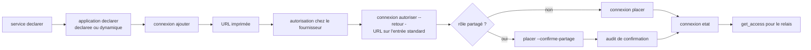
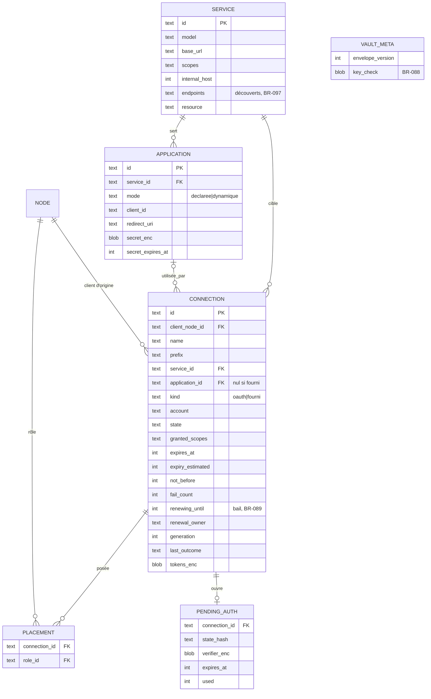

# F-006 · Connection library and outbound OAuth

## Metadata

| Field | Value |
|-------|-------|
| **Priority** | P2 |
| **Branch** | `feat/HULL-8-connexions` (two possible batches, §10) |
| **Last updated** | 2026-10-29 |

## 1. Context & Objective

### Current State

The v1 gateway (F-004, F-005 `implemented`) has an organisation › client › project › environment › role tree, operator tokens, an OAuth authorization server per access point, an authorization order and an audit log. It does not yet talk to any upstream service: a role's access point serves an empty tool list, and the gateway holds no provider secret. The per-organisation encryption key and the question "how does the gateway connect to a service" were sent back to this ticket by F-005 (§2 Out of Scope).

Today, a Cairn agent reaches Gitea with broad-scope service tokens left in clear text in a `.mcp.json` (brief): this is what the library must replace.

**Sources.** Original specification (ticket HULL-1, PDF extracted to `spec.txt`, 1,235 lines; the "spec l. N" references point to that extraction): objectives (l. 30-31), tree and library rules (l. 132-148), Library screen (l. 175-177), tool names and prefix (l. 494-498), outbound (l. 612-636), storage and backup (l. 668-684), threats (l. 760), tests (l. 1117-1135). To these are added F-005 (§2 Out of Scope, §3.2, BR-032, BR-047, BR-049, BR-066, BR-070, BR-072), `docs/trials/matrice-serveurs.md` (connection model, phase 2), `brief.md`, the F-005 learnings (bounds of a network exchange, single read-decision-write transaction, Sysbox and mounted secrets) and ticket HULL-8. The body of HULL-8 is one sentence: the framing is recorded in `.cairn/runs/acts/HULL-8-cadrage-1.md`, `-cadrage-2.md` and `-br-1.md`, and the operator's decisions in §9.

### Objective

Give the gateway a connection library: an account at a service, authorized once by outbound OAuth (declared application or dynamic registration) or supplied as a provided token, whose tokens are encrypted at rest, renewed under lock on use and placed on one or more roles of the tree under a short tool prefix. A connection cannot be shared outside its client, or between a sensitive and a non-sensitive role, without a confirmation traced at placement, and a change to the tree that creates such sharing is flagged. The relay (HULL-9) gets from it a valid token or a typed error, never a clear-text secret in a database, an output or a log.

### Expected Impact

- An operator connects two Gitea accounts (dev, reviewer) through the CLI, places them on two roles, and reads their state without any secret value appearing (AC of HULL-13 prepared).
- A concurrent renewal does not destroy a single-use-renewal grant (an uncertain outcome remains an accepted risk, §12); a transient provider outage does not ruin a healthy connection; a definitive refusal yields the visible "reauthentication required" state.
- Upstream tokens are unreadable in the database and its backup, the key staying outside the database.
- HULL-9 (relay), HULL-10 (policy), HULL-11 (web administration), HULL-12 (full audit) and HULL-13 (Cairn cutover) start from an existing library, existing placements and an existing "valid token" contract.

### Open Product Questions

The ambiguities of the framing were settled by the operator on 2026-10-29 (§9). Two readings are proposed without explicit validation and flagged in §9 (hypotheses H1 and H2).

Q1 (stress-test M16, exit of a provided-token connection refused): settled by the operator on 2026-10-29 — option a, `connexion reautoriser <c> --fichier <f|->` (BR-085, §9). No open question.

## 2. Scope

- **Model**: service (declarative record), organisation's outbound OAuth application, connection `<client>/<nom>` with its client of origin, short tool prefix, placement on a role, forward migrations.
- **Outbound authorization**: OAuth 2.1 with code and PKCE S256 for a hand-declared application **and** for a dynamic registration (RFC 7591) proven against a fake provider; authorization return pasted into the CLI, no new route.
- **Provided-token connection** — *operator addition, outside specification HULL-1* (decision A2 of 2026-10-29): same vault, same placement, no renewal.
- **Encrypted vault**: upstream tokens and secrets encrypted at rest (AES-256-GCM, versioned envelope) by the organisation's key, supplied through a mounted secret (`CONNECTIONS_KEY_FILE`); behavior without a key.
- **Life cycle**: renewal on use under lock, write before use, "reauthentication required" state, transient errors, `Retry-After` and exponential fallback, revocation, removal.
- **Sharing**: traced confirmation (`--confirme-partage`) for a placement outside the client of origin or between a sensitive and a non-sensitive role; flag when a tree change creates sharing.
- **CLI** `hullgate service|application|connexion …`, usage view in `connexion etat`, YAML export of connections without secrets, audit.
- **Internal contract** "valid token" for HULL-9.
- **Evidence**: fake OAuth provider in the tests and the bench, operator runbook and run against the real Gitea (AC-OP).

## Out of Scope

| Item | Recipient |
|---|---|
| Tool calls: 429 and `Retry-After` on upstream calls, delay shared per connection, rate limiting per connection (spec l. 505, 636) | HULL-9 (reuses the "not before" date of BR-094); rate limiting: HULL-12 |
| Name mapping table, truncation, filtered `tools/list`, `connection_id` of another role (l. 288, 494-496, 1119), cleaning of upstream errors (l. 504), caches, sessions | HULL-9 |
| A placement "can only restrict": modes, lists, pinning; writes closed in sensitive | HULL-10 |
| Library screen, OAuth return web route, passkey, YAML import with preview, history and undo | HULL-11 |
| Alert before deadline, OAuth health (failed renewals, upcoming expirations), statistics per connection | HULL-12 |
| Removal of tokens from the `.mcp.json` files, Gitea dev and reviewer served by the gateway | HULL-13 |
| Rotation of the encryption key (`kid`, `connexion rechiffrer`) | backlog candidate (versioned envelope ready, BR-087) |
| Multi-account merge (`account` parameter) | v2 (brief) |
| Blocking (rather than flagging) a tree change that creates sharing | to discuss with BR-047/BR-049 if the operator wants it |
| Several organisations per instance, differentiated administration roles | v2 (brief) |
| Background renewal task | not retained (D1 a); deadline alert: HULL-12 |
| Private certificate authority for an internal host: only the system certificate store of the image is used in v1 | backlog candidate (stress-test m10) |
| Management of a dynamic registration through RFC 7592 (`registration_access_token`): not kept, not used | backlog candidate |

## 3. Functional Spec

### 3.1 Model (SCR-01)

| Object | Content | Rules |
|---|---|---|
| **Service** | record: id, model (`gitea`, `generique`), https base URL, requested scopes, "internal host" option (host and port of the base URL), discovered endpoints and optional `resource` | BR-074, BR-084, BR-097 |
| **Application** | `client_id`, optional encrypted secret and its deadline, service, `redirect_uri`; mode `declaree` or `dynamique` | BR-081, BR-082, BR-083, BR-087 |
| **Connection** | `<client>/<nom>`, client of origin (node id), service, application or type `fourni`, prefix, account, granted scopes, state, deadline (exact or estimated), "not before" date, renewal lease and generation, last renewal outcome, encrypted token set | BR-074 to BR-077, BR-085 to BR-097 |
| **Placement** | pair (connection, role) | BR-077, BR-078 |

A connection belongs to the organisation (spec l. 139) and has only one token set whatever its number of placements (l. 140-141). Two connections of the same account with different scopes are two connections (l. 145-146).

**What a service model fixes** (BR-074, BR-097):

| Model | Discovery (at `service declarer`) | Account (BR-080) | Revocation | Scopes | `resource` (RFC 8707) | Default deadline (BR-091) |
|---|---|---|---|---|---|---|
| `gitea` | `/.well-known/openid-configuration` of the base URL | `preferred_username` read at the discovered `userinfo` endpoint; the model adds the `openid` scope | `revocation_endpoint` if announced, otherwise skipped and audited "not supported" | those of `--portees`, no default (a scope outside the list = full access at Gitea, §12) | not sent | 3600 s |
| `generique` | RFC 9728 (`/.well-known/oauth-protected-resource`), then RFC 8414, then OpenID Connect | `preferred_username`, otherwise `sub`, at the `userinfo` endpoint if announced, otherwise "unknown" | same | those of `--portees` | sent with the `resource` value read through RFC 9728, only if that document was found | 3600 s |

**`redirect_uri`** (BR-082): `http://127.0.0.1/oauth/retour`, a loopback address with no listener, registered with the application (to be entered as is at the provider for a declared application, sent to the dynamic registration). The operator's browser shows a connection error, and the operator copies the URL from its address bar. The web route of HULL-11 will add a second URI to the application, without replacing the first (BR-083: a re-registered dynamic client orphans its grants).

### 3.2 CLI (SCR-02)

Entry point `hullgate <groupe> <commande>` run in the container (F-005 §3.2 convention; the ticket and the specification write `passerelle connexion …`, the binary carries the product name). Audit actor `operator-cli`. Exit codes: 0 success, 2 refusal (constraint violated, nothing written), 1 database or key unavailable (nothing written, no secret printed). `--json` on the read commands. No command accepts a secret as an argument: a secret, a provided token and the authorization return URL (which carries the code) are read from a file or from standard input with `-` (`docker compose exec -T … < fichier`) (BR-086). A refusal or error message never repeats the return URL, the code, or the body or `error_description` of a provider response: only the `error` code from the closed list of BR-092, truncated to 64 characters.

| Group | Commands |
|---|---|
| `service` | `declarer <id> --serveur <url-https> [--modele gitea\|generique] [--portees a,b] [--hote-interne]` (discovers and displays the endpoints, and for an internal host the admitted addresses; BR-084, BR-097), `lister`, `redecouvrir <id> --confirm <id>` (BR-097), `retirer <id>` (refused if an application references it) |
| `application` | `declarer <id> --service <id> --mode declaree --client-id <id> [--secret-fichier <f\|->]`, `declarer <id> --service <id> --mode dynamique` (registers the gateway at the provider, BR-083), `lister`, `retirer <id>` (refused if referenced, BR-081), `reenregistrer <id> --confirm <id>` (displays, then moves its connections to `réauthentification requise`, BR-083) |
| `connexion` | `ajouter <client>/<nom> --service <id> --application <id> --prefixe <p>` (opens an authorization, prints the URL, state `en attente`); `ajouter <client>/<nom> --service <id> --fourni --fichier <f\|-> --prefixe <p> [--compte <libellé>]` (BR-085); `autoriser <client>/<nom> --retour - [--confirme-compte]` (reads the return URL on standard input, completes the authorization; BR-082, BR-096); `reautoriser <client>/<nom>` (OAuth: new URL, then `autoriser`; an `active` connection stays served until the exchange); `reautoriser <client>/<nom> --fichier <f\|->` (provided token: replaces the encrypted value, keeps name, prefix and placements, state `active`, audited; BR-085); `renouveler <client>/<nom>` (forced renewal, subject to the lease and the "not before" date, audited; refused with code 2 for a provided token or during the "not before" date, BR-089); `prefixe <client>/<nom> <p>` (as long as there is no placement); `placer <client>/<nom> <chemin-rôle> [--confirme-partage]`; `retirer-placement <client>/<nom> <chemin-rôle>`; `etat [<client>/<nom>]`; `lister`; `revoquer <client>/<nom>` (BR-095); `retirer <client>/<nom> --confirm <client>/<nom>` (BR-075) |

**Commands and connections key** (BR-088). Without a usable key (missing, unreadable, invalid or different): **allowed** — `etat`, `lister`, `placer`, `retirer-placement`, `prefixe`, `service lister|retirer`, `application lister|retirer`, and `revoquer` and `retirer` (local erasure; revocation at the provider is skipped and audited "key unavailable"); **refused with code 1**, nothing written — `ajouter`, `autoriser`, `reautoriser` (OAuth or `--fichier`), `renouveler`, `application declarer` with a secret or in dynamic mode, `application reenregistrer`. `service declarer`, `service redecouvrir` and `application declarer` without a secret do not need it. "Nothing is written" refers to the encrypted values: the erasure requested by `revoquer` or `retirer` remains allowed (spirit of BR-049: a revocation always remains possible).

`connexion etat` (BR-080): one line per connection — name, service, account, granted scopes, state, deadline (marked "estimated" if the provider did not give it), optional "not before" date, last renewal outcome if it is `incertaine` or `anomalie` — then its placements (role path, effective sensitivity). Example output:

```
mpx/gitea-dev   service gitea-dev   compte cairn-ai   portées write:issue  état active   échéance 2026-10-30T09:12Z
  placée sur mpx/cairn/dev/agent (non sensible)
mpx/gitea-rev   service gitea-rev   compte cairn-review   état réauthentification requise
  placée sur mpx/cairn/prod/review (sensible)
```

#### Visual States

- **SCR-02**: command accepted, code 0.
- **SCR-02.pending**: `ajouter` or `reautoriser`: the authorization URL is printed (never a secret nor the PKCE verifier), the connection is `en attente` for 10 minutes (BR-082).
- **SCR-02.refused**: constraint violated (name, client, prefix, duplicate, role, lock, sharing without confirmation, invalid `state`), code 2, message naming the constraint; nothing is written.
- **SCR-02.store-unavailable**: database unavailable, or key unavailable for a command of the "refused" list above, code 1, nothing written, nothing secret printed; the message says `clé absente`, `clé invalide` or `clé différente` (BR-088).
- **SCR-02.account-changed**: `autoriser` of a reauthorization whose account differs or is unknown, without `--confirme-compte`: code 2, accounts before and after named, old tokens kept (BR-096).
- **SCR-02.warning**: tree change creating sharing (BR-079): the tree command succeeds and prints the warning.

### 3.3 Internal contract to the relay (SCR-03)

Asynchronous function provided to HULL-9, indicative form (the exact name belongs to the implementation):

`get_access(connexion_id, role_id) -> Accès | erreur typée`

`signaler_refus(connexion_id, generation, motif) -> None`

- Both functions designate the connection and the role by their **id**, never by their name: a name changes when the client's segment is renamed (BR-074), and a re-created name designates another connection (BR-075).
- `Accès` carries a ready-to-use `Authorization` header, valid for at least 60 s (BR-091), and the `generation` of the token set it comes from; its textual representation is redacted (never a value in a log or a trace).
- Typed errors of `get_access`: `non_placee` (the connection is not placed on this role; no token read), `non_autorisee` (connection `en attente`, never authorized), `reauthentification_requise` (BR-092), `temporairement_indisponible(retry_after)` (BR-093, BR-094, BR-089), `cle_indisponible` (BR-088), `erreur_integrite` (a ciphertext that does not authenticate under a key whose check passes, BR-088: no state transition, audited).
- `signaler_refus` is called by HULL-9 when the provider answers 401 to a call made with an `Accès`. Effect: for a provided token, the connection moves to `réauthentification requise` (BR-085); for an OAuth connection, the access token of that generation is marked expired, and the next `get_access` renews (an `invalid_grant` then yielding BR-092). A signal carrying a generation that is no longer the current one is ignored: several 401s on the same token count only once. The signal is audited (BR-066 v2), without the raw upstream reason.
- The relay never calls the provider to renew; it never receives a client's incoming token on this path (BR-022, on the HULL-9 side).

### 3.4 No new HTTP route

The authorization return is pasted into the CLI (B1 b). The listeners stay those of F-005 §3.5 (BR-068).

## 4. Business Rules

**Overlap scan** (`br-identifiers.md` §Overlap), index of 72 lines, filter on connection, encrypt-, secret, key, token, renew-, revoc-, prefix, sensitive, audit, export, lock, backup, configuration, bounded, upstream: **37 lines retained**. **11 overlaps**: BR-032, BR-066, BR-070 — new version (C2); BR-049, BR-072, BR-047, BR-039, BR-045 — clarification (C3); BR-053, BR-062, BR-065 — neighboring new rule (C1, for BR-086, BR-084, BR-090). Off-topic after reading: BR-002, 003, 010, 012 to 016, 021, 022 (HULL-9 side), 026, 029, 035, 038, 040, 042, 044, 048, 050 to 052, 054, 055, 058, 059, 063, 068. Detail: `.cairn/runs/acts/HULL-8-br-1.md` §1. Operator: list BR-074 to BR-095 and `br-touched` validated on 2026-10-29, with the adjustment of BR-084 and the clarification of BR-045.

**Complementary stress-test scan** (2026-10-29, two new rules born from findings M11 and M4). BR-096 — filter on account, reauthoriz-, silent change, identity: **3 lines retained out of 72** (BR-002, BR-010, BR-073), off-topic after reading; neighbors in the spec: BR-082 — overlap — new rule (C1: PKCE and `state` can be respected with a silent account change, and the reverse); BR-077 (its clarification concerns the placement, not the authorization) — off-topic. BR-097 — filter on metadata, discover-, provider, upstream, rediscover-: **6 lines retained out of 72** (BR-002, 010, 013, 022, 056, 062); BR-056 (incoming discovery) and BR-062 (incoming client document) — off-topic after reading; in the spec, BR-083 — overlap — new rule (C1: the dynamic client can stay fixed while the endpoints change, and the reverse), BR-084 — overlap — new rule (C1: a bounded call can target an endpoint silently rediscovered). Allocation: **BR-096, BR-097**.

### BR-074 · A connection is named `<client>/<nom>` and carries its originating client

> **Extracted on 2026-10-29.** Current version: [`business-rules/BR-074.md`](../business-rules/BR-074.md).
> The content below reflects the state of this BR at the time of feature F-006 (v1).

*`behavioral` · `strict` · Candidate state: `verified` — `tests/unit/test_br_074_connection_name.py`.*

**Rule** — A connection belongs to the organisation, is named `<client>/<nom>` (existing client, segment-shaped name, unique under that client) and references a declared service; a nonexistent client or service, or a name already taken, is refused without writing anything.

**Clarifications**
- The client is referenced by its node id: renaming its segment changes the display, not the connection. Deleting a client that carries connections is refused (clarification of BR-045).
- A service is a declarative record (model, base URL, requested scopes, discovered endpoints, BR-097): `gitea` and `generique` are provided, what each one fixes is in §3.1; the operator declares the servers (`service declarer`). Source: spec lines 139, 212, 625.

### BR-075 · A removed connection never comes back to life, nor do its tokens

> **Extracted on 2026-10-29.** Current version: [`business-rules/BR-075.md`](../business-rules/BR-075.md).
> The content below reflects the state of this BR at the time of feature F-006 (v1).

*`behavioral` · `strict` · Candidate state: `verified` — `tests/unit/test_br_075_connection_removal.py`.*

**Rule** — Removing a connection erases its tokens and its placements in the same transaction and reserves its id; a connection recreated under the same name receives none of the previous one's tokens.

**Clarifications**
- Same mechanism as BR-045 for nodes. Deleting a role removes its placements in the transaction of BR-045 (spec line 1122).
- Revocation at the provider is attempted on a best-effort basis; its failure is audited (BR-066 v2) without preventing the removal.
- `retirer` takes the renewal lease of BR-089 like `revoquer` (BR-095): it waits for the end of a renewal in progress, reads the **current** tokens, erases and increments `generation` in the same transaction, then revokes at the provider outside the transaction.
- `retirer` is refused as long as a placement of the connection is under a locked node, and the refusal names the lock (BR-049, parity with the deletion of an ancestor of a locked node).
- Without a key (BR-088), `retirer` erases locally and skips the revocation at the provider, audited as "key unavailable".
- The prefix of a removed connection is freed (its placements are removed with it; a new placement is audited); only its id is reserved.

### BR-076 · A connection's tool prefix is short, unique, and fixed once placed

> **Extracted on 2026-10-29.** Current version: [`business-rules/BR-076.md`](../business-rules/BR-076.md).
> The content below reflects the state of this BR at the time of feature F-006 (v1).

*`behavioral` · `strict` · Candidate state: `verified` — `tests/unit/test_br_076_prefix.py`.*

**Rule** — The prefix is 2 to 8 characters `[a-z0-9]`, unique in the organisation, and no longer changes once a placement exists; a prefix that is invalid, already taken or modified after placement is refused.

**Clarifications**
- Source: spec line 494 ("short prefix configurable per connection", example `gr`). The name mapping table and the truncation belong to HULL-9. Length to be measured with Claude's clients (spec line 497).

### BR-077 · A placement puts a connection on a role, once

> **Extracted on 2026-10-29.** Current version: [`business-rules/BR-077.md`](../business-rules/BR-077.md).
> The content below reflects the state of this BR at the time of feature F-006 (v1).

*`behavioral` · `strict` · Candidate state: `verified` — `tests/unit/test_br_077_placement.py`.*

**Rule** — A connection is placed on a role, never on another level, only once per (connection, role) pair; a placement on another level, a duplicate or a nonexistent connection is refused. A role accepts several connections with distinct prefixes.

**Clarifications**
- The token set stays single whatever the number of placements (BR-089).
- Placing or removing a placement is an audit event (BR-066 v2); nothing changes account silently (spec lines 1127-1128).

### BR-078 · A sharing outside the client or between sensitive and non-sensitive requires a traced confirmation

> **Extracted on 2026-10-29.** Current version: [`business-rules/BR-078.md`](../business-rules/BR-078.md).
> The content below reflects the state of this BR at the time of feature F-006 (v1).

*`behavioral` · `strict` · Candidate state: `verified` — `tests/integration/test_br_078_sharing.py`.*

**Rule** — Placing a connection on a role of a client other than its originating client, or on a role whose effective sensitivity (BR-047) differs from that of a role where it is already placed, is refused (code 2) without `--confirme-partage`; with that flag, the warning and the confirmation are written to the audit.

**Clarifications**
- A single mechanism for the specification's safeguard (lines 147-148, 212) and the operator's decision of 2026-10-28 on prod / non-prod.
- The audit entry names the connection, the two roles and their two sensitivities.

**Example**
- **Given** `mpx/gitea-dev` is placed on `mpx/cairn/dev/agent` (non-sensitive)
- **When** the operator places it on `mpx/cairn/prod/review` (sensitive) without the flag
- **Then** refusal code 2 "sharing between a sensitive and a non-sensitive role: add --confirme-partage", nothing written; with the flag, the placement and the confirmation audit entry are written.

### BR-079 · A tree change that creates a sharing is signaled

> **Extracted on 2026-10-29.** Current version: [`business-rules/BR-079.md`](../business-rules/BR-079.md).
> The content below reflects the state of this BR at the time of feature F-006 (v1).

*`behavioral` · `warning` · Candidate state: `verified` — `tests/integration/test_br_079_sharing_signal.py`.*

**Rule** — Marking an environment sensitive, unmarking it, or moving a node in a way that makes a connection shared in the sense of BR-078 is signaled by the CLI before acting and in the audit, without blocking.

**Clarifications**
- Decision E1 b. A block would touch BR-047 and BR-049: out of scope (§2).

### BR-080 · `connexion etat` says what the connection is and where it serves, without any secret

> **Extracted on 2026-10-29.** Current version: [`business-rules/BR-080.md`](../business-rules/BR-080.md).
> The content below reflects the state of this BR at the time of feature F-006 (v1).

*`behavioral` · `strict` · Candidate state: `verified` — `tests/unit/test_br_080_state_view.py`.*

**Rule** — `hullgate connexion etat` shows for each connection its service, its account, the granted scopes, its state, its deadline and its placements with the effective sensitivity of each role, and never a token, secret or code value; `--json` returns the same fields.

**Clarifications**
- Source: spec line 147 ("where used" view), 175-177. No other `connexion`, `application` or `service` command prints a secret value.
- The account is read at the code exchange through the path that the service's model fixes (§3.1: `userinfo` endpoint, call bounded by BR-084), kept in clear (it is not a secret) and never re-read at renewal. For a provided token: the `--compte` label entered at `ajouter`, otherwise "unknown".
- `etat` also shows the "estimated" deadline (BR-091), the last outcome `incertaine` or `anomalie` (BR-090, BR-092) and, without a key, `clé absente`, `clé invalide` or `clé différente` (BR-088).
- `etat` without a name ends with the line `clé de connexions : utilisable` or the reason for the unavailability, readable even without any connection: it is the reading the runbook does after each deployment (§12, forgotten key).

### BR-081 · An outbound OAuth application belongs to the organisation and serves several connections

> **Extracted on 2026-10-29.** Current version: [`business-rules/BR-081.md`](../business-rules/BR-081.md).
> The content below reflects the state of this BR at the time of feature F-006 (v1).

*`behavioral` · `strict` · Candidate state: `verified` — `tests/unit/test_br_081_application.py`.*

**Rule** — An application (service, `client_id`, optional encrypted secret) is declared once and can be referenced by several connections; deleting an application that a connection references is refused.

**Clarifications**
- Source: spec lines 136, 637. No uniqueness on (application, account): two connections with different scopes on the same account are allowed (lines 145-146).

### BR-082 · Outbound authorization requires PKCE S256 and a single-use `state`

> **Extracted on 2026-10-29.** Current version: [`business-rules/BR-082.md`](../business-rules/BR-082.md).
> The content below reflects the state of this BR at the time of feature F-006 (v1).

*`behavioral` · `strict` · Candidate state: `verified` — `tests/integration/test_br_082_authorization.py`.*

**Rule** — Every outbound authorization uses the authorization code flow with PKCE S256 and a random `state` bound to the authorization opened by the CLI, single-use and expiring in 10 minutes; a response whose `state` is unknown, already used or expired is refused without exchanging the code.

**Clarifications**
- B1 b: the CLI displays the URL; the operator passes the return URL to `connexion autoriser --retour -` on standard input (BR-086: it carries the code); no new route (BR-068 holds). The `redirect_uri` is the application's (§3.1, `http://127.0.0.1/oauth/retour`): the authorization URL and the code exchange carry the same value.
- `resource` (RFC 8707) is sent according to the service's model (§3.1): for `generique`, only when the RFC 9728 discovery found a value, kept in the record (BR-097).
- The `state` is consumed in a short transaction **before** the code exchange. An exchange that fails afterwards (BR-092, BR-093) requires a new `reautoriser`; two concurrent `autoriser` calls on the same `state`: the second is refused as "already used". A return carrying `error=` (for example `access_denied`) consumes the `state`, answers code 2 with the `error` code alone, leaves the connection in its state and is audited without the URL.
- `en attente` lasts until `autoriser`, `reautoriser` or `retirer`; the `state` expires on its own after 10 minutes, the connection remaining `en attente`. `reautoriser` from `en attente` replaces the open authorization and makes the old `state` invalid (at most one open authorization per connection). `get_access` on an `en attente` connection returns `non_autorisee` (§3.3).
- `reautoriser` on an `active` connection opens an authorization without touching its tokens, which stay served until the exchange succeeds; they are then replaced and the old ones revoked on a best-effort basis. The account obtained is compared with the recorded account (BR-096).

### BR-083 · An outbound dynamic registration is kept before use and never redone on its own

> **Extracted on 2026-10-29.** Current version: [`business-rules/BR-083.md`](../business-rules/BR-083.md).
> The content below reflects the state of this BR at the time of feature F-006 (v1).

*`behavioral` · `strict` · Candidate state: `verified` — `tests/integration/test_br_083_dynamic_registration.py`.*

**Rule** — The `client_id` and the secret obtained by dynamic registration (RFC 7591) are kept before any authorization, the `client_id` in clear and only the secret encrypted; they are redone only by an explicit command, because registering again orphans the grants.

**Clarifications**
- Proved against the fake provider (P1 a). Source: spec l. 631-634; phase 2 matrix (Notion).
- `application reenregistrer` first displays the connections that reference the application. In the same transaction as the write of the new `client_id` and the new secret, it sets them to `réauthentification requise` and erases their tokens; their revocation at the provider is attempted on a best-effort basis with the **old** client, outside the transaction. The operation is audited (BR-066 v2).
- The `client_id` is not a secret (RFC 6749 §2.2): in clear like that of a declared application (§3.1, §6.5, BR-081), it appears in the authorization URL and is displayed by `application lister` and the export (BR-070 v2); the returned secret follows BR-087. The returned authentication method is kept with the application (`auth_method`).
- The registration asks for `token_endpoint_auth_method: none` (public PKCE client, decision B2); if the provider returns a secret anyway, it is kept encrypted and presented per the returned method. `client_secret_expires_at` is kept and displayed by `application lister`; an expired secret gives `invalid_client`, classified in the BR-092 table. `registration_access_token` (RFC 7592) is not kept (§Out of Scope).

### BR-084 · Every outbound call to a provider is bounded

> **Extracted on 2026-10-29.** Current version: [`business-rules/BR-084.md`](../business-rules/BR-084.md).
> The content below reflects the state of this BR at the time of feature F-006 (v1).

*`behavioral` · `strict` · Candidate state: `verified` — `tests/unit/test_br_084_outbound_bounds.py`.*

**Rule** — Discovery, registration, code exchange, account reading (`userinfo`), renewal and revocation toward a provider use https, without redirect, with a hard deadline of 10 s on the whole exchange and 256 KiB of response; a non-public address is refused, except that a host that the service record declares as an internal host may resolve to a private address, never to loopback, link-local, the unspecified address or multicast; any gap is a failure of the call.

**Clarifications**
- The exception is named by the operator when the service is declared (`--hote-interne`), audited at that moment (BR-066 v2), and applies only to the **host and port** of the record's base URL, compared after normalization (lowercase, trailing dot removed, IDNA, canonical IP literal: `127.1`, `0x7f000001` and `[::ffff:127.0.0.1]` are read as `127.0.0.1`). `service declarer` displays and audits the resolved addresses allowed at that moment. No environment variable or configuration option lifts the bound; the tests inject their own fetcher, as for BR-062.
- Like BR-062: **all** the resolved addresses of a name are verified (a mixed public and private resolution is refused outside the exception), and the connection is made to the verified address, the name serving for SNI and certificate verification; a DNS rebind between the verification and the connection therefore has no effect.
- Mechanism: the bounded fetcher of BR-062 (`cimd.py`: `http.client`, `socket`, `ssl`, worker thread, connection to the verified address), extended to POST and to headers (`hullgate.outbound`). The default TLS context loads OpenSSL's compiled paths, never `SSL_CERT_FILE` nor `SSL_CERT_DIR`. `httpx` is not used for outbound calls (it reads `HTTPS_PROXY`, `ALL_PROXY`, `SSL_CERT_FILE` and `.netrc` by default). No proxy or certificate environment variable is read. Learnings from F-005: the deadline is hard on the whole exchange (DNS and connection included), proved with a slow drip in keep-alive, `Connection: close` and HTTP/1.0.

### BR-085 · A provided-token connection is never renewed

> **Extracted on 2026-10-29.** Current version: [`business-rules/BR-085.md`](../business-rules/BR-085.md).
> The content below reflects the state of this BR at the time of feature F-006 (v1).

*`behavioral` · `strict` · Candidate state: `verified` — `tests/unit/test_br_085_static_token.py`.*

**Rule** — A provided-token connection keeps its value encrypted like any connection, is never renewed, goes to `réauthentification requise` only if the provider refuses it, and changes value only through `connexion reautoriser <c> --fichier <f|->`, which replaces the encrypted value while keeping name, prefix and placements and sets it back to `active`.

**Clarifications**
- **Operator addition, outside specification HULL-1** (decision A2, 2026-10-29): fallback if a provider refuses an OAuth token.
- The provider's refusal arrives through `signal_refusal` (§3.3), called by HULL-9 on an upstream 401: one signal of the current generation is enough. Until HULL-9, only the tests call it (AC-14).
- Value replacement (operator decision of 2026-10-29, Q1 a, stress-test M16): from `active` or `réauthentification requise`; the value is read from a file or standard input (BR-086), the old one is erased in the same transaction, `generation` is incremented (a `signaler_refus` for the old value is ignored), and the event is audited without the value (BR-066 v2). The labeled account (`--compte`) can be changed in the same command. `--fichier` on an OAuth connection, or without `--fichier` on a provided connection: code 2.

### BR-086 · A secret enters through a file, never through an argument

> **Extracted on 2026-10-29.** Current version: [`business-rules/BR-086.md`](../business-rules/BR-086.md).
> The content below reflects the state of this BR at the time of feature F-006 (v1).

*`behavioral` · `strict` · Candidate state: `verified` — `tests/unit/test_br_086_secret_input.py`.*

**Rule** — The value of a provided token (at `ajouter` as at `reautoriser`), of an application secret or of an authorization return URL is read from a file or from standard input (`--fichier`, `--secret-fichier`, `--retour`, with `-` for standard input); a value given as a command argument is refused and is echoed neither in an output, nor in the audit, nor in a log.

**Clarifications**
- Neighbor of BR-053 (operator token shown once). The file is the operator's; the session generates no production one (BR-032).
- The CLI runs in the container: the runbook uses standard input (`docker compose exec -T … < jeton.txt`), because the operator's file is on the production server and a secret `docker cp` is fragile under Sysbox (learning F-005). A trailing newline is removed; an empty value is refused (code 2).
- The return URL carries the authorization code (secret value, BR-066): a refusal of `autoriser` (unknown `state`, provider `error=`) echoes neither the URL nor the code in the message, the audit or the log.

### BR-087 · Upstream secrets are encrypted at rest by the organisation's key

> **Extracted on 2026-10-29.** Current version: [`business-rules/BR-087.md`](../business-rules/BR-087.md).
> The content below reflects the state of this BR at the time of feature F-006 (v1).

*`behavioral` · `strict` · Candidate state: `verified` — `tests/unit/test_br_087_encryption.py`.*

**Rule** — Upstream tokens, application secrets and registration secrets are written encrypted (AES-256-GCM, unique nonce, versioned envelope) with a key kept outside the database; a value found in clear in a table, the backup or the `-wal` file fails the test.

**Clarifications**
- Source: spec l. 629, 670-671, 760. Envelope ready for a future rotation (C1 a), which is not delivered.
- Each ciphertext is bound to its place: associated data (AAD) = envelope version ‖ table ‖ row id ‖ field name. A ciphertext moved to another row or another field does not decrypt (`erreur_integrite`, BR-088).
- Population (`executable-guards.md` §The population): the sweep covers all the tables and the files of the database after a complete run (authorization, renewal, dynamic registration, provided token); dated finding, commit, instrument to record at delivery.

### BR-088 · Without an encryption key, connections are unavailable and nothing is decrypted

> **Extracted on 2026-10-29.** Current version: [`business-rules/BR-088.md`](../business-rules/BR-088.md).
> The content below reflects the state of this BR at the time of feature F-006 (v1).

*`behavioral` · `strict` · Candidate state: `verified` — `tests/integration/test_br_088_key_unavailable.py`.*

**Rule** — When the connections key is absent, unreadable, invalid or different from the database's (key check), each connection is seen as `clé indisponible`, no token is decrypted or returned, no encrypted value is written and no state is changed by the gateway, and the gateway stays ready; recovery is seen at the next request.

**Clarifications**
- Reading B of decision C2 c (hypothesis H1, §9): `/readyz` does not change (BR-033 unchanged), the inbound side does not need the connections.
- **Key check**: HMAC-SHA256(key, fixed constant), truncated to 16 bytes, written to the database in the transaction of the first ciphertext. A key of the right format whose key check differs (regenerated secret, backup restored on another instance) is treated as absent: nothing is decrypted, written or erased by the gateway, and the audit and `etat` say `clé différente`. Without this guard, "decryption impossible" would read as "invalid token" and would empty the library.
- A ciphertext that does not authenticate under a key whose check passes (isolated row, AAD of BR-087) is a typed and audited `erreur_integrite`, never a state transition.
- Commands allowed and refused without a key: closed list of §3.2. "No encrypted value written" does not prevent the explicit erasure requested by `revoquer` or `retirer` (BR-095, BR-075).
- `clé indisponible` is audited once per (connection, reason) as long as the reason does not change (review 417, m2); the marker lives in a separate table (`key_alert`), the connection's row is not touched, and recovery of the key erases it.
- Lost key: a database whose key check is set refuses any other key, even with no live ciphertext. Recovery gesture: `python -m hullgate.keys connections-key-forget --confirm`, refused as long as a ciphertext lives (connection, application with secret, open authorization), which forgets the key check; the next key is adopted at the first ciphertext (runbook `keys-and-upstreams.md`, step C12; review 417, o1).

### BR-089 · The renewal of a connection is serialized, across all processes

> **Extracted on 2026-10-29.** Current version: [`business-rules/BR-089.md`](../business-rules/BR-089.md).
> The content below reflects the state of this BR at the time of feature F-006 (v1).

*`behavioral` · `strict` · Candidate state: `verified` — `tests/integration/test_br_089_renewal_lock.py`.*

**Rule** — At most one renewal per connection runs at a time, whatever the number of roles that share it or of processes (server, CLI); a second caller waits for the first one's result until the end of its lease, then receives `temporairement_indisponible`, instead of presenting the same renewal a second time.

**Clarifications**
- Source: spec l. 629-630. **Renewal lease per connection** — SQLite's write lock is global to the database: no write transaction is held during the call to the provider, otherwise `/readyz` (BR-033 v2, lock in 1 s) and the inbound OAuth routes (BR-064) would answer 503 for up to 10 s.
  1. A short `BEGIN IMMEDIATE` transaction rereads state, `not_before`, deadline, lease (`renewing_until`, `renewal_owner`) and `generation`. If a live lease exists, it writes nothing; otherwise it sets the lease for 12 s (hard deadline of 10 s of BR-084 + 2 s) and commits.
  2. The call to the provider is made outside a transaction.
  3. A second short transaction writes the result (BR-090) only if that caller still holds the lease and if `generation` is unchanged, then releases the lease. A result that arrives outside the lease or on a changed generation is discarded and its tokens revoked on a best-effort basis.
  4. A caller that finds a live lease rereads the state by polling (step of 250 ms at most) until the end of the lease + 1 s: it returns the token written by the first one if there is one, otherwise `temporairement_indisponible(retry_after)`.
- The learning from F-005 (read, decision and write under one transaction, otherwise the race becomes a false 503) applies to each short transaction, never to the network call.
- An expired lease with no written result marks an `incertaine` outcome (BR-090), which the next caller audits before setting its own lease.
- The same lease is taken by `connexion renouveler` (also subject to the "not before" date), by the writing of the tokens of an `autoriser` on an already authorized connection, and by `revoquer` and `retirer` (BR-095, BR-075).

### BR-090 · The new token is recorded before it is returned

> **Extracted on 2026-10-29.** Current version: [`business-rules/BR-090.md`](../business-rules/BR-090.md).
> The content below reflects the state of this BR at the time of feature F-006 (v1).

*`behavioral` · `strict` · Candidate state: `verified` — `tests/integration/test_br_090_persist_before_use.py`.*

**Rule** — A token resulting from a renewal is returned to the relay only after its encrypted write; if the write fails, nothing is returned and the connection's state is unchanged.

**Clarifications**
- A lost single-use renewal orphans the grant (matrix, risk 2). Neighbor of BR-065 (inbound issuances).
- The renewed tokens and the audit entry of the outcome are written in the same transaction; if it fails, nothing is returned (parity with BR-065).
- A write that fails is retried as long as the caller holds the lease (BR-089); the tokens are kept only in memory during these attempts, never elsewhere.
- **`incertaine` outcome**: the renewal request has gone out and no response was written (deadline or cut after sending, write impossible until the end of the lease). The state and the encrypted token remain those from before; the outcome is audited (at the latest by the next caller, BR-089) and `etat` displays it; it counts as a transient failure for BR-094. An `invalid_grant` that follows an uncertain outcome is audited with that reason. The replay that follows may destroy the grant at a provider with no grace: accepted risk, §12.

### BR-091 · A token that expires in less than 60 s is never returned

> **Extracted on 2026-10-29.** Current version: [`business-rules/BR-091.md`](../business-rules/BR-091.md).
> The content below reflects the state of this BR at the time of feature F-006 (v1).

*`behavioral` · `strict` · Candidate state: `verified` — `tests/unit/test_br_091_expiry_margin.py`.*

**Rule** — Requesting the token of a connection whose deadline is in less than 60 s first triggers its renewal; the token returned is valid for at least 60 s, otherwise the call fails with a typed error.

**Clarifications**
- D1 a: renewal on use, no background task. Clock injected in the tests.
- **Incomplete token response**: without `expires_in`, the model's default deadline (§3.1, 3600 s) applies, displayed as "estimated"; `expires_in` ≤ 60 makes the rule untenable: the code exchange is refused (code 2) and a renewal is a definitive outcome, reason `échéance trop courte` (BR-092); without `refresh_token`, the connection goes to `réauthentification requise` when its token enters the 60 s margin, without a call to the provider; a renewal without a new `refresh_token` keeps the old one; different scopes granted at renewal are recorded and audited before and after.

### BR-092 · A definitive provider refusal puts the connection in the reauthentication-required state

> **Extracted on 2026-10-29.** Current version: [`business-rules/BR-092.md`](../business-rules/BR-092.md).
> The content below reflects the state of this BR at the time of feature F-006 (v1).

*`behavioral` · `strict` · Candidate state: `verified` — `tests/integration/test_br_092_reauth_required.py`.*

**Rule** — A response that the table below classifies as definitive (including `invalid_grant`, revocation at the provider, the refused scope and the new consent required) places an OAuth connection in the `réauthentification requise` state; in this state no token is returned and no renewal is attempted until a `connexion reautoriser` followed by a successful `autoriser`, or for a provided-token connection until `connexion reautoriser --fichier` (BR-085).

**Clarifications**
- Source: spec l. 631-632. A revocation at the provider reads as `invalid_grant` at renewal, or arrives through `signal_refusal` (§3.3) on an upstream 401, which causes the renewal.
- **Closed classification of responses** (code exchange, renewal; shared with BR-093). The audit reason and the CLI message carry only the `error` code, never the body nor `error_description`.

| Provider response | Outcome | Effect |
|---|---|---|
| `invalid_grant`, `invalid_scope`, `consent_required`, `interaction_required`, `login_required` | definitive | `réauthentification requise` |
| `invalid_client`, `unauthorized_client` | definitive, reason `application` | `réauthentification requise`; `etat` names the application to redeclare or reregister (reauthorizing alone is not enough) |
| `expires_in` ≤ 60 | definitive, reason `échéance trop courte` | `réauthentification requise` (BR-091) |
| failure before the request is completely sent (DNS, connection, TLS), 5xx response, 429 | transient | state and token unchanged, `temporairement_indisponible` (BR-093, BR-094) |
| request sent, response absent or not written (10 s deadline, cut, write impossible) | uncertain | same, outcome audited (BR-090) |
| any other response: other 4xx, malformed JSON, response > 256 KiB, redirect, refused address | transient, reason `anomalie` | same, audited, no token erased |

At `autoriser`, a definitive or transient outcome answers code 2 (definitive) or 1 (transient) without writing anything; the `state` being consumed, the operator reruns `reautoriser` (BR-082).

### BR-093 · A transient failure changes neither the state nor the token

> **Extracted on 2026-10-29.** Current version: [`business-rules/BR-093.md`](../business-rules/BR-093.md).
> The content below reflects the state of this BR at the time of feature F-006 (v1).

*`behavioral` · `strict` · Candidate state: `verified` — `tests/integration/test_br_093_transient_failure.py`.*

**Rule** — A response that the BR-092 table classifies as transient or uncertain (network error, deadline exceeded, 5xx or 429 response, anomaly) during a renewal leaves the connection's state and encrypted token unchanged, and the caller receives a typed `temporairement_indisponible` error.

**Clarifications**
- Rules out the fault of ruining a healthy connection over a passing outage (framing D2).

### BR-094 · `Retry-After` is honored, otherwise a bounded exponential fallback

> **Extracted on 2026-10-29.** Current version: [`business-rules/BR-094.md`](../business-rules/BR-094.md).
> The content below reflects the state of this BR at the time of feature F-006 (v1).

*`behavioral` · `strict` · Candidate state: `verified` — `tests/integration/test_br_094_backoff.py`.*

**Rule** — After a 429 or a transient or uncertain outcome of a renewal, no attempt takes place before a "not before" date kept in the database: `Retry-After` when the provider gives a valid one, capped at 15 min, otherwise a fallback of 1 s doubling at each failure up to 15 min; the date is shared by all processes, and the fallback returns to zero after a successful renewal or a successful `autoriser`.

**Clarifications**
- Source: spec l. 636. Scope: the renewal point (N1 a); tool calls fall under HULL-9.
- `Retry-After` in seconds or as an HTTP date; an invalid value or a past date counts as an absent header (fallback).

### BR-095 · `revoquer` cuts access without losing the placements

> **Extracted on 2026-10-29.** Current version: [`business-rules/BR-095.md`](../business-rules/BR-095.md).
> The content below reflects the state of this BR at the time of feature F-006 (v1).

*`behavioral` · `strict` · Candidate state: `verified` — `tests/integration/test_br_095_revoke.py`.*

**Rule** — `hullgate connexion revoquer` revokes the tokens at the provider (best effort), erases the encrypted tokens and sets the connection to `réauthentification requise`, keeping its name, its prefix and its placements.

**Clarifications**
- N3 b. `retirer` (BR-075) then deletes. The failure of the revocation at the provider is audited (BR-066 v2), without blocking.
- `revoquer` takes the lease of BR-089: it waits for the end of a renewal in progress, reads the **current** tokens, erases them, changes the state and increments `generation` in the same transaction, then revokes at the provider outside the transaction. A renewal result that arrives afterwards is discarded and revoked on a best-effort basis (BR-089): no revoked connection comes back to life.
- The revocation at the provider uses the kept `revocation_endpoint` (BR-097); if not announced, it is skipped and audited "not supported". Without a key (BR-088), local erasure, revocation skipped and audited "key unavailable".
- `revoquer` is outside the lock (BR-049: a revocation always remains possible).
- An access token already returned to HULL-9 stays valid at the provider until its deadline, unless the revocation reaches it (§12).

### BR-096 · A reauthorization does not silently change account

> **Extracted on 2026-10-29.** Current version: [`business-rules/BR-096.md`](../business-rules/BR-096.md).
> The content below reflects the state of this BR at the time of feature F-006 (v1).

*`behavioral` · `strict` · Candidate state: `verified` — `tests/integration/test_br_096_account_change.py`.*

**Rule** — When the code exchange of a reauthorization returns an account different from the recorded account, or when one of the two is unknown, `connexion autoriser` is refused (code 2) without `--confirme-compte`: no token is written and the old ones stay in place; with this flag, the audit carries the account and the scopes before and after.

**Clarifications**
- Source: spec l. 1127-1128 ("no silent account change"); the operator refuses any AI token on their personal account (learning `inbox/2026-10-27-product.md`). Same form as `--confirme-partage` (BR-078).
- The tokens obtained by the refused exchange are revoked on a best-effort basis, never written; the `state` being consumed (BR-082), the operator reruns `reautoriser` then `autoriser --confirme-compte`.
- The account is read through the model's path (§3.1, BR-080). A provided token is not reauthorized (BR-085): the rule does not target it.

**Example**
- **Given** `mpx/gitea-dev` is `active` under the account `cairn-ai`
- **When** the operator reauthorizes it and signs in at Gitea as `alice`
- **Then** `autoriser` answers code 2 "different account: cairn-ai → alice; add --confirme-compte", the connection stays `active` under `cairn-ai` with its tokens.

### BR-097 · A provider's endpoints are fixed when the service is declared

> **Extracted on 2026-10-29.** Current version: [`business-rules/BR-097.md`](../business-rules/BR-097.md).
> The content below reflects the state of this BR at the time of feature F-006 (v1).

*`behavioral` · `strict` · Candidate state: `verified` — `tests/integration/test_br_097_endpoints.py`.*

**Rule** — Code exchange, account reading, renewal, revocation and registration use only the endpoints discovered at `service declarer` and kept in the service record; a kept value changes only through `service redecouvrir`, never in the course of a call.

**Clarifications**
- Otherwise a modified metadata document (compromised provider, configuration error, intermediate cache) would silently send the renewal tokens and the application secrets to another host, at every renewal.
- Discovery per the model (§3.1), bounded by BR-084; a non-https endpoint is refused at declaration (code 2). The values are displayed by `service lister` and audited at declaration; `service redecouvrir <id> --confirm <id>` audits the values before and after and does not touch the connections.

### Existing rules modified by F-006 (`br-touched`)

> **Extracted on 2026-10-29.** Carried over into their files: [`BR-032`](../business-rules/BR-032.md) v3, [`BR-039`](../business-rules/BR-039.md) v2, [`BR-045`](../business-rules/BR-045.md) v2, [`BR-047`](../business-rules/BR-047.md) v2, [`BR-049`](../business-rules/BR-049.md) v2, [`BR-066`](../business-rules/BR-066.md) v2, [`BR-070`](../business-rules/BR-070.md) v2, [`BR-072`](../business-rules/BR-072.md) v2. The table below reflects the deltas as F-006 froze them.

To be carried over into their files at extraction (`close-feature` Phase 3), which changes their version or their clarifications.

| BR | Resolution | Exact delta |
|---|---|---|
| **BR-032** | v3 (C2) | Rule: add `CONNECTIONS_KEY_FILE` to the list of variables. Clarification: default `/run/secrets/connections_key`, a 32-byte file in base64; key missing, invalid or different (key check): the gateway starts and BR-088 applies; the secret is never generated by the session. |
| **BR-066** | v2 (C2) | Rule: add to the audited events creation, authorization, reauthorization (with account and scopes before and after, BR-096), replacement of a provided token's value (BR-085), revocation and removal of a connection; declaration and rediscovery of a service (endpoints, and internal-host exception with the admitted addresses where applicable); declaration and re-registration of an application; placement and removal of placement; sharing confirmation (BR-078); outcome of a renewal (returned, definitive, transient, uncertain, anomaly); refusal flagged by HULL-9; refusal of `autoriser`; key unavailable or different; integrity error; no entry contains a token value, secret, code or return URL, nor a full fingerprint, nor the body or `error_description` of a provider response (only the `error` code from the closed list of BR-092, truncated). Clarification: remove "HULL-8 will write the confirmation there…", it is written. |
| **BR-070** | v2 (C2) | Rule: the export also carries the services, the applications (`client_id`, no secret) and the connections (name, service, prefix, application, state, placements); it stays free of tokens, fingerprints, secrets and audit entries. `format` becomes 2. Clarification: "nor OAuth client" concerns only the inbound clients of BR-061; a reimport requires reauthenticating the connections (spec l. 682-683); deterministic order by name. |
| **BR-049** | clarification (C3) | Placing a connection on a role or removing that placement is a setting change (spec l. 155) refused under a locked node; `connexion retirer` is refused as long as a placement of the connection is under a locked node (parity with deleting an ancestor, BR-045); `connexion revoquer` is outside the lock (a revocation always remains possible); the refusal names the locking node. |
| **BR-047** | clarification (C3) | The list of what the CLI displays before marking or unmarking grows by the connections that the change makes shared (BR-079). |
| **BR-072** | clarification (C3) | Replace "No client secret exists in F-005 (public clients, BR-061)" with "No **inbound** client secret exists (BR-061); encrypted upstream secrets fall under BR-087"; add that the backup carries no usable value, the key staying outside the database. |
| **BR-039** | clarification (C3) | `restore-check` starts without a connections key: when the backed-up database carries connections, the restoration is proven with those connections seen as `clé absente` (BR-088) and the same number of rows per table. No disposable connections key is supplied: it would create the "different key" case on a copy of the production database without proving anything more. |
| **BR-045** | clarification (C3) | Deleting a client that carries connections is refused, the refusal names the connections; deleting a role removes its placements in the same transaction. |

## 5. Acceptance Criteria

### Gate and tests (session)

- [ ] **AC-01** (all) — `make gate` on the branch: last line `GATE: OK`, code 0; pasted into the PR.
- [ ] **AC-02** (BR-074 to BR-097) — each rule introduced has at least one `test_br_NNN_*` test in `tests/unit` or `tests/integration` (their success is read by AC-01): `grep -rhoE 'def test_br_0(7[4-9]|8[0-9]|9[0-7])_' tests/unit tests/integration | grep -oE 'br_0[0-9]{2}' | sort -u | wc -l` = 24 distinct numbers. The extension of the tests of the touched rules is read by AC-25.

### Model and placement

- [ ] **AC-03** (BR-074) — `connexion ajouter mpx/gitea-dev --service gitea-dev …`: accepted; the same command a second time, a client `inconnu/x`, a nonexistent service and an invalid name: code 2, database unchanged (row count before/after).
- [ ] **AC-04** (BR-075) — after `retirer`, no token row or placement remains and the database file no longer contains the ciphertext; re-created under the same name, the connection is `en attente` without a token.
- [ ] **AC-05** (BR-076) — prefix `g`, `abcdefghi`, `GR`, an already taken prefix: code 2; changing the prefix before placement: accepted, after placement: code 2.
- [ ] **AC-06** (BR-077) — placement on a client, a project, an environment: code 2; on a role: accepted; the same pair twice: code 2; two connections with distinct prefixes on a role: accepted.
- [ ] **AC-07** (BR-078) — scenario of the example: refusal code 2 without the flag (nothing written), success with `--confirme-partage` and an audit entry carrying connection, two roles, two sensitivities; same mechanism for a role of another client.
- [ ] **AC-08** (BR-079) — `tree sensitive mpx/cairn/prod on` while a connection is placed on `prod` and on a non-sensitive role: output with warning, code 0, audit entry; `tree move` of a node carrying a placed role to another client: same.
- [ ] **AC-09** (BR-080) — `connexion etat --json` contains service, account, scopes, state, deadline, placements and effective sensitivity; sweep of the output of all `service`, `application`, `connexion` commands of the suite's run: no token, secret or code value generated by the suite (in-memory list of the fixture).

### Outbound OAuth and secrets

- [ ] **AC-10** (BR-081) — two connections reference the same application; `application retirer`: code 2 as long as one of them exists, accepted after their removal.
- [ ] **AC-11** (BR-082) — against the fake provider: the printed URL carries `code_challenge_method=S256`, a `state` and `redirect_uri=http://127.0.0.1/oauth/retour`, and the code exchange sends the same `redirect_uri` (upstream log); `resource` is present for a `generique` service whose fake publishes RFC 9728, absent otherwise; `autoriser --retour -` with an unknown, replayed and expired `state` (clock injected at +10 min): code 2, the fake provider receives no code exchange (upstream log, like BR-002); two concurrent `autoriser` calls on the same `state`: a single exchange reaches the fake; `error=access_denied` return: code 2, connection unchanged; `--retour <url>` as an argument: code 2; neither the URL nor the code appears in the output, the audit or the log of these refusals (in-memory list of the fixture); `get_access` on an `en attente` connection: `non_autorisee`; `reautoriser` from `en attente`: the old `state` is refused, the new one accepted; with the right `state`: connection `active`, account and scopes recorded.
- [ ] **AC-12** (BR-083) — `application declarer --mode dynamique`: the returned `client_id` is read in the database in clear text and the returned secret encrypted, before the first authorization; a second identical command: code 2; `reenregistrer --confirm`: accepted, audited; its two connections move to `réauthentification requise` with no encrypted token, and the fake receives their revocation under the old `client_id`; the secret returned by the fake is read encrypted and `client_secret_expires_at` is displayed by `application lister`.
- [ ] **AC-13** (BR-084) — fake server that slow-drips (headers then body) in keep-alive, `Connection: close` and HTTP/1.0: the call fails before 10 s + margin; redirection, response > 256 KiB, plain http, private / loopback / link-local address: refused, no request goes to the refused address (log of the fake resolver and server); mixed resolution (one public address, one private): refused; injected resolver that changes its answer between two calls: the connection is made to the checked address; host declared `--hote-interne` that resolves to a private address: accepted, addresses displayed and audited at declaration; the same host resolving to `127.0.0.1`, `169.254.169.254`, or written `127.1`, `0x7f000001`, `[::ffff:127.0.0.1]`: refused; same host on another port: refused; `HTTPS_PROXY`, `ALL_PROXY` and `SSL_CERT_FILE` set in the process environment toward a fake proxy: the proxy receives no connection and the call reaches the targeted server.
- [ ] **AC-14** (BR-085, §3.3) — connection `--fourni --fichier -` (value on standard input, final newline removed; empty value: code 2): active without authorization, `get_access` returns the value, no renewal request goes out at the deadline; `signaler_refus` with the current generation: `réauthentification requise`; with a stale generation: ignored; `reautoriser --fichier -` on that connection in `réauthentification requise`: `active`, new value returned by `get_access`, old value absent from the database (sweep), name, prefix and placements unchanged (count before/after), one audit entry without a value; `reautoriser --fichier` on an OAuth connection: code 2. OAuth connection: `signaler_refus` marks the token expired, the next `get_access` renews only once even after three signals of the same generation; if the fake then answers `invalid_grant`: `réauthentification requise`.
- [ ] **AC-15** (BR-086) — `--fourni` with a value as an argument (`--jeton X`): code 2; the value appears in no output, audit entry or log of the suite.
- [ ] **AC-16** (BR-087) — after a full run (authorization, renewal, dynamic registration, provided token), sweep of the tables, of the `VACUUM INTO` backup and of the `-wal`: none of the generated values in clear text; the envelope carries a version byte; two encryptions of the same value differ; a ciphertext copied to another connection's row or into another field does not decrypt (`erreur_integrite`, no state changed).
- [ ] **AC-17** (BR-088) — key removed, unreadable, 31 bytes long, then a valid 32-byte key but a different one: `/readyz` 200, `connexion etat` indicates `clé absente`, `clé invalide` or `clé différente`, `get_access` returns `cle_indisponible`, no connection or token row modified (row fingerprint before/after); original key restored: the connection becomes `active` again on the next call; without a key, each command of the "refused" list of §3.2: code 1, each "allowed" command: code 0; `revoquer` without a key: tokens erased, revocation at the provider absent from the upstream log, audit "key unavailable".

- [ ] **AC-29** (BR-097) — `service declarer` against a fake: endpoints displayed by `service lister` and audited; the fake then changes its metadata document toward another host: exchange, renewal and revocation keep reaching the kept endpoints, the other host receives nothing (upstream log); `service redecouvrir --confirm`: new values, audit before and after; an `http://` endpoint in the document: `service declarer` code 2.
- [ ] **AC-30** (BR-096) — scenario of the example against the fake that returns another `preferred_username`: code 2 naming the two accounts, old token still returned by `get_access`, no new token in the database, revocation of the obtained token received by the fake; account returned "unknown" (fake without `userinfo`): same refusal; `reautoriser` then `autoriser --confirme-compte`: new account recorded, audit carrying account and scopes before and after; same account: accepted without a flag, old tokens revoked on a best-effort basis.

### Life cycle

- [ ] **AC-18** (BR-089) — two concurrent `get_access` calls, in two processes, on a connection with single-use renewal at the fake provider: a single renewal reaches the provider, 0 `invalid_grant`, two valid tokens returned; the evidence cites the upstream log. During a renewal held 8 s by the fake: `/readyz` answers 200 and an incoming OAuth issuance succeeds; a renewal of **another** connection succeeds without waiting. Renewal held beyond the lease (12 s + 1 s): the second caller receives `temporairement_indisponible`, with no second call to the fake. `connexion renouveler`: one renewal, audited; during the "not before" date or on a provided token: code 2.
- [ ] **AC-19** (BR-090) — write made impossible between the provider's response and the return (database locked by a second connection until the end of the lease): `get_access` returns nothing, the state and the encrypted token are those from before, the `incertaine` outcome is audited and displayed by `etat`; same result when the fake consumes the renewal then cuts the response; the following `invalid_grant` is audited with the reason "after uncertain outcome"; write blocked then released before the end of the lease: token written then returned, audit entry in the same transaction.
- [ ] **AC-20** (BR-091) — clock injected at 59 s from the deadline: a renewal precedes the return, the returned token is worth ≥ 60 s; if the renewal fails, typed error and no token; at 61 s: no renewal. Incomplete responses from the fake: without `expires_in`, deadline at 3600 s marked "estimated"; `expires_in: 30` at the exchange: code 2; without `refresh_token`, at 59 s: `réauthentification requise` with no call to the fake; renewal without a new `refresh_token`: the old one serves for the next; reduced scopes: recorded, audit before and after.
- [ ] **AC-21** (BR-092) — the fake provider answers in turn each code of the first two rows of the BR-092 table and `expires_in: 30`: state `réauthentification requise` each time (reason `application` for `invalid_client` and `unauthorized_client`, named by `etat`), `get_access` returns nothing and does not call the provider; an `error_description` trapped by the fixture appears neither in the output nor in the audit; `reautoriser` then `autoriser`: `active`.
- [ ] **AC-22** (BR-093) — each transient and uncertain row of the BR-092 table (connection refused, deadline exceeded, 503, 429, unknown 400, malformed JSON, response > 256 KiB, redirection): state and ciphertext identical, error `temporairement_indisponible`, reason `anomalie` audited for the last row.
- [ ] **AC-23** (BR-094) — 429 with `Retry-After: 30`: no call before 30 s (clock injected); `Retry-After: 86400`: "not before" date at 15 min; invalid `Retry-After` or past date: fallback; without a header: waits of 1, 2, 4 s… capped at 15 min; a second server instance sees the same date; a success, then a successful `autoriser`, each reset the fallback to zero.
- [ ] **AC-24** (BR-095) — `revoquer`: the fake provider receives the revocation, the state is `réauthentification requise`, the placements and the prefix are unchanged, no encrypted token remains; fake provider down: the failure is audited, the state changes anyway; `revoquer` launched during a renewal held by the fake: it waits for its end, then no token remains in the database and the fake received the revocation of the most recent token; a renewal result that arrived outside the lease is thrown away and revoked; `revoquer` of a connection placed under a locked node: accepted.

### Touched rules, regressions and glossary

- [ ] **AC-25** (BR-032, BR-039, BR-045, BR-047, BR-049, BR-066, BR-070, BR-072) — for each delta of §4: BR-032 (variable read, default, invalid key without startup failure); BR-039 (`make restore-check` with a database carrying a connection: success without a connections key, connections seen as `clé absente`, same number of rows per table); BR-045 (deletion of a client carrying a connection: code 2; of a role: placements removed); BR-047 (display of the connections made shared); BR-049 (placement and removal of placement under a locked node, `connexion retirer` of a connection placed under a locked node: code 2 naming the lock; `revoquer`: accepted); BR-066 (one entry per listed event, without a secret); BR-070 (two byte-for-byte identical exports, `format: 2`, no token or secret); BR-072 (database sweep by AC-16).
- [ ] **AC-26** (BR-071) — `./bench.sh --target v1 --purge-images` code 0 as in F-005: none of the core's checks regresses.
- [ ] **AC-27** (BR-003) — `secrets_guard` on the repository after the run: no detection.
- [ ] **AC-28** (glossary) — `domain-glossary.md` declares the batch's declaration terms — Library, connection, provided-token connection, service, application (outbound OAuth), placement, tool prefix: `grep -cE '^\| \*\*(Bibliothèque|Connexion|Connexion à jeton fourni|Service|Application \(OAuth sortante\)|Placement|Préfixe d.outil)\*\*' domain-glossary.md` = 7. *Reauthentication required*, *connections key* and *"not before" date* are states or values defined by their rule (BR-092, BR-088, BR-094), without an entry.

### On the production server (operator)

- [ ] **AC-OP** (BR-032, BR-084, BR-087, BR-089, BR-091, BR-092) — the operator runs the runbook (`docs/guides/keys-and-upstreams.md`, to be delivered): creation of the mounted connections key secret, redeployment, declaration of the real Gitea service and application (`redirect_uri` `http://127.0.0.1/oauth/retour` entered at Gitea), `connexion ajouter` then `autoriser --retour -` for a Gitea account, `connexion placer` on a trial role, then `connexion lister`. The connection's name is **read back from the output of `connexion lister`**, never imposed.
  - **Instrument bounded to the batch**: `make verify-connexions CONNEXION=<nom relu>` (new target), which runs only the F-006 checks below and none of F-004's or F-005's. It prints one line per check in the exact form `VERIFY-CONNEXIONS <contrôle>: OK` or `VERIFY-CONNEXIONS <contrôle>: ÉCHEC <motif>`, then the banner `VERIFY-CONNEXIONS: n/4 OK` on every path. Checks: `etat` (state `active`, non-empty account); `jeton` (`get_access` returns a valid token ≥ 60 s, never displayed); `renouvellement` (`connexion renouveler` succeeds, deadline pushed back); `sortie` (no secret value generated during the run in the instrument's output). Expected banner: `VERIFY-CONNEXIONS: 4/4 OK`.
  - **Readings to post, not asserted** (seen once, with no known bound): the line `VERIFY-CONNEXIONS gitea-api: <code HTTP>` (the instrument presents the returned token to `GET <URL de base>/api/v1/user`, through BR-084's bounded fetcher, without displaying the token); `expires_in` observed at the exchange and at renewal; presence of a `refresh_token`; rotation of the `refresh_token` at renewal (yes / no); account displayed by `connexion etat`; Gitea version.
  - **Hypothesis lifted**: `gitea-api: 200` establishes that Gitea accepts an OAuth access token as `Authorization: Bearer` (matrix, route 2); a 401 records the gap, and the provided-token connection (BR-085) becomes the fallback for HULL-13.

## 6. Diagrams

| Type | Retained | Reason |
|------|----------|--------|
| Userflow | yes (6.1) | operator's journey: service › application › connection › authorization › placement |
| Sequence | yes (6.2, 6.3) | CLI ↔ gateway ↔ provider (authorization); two callers ↔ lock ↔ provider (renewal) |
| State machine | yes (6.4) | connection states |
| ER | yes (6.5) | new schema |
| Class | no | no significant object hierarchy; the implementation chooses its modules |

### 6.1 Userflow



### 6.2 Sequence — outbound authorization

```mermaid
sequenceDiagram
  actor Op as Opérateur
  participant CLI as CLI hullgate
  participant GW as Passerelle (base chiffrée)
  participant P as Fournisseur
  Op->>CLI: connexion ajouter mpx/gitea-dev
  CLI->>GW: connexion en attente, state, verifier PKCE (chiffré)
  CLI-->>Op: URL d'autorisation (S256, state)
  Op->>P: autorise le compte dans son navigateur
  P-->>Op: redirige vers l'URL de retour (code, state)
  Op->>CLI: connexion autoriser --retour - (URL sur l'entrée standard)
  CLI->>GW: state connu, non utilisé, < 10 min ? consommé (transaction courte)
  CLI->>P: échange du code au point conservé (borné, BR-084, BR-097)
  P-->>CLI: jetons, portées accordées
  CLI->>P: userinfo (compte, selon le modèle)
  CLI->>GW: compte inchangé ou --confirme-compte (BR-096) ; écrit les jetons chiffrés puis état active (BR-087, BR-090)
```

### 6.3 Sequence — renewal under lock

```mermaid
sequenceDiagram
  participant R1 as Appelant 1 (relais, rôle A)
  participant R2 as Appelant 2 (relais, rôle B)
  participant GW as Passerelle (base)
  participant P as Fournisseur
  R1->>GW: get_access(connexion_id, A)
  R2->>GW: get_access(connexion_id, B)
  GW->>GW: transaction courte 1 : échéance < 60 s (BR-091), aucun bail vivant, pose le bail 12 s, COMMIT
  GW->>GW: transaction courte 2 : bail vivant, n'écrit rien ; sondage ≤ 250 ms
  GW->>P: renouvellement hors transaction (une seule fois, BR-089)
  Note over GW: /readyz et OAuth entrant écrivent librement pendant l'appel
  P-->>GW: nouveaux jetons
  GW->>GW: transaction courte : bail tenu et generation inchangée ? écrit chiffré + audit, libère le bail (BR-090)
  GW-->>R1: Accès (≥ 60 s)
  GW-->>R2: Accès (même jeu de jetons, relu par sondage)
  Note over GW,P: transitoire ou 429 : date « pas avant », état inchangé (BR-093, BR-094) ; bail échu sans résultat : issue incertaine
```

### 6.4 State machine — connection

```mermaid
stateDiagram-v2
  [*] --> en_attente: ajouter (OAuth)
  [*] --> active: ajouter (jeton fourni)
  en_attente --> active: autoriser (state valide)
  en_attente --> en_attente: state expiré ; reautoriser (remplace l'autorisation ouverte) ; error= ; échec d'échange
  active --> reauth_requise: issue définitive (BR-092), revoquer, refus signalé (jeton fourni), reenregistrer
  reauth_requise --> en_attente: reautoriser (OAuth)
  reauth_requise --> active: reautoriser fichier (jeton fourni)
  active --> active: renouvellement ; transitoire, incertaine (date pas avant) ; reautoriser (anciens jetons servis jusqu'à autoriser) ; compte différent sans confirmation (BR-096)
  en_attente --> retiree: retirer
  active --> retiree: retirer
  reauth_requise --> retiree: retirer
  retiree --> [*]
```

`clé indisponible` is not a persisted state: it is an overlay computed at read time when the key is missing, invalid or different (BR-088). A provided-token connection enters directly in `active`; it leaves `reauth_requise` through `reautoriser --fichier` (BR-085), which also applies from `active`. `get_access` on `en_attente` returns `non_autorisee`.

### 6.5 ER



## 7. States & Captures

- **Freeze marker**: —
- **Package-status**: absent

No graphical interface: management is done through the CLI until HULL-11, and the authorization return is pasted into the CLI. The visible states are those of §3.2.

## 8. Design & Prototypes

- **Design package**: none. The "Connection library" screen (spec l. 175-177) is delivered by HULL-11 on the `design/prototype-admin/` prototype.
- **Design consideration**: no for F-006.

## 9. Implementation Notes

### Dependencies (prerequisite features)

- F-005 (`implemented`): tree, inheritance (BR-048), lock (BR-049), sensitivity (BR-047), audit (BR-066), mounted secrets (BR-032 v2), `/readyz` and vault (BR-033, BR-064), export (BR-070), bounded fetcher (BR-062), CLI.
- F-004 (`implemented`): image, `restore-check` (BR-039), deployment and backup on the production server; mounted secrets under Sysbox.
- ADR-002 to ADR-004: `proposed` (index); no effect on F-006.
- HULL-3 (behavior of Claude clients): concerns only the inbound side; no effect here.
- **Downstream**: HULL-9 (calls the §3.3 contract, carries BR-022 and the upstream sessions), HULL-10 (modes and lists on the placements), HULL-11 (Library screen, OAuth return route, import), HULL-12 (deadline alerts, rate limiting), HULL-13 (Gitea dev and reviewer).
- Session tools: toolbox `.cairn/runs/acts/HULL-6-toolbox.Dockerfile` if `make`, `uv` or `buildx` are missing (`missing-tool-handshake.md`).

### Technical Constraints

- Python 3.13, Starlette / Uvicorn (no new route), SQLite in WAL, `mypy --strict`, `ruff`, `uv sync --locked`.
- **No glue by replacing an object of the SDK's module** (F-005, ADR-004 proposed); the outbound OAuth client is hand-written on BR-062's bounded fetcher (`cimd.py`, `http.client` + `socket` + `ssl`), extended to POST and to headers; `httpx` is not used for outbound calls (BR-084: it reads the proxy and certificate environment by default).
- Probable dependency: `cryptography` (already pulled in by the POC / F-005) for AES-256-GCM.
- The CLI and the server are two processes on the same file: renewal is serialized by a **lease per connection** set and lifted by short `BEGIN IMMEDIATE` transactions (each read-decision-write, F-005 learning); the network call is made outside a transaction (BR-089), the SQLite write lock being global to the database.
- Outbound network exchanges have a hard deadline on the whole exchange; a socket `timeout` is not enough (F-005 learning).
- Sysbox: no `docker cp` of a secret mounted as a file; the backup stays streamed (F-005); the connections key is a mounted secret readable by UID 10001 (BR-030, BR-031).
- No real secret in the bench (BR-010): the fake provider generates its tokens; `secrets_guard` (BR-003) must see no real Gitea host.

#### Non-functional

- No throughput target in F-006 (one read and at most one renewal per `get_access`).
- A `get_access` without renewal makes no network call.
- Security: no secret value in a CLI output, an audit entry, a log or an error trace; the backed-up database contains only encrypted values.

### Architecture Decisions

Framing decisions by the operator, **2026-10-29** (source: the operator's decision on the recommendations of `HULL-8-cadrage-1.md` and `-cadrage-2.md`).

| Question | Decision | Rationale |
|----------|----------|-----------|
| P1 · who carries the outbound dynamic registration | HULL-8 carries both outbound OAuth client models (declared application, dynamic registration), DCR proven against the fake provider | Spec l. 631-634; the body of HULL-9 does not cite it |
| N2 · link to a client, sharing safeguards | The connection carries its client of origin (`<client>/<nom>`); a placement outside the client or between a sensitive and a non-sensitive role requires `--confirme-partage`, otherwise code 2 | A single mechanism for spec l. 147-148, 212 and the decision of 2026-10-28 |
| A1 · providers | Generic + Gitea model, real run on the operator's Gitea (AC-OP) | Need of HULL-13; settles "does Gitea accept an OAuth token through this channel?" |
| A2 · connection without OAuth | Provided-token type, **operator addition outside HULL-1** | Fallback if Gitea refuses the OAuth token; same vault |
| A3 · shared application | `application` object referenced by N connections | Spec l. 136, 637; a single place for the secret |
| A4 · prefix | Entered, form `[a-z0-9]{2,8}`, modifiable as long as there is no placement | Spec l. 494; a tool name does not vary |
| B1 · authorization return | Pasted into the CLI, no new route | BR-068; the web route comes with HULL-11 |
| B2 · confidential client | Public PKCE, secret supplied by file encrypted, outbound DCR (with P1) | Spec l. 634; the vault is in the same batch |
| C1 · encryption | AES-256-GCM, 32-byte base64 key in `CONNECTIONS_KEY_FILE`, versioned envelope, no rotation in v1 | Spec l. 670-671; same posture as the signing key in F-005 |
| C2 · missing key | "c" read as reading B: gateway ready, connections `clé indisponible` | The inbound side does not need the connections (hypothesis H1) |
| D1 · renewal trigger | On use, 60 s margin, under lock | Spec l. 466, 629-630; deadline alert: HULL-12 |
| D2 · 429 and transient errors | No state change; `Retry-After` respected, exponential fallback 1 s to 15 min | Spec l. 636 |
| E1 · scope of the warning | At placement (blocking) and on a tree change (flag) | A placement alone can be bypassed through the tree |
| E2 · deletion | Revocation at the provider on a best-effort basis, failure audited | An orphan token is a live secret |
| F1 · commands | Full command set and usage view in `etat` | Without `placer` no evidence; without `reautoriser` a dead end |
| G1 · evidence | Fake provider + bounded real run (AC-OP) | As F-005 |
| N1 · scope of the 429 | Renewal point only; tool calls to HULL-9 | Limit of HULL-8's token |
| N3 · revoke / remove | `revoquer` keeps the placements in `réauthentification requise`, `retirer` deletes | Answers the incident without losing the tree |
| N4 · notion of service | Provided record (`gitea`, `generique`) or declared by the operator | Spec l. 625 (`--service`) |
| N5 · export | Connections and applications in the export, without secrets; BR-070 v2 | Spec l. 682-683 |
| Private addresses (BR-084) | Refused by default, except the host declared in the service record (`--hote-interne`), audited at declaration, never through a variable | Operator decision of 2026-10-29 |
| Proposed values | `CONNECTIONS_KEY_FILE`; 32 bytes base64; prefix 2 to 8 `[a-z0-9]`; 10 s / 256 KiB; fallback 1 s to 15 min | Retained by the operator |
| Deletion of a client carrying connections | Refused (clarification of BR-045) | Avoids connections without a client of origin |
| Q1 · refused provided token (stress-test M16) | `connexion reautoriser <c> --fichier <f\|->` replaces the value keeping name, prefix and placements, audited | Operator decision, 2026-10-29 (option a); avoids losing placements and sharing confirmations |
| Hypothesis H1 | Reading B of C2 c: `/readyz` unchanged | The drafter's reading, validated by the operator with "reading B" |
| Hypothesis H2 | The placement is a role setting for BR-049 (spec l. 155) | Clarification, not a new version |

### Data Model Impact

- Migration: yes, the one following F-005's (`client` key unchanged).
- New tables: `service`, `application`, `connection`, `placement`, `pending_auth`, `vault_meta` (§6.5). The "not before" date, the failure counter, the lease, the generation, the account and the last outcome are columns of `connection`; the discovered endpoints are columns of `service` (BR-097); the key check is in `vault_meta` (BR-088).
- Connection identifiers are never reused (BR-075).

### Components to Create / Modify

Indicative, the implementation chooses its modules:
- New: an encrypted vault module (AES-GCM, envelope), an outbound OAuth client (discovery, PKCE, dynamic registration, renewal, revocation), a bounded outbound fetcher (neighbor of `cimd.py`), a connections module (states, lock, `get_access`), the fake provider of the tests and the bench.
- Modified: `config.py` (`CONNECTIONS_KEY_FILE`), `cli.py` (groups `service`, `application`, `connexion`), `migrations.py`, `audit.py`, `export.py`, `tree.py` (guard for a client carrying connections, flag, removal of placement with the role).
- Deployment and operations: `deploy/compose.prod.yaml` (new mounted secret), `deploy/ops.sh` (`restore-check` without a connections key, BR-039), `Makefile` (`verify-connexions`), `docs/guides/keys-and-upstreams.md`.

### Pitfalls Discovered

- **Secret copied by `argparse`**: `argparse`'s usage error repeats unrecognized arguments (`unrecognized arguments: --jeton X`) and the value of an invalid choice. The CLI parser replaces these messages with a text without a value (BR-086); an unreadable file path is not repeated either, because a value passed by mistake in place of the path would be.
- **Ciphertext left in the file after erasure**: without `PRAGMA secure_delete`, an `UPDATE … SET tokens_enc = NULL` leaves the bytes in the page's free space; the SQLite connections enable it (`db.connect`), and `connexion retirer` truncates the `-wal` on a best-effort basis (AC-04).
- **Circular import tree ↔ connections**: `tree.py` calls `connections` (BR-045 guard, BR-079 flag) through a local import in its functions; `connections` imports the tree at module level.
- **Write obtained after the end of the lease** (batch B): a write blocked by the SQLite lock can obtain it after the lease has ended; comparing `renewing_until` with the database clock is not enough when the clock is frozen (tests) or shifted. The second transaction also compares the process's monotonic clock with the end of the lease and, past that term, writes the `incertaine` outcome instead of the token (AC-19).
- **Process lock and network** (batch B): `Database.call` holds a process lock; running the whole renewal in one `db.call` would put `/readyz` on hold for the call to the provider. Each short transaction goes through an executor (`db.call` on the server side, `Direct(conn)` on the CLI side) and the network call is made between two (`test_br_089_async_contract_does_not_hold_process_lock`).
- **Host name with a trailing dot** (batch B): `GITEA.example.test.` must also be normalized for SNI and certificate verification, not only for the internal-host comparison.
- **Replayed `state`** (batch B): erasing the open authorization after a successful exchange made a replay read as "unknown"; the consumed row (`used = 1`) is kept until the next `reautoriser`, `revoquer` or `retirer`, and the replay reads as "already used" (AC-11).

### Implementation deltas — batch A (PR 1)

The §10 cut applied as is; what belongs to batch B in a batch A command:

| Point | Delivered in batch A | Completed in batch B |
|---|---|---|
| `service declarer` (BR-074, BR-084, BR-097) | Declarative record: model, https URL, scopes (`openid` added for `gitea`), `--hote-interne` option recorded and audited. No discovery: `points de terminaison : non découverts` | Bounded discovery at declaration, admitted addresses of an internal host displayed and audited, `service redecouvrir` |
| `application declarer` (BR-081, BR-083) | `declaree` mode only (`--mode dynamique` refused by argument parsing, code 2), `redirect_uri` `http://127.0.0.1/oauth/retour` recorded, secret through `--secret-fichier` encrypted | `dynamique` mode, `reenregistrer` |
| `connexion ajouter --application` (BR-082) | OAuth connection created `en attente`, without an open authorization (no URL printed); refused code 1 without a key, as in §3.2 | Opening of the authorization (URL, PKCE, `state`), `autoriser`, OAuth `reautoriser` |
| `connexion reautoriser` without `--fichier` | Code 2 "only the --fichier form … is available in this version" | OAuth reauthorization |
| `connexion retirer` (BR-075) | Erasure, placements removed, id reserved, name and prefix freed, `generation` + 1, in one transaction; revocation at the provider skipped and audited "not supported" (no `revocation_endpoint` kept before discovery) or "key unavailable" | BR-089 lease and best-effort revocation outside the transaction |
| `get_access` (§3.3) | `hullgate.connections.get_access(db, clé, connexion_id, role_id)` (asynchronous, `get_access_sync` blocking): `non_placee`, `cle_indisponible` (audited), `non_autorisee`, `reauthentification_requise`, `erreur_integrite` (audited), provided token returned; an OAuth token within 60 s returns `temporairement_indisponible` without renewing | Renewal under lease (BR-089 to BR-091), `signaler_refus` (AC-14) |
| AC-17, `revoquer` without a key clause | Not run: `revoquer` is BR-095 (batch B) | AC-17 completed with `revoquer` |
| Mounted secret `connections_key` in `deploy/compose.prod.yaml` | Not added: a missing file secret makes `docker compose up` fail, and the file is created only by the batch B runbook. The `CONNECTIONS_KEY_FILE` variable and its default are read (BR-032 v3); without a file, BR-088 applies | Mounted secret, runbook `docs/guides/keys-and-upstreams.md` that creates the file before redeployment |

Other batch A implementation choices (no effect on a rule):
- Unreadable key (permissions): seen as `clé absente`, like a removed key; `clé invalide` is reserved for content that is not 32 bytes in base64.
- `connexion etat --json`: fields `nom`, `service`, `type`, `application`, `prefixe`, `compte`, `portees`, `etat` (overlay `clé …` when the key is missing), `etat_enregistre`, `cle`, `echeance`, `echeance_estimee`, `pas_avant`, `derniere_issue`, `placements` (`role`, `sensible`).
- Envelope: version byte 1 ‖ 12-byte nonce ‖ ciphertext and tag; AAD `1 ‖ 0x00 ‖ table ‖ 0x00 ‖ id ‖ 0x00 ‖ champ`; tokens stored as JSON (`access_token`, `token_type`) in the `tokens` field.
- Key check: HMAC-SHA256(key, `hullgate/connexions/controle-de-cle/v1`) truncated to 16 bytes, table `vault_meta` (single row).
- `restore-check`: new "connexions" step (`python -m hullgate.backup connections`), final line `RESTORE-CHECK: OK <fichier> readyz=200 connexions=<n> (clé absente) tables=<json>`.
- Connections key generated by `python -m hullgate.keys connections-key <fichier>` (operator's action; disposable keys in the tests).
- Audit (BR-066 v2, batch A): `service.declare`, `service.remove`, `application.declare`, `application.remove`, `connection.add`, `connection.replace_value`, `connection.prefix`, `connection.place`, `connection.unplace`, `connection.share_confirmed`, `connection.share_signal`, `connection.remove`, `connection.upstream_revoke`, `connection.key_unavailable`, `connection.integrity_error`.

### Implementation deltas — batch B (PR 2)

Batch A seams completed (table above, column "Completed in batch B"): discovery at `service declarer` and `service redecouvrir`; `dynamique` mode and `reenregistrer`; authorization opened at `ajouter --application` and `reautoriser`, `autoriser`; lease and best-effort revocation in `retirer`; renewal under lease in `get_access`, `signaler_refus`; `revoquer` clause of AC-17; mounted secret `connections_key` in `deploy/compose.prod.yaml` with the runbook `docs/guides/keys-and-upstreams.md` (review 417, o2).

| Point | Delivered |
|---|---|
| Modules | `outbound.py` (bounded client of BR-084, neighbor of `cimd.py`), `upstream.py` (discovery, PKCE, exchange, renewal, `userinfo`, RFC 7009 revocation, RFC 7591 registration), `lifecycle.py` (lease, `get_access`, `autoriser`, `revoquer`, `retirer`, `signaler_refus`, registration), `verify_connexions.py` (AC-OP instrument) |
| §3.3 contract | `connections.get_access(db, clé, connexion_id, role_id, *, clock, out)` and `connections.signal_refusal(db, clé, connexion_id, generation, motif)`, asynchronous; `out` is the outbound client (default: `Outbound()`). `get_access_sync(conn, …)` for a connection owned by the caller |
| Migration 4 | `application.auth_method` (`none`, `client_secret_basic`, `client_secret_post`; an application declared with a secret becomes `client_secret_basic`), `connection.last_reason` (reason of the last outcome: `etat` names the application for `invalid_client`), table `key_alert` (deduplication of the audit without a key, outside the `connection` row) |
| `service declarer` | Discovery before any write; a failure (network, document, `http://` endpoint) is a refusal code 2 "discovery impossible: <reason>", nothing written. Internal host: admitted addresses displayed and audited (`admitted_addresses`), rechecked at each call (review 417, o3) |
| BR-083, `client_id` | Kept in clear text like that of a declared application (§3.1, §6.5); only the returned secret is encrypted — letter of BR-083's Rule and of AC-12 amended by operator decision (review 419 o1, §13) |
| `autoriser` | Definitive: code 2; transient, uncertain, anomaly: code 1 (`fournisseur indisponible`); account reading failure: code 1, tokens obtained revoked on a best-effort basis. The consumed `state` stays in the database (replay "already used") |
| Definitive outcome of a renewal | `réauthentification requise`, tokens erased, `generation` + 1 |
| `signaler_refus` without a key or on a non-`active` connection | Ignored and audited (`effect`), no state changed (BR-088) |
| Revocation at the provider | `refresh_token` then `access_token` (RFC 7009); provided token or without `revocation_endpoint`: "not supported"; without a key: "key unavailable" |
| `connexion etat` | Without a name, ends with `clé de connexions : utilisable` or the reason: readable without a connection, reread by the runbook after each deployment (§12; clarification of BR-080) |
| Review 417 | m1: a refusal of a service URL never repeats the URL; m2: `connection.key_unavailable` once per (connection, reason); o1: `python -m hullgate.keys connections-key-forget --confirm` (refused as long as a ciphertext lives), runbook C12; o2: mounted secret, runbook C2 to C5, `connexion etat` reread in `update.md` M3; o3: text of `--hote-interne` |
| TLS context | OpenSSL's compiled paths (`ssl.get_default_verify_paths().openssl_*`): `SSL_CERT_FILE` and `SSL_CERT_DIR` ignored (AC-13) |
| Composed addresses (HULL-32, fix after delivery) | Delivered first: addresses sorted (`sorted(set(...))`, IPv6 first) and only the first one composed — `service declarer` refused on the production server ("discovery impossible: connection interrupted", dual-stack host, IPv6 unreachable from the container). Fixed: `getaddrinfo` order kept (duplicates removed), admitted addresses tried one after another until the first TCP connection, each going back through the admission guard just before being composed, each attempt bounded by what remains of the single 10 s deadline; no re-resolution; all failing: same refusal (`transitoire`, "connection interrupted"). Same fix in `cimd.py` (BR-062, 5 s deadline). Letter of BR-084 and BR-062 unchanged ("connection to the checked address") |
| AC-OP instrument | `make verify-connexions CONNEXION=<nom>` → `deploy/ops.sh verify-connexions` → `python -m hullgate.verify_connexions` in the container; `sortie` fails if no token was obtained; readings `compte`, `gitea-api`, deadlines before and after renewal, `refresh_token`, rotation, version |
| Tests | Fake provider `tests/fake_provider.py`: a local HTTPS server, `*.example.test` hosts resolved to fictitious public addresses and redirected by `dial` (address policy run as is). The slow-drip modes of AC-13 are run with a 1 s deadline (one case keeps 10 s); the "beyond the lease" cases of AC-18, AC-19, AC-24 with a 1 to 2 s lease (`lifecycle.LEASE_S`); AC-18 keeps a renewal held 8 s under the real 12 s lease |

Audit (BR-066 v2, batch B): `service.rediscover`, `application.register`, `application.reregister`, `connection.authorize_open`, `connection.authorize`, `connection.authorize_refused`, `connection.renew`, `connection.refusal_signal`, `connection.revoke`, `vault.key_check_forgotten`.

## 10. Phases

One ticket, two batches acceptable on their own (proposal; the implementation may group them):

### Phase 1 — Batch A: model, vault, placement, sharing (PR 1)

Rules: BR-074 to BR-081, BR-085 to BR-088, and their touched rules (BR-032, BR-039, BR-045, BR-047, BR-049, BR-066, BR-070, BR-072).
- [x] Migration, services, applications, provided-token connections, encrypted vault (key check, AAD), placement, sharing, usage view, export, audit.
- [x] AC-01 to AC-10, AC-15 to AC-17, AC-25 to AC-28 (AC-02 counts the numbers delivered by the batch). AC-14 (flagged refusal) moves to batch B: it requires the fake provider and `signaler_refus`.
- [x] Deliverable on its own: a provided token is stored encrypted, placed and visible without a secret.

### Phase 2 — Batch B: outbound OAuth and life cycle (PR 2)

Rules: BR-082 to BR-084, BR-089 to BR-097, and the flagged refusal of BR-085.
- [x] PKCE authorization, dynamic registration, kept endpoints, bounded calls, renewal under lease, states, transient and uncertain errors, `revoquer`, `renouveler`, `signaler_refus`, account guard, fake provider, runbook.
- [x] AC-11 to AC-14, AC-18 to AC-24, AC-29, AC-30 (and AC-01, AC-02, AC-16, AC-17, AC-25 to AC-28 completed); AC-OP by the operator after merge.

## 11. Tests

### unit (`tests/unit/`, `make gate`)

| Test | BR |
|---|---|
| `test_br_074_connection_name.py`, `test_br_076_prefix.py`, `test_br_077_placement.py`, `test_br_081_application.py` | BR-074, 076, 077, 081 |
| `test_br_075_connection_removal.py`, `test_br_080_state_view.py`, `test_br_085_static_token.py`, `test_br_086_secret_input.py` | BR-075, 080, 085, 086 |
| `test_br_084_outbound_bounds.py` (slow-drip in three modes, addresses, redirection, size, internal-host exception) | BR-084 |
| `test_br_087_encryption.py` (envelope, nonce, sweep), `test_br_091_expiry_margin.py` | BR-087, 091 |

### integration (`tests/integration/`, fake provider, `make gate`)

| Test | BR |
|---|---|
| `test_br_078_sharing.py`, `test_br_079_sharing_signal.py` | BR-078, 079 |
| `test_br_082_authorization.py`, `test_br_083_dynamic_registration.py` | BR-082, 083 |
| `test_br_096_account_change.py`, `test_br_097_endpoints.py` | BR-096, 097 |
| `test_br_088_key_unavailable.py`, `test_br_089_renewal_lock.py` (two processes), `test_br_090_persist_before_use.py` | BR-088, 089, 090 |
| `test_br_092_reauth_required.py`, `test_br_093_transient_failure.py`, `test_br_094_backoff.py`, `test_br_095_revoke.py` | BR-092 to 095 |
| extensions of the touched rules' tests (BR-032, 039, 045, 047, 049, 066, 070, 072) | AC-25 |

### container (`make test-container`)

A database carrying a connection passes `restore-check` without a connections key (BR-039); container without a key file: `/healthz` and `/readyz` 200, `connexion etat` indicates `clé absente` (BR-088).

### Isolation bench

The `v1` target (BR-071) is rerun without regression (AC-26). The bench's fake provider serves `BR-089` in two processes.

## 12. Risks & Watchpoints

- **Functional — Gitea and the OAuth token**: the matrix (route 2) asks to validate that Gitea accepts an OAuth access token through the relay's channel; not verified. Lifted by: AC-OP; fallback: provided token (BR-085, outside HULL-1).
- **Functional — renewal and Gitea scopes**: any scope outside the list falls back to full access (matrix); a confined "reviewer" role requires choosing the connection's scopes carefully and reading them in `etat`.
- **Security — kept secrets**: a lost connections key makes all upstream tokens unreadable (reauthorization of each connection); keeping the key out of the backup is an operator action (runbook). No rotation in v1.
- **Security — outbound calls**: fetching URLs declared by the operator (weak SSRF); BR-084 bounds and named internal-host exception; to be reviewed with a dedicated eye (sensitive review model).
- **Security — logging a token**: a token in an exception trace or a `repr` is the most likely leak; the representation of `Accès` is redacted (§3.3) and AC-09, AC-15, AC-16 sweep the outputs.
- **Usage — single-use renewals**: a double renewal destroys the grant (Notion: the whole grant); BR-089 and BR-090 are the counter; the provider's grace delay is not assumed.
- **Usage — expirations that require a human**: absolute renewal token (180 days at Notion), Google applications in test (7 days): without an alert (HULL-12), the operator sees them only in `etat` ("reauthentication required"); risk accepted until HULL-12.
- **Technical — SQLite and two processes**: the SQLite write lock is global to the database; holding a transaction during a 10 s network call would put `/readyz` and incoming OAuth in 503 (BR-064). Counter: lease per connection and short transactions (BR-089), proven by AC-18. To watch: a lease left by a killed process is taken over only at its deadline (12 s).
- **Usage — uncertain outcome** (accepted, stress-test M9): when a renewal went out and the response is lost (cut, deadline, write impossible), the provider may have rotated the renewal token; the following replay can destroy the grant at a provider with no grace (Notion: the whole grant; Canva). The outcome is audited and visible in `etat`; counter: reauthorization.
- **Security — token already returned**: an access token returned to HULL-9 remains valid at the provider until its deadline (1 h at Gitea by default) after `revoquer` or `retirer`, unless the revocation at the provider reaches it; a renewal rotated during an uncertain outcome may leave a token unknown to the gateway and alive at the provider.
- **Operations — key forgotten at deployment** (accepted, stress-test m13): without a key, `/readyz` stays green (H1); a deployment that forgot the secret looks healthy while all the connections are `clé absente`, with no alert before HULL-12. Counter: the runbook has `connexion etat` read after each deployment.
- **Dependency — HULL-9 for the end-to-end evidence**: until the relay, `get_access` is called only by the tests and the AC-OP instrument.
- **Dependency — the `generique` model is not proven**: only Gitea was run for real; Notion (dynamic registration) is proven only against the fake provider.

## Stress-test

**Passe du 2026-10-29** — Claude (model:claude-opus-5-5), adversarial product reviewer, blank context, six axes (report `.cairn/runs/acts/HULL-8-stress-test-1.md`); triage and corrections by Claude (model:claude-opus-5-5) within the framework of the operator's decisions of 2026-10-29.
**41 findings — 2 critical, 22 major, 17 minor ; 40 retenus, 1 écarté.**
M16 was settled by the operator on 2026-10-29 (Q1 = a) then corrected. No finding for axis C. The criteria whose instrument changed (AC-02, AC-11, AC-13, AC-14, AC-17 to AC-24, AC-28, AC-OP, new AC-29 and AC-30) went through axis A's pairing question again: each clause names its expression (upstream log, in-memory fixture, injected clock, count); AC-OP fixes its lines, its banner and its readings.

Critical:
- **C1** · axis F · §BR-089 against BR-064 / BR-033 — a `BEGIN IMMEDIATE` transaction held during the network call (≤ 10 s) blocks the global lock: `/readyz` and incoming OAuth in 503. Sort : corrigé — renewal lease per connection in short transactions, call outside the transaction (BR-089), §6.3, §9, §12; AC-18 proves `/readyz` 200 during a renewal held 8 s.
- **C2** · axis B · §BR-088 / BR-087 — valid but different key not covered: risk of silently emptying the library. Sort : corrigé — key check in the database, `clé différente` treated as missing, `erreur_integrite` without transition (BR-088, §3.3, §6.5); AC-17 extended.

Majors:
- **M1** · axis B · §BR-084 — internal-host exception by name, without normalization, port, or verification of all addresses. Sort : corrigé — host and port normalized, never loopback nor link-local, all addresses checked and connection to the checked address, admitted addresses displayed and audited; AC-13.
- **M2** · axis F · §9 against §BR-084 — `httpx` against BR-062's fetcher. Sort : corrigé — `cimd.py` fetcher extended, `httpx` excluded from outbound calls (BR-084, §9).
- **M3** · axis A · §AC-13 — sweep of `config.py` does not read the clause; mixed resolution and DNS rebind absent. Sort : corrigé — AC-13 sets `HTTPS_PROXY`, `ALL_PROXY`, `SSL_CERT_FILE`, adds mixed resolution, rebind, IP literals.
- **M4** · axis B · §BR-084 / §3.1 — endpoints rediscovered at each call. Sort : corrigé — new rule BR-097 (fixed at declaration, `service redecouvrir`), §3.1, §3.2, §6.5; AC-29.
- **M5** · axis A · §3.2 / §BR-082 — `redirect_uri` undefined. Sort : corrigé — `http://127.0.0.1/oauth/retour` registered with the application, HULL-11 will add a second URI (§3.1, BR-082); AC-11, AC-OP.
- **M6** · axis F · §3.2 against `autoriser --retour <url>` — the code goes through as an argument. Sort : corrigé — `--retour -` on standard input, argument form refused, refusal without URL or code (BR-086, §3.2); AC-11.
- **M7** · axis B · §BR-086 — operator's file outside the container. Sort : corrigé — `-` for standard input, final newline removed, empty value refused (BR-086); AC-14.
- **M8** · axis F · BR-039 delta against BR-088 — disposable key creates the "different key" case. Sort : corrigé — `restore-check` without a key, connections `clé absente` (BR-039 delta, §9, §11); AC-25.
- **M9** · axis B · §BR-090 / BR-093 — single-use token lost on an uncertain outcome. Sort : corrigé — `incertaine` outcome audited and displayed, write retried under lease, reason after uncertain (BR-090, BR-092); residual risk in §12; AC-19.
- **M10** · axis B · §BR-095 / BR-075 — `revoquer` or `retirer` racing with a renewal. Sort : corrigé — same lease, current tokens, `generation` incremented, late result thrown away and revoked (BR-095, BR-075, BR-089); token already returned in §12; AC-24.
- **M11** · axis B · §3.2 `reautoriser` / §6.4 — reauthorization of an active connection and silent account change. Sort : corrigé — old tokens served until the exchange (BR-082), new rule BR-096 (`--confirme-compte`), §6.4; AC-30.
- **M12** · axis A · §BR-080 / §3.1 — "account" without a source. Sort : corrigé — read at the exchange through `userinfo` according to the model, added to BR-084, never read again; `--compte` or "unknown" for a provided token (BR-080, §3.1).
- **M13** · axis A · §BR-092 / BR-093 — classification of responses not closed. Sort : corrigé — closed table in BR-092, shared by BR-093; AC-21, AC-22.
- **M14** · axis B · §BR-091 / BR-089 — incomplete token response. Sort : corrigé — defaults without `expires_in`, refusal ≤ 60 s, without `refresh_token`, without rotation, reduced scopes (BR-091); AC-20.
- **M15** · axis F · §BR-085 / AC-14 against §3.3 — no actor for the provider's refusal. Sort : corrigé — `signaler_refus(connexion_id, generation, motif)` in §3.3, one signal per generation (BR-085); AC-14.
- **M16** · axis F · §BR-092 against §BR-085 — dead end of a refused provided token. Sort : corrigé — operator decision of 2026-10-29 (Q1 a): `reautoriser --fichier <f|->` replaces the value keeping name, prefix and placements (BR-085, BR-086, BR-092, §3.2, §6.4, §9, BR-066 delta); AC-14.
- **M17** · axis B · §BR-088 / SCR-02.store-unavailable — commands that require the key not listed. Sort : corrigé — closed allowed / refused list in §3.2, `revoquer` and `retirer` allowed as local erasure (BR-088, BR-095, BR-075); AC-17.
- **M18** · axis F · BR-049 delta against §BR-075 — `retirer` under lock. Sort : corrigé — `retirer` refused as long as a placement is under lock, `revoquer` outside the lock (BR-049 delta, BR-075, BR-095); AC-25, AC-24.
- **M19** · axis B · §BR-083 — `reenregistrer` without effect on the connections. Sort : corrigé — connections displayed, moved to `réauthentification requise` in the same transaction, revocation with the old client (BR-083); AC-12.
- **M20** · axis A · §3.1 / §BR-074 — `gitea` and `generique` models undefined. Sort : corrigé — "what a model fixes" table in §3.1.
- **M21** · axis A · §AC-OP — protocol of step 4a of `accept-feature` incomplete. Sort : corrigé — name read back from `connexion lister`, `connexion renouveler` declared, four checks and banner `n/4`, readings fixed including `gitea-api` (AC-OP, §3.2).
- **M22** · axis B · §6.4 / §3.3 — `en attente` state incomplete. Sort : corrigé — `non_autorisee`, duration, `reautoriser` that replaces the open authorization (BR-082, §3.3, §6.4); AC-11.

Minors:
- **m1** · axis A · §AC-02 — "touched rule extended" clause without an instrument. Sort : corrigé — removed from AC-02, read by AC-25; grep counted in distinct numbers (24).
- **m2** · axis A · §AC-28 — declaration terms outside the glossary. Sort : corrigé — *Service* and *Provided-token connection* added, origin of *Library* at BR-074, AC-28 at 7; the other three terms are states or values defined by their rule.
- **m3** · axis A · §BR-088 — "moves to the state" against a non-persisted overlay. Sort : corrigé — "is seen as `clé indisponible`".
- **m4** · axis A · §BR-094 — reset and `Retry-After` unbounded. Sort : corrigé — 15 min cap, invalid value = fallback, reset on success and `autoriser`; AC-23.
- **m5** · axis F · §1 against BR-079 — objective stronger than E1 b. Sort : corrigé — objective reworded (confirmation at placement, flag at the tree).
- **m6** · axis F · §10 batch A against AC-14. Sort : corrigé — AC-14 moves to batch B (§10).
- **m7** · axis A · §BR-082 — "`resource` when the service announces it" without a criterion. Sort : corrigé — fixed by the model (§3.1, BR-082); AC-11.
- **m8** · axis B · §BR-066 v2 / CLI — provider error text repeated. Sort : corrigé — only the truncated `error` code (§3.2, BR-092, BR-066 delta); AC-21.
- **m9** · axis B · §BR-083 — `client_secret_expires_at`, RFC 7592, authentication method. Sort : corrigé — clarification of BR-083, line in §Out of Scope; AC-12.
- **m10** · axis D · §Out of Scope — private CA of an internal host. Sort : différé — line in §Out of Scope.
- **m11** · axis B · §BR-082 — consumption of the `state`, concurrent `autoriser`, `error=`. Sort : corrigé — clarification of BR-082; AC-11.
- **m12** · axis A · §3.3 — `connexion` name or id. Sort : corrigé — ids (§3.3).
- **m13** · axis D · §12 — key forgotten at deployment, `/readyz` green. Sort : accepté — consequence of H1; line in §12, the runbook has `connexion etat` read after each deployment.
- **m14** · axis B · §BR-087 — ciphertext not bound to its row. Sort : corrigé — AAD version ‖ table ‖ id ‖ field (BR-087); AC-16.
- **m15** · axis A · §BR-076 / BR-075 — prefix of a removed connection. Sort : corrigé — freed, only the id is reserved (BR-075).
- **m16** · axis A · §BR-090 / BR-066 v2 — audit and tokens in the same transaction. Sort : corrigé — same transaction, nothing returned otherwise (BR-090); AC-19.
- **m17** · axis E · Gitea matrix — single use not enforced by default at Gitea: AC-18 is proven only against the fake. Sort : versé aux learnings — to carry for HULL-13; the observed rotation is an AC-OP reading.

## 13. Changelog

| Date | Author | Change |
|------|--------|--------|
| 2026-10-29 | Claude (product, model:claude-sonnet-5-5) | Draft created from HULL-8, specification HULL-1 (extracted text), F-005, the phase 2 matrix and the operator's decisions of 2026-10-29 (framing 1 and 2, rules BR-074 to BR-095, BR-084 adjusted, BR-045 clarified, reading B of C2) |
| 2026-10-29 | Claude (product, model:claude-opus-5-5) | Stress-test applied (41 findings): renewal lease (BR-089), key check (BR-088), new rules BR-096 (account) and BR-097 (endpoints), closed response table (BR-092), uncertain outcome, `--retour -`, `signaler_refus`, `renouveler`, `service redecouvrir`, models in §3.1, AC-OP fixed; Q1 open (M16) |
| 2026-10-29 | Claude (product, model:claude-opus-5-5) | Q1 settled by the operator (option a): `reautoriser --fichier` for a provided token (BR-085), AC-14; moved to `ready-for-freeze` |
| 2026-10-29 | human:sstolz (freeze) | Freeze: `ready-for-dev`. Capabilities: extends Access point tree, Audit log, Operator tokens, Gateway image, Backup and restore check; introduces Connection library, Outbound OAuth client, Encrypted connection vault. Vocabulary: "provided token". Merge: AI; Cut: yes, 2 PRs (batch A then batch B, §10). |
| 2026-10-29 | Claude (implementation, model:claude-opus-5-5) | Batch A delivered (PR 1, HULL-8): §9 "Pitfalls Discovered" and "Implementation deltas — batch A" (seams with batch B, mounted secret deferred to batch B with its runbook, `revoquer` clause of AC-17 to batch B); rule extraction, `implemented` and capability map at the batch B `close-feature` |
| 2026-10-29 | Claude (implementation, model:claude-opus-5-5) | Batch B delivered (PR 2, HULL-8): §4 synchronized (clarifications of BR-080, BR-083, BR-084, BR-088), rules BR-074 to BR-097 extracted, BR-032 v3, BR-039, BR-045, BR-047, BR-049, BR-066, BR-070, BR-072 v2; §9 "Implementation deltas — batch B" and pitfalls; §10 Phase 2 checked; `implemented` |
| 2026-10-29 | human:sstolz (decision) | BR-083 / AC-12: client_id in clear text, only the secret encrypted (aligned with §3.1, §6.5, BR-081, BR-070 v2) — review 419 o1 |
| 2026-10-29 | Claude (implementation, model:claude-opus-5-5) | HULL-32 fix (after delivery): fallback to the next admitted addresses in `getaddrinfo` order, under the single deadline (`outbound.py`, `cimd.py`); §9 row "Composed addresses". No rule modified |
| 2026-11-16 | Codex (implementation-coder, model:gpt-6-astra) | F-022 slice 1, freeze `10d166e`: S11 guide references, P1 private trial references and F1 private procedure mentions only where applicable. |
| 2026-11-16 | Codex (implementation-coder, model:gpt-6-astra) | F-022 slice 2, freeze `10d166e` (retouch 2 `7aac9e6`): §3.2 substitutions only; inline rule clarifications without version where applicable. |
| 2026-11-24 | Claude (implementation, model:claude-opus-5-5) | F-025 §3.8 rewrite pass, freeze `1427c98`: private-forge `#N` written `HULL-N`, citation form only. |
