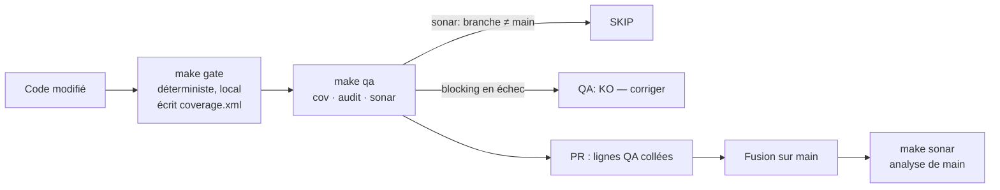

# F-007 · Quality analysis tooling — coverage, CVE, SonarQube, open list

## Metadata

| Field | Value |
|-------|-------|
| **Priority** | P1 |
| **Branch** | `feat/HULL-40-outillage-qualite` |
| **Last updated** | 2026-10-30 |

## 1. Context & Objective

### Current State

`make gate` (BR-035) chains `uv lock --check`, `ruff format --check`, `ruff check` (E, F, W, I, B, UP, SIM, RUF, S, PT), `mypy --strict`, `pytest tests/unit tests/integration`, `sdk_guard`. Neither measured nor tracked: **coverage** (no measurement), **known vulnerabilities of the dependencies** (no audit of `uv.lock`), **trends** (duplication, complexity, debt). No CI (`infra.ci: none`): everything happens in session. The SonarQube server exists (Community Build 26.4: analysis of the main branch only, no PRs or branches, no taint, no SCA); its project `hullgate` (branch `main`) is created and a project analysis token is stored outside the repository (`.cairn/auth/sonar/token`, ignored by git).

Reminder from the ticket: the acceptance run on the production server found two production defects (#31, #32) that ~600 green tests did not see; an analysis tool would not have found them. This feature **does not substitute** for real trials.

### Objective

Operator decision: the list of tools is **not closed**. The feature therefore delivers (1) **a mechanism** that makes adding a later tool simple and bounded — one target per tool, a declared role, a normalized report line — and (2) **a first batch** of three tools: coverage, dependency audit, SonarQube.

### Expected Impact

- Coverage and known vulnerabilities of the lock measured, each in one command, each report reduced to one readable line.
- Adding a tool = one target, one line in a list, one contract test; no rewrite of the gate or of the documentation.
- `make gate` stays local, fast, deterministic: no analysis tool is added to it, except the coverage measurement in the already existing step.

### Open Product Questions

Framing hypotheses, Q1 to Q8 confirmed by the operator on 2026-10-29 (Q7 corrected: token without expiration); each refers to §9 Architecture Decisions.

- **Q1** — dependency audit: `pip-audit` (reco) / `osv-scanner` / `uv audit` (existence not verified for `uv` 0.13.6) — H1.
- **Q2** — role of the audit: blocking from entry if the baseline state is green (reco, BR-100) / informational first — H2.
- **Q3** — coverage threshold: none, informational measurement first (reco) / immediate threshold — H3.
- **Q4** — ruff ↔ SonarQube overlap: ruff is authoritative, no adjustment of the Sonar profile (reco) / disable the duplicates on the server side — H4.
- **Q5** — radon/xenon (complexity): outside the first batch (reco) / in the batch — H5.
- **Q6** — who plays `make sonar`: the session on the operator's go, like BR-043 (reco) / the operator alone — H6.
- **Q7** — token: settled by the operator (2026-10-29), without expiration for the moment; no date tracking in the repository, a 401 gives a renewal message — H7.

## 2. Scope

- **Mechanism**: target `qa-<nom>` per tool, role `blocking` or `info` declared in a single place, normalized `QA …` report line, aggregator `make qa` (BR-098, BR-099, BR-100).
- **Gate**: unchanged in its failure conditions; no analysis tool is added to it; the `tests` step writes `coverage.xml` (BR-101).
- **First batch**: `qa-cov` (coverage, informational, BR-102), `qa-audit` (lock vulnerabilities, BR-103), `sonar` (analysis of `main`, informational, BR-104, BR-105).
- **Where they run**: see §3.3 and AC-OP.

## Out of Scope

- **Coverage threshold, blocking SonarQube ratings, blocking quality gate of the SonarQube server** — no measured baseline; the mechanism (BR-100) allows making them blocking by a later ticket, once the baseline is known.
- **radon / xenon, complexity through ruff's `C901`, bandit alone, pre-commit** — not retained in the first batch (Q5); these are the first exercises of the mechanism (§3.3), backlog candidates.
- **CI** — `infra.ci: none`; installing a CI is another decision. The mechanism is played in session.
- **Branch and PR analysis in SonarQube** — impossible in Community; PR review has no Sonar equivalent.
- **Taint, SCA by SonarQube** — absent from Community; the dependency audit (BR-103) takes the place of SCA.
- **Adjustment of the SonarQube rule profile** — done on the server side by the operator, outside the repository (Q4).
- **Real trials on the production server** — not replaced (§1).
- **Trends and history on the SonarQube side** — read by the operator on the server; no trend report is produced in the repository (backlog candidate if the need arises).
- **Audit of development dependencies (group `dev`)** — not shipped to production; only the runtime lock is audited (H1).

## 3. Functional Spec

### 3.1 `make qa` — aggregator (SCR-01)

`make qa` plays, in the order of the `QA_TOOLS` list of the `Makefile`, the target `qa-<nom>` of each declared tool. For each tool, a first line `== QA <nom> : <version de l'outil>` (like the gate steps) then exactly **one report line**:

```
QA <nom> <rôle> <verdict> — <détail en français>
```

- `<rôle>` ∈ `blocking`, `info`; `<verdict>` ∈ `OK`, `FINDINGS`, `SKIP`, `ERROR`.
- Last line of the command: `QA: OK`, or `QA: KO <nom> [<nom>…]` listing only the blocking tools that failed. Exit code 0 in the first case, non-zero in the second.
- Informational tools never affect the last line or the exit code.

`QA_TOOLS` is the declared list, one element per tool, of the form `<nom>:<rôle>` — for example `QA_TOOLS := cov:info audit:blocking sonar:info`. Each tool is also played alone (`make qa-cov`, `make qa-audit`, `make sonar`) and then renders its `QA …` line; `make sonar` is the alias of `qa-sonar`. Alone, a tool exits non-zero if and only if it renders `FINDINGS` or `ERROR` in role `blocking`, or `ERROR` in role `info`: the operator who launches it by hand sees the failure, the aggregator counts only the blocking ones (BR-099).

### 3.2 The tools of the first batch (SCR-02)

| Tool | Target | Input | Verdict `OK` | Verdict `FINDINGS` | `SKIP` / `ERROR` |
|---|---|---|---|---|---|
| coverage | `qa-cov` | `coverage.xml` written by the `tests` step of the gate | line rate of `src/` read, whatever it is (no threshold) | — (never) | `SKIP` if `coverage.xml` is absent ("run make gate") |
| audit | `qa-audit` | runtime lock exported from `uv.lock` (`uv export --locked --no-dev`) | no known vulnerability, apart from current exemptions | at least one non-exempted vulnerability, or an expired exemption | `ERROR` if the vulnerability database is unreachable or the export fails |
| SonarQube | `qa-sonar` (alias `sonar`) | `src/`, `tests/`, `coverage.xml`, `sonar-project.properties` | analysis sent; detail = dashboard URL | — (the server judges) | `SKIP` under `make qa`, outside `main`, dirty tree, token absent, `coverage.xml` or `coverage.sha` absent, or SHA of `coverage.sha` different from the head ("rerun make gate"), server unreachable; `ERROR` if the token is refused (401) or the scanner fails |

Audit exemptions: file `qa/audit-exemptions.txt`, one line per exemption `<identifiant> <AAAA-MM-JJ> <raison>`; the identifier is the one the audit reports (GHSA, PYSEC, CVE); the date is the last day the exemption holds (UTC).

### 3.3 Adding a tool (SCR-03)

Adding a later tool, for example radon, takes four steps, without touching the gate or the skills:

1. pin the tool: exact version `==` in the `dev` group of `pyproject.toml` (and `uv.lock`), or image pinned by digest (§9 Technical Constraints);
2. write the target `qa-<nom>` that prints its version then exactly one `QA …` line (BR-098);
3. add `<nom>:info` to `QA_TOOLS` (BR-099, BR-100);
4. add the tool's contract test (`tests/unit/test_br_NNN_qa_<nom>.py`) and, for a rule specific to the tool, the BR that carries it.

Moving a tool from `info` to `blocking` = replacing the word in `QA_TOOLS`, under the condition of BR-100.

**Where they run**: `make gate` — before any commit, as today; `make qa` — at `close-feature` before the PR, and by the review, the `QA …` lines pasted in the PR (`qa-sonar` renders `SKIP` there); `make sonar` — after the merge to `main`, by the session on the operator's go (H6), the only moment when the analysis makes sense in Community.

## 4. Business Rules

### Naming Convention

`BR-NNN`, sequential and global: `{{ references.br-identifiers }}`.

Overlap report (`br-identifiers.md` §Overlap): filter of the `Statement` on *gate, coverage, vulnerability, audit, analysis, tool, lint, report, sonar, digest, pinned, frozen*: **17 rows retained out of 96**. Verdicts after opening the relevant files: BR-035 — overlap — **new rule (C1)**: a `qa-*` tool can fail without the gate failing and conversely; BR-035 stays at v1 (its failure conditions do not change, C2 no; the assertion of `test_br_035_gate.py` stays true, C4 no); BR-003 (no secret in the artifacts) — overlap with BR-105 — **new rule (C1)**: a token can leak through a command line or a process log without appearing in a kept artifact, and BR-003 targets the artifacts of the bench acceptance run; BR-029 and BR-005 (images pinned by digest) — off topic (they concern the image and the bench); BR-036, BR-037 (SDK guard) — off topic; the 11 other rows ("token", "tool", "audit" in the gateway sense) — off topic. No rule demoted, no version or clarification.

### BR-098 · An analysis tool is a target that returns a normalized QA line

> **Extracted on 2026-10-29.** Current version: [`business-rules/BR-098.md`](../business-rules/BR-098.md).
> The content below reflects the state of this BR at the time of feature F-007 (v1).

*`behavioral` · `blocking` · Candidate state: `verified` — `tests/unit/test_br_098_qa_contract.py`.*

**Rule** — Each analysis tool declared in `QA_TOOLS` has a `qa-<nom>` target in the `Makefile` that prints its version then exactly one line `QA <nom> <rôle> <verdict> — <détail>`, with the role in {`blocking`, `info`} and the verdict in {`OK`, `FINDINGS`, `SKIP`, `ERROR`} . A tool declared without a target, a target that prints zero or two `QA` lines, or a role or a verdict outside the sets is an error of the contract test, hence of the gate.

**Clarifications**
- The detail is in French (`language`), without secrets (BR-105).
- The pinning of the tool is a constraint of §9, also verified by the contract test (AC-02); it is not an obligation of this rule.
- A `SKIP` always carries the reason in its detail.
- The `make qa` aggregator rechecks the line and the exit code of each target (`scripts/qa_check.py`): a target written in shell does not escape the contract. A target outside the contract is a failure of the tool; for a blocking tool, `QA: KO <nom>`.

### BR-099 · A tool's role is declared in one place; only a blocking tool makes `make qa` fail

> **Extracted on 2026-10-29.** Current version: [`business-rules/BR-099.md`](../business-rules/BR-099.md).
> The content below reflects the state of this BR at the time of feature F-007 (v1).

*`behavioral` · `blocking` · Candidate state: `verified` — `tests/unit/test_br_099_qa_roles.py`.*

**Rule** — Each tool's role is declared only in `QA_TOOLS`; `make qa` ends with `QA: KO <noms>` and a nonzero code if, and only if, a tool with role `blocking` returned `FINDINGS` or `ERROR`; otherwise it ends with `QA: OK` and code 0, whatever the verdicts of the `info` tools. A `blocking` tool does not return `SKIP`: a check it cannot perform is an `ERROR`.

**Clarifications**
- An `info` tool returns `ERROR` or `SKIP` without making the aggregator fail; the line remains visible.
- No other file (documentation, skill, project-context) copies the role: they refer to `QA_TOOLS`.

### BR-100 · A tool enters as informational, unless the base state is green

> **Extracted on 2026-10-29.** Current version: [`business-rules/BR-100.md`](../business-rules/BR-100.md).
> The content below reflects the state of this BR at the time of feature F-007 (v1).

*`behavioral` · `blocking` · Candidate state: `not-mechanisable` — the decision to declare a tool blocking is a judgment on the state of the baseline, held at the review point of the PR that changes the role.*

**Rule** — A tool is declared `info` when it enters `QA_TOOLS`. It is declared `blocking`, at entry or later, only if its line on the current `main` returns `OK` (or `OK` except for the exemption for the audit), with the evidence pasted into the PR that changes the role; the PR is refused otherwise.

**Clarifications**
- Policy on existing code: no tool applies retroactively as blocking on code that is already there; what exists is either brought back to green, exempted (audit), or left as `info`.
- Making a tool `info` again is allowed at any time, with its reason in the PR.

### BR-101 · The gate embeds no analysis tool, except coverage measurement

> **Extracted on 2026-10-29.** Current version: [`business-rules/BR-101.md`](../business-rules/BR-101.md).
> The content below reflects the state of this BR at the time of feature F-007 (v1).

*`behavioral` · `blocking` · Candidate state: `verified` — `tests/unit/test_br_101_gate_offline.py`.*

**Rule** — The recipe of `make gate` calls neither `qa`, nor any `qa-*` target, nor `sonar`; its `tests` step writes `coverage.xml` (measurement of `src/`, relative paths) by running the same tests as before, and its failure conditions remain those of BR-035. A call to `qa`, to a `qa-*` target or to `sonar` in the gate's recipe is an error of the test `test_br_101_gate_offline.py`, hence of the gate.

**Clarifications**
- Reason: the gate stays local, fast, deterministic; a vulnerability published tomorrow must not make yesterday's commit fail.
- The coverage measurement has no threshold in the gate (BR-102).

### BR-102 · Coverage is measured and reported, without a threshold

> **Extracted on 2026-10-29.** Current version: [`business-rules/BR-102.md`](../business-rules/BR-102.md).
> The content below reflects the state of this BR at the time of feature F-007 (v1).

*`behavioral` · `warning` · Candidate state: `verified` — `tests/unit/test_br_102_qa_cov.py`.*

**Rule** — `qa-cov` reads `coverage.xml` and returns `QA cov info OK` with the line rate of `src/` as detail; if absent, it returns `SKIP`; it never returns `FINDINGS` and no threshold is read or applied until a later BR sets one (BR-100).

**Clarifications**
- The rate measured at implementation is recorded in the PR as a starting baseline.
- `coverage.xml` is rewritten at each `make gate`; the line's detail carries its modification date, so that an old file shows.

### BR-103 · A runtime lock with an unexempted known vulnerability fails the audit

> **Extracted on 2026-10-29.** Current version: [`business-rules/BR-103.md`](../business-rules/BR-103.md).
> The content below reflects the state of this BR at the time of feature F-007 (v1).

*`behavioral` · `blocking` · Candidate state: `verified` — `tests/unit/test_br_103_qa_audit.py` (parsing of the exemptions and of the verdict on dummy output); access to the real database is played by AC-03.*

**Rule** — `qa-audit` exports the runtime lock from `uv.lock`, queries the vulnerability database and returns `FINDINGS` if a vulnerability affects a locked version without an exemption in force in `qa/audit-exemptions.txt`, or if an exemption has expired; `ERROR` if the database is unreachable; `OK` otherwise. An expired exemption is a failure, never ignored.

**Clarifications**
- An exemption without a date, without a reason, or with a malformed date is an invalid line: `ERROR`.
- The dependencies of the `dev` group are not audited (out of scope); `mcp-types` is in the runtime lock and so is audited.
- The role (`blocking` or `info`) is the one that BR-100 allows at implementation (H2).
- Offline, `qa-audit` returns `ERROR` so, if it is `blocking`, `QA: KO audit`: intended (BR-099, an impossible check is not a success); a `make qa` without access to the database is rerun with the network.

### BR-104 · SonarQube analyzes only `main`, clean tree

> **Extracted on 2026-10-29.** Current version: [`business-rules/BR-104.md`](../business-rules/BR-104.md).
> The content below reflects the state of this BR at the time of feature F-007 (v1).

*`behavioral` · `blocking` · Candidate state: `verified` — `tests/unit/test_br_104_qa_sonar_guard.py`.*

**Rule** — `qa-sonar` sends an analysis only if it is called explicitly (`make sonar`, not by `make qa`), the current branch is `main` and the working tree has neither a tracked modification nor an untracked file under `src/` and `tests/`; otherwise it returns `SKIP` with the reason, without calling the server.

**Clarifications**
- Reason: in Community, an analysis sent from a branch or a dirty tree replaces the history of `main` with code that is not in it.
- Under `make qa`, the verdict is `SKIP — analyse sur demande : jouer make sonar`: sending a secret to an operator's system remains a named gesture (H6), never a side effect of the aggregator.
- `coverage.xml` is ignored by git: the gate writes, next to it, `coverage.sha` (ignored by git): the SHA of the head it tested; if `coverage.xml` or `coverage.sha` is absent, or if this SHA is not that of `git rev-parse HEAD`, `qa-sonar` renders `SKIP` ("rerun make gate") rather than sending the rate of another branch; the scanner receives, read-only, only `src/`, `tests/`, `sonar-project.properties` and `coverage.xml`, never the whole repository.
- The scanner runs in the `sonar-scanner-cli` image pinned by digest (BR-098); the project key is `hullgate` and the server URL is in `sonar-project.properties`, without a secret.

### BR-105 · The SonarQube token never leaves its file or the scanner's environment

> **Extracted on 2026-10-29.** Current version: [`business-rules/BR-105.md`](../business-rules/BR-105.md).
> The content below reflects the state of this BR at the time of feature F-007 (v1).

*`behavioral` · `strict` · Candidate state: `verified` — `tests/unit/test_br_105_qa_sonar_token.py`.*

**Rule** — `qa-sonar` reads the token from `.cairn/auth/sonar/token` and passes it only to the scanner, through an environment variable (`SONAR_TOKEN`); the value appears neither as a command argument, nor in the `make` output, nor in a tracked file, nor in a log.

**Clarifications**
- An absent token is a `SKIP` that names the expected path; a refused token (401) is an `ERROR` that says to renew it, without quoting it (§3.2).
- `.cairn/auth/` is ignored by git (already in place); `.scannerwork/` joins `.gitignore`.
- A leak is not allowed: no waiver (`strict` rule); a token value found in an output, an argument or a tracked file is an error of the test `test_br_105_qa_sonar_token.py`, hence of the gate.

## 5. Acceptance Criteria

- [x] **AC-01** (BR-098, BR-099) — `make qa` on the branch, outputs pasted in the PR: one line `== QA <nom> :` and one line `QA <nom> …` per tool of `QA_TOOLS`, last line `QA: OK` or `QA: KO …`. Instrument: `make qa 2>&1 | grep -c '^QA '` equals the number of tools (the last line, `QA: OK` or `QA: KO …`, is written with a colon and is not counted; it is read by `tail -n 1`); test `test_br_098_qa_contract.py` and `test_br_099_qa_roles.py` (dummy targets for each role × verdict combination, `QA_TOOLS` overridden on the command line).
- [x] **AC-02** (BR-098) — the contract test fails on: tool without target, target with zero or two `QA` lines, role `warn`, verdict `PASS`, `dev` dependency not pinned by `==`, image without `@sha256:`. Instrument: one case per default in `test_br_098_qa_contract.py`.
- [x] **AC-03** (BR-103) — `make qa-audit` renders `QA audit … OK` on the current lock (or `FINDINGS`/`ERROR` recorded and handled according to BR-100); with a dummy vulnerability, `FINDINGS`; current exemption, `OK`; expired exemption, `FINDINGS`; malformed line, `ERROR`. Instrument: `test_br_103_qa_audit.py` on dummy tool output, and `make qa-audit` played once on the real network (output pasted).
- [x] **AC-04** (BR-101, BR-102) — `make gate`: last line `GATE: OK`, `coverage.xml` present at the root; `make qa-cov` renders the rate; `coverage.xml` deleted, `SKIP`. Instrument: test `test_br_101_gate_offline.py` (the recipe of `gate:` contains neither `qa` nor `sonar`, read as `test_br_035_gate.py` does); `test -s coverage.xml`; `make qa-cov | grep -c '^QA cov info OK'` equals 1; after `rm coverage.xml`, `make qa-cov | grep -c SKIP` equals 1.
- [x] **AC-05** (BR-104) — on a work branch, on `main` with a dirty tree, or under `make qa`, `make sonar` renders `QA sonar info SKIP — …`, without any network call to the server. Instrument: `test_br_104_qa_sonar_guard.py` with a fake `git` and a fake `docker` that fail if called.
- [x] **AC-06** (BR-105) — with a known dummy token, outputs of `make sonar`, of the dummy scanner and logs: the value appears nowhere, including in `ps`/arguments of the fake scanner; token absent: `SKIP` naming `.cairn/auth/sonar/token`; dummy 401: `ERROR`. Instrument: `grep -rF "<valeur factice>" <sortie>` empty; `test_br_105_qa_sonar_token.py`.
- [ ] **AC-OP** (BR-102, BR-104, BR-105) — **read by hand by the operator, or by the session on their go** (`skills/accept-feature.md` Phase 2 step `4a`): after the merge, on up-to-date `main` and clean tree, `make sonar`; the server's project `hullgate` shows an analysis of the branch `main` whose timestamp is later than the launch, with the coverage of the rate of `qa-cov`. The token is read by no one other than the scanner.
- [x] **AC-08** — the domain glossary declares the coined terms **Quality tool** and **QA line** (origin `BR-098`). Instrument: `grep -c -E '^\| \*\*(Outil d.analyse|Ligne QA)\*\*' domain-glossary.md` equals 2.
- [x] **AC-07** *(ceiling raised from +20% to +30% then to +35% with warm caches by operator decisions of 2026-10-30; §13)* — `make gate` stays `GATE: OK`; the test `test_br_035_gate.py` passes without modification; the gate duration does not increase by more than 35%. Protocol: on `main` then on the branch, on the same machine, a warm-up run of `make gate` (caches `uv`, `ruff`, `mypy` filled), then the measurement of a second run; the gap is that of the two measurements (values pasted in the PR).

## 6. Diagrams

Selection: **userflow** only — the mechanism is a sequence of local commands, without a multilayer transaction. *Sequence* omitted: the only network exchange (scanner ↔ server) is a single send. *State machine*, *ER*, *Class* omitted: no state, no persisted data of the feature, no hierarchy.

### 6.1 Userflow — where each command is played



## 7. States & Captures

`package-status: absent` — no visual surface (command line).

## 8. Design & Prototypes

Not applicable: no design asset.

## 9. Implementation Notes

### Dependencies (prerequisite features)

- F-004 — Foundation (implemented): `make gate`, BR-035, pinned `dev` group.
- Session tools: no `make`/`uv` on the host; toolbox `.cairn/runs/acts/HULL-6-toolbox.Dockerfile` (planned, not a blocker).
- The SonarQube server: reachable from the session (finding of 2026-10-29), project and token stored by the operator; **no call during this framing**.
- Downstream: any feature that adds an analysis tool goes through §3.3.

### Technical Constraints

- Stack: ADR-001, `uv` 0.13.6 pinned (`required-version`).
- **Pinned tools**: every analysis tool is a dependency of the `dev` group in exact version `==` locked in `uv.lock`, or an image pinned by digest; the contract test (AC-02) checks it.
- Development dependencies added: `pytest-cov`, `pip-audit` (or the tool of Q1) in exact version `==`, locked; update of `uv.lock` and check of `uv lock --check`.
- `[tool.coverage]` in `pyproject.toml`: `source = ["src"]`, `relative_files = true`, output `coverage.xml`; ignored by git.
- Image `sonarsource/sonar-scanner-cli`: multi-architecture index digest read at implementation (like BR-029); same mount constraints as the toolbox (the repository mounted, the session's dockerd).
- `sonar-project.properties` at the root (key `hullgate`, URL, `sonar.sources=src`, `sonar.tests=tests`, `sonar.python.coverage.reportPaths=coverage.xml`), without secret.
- `.gitignore`: `coverage.xml`, `.scannerwork/`.
- Exact options of `uv export`, of the audit tool and of the scanner: those of the pinned versions, checked at implementation.
- No new spec `status` value: the admission criterion does not apply (step 23a).

### Architecture Decisions

| Question | Decision | Rationale |
|----------|----------|-----------|
| H1 · audit tool | `pip-audit` on the export `uv export --locked --no-dev` | PyPA tool, reads a dependency file without an environment; `osv-scanner` reads `uv.lock` but adds a binary/an image; `uv audit` not verified for 0.13.6 |
| H2 · role of the audit | `blocking` if the baseline state is green at implementation (BR-100), otherwise `info` + ticket | A known CVE on a shipped dependency is what we want to stop; the entry rule avoids blocking on code already red |
| H3 · coverage threshold | none, `info` | No measured baseline; an invented threshold is a threshold to circumvent |
| H4 · ruff ↔ Sonar | ruff is authoritative (blocking, in the gate); Sonar profile left at default | The duplicates on the Sonar side are informational; the value of Sonar is duplication, complexity, hotspots, coverage trend |
| H5 · radon/xenon | outside the first batch | Sonar already reports cognitive complexity; first exercise of the mechanism if the wish comes |
| H6 · who plays `make sonar` | the session, on explicit operator go, after the merge to `main`; the operator alone otherwise | Same logic as BR-043: an act toward an operator system, with a secret, on go; the operator stays master of the token |
| H7 · token | without expiration for the moment (operator, 2026-10-29); no date tracking in the repository; 401 → renewal message | The token cannot be read; a copied date drifts |
| H8 · coverage in the gate | the `tests` step adds `--cov` and writes `coverage.xml`; `qa-cov` reads it | A single run of the tests; BR-035 unchanged |
| H9 · form of the list | `Makefile` variable `QA_TOOLS`, `<nom>:<rôle>` | A single place, readable by `make` and by a test; changing the role = one word |
| H10 · `make qa` at close-feature and at review | yes, lines pasted in the PR | The gate stays the only mandatory passage; `qa` completes without delaying each commit |

### Data Model Impact

- Migration: no.

### Components to Create / Modify

**Created**
- `qa/audit-exemptions.txt` — audit exemptions (may be empty or contain only comments).
- `sonar-project.properties` — scanner configuration.
- `scripts/qa_audit.py`, `scripts/qa_sonar.py` (if the `Makefile` shell becomes unreadable) — parsing of the exemptions and `main` guard.
- `tests/unit/test_br_098_qa_contract.py`, `test_br_099_qa_roles.py`, `test_br_101_gate_offline.py`, `test_br_102_qa_cov.py`, `test_br_103_qa_audit.py`, `test_br_104_qa_sonar_guard.py`, `test_br_105_qa_sonar_token.py`.

**Modified**
- `Makefile` — `QA_TOOLS`, `qa`, `qa-cov`, `qa-audit`, `qa-sonar`, `sonar`; `--cov` in the `tests` step of the gate; header comment.
- `pyproject.toml`, `uv.lock` — pinned tools, `[tool.coverage]`.
- `.gitignore` — `coverage.xml`, `.scannerwork/`.
- `.cairn/project-context.yaml` — comment of `quality-gate`: `make qa` played at `close-feature` and at review (operator setting, at implementation).

### Pitfalls Discovered

- **`--cov` and the gate**: the option is set on the command line of the `tests` step (`pytest tests/unit tests/integration --cov --cov-report=xml`), not in `addopts`: a partial pytest run would otherwise rewrite `coverage.xml` with partial coverage, and `make test-container` would measure for nothing. `test_br_035_gate.py` stays unchanged, the substring `pytest tests/unit tests/integration` being kept.
- **`pip-audit` on the export**: `--no-deps --disable-pip` on `uv export --locked --no-dev --no-emit-project` (pip-audit 2.10.1 prints its warning about `--no-deps` on the error output whatever happens, hashes or not: no effect on the verdict, which the JSON alone carries); the JSON output gives `id`, `aliases`, `fix_versions`; exit code 1 accompanies vulnerabilities, not a failure: a failure is recognized by the absence of JSON.
- **Scanner image**: the tag `12` of `sonarsource/sonar-scanner-cli` publishes only a `linux/amd64` manifest (no multi-architecture index); the digest set is that of this manifest (`QA_IMAGE_sonar`). On an arm64 session workstation, the image would run under emulation or not at all: to review at the scanner version upgrade.
- **AC-01, instrument**: `make qa 2>&1 | grep -c '^QA '` equals the number of tools (3), not "tools + 1": the last line is written `QA: OK` (colon), which the pattern `^QA ` does not reach. Count of the lines of the last command played: 3 lines `QA <nom> …` + `QA: OK`.
- **AC-07, ceiling raised**: `--cov` on the whole suite costs +23 to +30% (main 325 s, branch 401 s at implementation; main 333 s, branch 432 s at review, +29.7%); the +20% budget set without measurement did not hold. The operator decided on 2026-10-30 (option (a)) to raise the ceiling to +30% and keep coverage in the gate, then, review 428 having measured +29.0% with warm caches and +34.3% with cold caches, to set it at +35% measured with warm caches, protocol written in AC-07; the fallback of §12 (`qa-cov` replays the tests) is not applied. The margin remains thin: a growing gate will exceed the ceiling, to be reopened then.
- **`make qa` replays the main Makefile**: the aggregator relaunches `$(MAKE) -f $(firstword $(MAKEFILE_LIST))` for each tool, which lets the contract tests place dummy targets in a Makefile that includes the real one.
- **The aggregator checks each target** (review 426, B1): `scripts/qa_check.py` receives the output and the exit code of each `qa-<nom>` and refuses what the contract refuses (verdict or role outside the sets, case, several lines, blocking SKIP, missing version, exit code inconsistent with the verdict); a target written in shell has no other path than this check. For an `info` tool, the non-conformity is reported by a line `QA <nom> info ERROR — cible non conforme …` without changing the end or the code (BR-099).
- **Scanner mount** (review 426, N1): only `src/`, `tests/`, `sonar-project.properties` and `coverage.xml` are mounted, read-only; the scanner's working directory is `/tmp/.scannerwork` (`sonar.working.directory`). The whole repository is never mounted (`.cairn/auth/` is in it). To confirm at the first real call.
- **Explicit Sonar call**: the aggregator passes `QA_AGGREGATE=1` to each tool; `qa-sonar` and `sonar` (direct call) send, the aggregator never (BR-104).
- **Scanner ownership**: the repository is not mounted. Four read-only mounts: `src/` on `/usr/src/src`, `tests/` on `/usr/src/tests`, `sonar-project.properties` and `coverage.xml` under `/usr/src/`; the scanner's working directory is `/tmp/.scannerwork` (`sonar.working.directory`), `SONAR_USER_HOME=/tmp/.sonar`. The container runs under the session's UID (`--user`); Sonar's git attribution is disabled (`sonar.scm.disabled=true`), the mounts not embedding `.git`.

## 10. Phases

One phase, one PR.

### Phase 1 — Mechanism and first batch

- [x] `QA_TOOLS`, `qa`, contract tests (BR-098, BR-099)
- [x] `--cov` in the gate, `coverage.xml` (BR-101), `qa-cov` (BR-102)
- [x] `qa-audit`, exemptions (BR-103); role set according to BR-100
- [x] `qa-sonar`, `sonar-project.properties` (BR-104, BR-105)
- [x] `make gate` OK, `make qa` pasted in the PR

## 11. Tests

### unit

| Test | BR / Concern | File |
|------|-------------|------|
| `test_br_098_*` | BR-098 | `tests/unit/test_br_098_qa_contract.py`, `tests/unit/test_br_098_qa_aggregator_checks.py` |
| `test_br_099_*` | BR-099 | `tests/unit/test_br_099_qa_roles.py` |
| `test_br_101_*` | BR-101 | `tests/unit/test_br_101_gate_offline.py` |
| `test_br_102_*` | BR-102 | `tests/unit/test_br_102_qa_cov.py` |
| `test_br_103_*` | BR-103 | `tests/unit/test_br_103_qa_audit.py` |
| `test_br_104_*` | BR-104 | `tests/unit/test_br_104_qa_sonar_guard.py` |
| `test_br_105_*` | BR-105 | `tests/unit/test_br_105_qa_sonar_token.py` |

BR-100: not tested (review point), see its classification. `container`: not required, unless the diff touches `Dockerfile`, `compose*.yaml`, `deploy/` or `Makefile` — the `Makefile` is touched: `make test-container` required (BR-035 §Clarifications).

## 12. Risks & Watchpoints

- **Token leak**: in a command argument or in the scanner's trace in debug mode. Mitigation: BR-105, test with a dummy value, scanner launched without `-X`.
- **Sonar analysis of a state that is not `main`**: BR-104.
- **Non-deterministic gate**: a new CVE blocks. Mitigation: the audit is outside the gate (BR-101).
- **Blocking by a tool on code already there**: BR-100.
- **Shared VM disk** (22 GB free on 2026-10-28): scanner image and `uv` cache; purge by `make clean-images` to extend if needed.
- **Drift of a false sense of security**: these tools do not find production defects like #31/#32 (§1).
- **Gate duration budget** (AC-07, +35% maximum with warm caches since the decision of 2026-10-30): the +20% of the framing, set without measurement, did not hold; thin margin (+23 to +29.7% measured), the operator arbitrates at the next overrun (fallback: `qa-cov` replays the tests).
- **Nothing obliges the session to play `make qa`**: `close-feature` and the review read `quality-gate.*` of `project-context.yaml`; without a key for `qa`, the gesture relies on the instruction of §3.3 and on the comment of `quality-gate`. Chosen parry (operator, 2026-10-29): the gesture is carried by the orchestrator's instructions.
- **Revoked or renewed token** (without expiration to date): first symptom `QA sonar info ERROR` on 401.

## Stress-test

**Passe du 2026-10-29** — Claude (model:claude-sonnet-5-5), adversarial role, internal pass after the draft, six axes.
**13 findings — 0 critical, 5 major, 8 minor ; 10 retenus, 3 écartés.**

Critical:
- none.

Majors:
- **S1** · axis A · §5 AC-04 — instrument `grep -c 'qa' <(sed …)` not replayable under `SHELL := /bin/sh` and ambiguous. Sort : corrigé — test `test_br_101_gate_offline.py` and explicit `grep -c` commands.
- **S2** · axis B · §BR-103 — offline, the blocking audit makes `make qa` fail. Sort : corrigé — intended behavior written as a clarification of BR-103 (ERROR, no bypass).
- **S3** · axis F · §3.3/H6 vs BR-104 — `make qa` played on `main` would have sent the analysis and the token without a go, against H6. Sort : corrigé — BR-104 requires the explicit call `make sonar`; under `make qa`, `SKIP`.
- **S4** · axis A · §BR-101, BR-105 — `behavioral` rules without a named response to their violation. Sort : corrigé — "error of the test … hence of the gate" added to each.
- **S5** · axis A · §BR-098, BR-105 — two joined obligations (target/line + pinning; secret + SKIP/ERROR mapping). Sort : corrigé — pinning moved to a constraint of §9 (tested by AC-02), SKIP/ERROR mapping to a clarification and §3.2.

Minors:
- **S6** · axis A · §3.1 — exit code of a tool played alone not stated. Sort : corrigé — rule set in §3.1.
- **S7** · axis B · §BR-104 — untracked files under `src/` or `tests/` analyzed without being in the commit. Sort : corrigé — condition added.
- **S8** · axis B · §BR-102 — old `coverage.xml` read as current. Sort : corrigé — modification date in the detail.
- **S9** · axis A · §5 — coined terms ("Quality tool", "QA line") without a glossary criterion. Sort : corrigé — AC-08; writing the two glossary entries remains for implementation/closure.
- **S10** · axis D · §Out of Scope — Sonar trends/history not mentioned. Sort : différé — line added to §Out of Scope.
- **S11** · axis C · §3.2 — audit exemptions deferrable. Sort : rejeté — necessary as soon as a blocking audit meets a CVE without a fix.
- **S12** · axis A · §AC-07 — budget of +20% set without measurement. Sort : accepté — risk attached to §12.
- **S13** · axis E · §9 — `close-feature`/review read only `quality-gate.*`; nothing forces `make qa`. Sort : accepté — risk attached to §12, to settle at implementation.


## 13. Changelog

| Date | Author | Change |
|------|--------|--------|
| 2026-10-29 | Claude (product, model:claude-sonnet-5-5) | Draft creation (framing HULL-40), hypotheses H1–H10 |
| 2026-10-29 | Claude (product, model:claude-sonnet-5-5) | Stress-test (13 findings, 9 fixed); status `ready-for-freeze`, human freeze pending |
| 2026-10-29 | Claude (product, model:claude-sonnet-5-5) | Operator answers Q1–Q8 applied; token expiration hypothesis removed |
| 2026-10-29 | human:sstolz (freeze) | Freeze: `ready-for-dev`. Capabilities: extends v1 quality gate; introduces Quality analysis tools. Merge: AI; Split: no, 1 PR. |
| 2026-10-29 | Claude (implementation, model:claude-sonnet-5-5) | Implementation (HULL-40): `in-development` then `implemented`; BR-098 to BR-105 extracted; pitfalls recorded in §9; role of the audit set to `blocking` (BR-100: line `OK` on the current lock) |
| 2026-10-30 | human:sstolz (decision) | AC-07: gate overhead ceiling +30% (measured +23 to +29.7%) — review 426 |
| 2026-10-30 | Claude (implementation, model:claude-sonnet-5-5) | Consistency fixes, without changing the meaning of a rule (review 426): AC-01 instrument aligned with §3.1 (number of tools, the last line is not counted); §9 note on pip-audit's `--no-deps` warning corrected (always printed, no effect on the verdict); §3.2 and BR-104: `qa-sonar` renders `SKIP` if `coverage.xml` is absent or older than the head (review 426, N2) |
| 2026-10-30 | human:sstolz (decision) | AC-07: +35% with warm caches (measured +29.0% warm, +34.3% cold) — review 428 |
| 2026-10-30 | human:sstolz (decision) | §3.2 / BR-104: the `SKIP` of `make sonar` on absent or stale coverage is ratified, and tied to the commit — the gate writes `coverage.sha` (SHA of the tested head, ignored by git) next to `coverage.xml`; `make sonar` renders `SKIP` if this SHA is missing or differs from `git rev-parse HEAD` (the clean tracked tree is still required) — review 428, N-1 |
| 2026-10-30 | Claude (implementation, model:claude-sonnet-5-5) | Consistency fixes, without changing the meaning of a rule (review 428): §9 "Scanner ownership" describes the real mounts, no more repository under `/usr/src` (N-2); the version line `== QA <nom> :` must be non-empty (N-3, BR-098); `coverage.xml` SKIP tied to the SHA in place of the date test (N-1) |
| 2026-10-30 | Claude (implementation, model:claude-sonnet-5-5) | #45: the gate writes `coverage.sha` only on a clean tree in the sense of BR-104 (`scripts/qa_tree.py`, definition shared with the `qa-sonar` guard); on a dirty tree the file stays absent and `make sonar` renders `SKIP` ("rerun make gate"). Clarification of BR-104 (stays v1), meaning of the rule unchanged; the frontmatter waiver, granted until 2026-12-31 for this gap, is withdrawn |
| 2026-11-16 | Codex (implementation-coder, model:gpt-6-astra) | F-022 slice 2, freeze `10d166e` (retouch 2 `7aac9e6`): §3.2 substitutions only; inline rule clarifications without version where applicable. |
