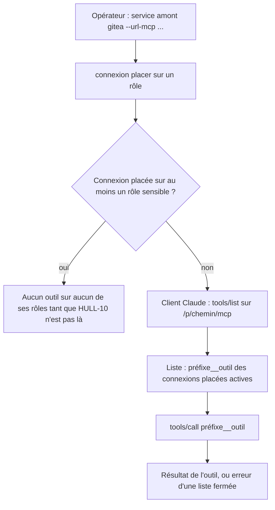
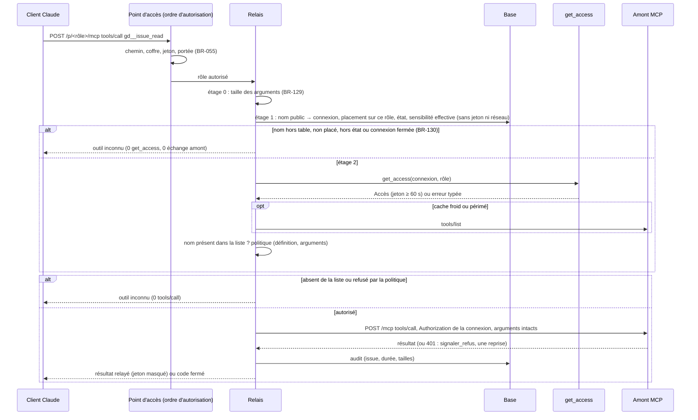
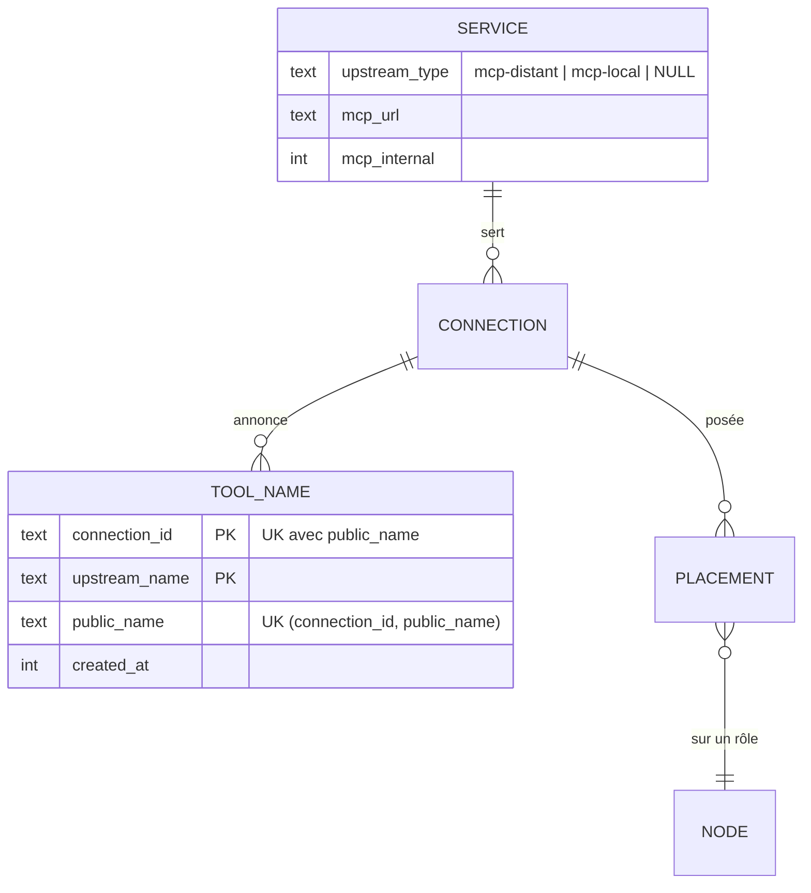

# F-008 · Relay — aggregation, renaming, sessions and upstream MCP servers

## Metadata

| Field | Value |
|-------|-------|
| **Priority** | P2 |
| **Branch** | `feat/HULL-9-relais` (three batches, §10) |
| **Last updated** | 2026-10-31 |

## 1. Context & Objective

### Current State

The v1 gateway (F-004, F-005, F-006 `implemented`, deployed on the production server) authenticates a Claude client by OAuth on a role's access point, judges every request in the authorization order (BR-055), keeps a library of encrypted connections placed on roles (BR-074 to BR-097) and gives its caller either a valid upstream token or a typed error (`get_access`, `signaler_refus`, F-006 §3.3). But a role's access point **serves an empty tool list and refuses every call** (BR-067): the gateway does not yet talk to any upstream MCP server.

Production fact (2026-10-30): the Claude.ai connector is connected to the public MCP name but exposes no tool, so Claude iOS cannot add it to a conversation. This is the direct consequence of that absence: with no visible tool, the connector is unusable.

The existing outbound client (`hullgate.outbound`) is designed for short OAuth exchanges (10 s deadline, 256 KiB, 16 threads, one thread per exchange); it does not fit tool calls as is. Review 419 (m2) noted that `Outbound()` is instantiated at every `get_access`: 10.8 ms per call and a thread cap with no effect, which the relay, calling `get_access` on every tool request, would turn into a denial of service.

**Sources.** Original specification (ticket HULL-1, extracted PDF, "spec. l. N"): MCP aggregation (lines 444-470), sessions and versions (lines 479-490), tool names (lines 492-498), guardrails on responses (lines 500-505), upstream types (lines 526-540), stdio servers (lines 844-846), tests (lines 1117-1135), plan, step 4 (lines 1199-1200). To these are added F-005 (BR-022, BR-055, BR-064, BR-067, BR-071, §2 Out of Scope), F-006 (§3.3, BR-077, BR-084, BR-088, BR-091, BR-094, BR-095, BR-097, §2 Out of Scope), `docs/trials/matrice-serveurs.md` (gitea-mcp 1.11.0: stateless HTTP, one Gitea host per process, token in `Authorization: Bearer` on every request), ADR-001 to ADR-004, reviews 417 and 419 (m2) and the learnings of F-005 and F-006.

### Objective

Have a role's access point serve the tools of the connections placed on that role, and only those: `tools/list` aggregated and renamed `<préfixe>__<outil>`, `tools/call` rechecked then routed to the upstream of the right connection with that connection's token, without the client's token or another role's context crossing over. The upstream is an MCP server (types `mcp-distant` and `mcp-local`), reached over Streamable HTTP in the protocol generation it negotiates, the client being in its own; progress and cancellation are relayed. Before announcing and before calling, the relay consults a policy hook that HULL-10 will fill.

### Expected Impact

- An operator declares the MCP URL of their Gitea service, places two connections (dev, reviewer) on two roles, and each role URL exposes exactly the tools of its connection (`gd__issue_read`, ...): the Claude.ai/iOS connector stops being empty.
- The acceptance criterion that F-005 left to HULL-9 is met: the 16 tests of the isolation acceptance run, transposed to the role, **pass** against v1 (BR-071), including those with a step that calls a relayed tool, "not playable" today.
- No upstream call leaves for a tool outside the list, outside the placement or outside the policy; the upstream log proves it (BR-002).
- HULL-10 (policy), HULL-12 (full audit, rate limiting) and HULL-13 (Cairn cutover) start from an existing relay, hook and call log.

### Open Product Questions

Q1 to Q4 were settled by the operator on 2026-10-30 ("ok for the recommendations", recommendation a for each); the adversarial stress test refines Q3 (M1, BR-106) and Q4 (C2, BR-130). Q5 was settled at the freeze on 2026-10-30, option a (H22, confirmed).

- **Q1 · Client-side sessions.** The access point stays stateless (BR-067; `Mcp-Session-Id` never issued) and the upstream session is held per (role, connection), rather than per client session as HULL-1 writes (line 480). Consequence: an explicit `notifications/cancelled` cannot be correlated in stateless mode; it is relayed only as **closing the request's stream** (2026-07-28 generation: that is the intended form); `notifications/tools/list_changed` is not pushed (F-005 had sent it back here). Options: a) stateless (recommended); b) inbound sessions bound to (role, token lineage), with a session table, expiry, cut-off at revocation, GET stream for `list_changed`.
- **Q2 · `api-rest` type.** The title of HULL-9 puts it in v1. It requires an adapter framework (Microsoft Graph, Dropbox), a ranking of modes by HTTP method, tools written by the gateway: a product of its own, with no user before HULL-13 (Gitea is enough). Options: a) deferred to a 1.1.0 ticket, the upstream type remaining an extensible enumeration (recommended); b) a witness adapter in HULL-9; c) the whole in HULL-9 (the ticket would be `split`).
- **Q3 · Plain HTTP to an internal host.** `gitea-mcp` and the stdio bridges listen over HTTP on the Docker network; BR-084 (OAuth) requires https. Options: a) `http://` allowed for the MCP URL **alone**, and only toward an internal host that the operator names at declaration, **all** of whose resolved addresses are private (a public address requires https, flag or not), audited (recommended); b) https required everywhere (a TLS sidecar per upstream, private certificate: candidate HULL-28 not carried out); c) free `http://` (rejected: bypasses the public address check).
- **Q4 · Transitional policy until HULL-10.** The brief closes writes by default on a sensitive environment, but HULL-10 does not exist yet. Options: a) a connection placed on at least one **sensitive** role announces no tool and calls none, **on all its roles**, as long as the policy does not exist; other connections announce everything (recommended); b) announce everything everywhere (production writes would be open between HULL-9 and HULL-10); c) nothing anywhere (the connector would stay empty, which HULL-9 must fix).
- **Q5 · First 401 of a provided-token connection.** A provided token is not renewed: BR-127 keeps the F-006 behavior (BR-085): an upstream 401 calls `signaler_refus` and the connection goes to `réauthentification requise`, the operator supplies a new token. Problem: an upstream that answers 401 for another reason (an unauthenticated stdio bridge) thus disables the connection at the first call, whereas the operator's decision (M3) sets a "not before" date instead of a disabling for an OAuth connection. Options: a) keep BR-085 for the provided token, the disabling being the intended signal (recommendation **applied**, H22: nothing else ever detects the revocation of a provided token, and an unauthenticated `mcp-local` bridge must never answer 401, which the runbook says); b) extend the "not before" date (BR-128) to the provided token, the connection staying active and every call returning `connexion_a_reautoriser`; cost: a truly revoked token no longer shows in the state.

## 2. Scope

- **Model**: the service declares its upstream type (`mcp-distant`, `mcp-local`) and the URL of its MCP server, fixed at declaration; forward migration (BR-106).
- **Bounded upstream MCP client**: Streamable HTTP over https (or http to a declared internal host), no redirect, no environment, verified addresses, hard deadline, bounded size, concurrency bounded per connection and globally, separate from the OAuth renewal (BR-107, BR-108); one outbound client per process and per use (debt of review 419, m2) (BR-125).
- **`tools/list`**: tools of the role's placed and active connections only, renamed `<préfixe>__<outil>` with a stable name table, cache per (role, connection) never a source of authorization, failure of one upstream isolated (BR-109 to BR-112).
- **`tools/call`**: finds the connection through the role's table, rechecks, obtains the token through `get_access`, relays, cleans the gateway's errors, never replays a call of uncertain outcome, retries a 401 once, handles the upstream's 429 with a per-connection "not before" date (BR-113 to BR-117, BR-124, BR-126 to BR-129).
- **Protocol**: two generations on each side (2025-11-25 with handshake and session, 2026-07-28 without session), upstream session reopened without the client seeing it, progress and cancellation relayed, announced capabilities limited to tools (BR-118 to BR-121).
- **Call audit**, **policy hook** and **transitional policy** that closes every connection carried by a sensitive role (BR-122, BR-123, BR-130).
- **Operator tooling**: `hullgate service amont …`, `hullgate connexion outils <c> --role <chemin>` (diagnosis of a placed connection: upstream list and public names, no tool call; purge of the name table), `make verify-relais`, the production server runbook.
- **Evidence**: fake MCP upstream in the tests (two generations), 16/16 isolation bench against v1 with a real `gitea-mcp` on the disposable Gitea instance, operator pass on the production server with Claude.ai and Claude iOS.

## Out of Scope

| Item | Addressee |
|---|---|
| Upstream type `api-rest` (Microsoft Graph, Dropbox adapters; mode per HTTP method) | 1.1.0 ticket to create if Q2 = a; the upstream type enumeration is extensible (BR-106) |
| Tool modes, lists, pinning of definitions, rules on argument value (HULL-10, comment of 2026-10-28), response cap **per role**, "to classify" queue | HULL-10, on the hook of BR-123 |
| Rate limiting per token and per connection; audit retention; statistics per connection; deadline alert | HULL-12 |
| Multi-account merge (`account` parameter), presentation merged by service prefix | v2 (brief) |
| Types `openapi`, `wasm`; resources, prompts, completions, logging, sampling, elicitation, roots (MCP) | v2 (brief); BR-121 refuses them |
| Multiplexing of an upstream session shared between roles | v2 (HULL-1, line 480); refused by BR-119 |
| Inbound sessions, standalone GET stream, pushed `notifications/tools/list_changed` | Q1 = b only; otherwise backlog candidate |
| Rewriting of tool schemas or annotations; cleaning of descriptions (instruction injection) | HULL-10 (pinning on the upstream definition) |
| Logging of call arguments and results | HULL-12, if the operator wants it (H9) |
| Upstream health screen, upstream failure alert | HULL-11 / HULL-12 |
| Private certificate authority for an internal upstream over https | HULL-28 (1.1.0) |
| Staggered "Happy Eyeballs" attempts of the outbound client | HULL-35 (1.1.0); the relay takes over the sequential fallback of HULL-32 |
| Per-organisation tightness: cache keys, upstream sessions, name table and audit actor carry the role and the connection, never the organisation | HULL-42 (to review at its framing); BR-110, BR-112, BR-119 |
| Bound on reading the **raw body** of an access point request (any method); BR-129 bounds only the arguments of a `tools/call` | backlog candidate on F-005 (BR-067) |
| Global bound on the memory of the definition caches (at most 10 MiB per (role, connection) key, i.e. 10 pages of 1 MiB, BR-109) | not set in v1 (4 or 5 clients); to review if the number of roles grows |
| Deterministic refusal reason "connection interrupted" / "deadline exceeded" (OAuth client) | HULL-36 (1.1.0); BR-117 holds the case for tool calls |
| Lineage displayed "active" before the exchange (`jeton lister`) | HULL-38 (1.1.0), unrelated to the relay |
| Objective for the latency added by the relay | measured by AC-OP (reading), not set in v1; to set if the reading justifies it |
| Stdio without a bridge, or a bridge embedded in the gateway image | refused (HULL-1, lines 530-532): one container per stdio server, outside the image |

## 3. Functional Spec

### 3.1 Model (SCR-01)

| Object | F-008 addition | Rules |
|---|---|---|
| **Service** | `upstream_type` (`mcp-distant` \| `mcp-local`; NULL = not declared), `mcp_url`, `mcp_internal` (the host and port of `mcp_url` are named an internal host) | BR-106 |
| **Tool name** (table `tool_name`) | (connection, upstream name) → public name, unique per connection, created at the first announcement, kept as long as the connection exists | BR-110 |
| Definition cache, upstream sessions, "not before" dates (call, report) | **in memory** of the server, per (role, connection) or per connection, lost at restart with no authorization consequence | BR-112, BR-119, BR-124, BR-128 |

A service declared before F-008 (for example the real Gitea of F-006) has `upstream_type` NULL: its connections have no tool and `connexion etat` says so ("upstream MCP not declared").

**Upstream types.** `mcp-distant`: the service exposes an MCP server that accepts a third-party client (Notion, Canva, `gitea-mcp` over HTTP). `mcp-local`: a stdio server behind a stdio → Streamable HTTP bridge, in its own container (HULL-1, lines 530-532); the gateway treats it as an `mcp-distant`; the type is **declarative** and additionally requires the MCP URL to be that of an internal host and the connection to be provided-token (H7). Neither has type-specific code.

### 3.2 CLI (SCR-02)

Same convention as F-006 §3.2 (actor `operator-cli`, codes 0, 2, 1, `--json` on reads, no secret in an argument).

| Command | Effect |
|---|---|
| `service amont <id> --type mcp-distant\|mcp-local --url-mcp <url> [--hote-interne-mcp]` | declares the service's MCP upstream; displays and audits the admitted addresses when the internal host exception is named; an already declared URL changes only with `--confirm <id>`; `service amont <id> --retirer --confirm <id>` resets the upstream to NULL (BR-106) |
| `connexion outils <client>/<nom> --role <chemin> [--purger-noms --confirm <client>/<nom>]` | diagnosis of a **placed** connection: lists, **bypassing the cache**, the tools the upstream announces with their public name, no tool call; `--role` is mandatory and the token is obtained through the ordinary path `get_access(connexion, rôle)`; refuses (code 2, no exchange) a connection that is not `active`, not placed on this role, or placed on at least one sensitive role (BR-130); audited (actor `operator-cli`); `--purger-noms` deletes from the table the names absent from the current list (BR-110) |
| `connexion placer … --confirme-partage`, `sensible marquer` | announce before acting, in the form of the BR-079 warning, "<connection> will no longer have a tool on <non-sensitive roles>" when the placement or the marking creates a connection carried by a sensitive role (BR-130) |
| `connexion etat` | adds a line "upstream: <type> <host>" or "upstream MCP not declared", and "tools closed: placed on a sensitive role" where applicable (BR-080 unchanged, no secret); the `last_reason` of a 401 from the MCP server reads "refusal reported: 401 from the MCP server" (BR-127, H22) |

`service declarer` does not change: the upstream MCP is a separate declaration, which leaves the F-006 services intact.

### 3.3 Role access point (SCR-03)

`/p/<chemin>/mcp` (BR-067 v2). After the authorization order, unchanged (BR-055):

- `initialize`, `ping`, `server/discover`: as in F-005; announced capabilities: `tools` only, `listChanged` false (BR-121).
- `tools/list`: tools of BR-109, names of BR-110, list served in **one page** (no `nextCursor`).
- `tools/call`: chain of BR-113 to BR-117, BR-127 to BR-130; a gateway failure is rendered as an `isError: true` result carrying a code from the closed list of BR-116; a name outside the list stays the F-005 JSON-RPC "unknown tool" error (`-32602`).
- any other method (`resources/*`, `prompts/*`, `completion/*`, `logging/*`): `-32601`.

Policy contract (hook of HULL-10, indicative form, exact name at implementation): `decider(rôle, connexion, nom_amont, définition_amont, arguments | None) -> autoriser | masquer | refuser(motif)`; called for each tool at announcement (`arguments` absent) and for each call (`arguments` present, so that HULL-10 can judge an argument value). The relay never reads a `masquer` or a `refuser` other than as "unknown tool" for the client.

**Order of a `tools/call`** (BR-113), in two stages. Stage 0: size of the arguments (BR-129). **Stage 1, without token or network**, read from the database alone: name in the table → connection → placement on the role of the URL → state → effective sensitivity of the connection (BR-130, which needs no definition). **Stage 2**: `get_access` → upstream `tools/list` if the cache is cold or stale → presence of the name in the list → policy with definition and arguments → upstream `tools/call`. A stage 1 refusal costs neither `get_access` nor an exchange; a stage 2 refusal never costs a `tools/call`.

## 4. Business Rules

### Existing rules modified by F-008 (`br-touched`)

| Rule | Change | Nature |
|---|---|---|
| BR-067 (access point without tools) | v2: the tool list is no longer empty; the rest (five versions, stateless, `ping`, 400 `supported`) is unchanged | change of the Rule |
| BR-071 (the bench judges v1) | clarification: 16/16 against v1 is reached; no test is "non jouable" any more for lack of a relay | clarification, control updated |
| BR-066 (audit) | v3: tool calls and their refusals are audited (BR-122); actions added to the list | additive |
| BR-022 (inbound token never to the upstream) | control moved from the POC bench to the v1 relay; Rule unchanged | control |
| BR-045 (deleted node) | clarification: deleting a role closes its upstream sessions and empties its caches (observed at the next served request, all keys checked against the database, BR-112) | clarification |
| BR-095 (`revoquer`) | clarification: a revoked connection no longer announces or calls any tool | clarification |

**Overlaps examined** (`br-identifiers.md` §Overlap, index loaded, filter on "inbound token", "upstream", "bounded", "tool list", "placement", "audit", "refusal without call"): BR-022 (no inbound token to the upstream) — overlaps BR-114 through the token, but BR-022 forbids a pass-through and BR-114 fixes the source of the token and the retry of a 401: two distinct obligations, BR-022 is only touched for its control; BR-084 (outbound calls to an OAuth provider) — same mechanism as BR-107, different bounds and protocol exception (30 s, 1 MiB, internal http for the MCP URL alone): separate rules, BR-084 unchanged; BR-097 (endpoints fixed at declaration) — BR-106 extends it to the MCP URL without modifying it; BR-015 and BR-016 (Go POC: Gitea relay end to end, no contact with the real Gitea) — POC bench rules, replayed by AC-26, not taken over; BR-002 (a refusal is proved by the absence of an upstream call) — proof principle of BR-113 and BR-123, not redefined; BR-077 and BR-095 (placement, revocation) — BR-109 reads them, does not restate them; BR-047, BR-078 and BR-079 (environment sensitivity, confirmed sharing of a connection, later marking) — BR-130 reads them and closes their consequence, without modifying them; BR-085 and BR-089 (reauthentication, renewal lease) — read by BR-127 and BR-128, not modified. No merge.

### BR-106 · A service declares its upstream type and its MCP server URL, fixed at declaration

> **Extracted on 2026-10-31.** Current version: [`business-rules/BR-106.md`](../business-rules/BR-106.md).
> The content below reflects the state of this BR at the time of feature F-008 (v1).

*`behavioral` · `strict` · Candidate state: `verified` — `tests/unit/test_br_106_upstream_declaration.py`.*

**Rule** — The MCP server URL of a service is written only at `service amont`, in https without credentials, fragment or query (`?…`), to all-public addresses; the only exception, named by the operator at this command, is that the host **and** the port of the MCP URL may resolve to **all-private** addresses (belonging to 10.0.0.0/8, 172.16.0.0/12, 192.168.0.0/16 or `fc00::/7`; 100.64.0.0/10 (CGNAT) is not part of them; never loopback, link-local, the unspecified address or multicast) and be reached over `http://`; any resolved public address requires https, exception named or not, at declaration as at each call; a declaration that violates one of these constraints is refused (code 2) and nothing is written. The relay calls no URL other than the one in the record, whatever a client, a tool argument or an upstream response presents to it.

**Clarifications**
- The type is `mcp-distant` or `mcp-local`; any other value is refused. `mcp-local` requires the internal-host exception and admits only provided-token connections (H7).
- The exception of BR-084 (host of the base URL, https required) does not change: the MCP URL has its own exception, named separately; `http://` is admitted only for it and only toward the named host (H3).
- A host "named internal" is not presumed internal: the resolution proves it. A host that resolves to a public address, or to a mix of private and public addresses, is not reached over `http://`, flag set or not (the connection's token never crosses the Internet in clear).
- Host and port are compared after normalization as in BR-084 (lowercase, trailing dot, IDNA, canonical IP literal); the admitted addresses are displayed and audited at declaration.
- Changing an already declared URL requires `--confirm <id>`, is audited (before/after) and empties the upstream caches and sessions of its connections (BR-112, BR-119, which lists the closures in a single place).
- An upstream redirect is never followed (BR-107): the record's URL is the only destination.
- BR-084 (strict) targets only the calls toward the OAuth provider, enumerated in its Rule: it remains unchanged, and the `http://` here does not override it.
- A URL that would designate the gateway itself (private address of its container) is not detected: accepted risk, bounded by BR-107 and BR-108 (§12).
- `service amont <id> --retirer --confirm <id>` sets the upstream back to NULL: the service's connections no longer bring any tool (BR-109), caches and sessions are emptied, the operation is audited.

### BR-107 · Every upstream MCP call is bounded

> **Extracted on 2026-10-31.** Current version: [`business-rules/BR-107.md`](../business-rules/BR-107.md).
> The content below reflects the state of this BR at the time of feature F-008 (v1).

*`behavioral` · `strict` · Candidate state: `verified` — `tests/unit/test_br_107_upstream_bounds.py`.*

**Rule** — Every exchange of the relay with an upstream has a hard deadline on the whole exchange (name resolution included) of 15 s for the handshake and `tools/list` and of 60 s for `tools/call`, at most 1 MiB read (stream included), no redirect followed, no environment variable read (proxy, certificate store), all addresses checked before the connection and tried in the resolver's order with fallback, and as the only outgoing headers, **besides the two framing headers that HTTP/1.1 requires (`Host`, equal to the normalized host of the record's URL, and `Content-Length`, the size of the body sent)**, `Authorization` (the connection's token), `Content-Type`, `Accept`, `MCP-Protocol-Version`, `Mcp-Session-Id` (the one the upstream gave), a fixed `User-Agent` and, in generation 2026-07-28, `Mcp-Method`, `Mcp-Name` (for `tools/call`) and one `Mcp-Param-<nom>` per argument annotated `x-mcp-header` in the tool's upstream schema, these last three taken from the body sent to the upstream and never from a client header; a gap in the bounds ends the exchange and is classified according to BR-116 or BR-117.

**Clarifications**
- Same mechanism as BR-084 (checked address tried, name used for the SNI and the certificate, `http.client`/`socket`/`ssl`), with a bounds profile of its own; the choice between extending `hullgate.outbound` and an SDK client is the implementation's under this rule (ADR expected, H12): any option that reads the environment, follows a redirect or does not try the checked address is excluded.
- The bounds of 15 s, 60 s, 1 MiB are technical ceilings of v1 (H6); the response ceiling **per role** belongs to HULL-10 and can only be lower. No configuration option lifts them; the tests inject their clock, their resolver and their `dial`, a single test playing the real 60 s value.
- No header of the incoming client (cookie, `Origin`, `X-Forwarded-*`, the client's `Authorization`) is forwarded; no response header of the upstream is forwarded to the client (`Set-Cookie`, `WWW-Authenticate`, `Mcp-Session-Id`).
- An upstream response is a JSON or an SSE stream, read under the same bounds (handshake and `tools/list` included).
- The 1 MiB ceiling applies to the response **body** (stream included), not to its headers. The response headers are bounded by the hard deadline of the exchange (15 s or 60 s) and by the ceilings of `http.client` (at most 100 lines of 64 KiB); they do not count in the 1 MiB (operator decision, 2026-10-31, n1 of review 449).
- The value of a connection's token that contains a control byte (CR, LF, NUL) is refused before sending: `erreur_interne`, no exchange, audited event.
- `Mcp-Method`, `Mcp-Name` and `Mcp-Param-*` (post-freeze amendment of 2026-10-30, operator decision): required by a 2026-07-28 server (`mcp==2.3.0` otherwise rejects the request, `HEADER_MISMATCH`). `Mcp-Method` is the body's method, `Mcp-Name` the `name` of the `tools/call`, `Mcp-Param-<nom>` the value of the annotated argument (`true`/`false` for a boolean, text otherwise); a value outside visible ASCII, or bordered by spaces, is encoded `=?base64?…?=`; no final value contains CR, LF or NUL (same refusal as the token). A schema whose annotations are invalid emits no `Mcp-Param-*`, like a conforming client. An annotated argument that cannot be encoded as a header (a value that is neither text, nor number, nor boolean, or a header of more than 8 KiB once encoded) makes the call refused before any upstream `tools/call` with `requete_trop_grande`: the client's request does not fit the form the upstream requires; it is neither a transient outage (`amont_indisponible` would invite replaying it identically) nor a failure of the gateway (`erreur_interne`).
- A `Mcp-Session-Id` returned by the upstream is subjected to the same check (visible ASCII 0x21-0x7E, which the protocol requires) before being sent back in a header: otherwise the exchange is an `amont_indisponible`, audited with the reason "session", no session held.
- `Host` and `Content-Length` are not application headers: HTTP/1.1 requires them to route and frame the request. `Host` carries the host of the record's URL, never the tried address nor a client's value; `Content-Length` the size of the body; no other transport header (`Accept-Encoding`, `Connection`, `Transfer-Encoding`, `Expect`, `TE`) is emitted (post-freeze amendment of 2026-10-30, operator decision, B1 of review 448).
- `http://` is admitted only for the host named by BR-106 and only if **all** its resolved addresses are private; a resolution that changes between the declaration and the call and leaves the policy (in particular a public address over `http://`) is refused at the call, without connecting.

### BR-108 · Concurrency toward the upstream is bounded and separate from OAuth renewal

> **Extracted on 2026-10-31.** Current version: [`business-rules/BR-108.md`](../business-rules/BR-108.md).
> The content below reflects the state of this BR at the time of feature F-008 (v1).

*`behavioral` · `blocking` · Candidate state: `verified` — `tests/unit/test_br_108_concurrency.py`.*

**Rule** — The relay runs at most 4 simultaneous exchanges per connection and 32 in total, in a thread pool separate from the outbound OAuth client's; beyond that, the call is refused at once (`amont_occupe`, BR-116) with no queue and no exchange.

**Clarifications**
- Cause: a relay with a 60 s deadline would saturate in under a minute the 16 slots of a shared pool, including those of token renewal.
- A call refused for saturation does not count as an upstream outage (no "not before" date, BR-124) and is audited with the outcome `amont_occupe` (BR-122), not as an upstream outage.

### BR-109 · `tools/list` announces only the tools of the connections placed and active on the URL's role

> **Extracted on 2026-10-31.** Current version: [`business-rules/BR-109.md`](../business-rules/BR-109.md).
> The content below reflects the state of this BR at the time of feature F-008 (v1).

*`behavioral` · `strict` · Candidate state: `verified` — `tests/integration/test_br_109_tools_list.py`.*

**Rule** — The tool list of a role is the union of the tools announced by the upstream of each of its connections **placed on that role** and **active**, subject to BR-130 and to the policy (BR-123); the role is the one of the authorized URL, never a parameter of the request; a connection that is not placed, `en attente`, in `réauthentification requise`, revoked or removed brings no tool and receives no exchange.

**Clarifications**
- A role without connection, or whose upstreams announce nothing, returns an empty list, as in F-005.
- Upstreams sometimes paginate: the relay follows the `nextCursor` up to 500 tools per connection and 10 pages; beyond that, the connection is treated as unavailable for this list (BR-111). The client's list is served in one page; a client cursor is ignored.
- The role's connections are fetched **in parallel**, under the bounds of BR-108 (the token renewal and the list of one connection do not add to those of the others); the client's list has a global deadline of 30 s (H21): a connection not back at the deadline is omitted (BR-111, reason "deadline").
- Definitions (upstream name aside, BR-110) are relayed unchanged: description, input schema, annotations (H8).

### BR-110 · A tool's public name is `<préfixe>__<outil>`, stable from one list to the next

> **Extracted on 2026-10-31.** Current version: [`business-rules/BR-110.md`](../business-rules/BR-110.md).
> The content below reflects the state of this BR at the time of feature F-008 (v1).

*`behavioral` · `blocking` · Candidate state: `verified` — `tests/unit/test_br_110_tool_names.py`.*

**Rule** — The public name of a tool is its connection's prefix (BR-076), two underscores, then the upstream name with the characters outside `[A-Za-z0-9_-]` replaced by `_`; the public name has **at most 64 characters**: if `<préfixe>__<nom nettoyé>` exceeds that, the upstream part is truncated to 64 − prefix length − 2 − 9 characters, then suffixed with `_` and 8 hexadecimal digits of the SHA-256 of the original upstream name; in case of a collision between two upstream names, the second receives that same suffix (truncation included); the assigned name is written at the first announcement and never recomputed, so that a tool keeps its public name as long as its connection exists, even when absent from an intermediate list.

**Clarifications**
- The table (connection, upstream name → public name) is the source; the algorithm serves only for the first assignment. A future change of algorithm renames nothing.
- An upstream name repeated in one list counts only once (the first definition).
- At most 1,000 names are kept per connection; beyond that, that connection's list is treated as unavailable (BR-111, reason "more than 1,000 names", distinct from an outage).
- Remedy: `connexion outils <c> --role <chemin> --purger-noms --confirm <c>` erases from the table the names absent from the upstream's current list (the names present keep theirs); the operation is audited with the actor and the number of names erased. An erased name that returns receives a new name, stable afterward. It is not played without a current list (connection down or beyond BR-109's ceiling: refusal, code 2).
- An empty upstream name, or one reduced to `_` after cleaning, is ignored and audited (reason "invalid name").
- The uniqueness of the public name is that of (connection, public name): between connections it follows from the prefix, unique per organisation (BR-076) and without `_`. The table does not carry the organisation (out of scope, HULL-42).
- A connection's table is erased with it (BR-075); the prefix no longer changes once a placement exists (BR-076), so the name does not vary.
- The prefix contains no `_`: the first `__` unambiguously separates prefix and tool. The relay nevertheless relies on the table, never on a split of the name.
- 64 characters for the **whole** name and `[A-Za-z0-9_-]` come from the Anthropic API's constraint on tool names (`^[a-zA-Z0-9_-]{1,64}$`); not measured on the clients (HULL-3: name length open), nor the case (`Foo` and `foo` are two public names that a client folding the case would confuse), H5. With a prefix of 8 characters, the upstream part has 54 characters, or 45 plus the suffix when truncated.

### BR-111 · An upstream outage does not erase the tools of the role's other connections

> **Extracted on 2026-10-31.** Current version: [`business-rules/BR-111.md`](../business-rules/BR-111.md).
> The content below reflects the state of this BR at the time of feature F-008 (v1).

*`behavioral` · `blocking` · Candidate state: `verified` — `tests/integration/test_br_111_upstream_down.py`.*

**Rule** — When the upstream of a connection does not answer `tools/list` (deadline, cut, 5xx, invalid or oversized response, pagination beyond the ceilings), the list returns the tools of the role's other connections, omits this connection and audits the omission with its reason; it is never replaced by the tools of a stale cache, and a call to a tool of this connection fails with `amont_indisponible`.

**Clarifications**
- A list entirely empty because every upstream is down is the same empty list as a role without connection; the difference is read in the audit.
- A cache entry younger than 300 s is served without contacting the upstream (BR-112); beyond that, an upstream outage omits the connection: there is no fallback cache.
- The reasons audited at an omission are distinct: "outage", "deadline" (BR-109), "version" (BR-118), "session" (BR-107), "sensitive" (BR-130), "invalid name" and "more than 1,000 names" (BR-110), "pagination" (BR-109).

### BR-112 · Upstream definitions are cached per (role, connection) and are never an authorization

> **Extracted on 2026-10-31.** Current version: [`business-rules/BR-112.md`](../business-rules/BR-112.md).
> The content below reflects the state of this BR at the time of feature F-008 (v1).

*`behavioral` · `strict` · Candidate state: `verified` — `tests/unit/test_br_112_tool_cache.py`.*

**Rule** — The tool definition cache is keyed by (role, connection), never shared between roles, lives at most 300 s, is discarded as soon as the placement, the effective sensitivity (BR-130), the state or the URL of the connection read from the database at the request differ from those of its filling, or the role has gone; the authorization of a call is read again from the database at each request and is never deduced from a cache entry.

**Clarifications**
- One upstream fetch at a time per key: concurrent requests on a cold key wait for the same one (no burst toward the upstream).
- The CLI is another process than the server: no invalidation goes by message. At each request served and for **all** its keys (not only the request's), the server compares what it reads from the database with the fingerprint of the filling; `connexion outils` always reads afresh, outside the cache, and has no refresh option (H20).
- Toward the upstream, no `list_changed` notification is listened to in v1 (no GET stream); the 300 s delay and the invalidations above stand in for it (H13).
- A warm cache does not bring back the tools of a connection whose placement has just been removed: the list first rebuilds the set of authorized connections from the database.

### BR-113 · `tools/call` finds the connection through the role's table and rechecks before any upstream call

> **Extracted on 2026-10-31.** Current version: [`business-rules/BR-113.md`](../business-rules/BR-113.md).
> The content below reflects the state of this BR at the time of feature F-008 (v1).

*`behavioral` · `strict` · Candidate state: `verified` — `tests/integration/test_br_113_call_routing.py`.*

**Rule** — A tool call reaches an upstream only if its name is the public name of a tool, announced for a connection **placed and active on the role of the URL** at the time of the call, that BR-130 does not close, and accepted by the policy; any other name (unknown, of another role, of a connection not placed, of a connection closed by BR-130, absent from the upstream list, hidden or refused by the policy) receives the same "unknown tool" error, without upstream `tools/call`; and every refusal that is decided without an upstream definition (name outside the table, connection not placed on the role, not in state, closed by BR-130) is decided **before** any `get_access` and any exchange with an upstream.

**Clarifications**
- The list the client saw is not an authorization (HULL-1, l. 465). The chain has two stages (§3.3). **Stage 1**, in the database only, without token or network: name → name table → connection → placement on the role of the URL → state → effective sensitivity (BR-130). **Stage 2**: `get_access` → `tools/list` if the cache is cold or stale → name present in the list → policy with definition and arguments → `tools/call`. The policy receives the upstream definition, which exists only after stage 2: a policy refusal therefore costs at most one `get_access` and one `tools/list`, never a `tools/call`.
- The proof by absence (BR-002) reads: 0 upstream `tools/call` for every refusal; 0 exchange and 0 `get_access` for stage-1 refusals; at most one `tools/list` for a stage-2 refusal.
- A name absent from the table never triggers a list fetch. A name present in the table but absent from the fresh list is unknown.
- A call already sent is not interrupted when the placement is removed or the incoming token revoked during its execution: it ends at the latest at the 60 s deadline (BR-107); the following calls are refused (§12).
- A name refused by the policy is indistinguishable from an unknown name (the existence of a hidden tool does not leak).

### BR-114 · The upstream token comes from `get_access` alone

> **Extracted on 2026-10-31.** Current version: [`business-rules/BR-114.md`](../business-rules/BR-114.md).
> The content below reflects the state of this BR at the time of feature F-008 (v1).

*`behavioral` · `strict` · Candidate state: `verified` — `tests/integration/test_br_114_upstream_token.py`.*

**Rule** — The only secret the relay presents to the upstream is the one that `get_access(connexion, rôle de l'URL)` returns, never the client's (BR-022); a typed error of `get_access` becomes a closed code of BR-116 without upstream exchange.

**Clarifications**
- Retrying after a 401 is rule BR-127, separate: a relay that replays twice with the right token complies with this one and violates the other.
- The relay never renews by itself (F-006 §3.3) and never presents the client's token (BR-022).
- `non_placee` (race with a placement removal) returns "unknown tool"; `non_autorisee`, `reauthentification_requise` return `connexion_a_reautoriser`; `temporairement_indisponible(retry_after)` returns `amont_indisponible` with the delay; `cle_indisponible` cannot happen here (the access point has already answered 503, BR-064) and, if it occurs, returns `amont_indisponible`; `erreur_integrite` returns `amont_indisponible` (already audited by F-006).

### BR-115 · Arguments pass through intact, and the relay interprets no identifier

> **Extracted on 2026-10-31.** Current version: [`business-rules/BR-115.md`](../business-rules/BR-115.md).
> The content below reflects the state of this BR at the time of feature F-008 (v1).

*`behavioral` · `strict` · Candidate state: `verified` — `tests/integration/test_br_115_arguments.py`.*

**Rule** — The arguments of a call are forwarded to the upstream of the connection named by the public name, value for value, with no addition, removal or rewriting; the relay reads from the arguments no connection, role or account identifier; the identifier of a connection of another role presented as an argument opens no exchange with that connection.

**Clarifications**
- This is the acceptance run's test "role A's token supplies a `connection_id` placed in role B" (HULL-1, l. 1119): A's upstream receives the argument as an ordinary value, B's upstream receives nothing.
- The client's progress token (`_meta.progressToken`) is the only field rewritten, and outside the arguments (BR-120).

### BR-116 · The gateway's errors come from a closed list, with no token, URL or upstream body

> **Extracted on 2026-10-31.** Current version: [`business-rules/BR-116.md`](../business-rules/BR-116.md).
> The content below reflects the state of this BR at the time of feature F-008 (v1).

*`behavioral` · `blocking` · Candidate state: `verified` — `tests/integration/test_br_116_error_hygiene.py`.*

**Rule** — Every failure produced by the gateway or by the transport (handshake, HTTP, JSON-RPC, deadline, size, saturation, connection to reauthorize) is returned to the client as an `isError: true` result whose code is in the closed list `amont_indisponible`, `amont_occupe` (with optional delay), `echeance_depassee`, `issue_incertaine`, `reponse_trop_grande`, `requete_trop_grande`, `connexion_a_reautoriser`, `erreur_interne`, and whose text repeats neither a token, nor the upstream's URL, nor a body, nor an `error_description` of the upstream.

**Clarifications**
- "Never a token or upstream URL in error messages" (HULL-1, l. 504) holds for what the gateway itself writes (H11); the content of a tool result falls under BR-126.
- `erreur_interne`: any unexpected exception of the gateway, without detail.
- A policy refusal is not in the list: it is "unknown tool" (BR-113, BR-123).
- Three phases, three codes: request not fully sent (resolution, connection, TLS, interrupted send; BR-093: transient) → `amont_indisponible`; request fully sent and the **deadline** (15 s or 60 s, BR-107) reached without a whole response → `echeance_depassee`; request fully sent and a **cut** or interrupted stream before the deadline → `issue_incertaine`. The client acts the same for the last two (it does not know whether the tool acted); the distinction serves diagnosis.
- An upstream HTTP status other than 200, 401 and 429 (403, 404 outside a session, 5xx, unfollowed 3xx) is an `amont_indisponible`; a 404 "unknown session" falls under BR-119.

### BR-117 · A call with an uncertain outcome is never replayed

> **Extracted on 2026-10-31.** Current version: [`business-rules/BR-117.md`](../business-rules/BR-117.md).
> The content below reflects the state of this BR at the time of feature F-008 (v1).

*`behavioral` · `strict` · Candidate state: `verified` — `tests/integration/test_br_117_no_replay.py`.*

**Rule** — When a tool call's request has been sent and the response is missing or incomplete (deadline, cut, interrupted stream), the relay returns `issue_incertaine` (cut) or `echeance_depassee` (deadline), according to BR-116, and sends no second request for that call; the relay's only retry is that of a 401 received before any content (BR-127).

**Clarifications**
- A write tool whose response is missing may have acted: only the caller decides to replay it (HULL-1, l. 505).
- Failures before sending (resolution, refused TCP connection, TLS) are not replayed either; they return `amont_indisponible` and the caller decides.

### BR-118 · The relay speaks to each party in the protocol generation it negotiates

> **Extracted on 2026-10-31.** Current version: [`business-rules/BR-118.md`](../business-rules/BR-118.md).
> The content below reflects the state of this BR at the time of feature F-008 (v1).

*`behavioral` · `blocking` · Candidate state: `verified` — `tests/integration/test_br_118_generations.py`.*

**Rule** — For each request, the relay serves the client in the version it asks for among the five of BR-067 and reaches the upstream in the most recent one it accepts among those the gateway can speak (handshake and session for 2024-11-05 to 2025-11-25, sessionless for 2026-07-28); the two choices are independent, and an upstream that accepts no proposed version returns `amont_indisponible`, audited with the reason "version".

**Clarifications**
- The gateway does not rewrite JSON-RPC identifiers: it carries the state of each side separately (this is "translated if needed", HULL-1 l. 486).
- The four crossings client {2025-11-25, 2026-07-28} × upstream {with session, sessionless} are proven; the client's three other versions are proven for `tools/list` and `tools/call`.
- The version negotiated with the upstream is kept with the upstream session (BR-119) and is read in the call audit.

### BR-119 · The upstream session is held per (role, connection), reopens without the client seeing it, and is never shared

> **Extracted on 2026-10-31.** Current version: [`business-rules/BR-119.md`](../business-rules/BR-119.md).
> The content below reflects the state of this BR at the time of feature F-008 (v1).

*`behavioral` · `blocking` · Candidate state: `verified` — `tests/integration/test_br_119_upstream_sessions.py`.*

**Rule** — When the upstream opens a session (`Mcp-Session-Id`), the relay holds it for the key (role, connection) and for that key alone; a session that the upstream declares expired is reopened once, and the call resumes, without the client seeing it; the deletion of the role, the removal of the placement, the sensitive marking (BR-130), the revocation or removal of the connection, the removal of the upstream and a change of URL close its sessions (explicit end sent to the upstream, without waiting for its response more than 2 s); the server notices this at **every request served**, whatever the role or the key: it checks all the keys of its sessions and caches against the database (existing role, placement, state, URL, sensitivity) and closes what no longer holds; the upstream's session identifier is never returned to a client.

**Clarifications**
- The key includes the role: two roles sharing a connection open two upstream sessions, and an upstream state does not pass from one role to the other (same rule as the cache, BR-112). Accepted gap from HULL-1 ("one per client session") since the access point is stateless (H1).
- Resuming after an expired session concerns the **session**, not a call with an uncertain outcome (BR-117): it happens only if the upstream refused the request for an unknown session before executing it.
- A deleted role receives no more requests: closing its sessions therefore cannot wait for a request of its key. Checking all the keys against the database is done at every request served (negligible cost for 4 or 5 clients); the 15 min inactivity safety net holds only if the server serves no request any more. The CLI holds no session.
- A session that expires while several calls of the key are in flight is reopened only **once** (same guard as BR-112); the other calls wait for that reopening.
- A stateless upstream (`gitea-mcp`, Notion) opens no session: the relay does not invent one; BR-118's negotiation is kept in memory on a best-effort basis.
- At most 64 upstream sessions held per connection, 15 min of inactivity; beyond that, the oldest is closed.

### BR-120 · Progress and cancellation are relayed

> **Extracted on 2026-10-31.** Current version: [`business-rules/BR-120.md`](../business-rules/BR-120.md).
> The content below reflects the state of this BR at the time of feature F-008 (v1).

*`behavioral` · `blocking` · Candidate state: `verified` — `tests/integration/test_br_120_progress_cancel.py`.*

**Rule** — For a call whose client carries a `progressToken`, the progress notifications that the upstream emits for that call are returned to the client in the response stream, in order and under the client's token, and every other upstream notification (progress of another token, `notifications/message`, `notifications/resources/updated`, `notifications/tools/list_changed`) is dropped without being returned to the client; when the client closes the stream of a call in progress, the relay sends `notifications/cancelled` to the upstream for that request and cuts the exchange within the following second, without making it a call with a known outcome (audited "cancelled").

**Clarifications**
- For a call **without** `progressToken` (JSON response, batches A and B), the relay sends no progress token to the upstream and every upstream notification is dropped.
- The relay sends the upstream its own progress token for each call carrying the client's and maps it to the client's: two concurrent calls of the same connection never mix their progress.
- Cancellation by an explicit `notifications/cancelled` in stateless mode cannot be correlated with a request in progress: only closing the stream can (Q1, H1).
- Returning progress requires streamed responses (SSE) where F-005 returns JSON; this change is isolated to batch C (§10) and holds only for `tools/call` carrying a `progressToken`.
- Progress is counted in the 1 MiB bound and in the 60 s deadline: it does not extend them.
- Closing the response (operator decision, 2026-10-31, HULL-9 comment 10771): the client's closing of a `tools/call` response, whether served as an SSE stream or as JSON, counts as cancellation. The relay cuts the exchange, sends `notifications/cancelled` to the upstream on the BR-108 slot of the cancelled call (ceded to the notice, not a new slot, hence never refused at saturation), with a hard deadline of 2 s for the notice, audits "cancelled" and never replays the call (BR-117). In the worst case, where the cut has no effect on a blocked name resolution, the slots come back after 4 s at most; the notice can no longer open a connection once its deadline has passed. The AC-OP of batch C (R10, Claude.ai and iOS) judged the clients' non-regression: neither sends a `progressToken`, so no cancellation was observed in real use; it is proven by AC-25.

### BR-121 · The relay announces only tools and refuses what the upstream asks of the client

> **Extracted on 2026-10-31.** Current version: [`business-rules/BR-121.md`](../business-rules/BR-121.md).
> The content below reflects the state of this BR at the time of feature F-008 (v1).

*`behavioral` · `blocking` · Candidate state: `verified` — `tests/integration/test_br_121_capabilities.py`.*

**Rule** — The relay announces to a client the `tools` capability alone (without `listChanged`) and answers `-32601` to any method of another family; a request that an upstream addresses to the client (`sampling/createMessage`, `elicitation/create`, `roots/list`) is never forwarded: it receives an error response from the relay, and the event is audited.

**Clarifications**
- The relay announces no client capability to the upstream (no `sampling`, `elicitation`, `roots`).
- The `instructions` and the `serverInfo` of the upstream `initialize` (free text) are never returned to the client: the relay serves its own.
- Resources linked in a tool's result (`resource_link`, embedded resource) are content and are relayed as such; the relay does not follow them.
- Ceiling per exchange (operator decision, 2026-10-31, HULL-9 comment 10771): at most 16 error responses per exchange to the requests that the upstream addresses to the client, in order, from a single thread; beyond that, the requests are counted in the exchange's audit entry (field `count`) without a response. Nothing is relayed to the client.
- Reading of "without `listChanged`" (n7 of review 462): the relay never announces `listChanged` true. The form served is `tools: {listChanged: false}` (§3.3: "false"); an absent field would be equivalent for a client and just as conforming, and the test accepts both forms.

### BR-122 · Every tool call and every relay refusal is audited, without argument or result

> **Extracted on 2026-10-31.** Current version: [`business-rules/BR-122.md`](../business-rules/BR-122.md).
> The content below reflects the state of this BR at the time of feature F-008 (v1).

*`behavioral` · `strict` · Candidate state: `verified` — `tests/unit/test_br_122_call_audit.py`.*

**Rule** — For each tool call and each omission of a connection at `tools/list`, the gateway writes an audit entry carrying the actor (operator token identifier or `client_id`), the role, the connection, the public name and the upstream name, the version negotiated with the upstream, the outcome (closed list: `ok`, `erreur_outil`, `refuse`, `amont_indisponible`, `amont_occupe`, `echeance_depassee`, `issue_incertaine`, `reponse_trop_grande`, `requete_trop_grande`, `connexion_a_reautoriser`, `annule`, `erreur_interne`), the duration and the sizes; it never writes an argument, a result, a token or a header.

**Clarifications**
- For "unknown tool" (outcome `refuse`), the connection and the upstream name do not exist: the entry carries only the known fields, and the public name, a hostile client value, is truncated to 64 characters and filtered on `[A-Za-z0-9_-]` before being written.
- One entry at the end of the call; if its writing fails, the result is served all the same and the failure is logged on the error output, as for a refusal (BR-066) (H9).
- Optional fields, read from the code. Entry of a call (`relay.tool_call`): `connection` and `upstream_name` (absent when no connection is known, "unknown tool"), `version` (absent when no upstream was reached), `stream: true` (response served as a stream, BR-120) and the `reason` column (reason for a failure on the upstream side, for example "session"; absent from the outcome `ok`). Entry of a list omission (`relay.list_omitted`): `reason` carries BR-111's reason, the detail the role, the connection, the outcome and the duration. Entry of a reporting "not before" date (`relay.signal_pause`, BR-128): `pause_s`. Entry of an exchange in which the upstream addressed requests to the client (`relay.upstream_request_refused`, BR-121): `method` (of the first) and `count`. None carries an argument, a result, a token or a header.
- BR-066's final sweep of the test databases is extended: no argument or result value of the fake upstream in any database.
- The audit grows by one line per call; its retention belongs to HULL-12 (§12).

### BR-123 · The relay consults a policy before announcing and before calling

> **Extracted on 2026-10-31.** Current version: [`business-rules/BR-123.md`](../business-rules/BR-123.md).
> The content below reflects the state of this BR at the time of feature F-008 (v1).

*`behavioral` · `blocking` · Candidate state: `verified` — `tests/integration/test_br_123_policy_seam.py`.*

**Rule** — For each tool at the announcement and at each call, the relay asks the policy with the role, the connection, the upstream name and definition (and the arguments at the call) and neither announces nor calls what it hides or refuses; a policy that raises an error refuses every tool concerned (fail closed).

**Clarifications**
- As long as HULL-10 has not supplied a policy, the transitional policy announces and calls all the tools of the connections that no sensitive role carries; BR-130 closes the others, before the policy and without an upstream definition.
- The policy receives the upstream definition: it is consulted only at stage 2 of BR-113, never without the relay having obtained a token and, at most, a list.

### BR-124 · A 429 from the upstream sets a "not before" date shared by the connection

> **Extracted on 2026-10-31.** Current version: [`business-rules/BR-124.md`](../business-rules/BR-124.md).
> The content below reflects the state of this BR at the time of feature F-008 (v1).

*`behavioral` · `blocking` · Candidate state: `verified` — `tests/unit/test_br_124_upstream_rate_limit.py`.*

**Rule** — When the upstream of a connection answers 429 to an exchange of the relay, the calls of that connection before the `Retry-After` date (otherwise an exponential fallback from 1 s to 60 s, bounded and reset to zero by a success) are refused without exchange with `amont_occupe` carrying the delay; the date holds for all the roles that share the connection and does not act on token renewal.

**Clarifications**
- Takes over F-006's attribution (§2 Out of Scope: "429 and `Retry-After` on upstream calls, delay shared per connection" → HULL-9); BR-094's date remains that of the renewal endpoint, separate (a 429 from the MCP upstream says nothing about the OAuth endpoint).
- The date is held in memory: a restart loses it, which costs at most one more 429. **Preventive** rate limiting belongs to HULL-12.

### BR-125 · An outbound client is built only once per process and per use

> **Extracted on 2026-10-31.** Current version: [`business-rules/BR-125.md`](../business-rules/BR-125.md).
> The content below reflects the state of this BR at the time of feature F-008 (v1).

*`behavioral` · `blocking` · Candidate state: `verified` — `tests/unit/test_br_125_single_outbound.py`.*

**Rule** — The process builds a single outbound client for OAuth renewal and a single one for the relay, shared by all calls; `get_access` and `signal_refusal` never build a client at the call, and a call with no client received is a programming error, not a fallback.

**Clarifications**
- Debt from review 419 (m2): `out or Outbound()` costs 10.8 ms per call (loading the certificate store) and creates a `BoundedSemaphore` per instance, hence a 16-thread ceiling with no effect by default.
- The tests inject their client, as today (BR-084).

### BR-126 · A tool's result is relayed as is, except the value of the connection's token

> **Extracted on 2026-10-31.** Current version: [`business-rules/BR-126.md`](../business-rules/BR-126.md).
> The content below reflects the state of this BR at the time of feature F-008 (v1).

*`behavioral` · `blocking` · Candidate state: `verified` — `tests/integration/test_br_126_result_relay.py`.*

**Rule** — The result that an upstream returns to a `tools/call` (success as well as `isError`) reaches the client with no modification other than the replacement with `[masqué]` of every occurrence of the value of the connection's token in its texts; a result that exceeds BR-107's bounds is not truncated but replaced with `reponse_trop_grande`.

**Clarifications**
- This is the "as is, errors included" half of HULL-1 (l. 468); the other half is BR-116 (H11).
- A URL, including the upstream's, present in the content (the link of a Gitea ticket) is business content and remains.
- Masking looks only for the exact value of the connection's token; it does not protect against an upstream that would encode the token differently.

### BR-127 · An upstream 401 before any content is reported then retried once, for an OAuth connection only

> **Extracted on 2026-10-31.** Current version: [`business-rules/BR-127.md`](../business-rules/BR-127.md).
> The content below reflects the state of this BR at the time of feature F-008 (v1).

*`behavioral` · `blocking` · Candidate state: `verified` — `tests/integration/test_br_127_401_retry.py`.*

**Rule** — When the upstream answers 401 to a call before any content, the relay calls `signaler_refus` with the generation of the `Accès` used, then, for an OAuth connection only, replays the call **once** with the token that `get_access` then returns; a second 401, or any 401 on a provided-token connection, returns `connexion_a_reautoriser` without a new attempt.

**Clarifications**
- The retry applies only to a 401 response received **before any content**: the upstream refused the authentication, it did not run the tool. Any other uncertain outcome follows BR-117.
- Separate from BR-114 (which fixes the token source, `strict`): a change to the retry policy does not touch the isolation rule.
- A 401 on a provided-token connection calls `signaler_refus`, so the connection moves to `réauthentification requise` (BR-085, F-006): Q5, H10, H22 (confirmed at the freeze). The `last_reason` of the state says "refus signalé : 401 du serveur MCP", distinct from a refusal by the OAuth provider, so that the operator knows what to fix.
- A second 401 on the fresh token triggers BR-128.

### BR-128 · A second upstream 401 on a fresh token sets a 'not before' reporting date for the connection

> **Extracted on 2026-10-31.** Current version: [`business-rules/BR-128.md`](../business-rules/BR-128.md).
> The content below reflects the state of this BR at the time of feature F-008 (v1).

*`behavioral` · `blocking` · Candidate state: `verified` — `tests/unit/test_br_128_signal_backoff.py`.*

**Rule** — When the upstream answers 401 to the BR-127 retry made with a freshly obtained token, the relay sets a "not before" reporting date for this connection (60 s by default, doubled at each new episode up to 15 min, reset by a success), audits it, and, as long as it has not expired, a 401 on this connection returns `connexion_a_reautoriser` without `signaler_refus` or a retry; the date lifts by itself at the deadline and never disables the connection.

**Clarifications**
- Cause: an upstream that answers 401 for another reason (a fixed token that ignores the `Bearer`, a bridge without authentication, a hostile upstream) would cause, on every call, a `signal_refusal` and an OAuth renewal (rotation of the renewal token, BR-089 lease) up to the provider's 429 or `invalid_grant`: the upstream would hold the operator's OAuth lineage.
- The values 60 s and 15 min are temporary v1 defaults (H18), with no configuration option.
- The date applies to all roles that share the connection, is kept in memory (a restart loses it: at most one more cycle) and depends neither on BR-124 (upstream 429) nor on BR-094 (renewal point).
- The audit carries the reason and the deadline, no secret.

### BR-129 · The size of a `tools/call` is bounded before any upstream call

> **Extracted on 2026-10-31.** Current version: [`business-rules/BR-129.md`](../business-rules/BR-129.md).
> The content below reflects the state of this BR at the time of feature F-008 (v1).

*`behavioral` · `blocking` · Candidate state: `verified` — `tests/integration/test_br_129_request_size.py`.*

**Rule** — A `tools/call` whose arguments, serialized as compact JSON as the relay would send them to the upstream, exceed 1 MiB (1,048,576 bytes) is refused with `requete_trop_grande` before any `get_access` and any exchange with an upstream; no option lifts this bound.

**Clarifications**
- BR-107 bounds the bytes read from the upstream, nothing bounded the bytes sent: an authenticated client could have pushed hundreds of MiB to the upstream under one BR-108 slot, in parallel.
- Same ceiling as the read (H6, H19). Reading the raw body of the access point before parsing, for all methods, is not bounded by this rule (§Out of Scope).
- The refusal is stage 0 of BR-113; it is audited (BR-122, outcome `requete_trop_grande`).

### BR-130 · Without a policy, a connection placed on at least one sensitive role has no tool, on all its roles

> **Extracted on 2026-10-31.** Current version: [`business-rules/BR-130.md`](../business-rules/BR-130.md).
> The content below reflects the state of this BR at the time of feature F-008 (v1).

*`behavioral` · `strict` · Candidate state: `verified` — `tests/integration/test_br_130_sensitive_connection.py`.*

**Rule** — As long as HULL-10 has not provided a policy, no tool of a connection placed on at least one sensitive role (sensitive environment, BR-047) is announced or called, on any of the roles that carry it; the sensitivity of the connection is the maximum of that of its placements, re-read from the database on every request.

**Clarifications**
- A safety guard and not a mode: it disappears when HULL-10 replaces it, and BR-130 is then modified (Q4, H4).
- Cause: BR-078 allows, with confirmation, a connection placed on both a sensitive role and a non-sensitive role, and BR-079 does not prevent a later marking from creating this sharing. Closing only the sensitive role would let the non-sensitive role serve, with the sensitive connection's token, the writes that the brief's guard closes.
- A new placement on a sensitive role or the sensitive marking of a placed role takes effect on the next request, warm cache included (BR-112); the list of a non-sensitive role then omits the connection (BR-111, reason "sensible").
- The guard is decided at stage 1 of BR-113, which alone carries the proof by absence (0 `get_access`, 0 exchange with the upstream; a renewal is a provider call, in the upstream log per BR-002): it requires no upstream definition.
- `connexion etat` says "tools closed: placed on a sensitive role"; `connexion outils` refuses such a connection (§3.2).

## 5. Acceptance Criteria

### Gate and tests (session)
- [x] **AC-01** (BR-035, F-004) — `make gate` returns `GATE: OK` on each batch's branch; `make test-container` plays the batch's `container` tests if the diff touches `Dockerfile`, `compose*.yaml`, `deploy/` or `Makefile`. Instrument: the two commands, outputs pasted in the PR.
- [x] **AC-02** (BR-069, BR-038/BR-039) — migration 4 applies to an F-006 database that carries services, connections and placements; they are intact, the services have `upstream_type` NULL; `make restore-check` restores a backup containing `tool_name`. Instrument: `tests/unit/test_br_069_migration_f008.py`; `make restore-check`.

### Upstream and bounds
- [x] **AC-03** (BR-106) — `service amont` refuses (code 2, nothing written): `http://` outside the exception, credentials in the URL, fragment, host resolving to private/loopback/link-local without exception, **`http://` with exception and a host resolving to a public address or one in 100.64.0.0/10, or to a mix of private and public addresses** (flag set), URL carrying a query `?…`, unknown type, `mcp-local` without exception, internal host to loopback even with exception, URL change or `--retirer` without `--confirm`; it accepts public https; a confirmed `--retirer` resets the upstream to NULL, empties caches and sessions, and the service's role list no longer carries its tools; with the exception and all-private addresses it displays and audits the admitted addresses. Instrument: `test_br_106_upstream_declaration.py`, one assertion per listed refusal.
- [x] **AC-04** (BR-106) — a service with no declared upstream: a role's `tools/list` that carries its active connection does not include it, 0 exchanges (upstream log); `connexion etat` displays "upstream MCP not declared". Instrument: `test_br_106_upstream_declaration.py`, fake upstream's log.
- [x] **AC-05** (BR-107) — against the fake upstream: 302 redirect not followed (0 requests to the target); 1 MiB + 1 byte response interrupted (`reponse_trop_grande`); slow drip in headers, in body and in SSE cut at the deadline; the 15 s deadline is played at its real value by `tools/list` (≤ 16 s); the 60 s one is verified by its constant (60) and by an injected clock on the same code path as the real deadline (post-freeze amendment of 2026-10-30); `Mcp-Method`, `Mcp-Name` and `Mcp-Param-*` received by a 2026-07-28 upstream are those of the body, an annotated argument that cannot be encoded returns `requete_trop_grande` with no upstream `tools/call`; `HTTPS_PROXY`, `SSL_CERT_FILE` ignored; a `Mcp-Session-Id` outside visible ASCII returned by the upstream is refused (`amont_indisponible`, reason "session", no session held). Instrument: `test_br_107_upstream_bounds.py`.
- [x] **AC-06** (BR-107) — addresses: private, loopback, link-local, mixed and literals `127.1`, `0x7f000001`, `::ffff:127.0.0.1` refused without connecting (empty `dial` log); with the HULL-32 fixture (IPv6 first and unreachable, IPv4 reachable), the call succeeds in less than the deadline; a resolution that became public between declaration and call, over `http://`, is refused without connecting; the only headers received by the upstream are those of the BR-107 list, `Host` and `Content-Length` included and no other (readings on the fake upstream, with a client that sends `Cookie`, `Origin`, `X-Forwarded-For`). Instrument: `test_br_107_upstream_bounds.py`.
- [x] **AC-07** (BR-108) — 32 pending calls saturate the relay, the 33rd and the 5th of the same connection receive `amont_occupe` in under 100 ms with no exchange, audited with the outcome `amont_occupe` and without a "not before" date; during saturation, an OAuth renewal (`get_access` on a connection to renew) succeeds in under 2 s; the number of live exchange threads of the relay never exceeds 32. Instrument: `test_br_108_concurrency.py` (thread count by `threading.enumerate`, timers measured over 5 runs).
- [x] **AC-08** (BR-125) — over 100 `get_access` and 100 `tools/call`, the number of outbound clients built is 1 per use (construction counter), and 50 concurrent `get_access` on connections to renew never have more than 16 live OAuth exchange threads (the `Outbound` cap is effective, review 419 m2). Instrument: `test_br_125_single_outbound.py`.

### List and names
- [x] **AC-09** (BR-109) — two roles A and B, three connections (one on A, one on B, one on none): A's list carries only the prefixed tools of its connection, B's of its own; a connection `en_attente`, `reauth_requise`, revoked or removed brings nothing; the upstream log of the unplaced connection is empty. Instrument: `test_br_109_tools_list.py`.
- [x] **AC-10** (BR-109) — upstream with three pages (`nextCursor`): the client receives the tools of the three pages in one page without `nextCursor`; 501 tools or 11 pages: the connection is omitted (BR-111). Instrument: `test_br_109_tools_list.py`.
- [x] **AC-11** (BR-110) — names: format `<préfixe>__<nom>`; `a.b/c` becomes `a_b_c`; with an 8-character prefix, a 100-character upstream name gives a public name of **exactly 64 characters** (upstream part truncated to 45, then `_` and 8 hexadecimal digits), and a 40-character name stays whole (50 characters); two successive lists and a restart (new instance, same database) return the same names; two upstream names that converge give two distinct public names; a tool absent from a list then back keeps its name; an empty upstream name or one reduced to `_` is ignored and audited; 1,001 distinct names announced on a connection make it unavailable, with the reason "more than 1,000 names" distinct from a failure; the table key is (connection, public name): two connections with distinct prefixes carrying the same upstream name never get a hash suffix. Instrument: `test_br_110_tool_names.py`.
- [x] **AC-12** (BR-111) — upstream A at deadline, upstream B healthy on the same role: the list returns B's tools, omits A, an audit entry carries the reason; the call of a tool of A (name known before the failure) returns `amont_indisponible`; a stale cache (> 300 s, injected clock) is not served for A, whereas an entry under 300 s is served without contacting the upstream; three upstreams that each answer in 14 s on the same role: the list returns in under 30 s (parallel fetches, not in sequence), an upstream that exceeds the global deadline is omitted, reason "deadline". Instrument: `test_br_111_upstream_down.py`.
- [x] **AC-13** (BR-112) — one connection on two roles: two cache entries and two fetches; 20 concurrent lists of a cold key: 1 upstream fetch; a placement removal, a sensitive marking, a URL or state change **written by a process other than the server** (the CLI) discard the entry at the next request, warm cache; `connexion outils` reads bypassing the cache; a revoked connection with a warm cache: the list no longer carries it and the call is refused (0 exchanges). Instrument: `test_br_112_tool_cache.py`.
- [x] **AC-35** (BR-109, BR-130, §3.2) — `connexion outils`: without `--role`, or for a connection not placed on that role, not `active`, or placed on a sensitive role: code 2, **0 exchanges**, nothing written; on a placed connection: the token comes from `get_access(connexion, rôle)` (never from the roleless form that forces a renewal), the list is read bypassing the cache, an audit entry carries the actor `operator-cli`, no secret in output. Instrument: `test_br_109_tools_list.py` (command), `get_access` counter.
- [x] **AC-36** (BR-110, BR-111) — `--purger-noms` without `--confirm <c>`: code 2, nothing deleted; with confirmation, on a connection carrying 1,001 names of which 3 are present in the current list: the 3 keep their public name, the others are deleted, the connection becomes available again, the operation is audited (actor, number deleted); on a connection whose upstream is down: code 2. Instrument: `test_br_110_tool_names.py`.

### Call
- [x] **AC-14** (BR-113) — played **with a cold cache and with a warm cache**, with a `get_access` counter and an upstream log that distinguishes `tools/list` from `tools/call`. Stage 1: unknown name, `bien__forme` of an unplaced connection, public name of a tool of A called on B, raw upstream name without prefix, connection not `active`, connection closed by BR-130: same `-32602` error, **0 exchanges** in any upstream's log and **0 `get_access`**, in both cache states (a name absent from the table never triggers a `tools/list`). Stage 2: table name absent from the fresh list, tool masked or refused by the policy: same error, **0 `tools/call`**, at most one `get_access` and, with a cold cache only, one `tools/list`; a valid call: 1 `tools/call`. Instrument: `test_br_113_call_routing.py` (proof by absence, BR-002; a probe that passes because the cache warmed up proves nothing, §9).
- [x] **AC-15** (BR-113) — removal of the placement during a warm list: the next call of the same tool is refused, 0 exchanges; a call already sent at that moment ends (response returned); `connexion revoquer` during a call, likewise. Instrument: `test_br_113_call_routing.py`.
- [x] **AC-16** (BR-114, BR-022) — the token received by A's upstream is that of A's connection (fingerprint); the fingerprint of no token issued to a client appears in the union of the upstream logs; a token that expires in under 60 s is renewed before the call; each typed `get_access` error gives its code (`non_placee` → unknown, `non_autorisee` and `reauthentification_requise` → `connexion_a_reautoriser`, `temporairement_indisponible` → `amont_indisponible` with delay, `erreur_integrite` → `amont_indisponible`) without an exchange. Instrument: `test_br_114_upstream_token.py`.
- [x] **AC-17** (BR-127) — upstream that answers 401: OAuth connection, 2 upstream requests in total, `signaler_refus` called once with the current generation, the result of the second try is returned; second 401: `connexion_a_reautoriser`, no 3rd request; provided-token connection: 1 request, state `réauthentification requise` (BR-085). The provided-token connection's `last_reason` reads "refusal reported: 401 from the MCP server". Instrument: `test_br_127_401_retry.py`, request count of the fake upstream.
- [x] **AC-18** (BR-115) — a call from A carrying `connection_id` = identifier of B's connection, and nested arguments (lists, numbers, `null`, Unicode): A's upstream receives the JSON arguments identical value for value, B's upstream 0 requests. Instrument: `test_br_115_arguments.py`.
- [x] **AC-19** (BR-116) — with markers in the connection's token, the MCP URL, the error body and the upstream's `error_description`, no response produced by the gateway (over the 8 codes provoked one by one) contains any of them; none of the 8 responses returns the "policy" state: a policy refusal is "unknown tool" (BR-113); an upstream status 403, 404 outside a session, 500 or 302 returns `amont_indisponible`. Instrument: `test_br_116_error_hygiene.py` (search for the markers in each response).
- [x] **AC-20** (BR-126) — an upstream result (success, then `isError: true`) reaches the client identical value for value (text content, image, `resource_link`, `structuredContent`); an occurrence of the connection's token value in its text is returned `[masqué]` and nothing else is modified; a URL in the content stays. Instrument: `test_br_126_result_relay.py`.
- [x] **AC-21** (BR-117, BR-116) — upstream that reads the request then stays silent until the deadline: `echeance_depassee`; upstream that cuts after the headers, before the deadline: `issue_incertaine`; in both cases exactly 1 request in the upstream log for the call, never 2; upstream that refuses the TCP connection: `amont_indisponible`, 0 requests. The reason is measured over 5 runs (lesson of HULL-36). Instrument: `test_br_117_no_replay.py`.
- [x] **AC-22** (BR-124) — the upstream answers 429 `Retry-After: 5`: the connection's calls for 5 s (injected clock) return `amont_occupe` with that delay, 0 exchanges; without `Retry-After`, fallback 1 s, 2 s, ... capped at 60 s, reset by a success; the date applies to two roles sharing the connection; an OAuth renewal of the same connection is not delayed. Instrument: `test_br_124_upstream_rate_limit.py`.

### Protocol
- [x] **AC-23** (BR-118) — 2 × 2 matrix with one fake upstream per generation: client 2025-11-25 and 2026-07-28 × upstream with session and without session: `initialize` (when defined), `tools/list` and `tools/call` succeed; the client's three other versions succeed at `tools/list` and `tools/call`; an upstream that refuses all the versions proposed: `amont_indisponible`, audit "version". Instrument: `test_br_118_generations.py`.
- [x] **AC-24** (BR-119) — expired upstream session (the upstream answers "unknown session" once): the call succeeds for the client, exactly one reopening, no call executed twice (execution counter of the fake tool); 4 calls in flight on an expired session: a single reopening, all four succeed; a connection shared by two roles: two upstream sessions; deletion of the role, then any request on **another** role: session end received by the upstream (without an injected clock) and table emptied; no `Mcp-Session-Id` in any response to the client. Instrument: `test_br_119_upstream_sessions.py`.
- [x] **AC-25** (BR-120) — call with `progressToken`: N upstream notifications returned in order under the client's token, progress for another token discarded, an upstream `notifications/message` discarded (nothing to the client), two concurrent calls without mixing; the client closes the stream: the upstream receives `notifications/cancelled` and the exchange is cut in under 1 s; audit "cancelled". Instrument: `test_br_120_progress_cancel.py`.
- [x] **AC-26** (BR-121) — `initialize` announces only `tools`, without `listChanged`; `resources/list`, `prompts/list`, `completion/complete`, `logging/setLevel` return `-32601`; an upstream `sampling/createMessage` request receives an error from the gateway, nothing is forwarded to the client, one audit entry; the `instructions` and the `serverInfo` of an upstream `initialize` carrying a marker appear in no response to the client. Instrument: `test_br_121_capabilities.py`.

### Audit and policy
- [x] **AC-27** (BR-122) — a successful call, a refusal, a list omission, a cancelled call, an unknown name of 200 characters with control bytes (name truncated to 64 and filtered in the entry, connection and upstream name fields absent): one entry each with the BR-122 fields; sweep of all the suite's databases: no argument, result, token or fingerprint; a failing audit write does not prevent the result (error output read). Instrument: `test_br_122_call_audit.py`.
- [x] **AC-28** (BR-123) — with a test policy that masks tool X and refuses the arguments `method=delete`: X absent from the list and called directly returns the same "unknown tool" with 0 `tools/call` (at most one `tools/list` and one `get_access`, stage 2 of BR-113, with a cold cache as with a warm cache); the policy receives role, connection, name, definition and, at the call, the arguments; a policy that raises an exception closes the tools concerned; without a policy, a connection that no sensitive role carries has all its tools. Instrument: `test_br_123_policy_seam.py`.

### Isolation bench and regressions
- [x] **AC-29** (BR-071, BR-015, BR-016, BR-022, BR-013) — `./bench.sh --target v1` plays a **complete** pass: the 16 transposed tests `réussi`, 0 `échoué`, 0 `non jouable`; the controls BR-013, BR-015 (read and write of role A served by the real `gitea-mcp` 1.11.0 on the disposable Gitea instance, write absent from role B's list and refused with no entry in the front's log), BR-022 and BR-016 are played against v1; `evidence/results-v1.json` updated, disposable secrets (BR-010). Instrument: the complete bench pass, report pasted in the batch B PR; an `--only` pass is not conclusive.
  - **Readings of the v1 target** (post-freeze amendment of 2026-10-31, operator decision; POC targets unchanged; written in `mapping.json` and `results-v1.json`, with a reference to BR-115, BR-109, BR-130 and BR-054; no BR modified): **T06** — the two type variants change the `typ` header of the access token (`rt+jwt` for renewal, `JWT` for identity), one property each (BR-014), and v1 answers 401 (BR-054: the type of a v1 access token is its `typ: at+jwt` header, the POC `token_use` claim does not exist); the other variants are unchanged. **T07/T08** — the variants argument `connection_id`, header `X-Connection-Id` and parameter `?connection_id=` succeed if the call is served on behalf of A and B's upstream receives nothing (no entry in its log; A's upstream receives the argument as an ordinary value, BR-115); the variant "B's tool called from A" stays a refusal without exchange (BR-113). **T09** — judged on v1's real masking, the transitional policy of BR-130: a connection placed on a sensitive role has no tool in role A's `tools/list`, and a `tools/call` of one of its names is refused with no upstream exchange; the "empty log" is judged only on the closed connection's upstream: no entry on behalf of that connection or for the masked tool, the other entries (workarounds through legitimate tools of the role) being recorded in the result without entering the verdict; fine-grained masking per tool belongs to HULL-10, which will tighten this judgment. **T10** — réussi if, after adding a connection, A's already listed tools and the account that serves them are unchanged (BR-109). **BR-015 control** — role B goes through a second `gitea-mcp` launched read-only (`-r`); its write tool is absent from B's list.
- [x] **AC-30** (BR-067, BR-045, BR-095) — the F-005 and F-006 tests pass; `test_br_067_mcp_endpoint.py` is updated for BR-067 v2 (non-empty list with relay, five versions still served statelessly, 400 `supported`); deletion of a role: upstream sessions closed and caches discarded at the next served request, from any role (all keys checked against the database, BR-112); `connexion revoquer`: no more tools. Instrument: `make gate`, these named tests.
- [x] **AC-31** (glossary) — `domain-glossary.md` carries the entries **Relay**, **Upstream** and **Public name (of a tool)** with their discarded terms, and the specs and rules do not use the discarded terms. Instrument: `grep -nEi "agrégateur|backend|alias d'outil" features/F-008-relais.md business-rules/BR-1{06..30}.md | grep -v '\*\*AC-31\*\*'` returns no line (the second `grep` discards the sole AC-31 line, which cites the discarded terms to define them: fixed at closure, the first `grep` alone found it itself); manual reread of the glossary entry (clause read by hand).

- [x] **AC-32** (BR-128) — upstream that answers 401 to any `Bearer` (OAuth connection): 1st call: `signaler_refus` once, retry once, second 401, `connexion_a_reautoriser`, date set (audit: reason and deadline, no secret); following calls before the deadline (injected clock): `connexion_a_reautoriser`, **0 `signaler_refus`, 0 renewals, 0 retry upstream requests**; at the deadline, a new cycle; the duration doubles at each episode up to 15 min and a success resets it to 60 s; the date applies to two roles that share the connection; the connection stays `active` in the database. Instrument: `test_br_128_signal_backoff.py`.
- [x] **AC-33** (BR-129) — arguments of exactly 1 MiB (compact JSON serialization, the one the upstream receives): call relayed; 1 MiB + 1 byte: `requete_trop_grande`, 0 `get_access`, 0 exchanges, one audit entry; 32 calls of 1 MiB + 1 in parallel: 0 BR-108 slots occupied. Instrument: `test_br_129_request_size.py`.
- [x] **AC-34** (BR-130, BR-078, BR-079, BR-123) — connection `gp` placed on a sensitive role S (confirmed, BR-078) and on a non-sensitive role N: the `tools/list` of N and of S announce no tool of `gp`; a direct call to `gp__…` on N returns "unknown tool"; in every case **0 `get_access` and 0 exchanges** with `gp`'s upstream (counters, cold and warm caches); a connection `gd` placed on N alone keeps all its tools; a placement of `gd` on a sensitive role, then the sensitive marking of a role that carries `gd`, remove its tools on each of its roles at the next request, warm cache; `connexion etat` displays "tools closed: placed on a sensitive role"; `connexion placer --confirme-partage` and `sensible marquer` display the announcement "<connection> will no longer have a tool on <non-sensitive roles>" before writing. Instrument: `test_br_130_sensitive_connection.py`.

### On the production server (operator)
- [x] **AC-OP** *(validated by the operator: batch B, HULL-9 comments 10637 and 10678, `VERIFY-RELAIS: 4/5 OK`, `sensible: SKIP` for lack of a sensitive role, Claude.ai and Claude iOS; batch C, comment 10778, R10, non-regression of the clients)* (BR-106, BR-107, BR-109, BR-113, BR-123, BR-130) — the operator plays `docs/guides/keys-and-upstreams.md` (to be delivered) **right after the merge of batch B**: launch of `gitea-mcp` 1.11.0 over HTTP in the compose project, on the gateway's network, `GITEA_HOST` toward the real Gitea; `service amont gitea … --type mcp-distant --url-mcp http://<hôte interne>:<port>/mcp --hote-interne-mcp`; placement of a connection on a trial **non-sensitive** role, **the connection being carried by no sensitive role** (BR-130); then `make verify-relais ROLE=<chemin relu>`. Any action toward the production server follows BR-043.
  - **Instrument bounded to the batch**: `make verify-relais ROLE=<chemin relu de `hullgate arbre lister`>` (new target, operator token read from standard input, BR-086), which plays only the F-008 controls and none of F-004 to F-006. It prints one line per control in the exact form `VERIFY-RELAIS <contrôle>: OK` or `VERIFY-RELAIS <contrôle>: ÉCHEC <motif>`, then the banner `VERIFY-RELAIS: n/5 OK` on every path. Controls: `liste` (at least one tool, all prefixed with the prefix of a placed connection, names of at most 64 characters); `appel` (a read tool, **reread from the output of `liste`** and chosen by the operator, returns a result without `isError`); `refus` (a name `zz__inconnu` returns the "unknown tool" error); `sensible` (the sensitive role named by the operator, if there is one, returns an empty list); `sortie` (the operator token read from standard input does not appear in the output, nor any string matching `clo_[A-Za-z0-9_-]{20,}` nor the substring `Bearer `). The value of the **connection's** token and any other secret are not read by the instrument: their absence from the output is not covered (clause read by hand below). Expected banner: `VERIFY-RELAIS: 5/5 OK` (`4/5` and `sensible: SKIP` if the operator has no sensitive role).
  - **Readings to post, not asserted** (seen once, no known bound): the number of tools and the time of `liste`; the time of the `appel`; the protocol version negotiated with the upstream (audit line); the `gitea-mcp` version; the length of the longest public name; the address (IPv4 or IPv6) reached for the upstream, on a dual-stack Docker host (lesson of HULL-32).
  - **Read by hand** (clause not covered by the instrument, marked as such): the walkthrough's output contains no connection token value (reading of the pasted output); on the Claude.ai connector, after reconnection, **the role's tools appear**; on Claude iOS, the connector **can be added to a conversation** (the production finding of 2026-10-30); a read call from each of the two clients succeeds. The operator posts, for each client, `réussi / échoué / échoué côté client` and what they saw, without a token (template as HULL-3).

## 6. Diagrams

### Selection Matrix

| Type | Retained | Reason |
|---|---|---|
| Userflow | yes (6.1) | the operator declares the upstream, places, and the client sees the tools |
| Sequence | yes (6.2) | `tools/call` goes through client, access point, database, `get_access`, upstream |
| State machine | no | no new state: a connection's state is that of F-006 (§6.4 of F-006); sessions and cache are lookup tables with no named transition |
| ER | yes (6.3) | migration 4 |
| Class | no | no hierarchy: functions and a policy contract |

### 6.1 Userflow

### 6.2 Sequence — `tools/call`

### 6.3 ER

## 7. States & Captures

No visual surface: `package-status: absent`. CLI states: **SCR-02** nominal (code 0); **SCR-02.refused** (code 2, named constraint, nothing written); **SCR-02.store-unavailable** (code 1). Access point states: empty list (role with no connection, or sensitive), partial list (upstream omitted, BR-111), result, error from the closed list (BR-116).

## 8. Design & Prototypes

No design asset (`drivers.design.type: none`). How the tools are presented in the Claude clients (displayed name, grouping, length) is measured by AC-OP, not drawn.

## 9. Implementation Notes

### Dependencies (prerequisite features)

- **F-005** (access point, authorization order, `--target v1` bench) — `implemented`.
- **F-006** (`get_access`, `signaler_refus`, placements, tokens, `Outbound`) — `implemented`, deployed and accepted on the production server (HULL-8, HULL-31, HULL-32).
- **HULL-10** (policy) — downstream: applies on the hook of BR-123; **HULL-11**, **HULL-12**, **HULL-13** — downstream.
- The Gitea MCP server (`gitea-mcp` 1.11.0, stateless HTTP, one Gitea host per process) and, for `mcp-local`, a stdio → HTTP bridge: to be launched by the operator (runbook), outside the gateway image.
- **HULL-45** (`coverage.sha`, `Makefile`, BR-104) is in progress: the `make verify-relais` target and any `Makefile` change of this batch are rebased on its merge.
- **HULL-21** (witness of the SDK guard on the bench's v1 target) touches the same `v1` target as AC-29: order settled: HULL-21 after batch B (operator, 2026-10-31).
- **HULL-3** (behavior of the Claude clients: name length, list refresh) stays open; its unknowns are hypotheses (H5, H13) and AC-OP readings.

### Technical Constraints

- Python 3.13, SDK `mcp==2.3.0` pinned: the MCP entry stays the SDK's (ADR-004); the upstream MCP **client** is an implementation choice under BR-107 (ADR-005, `accepted`, H12); `httpx` reads the environment by default and is usable only if constrained in a way proved by the BR-107 tests.
- No new HTTP route (BR-068); no environment variable lifts a bound (BR-084, BR-107).
- Switching the access point's responses from JSON to SSE: **only** for a `tools/call` carrying a `progressToken`, in batch C; batches A and B keep `json_response=True`.
- The database remains the only durable store; cache, upstream sessions and wait dates are in the memory of a single process (single-instance deployment, F-004).

### Architecture Decisions

| Question | Decision | Rationale |
|----------|----------|-----------|
| Client-side sessions | Stateless access point; upstream session per (role, connection) (Q1/H1) | F-005 (BR-067) serves statelessly; inbound sessions = table, expiry, token binding, cut-off at revocation: attack surface for 4 or 5 clients |
| `api-rest` | Deferred; extensible upstream type (Q2/H2) | an adapter framework is a product; Gitea is enough for HULL-13 |
| Plain HTTP | Admitted for the MCP URL alone, toward a named and audited internal host (Q3/H3) | `gitea-mcp` and the bridges listen over HTTP on the Docker network; BR-084 unchanged for OAuth |
| Before HULL-10 | A connection placed on at least one sensitive role has no tool, on all its roles (Q4/H4, BR-130) | keeps the brief's guard ("writes closed by default on sensitive") even for a shared connection (BR-078) without blocking non-sensitive connections |
| Public name | Stored table (unique per connection), algorithm only at the first assignment; at most 64 characters, whole name | HULL-1: "a name never varies between two `tools/list`"; API constraint on tool names |
| Order of a `tools/call` | Two stages: database alone (stage 1), then token, list, policy, call (stage 2) | the policy requires the upstream definition; refusals that do not need it cost neither token nor network (BR-113) |
| Invalidation of cache and sessions | Comparison with the database at every request, no message | the CLI is a different process from the server (BR-112) |
| Authorization of a call | Reread from the database at every request, never deduced from the cache | HULL-1 line 465: the announced list is not an authorization |
| Errors | `isError` result with a closed code for the gateway, upstream content as is | reconciles HULL-1 lines 468 and 504 |

#### Hypotheses made autonomously

Each is applied in this draft; the freeze confirms or corrects them. Q1 to Q4 are the hypotheses that commit the product.

| # | Hypothesis | Recommendation applied | Where |
|---|---|---|---|
| H1 | (Q1) stateless access point; upstream session per (role, connection); cancellation = closing the stream; no pushed `list_changed` | a | BR-119, BR-120, BR-112 |
| H2 | (Q2) `api-rest` deferred to a 1.1.0 ticket | a | §2 Out of Scope, BR-106 |
| H3 | (Q3) `http://` admitted for the MCP URL alone, toward the named internal host, all of whose resolved addresses are private (a public address requires https, flag or not), audited | a | BR-106, BR-107 |
| H4 | (Q4) transitional policy: a connection placed on at least one sensitive role has no tool on any role; the connection's sensitivity is the maximum of its placements | a | BR-130 |
| H5 | public names of **at most 64 characters, whole name**, `[A-Za-z0-9_-]` (Anthropic API constraint on tool names; not measured on the clients, case included; HULL-3 open) | 64 / strict set | BR-110 |
| H6 | v1 bounds: 15 s (handshake, list), 60 s (call), 1 MiB, 500 tools and 10 pages per list, 1,000 names kept, 4 exchanges per connection and 32 in total, cache 300 s, 64 upstream sessions per connection and 15 min of inactivity | values written | BR-107 to BR-112, BR-119 |
| H7 | `mcp-local` = same path as `mcp-distant`, internal host imposed, provided-token connection imposed (a bridge that does not check the token ignores it) | yes | §3.1, BR-106 |
| H8 | annotations and schemas relayed unchanged; HULL-10 will decide how far to trust them | yes | BR-109 |
| H9 | the audit keeps neither arguments nor results; one entry at the end of the call; write failure non-blocking | yes | BR-122 |
| H10 | an upstream 401 is retried once, for an OAuth connection only; a 401 of a provided-token connection follows BR-085 (Q5) | yes | BR-127 |
| H11 | tool result relayed as is except the token value; gateway errors in a closed list | yes | BR-116 |
| H12 | the upstream MCP client is written on the mechanism of `hullgate.outbound` or taken from the SDK under proven constraints; ADR-005 by the implementation | yes | BR-107, §9 |
| H13 | no listening to upstream `list_changed`; freshness by 300 s delay and invalidations | yes | BR-112 |
| H14 | three batches / three PRs (§10) | yes | §10 |
| H15 | upstream → client requests (sampling, elicitation, roots) refused | yes | BR-121 |
| H16 | upstream pagination followed within the caps, client list in one page | yes | BR-109 |
| H17 | the call's "not before" date in memory, separate from the renewal's | yes | BR-124 |
| H18 | (M3, operator decision) a second 401 on a fresh token sets a per-connection "not before" report date: 60 s by default, doubled up to 15 min, reset by a success; temporary defaults, no option; no disabling (Q5 for the provided token) | yes | BR-128 |
| H19 | 1 MiB bound on the arguments of a `tools/call`, same cap as the read; reading the raw body is out of scope | yes | BR-129 |
| H20 | cache, sessions and dates live in the server process; the CLI cannot invalidate anything: at every served request, the server checks **all** its session and cache keys against the database; `connexion outils` reads bypassing the cache and has no refresh option | yes | BR-112, BR-119 |
| H22 | (Q5) a 401 of a provided-token connection keeps BR-085 (`signaler_refus`, `réauthentification requise`); `last_reason` distinguishes "refusal reported: 401 from the MCP server" from an OAuth provider refusal; the `mcp-local` runbook says that an unauthenticated bridge never answers 401. **Confirmed by the operator at the freeze (2026-10-30)** | a | BR-127, §3.2, runbook |
| H21 | global deadline of 30 s for `tools/list` (13 s of renewal, BR-089 lease included, + 15 s of list + margin), parallel fetches; to be checked against HULL-3 | yes | BR-109 |
| H24 | (operator decision, 2026-10-30, post-freeze) BR-107 names `Host` (normalized host of the record's URL) and `Content-Length` (body size), framing headers imposed by HTTP/1.1, and excludes any other transport header; AC-06 counts them in the list. Cause: B1 of review 448 (a `strict` rule admits no declared gap) | a | BR-107, AC-06 |
| H23 | (operator decision, 2026-10-30, post-freeze) the closed list of BR-107 adds `Mcp-Method`, `Mcp-Name`, `Mcp-Param-*`, values drawn from the upstream body; an annotated argument that cannot be encoded returns `requete_trop_grande`; AC-05 verifies the 60 s deadline by constant and injected clock (only the 15 s one is really played). Cause: BR-107 / BR-118 contradiction found in batch A (`.cairn/runs/acts/HULL-9-implementation-A-1.md`) | a | BR-107, AC-05 |

### Data Model Impact

- **Number**: migration 4 already exists (F-006 batch B: `auth_method`, `last_reason`, `key_alert`); F-008 writes **migration 5** (`workflow.md` §Rules: a number is taken at implementation). Wherever this spec says "migration 4" (AC-02, §6.3, §10, §11), read "migration 5".
- Migration 5, forward (BR-069): `service` gains `upstream_type` (CHECK `mcp-distant` \| `mcp-local`, NULL allowed), `mcp_url`, `mcp_internal`; table `tool_name(connection_id, upstream_name, public_name, created_at)`, key (connection, upstream name), uniqueness constraint on (`connection_id`, `public_name`) and not on `public_name` alone (uniqueness across connections follows from the prefix, BR-076, BR-110; no organisation in the table, HULL-42). No secret: backup and export (without secrets) are unchanged; the table is deleted with its connection (BR-075).
- No call data in the database apart from the audit.

### Components to Create / Modify

**Created**
- `src/hullgate/relay.py` — `tools/list`, `tools/call` routing, name table, cache, upstream sessions
- `src/hullgate/upstream_mcp.py` — bounded upstream MCP client (handshake, sessions, two generations, SSE)
- `src/hullgate/policy.py` — policy contract and transitional policy
- `src/hullgate/verify_relais.py` — AC-OP instrument
- `tests/support`: fake upstream MCP per generation (request log, fingerprints, fault injections)
- `docs/guides/keys-and-upstreams.md` (also says that an unauthenticated `mcp-local` bridge must never answer 401: it would disable its own connection at the first call, H7, H22)

**Modified**
- `src/hullgate/mcp_endpoint.py`, `app.py` — the MCP server calls the relay; capabilities; batch C: stream
- `src/hullgate/cli.py`, `connections.py`, `lifecycle.py` — `service amont`, `connexion outils`, `etat`, shared outbound client
- `src/hullgate/migrations.py` — migration 4
- `src/hullgate/outbound.py` — reusable bounds profile (or separation, H12)
- `poc/isolation-bench/` (`v1` target: upstream, front, `adapter_v1.py`, `run_bench.py`) — relayed controls
- `Makefile` — `verify-relais` (after HULL-45); `domain-glossary.md`

#### Implementation deltas — batch A (2026-10-30)

| Point | Delivered in batch A | Reason / next |
|---|---|---|
| Migration | **5** (the spec says 4) | number already taken by F-006 batch B; see Data Model Impact |
| Upstream client | `src/hullgate/upstream_mcp.py` (`Transport`, `UpstreamClient`), ADR-005 `accepted` (operator, 2026-10-30) | H12: in-house client on the verified-address connection of `hullgate.outbound` (class reused without modification), SDK client discarded |
| Name table, `connexion outils`, check against the database | `src/hullgate/relay.py` | the access point's `tools/list` / `tools/call` routing is batch B |
| Transport headers | `Host` and `Content-Length` emitted, named by BR-107 since amendment H24 | imposed by HTTP/1.1; `Accept-Encoding` removed; no inbound client header reaches the module |
| Generation | `server/discover` probe in 2026-07-28, fallback `initialize` 2025-11-25 on any lack of evidence (same policy as the SDK client); `MCP-Protocol-Version` omitted in 2024-11-05 | BR-118 |
| Session end | `DELETE` with `Mcp-Session-Id` and the token of the last use, separate thread, 2 s | BR-119; a session declared unknown by the upstream is not closed on its side |
| Upstream 401 | rendered at library level (`Unauthorized`); `connexion outils` renders it as code 1 without `signaler_refus` | BR-127, BR-128 and the `last_reason` "refusal reported: 401 from the MCP server" belong to batch B |
| Upstream → client requests in a stream | read and discarded | error response and audit of BR-121: batch B |
| Upstream notifications | read within the 1 MiB bound, never returned | BR-120: batch C |
| Server | does not yet build a relay or an upstream client (no tool call in batch A); the CLI builds one `Outbound` and one `UpstreamClient` per process | server wiring in batch B (BR-125 holds: `get_access` never builds any) |
| `connexion etat` | line "upstream: <type> <host>" or "upstream MCP not declared", JSON key `amont` | "tools closed: placed on a sensitive role" and the announcements of `placer` / `marquer` (BR-130, AC-34): batch B |
| `mcp-local` | also refuses `connexion ajouter --application` on the service, and the declaration if a live OAuth connection exists | H7 read as a constraint on both sides |
| Batch A ACs | AC-03, AC-04, AC-21 to AC-24 at library level (the inbound client side of AC-23 and AC-24, the audit of AC-07 and the access point's list of AC-03 and AC-04 are taken up in batch B) | §10 |

#### Implementation deltas — batch B (2026-10-31)

| Point | Delivered in batch B | Reason / next |
|---|---|---|
| Server relay | `hullgate.relay.Relay`, built once per listener with one `Outbound` and one `UpstreamClient` (BR-125); the authorized role and actor pass to the SDK server through the ASGI request state | no client parameter designates the role (BR-109) |
| Policy | `hullgate.policy`: `decide(rôle, connexion, nom amont, définition, arguments)` returns `Allow`, `Hide` or `Refuse`; transitional policy `TRANSITIONAL`; an exception counts as a refusal | contract of §3.3, name fixed here for HULL-10 |
| Relayed result | validated by `mcp_types`, then serialized by the SDK according to the client's version: standard fields pass value for value, a field unknown to the model is removed by the SDK | SDK MCP entry (ADR-004); BR-126 |
| Upstream JSON-RPC error on a `tools/call` | `amont_indisponible` (reason "JSON-RPC error <code>", the upstream's message never repeated) | BR-116 (JSON-RPC failure) |
| 401 on `tools/list` | same chain as the call: report, retry once (OAuth), "not before" date of BR-128 | BR-127 says "a call"; the list has no other safe handling |
| Invalid upstream name | audited at every fetch of the list (the name is never recorded) | BR-110 |
| Upstream → client request | `-32601` response sent to the upstream in a separate thread, audited `relay.upstream_request_refused`, nothing to the client | BR-121 |
| `verify-relais` | operator tokens on standard input, line 1 for `ROLE`, line 2 for `SENSIBLE`; `OUTIL=` reread from the `relevé outil` lines; played against the container's local access point | BR-086; a token set above a sensitive role is refused there (BR-051) |
| Upstream network | `deploy/compose.prod.yaml` gains the `amonts` network (`hullgate_amonts`), `deploy/amonts.compose.yaml` launches `gitea-mcp` 1.11.0 pinned by digest | §12: the network carries only the gateway and its upstreams |
| v1 bench | bench upstream over TLS (disposable authority mounted as the gateway's certificate store in `v1.compose.yaml` only), OAuth connections authorized by the adapter, disposable Gitea with two real `gitea-mcp`; public names are born at announcement: provisioning reads the `tools/list` of roles A and B | BR-084, BR-110; v1 readings of AC-29 (amendment of 2026-10-31) |
| AC-27 "cancelled call" | not played in batch B | outcome `annule` of BR-120: batch C |
| AC-31 | the `grep` instrument finds AC-31's own line (which cites the discarded terms); no other line | fixed at closure: a second `grep -v` discards that line (AC-31) |

#### Implementation deltas — batch C (2026-10-31)

| Point | Delivered in batch C | Reason / next |
|---|---|---|
| Streamed responses | a second SDK handler (`json_response=False`, stateless) serves only the `tools/call` carrying a `progressToken` from a client that accepts `text/event-stream`; the access point reads the body before the SDK to route, then replays it as is; everything else keeps `json_response=True` | §9 Technical Constraints; in 2026-07-28, the SDK still returns JSON if the call ends in under 15 s without progress |
| Progress | relay's own token `hullgate-<id de requête>` sent to the upstream in `_meta`, outside the arguments; only the `notifications/progress` of that token is returned, by the SDK's `report_progress` (client's token), a write not completed in 1 s is abandoned | BR-115, BR-120 |
| Cancellation | the client closing the connection sets a cancellation (`Cancel`): disconnect watcher on the ASGI `receive` and cancellation of the processing by the SDK; cut of the upstream socket, then `notifications/cancelled` sent on the cancelled call's BR-108 slot, handed to the sending thread (2 s) and returned afterwards (review 470, B1: never lost at 4/32); a cancelled call's thread keeps its slot among the relay's 96 until it ends (m2); audit outcome `annule`, code returned `issue_incertaine` (never read) | BR-120 says "a call's stream": cancellation also applies to a `tools/call` served as JSON, whose response is the stream; cut measured at 4 to 30 ms (5 runs × 2 modes) |
| Audit | field `stream: true` on the entry of a call served as a stream | batch C AC-OP reading (does the client send a `progressToken`?); neither argument, nor result, nor token (BR-122) |
| Upstream → client requests (review 462, m4) | at most 16 error responses per exchange, in order, from a single thread; one audit entry per exchange (`method` of the first, `count`) | BR-121 "audited" held per exchange; beyond 16, a request from a failing upstream stays unanswered (BR-107, BR-108: bounds) |
| `service lister` | line "upstream: <type> <host> [internal host]" or "upstream MCP not declared" under each service | runbook R5; batch B AC-OP reading (HULL-9) |
| `gitea-mcp` 1.11.0 | no known tool to emit progress (binary: library types only) | batch C AC-OP judges the non-regression of the clients (runbook R10); progress is proved by AC-25 |
| Bench (review 462, M1) | reading of the T06 headers only for an adapter that has `header()`; ContextForge unchanged | BR-006; `results.json` not replayed |

### Pitfalls Discovered

To be filled during development. Anticipated by the learnings: `Database.call` holds a global lock (one short transaction per step, never a network call inside it); a bounds gap is measured over several runs; a probe that passes for the wrong reason (a size cap that triggers before the slow drip) proves nothing.

Batch A: `HTTPResponse.read1` returns `b""` without error when the upstream closes before the end of a `Content-Length` body: without comparing to the announced length, a cut after the headers read as "non-JSON response" (`amont_indisponible`) instead of `issue_incertaine` (found by AC-21); likewise for an SSE stream closed before the expected response. The pass against the real SDK server confirms that a 2026-07-28 `tools/call` without `Mcp-Param-*` on an annotated argument is refused (400): the BR-107 amendment is necessary, not merely allowed.

## 10. Phases

Three batches, three PRs (H14); batch B is delivered before C so that the connector stops being empty as early as possible.

### Phase 1 — Batch A: the upstream (PR 1)

- [x] Migration 4, `service amont`, `connexion outils --role` (diagnosis of a placed connection: upstream list, names, purge, no new route) (BR-106, BR-110, BR-112 for the command)
- [x] Bounded upstream MCP client, two generations, sessions, SSE, concurrency, shared outbound client (BR-107, BR-108, BR-125, BR-118 and BR-119 on the upstream side, BR-124, BR-117 at library level)
- [x] Fake upstream MCP per generation; AC-01 to AC-08, AC-21 to AC-24, AC-35, AC-36 (at library level: the access point does not yet serve any tool)
- Seam: the access point stays without tools (BR-067 v1); the batch changes nothing for a client.

### Phase 2 — Batch B: the relay on the access point (PR 2)

- [x] `tools/list`, `tools/call` in two stages, names, cache, isolated failure, errors, audit, transitional policy (BR-109 to BR-117, BR-121 to BR-123, BR-126 to BR-130), BR-067 v2
- [x] Isolation bench `--target v1` 16/16 with a real `gitea-mcp` (AC-29), `docs/guides/keys-and-upstreams.md`, `make verify-relais`
- [x] AC-09 to AC-20 (AC-21 to AC-24 taken up at the access point), AC-26 to AC-28, AC-32 to AC-34, AC-29 (bench), AC-30, AC-31; AC-OP played by the operator right after the merge

### Phase 3 — Batch C: progress and cancellation (PR 3)

- [x] Streamed responses for `tools/call` carrying a `progressToken`; cancellation by closing the stream (BR-120, AC-25); non-regression of the real clients (AC-OP replayed for Claude.ai and iOS)
- Batch C can be abandoned or deferred without removing A or B if a real client reacts badly to the stream (§12).

## 11. Tests

### unit (`tests/unit/`, `make gate`)

| Test | BR / Concern | File |
|------|-------------|------|
| `test_br_106_*` | BR-106 | `test_br_106_upstream_declaration.py` |
| `test_br_107_*` | BR-107 | `test_br_107_upstream_bounds.py` |
| `test_br_108_*` | BR-108 | `test_br_108_concurrency.py` |
| `test_br_110_*` | BR-110 | `test_br_110_tool_names.py` |
| `test_br_112_*` | BR-112 | `test_br_112_tool_cache.py` |
| `test_br_122_*` | BR-122 | `test_br_122_call_audit.py` |
| `test_br_124_*` | BR-124 | `test_br_124_upstream_rate_limit.py` |
| `test_br_128_*` | BR-128 | `test_br_128_signal_backoff.py` |
| `test_br_125_*` | BR-125 | `test_br_125_single_outbound.py` |
| migration 4 | BR-069 | `test_br_069_migration_f008.py` |

### integration (`tests/integration/`, fake upstream MCP, `make gate`)

| Test | BR | File |
|------|-----|------|
| list, failure | BR-109, BR-111 | `test_br_109_tools_list.py`, `test_br_111_upstream_down.py` |
| call | BR-113 to BR-117, BR-126, BR-127, BR-129 | `test_br_113_call_routing.py`, `test_br_114_upstream_token.py`, `test_br_115_arguments.py`, `test_br_116_error_hygiene.py`, `test_br_117_no_replay.py`, `test_br_126_result_relay.py`, `test_br_127_401_retry.py`, `test_br_129_request_size.py` |
| protocol | BR-118 to BR-121 | `test_br_118_generations.py`, `test_br_119_upstream_sessions.py`, `test_br_120_progress_cancel.py`, `test_br_121_capabilities.py` |
| policy | BR-123, BR-130 | `test_br_123_policy_seam.py`, `test_br_130_sensitive_connection.py` |

### container (`make test-container`)

Only if the diff touches `Dockerfile`, `compose*.yaml`, `deploy/` or `Makefile`: image startup with migration 4 on an F-006 database.

### Isolation bench

`./bench.sh --target v1`, complete pass (AC-29). BR-002: proof of refusal by the absence of an entry in the upstream's log; BR-013: the log traces every request by construction.

BRs not tested directly: none.

## 12. Risks & Watchpoints

- **Isolation (core of batch B)** — the relay is the first gateway code that holds both the role's identity and an upstream token: a role or connection mix-up there opens the isolation. The controls are BR-109, BR-113, BR-115 and the proof by absence of exchange; the review reads these three rules against hostile inputs (forged name, `connection_id` argument, name of another role, pagination cursor).
- **Window of a call in flight** — a call already sent survives the removal of the placement, the revocation of the connection and that of the inbound token for at most 60 s (BR-113). Accepted: no inbound session to cut (Q1); the bound is the call's deadline.
- **Between HULL-9 and HULL-10** — for a connection that no sensitive role carries, the relay announces and calls **all** its tools, writes included. Mitigation: BR-130 closes every connection placed on at least one sensitive role, on all its roles (the guard no longer depends on the operator's arrangement); the operator places on a non-sensitive role only connections they accept to see open there (runbook). HULL-13 cannot precede HULL-10.
- **Diagnosis of sensitive connections** — `connexion outils` refuses a connection placed on a sensitive role (BR-130): the operator cannot list its upstream before HULL-10. Accepted: no need identified before HULL-10.
- **Unbounded raw body** — F-005 does not bound the reading of an access point request body (BR-129 bounds only the arguments of a `tools/call`, after parsing): an authenticated client can saturate memory with an enormous body. Out of scope of HULL-9 (§Out of Scope), to handle on F-005 or by HULL-12.
- **Upstream that loops back to the gateway** — an MCP URL that would designate the gateway itself is not detected (BR-106); the loop is bounded by BR-107 and BR-108.
- **Concurrency** — a slow upstream occupies its 4 slots (BR-108): the following calls of its connection receive `amont_occupe` without hindering the other connections or the renewal. The figures 4 and 32 are estimates (H6).
- **Upstream annotations believed by the client** — an upstream that marks a destructive tool `readOnlyHint` can make a client-side confirmation be skipped; this is the trust placed in it by declaring it, unchanged by the gateway (H8). HULL-10 decides to rewrite them.
- **Switch to streaming (batch C)** — switching from JSON to SSE for some calls can upset a real client (HULL-3: behaviors not measured); mitigation: separate batch, AC-OP replayed, fallback = abandoning the batch.
- **`list_changed`** — F-005 (§2) sent the `list_changed` notification back to HULL-9; with no inbound session or GET stream (Q1 = a) it is not pushed: a client sees a placement change at its next `tools/list`, and the authorization, for its part, changes immediately (BR-113).
- **Cancellation in stateless mode** — explicit cancellation by a client of a generation earlier than 2026-07-28 does not reach the upstream; the call runs until its deadline (Q1).
- **Report after a second 401** — the "not before" date (BR-128) delays by 60 s to 15 min the reporting of a real token revocation by the upstream: the connection's state stays `active` during that delay and calls return `connexion_a_reautoriser`.
- **401 retry** — an upstream that would execute then answer 401 would see the tool replayed; unlikely (BR-114 retries only without content), not zero.
- **Audit growth** — one line per call (BR-122), retention belongs to HULL-12.
- **Internal host over plain HTTP** — the relay's traffic to `gitea-mcp` (token included) crosses the Docker network in clear: any container on the same network can observe it if it has the capture capability. The project's network carries only the gateway and its upstreams (runbook), the exception is named and audited (Q3).
- **SDK upgrade** — the entry remains that of `mcp==2.3.0` (ADR-001): any upgrade replays the bench (BR-037); the relay relies on `ServerRequestContext` and the SDK's stream closing, young internals.
- **Unmeasured hypothesis** — `gitea-mcp` forwards the received OAuth access token as `Authorization: Bearer` to the Gitea API (matrix, path 2); the `appel` line of AC-OP lifts it, a failure shifts the Gitea case to the provided-token connection (BR-085) or to another path.
- **Operator** — `gitea-mcp` is to be launched and kept on the production server (one process per Gitea host); the procedure is a runbook, played on explicit go (BR-043).

## Stress-test

Three passes. The identifiers (C1, M1, m1…) are **local to each pass**, which separates "Pass 1" from "Pass 2".

### Pass 1 — the author

**Passe du 2026-10-30** — Claude (model:claude-sonnet-5-5), the draft's author, six axes, **without an independent adversarial reviewer** (report `.cairn/runs/acts/HULL-9-cadrage-1.md`); the fresh-context pass is Pass 2.
**19 findings — 1 critical, 11 major, 7 minor ; 16 retenus, 3 écartés.**
"Retenus": corrigé, différé or versé aux learnings; "écartés": accepté or rejeté (the draft does not change). The criteria whose instrument changed (AC-03, AC-07, AC-08, AC-19, AC-20, AC-31) went through the axis A matching question again: each clause names its expression or is marked read by hand.

Critical:
- **C1** · axis F · §BR-106, BR-107 against BR-084 (`strict`) — the `http://` to the MCP URL could be read as a derogation from a strict rule, never admitted. Sort : corrigé — BR-084 targets only the calls to the OAuth provider (its closed list) and stays unchanged, stated plainly in BR-106; Q3 submits the rule to the operator.

Majors:
- **M1** · axis F · §BR-116 against BR-113 and BR-123 — "policy" appeared among the failures returned as an error result, whereas a policy refusal is "unknown tool". Sort : corrigé — "policy" removed from BR-116, stated plainly; AC-19 proves it.
- **M2** · axis A · §BR-108 — joined the concurrency cap and the single construction of the outbound client: one is violated without the other. Sort : corrigé — BR-125 created (debt of review 419, m2), AC-08.
- **M3** · axis A · §BR-116 — joined the closed list of errors and the as-is relay of the result. Sort : corrigé — BR-126 created, AC-20.
- **M4** · axis A · §BR-122 — open outcome list ("..."). Sort : corrigé — closed list of eleven outcomes.
- **M5** · axis A · §AC-31 — glossary criterion without an instrument expression. Sort : corrigé — `grep` written, reread marked read by hand.
- **M6** · axis B · §BR-107 — a token with CR, LF or NUL would allow injecting a header toward the upstream. Sort : corrigé — refusal before sending, `erreur_interne`, audited.
- **M7** · axis B · §3.2 — no command removes a service's upstream. Sort : corrigé — `service amont --retirer --confirm`, BR-106, AC-03.
- **M8** · axis B · §BR-113 — a call in flight survives the removal of the placement, the revocation of the connection or of the inbound token for up to 60 s. Sort : accepté — no inbound session to cut (Q1); the bound is the deadline; risk in §12.
- **M9** · axis E · §2 against F-005 §2 — F-005 sent `list_changed` back to HULL-9; the draft does not push it. Sort : accepté — impossible without an inbound session or GET stream (Q1); risk in §12; the operator decides through Q1.
- **M10** · axis F · §10 — the assignment of the ACs to batches A and B overlapped (BR-117, BR-119). Sort : corrigé — batches rewritten, ACs at library level (batch A) then at access point level (batch B).
- **M11** · axis E · §12 — the Gitea case assumes that `gitea-mcp` relays the OAuth token as a bearer to the API (matrix, not measured). Sort : corrigé — hypothesis in §12, lifted by the `appel` line of AC-OP, fallback on BR-085.

Minors:
- **m1** · axis B · §BR-110 — upstream name repeated within the same list. Sort : corrigé — first definition only.
- **m2** · axis B · §BR-107 — upstream responses in SSE for the handshake and `tools/list` not stated. Sort : corrigé.
- **m3** · axis E · §9 — calendar collisions with HULL-45 (`Makefile`) and HULL-21 (bench `v1` target). Sort : corrigé — noted in §9 Dependencies.
- **m4** · axis D · §2 — no objective for added latency. Sort : différé — §Out of Scope, AC-OP reading.
- **m5** · axis C · §3.2 — `connexion outils` (diagnosis) could wait. Sort : rejeté — tool of the AC-OP and of batch A, low cost; it is not a defect.
- **m6** · axis A · §BR-119 — "at best" vague for the session end. Sort : corrigé — sent without waiting for the response more than 2 s.
- **m7** · axis A · §BR-116 — `erreur_interne` not defined. Sort : corrigé — any unexpected exception, without detail.

### Pass 2 — adversarial reviewer (fresh context)

**Passe du 2026-10-30** — Claude (model:claude-fable-5-1), fresh context, security tier, six axes (report `/tmp/claude-1000/-workspace/72543f1d-e797-4e32-95cc-aba47ab75ee0/scratchpad/HULL-9-stress-test-fable-1.md`, outside the repository). **29 findings — 2 critical, 11 major, 16 minor; 28 corrigés, 1 écarté with reason (m11 accepté, risk in §12).**
Operator decisions of 2026-10-30 ("ok for the recommendations"): C2, M1, M3, M6, M11, M8. The other findings are editorial. New rules: BR-127 (M2), BR-128 (M3), BR-129 (M4), BR-130 (C2); BR-123 and BR-114 lightened accordingly; new criteria AC-32 to AC-36.

Critical:
- **C1** · BR-113, BR-123, §3.3, AC-14, AC-28 — the promised order ("0 `get_access`, 0 exchanges") was incompatible with the policy that requires the upstream definition: with a cold cache, a policy refusal cost a `get_access` and a `tools/list`. Sort : corrigé — two stages (database alone, then token / list / policy / call), proof by absence redefined (0 `tools/call` for any refusal, 0 exchanges and 0 `get_access` at stage 1, at most one `tools/list` at stage 2), a name outside the table never triggers a list; AC-14 and AC-28 played with cold and warm caches; diagram 6.2 updated.
- **C2** · BR-123 with BR-078 — the "sensitive without tools" guard was empty for a connection shared between a sensitive role and a non-sensitive role. Sort : corrigé (operator decision) — BR-130 (`strict`) closes every connection placed on at least one sensitive role, on all its roles, sensitivity reread from the database; BR-123 reduced to the consultation of the policy; AC-34; H4, §12, §6.1, `connexion etat`.

Majors:
- **M1** · BR-106, BR-107 — the "named internal host" was not verified internal (public address over `http://` accepted by the flag). Sort : corrigé (decision) — with `http://`, all resolved addresses are private, at declaration and at every call; a public address requires https; AC-03 and AC-06; Q3, H3.
- **M2** · BR-114 (`strict`) — two obligations (source of the token and retry of a 401). Sort : corrigé — split: BR-114 (token from `get_access`) and BR-127 (401, `blocking`); AC-16 and AC-17 are divided accordingly.
- **M3** · BR-114, BR-085, BR-089 — an upstream that answers 401 for another reason made the OAuth lineage renew at every call. Sort : corrigé (decision) — BR-128: "not before" report date (60 s, doubled up to 15 min), audited, no disabling; AC-32; H18. The provided token keeps BR-085: Q5 (new question).
- **M4** · BR-107, BR-115, BR-116 — no bound on the bytes sent to the upstream. Sort : corrigé — BR-129 (1 MiB on the arguments, before `get_access`), code `requete_trop_grande` added to BR-116 and BR-122; AC-33, AC-19, H19; the bound on the access point's raw body is declared out of scope.
- **M5** · BR-116, BR-117, AC-19, AC-21 — `echeance_depassee` not defined. Sort : corrigé — three phases, three codes (not sent → `amont_indisponible`; sent and deadline reached → `echeance_depassee`; sent and cut before the deadline → `issue_incertaine`); AC-21 names the code per case.
- **M6** · BR-109, BR-123 against §3.2 — `connexion outils` contacted the upstream of an unplaced or sensitive connection, with no defined token. Sort : corrigé (decision) — restricted to placed connections, `--role` mandatory, token through `get_access(connexion, rôle)`, refusal of a connection placed on a sensitive role (BR-130); AC-35.
- **M7** · BR-110, AC-11 — ambiguous length of 64. Sort : corrigé — 64 on the whole public name, upstream part truncated to 64 − prefix − 2 − 9, then `_` and 8 hexadecimal digits; AC-11 (prefix of 8, name of 100 → exactly 64); source of the bound in H5.
- **M8** · §6.3 ER, BR-110, HULL-42 — `public_name` globally unique, against the prefix's per-organisation uniqueness. Sort : corrigé (decision) — (connection, public name) uniqueness in the ER, in the data model and in BR-110; line "per-organisation tightness (HULL-42)" in §Out of Scope.
- **M9** · BR-120, BR-121 — fate of upstream notifications other than progress not written. Sort : corrigé — only the progress of the call's token is relayed, any other notification is discarded; AC-25.
- **M10** · AC-OP, `sortie` control — clause without an instrument. Sort : corrigé — expression written (operator token, `clo_[A-Za-z0-9_-]{20,}`, `Bearer `); the connection token's value becomes a clause read by hand, marked.
- **M11** · BR-110 — 1,000 names never deleted: connection permanently unavailable. Sort : corrigé (decision) — `connexion outils --purger-noms --confirm`, audited; distinct reason "more than 1,000 names" in BR-111; AC-36.

Minors:
- **m1** · upstream `Mcp-Session-Id` — corrigé: same check as the token, BR-107, AC-05.
- **m2** · saturation: refusal or outcome? — corrigé: outcome `amont_occupe` (BR-108, AC-07).
- **m3** · "fallback cache" not defined — corrigé: BR-111, no fallback cache.
- **m4** · sensitivity "of the connection" — corrigé: BR-112 speaks of the effective sensitivity, carried by BR-130.
- **m5** · list of session closures scattered — corrigé: one place, BR-119 (BR-106 refers to it).
- **m6** · BR-121: who answers the upstream; `instructions` / `serverInfo` — corrigé: the relay answers; never returned to the client; AC-26.
- **m7** · "unknown tool" audited with a hostile value — corrigé: known fields only, name truncated and filtered, BR-122, AC-27.
- **m8** · `?…` query in the MCP URL — corrigé: forbidden (BR-106, AC-03).
- **m9** · HTTP statuses not classified — corrigé: `amont_indisponible`, session 404 falling under BR-119 (BR-116, AC-19).
- **m10** · concurrent session reopenings — corrigé: only one per key (BR-119, AC-24).
- **m11** · upstream equal to the gateway — **écarté** (accepté): detecting one's own addresses is fragile in a container and the risk is bounded by BR-107 and BR-108; clarification in BR-106 and line in §12.
- **m12** · empty upstream name or one reduced to `_` — corrigé: ignored and audited (BR-110, AC-11).
- **m13** · "without contacting the upstream" without `get_access` — corrigé: BR-130 and AC-34 count `get_access`.
- **m14** · N connections: N × 25 s in sequence — corrigé: parallel fetches under BR-108, global list deadline (25 s, raised to 30 s by Pass 3) (BR-109, AC-12, H21).
- **m15** · `Foo` and `foo` — corrigé: case is an unknown of HULL-3 / H5.
- **m16** · request and cache memory bounds neither settled nor declared — corrigé: BR-129 for the arguments, two lines in §Out of Scope.

Observation on the rework (outside the findings): the cache, the sessions and the dates are in the server process and the CLI is a different process: "emptied by the CLI" (BR-112, BR-119, `--rafraichir`) was not feasible. Sort : corrigé — fingerprint comparison read from the database at every request, `--rafraichir` removed, `connexion outils` bypassing the cache (BR-112, H20, AC-13).

### Pass 3 — control review (fresh context)

**Passe du 2026-10-30** — Claude (model:claude-fable-5-1), review of amendment 1 (report `/tmp/claude-1000/-workspace/72543f1d-e797-4e32-95cc-aba47ab75ee0/scratchpad/HULL-9-stress-test-fable-2.md`, outside the repository). **10 findings — 0 critical, 1 major, 9 minor; 10 corrigés, 0 écarté.** The review confirms the resolution of C1, C2, M1 to M11 of Pass 2 and concludes "freezable after touch-ups".

- **R1** · major · BR-119, BR-112, AC-24, AC-30 — a deleted role no longer receives requests: the closing "at the key's next request" never came, and AC-24 passed only through the clock. Sort : corrigé — at every served request, whatever the role, the server checks **all** its session and cache keys against the database; AC-24 (request on another role, without clock) and AC-30 aligned; H20.
- **r2** · AC-31 — `grep` range: corrigé, `BR-1{06..30}`.
- **r3** · BR-129 — bytes measured: corrigé, compact JSON serialization as the upstream receives it, 1,048,576 bytes; AC-33.
- **r4** · BR-106 — "private" test: corrigé, ranges enumerated; 100.64.0.0/10 (CGNAT) off the list, hence refused over `http://` (to reopen if a container network uses it); AC-03.
- **r5** · proof clause written three times: corrigé, BR-113 stage 1 is its sole home, BR-130 cites it.
- **r6** · BR-120 — call without `progressToken`: corrigé, no token sent to the upstream, any notification discarded.
- **r7** · `placer --confirme-partage` and `marquer` do not announce the closing: corrigé, §3.2 and AC-34.
- **r8** · AC-OP without BR-130: corrigé.
- **r9** · global list deadline: corrigé, 30 s (BR-109, AC-12, H21).
- **r10** · unbounded raw body: corrigé, line in §12 in addition to §Out of Scope.
- **Q5** · applied: option a, hypothesis **H22 confirmed at the freeze**; `last_reason` "refusal reported: 401 from the MCP server" (BR-127, §3.2, AC-17) and instruction of the `mcp-local` runbook.

## 13. Changelog

| Date | Author | Change |
|------|--------|--------|
| 2026-10-30 | Claude (model:claude-sonnet-5-5) | Framing draft of HULL-9: 21 rules (BR-106 to BR-126), 31 ACs and AC-OP, three batches, four open questions (Q1 to Q4) |
| 2026-10-30 | Claude (model:claude-sonnet-5-5) | Author's stress-test pass: 19 findings, 16 retenus; BR-125 and BR-126 born from splitting BR-108 and BR-116; `ready-for-freeze` |
| 2026-10-30 | Claude (model:claude-sonnet-5-5) | Amendment after the adversarial stress test (29 findings, 28 corrigés, 1 écarté) and the operator's decisions: BR-127 to BR-130 created, BR-113 in two stages, BR-106 / 110 / 112 / 114 / 116 / 119 / 120 / 121 / 122 / 123 modified, AC-32 to AC-36 created, Q5 raised |
| 2026-10-30 | Claude (model:claude-sonnet-5-5) | Touch-ups from the control review (R1, r2 to r10: 10 corrigés), list deadline at 30 s, Q5 applied as recommendation a (H22 to confirm at the freeze), Q1 to Q4 noted as settled |
| 2026-10-30 | human:sstolz (freeze) | Freeze: `ready-for-dev`. Capabilities: extends MCP access point of a role, Connection library, Outbound OAuth client, Audit log, MCP gateway isolation acceptance run; introduces MCP tool relay, Upstream MCP client. Merge: AI; Split: yes, 3 PRs (batches A, B, C). Q5: option a (H22 confirmed). |
| 2026-10-30 | human:sstolz (decision) | Post-freeze amendment: BR-107 adds Mcp-Method, Mcp-Name, Mcp-Param-* (values from the upstream body); AC-05 plays 60 s through an injected clock — BR-107/BR-118 contradiction found in batch A |
| 2026-10-30 | human:sstolz (decision) | Post-freeze amendment: BR-107 admits Host and Content-Length, framing headers imposed by HTTP/1.1 — B1 of review 448 |
| 2026-10-31 | human:sstolz (decision) | Post-freeze amendment of AC-29: readings of the bench's v1 target for T07/T08 (BR-115), T09 (masking by BR-130), T10 (BR-109) and the BR-015 control (`gitea-mcp` read-only for B); POC targets and BRs unchanged — stop of batch B (`.cairn/runs/acts/HULL-9-implementation-B-1.md`); order HULL-21 after batch B |
| 2026-10-31 | human:sstolz (decision) | Post-freeze amendment of AC-29, details of the v1 readings: T06 falsifies the type through the `typ` header (`rt+jwt`, `JWT`), 401 expected (BR-054, BR-014); T09 judges the log on the upstream of the sole connection closed by BR-130; BRs unchanged — stop B-3 (`.cairn/runs/acts/HULL-9-implementation-B-3.md`) |
| 2026-10-31 | human:sstolz (decision) | Clarifications written at extraction, Rule unchanged (HULL-9, comment 10771 and review 449): BR-107, the 1 MiB cap applies to the response body, response headers being bounded by the deadline and by `http.client`; BR-120, closing the response of a `tools/call` (SSE or JSON) amounts to cancellation, notice cut at 2 s; BR-121, at most 16 error responses per exchange |
| 2026-10-31 | Claude (implementation, model:claude-sonnet-5-5) | Closure (close-feature): `implemented`; BR-106 to BR-130 extracted (all `verified`), BR-022, BR-045, BR-066 v3, BR-067 v2, BR-071, BR-095 carried; BR-121 reads "without `listChanged`" (n7); BR-122 lists its optional fields; AC-31 instrument fixed (`grep -v` of its own line); ADR-005 `accepted` in §9 |
| 2026-11-16 | Codex (implementation-coder, model:gpt-6-astra) | F-022 slice 1, freeze `10d166e`: S11 guide references, P1 private trial references and F1 private procedure mentions only where applicable. |
| 2026-11-16 | Codex (implementation-coder, model:gpt-6-astra) | F-022 slice 2, freeze `10d166e` (retouch 2 `7aac9e6`): §3.2 substitutions only; inline rule clarifications without version where applicable. |
| 2026-11-24 | Claude (implementation, model:claude-opus-5-5) | F-025 §3.8 rewrite pass, freeze `1427c98`: private-forge `#N` written `HULL-N`, citation form only. |
