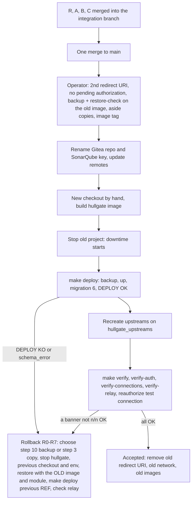

# F-010 · English contracts and product rename to hullgate

> **Former names (HULL-58).** In this spec `<old-name>` (upper case `<OLD-NAME>`) stands for the product's former name and `<old-prefix>` for the former ticket prefix; ticket ids keep their numbers under `HULL`. The repository spells neither former name.

## Metadata

| Field | Value |
|-------|-------|
| **Priority** | P1 |
| **Branch** | integration branch `feat/HULL-56-english-contracts`; one branch per PR (§3.8) |
| **Last updated** | 2026-11-01 |

## 1. Context & Objective

### Current State

On 2026-10-31 the operator switched the project `language` to `en` (`307d0f4`) and opened #52, now an umbrella (readiness `split`, comment 10931); this feature is its first lot, ticket #56 « English contracts and product rename to hullgate (lot 1 of #52) ». Siblings: #57 code text, #58 docs (which also takes the deletion of `poc/py-gateway`), #59 bench verdict vocabulary. The same day the operator settled the product name, **`hullgate`** (#43, comment 10909), to be applied in the same break: renaming after 1.0.0 would be a second CLI break and a second cutover. Facts read on `main` at `b37664f`; each count has its instrument in §3.5 and can be replayed.

- **CLI** (`src/<old-name>/cli.py:69-226`): 9 groups, 40 verbs, 34 distinct flags. French spellings: 2 groups (`jeton`, `connexion`), 24 verbs (21 with no English twin), 17 flags (+ `--url-mcp`, renamed for word order, = 18), 4 accepted values, 3 level aliases, 2 setting keys (`duree_jetons`, `verrou`, `tree.py:134-137`). The default role segment `principal` (`tree.py:47`; created with each new **environment**, `tree.py:408`) is kept.
- **CLI output**: 99 `self.say(` sites (`cli.py:329-934`; 9 of them take a non-literal argument whose text lives in helpers and module constants), 9 error prefixes (`:977-1031`) and the `usage :` prefix (`:58`). **No program parses them**: the bench uses `--json`, exit codes and the authorization URL. Their readers are 14 test files (31 occurrences) and the runbooks' « expected result ».
- **JSON and YAML**: 16 + 7 + 2(+1 value) + 6 French field names in four commands; French values in `token list` (`type` `"operateur"`, `path` `"(supprimé)"`), `client list`/`token list` `state`, `connection status` (`compte` default `"inconnu"`, `amont` `"amont MCP non déclaré"`, `refus` sentinel, `etat`/`etat_enregistre` labels); the export (`format: 2`) has 12 French keys and 2 level values.
- **Wire**: the 8 codes of BR-116 and the hint `(réessayer dans N s)`; the mask `[masqué]` (`relay.py:405`, quoted by BR-126's Rule); the audit issues `erreur_outil`, `refuse`, `annule`; **8** omission reasons, of which 5 French (`panne`, `échéance`, `sensible`, `plus de 1 000 noms`, `nom invalide`; `relay.py:92-93,405-410`); 6 of the 7 `get_access` typed codes (`connections.py:1455-1492`). OAuth and HTTP `error` codes are English; 9 of 11 `error_description` strings are French prose (text, out of lot).
- **Audit**: 56 action names, 0 French; `result` values English except the renewal outcomes (written into `result`, `lifecycle.py:593,604`); French values in `detail.issue`, share signal (2), renewal outcomes (5). The table is append-only by trigger and by BR-066 (`strict`).
- **Stored values**: 23 `CREATE TABLE` (21 tables), 0 French table or column names. French values live in 10 columns: `connection.kind`, `connection.state`, `service.model`, `service.upstream_type`, `application.mode`, `application.redirect_uri`, `setting.key`, `connection.last_outcome` and — compared by equality, found by the second stress-test — `connection.last_reason` sentinels (8 fixed literals: `sans refresh_token`, `bail échu sans résultat`, `écriture impossible avant la fin du bail`, `révoquée`, `application réenregistrée`, `refus signalé : 401 du serveur MCP`, `refus amont signalé`, `échéance trop courte`), `key_alert.reason` (3 key statuses), plus the upstream-revocation outcomes mapped by dict lookup (`lifecycle.py:251-257`, 4). Sealed columns bind `(version, table, row_id, field)` as AAD, not values.
- **Ops**: 27 `make` targets (3 French) and 3 French variables; `VERIFY-SOCLE|CONNEXIONS|RELAIS` with `ÉCHEC` and 8 French check names; 2 French Python modules; `ops.sh` greps `"cle": "clé absente"` and `^VERIFY-CONNEXIONS: [0-9]/4 OK$`. `GATE:`, `QA`, `DEPLOY:`, `BACKUP:` tokens are already English.
- **Infra**: `AMONTS_NETWORK` (1 French env key of about 29), network/project/file/key `amonts`; the outbound redirect URI `http://127.0.0.1/oauth/retour` is registered at each provider.
- **Product name `<old-name>` as a contract** (new with the rename; sweep G, 122 files / 492 lines, 427 once the kept names are removed): the Python package (`src/<old-name>/`, 31 files; 84 files / 214 lines of `import`; 24 files / 68 lines of dotted names and `python -m` strings; `pyproject.toml` name and script `<old-name> = "<old-name>.__main__:entry"`, the `uv.lock` entry, `Dockerfile` `ENTRYPOINT`); the CLI binary `<old-name>` (21 `<old-name> admin …` lines in 4 runbooks); image tags `<old-name>:current|dev|multiarch-*|smoke` and the env keys `<OLD-NAME>_IMAGE`, `<OLD-NAME>_VOLUME` (11 files / 24 lines); compose project `name: <old-name>` and `<old-name>-dev`, service `<old-name>`, Traefik router/service labels, container and thread names (12 files / 24 lines); **9 names visible to clients, upstreams or authenticators** — the MCP `serverInfo.name` (`mcp_endpoint.py:205`), the `clientInfo.name` sent upstream (`upstream_mcp.py:851`), two `User-Agent` values (`outbound.py:354`, `upstream_mcp.py:98`), the OAuth `resource_name` (`oauth.py:404`), the TOTP `issuer=` (`keys.py:177`), the consent cookie `<old-name>_consent` (`oauth.py:80`), the progress-token prefix (`upstream_mcp.py:1179`) and the export header comment (`export.py:103`); 6 loggers and 3 thread names; repository `<repository-url>`, ssh alias `gitea-<old-name>`, SonarQube key and name (`sonar-project.properties:3-4`), `.cairn/project-context.yaml` (name, repository, tracker project), the production server directory `<compose-root>/<old-name>` and its crontab line. Kept, being data at rest: volume `<old-name>_data`, database file `<old-name>.db` (`config.py:19`), the key-check HMAC label (`cipher.py:32`), the operator-token prefix `clo_` (`tokens.py:21`) — 37 files / 68 lines match these.
- **Bench**: the isolation bench drives the real CLI (`adapter_v1.py`: 35 `self.cli(...)` calls; `runner/harness/v1-harness.py:84-94` also drives it, and filters `t["state"] == "actif"`) and writes verdicts `réussi | échoué | non jouable | non joué`; `scripts/sdk_guard.py:27` reads `réussi` (BR-037 v2, `strict`).
- **BRs**: 47 active rules name an old spelling or a changed value in their Rule (27) or in a Clarification or Example (20, §4.4); the 84 that cite `src/<old-name>/` in Implementation References follow the rename without a version.

### Objective

After this feature, every name a client, script, runbook or audit reader depends on by its exact spelling is English, the product is called `hullgate` in every contract form, the stored values are migrated, and the old spellings are gone from the repository outside the pinned exclusions. The guarantee is stated per family by its extractor (§3.5, BR-131): the families that have a surface extractor are pinned by snapshot, the others by sweep. Free text (messages, comments, docs) is left to #57 and #58.

### Expected Impact

- No contract spelling changes after 1.0.0 **except the DNS name of the gateway (#42)**, which is not a code contract.
- One DB migration (version 6) at the cutover, under a pre-deploy backup, with a way back that works (§3.6); no data move: the volume keeps its real name.
- Downstream tickets (#10 policy, #11 admin web and tree import, #12 retention) are shaped on the English names and on `hullgate` from their first line.

### Settled decisions and open points

**Settled by the operator on 2026-10-31** (dated line in §13):

1. **Product rename to `hullgate`**, in the same break: package, CLI binary, image, compose project, containers, env prefixes, the 9 client-visible names, the network `hullgate_upstreams` (the former `amonts` rename merges into it). The Gitea repo, the session remote, the production server clone remote, the project-context drivers, the SonarQube key and the production server directory follow **at the cutover** (§3.6).
2. **Data volume keeps its real name `<old-name>_data`** (explicit `name:` in `deploy/compose.prod.yaml:67`); no data move. Said explicitly because the compose project rename would otherwise change the volume name: the volume is named by `HULLGATE_VOLUME`, default `<old-name>_data`, not derived from the project.
3. **Delivery**: one integration branch carries the PRs, each reviewed separately; one merge to `main` and one deploy (§3.8).
4. **Audit history**: old rows kept byte for byte plus one marker row; `restore-check` made migration-aware (§3.3, BR-039, BR-132).
5. **Bench verdicts excluded in BR-131's Rule text itself**; #59 handles them.
6. **Names**: `principal` kept; `mcp-public` / `mcp-internal` replace `mcp-distant` / `mcp-local` (both renamed in migration 6); `verify-auth` replaces `verify-core`; the 7 typed access codes are prefixed `access_`.
7. **Clean break, no aliases.**
8. **N1**: the rename is its own mechanical PR **R**, first.
9. **N2 (revised after the second stress-test)**: `<compose-root>/<old-name>` is **kept through the cutover and the rollback window**; it is renamed after acceptance as a standalone gesture (§3.6 step 16). The directory move is out of the cutover and of the rollback.
10. **N3**: the operator-token prefix `clo_` is kept.
11. **N4**: new backups are named `hullgate-<ts>.db`, **and** rotation and `restore-check` sort and select on the timestamp, never on the file name (AC-27).
12. **N5**: the integration branch merges to `main` with a merge commit (`no-ff`).

**Recommendations applied, not yet explicitly validated** (the operator **confirms the naming table of §3.2 at the freeze**; the names concerned: `connection status` with field `state`, `unplace`, `provided`, `connection_reauth_required`, export `format: 3` with `organisation` kept, `/oauth/callback`, and the other choices listed in the amendment report): redirect URI `/oauth/retour` → `/oauth/callback` with a second URI registered before the deploy (§3.6); BR policy of §4.4 (every rule that names an old spelling or a changed value is versioned, now); the 109 fixed CLI lines in phase 1, `Refused` bodies to #57; the bench adapters follow the CLI with one conclusive v1 replay at the close of phase 1.

## 2. Scope

**Phase 0 — PR R: product rename** (mechanical): `src/<old-name>` → `src/hullgate` and every import, dotted name, `python -m`, logger, thread and ASGI-state key; `pyproject.toml`, `uv.lock`, `Dockerfile`, `compose.yaml`, `deploy/*`, `Makefile`, image tags, `<OLD-NAME>_*` → `HULLGATE_*`, compose project and service, Traefik labels, the 9 client-visible names, `sonar-project.properties`, the CLI binary in runbooks and bench adapters, `Implementation References` paths of 84 BRs (no version). The data-at-rest names are untouched.

**Phase 1 — PR A: CLI and stored vocabulary**
- CLI groups, verbs, flags, accepted values, level names and setting keys as in §3.2; the 109 fixed output lines; JSON and YAML field names and values, export `format: 3`.
- Migration 6 (§3.3), the cutover marker (§3.4), `restore-check` made migration-aware; the typed access codes, key status tokens, share-signal values, renewal outcomes, `last_reason` sentinels, upstream-revocation outcomes, the redirect URI.
- Consumers that move with them: `deploy/ops.sh` `restore-check` and its backup status JSON, `src/hullgate/backup.py`, the bench adapters, `v1-harness.py` and `mapping.json`, the CLI commands and expected results of the four runbooks that quote the CLI, `domain-glossary.md` (the 20 rows take their English canonical terms, §3.7), the tests.
- BR-132, BR-131 (inline) and the 30 BRs of §4.4 allocated to this phase.

**Phase 2 — PR B: relay wire and audit values**
- The 8 codes of BR-116, the hint, the mask `[masked]`, the issue values of BR-122, the 8 omission reasons, in `relay.py` and `upstream_mcp.py`; the 16 BRs of §4.4 allocated to this phase.

**Phase 3 — PR C: ops lines and infrastructure names**
- `make verify-auth|verify-connections|verify-relay`, their variables, verdict lines, check names and Python modules; `ÉCHEC` → `KO`; the network, project, file and env key `hullgate_upstreams` / `UPSTREAMS_NETWORK`; `deploy/smoke`; the cutover runbook; BR-104; closure of BR-131.

## Out of Scope

- **#57 — code text**: messages, `Refused(...)` bodies (264 raise sites), `error_description` (9 French of 11), docstrings, comments, log lines, the consent page HTML, shell-script messages, free-text audit `reason`s that no code compares (≈8), Python identifiers that BR Rules cite (`signaler_refus`, `Accès`; BR-125, BR-127).
- **#58 — docs**: 8 feature specs, the prose of all BRs and runbooks (and how a pure translation is versioned), ADRs, trials, capability map, changelog, release notes, `README.md`, the `domain` tags of BR and spec frontmatter, the **deletion of `poc/py-gateway/`** carried over from F-009.
- **#59 — bench verdict vocabulary** `réussi | échoué | non jouable | non joué` (BR-037, BR-071), with a guard reading both spellings until `results-v1.json` is replayed.
- **Open tickets' bodies** (#52 lot 4): a standing practice (translate when touched), not a ticket.
- **The gateway's DNS name (#42)**: not a code contract; `MCP_HOST` is a deployment setting.
- **Any behaviour change** beyond spellings, the migration and one accepted shape change: in `connection status --json`, `state` and `stored_state` carry tokens where they carried labels (§3.2).
- **Renaming data at rest**: volume `<old-name>_data`, database file `<old-name>.db`, the key-check label (changing it would make every key read `key_different`, BR-088), the operator-token prefix `clo_` (N3).
- **Editing any `evidence/*.json` by hand.**

## 3. Functional Spec

### 3.1 What the operator sees (SCR-01, the CLI and ops surface)

Behaviour is unchanged; only spellings move. After phase 1: `hullgate connection place acme/w1 acme/app/prod/role-a --confirm-share` prints `placed: acme/w1 on acme/app/prod/role-a (non-sensitive)`; the old `<old-name> connexion placer … --confirme-partage` fails (no such binary; and the old verbs under the new binary end with the argparse usage error, exit code 2). After phase 3: `make verify-relay` prints `VERIFY-RELAY list: OK` … `VERIFY-RELAY: 5/5 OK`.

### 3.2 The contract tables (old → new)

**Product name** (PR R)

| Where | Old → new |
|---|---|
| package, `python -m`, entry script, CLI binary | `<old-name>` → `hullgate` (`src/hullgate/`, `hullgate = "hullgate.__main__:entry"`) |
| image tags | `<old-name>:current|dev|multiarch-amd64|multiarch-arm64|smoke` → `hullgate:…` |
| env keys | `<OLD-NAME>_IMAGE` → `HULLGATE_IMAGE`; `<OLD-NAME>_VOLUME` → `HULLGATE_VOLUME` (default **`<old-name>_data`**, kept) |
| compose | project `<old-name>` / `<old-name>-dev` → `hullgate` / `hullgate-dev`; service `<old-name>` → `hullgate`; Traefik labels `routers.<old-name>.*`, `services.<old-name>.*` → `…hullgate…`; temporary container names `<old-name>-restorecheck-`, `-backup-`, `-smoke` → `hullgate-…` |
| client- and authenticator-visible | MCP `serverInfo.name`, upstream `clientInfo.name`, `User-Agent` (2), `resource_name` (`hullgate <path>`), TOTP `issuer=hullgate`, cookie `hullgate_consent`, progress-token prefix, export header comment |
| loggers, threads, ASGI state keys | `<old-name>.*` → `hullgate.*`; `<old-name>-liste|oauth|relais` → `hullgate-…` |
| repo, tooling (at the cutover) | Gitea repository `<repository-url>` (renamed to `hullgate`); ssh alias `gitea-<old-name>` → `gitea-hullgate`; SonarQube key and name → `hullgate`; `.cairn/project-context.yaml` name, repository, `tracker.project-id`; the production server `<compose-root>/<old-name>` → `<install-dir>` **after acceptance, as a standalone gesture** (N2, §3.6 step 16) |
| **kept** (data at rest) | volume `<old-name>_data`; database file `<old-name>.db`; key-check label `<old-name>/connexions/controle-de-cle/v1`; token prefix `clo_` (N3) |

**CLI groups and verbs** (`hullgate <group> <verb>`; not listed, unchanged: `tree add|rename|move|delete|show|sensitive|lock|unlock`, `settings get|set|unset`, `audit tail`, `client add|list|remove|dcr`, `export`)

| Group.verb (old) | New |
|---|---|
| `jeton` (alias `token`) | `token` |
| `jeton creer` / `lister` / `revoquer` | `token create` / `list` / `revoke` |
| `service declarer` / `lister` / `retirer` / `redecouvrir` / `amont` | `service declare` / `list` / `remove` / `rediscover` / `upstream` |
| `application declarer` / `lister` / `retirer` / `reenregistrer` | `application declare` / `list` / `remove` / `reregister` |
| `connexion` | `connection` |
| `connexion ajouter` / `autoriser` / `reautoriser` / `renouveler` | `connection add` / `authorize` / `reauthorize` / `renew` |
| `connexion revoquer` / `prefixe` / `placer` / `retirer-placement` | `connection revoke` / `prefix` / `place` / `unplace` |
| `connexion etat` / `lister` / `retirer` / `outils` | `connection status` / `list` / `remove` / `tools` |

**Flags** (18 renamed; `--confirm`, `--json`, `--name`, `--label`, `--slug`, `--client`, `--client-id`, `--redirect-uri`, `--role`, `--service`, `--application`, `--type`, `--mode`, `-n` unchanged)

| Old | New | Old | New |
|---|---|---|---|
| `--chemin` (twin `--path`) | `--path` | `--hote-interne-mcp` | `--mcp-internal-host` |
| `--duree` (twin `--duration`) | `--duration` | `--url-mcp` | `--mcp-url` |
| `--serveur` | `--server` | `--retirer` | `--remove` |
| `--modele` | `--model` | `--secret-fichier` | `--secret-file` |
| `--portees` | `--scopes` | `--fourni` | `--provided` |
| `--hote-interne` | `--internal-host` | `--fichier` | `--file` |
| `--prefixe` | `--prefix` | `--compte` | `--account` |
| `--retour` | `--callback` | `--confirme-compte` | `--confirm-account` |
| `--confirme-partage` | `--confirm-share` | `--purger-noms` | `--purge-names` |

**Accepted values and keys**

| Where | Old → new |
|---|---|
| `--model` | `generique` → `generic` (`gitea` unchanged) |
| `--mode` | `declaree`, `dynamique` → `declared`, `dynamic` |
| `--type` | `mcp-distant`, `mcp-local` → **`mcp-public`, `mcp-internal`** (public https servers; private-network servers) |
| `tree add` level | `projet`, `environnement`, `rôle` no longer accepted; `client`, `project`, `environment` or `env`, `role` |
| `settings` keys | `duree_jetons`, `verrou` → `token_duration`, `lock` |
| default role segment | **`principal` kept** |

**CLI output** — the fixed lines of `cli.py` (the 109 sites, plus the helpers and constants they print: `_state_line`, the list line `amont :`, `TOOLS_CLOSED`, `UPSTREAM_UNDECLARED`, `KIND_LABELS`, `LEVEL_LABELS`, the `audit tail` field labels `motif=`, `avant=`, `après=`) are English, same fields and order. Labels: `en attente`/`active`/`réauthentification requise` → `pending`/`active`/`reauthorization required`; `jeton fourni` → `provided token`; `projet`/`environnement`/`rôle` → `project`/`environment`/`role`; `motif=`/`avant=`/`après=` → `reason=`/`before=`/`after=`. Error prefixes: `refused:`, `invalid configuration:`, `database unavailable:`, `connections key unavailable:`, `provider unavailable:`, `connection unavailable:`, `usage:`.

**JSON and YAML — field names**

| Output | Old → new |
|---|---|
| `connection status --json` (16) | `nom`→`name`, `prefixe`→`prefix`, `compte`→`account`, `portees`→`scopes`, `etat`→`state`, `etat_enregistre`→`stored_state`, `cle`→`key`, `echeance`→`expires_at`, `echeance_estimee`→`expiry_estimated`, `pas_avant`→`not_before`, `derniere_issue`→`last_outcome`, `placements[].sensible`→`sensitive`, `application_a_redeclarer`→`application_to_redeclare`, `amont`→`upstream`, `outils_fermes`→`tools_closed`, `refus`→`refusal` |
| `service list --json` (7) | `modele`→`model`, `portees`→`scopes`, `hote_interne`→`internal_host`, `points_de_terminaison`→`endpoints`, `amont`→`upstream`, `url_mcp`→`mcp_url`, `hote_interne_mcp`→`mcp_internal_host` |
| `application list --json` (2) | `secret_expire`→`secret_expires_at`, `methode`→`method` |
| `connection tools --json` (6) | `connexion`→`connection`, `outils`→`tools`, `nom`→`name`, `nom_amont`→`upstream_name`, `noms_invalides`→`invalid_names`, `noms_effaces`→`purged_names` |
| `export` YAML (`format: 3`) | `niveau`→`level`, `nom`→`name`, `sensible`→`sensitive`, `reglages`→`settings`, `projets`→`projects`, `environnements`→`environments`, `modele`→`model`, `portees`→`scopes`, `hote_interne`→`internal_host`, `connexions`→`connections`, `prefixe`→`prefix`, `etat`→`state`; level values `projet`→`project`, `environnement`→`environment`; unchanged: `organisation`, `client`, `segment`, `roles`, `services`, `applications`, `placements`, `mode`, `id`, `url`, `format` |

**JSON — values** (token where the JSON carried a label; labels stay in the text output)

| Field | Old → new |
|---|---|
| `connection status` `state` (token) | `pending`, `active`, `reauth_required`, and when the key is unavailable `key_absent`, `key_invalid`, `key_different` |
| `connection status` `stored_state` (token) | `pending`, `active`, `reauth_required` (was the label) |
| `connection status` `account` default | `inconnu` → `unknown` |
| `connection status` `upstream` when undeclared | `amont MCP non déclaré` → `no MCP upstream declared` |
| `connection status` `refusal` | sentinel `refus signalé : 401 du serveur MCP` → `mcp_refusal_401` (provider error codes unchanged) |
| `token list` `type` | `operateur` → `operator` (`oauth` unchanged); `path` of a deleted node `(supprimé)` → `(deleted)` |
| `token list` `state`, `client list` `state` | `actif`/`expiré`/`révoqué` → `active`/`expired`/`revoked`; `actif`/`retiré` → `active`/`removed` |
| `application list` `secret` | `chiffré` → `encrypted` |

**Stored values** (PR A, migration 6)

| Column / constant | Old → new |
|---|---|
| `connection.kind` | `fourni`→`provided` (`oauth` unchanged) |
| `connection.state` | `en_attente`→`pending`, `reauth_requise`→`reauth_required` |
| `service.model` | `generique`→`generic` |
| `service.upstream_type` | `mcp-distant`→`mcp-public`, `mcp-local`→`mcp-internal` |
| `application.mode` | `declaree`→`declared`, `dynamique`→`dynamic` |
| `setting.key` | `duree_jetons`→`token_duration`, `verrou`→`lock` |
| `connection.last_outcome` (and the classes of BR-066, 092, 093, 094) | `rendu`→`renewed`, `definitive`→`permanent`, `incertaine`→`uncertain`, `transitoire`→`transient`, `anomalie`→`anomaly` |
| `connection.last_reason` sentinels (every fixed literal the code writes there, whether or not it is compared; other values are provider error codes or text and are kept) | `sans refresh_token`→`no_refresh_token`, `bail échu sans résultat`→`lease_expired`, `écriture impossible avant la fin du bail`→`lease_write_failed`, `révoquée`→`revoked`, `application réenregistrée`→`application_reregistered`, `refus signalé : 401 du serveur MCP`→`mcp_refusal_401`, `refus amont signalé`→`upstream_refusal`, `échéance trop courte`→`expiry_too_short` (`MCP_401` motif → `mcp_401`) |
| `key_alert.reason`, key status in CLI, audit, backup status | `clé absente`→`key_absent`, `clé invalide`→`key_invalid`, `clé différente`→`key_different`; backup status JSON keys `connexions`→`connections`, `cle`→`key` |
| upstream-revocation outcomes (`lifecycle.py:251-257`, audit `reason`) | `révoquée`→`revoked`, `non prise en charge`→`unsupported`, `clé indisponible`→`key_unavailable`, `aucun jeton`→`no_token`, `échec (…)`→`failed (…)` |
| `application.redirect_uri`, `REDIRECT_URI` | `http://127.0.0.1/oauth/retour`→`http://127.0.0.1/oauth/callback` |
| share signal (audit detail) | `hors_client`→`other_client`, `sensibilite`→`sensitivity` |
| `get_access` typed codes, prefixed so they cannot be read as OAuth `error` codes or audit `result`s | `erreur`→`access_error`, `non_placee`→`access_not_placed`, `non_autorisee`→`access_not_authorized`, `reauthentification_requise`→`access_reauth_required`, `temporairement_indisponible`→`access_temporarily_unavailable`, `cle_indisponible`→`access_key_unavailable`, `erreur_integrite`→`access_integrity_error` |

**Wire and audit issue values** (PR B)

| Old | New |
|---|---|
| `amont_indisponible`, `amont_occupe` | `upstream_unavailable`, `upstream_busy` |
| `echeance_depassee`, `issue_incertaine` | `deadline_exceeded`, `uncertain_outcome` |
| `reponse_trop_grande`, `requete_trop_grande` | `response_too_large`, `request_too_large` |
| `connexion_a_reautoriser`, `erreur_interne` | `connection_reauth_required`, `internal_error` |
| hint `(réessayer dans N s)`; mask `[masqué]` | `(retry in N s)`; `[masked]` |
| issue values `erreur_outil`, `refuse`, `annule` (`ok` unchanged) | `tool_error`, `refused`, `cancelled` |
| omission reasons (8): `panne`, `échéance`, `sensible`, `plus de 1 000 noms`, `nom invalide` (`version`, `session`, `pagination` unchanged) | `outage`, `deadline`, `sensitive`, `too_many_names`, `invalid_name` |

**Ops and infrastructure** (PR C)

| Old | New |
|---|---|
| `make verify-socle` / `verify-connexions` / `verify-relais` and `ops.sh` subcommands | `verify-auth` / `verify-connections` / `verify-relay` |
| variables `CONNEXION`, `SENSIBLE`, `OUTIL` (`ROLE`, `REF`, `FILE` unchanged) | `CONNECTION`, `SENSITIVE`, `TOOL` |
| lines `VERIFY-SOCLE`, `VERIFY-CONNEXIONS`, `VERIFY-RELAIS`; verdict `ÉCHEC` | `VERIFY-AUTH`, `VERIFY-CONNECTIONS`, `VERIFY-RELAY`; `KO` |
| check names `etat jeton renouvellement sortie` / `liste appel refus sensible sortie` | `state token renewal output` / `list call refusal sensitive output` |
| modules `verify_connexions`, `verify_relais` | `hullgate.verify_connections`, `hullgate.verify_relay` |
| compose project `<old-name>-amonts`, network `<old-name>_amonts`, key `amonts`, `AMONTS_NETWORK`, `deploy/amonts.compose.yaml` | `hullgate-upstreams`, `hullgate_upstreams`, `upstreams`, `UPSTREAMS_NETWORK`, `deploy/upstreams.compose.yaml` |
| backup files (N4) | `<old-name>-<ts>.db` → `hullgate-<ts>.db` (rotation and `restore-check` **sort and select on the timestamp part of the name, never on the whole name**: `sed -E 's/^[a-z]+-//'` before `sort`, `ops.sh:124-126,146`; both prefixes accepted) |

**Kept on purpose**: the English words `client`, `service`, `application`, `organisation`, `segment`, `format`, `roles`, `principal`; `GATE:`, `QA`, `DEPLOY:`, `BACKUP:`, `OPS:` tokens; audit action names; OAuth and HTTP `error` codes; the data-at-rest names above; the bench's verdict spellings (#59).

### 3.3 Migration 6 and `restore-check` (SCR-02)

At startup (BR-069), one transaction with `rebuild=True`: rebuild `service`, `application` and `connection` with the new CHECK sets (SQLite cannot alter a CHECK) **and with their indexes, columns and constraints** — the four indexes of `connection` (two partial unique: `connection_name`, `connection_prefix`), `application_service`, the columns added by migrations 4 and 5 (`auth_method` with its CHECK, `last_reason`, `upstream_type`, `mcp_url`, `mcp_internal` with its CHECK) and the table-level `CHECK ((kind = 'provided') = (application_id IS NULL))`; child tables (`placement`, `pending_auth`, `key_alert`, `tool_name`, `application`→`service`, `connection`→`application`) keep referencing the final names. Then `UPDATE setting` keys, `connection.last_outcome`, `connection.last_reason` sentinels, `key_alert.reason`, `application.redirect_uri`.

**How an unknown value aborts**, with static statements only (the runner `Migration` holds none other, `migrations.py:17-23`): after the mappings, one `TEMP TABLE _vocab_guard (ok INTEGER CHECK (ok = 1))` per unconstrained column receives `INSERT … SELECT CASE WHEN EXISTS (SELECT 1 FROM <table> WHERE <column> NOT IN (<english values>)) THEN 0 ELSE 1 END`; a violated CHECK raises `IntegrityError`, the runner rolls back and reports `schema_error` naming the guard, leaving the database at version 5. `connection.last_outcome` additionally carries a CHECK in the rebuilt table. `setting.key` carries **no permanent CHECK** (#10 adds keys); `last_reason` is guarded only on the eight sentinels (any other value is a provider code or text and is kept).

Sealed columns (`tokens_enc`, `secret_enc`, `verifier_enc`), row counts and ids are not touched. Migrations 1 to 5 are not edited (BR-069); a fresh database passes through them and migration 6; `SCHEMA_VERSION` becomes 6 (`test_br_069_migrations.py:169` pins 5 and moves with it).

**`restore-check` is migration-aware** (fixes the blocker found by the second stress-test: today `backup restore` prints the counts of the restored copy *before* it starts, the gateway then migrates it, and `backup counts` differs by the marker row). `backup.py restore` applies the migrations to the restored copy (the same `migrations.migrate`, in the disposable container) and prints the counts **after** migration; the gateway then starts on an already-migrated copy and writes no second marker; the comparison `got == expected` therefore proves that starting changes no row beyond migration. Under the previous image (no migration 6) the same flow passes unchanged on a v5 backup, which is the only rehearsal that can run before the cutover (§3.6). BR-039 takes a version; BR-132 states it. The in-place restore block of `backup-restore.md` is gated on `restore-check` and so works for every pre-cutover backup under either image.

### 3.4 Audit history and the cutover marker (SCR-03)

Existing audit rows are never updated (BR-066 v4). When the audit table is non-empty at migration 6, the migration appends one row in the same transaction: `actor` `migration`, `action` `instance.vocabulary_migrated`, `result` `ok`, `detail` `{"from": 5, "to": 6, "converted": {"<table.column>": <rows>, …}}`. The marker separates **vocabularies of values** (`detail.issue`, `reason`, share signal, renewal outcome): a row below it uses the French spellings of those values; action names and field names were English before and after. The audit readers in the repository filter on action names only, so a table with mixed values breaks none of them. Because the gateway ships on `main` only after A, B and C are all merged (§3.8), no row written after the marker carries a French value.

### 3.5 Instruments (SCR-04) — dated constat 2026-10-31 at `b37664f`

Roots: `ROOTS="src scripts deploy Makefile Dockerfile compose.yaml pyproject.toml uv.lock sonar-project.properties poc/isolation-bench/runner poc/isolation-bench/mapping.json poc/isolation-bench/README.md tests docs/runbooks README.md"`. The sweeps are upper bounds: they also match prose in comments and docstrings, which must be corrected when they quote a retired spelling. Each sweep has a **positive fixture** in the test (one sample line per alternative that the pattern must match), so a pattern that matches nothing cannot pass.

| Sweep | Pattern (`grep -rEn -- "$P" $ROOTS`) | Constat (files / lines) | Phase |
|---|---|---|---|
| A (CLI) | `"(jeton\|connexion)"\|\b(jeton (creer\|lister\|revoquer)\|connexion (ajouter\|autoriser\|reautoriser\|renouveler\|revoquer\|prefixe\|placer\|retirer-placement\|etat\|lister\|retirer\|outils)\|service (declarer\|lister\|retirer\|redecouvrir\|amont)\|application (declarer\|lister\|retirer\|reenregistrer))\b\|"(creer\|revoquer\|ajouter\|autoriser\|reautoriser\|renouveler\|prefixe\|placer\|retirer-placement\|etat\|outils\|declarer\|redecouvrir\|amont\|reenregistrer)"\|--(chemin\|duree\|serveur\|modele\|portees\|hote-interne\|hote-interne-mcp\|retirer\|secret-fichier\|fourni\|fichier\|prefixe\|compte\|retour\|confirme-compte\|confirme-partage\|purger-noms\|url-mcp)\b\|"(projet\|environnement\|rôle)"` | 119 / 791 (before `--url-mcp`) | 1 |
| B1 (typed codes, share) | `\b(non_placee\|non_autorisee\|reauthentification_requise\|temporairement_indisponible\|cle_indisponible\|erreur_integrite\|hors_client)\b\|"sensibilite"` | 9 / 18 | 1 |
| B2 (wire) | `\b(amont_indisponible\|amont_occupe\|echeance_depassee\|issue_incertaine\|reponse_trop_grande\|requete_trop_grande\|connexion_a_reautoriser\|erreur_interne\|erreur_outil)\b\|"(refuse\|annule)"\|\bM_(DOWN\|DEADLINE\|SENSITIVE) *= *"[^"]*"\|réessayer dans\|\[masqué\]\|plus de 1 000 noms\|"nom invalide"` | 18 / 89 (before the last three alternatives) | 2 |
| C (stored) | `\b(en_attente\|reauth_requise\|mcp-distant\|mcp-local\|duree_jetons)\b\|"(fourni\|generique\|declaree\|dynamique\|verrou\|rendu\|definitive\|incertaine\|transitoire\|anomalie)"\|'(fourni\|generique\|declaree\|dynamique\|rendu\|definitive\|incertaine)'\|sans refresh_token\|bail échu\|écriture impossible\|application réenregistrée\|refus signalé\|refus amont signalé\|échéance trop courte` | 62 / 235 (before `mcp-local` and the last five) | 1 |
| D (ops) | `VERIFY-(RELAIS\|CONNEXIONS\|SOCLE)\|verify[-_](relais\|connexions\|socle)\|ÉCHEC\|\bAMONTS_NETWORK\b\|<old-name>[-_]amonts\|amonts\.compose\|networks: \[amonts\]\|^ *amonts: \|^ *- amonts\|\b(CONNEXION\|SENSIBLE\|OUTIL)\b` | 20 / 169 | 3 |
| E (key, URI) | `clé (absente\|invalide\|différente)\|"cle"\|oauth/retour` | 30 / 49 | 1 |
| F (JSON values) | `"(actif\|expiré\|révoqué\|retiré\|operateur\|inconnu\|chiffré)"\|\(supprimé\)\|amont MCP non déclaré` | measured at the first run of the test | 1 |
| G (product name, contract forms) | `(from\|import) <old-name>\|src/<old-name>\|<old-name>\.[a-z_]+\|python -m <old-name>\|<old-name>:(current\|dev\|multiarch\|smoke)\|<OLD-NAME>_[A-Z]+\|<old-name>[-_](dev\|smoke\|restorecheck\|backup\|oauth\|liste\|relais\|consent)\|name: <old-name>\b\|(routers\|services)\.<old-name>\|^ *<old-name>:\|exec -T <old-name>\|"<old-name>"\|<old-name> admin\|<compose-root>/<old-name>\|gitea-<old-name>\|<repository-url>\|projectKey=<old-name>\|projectName=<old-name>\|<old-name>_deploy\|^<old-name> = \|SERVICE=<old-name>\|ps -q <old-name>\|issuer=<old-name>\|<old-name> \{\|<old-name>-\{\|# <old-name>\|<old-name> connexion\|<old-name> <` | 123 / 505 (444 once the kept names `<old-name>_data\|<old-name>\.db\|<old-name>/connexions/controle-de-cle` are **stripped from each line** before matching, so a line that also carries a contract form still counts) | 0 |

**Exclusions** (pinned in the test as a literal list, each with its reason; seven since the operator decision of 2026-11-01, §13; an eighth entry is a review finding): `src/hullgate/migrations.py` (migrations 1 to 6 carry the old values by design), `tests/unit/test_br_132_vocabulary_migration.py` (fabricated pre-migration database), `tests/unit/test_br_131_contract_surface.py` (holds the sweeps), `tests/unit/test_br_069_migrations.py` and `tests/unit/test_br_069_migration_f008.py` (they build v3 to v5 databases whose CHECKs require the old values: `'declaree'`, `'fourni'`, `'mcp-distant'`, the old URI), `docs/runbooks/hullgate-cutover.md` (names the old directory, image, project and network on purpose), `deploy/smoke/cutover.sh` (the rehearsal of AC-28 deploys the previous code and speaks its CLI, targets and names). Not swept, by design: `business-rules/`, `features/`, `docs/trials`, `docs/reviews`, `CHANGELOG.md`, `poc/isolation-bench/evidence/`, `.cairn/`, and runbook **prose** mentioning the old product name (#58).

**Extractors per family** (what BR-131's snapshot reads, one mutant per key compared, never one per function): CLI — a walk of `cli._parser()` for groups, verbs, flags and choices; JSON shapes — the real output of each command in the CLI tour test; CHECK lists — `sqlite_master` of a fresh migrated database, normalised; wire and audit values — the distinct `detail.issue`, `reason` and `result` values written by the integration suite, collected by a session fixture, against a pinned set; Makefile targets — `make -pn`; compose and env — YAML parse of `compose.yaml`, `deploy/*.yaml` and `env.example`. A family with no extractor is covered by the sweeps alone and is not claimed more.

### 3.6 Cutover on the production server and rollback (SCR-05) — the operator's gestures, in `docs/runbooks/hullgate-cutover.md`

The runbook is written in PR C; nothing is played toward the production server by a session without the operator's explicit go (BR-043 v2); `.cairn/auth/` is not read. Three facts shape the order. **The running `deploy/ops.sh` is the old one**: it is loaded whole before `git checkout`, so a plain `make deploy` from the old checkout keeps the old service name and env keys and would fail its readiness loop; the new checkout is therefore taken by hand first. **The pre-deploy backup of `make deploy`, when no container runs, needs the new image**, so the image is built before the old project is stopped. **The production server directory `<compose-root>/<old-name>` is kept** through the cutover and the rollback window (N2): its absolute secret paths are in `.env`, so moving it inside the window would break the saved `.env`; it is renamed after acceptance as a standalone gesture (step 16).

*Before the cutover (readings and safeguards)*
1. In the Gitea OAuth2 application, **add** `http://127.0.0.1/oauth/callback` beside `…/oauth/retour` (several redirect URIs per application are accepted — product knowledge, to verify on the production server's Gitea; if refused, step 13 moves before step 11 and the authorization check moves with it).
2. `connection list`: no connection `pending` (no authorization open at deploy).
3. Old checkout: `make backup`, then `make restore-check` on it (old image, no migration: counts equal) — the only rehearsal that can pass; copy the backup aside under a name outside the rotation: `cp backups/<old-name>-<ts>.db backups/pre-hullgate-<ts>.db`; `cp .env .env.pre-hullgate`; `docker tag <old-name>:current <old-name>:pre-hullgate`.

*Cutover*
4. Gitea: rename the repository `<repository-url>` to `hullgate`; SonarQube: **Update Key** to `hullgate` (project settings, history kept). Do not run `make sonar` between the merge and this step.
5. Session (on the operator's go, right after step 4): `git remote set-url origin <repository-url>`; one commit on `main` updating `.cairn/project-context.yaml` (name, repository, tracker project). **Check**: one read call on the tracker (`ticket.get` on #56) through the gitea MCP server after the rename; if it fails, the server's own configuration carries the old repository name and is corrected before any further tracker act.
6. The production server, ssh: add `Host gitea-hullgate` (same `HostName`, `Port`, `IdentityFile ~/.ssh/<old-name>_deploy`; the read-only deploy key stays attached to the renamed repository and its file name is not changed), then `git remote set-url origin <repository-url>`; keep the old `Host` entry until step 15.
7. `.env`: rename `<OLD-NAME>_IMAGE` → `HULLGATE_IMAGE`, `<OLD-NAME>_VOLUME` → `HULLGATE_VOLUME` (value `<old-name>_data`, written explicitly), add `UPSTREAMS_NETWORK=hullgate_upstreams`, drop `AMONTS_NETWORK`. The secret paths in `.env` are unchanged (the directory is kept).
8. `git fetch origin && git checkout --detach <sha>` by hand (new `ops.sh`, new compose files in place), then build the new image: `docker compose -f deploy/compose.prod.yaml --env-file .env build` — the old container keeps serving meanwhile.
9. Stop the old project: `docker compose -p <old-name> down --remove-orphans` (volumes kept; `--remove-orphans` because the clone now holds the new compose files, so the old service is an orphan to that model), then check `docker ps -q --filter label=com.docker.compose.project=<old-name>` prints **nothing** (a reading of AC-OP-01). **Downtime starts.**
10. `make deploy REF=<sha> 2>&1 | tee -a backups/cutover-step10.log` (the log names the pre-deploy backup and the ref deployed before, which the rollback's R0 reads; appended at each attempt): backup through a throwaway container on `hullgate:current` and the unchanged volume `<old-name>_data`, build (cached), `up -d`, wait for `/readyz`; **migration 6 runs at startup**; `DEPLOY: OK <sha>`. Expected and harmless: Compose warns that volume `<old-name>_data` "was created for project <old-name>" (the volume is named explicitly, no data moves). Ignore the « Retour à la référence précédente » line: the rollback below applies.
11. Immediately after `/readyz`: recreate the upstreams on the new network, `docker compose -f deploy/upstreams.compose.yaml --env-file .env up -d`. **From the deploy to this step every relay call fails `upstream_unavailable`** (the gateway is on `hullgate_upstreams`, the upstream still on `<old-name>_amonts`): keep the two steps contiguous. The old upstream project keeps running until step 15.
12. Readings and checks: `make verify`, `make verify-auth ROLE=…`, `make verify-connections CONNECTION=…`, `make verify-relay …`.
13. `connection reauthorize` of the test connection (`recette-socle/gitea-test`) **completed end to end** through the provider with the new redirect URI — the check that closes the redirect-URI change.

*After acceptance* (the rollback window closes at step 14)
14. Gitea: remove `…/oauth/retour` from the OAuth2 application.
15. `docker compose -p <old-name>-amonts down` (the old upstream project; this is what lets the network go), then `docker network rm <old-name>_amonts`; `docker image rm <old-name>:current <old-name>:pre-hullgate`; remove the old `Host gitea-<old-name>` entry and `.env.pre-hullgate`; keep `backups/pre-hullgate-<ts>.db` until the rotation has aged out the pre-cutover backups.
16. **Standalone, own gesture** (N2): rename `<compose-root>/<old-name>` → `<install-dir>` — stop nothing but the nightly cron window: `mv`, fix the three absolute secret paths in `.env`, replace the crontab line, `docker compose … up -d` to re-resolve the bind mounts, `make verify`. Its undo is the same `mv` back.

*Rollback (before step 14) — short blocks R0 to R7 in `docs/runbooks/hullgate-cutover.md`, played in the clone of the cutover, each ending on a printed `OK`/`KO` check that stops it (review 488, B1); every command uses the previous checkout, the previous image or the previous module, never the new tree on the restored file*

- **R0** sets `PREV` and `TS` once, checks their format and the safeguards of step 3, and chooses the backup R4 restores (`SRC`, operator decision of 2026-11-01, #56): **step 10's pre-deploy backup** `backups/hullgate-<ts10>.db`, taken at the start of downtime with no writer and before migration 6, named by step 10's own output (`make deploy … | tee -a backups/cutover-step10.log`, last attempt first, never "the latest backup": `make verify` writes later ones at schema 6), kept only if its timestamp is after `<ts>`, its `PRAGMA user_version` is 5 and `restore-check` of the **previous** code passes on it; otherwise **step 3's aside copy** `backups/pre-hullgate-<ts>.db`, with the reason printed. Nothing changes in R0.
- **R1** `docker compose -p hullgate down --remove-orphans`, then a printed check that no `hullgate` container runs.
- **R2-R4** (one block, `set -e`): proof that no container uses `<old-name>_data`; `git checkout --detach <previous sha>`; `cp .env.pre-hullgate .env`; `rm -f` of the database and its side files then `python -m <old-name>.backup restore - /data/<old-name>.db < $SRC` in `<old-name>:pre-hullgate` (the OLD image and the OLD module: nothing migrates the file); a printed check that `PRAGMA user_version` is 5.
- **R5-R6** (`set -e`): `make deploy REF=<previous sha>` (old script, old compose, project `<old-name>`); the old upstream recreated (`docker compose -f deploy/amonts.compose.yaml --env-file .env up -d --force-recreate`, in case step 9 or R1 removed its network); `docker compose -p hullgate-upstreams down --remove-orphans` and a printed check.
- **R7** `make verify`, a printed check that `<old-name>_amonts` carries the gateway and `gitea-mcp`, and the relay under the old names (`make verify-relais`): `VERIFY: 6/6 OK` alone does not prove the relay.

What a rollback cannot restore: every write after the restored backup (from step 10, or from step 3 after a fallback: audit rows, operator tokens, the gateway's OAuth codes and the refresh tokens it rotated for Claude clients, who reconnect), and provider state (a refresh token used at step 12 or 13 may be invalid at the provider: reauthorize the connection under the old code, `…/oauth/retour` being registered until step 14).

Why this order: the old code refuses a v6 database (`schema_too_new`), so the database is restored **before** the old code starts; and the restore must use the previous module, because the new `backup restore` migrates the file it restores (§3.3) and would write a v6 file into the volume. After a rollback the Gitea repository and the SonarQube key stay `hullgate` (Gitea redirects the old URL — to verify) while the production server runs `<old-name>` code: `make sonar` waits and the old clone's remote keeps the new alias.

### 3.7 Canonical terms (SCR-06)

`domain-glossary.md` (20 rows in three tables) takes the English canonical terms the names above spell: Access point, Segment, Sensitive environment, Lock, Operator token, Authorization order, Lineage, Authorization barrier, Library, Connection, Provided-token connection, Service, Application (outbound OAuth), Placement, Tool prefix, Quality tool, QA line, Relay, Upstream, Public (tool) name. Each row keeps its former French term in the Definition (« formerly Amont ») and **not** in the "do not use" column, so INV-021 does not fire on the French BR prose until #58 moves the term there. The glossary names the product `hullgate`.

### 3.8 Delivery: one integration branch, four PRs, one merge

- Integration branch **`feat/HULL-56-english-contracts`**, cut from `main` once the spec is frozen. PR branches `feat/HULL-56-r-rename`, `feat/HULL-56-a-cli-stored`, `feat/HULL-56-b-wire`, `feat/HULL-56-c-ops`.
- Each PR is opened **with the integration branch as its base** (not `main`), reviewed by the review act on its own diff, merged by the AI (squash, `access.merge-by: ai`) into the integration branch, in the order R, A, B, C. A PR body states: « integration branch only — do not deploy ».
- `close-feature` runs per PR on its PR branch (BR extraction committed there); BR-131, which spans R to C, is extracted at the closure of C. `main` is merged into the integration branch (merge commit) whenever it moves, so the final merge is conflict-free.
- The identifiers BR-131 and BR-132 are reserved from the freeze: the spec is committed on `main` at the freeze and `br-identifiers.md` §Allocation scans the §4 of every open spec, so a spec drafted meanwhile (#10) cannot take them.
- After C: one PR **integration → `main`** (N5: merge commit), carrying no new change; its checks are `make gate`, `make test-container`, `cairn check` green, the four PR approvals. `main` stays deployable throughout, and the first deploy that contains migration 6 contains the whole feature, which is what makes the marker of §3.4 true.

## 4. Business Rules

### 4.1 Naming and classification

Next free identifier: **BR-131** (index ceiling BR-130, no rule in flight: F-001 to F-009 are all `implemented`). Inline below: BR-131, BR-132, BR-066 v4 and BR-039 v-next; the 45 other evolutions are spelling or value edits listed in §4.4.

### BR-131 · The gateway's closed vocabularies and its product name are English

> **Extracted on 2026-11-01.** Current version: [`business-rules/BR-131.md`](../business-rules/BR-131.md).
> The content below reflects the state of this BR at the time of feature F-010 (v1).

*`behavioral` · `strict` · Candidate state: `verified` — `tests/unit/test_br_131_contract_surface.py`: the surface extracted per family (§3.5: parser walk, real JSON output of the CLI tour, CHECK lists, audit and wire values written by the integration suite, `make -pn`, compose and env YAML) equals the English tables pinned from §3.2, with one mutant per key compared, and the sweeps A to G return no line outside the seven pinned exclusions, each sweep having a positive fixture.*

**Rule** — Every closed vocabulary that a client, a script, an operator's runbook or an audit reader depends on by its exact spelling is English: the CLI groups, verbs, options and accepted values with the keys and values of their JSON and YAML outputs; the error codes and the fixed texts the gateway returns to MCP clients; the issue, outcome, omission and reason values written to the audit or stored in the database; the `make` targets, their variables and verdict lines; the names of compose projects, networks, files and environment keys; and the product's own name, `hullgate`, in its package, binary, images, containers and every name it presents to a client, an upstream or an authenticator. A CLI invocation that uses a retired French spelling is refused with the usage error (exit code 2) and changes nothing. Excepted, and only these: the isolation bench's verdict vocabulary (BR-037, BR-071), until the ticket that migrates it; and the identifiers of data at rest — the volume `<old-name>_data`, the database file `<old-name>.db`, the key-check label and the operator-token prefix `clo_` — which are never renamed.

**Clarifications**
- A *closed vocabulary* is a name or value that code compares by equality or that a document quotes as something to type or to expect. Free text — messages, `Refused` bodies, `error_description`, docstrings, comments, the consent page, documents — is not one and follows the project's `language` in its own lot.
- Permanent keeps (not exceptions): the English words `client`, `service`, `application`, `organisation`, `segment`, `format`, `roles`, `principal`; the verdict tokens `GATE:`, `QA`, `DEPLOY:`, `BACKUP:`, `OPS:`; audit action names; OAuth and HTTP `error` codes.
- The key-check label embeds the former product name on purpose: it is the HMAC domain of the stored key check, and changing it makes every key read `key_different` (BR-088). A regression test pins the check of a fixed key to a literal digest.
- Historical data keeps its spelling: audit rows written before migration 6 (BR-066 v4) and the bench's `evidence/*.json`.
- The pinned tables are those of F-010 §3.2; a new name enters the snapshot only by editing the pinned table in the same change, which is where a reviewer reads its spelling.

**Example**
- **Given** a feature adds the option `--fichier` to a new verb
- **When** `make gate` runs
- **Then** the surface snapshot differs from the pinned table and the gate ends `GATE: KO test`.

### BR-132 · The vocabulary migration rewrites every stored French value or stops

> **Extracted on 2026-11-01.** Current version: [`business-rules/BR-132.md`](../business-rules/BR-132.md).
> The content below reflects the state of this BR at the time of feature F-010 (v1).

*`behavioral` · `blocking` · Candidate state: `verified` — `tests/unit/test_br_132_vocabulary_migration.py`: a fabricated version-5 database carrying every old stored value migrates to version 6 with only English values left in the columns of §3.3, identical row counts, identical `sqlite_master` (indexes, CHECKs normalised) and `table_xinfo` per table, empty `foreign_key_check`, byte-identical sealed columns, `restore-check` logic passing on a v5 backup with audit rows; a value outside the mapping leaves the database at version 5 with `schema_error`.*

**Rule** — Migration 6 rewrites, in one transaction, every stored value listed in F-010 §3.2 (`connection.kind`, `connection.state`, `connection.last_outcome`, the eight `connection.last_reason` sentinels, `service.model`, `service.upstream_type`, `application.mode`, `application.redirect_uri`, `setting.key`, `key_alert.reason`) to its English spelling, rebuilding the tables whose CHECK sets name them without losing any index, column or constraint; a stored value outside the mapping aborts the migration with `schema_error` and leaves the database at version 5; no sealed value, row count, identifier or foreign key changes.

**Clarifications**
- BR-069 governs order and failure; this rule adds what migration 6 must convert. An older image refuses the converted database (`schema_too_new`): the way back is the pre-cutover backup restored **before** the previous code starts (F-010 §3.6 rollback), never the new image started on the restored file. A restore meant for the previous code **must use the previous image's `backup restore`**: the new one migrates the file it restores, so it would write a v6 file.
- BR-088 is not engaged: the migration changes the spelling of a stored value, not the state of a connection, runs before the key is read and touches no sealed column; a gateway started without its key migrates and stays ready.
- `backup restore` applies the migrations to the restored copy and counts after them, so `restore-check` compares like with like (BR-039).
- Any audit row is untouched (BR-066 v4).

**Example**
- **Given** a version-5 database holding a connection `fourni` / `reauth_requise` with `last_reason` `révoquée` and a setting `verrou`
- **When** the gateway starts
- **Then** the connection reads `provided` / `reauth_required` / `revoked`, the setting key reads `lock`, `PRAGMA user_version` is 6, the index `connection_prefix` still exists and the sealed tokens decrypt unchanged.

### BR-066 · The audit traces emissions, revocations, refusals and tree changes, without secrets (v4)

> **Extracted on 2026-11-01.** Current version: [`business-rules/BR-066.md`](../business-rules/BR-066.md).
> The content below reflects the state of this BR at the time of feature F-010 (v4).

*`behavioral` · `strict` (unchanged) · Candidate state: `verified` — `tests/unit/test_br_066_audit.py` extended and `tests/unit/test_br_132_vocabulary_migration.py` (audit rows byte-identical, one marker row).*

**Rule** — v3 text with exactly three edits: (1) the renewal outcomes read `renewed, permanent, transient, uncertain, anomaly`; (2) the list of traced acts gains the vocabulary migration (`instance.vocabulary_migrated`, actor `migration`); (3) the verb of the refused act reads `authorize`. The v4 text is written out in full at extraction.

**Clarifications**
- A vocabulary migration does not rewrite audit history: rows written before it keep their French values; the marker row tells the reader where the vocabulary of values changes. No command and no migration modifies or deletes an entry. The marker is written only when the table held at least one row.

### BR-039 · A backup is checked by restoring it without touching production (v3)

> **Extracted on 2026-11-01.** Current version: [`business-rules/BR-039.md`](../business-rules/BR-039.md).
> The content below reflects the state of this BR at the time of feature F-010 (v3).

**Rule** — unchanged in substance; the comparison of `make restore-check` is made on the restored copy **after** the migrations of the current code have been applied to it (`backup restore` counts after migration), so a backup older than the current schema passes; the printed line reads `RESTORE-CHECK: OK <file> readyz=200 connections=<n> (key_absent) tables={…}`. The Clarifications follow the new spellings (`key_absent`, the `connections`/`key` status keys, `python -m hullgate.backup`).

### 4.2 Overlap scan (`br-identifiers.md` §Overlap)

Filter on `liste fermée, vocabulaire, énumér*, migr*, schéma, ajout seul, anglais, English, code(s)` over the 129-row index: **11 lines retained** (BR-024, 058, 059, 060, 069, 072, 073, 082, 096, 099, 116). Verdicts after opening: BR-024, 058, 059, 060, 072, 073, 099 off topic; **BR-069 — neighbour** (migration order and failure; C1: BR-132 can be violated while BR-069 is respected: a migration that succeeds and leaves `fourni` behind), new rule; **BR-116 — neighbour** (the closed list of codes; C1: the CLI can be French while the codes are English), new rule, BR-116 takes a version for its spellings; BR-082, BR-096 — touched, spelling only; **BR-066 — overlap with the append-only guarantee — new version (C2)**: a migration that rewrote rows would have satisfied v3 only if it were not a « command »; v4 closes that reading; **BR-039 — overlap — new version (C2)**: a backup older than the current schema satisfied v1 and no longer satisfies it once migration 6 adds a row. No other candidate.

### 4.3 Classification line of the evolutions

All evolved rules keep their `kind` and `enforcement` (`behavioral`; `strict` or `blocking` as their files say, rechecked at extraction) and their candidate control state `verified` through their existing tests, whose assertions move to the new spellings.

### 4.4 Spelling and value evolutions — the 47 evolved rules (v+1; BR-066 and BR-039 are written out above)

Rule: a rule is versioned when its Rule **or its Clarifications or Examples** state a spelling or a value that this feature changes (a quoted command, flag, code, stored or JSON value, output line, URI, `format`). Prose that merely uses a French word is #58's. The edit applies the §3.2 substitutions to the Rule, Clarifications and Examples and nothing else; the Versioning row reads « Contract spelling migrated to English (F-010) ». A rule that names tokens of two phases is versioned in the **last** of them (inside the integration branch the intermediate state is never deployed). Implementation References of the 84 rules citing `src/<old-name>/` follow the rename in PR R **without a version** (a pointer, not a requirement; `cairn check` is run at R's closure to confirm no pointer check fails).

| Phase | BR | Tokens (Rule = R, Clarification/Example = C) |
|---|---|---|
| 1 | BR-052 R | `duree_jetons` |
| 1 | BR-053 R | `<old-name> jeton creer` |
| 1 | BR-070 R/C | `<old-name> export`; format « 2 depuis F-006 »; `duree_jetons` |
| 1 | BR-078 R | `--confirme-partage` |
| 1 | BR-080 R | `<old-name> connexion etat` and the JSON fields it renders |
| 1 | BR-085 R | `--fichier`, `connexion reautoriser` |
| 1 | BR-086 R | `--fichier`, `--secret-fichier`, `--retour`, `ajouter`, `reautoriser` |
| 1 | BR-089 R | `temporairement_indisponible` |
| 1 | BR-092 R | `--fichier`, `connexion reautoriser`, `autoriser`, class `définitive` |
| 1 | BR-093 R | `temporairement_indisponible`, classes |
| 1 | BR-094 R | `autoriser`, classes |
| 1 | BR-095 R | `<old-name> connexion revoquer` |
| 1 | BR-096 R | `--confirme-compte`, `connexion autoriser` |
| 1 | BR-097 R | `service declarer`, `service redecouvrir` |
| 1 | BR-106 R | `service amont`, `mcp-distant`/`mcp-local`, `--retirer` |
| 1 | BR-066 | inline above |
| 1 | BR-039 C | `RESTORE-CHECK` line, `clé absente`, `clé différente`, `python -m <old-name>` (inline above) |
| 1 | BR-048 C | `verrou`, `duree_jetons` |
| 1 | BR-049 C | `connexion retirer`, `connexion revoquer` |
| 1 | BR-050 C | `--chemin` |
| 1 | BR-074 C | `generique`, `service declarer` |
| 1 | BR-075 C | `revoquer` |
| 1 | BR-082 C | `--retour`, `autoriser`, `reautoriser`, `generique`, `non_autorisee`, `/oauth/retour` (and the control note) |
| 1 | BR-083 C | `application lister`, `application reenregistrer` |
| 1 | BR-084 C | `--hote-interne`, `service declarer` |
| 1 | BR-087 C | `erreur_integrite` |
| 1 | BR-088 C | `etat`, `revoquer`, `clé différente`, `erreur_integrite`, `python -m <old-name>` |
| 1 | BR-090 C | `etat`, `incertaine` |
| 1 | BR-091 C | `sans refresh_token`, `échéance trop courte` (last_reason sentinels) |
| 1 | BR-112 C | `connexion outils` |
| 2 | BR-108 R | `amont_occupe` |
| 2 | BR-111 R | `amont_indisponible`; omission reasons (C) |
| 2 | BR-116 R | the 8 codes |
| 2 | BR-117 R | `echeance_depassee`, `issue_incertaine` |
| 2 | BR-118 R | `amont_indisponible` |
| 2 | BR-122 R | the 12 issue values |
| 2 | BR-124 R | `amont_occupe` |
| 2 | BR-126 R | `reponse_trop_grande`, `[masqué]` |
| 2 | BR-127 R | `connexion_a_reautoriser` (the identifier `signaler_refus` stays: #57) |
| 2 | BR-128 R | `connexion_a_reautoriser` |
| 2 | BR-129 R | `requete_trop_grande` |
| 2 | BR-107 C | wire codes |
| 2 | BR-109 C | `échéance` (omission reason) |
| 2 | BR-110 C | `--purger-noms`, `connexion outils`, the omission reasons `nom invalide`, `plus de 1 000 noms` |
| 2 | BR-114 C | the six typed codes → the `access_` codes → the wire codes (the normative mapping), `connexion outils` |
| 2 | BR-130 C | `connexion etat`, `connexion outils`, omission reason `sensible` |
| 3 | BR-104 C | SonarQube project key `<old-name>` → `hullgate` |

That makes **47** touched rules (`br-touched`): 27 by their Rule, 20 by a Clarification or Example only. Instrument: `grep` of the sweeps' patterns over `business-rules/*.md` Rule, Clarification and Example text (Archives and Implementation References excluded) at the start of each phase lists the rules the phase must still version, and must list none at its closure. State labels used in prose (« réauthentification requise », « en attente ») are prose, not tokens: #58.

## 5. Acceptance Criteria

**Phase 0 — PR R**

- [x] **AC-01** (BR-131) — package and binary: `test -d src/hullgate && ! test -e src/<old-name>`; `grep -n '^hullgate = "hullgate.__main__:entry"' pyproject.toml` prints one line; `uv lock --check` exits 0 (toolbox); in the toolbox `python -m hullgate --help` exits 0 and `docker run --rm hullgate:dev --help` (the image's entrypoint) exits 0.
- [x] **AC-02** (BR-131) — the PR is mechanical: replaying the committed script `.cairn/runs/acts/HULL-56-rename.sh` (a `git mv` and substitutions limited to sweep G's forms) on the PR's base reproduces the PR tree: `git diff --stat <replayed-tree> HEAD` is empty. The script also covers the `uv.lock` entry and the Implementation References of the 84 rules; anything else not reproducible is listed in the PR body and read by hand.
- [x] **AC-03** (BR-131) — sweep G returns no line outside the exclusions of §3.5 and the kept names (`grep -rEn -- "$G|$KEEP" $ROOTS | sed -E 's/<old-name>_data|<old-name>\.db|<old-name>\/connexions\/controle-de-cle//g' | grep -E -- "$G"` filtered by the exclusion list — the kept tokens are stripped per line, never the whole line dropped): `pytest tests/unit/test_br_131_contract_surface.py -q -k sweep_g`.
- [x] **AC-04** (BR-131, BR-088) — data at rest is unchanged: `python3` over `deploy/compose.prod.yaml` resolves the volume name to `<old-name>_data` with `HULLGATE_VOLUME` unset and to the given value when set; `DB_FILENAME == "<old-name>.db"`; `PREFIX == "clo_"`; the key check of a fixed 32-byte key equals a literal digest pinned in `tests/unit/test_br_088_*` (`-k key_check_label`); no sweep-G line mentions the label outside `cipher.py`.
- [x] **AC-05** (BR-131) — names shown to others: `pytest tests/integration -q -k product_name` (`tests/integration/test_br_131_product_name.py`, 3 tests, added at the closure) asserts MCP `serverInfo.name == "hullgate"`, the OAuth `resource_name` starts with `hullgate `, both `User-Agent` values equal `hullgate`, the consent cookie is `hullgate_consent`, the otpauth URI carries `issuer=hullgate`, the export's first line starts `# hullgate`.

**Phase 1 — PR A**

- [x] **AC-06** (BR-131) — CLI surface pinned: `pytest tests/unit/test_br_131_contract_surface.py -q -k parser` is green; the parser has 9 groups, 40 verbs and 32 distinct flags (walk of `cli._parser()`), none from the French column of §3.2; mutants (rename one verb, one flag, one choice value) turn it red.
- [x] **AC-07** (BR-131) — sweeps A, B1, C, E, F return no line outside the exclusions of §3.5 (`pytest … -k sweeps_phase1`), and each sweep's positive fixture (one sample line per alternative) is matched by its pattern.
- [x] **AC-08** (BR-131) — clean break: for each of the 24 old verbs invoked **under the new group** (`connection etat`, `token creer`, `service amont`, …) and each of the 18 old flags invoked **under a verb that had it**, `cli.main` ends with exit code 2 and a `usage:` line, no row written; and the old groups `jeton` and `connexion` fail likewise (`-k old_spellings`, 44 parametrised cases).
- [x] **AC-09** (BR-132) — migration maps everything: on a fabricated version-5 database holding every old value of §3.2 'Stored values' (`pytest tests/unit/test_br_132_vocabulary_migration.py -q -k maps`), after start `PRAGMA user_version` is 6; `SELECT DISTINCT` of each listed column returns only English values; per-table row counts equal the counts before; `PRAGMA foreign_key_check` and `integrity_check` are clean; the SHA-256 of `tokens_enc`, `secret_enc` and `verifier_enc` per row is unchanged; the database holds populated `placement`, `pending_auth`, `key_alert` and `tool_name`.
- [x] **AC-10** (BR-132) — structure survives the rebuild: the set `SELECT type, name, tbl_name, sql FROM sqlite_master` after migration equals the one produced by migrations 1 to 5 plus the intended edits (CHECK value lists normalised), including `connection_name`, `connection_prefix` (partial unique) and `application_service`; `PRAGMA table_xinfo` equal per table; a second `connection` with an existing prefix is refused (`-k structure`).
- [x] **AC-11** (BR-132, BR-069) — fail closed: the same database with one `connection.last_outcome` outside the mapping, then one `setting.key` outside it, then one `redirect_uri` other than the old URI, each stays at `user_version` 5, reports `schema_error` naming the guard, and `/readyz` answers 503 (`-k unknown_value`); a gateway started without its connections key migrates and `/readyz` answers 200 (`-k no_key`).
- [x] **AC-12** (BR-066 v4, BR-132) — audit history intact: on a database with 20 audit rows, the SHA-256 of `SELECT * FROM audit ORDER BY seq` for `seq <= 20` is identical before and after; exactly one new row, `action` `instance.vocabulary_migrated`, `actor` `migration`, `detail.from` 5, `detail.to` 6; `audit_append_only_update` and `audit_append_only_delete` still in `sqlite_master`; on an empty audit table no row is added (`-k audit`).
- [x] **AC-13** (BR-039, BR-132) — restore-check passes on a pre-cutover backup: a fabricated v5 backup with at least one audit row passes the restore-check logic under the v6 code — `backup restore` prints counts after migration, the started copy reports the same counts, no second marker (`pytest tests/container/test_br_039_restore_check.py -q -k v5_backup`, toolbox). The previous-image case is covered by the rehearsal AC-28, not skipped here.
- [x] **AC-14** (BR-131) — shapes: golden tests pin the key sets of `connection status --json`, `service list --json`, `application list --json`, `connection tools --json`, `token list --json`, `client list --json` and of the export (`format: 3`) as literal sets compared by equality, and the **value sets** where closed: `state` ∈ `pending|active|reauth_required|key_absent|key_invalid|key_different`, `stored_state` ∈ `pending|active|reauth_required`, token `type` ∈ `operator|oauth`, token `state` ∈ `active|expired|revoked`, client `state` ∈ `active|removed` (`-k "json_shape or export_format"`).
- [x] **AC-15** (BR-131) — output lines: a CLI **tour test** runs every verb of `tests/unit/cli_output_tour.py` against a seeded database and writes the captured stdout and stderr lines to `tests/unit/cli_output_lines.txt`; the number of distinct lines is pinned at the first green run; a stem check over the tour output (the French stems of sweeps A and C, plus `connexion`, `jeton`, `erreur`, `valeur`, `créé`, `supprimé`, `déplacé`, `placée`, `révoqué`, `motif`, `avant`, `après`) prints no hit — unaccented French is caught; that the lines are good English is **read by hand** at review. The AST count (99 + 9 + 1 sites) is the inventory, not the criterion.
- [x] **AC-16** (BR-042, BR-131) — runbooks follow: every command line of `docs/runbooks/*.md` that invokes the CLI (the `$C …` and `hullgate admin …` lines; 19, 18, 3 and 1 at `b37664f` in `keys-and-upstreams.md`, `keys-and-upstreams.md`, `keys-and-upstreams.md`, `update.md`) is extracted and parsed by the new parser without a usage error (`-k runbook_commands`); `pytest tests/unit/test_br_042_runbooks.py -q` stays green; each « Résultat attendu » that quotes an output line quotes the English line.
- [x] **AC-17** (BR-071, BR-131) — bench follows the CLI: every `self.cli(...)` call of `adapter_v1.py` (35 at `b37664f`) **and** every CLI call of `runner/harness/v1-harness.py` and the two review harnesses (`HULL-5-review-*-test.py`) is extracted by AST and parses under the new parser, and each reads only field names and values of the pinned status JSON (`-k bench_adapter_parses`); at the close of phase 1 the implementation plays, in the toolbox, `cd poc/isolation-bench && ./bench.sh --target v1 --purge-images`, which ends 16 tests and every control `réussi`; `python3 scripts/sdk_guard.py` exits 0 on the regenerated `results-v1.json`; the verdict vocabulary is unchanged (`grep -c '"result": "réussi"' results-v1.json` is 27); the duration is recorded (a reading, not an assertion).
- [x] **AC-18** (BR-131) — declaration terms: `domain-glossary.md` has 20 rows, no French term in the **Term** column, and each term of §3.7 is present (`for t in …; do grep -c "\*\*$t" domain-glossary.md; done` over the 20 terms prints `1` twenty times).
- [x] **AC-19** (phase 1 BRs) — at the closure of phase 1 each of the 30 rules of §4.4 phase 1 has its `version` incremented, no old spelling of sweeps A to G left in its Rule, Clarifications and Examples (`awk '/^## Rule/,/^## Versioning/' business-rules/BR-052.md | grep -cE -- "$A|$B1|$B2|$C|$E|$F|$G"` prints `0`, per rule — every sweep, not the tokens of its row), its previous text in Archives; and it differs from its previous version **only on lines containing a §3.2 old spelling** (**read by hand** on `git diff -U0`). Reading fixed by the operator (2026-11-01, #56): the criterion counts quoted tokens; four prose phrases that the sweeps also hit stay as prose and are translated by #58 (BR-066 « refus signalé », BR-089 « bail échu », BR-090 and BR-092 « écriture impossible »).

**Phase 2 — PR B**

- [x] **AC-20** (BR-116, BR-131) — wire: `pytest tests/integration/test_br_116_error_hygiene.py -q` is green with the 8 new codes provoked one by one; the closed list in `upstream_mcp.py` equals the pinned set `{upstream_unavailable, upstream_busy, deadline_exceeded, uncertain_outcome, response_too_large, request_too_large, connection_reauth_required, internal_error}`; the hint reads `(retry in N s)`; a tool result containing the connection token is returned with `[masked]` in place of it (`-k mask`).
- [x] **AC-21** (BR-122, BR-111, BR-131) — audit values: a call per issue writes `detail.issue` from the pinned set `{ok, tool_error, refused, cancelled}` plus the 8 codes (12 values, `-k br_122`); the omission reasons collected from the integration suite equal `{outage, deadline, version, session, sensitive, pagination, too_many_names, invalid_name}` (8; the overflow and invalid-name paths are provoked); sweep B2 returns no line outside the exclusions.
- [x] **AC-22** (the 16 rules of §4.4 phase 2) — as AC-19 for phase 2, with the same reading of prose hits.

**Phase 3 — PR C**

- [x] **AC-23** (BR-131) — ops: `make -n verify-auth verify-connections verify-relay` succeeds and `make -n verify-socle` fails; `make -pn | grep -cE '^(verify-auth|verify-connections|verify-relay):'` prints `3`; sweep D returns no line outside the exclusions; the two verify modules print only `VERIFY-… ` lines with `OK`, `KO` or `SKIP` (`pytest tests/unit -q -k verify_lines`); `deploy/ops.sh` greps the new banners (`grep -n 'VERIFY-CONNECTIONS: \[0-9\]/4 OK' deploy/ops.sh` finds one line).
- [x] **AC-24** (BR-131) — infra: `python3` parsing `deploy/compose.prod.yaml` and `deploy/upstreams.compose.yaml` shows network key `upstreams`, project `hullgate-upstreams`, variable `UPSTREAMS_NETWORK` default `hullgate_upstreams`; `test -e deploy/amonts.compose.yaml` fails; `pytest tests/container -q -k network` (toolbox) is green.
- [x] **AC-25** (BR-131, BR-104) — closure of C: BR-131 and BR-132 extracted as `version: 1`; BR-104 versioned; `cairn render-index business-rules` leaves `business-rules/index.md` unchanged on a second run; sweeps A to G return no line outside the exclusions; `cairn check` exits 0.

**All phases**

- [ ] **AC-26** — each PR: `make gate` ends `GATE: OK` (about 470 s; `make fmt` and `make lint` first); `make qa` lines pasted in the PR (F-007); the PR base is the integration branch (`gh`-free check: the PR's `base` field read on the tracker); the final PR has no diff against the integration branch head.
- [x] **AC-27** (BR-131, N4) — backups are ordered by time, not by name (phase 1): with a fixture directory mixing `<old-name>-<ts>.db` and `hullgate-<ts>.db` whose names sort in the opposite order to their timestamps (e.g. `hullgate-20261101T000000Z.db` older than `<old-name>-20261102T000000Z.db`), rotation with `BACKUP_KEEP=3` keeps the three newest **by timestamp**, and `restore-check` with no argument selects the newest **by timestamp** (`pytest tests/unit -q -k backup_order`, driving the shell functions of `ops.sh`).
- [x] **AC-28** (BR-039, BR-040, BR-132, toolbox, phase 3) — **the full cutover and the full rollback are rehearsed** on a throwaway clone with `deploy/smoke` (local Traefik, a fake provider and a fake upstream; `make prod-smoke` extended): (1) deploy the previous SHA with data (connections, 20 audit rows); (2) the steps of §3.6 that a throwaway host can play — 3, 7 to 12 (hand checkout and build, `down --remove-orphans` and the `docker ps` check, `make deploy`, upstream recreation, `make verify*`); (3) the rollback block R1 to R6 verbatim; readings: `RESTORE-CHECK: OK` at step 3, `DEPLOY: OK` at step 10, `PRAGMA user_version` 6 after step 10 and **5 after R4**, `VERIFY: 6/6 OK` after the rollback. Forge, SonarQube, provider-console and ssh-alias steps (1, 4 to 6, 13, 14) cannot be rehearsed and are covered by AC-OP-01.
- [ ] **AC-OP-01** (BR-040, BR-132, operator, on the production server, after the merge to `main`) — the cutover of §3.6, steps 1 to 13, once AC-28 is green. Protocol: the **instrument is bounded** to the steps of `docs/runbooks/hullgate-cutover.md`, not the whole suite; **readings to record, not assert**: the migration's `DOWNTIME`, the audit `seq` before (step 3) and after, the `seq` of the marker row, the duration of the contiguous window between steps 10 and 11; **list of readings to post**: the output of step 3's `restore-check` (the pre-deploy rehearsal), the output of the step 9 check (`docker ps -q --filter label=com.docker.compose.project=<old-name>`, expected empty), the last `DEPLOY:` line, the `DOWNTIME` line, `audit tail -n 2 --json`, the `VERIFY:` banner, the `VERIFY-AUTH`, `VERIFY-CONNECTIONS` and `VERIFY-RELAY` banners, `docker network ls | grep hullgate_upstreams`, the tracker read of step 5, the line printed by the completed `connection reauthorize` of step 13; **identifiers read back from output**: `ROLE` from `tree show`, `CONNECTION` from `connection list`, `TOOL` from the relay `list` line — never imposed; **line patterns**: `^RESTORE-CHECK: OK `, `^DEPLOY: OK [0-9a-f]{7,40}$`, `^VERIFY: 6/6 OK$`, `^VERIFY-AUTH: 4/4 OK$`, `^VERIFY-CONNECTIONS: [0-9]/4 OK$`, `^VERIFY-RELAY: 5/5 OK$`. The rollback is not played on production. Step 16 (directory rename) is a separate small gesture after acceptance, read by `make verify`.

## 6. Diagrams

Selection matrix: **userflow** included (the cutover and its rollback are the only multi-actor flow); **sequence** skipped (no new exchange between layers); **state machine** skipped (no state added; connection states are renamed, not changed); **ER** skipped with reason: no table, column or relation changes, only the value sets listed in §3.2; **class** skipped (no hierarchy).

### 6.1 Userflow — merge, cutover and rollback

## 7. States & Captures

`package-status: absent` — no UI, no design assets.

## 9. Implementation Notes

### Dependencies (prerequisite features)

- F-004 to F-009 — implemented (2026-10-31): the surfaces renamed here.
- Tracker: #56 (this spec's ticket) under the umbrella #52; siblings #57, #58, #59 follow and must not start before phase 0 and 1 are on the integration branch (same files). #43 (name) is settled as `hullgate`; #42 (DNS) is independent.
- Downstream, to be shaped on the English names: #10 (policy: new settings keys), #11 (admin web and tree import: reads export `format: 3`), #12 (retention).
- Tools: `make`, `uv`, `buildx` exist in the toolbox only (`.cairn/runs/acts/HULL-6-toolbox.Dockerfile`), not in the session: the gate and the bench replay run there.

### Technical Constraints

- Python 3.13, `mypy --strict` clean, no new dependency; migration 6 follows the `rebuild=True` pattern of migration 2 and uses static statements only (guard tables, §3.3); migrations 1 to 5 are not edited.
- No behaviour change besides spellings, the migration and the accepted shape change of `state`/`stored_state`; exit codes, field order and sealed values are unchanged.
- Nothing is played toward the production server by a session (BR-043 v2); `.cairn/auth/` is not read. The pre-commit hook (BR-003) rejects the real Gitea hostname in committed `poc/` and runbook files: runbooks name the host as `<GITEA_HOST>`.
- The bench is changed only where it drives the CLI; its evidence files are regenerated by a replay, never edited.

### Architecture Decisions

| Question | Decision | Rationale |
|----------|----------|-----------|
| Product name | `hullgate`, in the same break (operator) | a second CLI break and cutover after 1.0.0 is dearer |
| Data volume | keeps `<old-name>_data`, named by `HULLGATE_VOLUME` (operator) | no data move; the compose project name must not derive it |
| Compatibility | clean break, no aliases (operator) | one deployment, one operator; aliases double the tested surface |
| Audit history | rows kept byte for byte, one marker row; `restore-check` migration-aware (operator) | BR-066 is `strict`; a read-time map is a permanent legacy table |
| Delivery | integration branch, PRs R, A, B, C into it, one merge to `main`, one deploy (operator) | `main` stays deployable; the marker is true |
| Bench verdicts | excluded in BR-131's Rule, #59 (operator) | a `strict` rule takes its exception in its own text |
| Names | `principal` kept; `mcp-public`/`mcp-internal`; `verify-auth`; `access_` typed codes (operator) | avoid a mixed tree, the `mcp-remote` bridge name, two meanings of « core », OAuth/`result` collisions |
| Rollback order | a literal block: previous checkout, previous `.env`, restore with the previous image and module, then the previous code (§3.6) | the old code refuses a v6 file; the new `backup restore` migrates what it restores |
| The production server directory | kept through the cutover, renamed after acceptance (operator, N2 revised) | its absolute secret paths are in `.env`; moving it inside the window broke the saved `.env` |
| Unknown stored value | guard tables with CHECK, no runner change | the runner holds static statements only |
| JSON shape | tokens in JSON, labels in text | one accepted shape change, explicit |
| Surface guard | per-family extractors, pinned snapshot plus sweeps with positive fixtures | a denylist cannot see a new French name |
| BR policy | version every rule whose Rule, Clarification or Example states a changed token | a stated behaviour the code no longer has is a defect |

No new `status` value is proposed (step 23a: nothing to apply).

### Data Model Impact

- Migration: yes, version 6 (§3.3). No new table, column or relation; CHECK sets of `connection.kind`, `connection.state`, `connection.last_outcome`, `service.model`, `service.upstream_type`, `application.mode` change; the values of four further columns (`setting.key`, `application.redirect_uri`, `connection.last_reason`, `key_alert.reason`) are rewritten; one marker audit row.

### Components to Create / Modify

**Created**
- `tests/unit/test_br_131_contract_surface.py`, `tests/unit/test_br_132_vocabulary_migration.py`, `tests/unit/cli_output_tour.py`, `tests/unit/cli_output_lines.txt` — guards of AC-03 to AC-17.
- `.cairn/runs/acts/HULL-56-rename.sh` (the replayable rename), `docs/runbooks/hullgate-cutover.md` (cutover, rollback, AC-OP-01).
- `deploy/upstreams.compose.yaml` (renamed from `amonts.compose.yaml`, `git mv`).

**Modified**
- Phase 0: every file of sweep G (about 122), 84 BR Implementation References.
- Phase 1: `cli.py`, `tree.py`, `connections.py`, `lifecycle.py`, `export.py`, `tokens.py`, `clients.py`, `cipher.py`, `backup.py`, `migrations.py`, `outbound.py`, `keys.py`; `deploy/ops.sh` (`restore-check`, backup prefixes); the bench adapters, harnesses and `mapping.json`; the four runbooks that quote the CLI; `domain-glossary.md`; about 60 test files; the 30 BRs of §4.4 phase 1 and BR-132.
- Phase 2: `relay.py`, `upstream_mcp.py`; about 15 test files; the 16 BRs of §4.4 phase 2.
- Phase 3: `Makefile`, `deploy/ops.sh`, `deploy/compose.prod.yaml`, `deploy/env.example`, `deploy/smoke/*`, `verify_connections.py` and `verify_relay.py` (renamed), runbooks; about 5 test files; BR-104.
- At closure: `business-rules/` (47 evolved, 2 new), the indexes (rendered), `capability-map.md`, `CHANGELOG.md`.

**Deleted**: `deploy/amonts.compose.yaml`, `src/hullgate/verify_connexions.py` and `verify_relais.py` (by rename).

### Pitfalls Discovered

None yet.

## 10. Phases

### Phase 0 — PR R: product rename

- [x] script, `git mv`, substitutions; AC-01 to AC-04 (AC-05 open, §13); `make gate` ends `GATE: OK`
- [x] Closure of R: Implementation References follow; `cairn check` shows no new failure

### Phase 1 — PR A: CLI and stored vocabulary

- [x] §3.2 tables for CLI, values, JSON/YAML, stored values, typed codes; migration 6, marker, migration-aware `restore-check`; adapters, runbooks, glossary
- [x] AC-06 to AC-19 played, including the v1 replay of AC-17; `make gate` ends `GATE: OK`
- [x] Closure of A: the 30 rules and BR-132 extracted

### Phase 2 — PR B: relay wire and audit values

- [x] §3.2 wire table; AC-20 to AC-22; `make gate` ends `GATE: OK`
- [x] Closure of B: 16 rules extracted

### Phase 3 — PR C: ops lines and infrastructure names

- [x] §3.2 ops table; the cutover runbook; AC-23 to AC-25 (AC-26 open for the final PR)
- [ ] Closure of C: BR-131 extracted, BR-104 versioned, capability map, CHANGELOG (done at the closure); the final PR into `main`; AC-OP-01 handed to the operator (orchestrator, after this closure)

## 11. Tests

### unit (`tests/unit/`)

| Test | BR / Concern | File |
|------|-------------|------|
| `test_br_131_parser`, `test_br_131_old_spellings[…]` (44), `test_br_131_sweeps_phase*` (with positive fixtures), `test_br_131_sweep_g`, `test_br_131_json_shape_*`, `test_br_131_export_format_3`, `test_br_131_cli_output_tour`, `test_br_131_runbook_commands`, `test_br_131_bench_adapter_parses`, `test_br_131_product_name` | BR-131 | `test_br_131_contract_surface.py` |
| `test_br_132_maps`, `_structure`, `_unknown_value`, `_no_key`, `_audit_untouched`, `_fresh_database` | BR-132, BR-066 | `test_br_132_vocabulary_migration.py` |
| `test_br_088_key_check_label` (literal digest) | BR-088, BR-131 | `test_br_088_*` |
| existing `test_br_NNN_*` of the 47 rules and the other files with old tokens | BR-039 … BR-130 | assertions move to the new spellings |

### integration and container

- `tests/integration/test_br_116_error_hygiene.py`, `test_br_122_*`, `test_br_111_*`: 8 codes, 12 issues and 8 omission reasons provoked one by one, with a session fixture collecting the audit values.
- `tests/container/test_br_039_restore_check.py`: v5 backup under the new code, under the previous image, backup prefixes; network and project names (toolbox).

Negative controls (by the implementation): one mutant per key in each snapshot; an unknown stored value; an audit table with the trigger dropped fails `_audit_untouched`; a dropped `connection_prefix` index fails `_structure`; emptying a pinned table fails, not skips (literals, not derived from the constant — inbox F-009 review); a sweep whose pattern is mistyped fails its positive fixture.

BRs not tested directly: none.

## 12. Risks & Watchpoints

- **Functional risk**: the cutover is the only moment the old code cannot read the database; the way back is §3.6's rollback, rehearsed on a disposable volume by the implementation and by the pre-deploy `restore-check` on the old image (AC-OP-01).
- **Technical risk**: rebuilding `connection` (five tables reference it) — mitigated by `rebuild=True`, `foreign_key_check`, and AC-10's structure comparison (indexes, CHECKs, `table_xinfo`).
- **Process risk**: the first deploy across the rename is run by the **new** `ops.sh` only because the checkout is taken by hand (§3.6 step 8); a plain `make deploy` from the old checkout fails its readiness loop. The old project is stopped with `--remove-orphans` and checked empty, because after the checkout the clone's compose files no longer know it (two writers on `<old-name>.db` otherwise). The window between steps 10 and 11 (gateway up, upstream still on the old network) makes every relay call fail `upstream_unavailable`; `make verify` takes a backup each run and rotation keeps 14 and now orders by timestamp, so the pre-cutover backup is copied aside (step 3). A scheduled `make backup` during the cutover answers « verrou occupé ».
- **Dependency risk**: the bench replay needs ≥ 10 GB free and `buildx` (toolbox); the guard (BR-037) is untouched. Gitea's several redirect URIs per application is product knowledge to verify on the production server; the sonar key must be renamed in SonarQube before the next `make sonar` or a second project is created.
- **Process risk (BR-131)**: BR-131 spans four PRs; `cairn check` shows INV-001 on it between closures (inline rule not yet extracted), the normal state of an evolution before `close-feature` Phase 3; learnings ask for `cairn check` green before each merge: the exception is stated in each PR body. Partial `close-feature` on a cut spec is a case the process does not spell out: ask the operator if a closure raises anything else.
- **Mixed-language state**: inside the integration branch, the CLI prints `refused: nom de connexion invalide …` (English prefix, French body); runbook and BR prose are French around English commands. Transient and documented; none of it is a contract, and none of it reaches `main` before C.
- **Operator risk**: step 13 closes the redirect-URI change; forgetting it surfaces as a provider error at the next authorization. The ssh alias is a copy-paste block and the old alias stays until acceptance; the directory is not moved inside the window (step 16 comes after acceptance).
- **Privacy / security risk**: none new; no secret is printed, renamed or migrated (the deploy key file keeps its name); `connection status` still shows no secret (BR-080).

## Stress-test

**Passe du 2026-10-31** — model:claude-sonnet-5-5, six axes.
**15 findings — 0 critical, 6 major, 9 minor ; 14 retenus, 1 écartés.**

Critiques :
- none.

Majors :
- **M1** · axe A · §BR-131 Rule — « closed vocabulary » left open which names are in the rule (a French word inside a message?). Sort : corrigé — the Rule lists the families; the Clarification defines the term by equality or quotation and excludes free text; the three exclusions are pinned.
- **M2** · axe A · §3.1 / Q8 — « output lines » did not say which strings are contract and which are the 264 `Refused` bodies. Sort : corrigé — 109 fixed lines counted and extracted into a golden file (AC-08), the bodies in §Out of Scope, the transient mixture in §12.
- **M3** · axe B · §BR-132 — migration 6 rewrites `connection.state` while BR-088 says no state is changed without the key. Sort : corrigé — BR-132 Clarification: spelling, not state, no sealed column touched; AC-05 `no_key` and AC-04 sealed hashes.
- **M4** · axe B · §3.6 — after a successful migration an older image refuses the database (`schema_too_new`), so a late rollback is not « previous image ». Sort : corrigé — rollback is the pre-deploy backup plus the previous reference; flow in §6.1, rehearsal in §12, reading in AC-OP-01.
- **M5** · axe D · §Out of Scope — a reader would assume `error_description` (9 French of 11) and the consent page are in a lot called « contracts ». Sort : corrigé — both named with counts in §Out of Scope and BR-131 Clarifications.
- **M6** · axe E · §Q6 — `sdk_guard.py` reads `réussi` under a `strict` BR; renaming the bench verdicts would silently break the gate or force a replay. Sort : corrigé — the verdicts stay (exception named in BR-131), AC-10 asserts the vocabulary of `results-v1.json` unchanged and `sdk_guard.py` exits 0.

Minors :
- **m1** · axe A · §3.5 — sweeps count prose in comments, so a count of 791 overstates contracts. Sort : corrigé — the section says so; the constat is the starting point, the criterion is zero.
- **m2** · axe B · §3.4 — a fresh or empty database would get a marker row for nothing. Sort : corrigé — marker only when the audit table is non-empty (AC-06).
- **m3** · axe B · §3.3 — an operator script outside the repository, or an old `.env` key, would break silently. Sort : accepté — one operator; the old `AMONTS_NETWORK` is ignored because the new key has a default; risk in §12.
- **m4** · axe C · §2 — the lot is large (27 BRs, about 75 test files). Sort : accepté — three PRs; splitting A by layer touches the same tests twice (Q7).
- **m5** · axe C · §3.2 export — `format: 3` although no importer exists yet (#11). Sort : accepté — renaming keys after #11 would version a consumer.
- **m6** · axe C · §3.7 — translating the whole glossary in a « contracts » lot is a docs task. Sort : accepté — 15 rows, and it is where the canonical English terms of the new names are declared (declaration-term rule).
- **m7** · axe D · §Out of Scope — BR Rules cite code identifiers (`signaler_refus`, `Accès`) that the code lot will rename. Sort : différé — §Out of Scope; those BRs take them with their translation.
- **m8** · axe D · §Out of Scope — `domain` tags of BR and spec frontmatter (`socle`, `connexions`) are French labels. Sort : différé — docs lot.
- **m9** · axe F · §Q3 — the verb `status` and the field `state` look inconsistent. Sort : rejeté — a command name and a column name; the operator can still choose `state` (point (i) of Q3).

**Passe Opus 1 du 2026-10-31** — model:claude-opus-5-5, six axes, independent pass on `371cad8` (report `.cairn/runs/acts/HULL-52-stress-test-opus-1.md`).
**32 findings — 2 critical, 16 major, 14 minor ; 32 retenus, 0 écartés.**

Critiques :
- **C1** · axe F · §3.4 vs BR-039 — the marker row makes `restore-check` fail on every pre-migration backup. Sort : corrigé — `backup restore` migrates the copy and counts after migration (§3.3, BR-039, BR-132, AC-13).
- **C2** · axe B · §3.6 — the rollback order loops. Sort : corrigé — rollback R1-R6 runs the previous image and code, restoring before the old code starts; `<old-name>:pre-hullgate` tag, `.env.pre-hullgate`, aside copy of the backup, pre-deploy `restore-check` (§3.6, §6.1, BR-132, AC-OP-01).

Majors et minors : sort table of the pass.

| Finding | Sort | What was done |
|---|---|---|
| M1 JSON values missing | corrigé | §3.2 « JSON — values » table; sweep F; AC-14 pins value sets; the harness filter `actif` is in AC-17 |
| M2 mask `[masqué]` | corrigé | wire table, BR-126 row, sweep B2, AC-20 |
| M3 omission reasons are 8 | corrigé | `too_many_names`, `invalid_name`; AC-21 pins 8; BR-110 moved to phase 2 |
| M4 stored values outside the 9 columns | corrigé | `last_reason` sentinels, `key_alert.reason`, revocation outcomes migrated or renamed now; BR-132 and AC-09 extended |
| M5 `state`: label or token | corrigé | JSON carries tokens (6 values for `state`), text carries labels; the one accepted shape change, §Out of Scope, BR-080 |
| M6 migration cannot see a lost index | corrigé | AC-10 compares `sqlite_master` and `table_xinfo`; abort by guard tables with CHECK, no runner change (§3.3) |
| M7 output-line instrument | corrigé | tour test over the CLI instead of AST; stem check over the tour output; `motif=/avant=/après=` named (AC-15) |
| M8 exclusions cannot hold | corrigé | five pinned exclusions plus the cutover runbook (`test_br_069_*` named with their reason); `SCHEMA_VERSION` pin moves |
| M9 BR lists | corrigé | every rule whose Clarification states a changed value is versioned now: 47 touched (27 Rule, 19 Clarification), deferred list empty; BR-074, BR-109 added; recount in §4.4 |
| M10 exception in a Clarification | corrigé | the exceptions are in BR-131's Rule text; #59 owns the bench; permanent keeps separated from exceptions |
| M11 key-check label | corrigé | named in BR-131 (Rule and Clarification), literal-digest regression test (AC-04) |
| M12 guard form | corrigé | extractors per family, one mutant per key, positive fixture per sweep; Objective narrowed (§3.5) |
| M13 deploy between PRs | corrigé | integration branch, one merge to `main` (§3.8); the marker is true |
| M14 redirect URI window | corrigé | second URI registered before the deploy, removed after acceptance; `connection reauthorize` end to end; no pending authorization pre-check (§3.6, AC-OP-01) |
| M15 name collision with #43 | corrigé | the operator settled `hullgate`; the rename is in this feature; §1 promise reworded |
| M16 spec on a `split` ticket | corrigé | `ticket: HULL-56`, #52 umbrella |
| m1 old verb never tested under new group | corrigé | AC-08 invokes each old verb under its new group and each old flag under a verb that had it |
| m2 unwritten « above zero » instrument | corrigé | positive fixture per sweep (§3.5, AC-07) |
| m3 `v1-harness.py` outside the parse | corrigé | AC-17 extended to it and to the review harnesses |
| m4 glossary has 20 rows | corrigé | 20 throughout (§3.7, AC-18) |
| m5 AC-12 narrower than §4.4 | corrigé | AC-19 reads « lines containing a §3.2 old spelling » |
| m6 default role wording | corrigé | `principal` kept (operator); created with each new environment |
| m7 `mcp-remote` | corrigé | `mcp-public` / `mcp-internal` (operator) |
| m8 `verify-core` | corrigé | `verify-auth` (operator) |
| m9 typed codes collide | corrigé | `access_` prefix on the 7 codes (operator) |
| m10 window between deploy and upstream recreation | corrigé | stated, steps 11 and 12 contiguous (§3.6, §12, AC-OP-01 reading) |
| m11 backup rotation | corrigé | aside copy `pre-hullgate-<ts>.db` outside the rotation regex (§3.6 step 3) |
| m12 French tag `exploitation` | corrigé | `operations` |
| m13 `poc/py-gateway` deletion has no lot | corrigé | named in §Out of Scope as carried by #58 |
| m14 marker wording | corrigé | « separates vocabularies of values » (§3.4) |

Partial adoptions, not rejections: M8 took the first of the two proposed forms (five pinned exclusions rather than one fixture module); M6 chose guard tables rather than a Python step in the runner. **Rejected: none.**

**Passe 3 du 2026-10-31** — model:claude-sonnet-5-5, six axes, targeted on the material added by the amendment (rename, integration branch, cutover, new BR lists).
**9 findings — 0 critical, 3 major, 6 minor ; 9 retenus, 0 écartés.**

Critiques :
- none.

Majors :
- **X1** · axe B · §3.6 — the first deploy across the rename is run by the old `ops.sh`, loaded whole before `git checkout`: old service name and env keys, readiness loop fails. Sort : corrigé — the new checkout is taken by hand (step 8) before `make deploy`; §12 states why.
- **X2** · axe B · §3.6 — with the old project stopped, the pre-deploy backup runs in a throwaway container on `hullgate:current`, which does not exist yet (`BACKUP: KO image absente`). Sort : corrigé — the image is built before the old project is stopped (step 8 before 9).
- **X3** · axe F · §4.4, BR-070/BR-080 — the Rule-level `<old-name>` command names (`<old-name> export`, `<old-name> jeton creer`) are versioned by phase 1 while PR R renames the binary; PR R must not edit versioned text. Sort : corrigé — R touches Implementation References only (no version); the four Rules take the binary name with their phase-1 version.

Minors :
- **X4** · axe D · §3.5 sweep G — runbook prose mentions the old product name in 8 files; the sweep would flag prose. Sort : corrigé — sweep G matches contract forms only; prose is #58's and not swept.
- **X5** · axe B · §3.6 step 4 — a `make sonar` between the merge and the SonarQube key rename creates a second project. Sort : corrigé — ordering note in step 4 and §12.
- **X6** · axe F · §4.4 — a rule naming tokens of two phases would be versioned twice. Sort : corrigé — versioned in the last phase; the intermediate state stays inside the integration branch.
- **X7** · axe A · AC-02 — « mechanical » had no instrument. Sort : corrigé — the rename is a committed, replayable script and the criterion compares trees.
- **X8** · axe E · §3.6 step 1 — several redirect URIs per Gitea OAuth2 application is product knowledge, unverified on the production server's version. Sort : accepté — fallback stated in step 1; risk in §12.
- **X9** · axe D · BR Implementation References of 84 rules — editing a pointer without a version. Sort : accepté — a pointer is not a requirement; `cairn check` at R's closure confirms no pointer check fails; risk in §4.4.

**Passe Opus 2 du 2026-10-31** — model:claude-opus-5-5, six axes, re-check of `9434d7a` (report `.cairn/runs/acts/HULL-52-stress-test-opus-2.md`); the 32 findings of pass 1 were checked fixed in the text.
**14 findings — 2 critical, 3 major, 9 minor ; 14 retenus, 0 écartés.**

Critiques :
- **N-C1** · axe B · §3.6 R3 — the rollback restore ran with the new tree, and the new `backup restore` migrates. Sort : corrigé — the rollback is a literal block: previous checkout first, previous `.env`, restore with `<old-name>:pre-hullgate` and the old module; BR-132 Clarification states it.
- **N-C2** · axe B · §3.6 steps 3, 10, R2 — the saved `.env` carried the old directory's absolute secret paths. Sort : corrigé — operator decision N2 revised: the directory is kept through the cutover and the rollback; the move is a standalone post-acceptance gesture (step 16).

Majors et minors : sort table of the pass.

| Finding | Sort | What was done |
|---|---|---|
| N-M1 sweep G misses forms, whole-line filter hides lines | corrigé | G gains `SERVICE=<old-name>`, `ps -q <old-name>`, `issuer=<old-name>`, the f-string forms, the header comment and the printed command (123 / 505 replayed); kept tokens are stripped per line before matching (AC-03) |
| N-M2 `down` leaves the orphan gateway | corrigé | `down --remove-orphans` plus a `docker ps` check printing nothing, a reading of AC-OP-01 (step 9) |
| N-M3 rehearsal does not test the rollback | corrigé | AC-28 plays the cutover steps a throwaway host can play and the rollback block verbatim on a `deploy/smoke` clone; AC-OP-01 depends on it |
| n1 six vs five exclusions | corrigé | six everywhere, a seventh is a review finding |
| n2 old upstream project never stopped | corrigé | step 15 starts with `docker compose -p <old-name>-amonts down`; it runs until acceptance so the rollback needs no start |
| n3 compose volume warning | corrigé | named in step 10's expected output; the volume is not made `external` (fresh installs need it created) |
| n4 fixed `last_reason` literals, `result` sentence | corrigé | all 8 fixed literals migrated (`refus amont signalé`, `échéance trop courte` added; BR-091 touched); §1 states renewal outcomes are written into `result` |
| n5 AC-13 skipped case | corrigé | the previous-image case moved to AC-28 |
| n6 AC-19 tokens of the row | corrigé | AC-19 greps every old spelling of sweeps A to G |
| n7 repo and sonar key after a rollback | corrigé | one paragraph under the rollback block |
| n8 BR identifiers on `main` | corrigé | reserved from the freeze by the §4 allocation scan (§3.8) |
| n9 tracker repository name | corrigé | step 5 gains a check: one tracker read after the rename |

N1 to N5 were answered by the operator the same day (N2 revised after this pass): §1 items 8 to 12. **Rejected: none.**

**Passe 4 du 2026-10-31** — model:claude-sonnet-5-5, six axes, targeted on the changes of the second amendment.
**4 findings — 0 critical, 1 major, 3 minor ; 4 retenus, 0 écartés.**

Critiques :
- none.

Majors :
- **Y1** · axe F · §4.4 — migrating the 8 fixed `last_reason` literals makes BR-091's Clarification (it quotes `échéance trop courte` and `sans refresh_token`) state a value the code no longer has. Sort : corrigé — BR-091 added to phase 1: 47 touched rules (27 Rule, 20 Clarification).

Minors :
- **Y2** · axe B · §3.6 R4 — a stale `-wal` or `-shm` file next to the old database would replay onto the restored file. Sort : corrigé — R4 removes the database and both side files before restoring.
- **Y3** · axe A · AC-28 — forge, SonarQube, provider-console and ssh-alias steps cannot be rehearsed on a throwaway host. Sort : accepté — named in AC-28 and covered by AC-OP-01.
- **Y4** · axe C · §3.6 step 16 — a post-acceptance directory rename adds a gesture that could be dropped. Sort : accepté — it is optional for correctness (the old name is only a path); the runbook marks it as such and the undo is the same `mv`.

## 13. Changelog

| Date | Author | Change |
|------|--------|--------|
| 2026-10-31 | model:claude-sonnet-5-5 | Spec creation (framing of HULL-52, lot 1 « contracts »), up to the freeze, excluded |
| 2026-10-31 | model:claude-sonnet-5-5 | Amendment (commit on `draft/HULL-52-f010`): ticket → #56; operator decisions of 2026-10-31 written in; 32 findings of the Opus pass applied (sort table in the Stress-test section); third pass on the new material |
| 2026-10-31 | human:sstolz (decisions) | Decisions of 2026-10-31: (1) product renamed `hullgate` in the same break, repository/remotes/SonarQube key/directory at the cutover; (2) volume keeps `<old-name>_data`, no data move; (3) one integration branch, PRs reviewed separately, one merge and one deploy; (4) audit rows kept plus one marker row, `restore-check` migration-aware; (5) bench verdicts excluded in BR-131's Rule, #59; (6) `principal` kept, `mcp-public`/`mcp-internal`, `verify-auth`, `access_` typed codes; (7) clean break, no aliases |
| 2026-10-31 | model:claude-sonnet-5-5 | Amendment 2 (commit on `draft/HULL-52-f010`): operator decisions on N1 to N5; Opus pass 2 applied (14 findings, sort table); BR-091 added (47 touched); AC-27, AC-28; passe 4 |
| 2026-10-31 | human:sstolz (decisions) | Decisions of 2026-10-31 (second set): N1 the rename is its own mechanical PR R, first; N2 revised: `<compose-root>/<old-name>` kept through the cutover, renamed after acceptance as a standalone gesture; N3 `clo_` kept; N4 new backups `hullgate-<ts>.db`, rotation and `restore-check` select on the timestamp; N5 merge commit (`no-ff`) of the integration branch |
| 2026-10-31 | human:sstolz (freeze) | Freeze: `ready-for-dev`. The operator confirms the naming table of §3.2, including the names listed in the amendment-2 report. Capabilities: extends Jetons opérateur, Journal d'audit, Bibliothèque de connexions, Client OAuth sortant, Relais d'outils MCP, Client MCP amont; introduces English contract vocabulary. Merge: AI (integration branch `feat/HULL-56-english-contracts`, PRs R, A, B, C each reviewed, one `no-ff` merge to `main`); Split: 4 PRs. |
| 2026-11-01 | orchestrator (ruling) | Post-freeze: the BR versioning that §3.8 and §10 place on each PR branch (AC-19, AC-22) and the extraction of BR-131 and BR-132 are moved to the closure of F-010, after PR C: nothing deploys between the PRs; AC-25 is read there. |
| 2026-11-01 | human:sstolz (decision, #56) | Post-freeze: the rehearsal script `deploy/smoke/cutover.sh` is accepted as a seventh pinned exclusion of the sweeps (§3.5): it deploys the previous code and speaks its CLI, targets and names, like the cutover runbook. |
| 2026-11-01 | human:sstolz (decision, #56) | Post-freeze: AC-28 is accepted without a fake OAuth provider (the image trusts only its CA store, BR-084, and `service declare` runs an https discovery): the rehearsal seeds the service row and uses a provided-token connection; the OAuth renewal path stays with the integration tests and AC-OP-01 steps 12-13. |
| 2026-11-01 | human:sstolz (decision, #56) | Post-freeze amendment of §3.6 (PR C, review 488): the rollback is written as short blocks R0 to R7 that stop on a printed `KO`; R4 restores step 10's pre-deploy backup (schema 5, named by step 10's output, after step 3, `restore-check` of the previous code passing) and falls back to step 3's aside copy otherwise, printing the reason; what a rollback cannot restore is stated. |
| 2026-11-01 | model:claude-opus-5-5 (amendment, review 494) | Under the §3.6 amendment above: step 10 appends its output to `backups/cutover-step10.log` (`tee -a`), which R0 reads for the pre-deploy backup (last attempt first) and for `PREV` (the ref deployed before step 10, right after a `DEPLOY: KO` as well); R0 reads the backup's schema from its header on the host. |
| 2026-11-01 | model:claude-opus-5-5 (amendment, review 494) | Under the decision of 2026-11-01 on the seventh exclusion: §3.5 and BR-131's candidate state read seven pinned exclusions (`deploy/smoke/cutover.sh` named in §3.5); an eighth is a review finding. |
| 2026-11-01 | model:claude-sonnet-5-5 (close-feature, Phase 3) | Closure after PR C: BR-131 and BR-132 extracted (v1); the 47 evolved rules versioned (v+1, previous text archived, only the contract tokens of §3.2 changed; BR-039 and BR-066 carry the edits §4.1 writes out); `status: implemented`; indexes, capability map and CHANGELOG rendered or synced. AC-26 (final PR) and AC-OP-01 (operator) stay open. |
| 2026-11-01 | human:sstolz (decision, #56) | Post-freeze: AC-19 and AC-22 count quoted tokens; four prose phrases (BR-066 « refus signalé », BR-089 « bail échu », BR-090 and BR-092 « écriture impossible ») stay as prose for #58. |
| 2026-11-01 | human:sstolz (decision, #56) | Post-freeze: AC-05 is played by a new integration test `test_br_131_product_name.py` asserting the nine client-visible names positively; ticked. |
| 2026-11-01 | human:sstolz (decision, #56, freeze owner) | Post-freeze amendment of `capabilities.extends`: adds Arbre des points d'accès, Coffre chiffré des connexions, Sauvegarde et contrôle de restauration, Outils d'analyse de qualité (their rules are in `br-touched`); the four rows move to `Last touched` F-010. |
| 2026-11-16 | Codex (implementation-coder, model:gpt-6-astra) | F-022 slice 1, freeze `10d166e`: S11 guide references, P1 private trial references and F1 private procedure mentions only where applicable. |
| 2026-11-16 | Codex (implementation-coder, model:gpt-6-astra) | F-022 slice 2, freeze `10d166e` (retouch 2 `7aac9e6`): §3.2 substitutions only; inline rule clarifications without version where applicable. |
