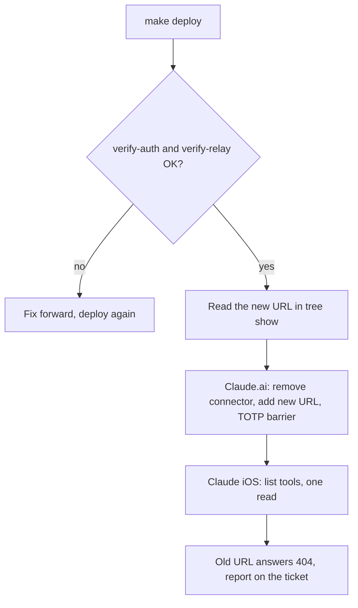
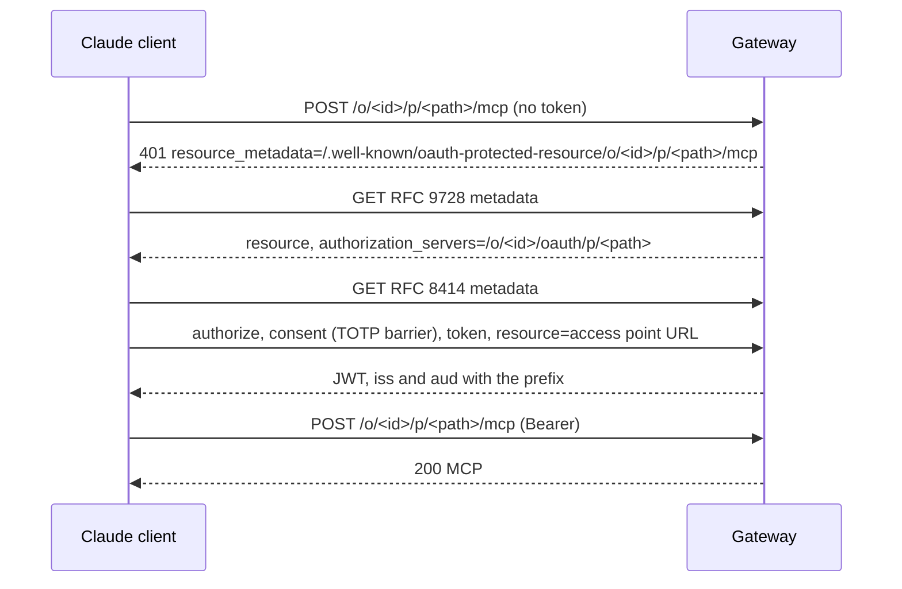

# F-014 · Organisation URL scheme — /o/<id>/p/… and public identifier

## Metadata

| Field | Value |
|-------|-------|
| **Priority** | P1 |
| **Branch** | `feat/HULL-42-organisation-url` |
| **Last updated** | 2026-11-17 |

## 1. Context & Objective

### Current State

Facts read on `main` at `a8fa639`, 2026-11-01.

- A role is served at `${PUBLIC_URL}/p/<client>/<project>/<env>/<role>/mcp` (`src/hullgate/access_tokens.py:38`, BR-044) and its authorization server at `${PUBLIC_URL}/oauth/p/<path>` (`access_tokens.py:34`, BR-056). Neither carries the organisation, although the tree has an organisation root (`src/hullgate/migrations.py:113-115`; that row's `slug` is empty and BR-044 says it has no segment).
- ADR-002, *Consequences*: changing the path of a role or `PUBLIC_URL` invalidates its OAuth authorizations, and clients authorize again. The scheme is fixed now so that real clients never pay it.
- The first real client arrives with HULL-13. Cairn's own `.mcp.json` still reaches Gitea through local `sh` commands, not through the gateway (read 2026-11-01: `gitea`, `gitea-review`).
- Operator statement of 2026-11-01 (arbitration Z2): nobody uses the tool, breaking changes are free, all data on the production server is disposable. The only OAuth client the repository knows is the operator's own Claude.ai connector, also opened on Claude iOS (`docs/guides/keys-and-upstreams.md` S10 and S11, `docs/guides/keys-and-upstreams.md` R9).
- Operator go of 2026-11-01 (`.cairn/runs/milestone-1.0.0.md`, item 2; ticket comment 11163): scheme `/o/<id>/p/…` with a short random base32 identifier, no wildcard certificate, no DNS provider, in 1.0.0 before HULL-13. Realisation of multi-organisation moves to HULL-67.

### Objective

Every organisation-scoped URL of the gateway carries a public, anonymous, permanent organisation identifier from 1.0.0 on. One organisation per instance stays true.

### Expected Impact

- The URL of a role never has to change for multi-organisation: HULL-67 adds organisations without moving the URL of the existing one, so no client reconnects for it.
- No authorization is migrated: the operator reconnects his connector after the deployment, as an ordinary step (§3.5).
- No DNS, certificate or Traefik change: the router rule is `Host(...)` only (`deploy/compose.prod.yaml:57`).

### Open Product Questions

None. The final public host is closed (arbitration Z2): `MCP_HOST` is a deployment setting and can move any time before HULL-13.

## 2. Scope

- **URL scheme**: every organisation-scoped route moves under `/o/<id>`, as listed in §3.1: access points, authorization servers, the two metadata families, the consent cookie's path.
- **Organisation identifier**: a public identifier on the organisation, created with the instance or by the migration that adds it, permanent (§3.2, §3.4).
- **Refusal of everything else**: no alias, no redirect; old paths and foreign identifiers answer 404 (BR-161).
- **Operator surfaces**: `tree add`, `tree show` and any other URL the CLI prints, `export`, the instruments `verify-auth` and `verify-relay` (§3.3).
- **Bench**: the `v1` target follows the scheme; a full replay proves isolation holds on the new URLs.
- **Reconnection**: the operator's ordinary step after the deployment (§3.5).
- **Record**: an ADR for the scheme, written by implementation (`conventions/adr.md` §Ownership); ADR-002 points to it.

## Out of Scope

- **Several organisations per instance, several operators, per-organisation authentication, per-organisation vault key, data isolation between organisations, quotas, GDPR** — HULL-67. The identifier selects no data here: in v1 it is compared with the one identifier the instance has, nothing else.
- **Items carried to HULL-67 from F-008**: its §Out of Scope row "Étanchéité par organisation" (cache keys, upstream sessions, the `tool_name` table and the audit actor carry role and connection, never the organisation; BR-110, BR-112, BR-119), and review finding n1 of `.cairn/runs/acts/*-9-B-review-1.md` (`relay.py:813-818` reads without `ORDER BY` a tool prefix that BR-076 makes unique only per organisation; unreachable with one organisation).
- **A subdomain per organisation** — discarded by the operator on 2026-11-01. It stays possible for a custom domain later, as a host change under ADR-002.
- **The public host (`MCP_HOST`)** — a deployment setting; it can move any time before HULL-13, and after that it is a reconnection of every client under ADR-002.
- **Hiding the client, project, environment or role names of a URL** — those segments stay readable. The identifier makes the organisation anonymous, not the path.
- **`hullgate tree` commands addressing an organisation** — `/` keeps designating the one organisation; `--path` values stay tree paths, without identifier.
- **`/admin`** (F-016) — an instance route on the admin listener, not organisation-scoped; it stays outside `/o/<id>`.
- **Tree import** — HULL-11 reads the identifier from the export (§3.3) and decides what an import does with it.

## 3. Functional Spec

### 3.1 URL scheme (SCR-01)

One rule: an organisation-scoped route is today's route with `/o/<id>` in front. For the RFC 8414 and RFC 9728 metadata, the prefix follows the `/.well-known/<suffix>` insertion, as a path does today.

| Surface | Before | After |
|---|---|---|
| Access point of a role | `/p/<path>/mcp` | `/o/<id>/p/<path>/mcp` |
| Authorization server (issuer, JWT `iss`) | `/oauth/p/<path>` | `/o/<id>/oauth/p/<path>` |
| `authorize`, `consent`, `token`, `revoke`, `register` | `/oauth/p/<path>/<action>` | `/o/<id>/oauth/p/<path>/<action>` |
| RFC 9728 metadata | `/.well-known/oauth-protected-resource/p/<path>/mcp` | `/.well-known/oauth-protected-resource/o/<id>/p/<path>/mcp` |
| RFC 8414 metadata | `/.well-known/oauth-authorization-server/oauth/p/<path>` | `/.well-known/oauth-authorization-server/o/<id>/oauth/p/<path>` |
| Consent cookie `Path` | `/oauth/p/<path>/consent` | `/o/<id>/oauth/p/<path>/consent` |
| Probes `/healthz`, `/readyz` | unchanged | unchanged: they belong to the instance |

`<path>` stays `<client>/<project>/<env>/<role>`. RFC 8707 audience and `resource` stay exactly the access point's URL (BR-054, BR-055 step 6, BR-058), now with the prefix. `PUBLIC_URL` stays without a path (BR-032).

Example: `https://gw.example.test/o/k7mq2xv4tnpd/p/acme/app/prod/ops/mcp`.

### 3.2 Organisation identifier (SCR-02)

- 12 characters of the lowercase RFC 4648 base32 alphabet, `^[a-z2-7]{12}$`: 60 random bits.
- Generated once, by the schema migration that adds it (§3.4). A rebuilt instance gets it when its database is created. It never derives from a name, a host or a date.
- Permanent: no command, migration or setting changes it. It lives in the database, so backup and restore keep it.
- Public: it appears in URLs, metadata, tokens, logs. It is an anonymous name, not a credential, and no secret handling applies.

### 3.3 Operator surfaces (SCR-03)

- Every URL the CLI prints carries the prefix (`Cli.url`, `src/hullgate/cli.py:309-310`; `tree add` and `tree show`).
- `tree show` prints the identifier on the root line: `/  « Organisation »  organisation  k7mq2xv4tnpd`; `tree show --json` carries it as key `public_id` on the organisation's item (`level` `org`), the only item that has the key. The operator needs no new command, and no new verb is added.
- `hullgate export` carries it as `id:`, first key under `organisation:`, and the format number moves to the next integer (`format: 4` unless another feature took it): the export is what a re-import reads, and a role's URL must survive it (BR-070).
- `make verify-auth ROLE=<path>` and `make verify-relay ROLE=<path>` keep `ROLE` as a tree path, as read from `tree show`; the instruments need no new operator input. **One source**: `tree show / --json`, key `public_id`, for every instrument outside the gateway's process (`deploy/ops.sh:371-372`, `deploy/smoke/smoke.sh`, `socle_checks.py`, `adapter_v1.py`); `src/hullgate/verify_relay.py:94`, inside it, reads the same stored value.

### 3.4 Creating the identifier (SCR-04)

Schema migration 7 adds the stored identifier and draws it for the organisation, in one transaction under the runner of BR-069. It runs on any database, so a new or rebuilt instance has it from its first start. That is all it does: no OAuth row, token, client, connection or audit row is touched.

An OAuth token issued before the feature cannot reach anything, without any revocation: its `aud` names a URL that is no longer served, so step 4 or 6 of BR-055 refuses it at the new URL, and its refresh fails `resource` (BR-058). AC-09 proves it. Such a lineage may still read active in `token list` until it expires or the instance is rebuilt.

Operator tokens are unaffected: they bind to a tree path, not a URL, and step 6's audience applies to OAuth tokens only (BR-050, `tokens.py:280`). Nothing is reissued, and the instruments of §3.5 rely on it.

### 3.5 Deployment and reconnection (SCR-05)

An ordinary deployment: `make deploy REF=<ref>`, then `make verify-auth` and `make verify-relay`.

**The connector is reconnected, not migrated**: its URL lives on Claude's side and its tokens are bound to the old URL. After the deployment the operator reads the new URL in `tree show`, then on Claude.ai removes the connector, adds a custom connector with the new URL and passes the TOTP barrier (`keys-and-upstreams.md` S10); Claude iOS follows by account (S11). A CIMD or pre-registered client needs no `client add`; a `dcr` client re-registers behind the barrier. The client's kind is a hypothesis until `client list` reads it. `keys-and-upstreams.md` S10 carries this.

### 3.6 Population of the change (SCR-06) — dated constat 2026-11-01 at `a8fa639`

Instrument: `grep -rIE '/p/|oauth/p'` per root, `__pycache__` excluded; the sweep below adds the escaped form `\\/p\\/`.

| Root | Files | Lines | Note |
|---|---|---|---|
| `src/` | 6 | 19 | `access_tokens.py`, `mcp_endpoint.py`, `oauth.py`, `cli.py`, `verify_relay.py`, `app.py` |
| `deploy/` | 1 | 2 | `ops.sh`; plus `smoke/smoke.sh`, whose `sed` escapes the slashes (`\/p\/`) and escapes this instrument |
| `docs/runbooks/` | 3 | 10 | `keys-and-upstreams.md`; both `poc-go-*` files describe the Go POC and do not change |
| `brief.md` | 1 | 1 | the product's one-line URL |
| `tests/` | 16 | 60 | `tests/support.py` holds 9 |
| `poc/isolation-bench/runner/` | 6 | 14 | `adapter_v1.py`, `v1_tools.py`, `socle_checks.py`, `harness/v1-harness.py`; the `gateway` target's files do not change |

This table states the tree at drafting, and HULL-66, HULL-57 and HULL-58 land first. **Prescribed sweep**: implementation replays the instrument on its own base after its deltas, and each remaining line is either a route under the new scheme or a named exclusion (the POC targets and runbooks, archived specs and rule archives, `evidence/*.json`). The list goes in the PR.

## 4. Business Rules

### 4.1 Naming, classification and overlap

`BR-NNN`, per `conventions/br-identifiers.md`. Range allocated by the orchestrator: BR-160 to BR-169. BR-162 to BR-169 stay unused (arbitration Z2). The texts of evolved rules below replace their French originals at extraction, in English.

**Overlap scan** — filter on *organisation, identifier, URL, old, redirect, 404, migration, path, revoke, lineage, prefix, export, subdomain, segment*, in their French and English forms, in the `Statement` column: **29 lines retained of 131**, each opened: **4 overlaps, 25 off topic**. Four more overlaps came from outside the filter: a sweep of the rule files for `/p/` and `/oauth/p` found BR-051, BR-061 and BR-068, whose statement's first sentence the index shows without those terms, and BR-064 was opened because step 1 touches it.

| Rule | Verdict | Resolution |
|---|---|---|
| BR-044 | overlap | new version (C2): a URL without the prefix satisfied it and no longer does |
| BR-056 | overlap | new version (C2): the issuer changes |
| BR-068 | overlap | new version (C2): the list of served routes names `/p/…` |
| BR-070 | overlap | new version (C2): an export without the identifier satisfied it and no longer does |
| BR-055 | overlap | clarification (C3): step 1 already says "path of an existing role", the path now includes the prefix |
| BR-064 | overlap | clarification (C3): the 503 before any 404 already holds; the identifier check is inside it |
| BR-066 | off topic | no audit event is added |
| BR-051 | overlap | clarification (C3): only its examples name a path |
| BR-061 | overlap | clarification (C3): one clarification names `/oauth/p/<chemin>` |
| BR-046 | off topic | it binds `rename` and `move` of a node; a scheme change moves no node and is no command |
| BR-132 | off topic | Migration 6's own rule, finished |
| BR-069 | off topic | the runner; the identifier's migration is one under it |
| BR-045, BR-050, BR-052, BR-058, BR-059, BR-109, BR-114 | off topic | they read a role or the URL through a resolved node or exact comparison; unchanged wording holds |
| BR-032 | off topic | `PUBLIC_URL` stays without a path |
| BR-054 (outside the filter) | off topic | `iss` is "the access point's issuer", with no literal form: no version needed |
| BR-048, BR-074, BR-076, BR-081, BR-086, BR-087, BR-095, BR-103, BR-106, BR-110, BR-115, BR-116, BR-013, BR-062 | off topic | the filter matched `organisation` or `URL`, `path` or `export` in another sense |

### BR-160 · The organisation has one permanent, random public identifier

> **Extracted on 2026-11-15.** Current version: [`business-rules/BR-160.md`](../business-rules/BR-160.md).
> The content below reflects the state of this BR at the time of feature F-014 (v1).

*`behavioral` · `strict` · Candidate state: `verified` — `tests/unit/test_br_160_organisation_id.py`: format, on a fresh database and on one at the previous schema; two fresh databases differ; stable across reopen and backup/restore; an update of the stored value is refused by the store.*

**Rule** — The organisation has exactly one public identifier of 12 characters matching `^[a-z2-7]{12}$`, drawn at random once and derived from nothing; the store refuses any update of a value once set.

**Clarifications**
- Never changed afterwards: no command, setting or later migration touches it. Review reads that clause; the test reads the store's refusal.
- It is public: no secret handling, no constant-time comparison, free to appear in logs and audit rows.
- A backup carries it; a restored backup of the same schema keeps it.
- In v1 the instance has one; uniqueness among several is HULL-67's, and the stored form allows it.

**Example**
- **Given** a database at the previous schema version
- **When** the gateway starts on the new code, then restarts
- **Then** `tree show` prints the same 12-character identifier both times, and no `hullgate` verb changes it.

### BR-161 · A route answers only under the instance's own identifier

> **Extracted on 2026-11-15.** Current version: [`business-rules/BR-161.md`](../business-rules/BR-161.md).
> The content below reflects the state of this BR at the time of feature F-014 (v1).

*`behavioral` · `strict` · Candidate state: `verified` — `tests/integration/test_br_161_url_refusal.py`: every form of §5 AC-06, per route family, with status, body and absence of `Location` asserted.*

**Rule** — The public listener serves an organisation-scoped route only under `/o/<id>` with the instance's exact identifier; any other form, including the paths in force before this feature, another well-formed identifier, a malformed or differently cased identifier, the bare prefix and any percent-encoded spelling of a route, answers 404 with no redirect, no alias and no hint of the right identifier.

**Clarifications**
- On a given route, the 404 for a foreign well-formed identifier is byte-identical to the 404 for an unknown role under the right identifier; the authorization family holds per route, `authorize` answering a page and `token` JSON. The existence of a role under the right identifier stays visible, as H13 accepted (BR-055).
- A well-formed identifier is checked inside step 1 of BR-055: an unreadable store answers 503 for it (BR-064), never 404.
- The grammar reads the request's raw path, as sent. `scope["path"]` is percent-decoded by the server (`uvicorn/protocols/http/h11_impl.py:204-205`), so `%2F` reads as a separator and a decoded check would serve an alias: `/p/acme%2Fapp/prod/ops/mcp` is accepted by today's parser in that way (reading of `mcp_endpoint.py:66-74`, not run). `raw_path` is optional in ASGI: absent, or holding bytes that do not decode as ASCII, it matches no route (404), never a fallback to `scope["path"]`.
- The rule binds the gateway's public listener: the bytes it receives. An edge in front of it may normalise a request before it arrives — dot segments (`.`, `..` and their percent forms), duplicate slashes, percent-encoded unreserved characters — and a form it rewrites into the canonical path is served as that path: the edge's reading, not an alias the gateway serves. No such normalisation brings a foreign identifier, a pre-feature path, `%2F`, a trailing slash or an uppercase identifier to a route: those answer 404 end to end.
- `/healthz` and `/readyz` stay at the root; they are not organisation-scoped.

**Example**
- **Given** the instance's identifier is `k7mq2xv4tnpd`
- **When** a client calls `/p/acme/app/prod/ops/mcp`, or `/o/aaaaaaaaaaaa/p/acme/app/prod/ops/mcp`
- **Then** 404, without `Location`, and no audit entry, as for any unknown path today.

### BR-044 · The tree has five fixed levels and one URL per role (v2)

> **Extracted on 2026-11-15.** Current version: [`business-rules/BR-044.md`](../business-rules/BR-044.md).
> The content below reflects the state of this BR at the time of feature F-014 (v2).

*Classification unchanged at extraction.*

**Rule** — The tree has an organisation root, then exactly the levels client, project, environment and role, each node having as parent only a node of the level immediately above; each role is served at the URL `${PUBLIC_URL}/o/<id>/p/<client>/<project>/<env>/<role>/mcp`, `<id>` being the organisation's public identifier (BR-160). The rest of the Rule is unchanged.

**Clarifications** (changed)
- No reserved segment: the prefix `/o/<id>/p` separates access points from technical routes.
- One organisation per instance (H2), created by the first migration, display name editable, with no segment: `<id>` is not a segment and `--path` values never carry it.

### BR-056 · Each access point has its own discoverable authorization server (v2)

> **Extracted on 2026-11-15.** Current version: [`business-rules/BR-056.md`](../business-rules/BR-056.md).
> The content below reflects the state of this BR at the time of feature F-014 (v2).

*Classification unchanged at extraction.*

**Rule** — As v1, with the issuer `${PUBLIC_URL}/o/<id>/oauth/p/<path>` in `authorization_servers`.

**Clarifications** (added)
- Metadata locations follow §3.1: `/.well-known/oauth-protected-resource/o/<id>/p/<path>/mcp` and `/.well-known/oauth-authorization-server/o/<id>/oauth/p/<path>`.

### BR-068 · No administration route without authentication (v2)

> **Extracted on 2026-11-15.** Current version: [`business-rules/BR-068.md`](../business-rules/BR-068.md).
> The content below reflects the state of this BR at the time of feature F-014 (v2).

*Classification unchanged at extraction.*

**Rule** — As v1, the public listener serving only its probes, the routes under `/o/<id>/` and the `/.well-known/…` metadata.

### BR-070 · The tree export is deterministic and carries no secret (v4)

> **Extracted on 2026-11-15.** Current version: [`business-rules/BR-070.md`](../business-rules/BR-070.md).
> The content below reflects the state of this BR at the time of feature F-014 (v5).

*Classification unchanged at extraction.*

**Rule** — As v3, with the organisation's public identifier among the exported values.

**Clarifications** (changed)
- The `format` key moves to its next integer.
- "Internal identifiers excluded" stays: the public identifier is not an internal one.

### Clarifications of bound rules

> **Extracted on 2026-11-15** as new versions: [`BR-055`](../business-rules/BR-055.md) (v2), [`BR-064`](../business-rules/BR-064.md) (v2), [`BR-051`](../business-rules/BR-051.md) (v2), [`BR-061`](../business-rules/BR-061.md) (v3). The lines below reflect their state at the time of F-014.

- **BR-055** — Step 1 reads the whole path: the instance's identifier (BR-161) and an existing role. Examples name `/o/<id>/p/…`.
- **BR-064** — Checking the identifier is part of step 1: a store failure answers 503 before any identifier-based 404.
- **BR-051** — Its note and example read `/o/<id>/p/mpx/cairn/…`.
- **BR-061** — A client identified or registered through `/o/<id>/oauth/p/<path>` is bound to that path.

## 5. Acceptance Criteria

**Identifier**

- [x] **AC-01** (BR-160) — On a fresh database and on one at the previous schema, the organisation's identifier matches `^[a-z2-7]{12}$`; two fresh databases have different ones; reopening keeps it.
- [x] **AC-02** (BR-160) — A backup and a restore keep it; a direct `UPDATE` of the stored value fails, and an update of another column of the organisation row, its display name, succeeds (`pytest tests/unit/test_br_160_organisation_id.py`).

**Scheme**

- [x] **AC-03** (BR-044) — A role created by `tree add` is served at the URL `tree add` prints, which is the §3.1 form; `tree show` prints the identifier on the root line and `tree show / --json` carries it as `public_id` on the organisation's item alone (`pytest tests/unit/test_br_044_tree.py`).
- [x] **AC-04** (BR-056, BR-054) — RFC 9728 and RFC 8414 metadata answer at the §3.1 locations with `resource` and `issuer` in the new form, and a JWT carries `iss` and `aud` in that form.
- [x] **AC-05** (BR-056, BR-058, BR-060, BR-059) — A full OAuth journey runs on the new URLs: challenge, discovery, authorize, consent (cookie `Path` as §3.1), code, token, MCP call, refresh, revoke.
- [x] **AC-06** (BR-161) — `pytest tests/integration/test_br_161_url_refusal.py`, parametrised per family (access point, authorization routes, RFC 9728, RFC 8414), asserts 404 and no `Location` on: the pre-feature path; a well-formed foreign identifier; an uppercase identifier; 11 and 13 characters; a character outside the alphabet; `/o/<id>`, `/o/<id>/`, `/o/<id>/mcp`; the doubled prefix `/o/<id>/o/<id>/p/<path>/mcp`; `/o/<id>//p/<path>/mcp`; `/o/<id>/../p/<path>/mcp`; `/o/<id>/p/<path>/mcp/`; `/o/<id>/p/<path>`; `%2F` in place of a slash inside the identifier's prefix and inside `<path>`; a percent-encoded ordinary character in the identifier and in `<path>`; a scope without `raw_path`; a `raw_path` of non-ASCII bytes. **Transport**: an HTTP client normalises what it is given, so every non-canonical form (`..`, `//`, percent forms, the two scope cases) is sent as a hand-built ASGI scope, `raw_path` holding the exact bytes and `path` decoded as uvicorn would; canonical forms may use `TestClient`. On each route, foreign-identifier and unknown-role responses are byte-identical.
- [x] **AC-07** (BR-064, BR-055) — With the store unreadable, every §3.1 route, well-formed, under the instance's identifier and under a foreign well-formed one, answers 503; the malformed forms and `/o/<id>/mcp` stay 404. `/healthz` and `/readyz` still answer at the root (BR-068).

**Old tokens**

- [x] **AC-09** (BR-055, BR-058) — `pytest tests/integration/test_br_161_url_refusal.py`: an access token and a refresh bound to a pre-feature URL are refused at the new URLs, with no revocation having run: the access token 401 `invalid_token`; the refresh `invalid_target` with `refresh.used` still 0, for both inputs (the old `resource` in the form, the new `resource` with the old refresh). An operator token issued before the feature is accepted at the new URL.

**Surfaces**

- [x] **AC-11** (BR-070) — `hullgate export` carries `id:` under `organisation:`, the next `format`, and stays byte-identical for the same state.
- [x] **AC-12** (BR-068) — `tests/integration/test_br_068_no_admin_routes.py` follows the new list and passes.
- [x] **AC-13** — `make gate` ends `GATE: OK`; `make qa` ends `QA: OK`. New names enter the pinned tables of BR-131 in the same change.
- [x] **AC-14** (BR-071, BR-012) — `./bench.sh --target v1` passes in full on the new URLs: 16 tests and all controls, harnesses N3 and nominal `/revoke` included; `results-v1.json` is regenerated by the replay, never edited, and `make gate`'s SDK guard reads it (BR-037).
- [x] **AC-15** — `make verify-auth`: `make prod-smoke` (toolbox) passes `ROLE` as a tree path and prints `^VERIFY-AUTH: 4/4 OK$` and `^SMOKE: 4/4 OK$`. `verify-relay`: `pytest tests/integration/test_verify_relay.py` is green with `ROLE` as a tree path against the new URLs.
- [x] **AC-16** — The §3.6 sweep is replayed; the PR lists each remaining line as route or exclusion. `brief.md` and `docs/guides/keys-and-upstreams.md` state the new URLs.
- [x] **AC-17** — An ADR records the scheme, its discarded options and the host rule (a host change is a path change under ADR-002: every client reconnects); ADR-002 points to it; `decisions` lists it at closure.

**Operator, on the production server (evidence is the operator's, BR-043 v2)**

- [x] **AC-OP-01** — After the deployment, the instruments pass; the connector is reconnected on Claude.ai through the barrier, then on Claude iOS, tools appear and a read returns on each; the old URL answers 404 without `location:`.

Protocol (`accept-feature.md` step 4a):

- **Instrument bounded to**: `make verify-auth`, `make verify-relay`, the gesture of §3.5, one `curl -sS -o /dev/null -D -` on the old URL; not the whole suite.
- **Readings to record, not assert**: the connector client's kind from `client list`; the `actor` of the new `oauth.token.issue` row.
- **List to post on the ticket**: the last `DEPLOY:` line; the `VERIFY-AUTH` and `VERIFY-RELAY` banners; the `tree show` root line; the response headers of the 404 check; the relay reading on each client.
- **Identifiers read back from output, never imposed**: `ROLE` and the old URL from `tree show` before the deployment; the new URL from `tree show` after it; `TOOL` from the relay `reading tool:` lines.
- **Line patterns**: `^DEPLOY: OK [0-9a-f]{7,40}$`, `^VERIFY-AUTH: 4/4 OK$`, `^VERIFY-RELAY: [45]/5 OK$` (`4/5` with `sensitive: SKIP`, `keys-and-upstreams.md` R7), `^HTTP/[0-9.]+ 404`, with no `location:` line. "Tools appear" and "a read returns" are read by hand.

AC-08, AC-10 and AC-18 were withdrawn with the migration of live authorizations (arbitration Z2); numbers are kept so the stress-test trace stays readable.

## 6. Diagrams

Selection: userflow and sequence included. State machine: none, the identifier has no states. ER: skipped, one column on `node` (§9).

### 6.1 Userflow — deployment and reconnection

### 6.2 Sequence — a client discovers and connects on the new URL

## 7. States & Captures

- **Package-status**: absent. CLI and HTTP only, no visual state.

## 9. Implementation Notes

### Dependencies (prerequisite features)

- F-005 to F-010 — implemented.
- **Upstream order, milestone run**: HULL-66, HULL-57, HULL-58 land first. F-014 works on their tree: English `Refused` bodies, renamed names, runbook paths after HULL-58. Its deployment is an ordinary one. **Numbering**: migration 7, F-011 adding none; F-015 follows.
- **Downstream**: HULL-13 must start on the new URLs, so F-014's deployment precedes it. HULL-11 reads the export's `id` and has its own origin, `ADMIN_URL` (F-016), not the single public origin; BR-068's route list is shared with it. HULL-67 realises multi-organisation. HULL-41 (hosted offer) inherits the scheme.
- **Bench disk**: a v1 replay needs about 10 GB (`.cairn/runs/milestone-1.0.0.md`, item 3); HULL-58 replays as well. Check free space before AC-14.

### Technical Constraints

- Python 3.13, `mypy --strict` clean, no new dependency. Migrations already written are not edited.
- No URL derives from a request; all from `PUBLIC_URL` and the stored identifier (BR-041, BR-056).
- A deployment is an ordinary one, under the standing go (`.cairn/runs/milestone-1.0.0.md`, item 5); BR-043 v2 still holds.
- The grammar of BR-161 reads the raw path (`scope["raw_path"]`), not `scope["path"]`.
- The pre-commit hook (BR-003) applies to runbooks: hosts stay placeholders.
- This spec makes no change to BR-032's `PUBLIC_URL`, to the Traefik rule or to `.env`.

### Architecture Decisions

| Question | Decision | Rationale |
|----------|----------|-----------|
| Scheme and identifier kind | `/o/<id>/p/…`, short random base32, no wildcard certificate, no DNS provider (operator, 2026-11-01) | ticket comment 11163 |
| Multi-organisation | not realised; one organisation per instance stays true (operator) | HULL-67, v2 |
| Connector | **reconnected**, not migrated, as an ordinary step (operator, Z2) | §3.5 |
| Identifier length and alphabet | 12 characters of lowercase RFC 4648 base32, 60 bits — tranché en autonomie déléguée | top of the ticket's 10-12 range; no `0`/`1`/`8`/`9` to misread; collisions are negligible for any v2 volume |
| Issuer location | `/o/<id>/oauth/p/<path>`, not `/oauth/o/<id>/p/<path>` — tranché en autonomie déléguée | one rule (§3.1): everything of an organisation sits under one prefix, for a proxy, a cookie path or v2 routing alike; ticket and go fix only the access point's form |
| Old URLs | 404, no alias, no redirect, no grace period — tranché en autonomie déléguée | a redirect cannot satisfy RFC 9728 and RFC 8707; two URLs per role break BR-044; nobody uses the tool; same clean break as F-010 |
| Existing OAuth state | left alone, no audited revocation (operator, Z2) | old tokens are refused by construction (§3.4, AC-09); the data is disposable |
| Identifier in the export | yes, `format` next integer — tranché en autonomie déléguée | a tree restored by import must keep its URLs; HULL-11 decides the import's behaviour |
| Showing the identifier | root line of `tree show`, no new verb — tranché en autonomie déléguée | every printed URL already carries it |
| Check of an unknown identifier | checked inside BR-055 step 1, same 404 as an unknown role — tranché en autonomie déléguée | no oracle on identifiers, and BR-064 holds |
| Identifier creation | by the schema migration that adds the column — tranché en autonomie déléguée | a schema change is needed anyway, and it covers rebuilt and running instances with one code path |

The coined terms (*organisation identifier*, *organisation prefix*, the amended *access point*) are written to `domain-glossary.md` by the orchestrator before the freeze (arbitration X17); no criterion reads them.

The scheme gets its ADR from implementation (`conventions/adr.md` §Ownership, ticket item 1): `decisions` is empty until then. ADR-002's statements on the issuer's location and on "no additional data" are the ones that change.

No new `status` value is proposed (step 23a: nothing to apply).

### Data Model Impact

- Migration: yes, number 7, forward only.
  - *Delta (implementation, 2026-11-15)*: **migration 10**, the next free number on `main` at `37cc654` (F-015 took 7, F-016 slices 1 and 2 took 8 and 9; orchestrator decisions log, 2026-11-14). The number is rechecked against `main` at the merge and moves to the next free one if another lane took it first.
- `node` gains a nullable column for the public identifier, set on the organisation row only. Recommended: `public_id TEXT` with a `CHECK` on the format, a partial unique index, and a `BEFORE UPDATE` trigger with the condition `OLD.public_id IS NOT NULL AND NEW.public_id IS NOT OLD.public_id`, so that other columns of the organisation row stay editable; the store then enforces BR-160.
- The runner holds static statements (`src/hullgate/migrations.py`, F-010 §Technical Constraints). SQLite's `random()` can draw the identifier; if that proves unreasonable, extending the runner is implementation's choice, under the same transaction.
  - *Delta (implementation)*: as recommended. `public_id TEXT` with `CHECK (public_id IS NULL OR (level = 'org' AND length(public_id) = 12 AND public_id NOT GLOB '*[^a-z2-7]*'))`, partial unique index `node_public_id`, trigger `node_public_id_permanent` (`BEFORE UPDATE OF public_id … WHEN OLD.public_id IS NOT NULL AND NEW.public_id IS NOT OLD.public_id`). The draw is one static `UPDATE`: each of the 12 characters is `substr(<alphabet>, (random() & 31) + 1, 1)`, 5 uniform bits of its own 64-bit `random()` (no `abs()`, which overflows on the minimum value). No runner change.

### Components to Create / Modify

**Created**
- `tests/unit/test_br_160_organisation_id.py`, `tests/integration/test_br_161_url_refusal.py`
- `architecture-decisions/ADR-NNN-…` (next free number, implementation)

**Modified**
- `src/hullgate/access_tokens.py`, `mcp_endpoint.py`, `oauth.py`, `app.py` — one URL source, prefix routing, cookie path
- `src/hullgate/migrations.py`, `tree.py`, `cli.py`, `export.py`, `verify_relay.py`
- `deploy/ops.sh`, `brief.md`, `docs/guides/keys-and-upstreams.md`
- `tests/support.py` and the tests of §3.6, `tests/unit/cli_output_lines.txt` (normalise the identifier)
- `poc/isolation-bench/runner/adapter_v1.py`, `v1_tools.py`, `socle_checks.py`, `harness/v1-harness.py`
- `CHANGELOG.md`, user-facing notes: the URLs change

### Pitfalls Discovered

Implementation (2026-11-15), deltas and findings:

- **BR-161 v2 edge readings (HULL-42 review 1 P1)**: `prod-smoke` sends hand-built HTTP request lines through its local Traefik for the access point, RFC 9728, RFC 8414 and token, deriving the identifier and role from `tree show / --json`. Dot segments (including percent forms), duplicate slashes and percent-encoded unreserved characters print `READING edge` statuses without assertions. Foreign identifiers, pre-feature paths, `%2F` in the prefix and path, trailing slashes and uppercase identifiers must return 404 without `Location`; one counted `SMOKE edge-404` control brings the total to `SMOKE: 6/6 OK`. `tests/container/test_br_161_edge_readings.py` checks form construction, raw transport and verdicts without Docker; `test_br_230_route.py` requires the control in the local smoke.
- **Review 610 / round 3 delta**: the same `SMOKE edge-404` control now requires one canonical response per family (401/200/200/401) and gateway JSON `not_found` on all 24 refusals; 64 requests total without retries, keeping the 36 normalisable forms observational and failing closed on canonical or refusal 429s within BR-306's per-address budget.
- **Numbers taken since the freeze**: export `format: 5` (F-015 took 4, as §3.3 allowed); BR-070 **v5** (F-015 took v4); migration **10** (above). BR-068's file on `main` is still v1: F-016's v2 text is not extracted yet (its slices are open), so F-014 extracts its own v2 and F-016's closure carries it forward (F-016 §4.1 says the later one does).
- **One URL source**: `src/hullgate/routes.py` builds every organisation-scoped URL from `PUBLIC_URL` and the stored identifier and holds the raw-path grammar; `access_tokens.issuer_for` / `resource_for` take the identifier. The JWT check reads the identifier from the audience and requires the issuer of that same access point; whether it is the instance's is step 6's exact comparison with the endpoint URL, built from the stored value.
- **Step 1 reads the identifier under the store**: the access point and every OAuth route compare the route's identifier with the stored one in the same read as the role (`_find_role`, `_instance_role`); an unreadable store is 503 before any 404 (BR-064). An authorization server is bound per request to the stored identifier (`dataclasses.replace`), from which it states every URL.
- **Any path that is no route** of the public listener now answers the JSON `{"error": "not_found"}` 404 (Starlette's plain-text 404 before, for paths outside the old prefixes). No hint in any 404.
  - *Delta (review 587, B1)*: Starlette's router answered `/healthz/` and `/readyz/` with a 307 whose `Location` came from the request's `Host`. The probes are now matched on the raw path too, exactly (`/healthz`, `/readyz`), and the listener has no slash redirect: `/healthz/`, `/%68ealthz` and any other spelling answer that JSON 404 without `Location` (`test_br_068_probes_answer_only_their_exact_path_on_a_real_listener`, real uvicorn, raw socket).
- **`socle_checks.py`** has a single `/p/` line, the DCR sub-check of the Python POC instance (`dcr()`, POC routes `/admin/roles`): a POC target, a named exclusion of the §3.6 sweep, unchanged. The v1 instruments read the identifier through the adapter (`adapter_v1.py`, `v1_tools.py`) and the harness (`v1-harness.py`), each from `tree show / --json`.
- **`verify_relay`**'s injected `Post` takes the access point's request path (`/o/<id>/p/<role>/mcp`), the identifier read from the store; `ROLE` stays a tree path.
- **ADR**: ADR-008 supersedes ADR-002 whole, restating one authorization server per access point: a supersession is never partial (`conventions/adr.md`), and ADR-002's issuer location and "no additional data" no longer hold.
- **Tests**: the URL helpers of `tests/support.py` read the identifier of the latest test gateway; two databases of the same tree differ by their drawn identifier only, so the byte-identity of the export across two databases compares with the `id` line set to a placeholder (`export_of`), and the same database's two exports byte for byte. A test that rebuilds a database below version 10 rereads the identifier after the migration draws a new one (`Gateway.reread_org`), which is the §12 old-backup case.
- **User-facing notes**: not written here; implementation never writes the user-facing track (`cut-release` writes it from `[Unreleased]`).
- **Recheck of §12**: `restore_check_core` compares table counts and `/readyz` only, no URL; the restored copy of a backup at the same schema keeps its identifier (AC-02's restore test).

## 10. Phases

### Phase 1 — Code, migration, bench (one PR)

- [x] AC-01 to AC-17 pass, withdrawn numbers excepted (AC-14: bench v1 16/16 and every control at `9fd0aed`, `results-v1.json` regenerated)
- [x] Review with the isolation lens: every route family, every refusal (PR HULL-93: reviews 587 and 589; PR HULL-101: reviews 610 and 614)

### Phase 2 — Deployment and reconnection (before HULL-13)

- [x] AC-OP-01 reported on the ticket (played on 2026-11-17 on deployed ref `8222b8e`; acceptance comment 13446)

## 11. Tests

### unit (`tests/unit/`)

| Test | BR / Concern | File |
|------|-------------|------|
| `test_br_160_*` | BR-160 | `test_br_160_organisation_id.py` |
| `test_br_044_*`, `test_br_054_*`, `test_br_070_*`, `test_br_131_*` | new forms, `format`, pinned names | existing files |

### integration (`tests/integration/`)

| Test | BR / Concern | File |
|------|-------------|------|
| `test_br_161_*` | BR-161, BR-055 step 1, BR-058, BR-064 | `test_br_161_url_refusal.py` |
| `test_br_056_*`, `test_br_058_*`, `test_br_060_*`, `test_br_061_*`, `test_br_064_*`, `test_br_068_*` | new URLs | existing files |

### container and bench

- `make test-container`: `deploy/ops.sh` and instruments change. Bench `v1` target, full replay (AC-14).

## 12. Risks & Watchpoints

- **Security**: path parsing is the isolation boundary. A prefix strip that lets `/o/<id>/o/<id>/p/…`, `%2F`, or a double slash through would widen it, and `scope["path"]` is already decoded (BR-161). AC-06 tests those forms per route family; review reads the parser.
- **Enumeration**: the identifier is the only thing hiding an organisation from a scanner. 60 random bits behind a byte-identical 404 cost 2^59 requests on average for one hit, so no rate limit on the 404 and no longer identifier are needed; it stays a name, not a credential.
- **Old backups**: a backup taken before migration 7 (nightly cron, each deployment's `BACKUP: OK`) restored under the new code draws a new identifier, so the URL changes with no message and the reconnected connector stops. The data is disposable: rebuild rather than restore. `make restore-check` restores into a throwaway container with its own identifier, which does no harm while it compares no URL between the two instances: at `a8fa639`, `restore_check_core` matches `url|curl|readyz|compare|diff` only at `deploy/ops.sh:192` (`PUBLIC_URL=http://restore-check.invalid`). Implementation rechecks.
- **Client behaviour**: a longer issuer path is a new shape for Claude's discovery, proved only on AC-OP-01. RFC 8414 path insertion is unchanged in kind. A failure is a defect fixed forward.
- **Pinned names**: the JSON key `public_id` and the export key `id` must enter BR-131's tables, or the gate fails.
- **Order**: F-014 must land before HULL-13; the dependency is stated in §9.

## Stress-test

**Passe du 2026-11-01** — model:claude-fable-5-1, six axes.
**17 findings — 1 critical, 3 major, 13 minor ; 17 retenus, 0 écartés.**

Report: `.cairn/runs/acts/HULL-42-stress-test-1.md`. Arbitration: `.cairn/runs/acts/milestone-1.0.0-arbitration-1.md` (default rule, X1, X17). Axis A's clause question was replayed on every criterion whose instrument changed (AC-02, AC-03, AC-06, AC-08, AC-15, AC-18, AC-OP-01 to 04): each clause is paired with its expression; the AC-OP clauses "tools appear" and "no connection needed reauthorizing" are read by hand under the protocol, and BR-160's "never changed afterwards" is read by review.

Critiques :
- **C1** · axe F · §12 vs AC-06 / BR-161 — the forms §12 calls the risk were absent from the only reader of a `strict` rule. Sort : corrigé — AC-06 parametrised per family with the doubled prefix, `//`, `..`, trailing forms, `%2F` and percent-encoded characters; BR-161 and §9 make the grammar read the raw path, since `scope["path"]` is decoded.

Majors :
- **M1** · axe A · §5 AC-OP — no protocol of `accept-feature.md` step 4a. Sort : corrigé — shared block: bounded steps, readings, list to post, identifiers read back, patterns.
- **M2** · axe B · §3.5 Rollback — silent once the old connector was removed. Sort : corrigé — boundary at step 4 in §3.5 and AC-18, second arrow in §6.1.
- **M3** · axe A · §4 / §5 — coined terms without a glossary answer. Sort : corrigé — X17: §9 says the orchestrator writes them before the freeze, no criterion; §13 no longer claims step 20.

Minors :
- **m1** · axe A · §3.3 — no named source for the identifier. Sort : corrigé — `tree show / --json`, key `public_id`; AC-03 reads it.
- **m2** · axe A · BR-160 / AC-02 — parser walk reads names, not writes; "later migration" unreadable. Sort : corrigé — clause dropped from AC-02, the Rule binds the store's refusal, "never changed" moved to a clarification read by review.
- **m3** · axe F · BR-162 title. Sort : corrigé — title retitled.
- **m4** · axe A · §3.4 step 2 — two row shapes under one action. Sort : corrigé — same shape stated, asserted in AC-08.
- **m5** · axe C · §3.4 step 3 — redundant removal. Sort : corrigé — kept as hygiene, reason stated.
- **m6** · axe F · §2 vs §3.3 — `tree move`. Sort : corrigé — removed from §2.
- **m7** · axe A · AC-17 / Question 1 — "host rule" undefined. Sort : corrigé — defined in AC-17; the ripple of option (b) is named in §1, applied at the freeze if chosen.
- **m8** · axe F · §12 vs AC-18. Sort : corrigé — old-backup note added to AC-18.
- **m9** · axe A · §3.5 step 4 — client kind stated as fact. Sort : corrigé — step 1 reads `client list`, step 4 conditional, hypothesis marked.
- **m10** · axe A · AC-15 — disjunction of instruments. Sort : corrigé — `make prod-smoke` for `verify-auth`, `test_verify_relay.py` for `verify-relay`, one per clause. Also, while checking it: `deploy/smoke/smoke.sh` joins §3.6, its escaped slashes evaded the instrument.
- **m11** · axe D · §Out of Scope — `/admin`. Sort : corrigé — line added.
- **m12** · axe F · §4.1 — BR-054 unclassified. Sort : corrigé — row added.
- **m13** · axe E · §9 Dependencies — ordering and numbering. Sort : corrigé — separate cutover after F-011's window (X1), migration 8, or 7 if F-011 slips.

Addendum 2026-11-01, pass 1b: Y1 — §9 Downstream gives HULL-11 its own origin `ADMIN_URL`; §Out of Scope no longer spells the former name (the review record is cited by a path pattern).

Addendum 2026-11-01, pass 2 rework (arbitration Z2, no new pass played; the trace above is unchanged): the migration of live authorizations and the cutover left the spec, so the outcomes of M1 (protocol now on AC-OP-01), M2, m3, m4, m5, m8, m9, m13 describe text since reworked or removed. C1 stands in full. The next targeted pass appends its own block.

Addendum 2026-11-01, pass 3 (arbitration Z4, no new pass played; the trace above is unchanged): this spec's migration is number 7, F-011 adding none; m13's « migration 8, or 7 » and its reference to F-011's window are void.

**Passe du 2026-11-01** — model:claude-fable-5-1, six axes, targeted.
**9 findings — 0 critical, 1 major, 8 minor ; 9 retenus, 0 écartés.**

Report: `.cairn/runs/acts/HULL-42-stress-test-2.md`. Arbitration: §Pass 4, default rule. Axis A's clause question was replayed on AC-02, AC-06, AC-07 and AC-09, whose instruments changed: each clause is paired with an expression; none is read by hand.

Critiques :
- none.

Majors :
- **M1** · axe A · AC-06 — an HTTP test client may normalise `..`, `//` and percent forms before any scope exists, leaving the clause unread on a `strict` rule. Sort : corrigé — AC-06 sends every non-canonical form as a hand-built ASGI scope with exact `raw_path` bytes.

Minors :
- **m1** · axe B · BR-161 — `raw_path` optional, non-ASCII bytes. Sort : corrigé — no route matches, no fallback; two AC-06 cases.
- **m2** · axe A · BR-161 vs AC-06 — scope of the byte identity. Sort : corrigé — foreign well-formed identifier, per route; the report's first option, the single 404 body would enlarge the code.
- **m3** · axe A · AC-07 — false for `/o/<id>/mcp`. Sort : corrigé — rewritten as proposed.
- **m4** · axe A · AC-09 — no code, no non-consumption. Sort : corrigé — `invalid_target`, `refresh.used` 0, both inputs.
- **m5** · axe D · §3.4 — operator tokens unsaid. Sort : corrigé — line in §3.4, assertion in AC-09.
- **m6** · axe B · BR-160 / AC-02 — over-wide trigger. Sort : corrigé — condition written in §9, display-name update in AC-02.
- **m7** · axe D · §12 — pre-7 backup. Sort : corrigé — §12 line; `restore_check_core` read, no URL compared, implementation rechecks.
- **m8** · axe D · §12 — enumeration cost. Sort : corrigé — sentence in §12.

## 13. Changelog

| Date | Author | Change |
|------|--------|--------|
| 2026-11-01 | model:claude-opus-5-5 | Spec creation, steps 1 to 19 of `create-feature-spec`, delegated drafting (`.cairn/runs/acts/HULL-42-drafting-1.md`); step 20 reattributed to the orchestrator |
| 2026-11-01 | model:claude-opus-5-5 | Stress-test pass 1 applied by retouch under the arbitration (`.cairn/runs/acts/HULL-42-retouch-1.md`); `ready-for-freeze` |
| 2026-11-01 | model:claude-opus-5-5 | Rework under arbitration Z2 (no users, disposable data): BR-162, audited revocation, cutover runbook and rollback removed, host question closed; back to `draft` (`.cairn/runs/acts/HULL-42-retouch-3.md`) |
| 2026-11-01 | model:claude-opus-5-5 | Stress-test pass 2 applied by retouch under arbitration §Pass 4 (`.cairn/runs/acts/HULL-42-retouch-4.md`); `ready-for-freeze` |
| 2026-11-15 | model:claude-opus-5-5 | Implementation (HULL-42, `.cairn/runs/acts/HULL-42-implementation-1.md`): §9 deltas and pitfalls, migration 10, BR-160 and BR-161 extracted, BR-044, BR-056, BR-068, BR-070 new versions, BR-051, BR-055, BR-061, BR-064 clarified, `decisions: [ADR-008]`; `implemented` |
| 2026-11-15 | Claude (product, model:claude-opus-5-5) | BR-161 v2: clarification naming what the edge may normalise (HULL-42 review 1 P1, operator go); rule sentence unchanged; prod-smoke readings to add before acceptance |
| 2026-11-16 | Codex (implementation-coder, model:gpt-6-astra) | F-022 slice 1, freeze `10d166e`: S11 guide references, P1 private trial references and F1 private procedure mentions only where applicable. |
| 2026-11-16 | Codex (implementation-coder, model:gpt-6-astra) | F-022 slice 2, freeze `10d166e` (retouch 2 `7aac9e6`): §3.2 substitutions only; inline rule clarifications without version where applicable. |
| 2026-11-17 | Claude (product, model:claude-fable-5-2) | Acceptance (HULL-42, `.cairn/runs/acts/HULL-42-acceptance-1.md`, ticket comment 13446): 16 criteria met; AC-OP-01 and the two open §10 boxes ticked on the operator's evidence of 2026-11-17 (`.cairn/runs/acts/HULL-42-acop-evidence.md`) |
| 2026-11-24 | Claude (implementation, model:claude-opus-5-5) | F-025 §3.8 rewrite pass, freeze `1427c98`: private-forge `#N` written `HULL-N`, citation form only. |
