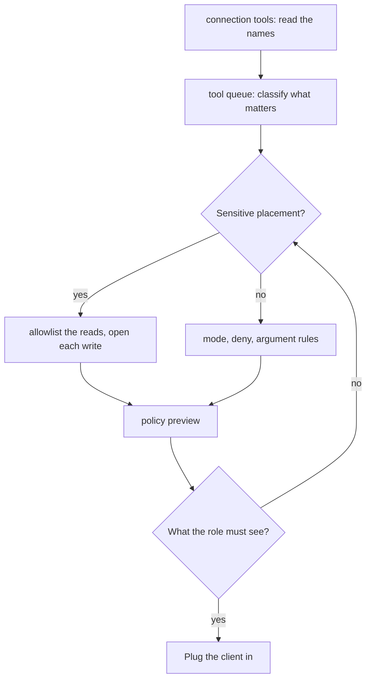
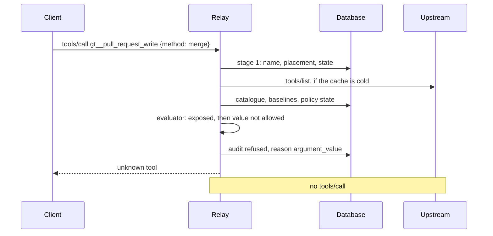
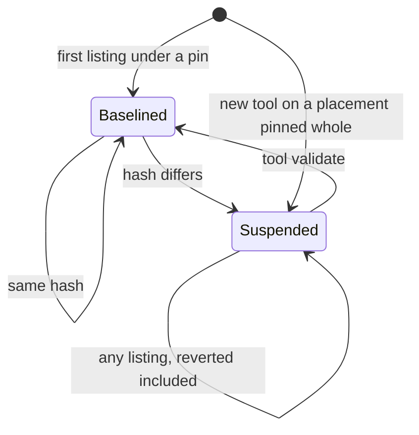
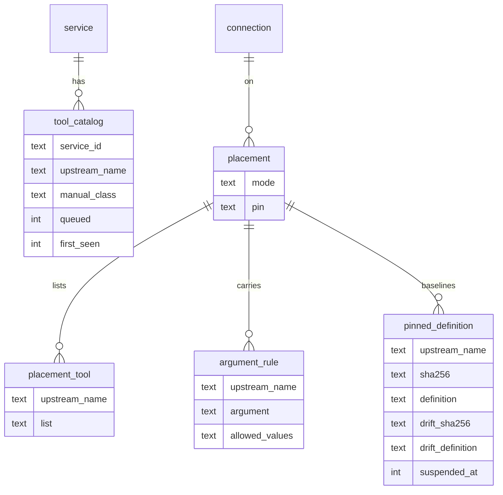

# F-015 · Action policy

## Metadata

| Field | Value |
|-------|-------|
| **Priority** | P2 |
| **Branch** | one branch per lot: `feat/HULL-10-policy-engine`, `feat/HULL-10-pinning`, `feat/HULL-10-cap-export` (§10) |
| **Last updated** | 2026-11-14 |

## 1. Context & Objective

### Current State

Constat of 2026-11-01, commit `a8fa639`.

- The relay consults a policy before announcing and before calling (BR-123), but `src/hullgate/policy.py` holds only `Transitional`, which allows everything. Any connection no sensitive role carries serves **all** its upstream tools, writes and merges included.
- BR-130 closes every tool of a connection placed on at least one sensitive role, on all its roles: nothing can be opened on production, and `connection tools` refuses such a connection, so the operator cannot even read its tool names.
- The per-tool bench reading of T09 waits for this feature (BR-071). The settings engine declares `token_duration` and `lock` only (BR-048). BR-049 announces that policy settings will obey the lock.
- 3 of the 4 target services group several actions behind one tool: Gitea `method`, Notion `command`/`mode`, Work IQ `do_action` (`docs/trials/matrice-serveurs.md` l. 16, 152). A filter by tool name cannot separate commenting from merging there.
- Of the five response guardrails of the specification (§Garde-fous sur les réponses), three are shipped: upstream timeouts (BR-107), error cleaning (BR-116), no automatic retry (BR-117). Rate limiting belongs to HULL-12 (F-008 §Out of Scope). The per-role cap is the only one left.

### Objective

An operator decides, per placement, which tools of a connection a role sees and which argument values it may send, and can read the outcome before plugging a client in. The acceptance criterion of the specification holds: **the reviewer does not see the merge tool**.

### Expected Impact

- Production becomes usable: a sensitive role exposes exactly the tools the operator listed, and BR-130 goes.
- A grouped tool can be opened for one action when one argument selects it: `pull_request_write` with `method` in `{create}` cannot merge. That holds for Gitea; Notion selects with `command` **and** `mode`, and Work IQ `do_action` with a path, which one rule separates only partly (§Out of Scope).
- A compromised upstream that rewrites a pinned tool loses that tool until the operator validates the change.
- HULL-13 (Cairn cutover) and HULL-11 (rights preview, Tools screen) have the engine they call.

### Open Product Questions

None blocking. Every scoping question was settled under delegated autonomy: §9 Architecture Decisions, entries marked *tranché en autonomie déléguée*. Four of them depart from the specification or the prototype and are worth a look at the freeze: D2, D3, D5, D9.

Confirmed at the freeze go of 2026-11-14: D2, D3, D5 and D9 as written.

## 2. Scope

- **Classification**: three classes `read`, `write`, `destructive`; source order manual → annotations → default `destructive`; manual classification per service (BR-170 to BR-172).
- **Tool catalogue and classification queue**: every tool seen enters the catalogue; a new one enters the queue; a name heuristic proposes and never imposes (BR-173).
- **Exposure decision**: one evaluator shared by the relay and the preview (BR-174), with the sensitive-placement rules that replace BR-130 (BR-175, BR-186).
- **Lists per placement**: `open`, `deny`, `allowlist`, validated on entry (BR-176); inherited setting `mode` and per-placement override (BR-177).
- **Argument rules**: an allow-list of values for one named argument per tool (BR-178), announced schema narrowed accordingly (BR-179).
- **Definition pinning**: per setting, placement or tool, implied by an argument rule (BR-180); suspension on change (BR-181, BR-187); operator diff and validation (BR-182).
- **Rights preview on the command line**, the instrument HULL-11 will display (BR-183).
- **Per-role response cap** (BR-184).
- **Audit** of refusal reasons (BR-185) and of every policy change (BR-188).
- **Export** of the policy; bench T09 tightened to per-tool masking; runbook.

## Out of Scope

| Item | Destination |
|---|---|
| Admin screens: Role, Rights preview, Tools; one-click actions of the prototype | HULL-11, on the evaluator and the commands of this feature |
| Pushing `notifications/tools/list_changed` to connected clients | F-008 §Out of Scope stands (BR-121); the policy applies at the next request |
| Rate limit per token and per connection | HULL-12 (F-008 §Out of Scope) |
| Alert delivery (webhook, ntfy) for a suspended tool | HULL-12, which reads `suspended_at` (BR-181) |
| Upstream type `api-rest` and its HTTP-method classification source (source 2 of the specification) | ticket 1.1.0 (F-008 §Out of Scope); the source order leaves its place |
| Tokens reduced to a connection or a mode (specification §Conventions de nommage, `dropbox-prod:lecture`; BR-050 clarification) | candidate ticket: changes tokens and the consent page, adds no exposure |
| Rights preview **for a token** | HULL-11: in v1 a token narrows no tool, so a token's rights are those of the role it opens (`tokenCheck` of the prototype) |
| Declared ceiling of a connection's provider rights (prototype `Droits du fournisseur`) | HULL-11; the provider enforces its own rights |
| Rules on several arguments of one tool, nested arguments, non-string values, classification per argument value | candidate ticket. Every grouped argument of the matrix is a top-level string, but a one-argument rule cannot separate Notion's read from its write when a tool takes `command` and `mode`, nor Work IQ's actions behind one path argument |
| Pruning the tool catalogue | candidate ticket: removed tools stay as rows (BR-173); `--purge-names` bounds the name table, not the catalogue |
| Cap on `tools/list` size or on the catalogue weight in tokens | candidate ticket; the specification ties the cap to tool responses |
| Rewriting tool descriptions (a description may still name a closed action) | not planned: pinning protects the definition, BR-179 touches one enum only |
| Confirmation of a write (elicitation) | v2 (brief) |
| Pinning `_meta` and `icons` of a tool definition (BR-181 hashes five fields; the relay forwards the rest unpinned) | HULL-79, 1.1.0 |

## 3. Functional Spec

The words below are contracts (BR-131). Upstream tool names in the configuration are **upstream names**, never public names.

### 3.1 Model

| Object | Lives on | Content |
|---|---|---|
| **Tool catalogue** | service | one row per (service, upstream name): first seen, manual class, queue state |
| **Mode** | setting, optional placement override | `read`, `write`, `destructive` |
| **Lists** | placement | `open`, `deny`, `allowlist`, each a set of upstream names |
| **Argument rule** | placement, per tool | one argument name and its allowed values |
| **Pin** | setting `pinning`; placement `on`, `off`, `inherit`; per tool | |
| **Definition baseline** | placement, per tool | SHA-256 and text of the pinned upstream definition; suspension state |

New settings (BR-048, inherited, `settings get|set|unset`):

| Key | Values | Default on the organisation |
|---|---|---|
| `mode` | `read`, `write`, `destructive` | `write` |
| `pinning` | `auto`, `on`, `off` | `auto`: on for a sensitive placement, off elsewhere |
| `response_cap` | `<n>KiB` or `<n>MiB`, 1 KiB to 1 MiB | `1MiB` |

### 3.2 Exposure decision

For a tool with class `c` on a placement, in this order; the table is BR-174, BR-175, BR-181 and BR-187 read together.

| # | Test | Outcome | Reason |
|---|---|---|---|
| 1 | suspended (BR-181) | hidden | `suspended` |
| 2 | in `deny` | hidden | `denied` |
| 3 | in `open` | exposed, steps 4 to 5b skipped, step 6 still applies | |
| 4 | allowlist in force (sensitive placement, or non-empty `allowlist`) and tool not listed | hidden | `not_allowlisted` |
| 5 | sensitive placement and `c` above `read` | hidden | `write_closed` |
| 5b | non-sensitive placement and `c` above the effective mode | hidden | `above_mode` |
| 6 | at a call only, tool carrying an argument rule | value checked (BR-178) | `argument_value` |

Steps 1 to 5b decide exposure; step 6 applies to a tool already exposed. The three lists have three meanings: `allowlist` narrows, `deny` closes, `open` alone goes beyond the mode.

### 3.3 Policy commands (SCR-01)

```
hullgate policy show <connection> --role <path> [--json]
hullgate policy mode <connection> --role <path> read|write|destructive|inherit
hullgate policy add <connection> --role <path> open|deny|allowlist <tool>...
hullgate policy add <connection> --role <path> allowlist --class read
hullgate policy remove <connection> --role <path> open|deny|allowlist <tool>...
hullgate policy arg <connection> --role <path> <tool> <argument> <value>...
hullgate policy arg-remove <connection> --role <path> <tool>
hullgate policy pin <connection> --role <path> on|off|inherit
hullgate policy pin-tool <connection> --role <path> <tool>
hullgate policy unpin-tool <connection> --role <path> <tool>
hullgate policy preview <role-path> [--json]
```

Example, the reviewer of the specification:

```
hullgate connection tools mpx/gitea-review --role mpx/cairn/prod/review
hullgate policy add mpx/gitea-review --role mpx/cairn/prod/review allowlist --class read
hullgate policy add mpx/gitea-review --role mpx/cairn/prod/review open pull_request_review_write
hullgate policy arg mpx/gitea-review --role mpx/cairn/prod/review pull_request_review_write method create submit
hullgate policy add mpx/gitea-review --role mpx/cairn/prod/review deny pull_request_write issue_write
hullgate policy preview mpx/cairn/prod/review
```

`allowlist --class read` lists the tools whose current class is `read`, once: a read that appears later still needs a gesture (D9). It writes one `policy.list_add` per tool.

A refused command exits 2 and changes nothing, like every CLI refusal.

### 3.4 Tool commands (SCR-02)

```
hullgate tool queue [--service <id>] [--json]
hullgate tool classify <service> <tool> read|write|destructive|clear
hullgate tool accept <service> <tool>
hullgate tool diff <node-path> [--json]
hullgate tool validate <node-path> <connection> [--tool <tool>]
```

`tool queue` shows, per tool: service, name, current class, source, proposal. `tool diff` and `tool validate` take any node and act on the placements of its subtree, as in the specification (`mpx/cairn/prod`).

### 3.5 Rights preview (SCR-03)

`policy preview <role-path>` lists every tool of every connection placed on the role, from a fresh upstream listing, with no tool call. Row fields, also the `--json` keys:

| Key | Content |
|---|---|
| `public_name`, `connection`, `upstream_name` | |
| `class`, `source` | class and `manual`, `annotations` or `default` |
| `exposed` | boolean |
| `reasons` | every applicable reason of §3.2, not the first one only |
| `opened` | exposed by `open` beyond the mode or on a sensitive placement |
| `grouped` | the enumerated values of top-level string arguments, when the schema has some |
| `argument_rule` | argument and allowed values |
| `pinned` | whether the tool is pinned |
| `sensitive_via` | the sensitive role paths, on a placement held by BR-175 through a shared connection (D3) |

#### Visual States

- **SCR-03**: nominal, exposed rows then hidden rows.
- **SCR-03.empty**: role without connection, one line, exit 0.
- **SCR-03.unavailable**: a connection that is not active or whose upstream does not answer gets one `unavailable` line with its code, and the other connections are listed.
- **SCR-03.policy-error**: an exception in the evaluator names the connection and the command exits non-zero (BR-185).

### 3.6 Access point (SCR-04)

`tools/list` and `tools/call` keep their form. Three visible changes: the list holds the exposed tools only; a tool with an argument rule shows a narrowed enum when its schema has one (BR-179); a result above the role's cap becomes `response_too_large` (BR-184). A hidden tool, a refused value and a suspended tool all answer "unknown tool" (BR-113).

### 3.7 Export

`hullgate export` moves to the next format number. `placements` entries become mappings: `path`, `mode`, `pin`, `open`, `deny`, `allowlist`, `pinned_tools`, `arguments`, lists sorted. Each service gains `tools`, sorted: the catalogue names, each with its manual class when it has one, so that an import on a fresh instance can apply lists and classifications. Baselines and queue state are not exported: a re-import pins again.

## 4. Business Rules

### Naming Convention

`BR-NNN`, sequential and global. Allocation fixed by the orchestrator for this spec: BR-170 to BR-199; rules from BR-189 on stay free.

### Lifecycle

Per `conventions/br-lifecycle.md`: inline here until `close-feature` Phase 3, with one departure. BR-130 is retired and BR-109, BR-111, BR-112, BR-113, BR-123 are versioned **on the lot A branch**, not at closure: the guard and its replacement land together, and `cairn check` stays green before each merge.

### Existing rules touched (`br-touched`)

The rule text quoted by number is the version in force when implementation starts: F-011 and F-014 may version some of these rules first, and HULL-58 translates them.

| Rule | Change | Nature |
|---|---|---|
| BR-048 | Declares `mode`, `pinning`, `response_cap` | clarification (C3) |
| BR-049 | Every `policy` write and `tool validate` is refused on a locked node; so is a `tool classify` or `clear` that lowers a class while a placement of the service lies under a locked node (BR-172, D10) | clarification (C3) |
| BR-066 | Names the actions of BR-185 and BR-188 | clarification (C3) |
| BR-070 | Next format, placements as mappings, service `tools` | new version (C2) |
| BR-071 | T09 reads per-tool masking; the v1 adapter provisions the classes the bench needs | new version (C2) |
| BR-109 | Loses the BR-130 clause; the definitions stay unchanged except for BR-179 | new version (C2) |
| BR-111 | Omission reason `sensitive` removed, `policy_error` added (BR-185) | new version (C4) |
| BR-112 | Rule text loses the pointer to BR-130 and reads "effective sensitivity (BR-186)"; the policy state is read at each request, never cached, list included | new version (C2) |
| BR-113 | Loses "that BR-130 does not close" and its stage-1 refusal; a sensitive connection now reaches stage 2 | new version (C2) |
| BR-122 | `reason` values of a policy refusal (BR-185) | clarification (C3) |
| BR-123 | The transitional clarification goes: the real policy is the default; tests of "no policy" go | new version (C4) |
| BR-126 | A result above the role's cap is replaced too (BR-184) | new version (C2) |
| BR-130 | Retired by F-015: its condition ended, and BR-175 and BR-186 govern sensitive placements | retired (`conventions/br-lifecycle.md` §Retirement) |

### BR-170 · A tool has one class, and classes are ordered

> **Extracted on 2026-11-14.** Current version: [`business-rules/BR-170.md`](../business-rules/BR-170.md).
> The content below reflects the state of this BR at the time of feature F-015 (v1).

*`definitional` · `strict` · Candidate state: `verified` — `tests/unit/test_br_170_classes.py`: the order and the admission table over the 9 (class, mode) pairs.*

**Rule** — Every upstream tool has exactly one class among `read`, `write`, `destructive`, ordered in that sequence; a mode admits its own class and the lower ones.

### BR-171 · The class comes from the first available source

> **Extracted on 2026-11-14.** Current version: [`business-rules/BR-171.md`](../business-rules/BR-171.md).
> The content below reflects the state of this BR at the time of feature F-015 (v1).

*`behavioral` · `strict` · Candidate state: `verified` — `tests/unit/test_br_171_class_source.py`: the annotation table below, row by row, and manual priority over each.*

**Rule** — The class of a tool is its manual classification when there is one, otherwise what its MCP annotations declare, otherwise `destructive`.

**Clarifications**
- Annotations, read from the upstream definition: `readOnlyHint: true` without `destructiveHint: true` → `read`; `destructiveHint: true`, alone or with `readOnlyHint: true` → `destructive`, deliberately stricter than the MCP schema, which ignores `destructiveHint` on a read-only tool; `readOnlyHint: false` or absent with `destructiveHint: false` → `write`; anything else (no annotation, `destructiveHint` absent, a non-boolean value) → source 3, `destructive`. An absent `destructiveHint` is true in the MCP schema, so it never gives `write`.
- Annotations are declarations of the upstream, not guarantees (specification §Modes): the allowlist of sensitive placements compensates (BR-175).
- Source 2 of the specification (HTTP method of `api-rest`) takes its place between manual and annotations with that type (§Out of Scope).

**Example**
- **Given** a tool with `readOnlyHint: true` and `destructiveHint: true`
- **When** the class is computed without manual classification
- **Then** the class is `destructive`, source `annotations`

### BR-172 · A manual classification binds a service and a tool name

> **Extracted on 2026-11-14.** Current version: [`business-rules/BR-172.md`](../business-rules/BR-172.md).
> The content below reflects the state of this BR at the time of feature F-015 (v1).

*`behavioral` · `blocking` · Candidate state: `verified` — `tests/integration/test_br_172_manual_class.py`: two connections of a service share it, another service does not, `clear` restores the source below; unknown tool refused; a lowering under a lock refused, a raising passes.*

**Rule** — `tool classify` records one class for a (service, upstream name), which applies to every connection of that service and takes effect at the next request; `clear` removes it; a tool the catalogue does not know, and a change that lowers the tool's class while a placement of the service lies under a locked node, are refused with nothing written.

**Clarifications**
- The specification's `classer` list has this single home: a tool's nature does not depend on the placement, and a placement restricts with `deny`.
- `tool queue` and `connection tools` show what exists. An import writes names the document carries (§3.7).
- Lowering is measured on the resulting class, `clear` included. Raising stays allowed under a lock: it can only hide. The refusal names the lock, as BR-049 does.

### BR-173 · A new tool enters the queue without changing its exposure

> **Extracted on 2026-11-14.** Current version: [`business-rules/BR-173.md`](../business-rules/BR-173.md).
> The content below reflects the state of this BR at the time of feature F-015 (v1).

*`behavioral` · `blocking` · Candidate state: `verified` — `tests/integration/test_br_173_queue.py`: a tool added upstream appears in `tool queue` after the next listing, its exposure equals that of the same tool out of the queue on every row of §3.2, `classify` and `accept` remove it, a tool no longer announced leaves the queue marked `removed`, a name heuristic changes only the proposal.*

**Rule** — A tool seen for the first time for a service enters the catalogue and the classification queue, leaves the queue by `tool classify` or `tool accept`, and the queue state plays no part in the decision of §3.2; the proposal a name heuristic derives never changes a class.

**Clarifications**
- The catalogue is fed by the relay when it fills a listing and by `connection tools` and `policy preview`, only with the names BR-110 accepted, so its growth is bound by the 1 000 names of a connection and by `--purge-names`.
- Heuristic: a name starting with `delete_`, `remove_`, `merge_` or `share_` proposes `destructive`. It reads the upstream name only.
- `tool accept` keeps the class of its current source and writes nothing but the exit from the queue.
- A tool no longer announced stays in the catalogue and, at the next listing, leaves the queue marked `removed`.

### BR-174 · Exposure is decided in one order

> **Extracted on 2026-11-14.** Current version: [`business-rules/BR-174.md`](../business-rules/BR-174.md).
> The content below reflects the state of this BR at the time of feature F-015 (v1).

*`behavioral` · `strict` · Candidate state: `verified` — `tests/unit/test_br_174_evaluator.py`: the full table of §3.2 over class × mode × list membership × sensitivity; `tests/integration/test_br_174_list_and_call.py`: list and call agree on exposure on every row of steps 1 to 5b.*

**Rule** — A tool is exposed on a placement if and only if the decision of §3.2 says so: a suspended tool is hidden, then `deny` hides, then `open` exposes, then an allowlist in force requires the tool to be listed, and the class must not exceed the bound: `read` on a sensitive placement, the effective mode otherwise.

**Clarifications**
- `deny` beats `open`; suspension beats both.
- `open` counts as listed when an allowlist is in force: one entry suffices to open a tool.
- An allowlist is in force on a sensitive placement (BR-175), and on any placement whose `allowlist` is not empty.
- On a non-sensitive placement a listed tool stays bounded by the mode: `allowlist` narrows, and `open` alone goes beyond the mode. The specification's "remplace le mode" is read as the list replacing the mode as a filter, not as lifting the class bound.
- `tools/list`, `tools/call` and `policy preview` take the decision from one evaluator (§9).
- A new upstream tool stays hidden on an allowlist in force until it is listed.

### BR-175 · A sensitive placement exposes listed reads, and writes only through `open`

> **Extracted on 2026-11-14.** Current version: [`business-rules/BR-175.md`](../business-rules/BR-175.md).
> The content below reflects the state of this BR at the time of feature F-015 (v1).

*`behavioral` · `strict` · Candidate state: `verified` — `tests/integration/test_br_175_sensitive.py`: blank placement gives an empty list; a listed read shows; a listed write stays hidden with `write_closed`; `open` shows it.*

**Rule** — A sensitive placement (BR-186) exposes nothing but the tools of its `allowlist` whose class is `read` and the tools of its `open` list, whatever the mode.

**Clarifications**
- No setting lifts the allowlist of a sensitive placement in v1 (D2).
- A blank sensitive placement announces nothing, which is what BR-130 gave, and `make verify-relay`'s `sensitive` check keeps its meaning on such a role.
- A sensitive placement now reaches stage 2 of BR-113: a listing and a `get_access` happen, no `tools/call` does without an opening.

### BR-186 · A placement is sensitive when its connection is placed on a sensitive role

> **Extracted on 2026-11-14.** Current version: [`business-rules/BR-186.md`](../business-rules/BR-186.md).
> The content below reflects the state of this BR at the time of feature F-015 (v1).

*`definitional` · `strict` · Candidate state: `verified` — `tests/integration/test_br_186_sensitive_placement.py`: the non-sensitive role of a shared connection is held by BR-175; marking an environment holds it at the next request with a warm cache.*

**Rule** — A placement is sensitive if and only if its connection is placed on at least one sensitive role (BR-047), read from the database at each request.

**Clarifications**
- The sensitivity of a connection is the maximum of its placements: BR-078 admits a shared connection, and its token holds the same provider rights on both sides (D3).
- BR-112 and BR-113 read this sensitivity.

### BR-176 · Lists belong to a placement and refuse what does not exist

> **Extracted on 2026-11-14.** Current version: [`business-rules/BR-176.md`](../business-rules/BR-176.md).
> The content below reflects the state of this BR at the time of feature F-015 (v1).

*`behavioral` · `blocking` · Candidate state: `verified` — `tests/integration/test_br_176_lists.py`: unknown tool, unplaced connection and locked node refused with nothing written; `allowlist --class read` lists the current reads once and a later read stays out; `connection unplace`, `connection remove` and `tree delete` leave no policy row; a re-placement starts blank; a tool that disappears upstream keeps its entry inert.*

**Rule** — `open`, `deny` and `allowlist` are sets of upstream names on one placement; an entry naming a tool the catalogue does not know for that service is refused, and a placement's policy disappears with it in the same transaction.

**Clarifications**
- The catalogue names travel in the export (§3.7), so the refusal holds on a fresh instance: an import writes the names before the lists that cite them.
- `policy show` prints mode, pin, the three lists and the argument rules of a placement, without an upstream exchange.
- Lists are not inherited: a placement is a leaf.
- Moving a role keeps its id, so its placements keep their policy (BR-046).

### BR-177 · The mode is a setting a placement may override

> **Extracted on 2026-11-14.** Current version: [`business-rules/BR-177.md`](../business-rules/BR-177.md).
> The content below reflects the state of this BR at the time of feature F-015 (v1).

*`definitional` · `strict` · Candidate state: `verified` — `tests/integration/test_br_177_mode.py`: inherited value and origin, override upward and downward, `inherit`.*

**Rule** — The effective mode of a placement is its own mode when set, otherwise the effective value of the setting `mode` on its role.

**Clarifications**
- The organisation default is `write`, so a tool of class `destructive`, which includes every unannotated tool, is hidden until the operator classifies or opens it (§12).
- An override may rise above the inherited value: `policy mode` is an explicit act, audited, and BR-175 still holds.

### BR-178 · An argument rule admits listed values and refuses the rest

> **Extracted on 2026-11-14.** Current version: [`business-rules/BR-178.md`](../business-rules/BR-178.md).
> The content below reflects the state of this BR at the time of feature F-015 (v1).

*`behavioral` · `strict` · Candidate state: `verified` — `tests/integration/test_br_178_argument_rule.py`: allowed value reaches the upstream unchanged; other value, absent argument, array, number, null, case variant all answer "unknown tool" with 0 `tools/call`; `tests/integration/test_br_178_entry.py`: the entry refusals.*

**Rule** — A tool carrying an argument rule is called only when the named top-level argument is present and its value is a string exactly equal to one of the allowed values; any other call is refused before any `tools/call`.

**Clarifications**
- One rule per (placement, tool), replaced by a new `policy arg`.
- The rule reads the arguments; it never alters them (BR-115). The arguments forwarded are the object the rule read, re-serialised: raw bytes are never forwarded, so a duplicated key cannot give the rule and the upstream two different values.
- `policy arg` lists the upstream at entry, as `connection tools` does: it refuses an argument absent from `inputSchema.properties`, a value outside an `enum` the schema declares, and an unavailable upstream. No rule is recorded unvalidated.
- A renamed parameter leaves the old name absent, so the call is refused: the rule fails closed even before pinning suspends the tool.
- The refusal is "unknown tool" (BR-113), even though the tool is listed: the frozen contract of the seam stands (D7). The operator reads the reason in the audit.
- The operator's example: `pull_request_write` with `method` in `{create}`.

**Example**
- **Given** the rule `pull_request_write`, `method`, `{create}` on a placement
- **When** a client calls the tool with `method: merge`
- **Then** it receives "unknown tool", the upstream journal has no `tools/call`, the audit says `refused`, reason `argument_value`

### BR-179 · An announced enum shows only the allowed values

> **Extracted on 2026-11-14.** Current version: [`business-rules/BR-179.md`](../business-rules/BR-179.md).
> The content below reflects the state of this BR at the time of feature F-015 (v1).

*`behavioral` · `blocking` · Candidate state: `verified` — `tests/integration/test_br_179_narrowing.py`: announced enum narrowed, upstream order kept; a schema without enum relayed unchanged; baseline hash and `Mcp-Param-*` computed on the upstream definition.*

**Rule** — When a tool with an argument rule is announced and `inputSchema.properties.<argument>.enum` exists, the announced enum holds only the allowed values, in upstream order; nothing else of the definition changes.

**Clarifications**
- "The AI does not see what it cannot use" (specification, end of the authorization order).
- The rewrite applies to the announced copy only: the cache, the baseline (BR-181) and the `inputSchema` given to the upstream client stay the upstream's.
- Without an enum, the definition is relayed unchanged and only BR-178 applies.

### BR-180 · Pinning resolves per tool, placement, then setting

> **Extracted on 2026-11-14.** Current version: [`business-rules/BR-180.md`](../business-rules/BR-180.md).
> The content below reflects the state of this BR at the time of feature F-015 (v1).

*`definitional` · `strict` · Candidate state: `verified` — `tests/unit/test_br_180_pin_resolution.py`: every combination of tool pin, argument rule, placement pin, setting value and sensitivity, with `settings get pinning` read on each row.*

**Rule** — A tool is pinned when it has a tool pin or an argument rule, otherwise when its placement pin says `on`, otherwise, with the pin at `inherit`, when the effective `pinning` is `on`, or `auto` on a sensitive placement.

**Clarifications**
- An argument rule implies the pin: the specification (§Outils regroupés, option b) requires that the pin cover this argument's schema, or an upstream renaming would bypass the rule in silence. The whole definition is pinned, the simplest cover of that schema.
- An explicit `off` applies wherever BR-048 resolves it, so `settings get` and the behaviour agree: pinning is overridable (specification §Figeage des définitions), it is an audited act, and `auto` gives the sensitive default.
- `policy pin-tool` adds to a placement that is not pinned; it does not exempt a tool from a pinned placement.

### BR-181 · A pinned tool whose definition changes is suspended

> **Extracted on 2026-11-14.** Current version: [`business-rules/BR-181.md`](../business-rules/BR-181.md).
> The content below reflects the state of this BR at the time of feature F-015 (v1).

*`behavioral` · `strict` · Candidate state: `verified` — `tests/integration/test_br_181_suspension.py`: change of each hashed field suspends the tool, hidden and refused with 0 `tools/call`; the other tools stay; reverting upstream does not lift it; one audit entry per change; a failed audit write leaves `suspended_at` set; a failed state write fails the listing and exposes nothing.*

**Rule** — A pinned tool whose upstream definition no longer hashes to its baseline is suspended on that placement: hidden and refused, even if the upstream reverts.

**Clarifications**
- The first listing under a pin records the SHA-256 of the tool's upstream definition as its baseline.
- `tool validate` alone lifts a suspension (BR-182).
- Hashed: `title`, `description`, `inputSchema`, `outputSchema`, `annotations`, in canonical JSON, on the upstream definition, never the rewritten one (specification §Paramètre account). A renamed tool is a removal and a new tool.
- The first baseline of a placement trusts what it reads: a definition changed before the pin is not detected (§12).
- Detection happens when a listing is filled, so at most 300 s after the change (BR-112).
- Suspension does not lift by itself, even when the upstream reverts: a tool that flips back and forth is the case to look at.
- A suspension, of a changed tool or of a new one (BR-187), is a `pinned_definition` row with `suspended_at` set, written in its own transaction whatever becomes of the audit entry, and a failure of that write fails the listing closed; this column is the state of record for the evaluator, `tool diff` and HULL-12.
- Each change also writes one `tool.suspended` audit entry per (placement, tool, hash), a trace and never the state; HULL-12's alert reads `suspended_at` (F-019).
- A baseline stays while the pin is lifted and is compared again if the pin returns: the direction of the surprise is a suspension.
- A tool that disappears shows as `removed` in `tool diff`; validating drops its baseline.

### BR-187 · A new tool on a placement pinned whole is suspended

> **Extracted on 2026-11-14.** Current version: [`business-rules/BR-187.md`](../business-rules/BR-187.md).
> The content below reflects the state of this BR at the time of feature F-015 (v1).

*`behavioral` · `strict` · Candidate state: `verified` — `tests/integration/test_br_187_new_tool.py`: a new tool on a placement pinned whole is suspended and holds a row with `suspended_at`; the first listing of a placement suspends nothing; a placement with tool pins only leaves a new tool alone.*

**Rule** — On a placement that already holds baselines and is pinned whole, a tool without a baseline is suspended as new, as BR-181 suspends a changed one.

### BR-182 · Only the operator validates a change, after reading it

> **Extracted on 2026-11-14.** Current version: [`business-rules/BR-182.md`](../business-rules/BR-182.md).
> The content below reflects the state of this BR at the time of feature F-015 (v1).

*`behavioral` · `blocking` · Candidate state: `verified` — `tests/integration/test_br_182_validate.py`: diff shows old and new for each field; validate records the new baseline, lifts the suspension, audits both hashes, refuses a locked node; control characters and escape sequences of a hostile description come out escaped.*

**Rule** — `tool diff` shows, for each suspended, new or removed tool of the subtree, the fields that changed, old and new; `tool validate` alone records the current definition as baseline and lifts the suspension, for the whole connection or for one `--tool`.

**Clarifications**
- No access point, relay path or client action can validate.
- `tool diff` lists the upstream at reading time and prints upstream text with control characters and terminal escape sequences escaped: the text comes from the party pinning distrusts.
- `tool validate` re-reads the upstream: it validates what is there now, not what the last diff showed, and prints the hashes it recorded.
- An upstream that does not answer during `tool diff` or `tool validate`: exit 2, nothing written, the same posture as `policy arg`.

### BR-183 · The preview says what the role sees and why

> **Extracted on 2026-11-14.** Current version: [`business-rules/BR-183.md`](../business-rules/BR-183.md).
> The content below reflects the state of this BR at the time of feature F-015 (v1).

*`behavioral` · `blocking` · Candidate state: `verified` — `tests/integration/test_br_183_preview.py`: for a role covering every row of §3.2, each row's `exposed` equals what `tools/list` returns and each hidden row carries all its reasons; a grouped tool shows its enumerated actions; `sensitive_via` names the roles on a shared connection; 0 `tools/call`; an unavailable connection gets its line and the others are listed; 0 secret in the output.*

**Rule** — `policy preview` shows, for a role, each tool of its placed connections with its public name, class and source, whether it is exposed, every reason that hides it, and, when they apply, its opening, grouped actions, argument rule and `sensitive_via`.

**Clarifications**
- The verdict is the evaluator's (§9), and the preview calls no tool (BR-113 stands: nothing here reaches `tools/call`).
- A grouped action comes from a top-level string argument with an `enum` (specification §Outils regroupés).
- Each opening shows there (specification §Environnements sensibles).
- The listing is fresh, through `get_access`, and audited like `connection tools`.

### BR-184 · The role's response cap replaces a larger result

> **Extracted on 2026-11-14.** Current version: [`business-rules/BR-184.md`](../business-rules/BR-184.md).
> The content below reflects the state of this BR at the time of feature F-015 (v1).

*`behavioral` · `blocking` · Candidate state: `verified` — `tests/integration/test_br_184_response_cap.py`: at the cap served, one byte above replaced, for success and `isError`, in JSON and in SSE; no retry; audit `response_too_large` with the real size; a value above 1 MiB refused by `settings set`.*

**Rule** — A `tools/call` result whose size exceeds the effective `response_cap` of the role is not truncated: it is replaced by `response_too_large`, and the call is not repeated.

**Clarifications**
- Size: the compact JSON of the upstream result, the figure audited as `response_bytes`.
- The cap is at most the 1 MiB of BR-107: the setting refuses more.
- The tool has run: the fixed text of the error says the result was withheld, not that the call failed. The client decides (BR-117).
- The cap covers tool results, not `tools/list`.

### BR-185 · Every policy refusal is audited with its reason

> **Extracted on 2026-11-14.** Current version: [`business-rules/BR-185.md`](../business-rules/BR-185.md).
> The content below reflects the state of this BR at the time of feature F-015 (v1).

*`behavioral` · `blocking` · Candidate state: `verified` — `tests/integration/test_br_185_audit.py`: each reason of the closed list reached and read back; an evaluator exception writes one `relay.list_omitted` per (list, connection) and `policy preview` exits non-zero; the database sweep of BR-122 finds no argument value.*

**Rule** — A `tools/call` refused by the policy is audited with one reason of the closed list `suspended`, `denied`, `not_allowlisted`, `write_closed`, `above_mode`, `argument_value`, `policy_error`, and an evaluator exception at `tools/list` writes one `relay.list_omitted` entry with reason `policy_error` per (list, connection).

**Clarifications**
- `issue` stays `refused` (BR-122), the reason goes to the `reason` column; `argument_value` names no value (BR-122).
- The audited reason is the first in the order of §3.2; the preview shows them all.
- A tool hidden from a list by a decision writes nothing: a list would write one line per hidden tool, and the preview answers that question.
- An exception in the policy is `policy_error` and refuses (BR-123). It empties a connection's tools, so it must leave a trace: the `tools/list` entry above, and `policy preview` exits non-zero naming the connection.

### BR-188 · Every policy change is audited

> **Extracted on 2026-11-14.** Current version: [`business-rules/BR-188.md`](../business-rules/BR-188.md).
> The content below reflects the state of this BR at the time of feature F-015 (v1).

*`behavioral` · `blocking` · Candidate state: `verified` — `tests/integration/test_br_188_change_audit.py`: each action written with actor, target, before and after, and read back.*

**Rule** — Every change of a mode, list, argument rule, pin, classification or baseline writes an audit entry with actor, target, before and after.

**Clarifications**
- Actions: `policy.mode`, `policy.list_add`, `policy.list_remove`, `policy.argument_set`, `policy.argument_remove`, `policy.pin`, `tool.classify`, `tool.accept`, `tool.discovered`, `tool.suspended`, `tool.validate`.

## 5. Acceptance Criteria

### Gate and tests

- [ ] **AC-1** `make gate` is green; every test of §11 passes; `cairn check` reports no new error.

### Criterion of the specification

- [ ] **AC-2** On a sensitive reviewer role configured as in §3.3, against a fake upstream with the Gitea tool names (lot A), then against real `gitea-mcp` in the bench (lot C, with AC-23): `pull_request_write` is absent from `tools/list`, a direct call answers "unknown tool", the upstream journal holds 0 `tools/call` for it, and `pull_request_review_write` works.
- [ ] **AC-3** On a non-sensitive developer role with `pull_request_write` in `open` (its class is `destructive`, §12) and the rule `pull_request_write`, `method`, `{create}`: creating a PR passes, merging is refused with 0 `tools/call`, the announced enum holds `create` only.

### Classification and queue

- [ ] **AC-4** BR-170, BR-171: the admission table and the annotation table pass row by row.
- [ ] **AC-5** BR-172: a manual class overrides annotations on all the service's connections and `clear` restores them.
- [ ] **AC-6** BR-173: a tool added upstream enters the queue, with its proposal, and its exposure is unchanged by the queue.

### Exposure

- [ ] **AC-7** BR-174: exposure agrees between `tools/list`, `tools/call` and `policy preview` on steps 1 to 5b of §3.2; step 6 is call-only and read by AC-12.
- [ ] **AC-8** BR-175, BR-186: a blank sensitive placement lists nothing; the rows of the rule hold, on the non-sensitive role of a shared connection too; `connection tools` now works on a sensitive connection.
- [ ] **AC-9** BR-176, BR-177: entry refusals change nothing; `allowlist --class read` lists the current reads, one audit entry each; a placement's policy disappears with it; mode inherits and overrides with origin.
- [ ] **AC-10** BR-049, BR-172: every `policy` write and `tool validate` is refused on a locked node, and so is a `tool classify` or `clear` lowering a class of a service placed under one, nothing written.
- [ ] **AC-11** A policy change applies at the next request, warm cache included, with no restart (BR-112).

### Argument rules

- [ ] **AC-12** BR-178: each refused form is refused with 0 `tools/call`; allowed calls reach the upstream value for value.
- [ ] **AC-13** BR-179: the enum is narrowed in the list only; `Mcp-Param-*` and the baseline use the upstream definition.

### Pinning

- [ ] **AC-14** BR-180: the resolution table passes, and `settings get pinning` agrees with it on every row.
- [ ] **AC-15** BR-181, BR-187: a changed description, schema or annotation suspends the tool alone; the suspension survives an upstream revert; a new tool on a placement pinned whole is suspended; one audit entry per change.
- [ ] **AC-16** BR-182: diff, escaping and validation as stated; an upstream that does not answer writes nothing; no access point validates.

### Preview, cap, audit, export

- [ ] **AC-17** BR-183: on a role covering §3.2, preview and `tools/list` agree tool for tool, grouped actions and `sensitive_via` show, and no secret appears.
- [ ] **AC-18** BR-184, BR-126: the cap boundary holds in JSON and SSE, no retry.
- [ ] **AC-19** BR-185, BR-188, BR-122: every reason and action is read back; an evaluator exception leaves its trace at `tools/list` and in the preview; 0 argument value in any test database; the new CLI, setting and audit values are in BR-131's pinned tables (`test_br_131_*`).
- [ ] **AC-20** BR-070: same state gives byte-identical export; policy, catalogue names and manual classes present; no baseline, no queue state, no secret; `tests/integration/test_br_070_policy_roundtrip.py` shows that every list entry of an export names a tool the same document carries.

### Retirement and regressions

- [ ] **AC-21** BR-130 retired: `Transitional`, the `sensitive` omission reason and the BR-130 refusal of `connection tools` are gone. Sweep replayed after the lot: `grep -rn "BR-130" src tests poc/isolation-bench/runner poc/isolation-bench/mapping.json docs/runbooks` returns nothing. Evidence files are out of the sweep (regenerated by AC-23), and `capability-map.md` is updated at closure. Constat at `a8fa639`: this sweep finds 28 lines in 11 files.
- [ ] **AC-22** Upgrade, `tests/integration/test_migration_policy.py` on a fixture at the previous schema, built as F-014 builds its own: placements keep their rows, every sensitive placement lists nothing, and a non-sensitive one lists its tools of class ≤ `write`: 36 of the 61 tools of a fake upstream carrying the annotations measured in §12.
- [ ] **AC-23** BR-071: a full bench pass against `v1` gives 16 of 16 with T09 read on a tool hidden by `deny` next to a visible sibling of the same connection; `results-v1.json` regenerated; the SDK guard stays green.

### On the production server (operator)

- [ ] **AC-OP** Runbook `docs/guides/keys-and-upstreams.md`, F-015 block, on a real Gitea connection, the reviewer configuration of §3.3 applied to a role of the operator's choosing. Instrument bounded to this block: only the commands below, never a whole suite. `<role>` and `<connection>` are the operator's, read back from `connection list --json`, never imposed. Banner expected: `VERIFY-RELAY: 5/5 OK`, or `4/5` with the `sensitive` check `SKIP`. Assertions:
  1. `make verify-relay ROLE=<role>`: paste the banner line.
  2. `hullgate policy preview <role> --json`: the row of `pull_request_write` reads `"exposed": false`. Paste that row.
  3. A call to `<prefix>__pull_request_write` with `method: merge` from Claude.ai: the client reports an unknown tool. Paste the client's message and the `relay.tool_call` line of `hullgate audit tail`, `issue` `refused`.

  Readings to post, in this frozen list, without threshold: count of `exposed: true` rows in the preview; count of tools in Claude.ai's list for that connector; size in bytes of the preview output. The two counts are compared by the operator and any gap is posted, not judged. Secrets and the first production policy stay the operator's gestures (BR-043).

## 6. Diagrams

| Type | Decision |
|---|---|
| Userflow | §6.1 |
| Sequence | §6.2: the feature crosses CLI, database, relay and upstream |
| State machine | §6.3: a pinned tool has explicit transitions |
| Entity relation | §6.4: schema change |
| Class diagram | skipped: one evaluator module, no hierarchy |

### 6.1 Userflow



### 6.2 Sequence — a call to a tool with an argument rule



### 6.3 State machine — a pinned tool on a placement



### 6.4 Entity relation



## 7. States & Captures

- **Package-status**: absent. No screen here; HULL-11 carries them.

## 8. Design & Prototypes

- **Design package**: no design assets.
- **Reference**: `design/prototype-admin/project/Main.dc.html`, `computeTools`: fields of the preview, list of hiding reasons. Mapping: prototype `open` is our `open`, prototype `allow` is our `allowlist`, prototype `deny` is ours. The departures are D5 and D9.

## 9. Implementation Notes

### Dependencies (prerequisite features)

- F-005, F-006, F-008, F-010 — implemented: settings engine, placements, seam of BR-123, English vocabulary.
- HULL-66 (F-011), HULL-57, HULL-58, HULL-42 (F-014) — open, ahead in the milestone order. Reread at `start-feature`: F-014 owns migration 7 and this feature takes 8, the export format is "next free", the token prefix and the URL scheme are theirs, and the rule texts of §4 may have moved to English. Nothing here depends on their content.
- **Downstream**: HULL-11, F-016 (Role, Rights preview and Tools screens, lot C, call this engine and its audited `before` and `after`; its text "An unclassified tool is hidden on every role" aligns on D5; `policy.*` operations are functions of `hullgate.policy`, audited there, and the CLI and F-016 both call them), HULL-12 (alerts read `suspended_at`, BR-181; the cap is not rate limiting), HULL-13, F-018 (a private operations spec of the maintainer, not published) (hard dependency). F-018 (a private operations spec of the maintainer, not published) §9 asks for reads on a sensitive role, a write opened by name, allowed values on `method`, and a role's list visible: met by `allowlist --class read`, `open`, BR-178 and BR-183. BR-271 (a private operations spec of the maintainer, not published) is the §3.3 example. F-018 (a private operations spec of the maintainer, not published) adds the read list, the classification step and `connection tools` before `policy add`: its text moves from "read mode" to this (arbitration X10).

### Technical Constraints

- Python 3.13, `mcp==2.3.0`, SQLite; no new dependency.
- The CLI is another process: no invalidation by message (BR-112). The relay reads policy state from the database per request. A read per tool would multiply queries by the 1 000 tools of BR-110: load a role's state once per request.
- `Policy.decide` keeps its five arguments. `allowed()` drops the reason today; the relay needs it for BR-185.
- One evaluator, pure over its inputs (class, lists, pin, drift, sensitivity): `tools/list`, `tools/call`, `policy preview` and HULL-11 share it.
- The orchestrator writes the coined terms in `domain-glossary.md` before the freeze (arbitration X17): no criterion here.
- Every new word is English (BR-131): the new CLI, setting and audit values enter BR-131's pinned tables in the same change, as F-014 states for its own.

### Architecture Decisions

All entries: *tranché en autonomie déléguée*, drafting of 2026-11-01. `technical-autonomy: decide`.

| # | Question | Decision | Rationale |
|---|---|---|---|
| D1 | Names of the lists | `open`, `deny`, `allowlist`; `autoriser` → `open` | `allow` beside `allowlist` invites the wrong command, and `open` is the word of the prototype and of the specification ("ouvre des outils"). Each list has one meaning: narrow, close, go beyond the mode |
| D2 | Can the allowlist be turned off on a sensitive placement? | No, in v1 | "Activated by default" leaves room for a switch, but the specification's compensation for lying annotations rests on it; a switch is easy to add, an exposure hard to take back |
| D3 | Sensitivity of a shared connection after BR-130 | The maximum of its placements (BR-186), not per role as the prototype does | The cause BR-130 gives stands: the same token holds the same rights on both sides. Stricter than the prototype, cost: a shared connection needs lists on its non-sensitive role too. **Worth a look at the freeze** |
| D4 | Where a manual classification lives | On the service, as in the prototype; the specification's `classer` list is not repeated per placement | One fact, one place |
| D5 | Tool without any classification source | Class `destructive`, visible under an explicit `destructive` mode or `open`, as the specification says. The prototype hides it everywhere | Following the prototype would make the operator classify every unannotated tool before `open` works, and leave source 4 meaningless. **To confirm at the freeze; HULL-11 aligns its text** |
| D6 | Rate limit | Stays in HULL-12 | F-008 §Out of Scope sent it there; only the per-role cap is left of the guardrails |
| D7 | Refusal of an argument value on a listed tool | "Unknown tool", audited `argument_value` | BR-113 and §3.3 of F-008 froze it; the enum narrowing keeps honest clients away from it. Cost: a client that insists gets a misleading message |
| D8 | Argument rule shape | One top-level string argument per tool per placement | Operator's scope (2026-10-28) and every case of the matrix |
| D9 | Reads on a sensitive placement | Must be listed in `allowlist`, as the specification says. The prototype shows them by default | Annotations alone must not open a tool in production. Cost: HULL-13 lists its read tools, in one gesture with `allowlist --class read`; a read added later needs its own. No setting lifts it (X10). **Worth a look at the freeze** |
| D10 | `tool classify` under a lock | Lowering a class is refused while a placement of the service lies under a locked node; raising passes | A lock freezes what a subtree exposes: lowering could expose a listed tool on a locked node with no act on that node. Raising can only hide |
| D11 | Rights preview in this feature | On the command line | The AC needs an instrument, and HULL-11 needs the same verdict |
| D12 | Readiness of the ticket | `ready`, two parts plus a remainder: tool exposure (modes, lists, argument rules), definition pinning, and one setting of the guardrails | With 3 of 5 guardrails shipped and one in HULL-12, the remainder is one setting on the same surface, not a feature accepted on its own. All are configuration of one placement read at one seam. Split in lots, §10 |
| D13 | Are `_meta` and `icons` of a tool definition pinned (lot B review, Q10)? | No, out of scope of BR-181 for 1.0.0: operator, 2026-11-14: out of scope, ticket HULL-79 | An icon or a metadata field does not change what the tool does; the five hashed fields, the safety annotations among them, stay pinned |

### Data Model Impact

- Migration: yes, one, number 8, additive, shipped by lot A with all four tables: `pinned_definition` stays empty until lot B.
  - *Delta (lot A, 2026-11-14)*: shipped as **migration 7**, the next free number on the base branch (F-014's 7 was not merged; workflow §Rules). Orchestrator decision: 7 stays; F-014 (HULL-42) renumbers to 8.
  - *Delta (lot A)*: `tool_catalog` also carries `annotation_class` (the class the last listing's annotations gave) and `removed`, so `tool queue` and `allowlist --class read` read a current class without an upstream exchange; `pinned_definition` carries `tool_pin` for lot B's `policy pin-tool`. The migration also writes the organisation defaults of `mode`, `pinning` and `response_cap` (BR-048), the three settings being declared in lot A.
- `placement`: columns `mode` and `pin`, nullable.
- New tables `tool_catalog`, `placement_tool`, `argument_rule`, `pinned_definition`.
- Existing placements stay, blank. Effect at upgrade: §12.

### Components to Create / Modify

**Modified**
- `src/hullgate/policy.py` — the engine replaces `Transitional`; evaluator
- `src/hullgate/relay.py` — reason carried to the audit; BR-130 stage and omission removed; catalogue and baseline writes at fill; narrowing; cap
- `src/hullgate/connections.py`, `src/hullgate/tree.py` — `connection tools` refusal lifted; status line removed; settings declared; policy erased with a placement
- `src/hullgate/cli.py`, `src/hullgate/migrations.py`, `src/hullgate/export.py`
- `src/hullgate/verify_relay.py` — `call` and `refusal` checks under a default policy
- `src/hullgate/policy.py` holds the `policy.*` operations, audited there; the CLI is a thin layer
- `tests/support.py` — `TRANSITIONAL` goes; the fake upstream declares classes; 16 integration files use it (§12)
- `poc/isolation-bench/runner/adapter_v1.py`, `recette.py`, `mapping.json` — T09, provisioning
- `docs/guides/keys-and-upstreams.md`

**Deleted**
- `tests/integration/test_br_130_sensitive_connection.py`, replaced by the tests of BR-175 and BR-186

### Pitfalls Discovered

Lot A (2026-11-14):

- **Bench T09, v1 reading.** It judges the journal of the closed connection's upstream. Under BR-175 a sensitive placement reaches stage 2 of BR-113, so a `get_access` and a `tools/list` are journaled under the witness account, and the v1 reading of T09 would read KO until lot C rewrites T09 on a tool hidden by `deny` (AC-23). The bench is outside the gate. Lot A only replaced the BR-130 citations (AC-21).
- **Upgrade window.** With lot A deployed alone, every `gitea-mcp` write is hidden on a live connector (§12) and the runbook's classifying commands are lot C's: no deployment between the lots.
- **Locks before upstream exchanges.** `policy arg` plays its placement and lock refusals (`policy.writable`) before the entry listing, so a locked node never costs an upstream exchange.
- **Seam reasons.** A test-double policy returning `HIDE` at a call is audited `refused` without a reason; the engine always gives a reason from the closed list (BR-185).
- **Fixtures.** The fake upstream's tools are `write` by their annotations by default (`tests/fake_upstream.py`), so existing tests exercise the real policy; tests needing another class pass `READ`, `DESTRUCTIVE` or `NONE`.

Lot B (2026-11-14):

- *Delta.* **Where detection runs.** Every listing of a placement compares the pinned tools to their baselines, in a transaction of its own: the relay's fill, and the CLI listings `connection tools`, `policy preview` and `policy arg`. `tool diff` is a read and writes nothing. The relay reads the role's policy state **after** the listings of the request, so a suspension a fill has just written already hides the tool in the same response.
- *Delta.* **A suspension outlives the pin.** Lifting a pin (`policy pin off`, `unpin-tool`, removing an argument rule) does not lift a suspension: `tool validate` alone does (BR-182 "alone"). A baseline also stays while its pin is lifted (BR-181).
- *Delta.* **"Holds baselines" (BR-187)** is read as any baseline on the placement. Turning a placement that holds tool pins only into a whole pin suspends, at its next listing, every pinned tool without a baseline; the operator reads them in `tool diff` (state `suspended`, once that listing has suspended them) and lifts them with one `tool validate <node> <connection>`.
- *Delta.* **`tool diff` states** are `suspended`, `changed` (the current definition differs from the baseline but no listing has suspended it yet), `new` and `removed`. Values are printed as escaped one-line JSON (`\xNN`, `\uNNNN` for every non-printable character); `--json` is written ASCII-only, DEL escaped too.
- *Delta.* **`tool validate`** lists the upstream once per connection (one token serves its placements), takes only catalogue names (BR-110), and is refused before any exchange when a role of the connection's placements in the subtree lies under a lock. `--tool` names a catalogue tool that is pinned or holds a row on one of them, else exit 2.
- *Delta.* **Failure at a listing.** A pinning state that cannot be read (a corrupted row) is `policy_error`: the connection is omitted from `tools/list`, a call is refused, the preview names it and exits 1. A database that refuses the write is an outage of the gateway (`outage`, `upstream_unavailable` at a call). Both fail closed.
- *Delta.* `policy show` also prints `pinned_tools` (tool pins only; the placement pin is its `pin` line).
- *Review of lot A, folded in.* N1: a `tool classify` that changes no manual class on a queued tool takes it out of the queue **audited** (`tool.classify`, `queued` true → false); on an unqueued tool it writes nothing. N2: `policy preview` loads the role's state once, after the listings and inside the guarded block.
- **Upgrade effect.** With `pinning` `auto`, every sensitive placement records its baselines at its next listing after deployment: trust on first use (§12).

Lot C (2026-11-14):

- *Delta.* **Response cap (BR-184).** The cap is the role's effective `response_cap`, read with the role's state at stage 1 of each call (BR-112); a value that cannot be read refuses the call `policy_error`, like an unreadable state. The size is the compact JSON of the upstream result before masking. The replacement is the gateway error `response_too_large` with a fixed text saying the tool ran and its result was withheld; the transport bound of BR-107 (1 MiB) gives the same text. The `relay.tool_call` entry carries the real `response_bytes` and the effective `response_cap` in bytes.
- *Delta.* **Export format 4 (BR-070).** A placement's `mode` and `pin` read `inherit` when it carries none; `arguments` is a list of `tool`, `argument`, `values`, sorted by tool, values sorted; `pinned_tools` holds the tool pins only (an argument rule implies its pin and is exported as a rule).
- *Delta.* **Bench T09, v1 reading (BR-071).** The v1 adapter no longer places a connection on a sensitive role for T09. It reads each catalogue (`connection tools`), classifies the bench upstream's tools, which publish no annotation (`whoami`, `get_note`, `hidden_admin` `read`; `write_note`, `flaky` `write`) and `gitea` `issue_write` `write` (BR-015 and BR-022 call it), and puts `hidden_admin` in `deny` on the placements of roles A and B. T09 is read on `hidden_admin`, absent from role A's list next to `whoami`, the visible sibling of the same connection; its direct calls are refused and, in the window, the upstream of its connection receives no tool call and no entry names `hidden_admin`; the other entries (lists, initialisation, token exchanges, and the generic-tool bypass variant calling a visible read of another connection, `ga__actions_run_read`) are recorded outside the verdict. Read on the full pass of 2026-11-14: 16 of 16, T09 passed.
- *Delta (review of lot C, B1).* **AC-2 on real `gitea-mcp` in the bench.** The bench control `AC-2/F-015` plays the reviewer of §3.3 on a sensitive role `acme/app/coffre/review` with its own Gitea connection `acme/gr` (never `acme/ga`: placed on a sensitive role, its placement on role A would turn sensitive, BR-186). The adapter opens a pull request on the disposable Gitea; the control reads `pull_request_write` absent from `tools/list`, a direct merge call answering "unknown tool" with no frontal entry for it, a COMMENT review through `pull_request_review_write` served, and the announced `method` enum narrowed to `create`, `submit` (BR-179). The role is reached with an operator token placed on it (BR-051).
- *Review of lot C, folded in.* N1: `policy arg` on a tool whose upstream text UTF-8 cannot encode is refused, exit 2, nothing written, as `tool validate`. N2: `policy show`, `policy arg`, `connection tools` and `export` name the connection on an unloadable row, as `tool diff`, `tool validate` and `policy preview` do.
- *Review of lot B, folded in.* N1: `policy arg` records the entry definition as the tool's baseline when it holds none, in the transaction that writes the rule (BR-180 clarification 1); a parameter renamed before the next listing now suspends the tool. N2: a stored policy row that cannot be loaded is a `StateError` everywhere (`policy show`, `tool diff`, `tool validate`, `policy arg`, `export`): exit 1, `policy error: <connection>: …`, nothing written; an upstream definition with text UTF-8 cannot encode reads as `changed` in `tool diff` (hashed through `surrogatepass`, which leaves every other hash unchanged), and `tool validate` refuses it with nothing written, the other tools staying validatable with `--tool`; the relay's listings still fail such a definition closed. N3: `tool diff` is measured on each of the five hashed fields. N4: the whole-pin delta above reads `suspended`.
- *Review of lot A, folded in.* N3: the runbook's troubleshooting line on the retired BR-130 refusal and the bench adapter's `closure_notice` are gone; the sweep of removed symbols (`closure_notice`, `closed_prefix`, `outils fermés`, `Transitional`) returns nothing.
- *Delta.* **Whole pin after an argument rule.** Because the rule now baselines its tool at entry, a placement holding only that rule "holds baselines" (BR-187): turning it into a whole pin suspends its other tools at the next listing, one `tool validate` lifting them. The CLI tour pins the placement before writing the rule.
- **Runbook.** `docs/guides/keys-and-upstreams.md` gains the F-015 block (F1 to F6): the writes are chosen before the deployment and given back right after it (§12), then the reviewer of §3.3 and the three assertions of AC-OP.

## 10. Phases

Too large for one PR: three lots, each merged green. No cut between lots.

### Phase 1 — Lot A, engine (`feat/HULL-10-policy-engine`)

BR-170 to BR-179, BR-183, BR-185, BR-186, BR-188 (reasons and actions so far); BR-048, BR-049, BR-066, BR-122. BR-130 is retired and BR-109, BR-111, BR-112, BR-113, BR-123 are versioned on this branch (§4 Lifecycle). `policy pin`, `pin-tool` and `unpin-tool` are absent until lot B; `pinned` reads false and the reason `suspended` is unreachable.

- [ ] AC-2 (fake upstream) to AC-13, AC-17, AC-19, AC-21, AC-22
- [ ] Tests pass

### Phase 2 — Lot B, pinning (`feat/HULL-10-pinning`)

BR-180 to BR-182, BR-187; the three `pin` commands. Between A and B the argument rule still fails closed on a renamed parameter (BR-178); no deployment is planned in that window.

- [ ] AC-14 to AC-16
- [ ] Tests pass

### Phase 3 — Lot C, cap, export, bench (`feat/HULL-10-cap-export`)

BR-184; BR-070, BR-071, BR-126; runbook.

- [ ] AC-2 (real `gitea-mcp`), AC-18, AC-20, AC-23, AC-OP
- [ ] Tests pass

## 11. Tests

### unit

| Test | BR | File |
|---|---|---|
| `test_BR_170_*` | BR-170 | `tests/unit/test_br_170_classes.py` |
| `test_BR_171_*` | BR-171 | `tests/unit/test_br_171_class_source.py` |
| `test_BR_174_*` | BR-174 | `tests/unit/test_br_174_evaluator.py` |
| `test_BR_180_*` | BR-180 | `tests/unit/test_br_180_pin_resolution.py` |

### integration

| Test | BR | File |
|---|---|---|
| `test_BR_172_*` | BR-172 | `tests/integration/test_br_172_manual_class.py` |
| `test_BR_173_*` | BR-173 | `tests/integration/test_br_173_queue.py` |
| `test_BR_174_*` | BR-174 | `tests/integration/test_br_174_list_and_call.py` |
| `test_BR_175_*` | BR-175, BR-113 | `tests/integration/test_br_175_sensitive.py` |
| `test_BR_186_*` | BR-186, BR-112 | `tests/integration/test_br_186_sensitive_placement.py` |
| `test_BR_176_*` | BR-176, BR-049 | `tests/integration/test_br_176_lists.py` |
| `test_BR_177_*` | BR-177, BR-048 | `tests/integration/test_br_177_mode.py` |
| `test_BR_178_*` | BR-178 | `tests/integration/test_br_178_argument_rule.py`, `test_br_178_entry.py` |
| `test_BR_179_*` | BR-179, BR-109 | `tests/integration/test_br_179_narrowing.py` |
| `test_BR_181_*` | BR-181 | `tests/integration/test_br_181_suspension.py` |
| `test_BR_187_*` | BR-187 | `tests/integration/test_br_187_new_tool.py` |
| `test_BR_182_*` | BR-182 | `tests/integration/test_br_182_validate.py` |
| `test_BR_183_*` | BR-183 | `tests/integration/test_br_183_preview.py` |
| `test_BR_184_*` | BR-184, BR-126 | `tests/integration/test_br_184_response_cap.py` |
| `test_BR_185_*` | BR-185, BR-122, BR-111 | `tests/integration/test_br_185_audit.py` |
| `test_BR_188_*` | BR-188, BR-066 | `tests/integration/test_br_188_change_audit.py` |
| `test_BR_070_*` | BR-070 | `tests/integration/test_br_070_policy_roundtrip.py` |
| migration, AC-22 | upgrade | `tests/integration/test_migration_policy.py` |
| existing, updated | BR-123 | policy-seam tests |

### container

| Test | BR | File |
|---|---|---|
| Not required by this diff unless `Dockerfile`, `compose*.yaml`, `deploy/` or `Makefile` change | | |

Bench: AC-2 and AC-23, full pass against `v1`, with the 10 GB the milestone report measured.

## 12. Risks & Watchpoints

- **Upgrade hides every write of `gitea-mcp`**: measured 2026-11-01 on `gitea-mcp-server:1.11.0`, `tools/list` over stdio in a disposable offline container: 61 tools, 36 with `readOnlyHint: true`, 15 with `readOnlyHint: false` and no `destructiveHint`, 10 with `destructiveHint: true`. Under BR-171, 36 are `read`, 25 are `destructive`, **none is `write`**. At the default mode a Gitea role keeps its 36 reads and loses `issue_write`, `pull_request_write`, `create_or_update_file` and every other write until the operator classifies or opens them. A Claude.ai connector is **live on the gateway today** (`gt__` prefix), so this happens at the deployment of lot A, not after HULL-13. Notion: the matrix (l. 127) mentions `destructiveHint` on three tools and no `readOnlyHint`, so nearly all of its 60-plus tools would be `destructive`, reads included, unmeasured here. The runbook gives the classifying commands **before** the deployment step.
- **Test fixtures**: 16 integration test files and the bench call unannotated fake tools that the default policy will hide. Fixtures must declare classes, not switch the policy off, or the suite stops testing the real path. A test double that allows everything stays out of `src/`.
- **Trust on first use**: the first baseline believes the upstream. A tool the operator never reviewed is pinned as found. Mitigation: `allowlist` forces a reading on sensitive placements.
- **Definition window**: up to 300 s between an upstream change and its suspension (BR-112).
- **Grouped tools stay imprecise without a rule**: `open` on `issue_write` opens all its methods. The preview shows the grouped actions, which is the point.
- **Description leak**: a closed action may still be named in a tool's description (§Out of Scope).
- **A declared `read` class may lie**: on a non-sensitive role, a tool annotated `readOnlyHint` passes under any mode. Assumed by the specification (§Déterminer le mode d'un outil, *limite assumée*).
- **BR-130's stage-1 proof goes**: a sensitive connection now costs a `get_access` and a listing. A refusal there still costs no `tools/call`.
- **Migration order**: F-014 owns migration 7, this feature follows with 8; two lanes writing a migration collide on the number.

## Stress-test

**Passe du 2026-11-01** — model:claude-fable-5-1 (delegated act HULL-10-stress-test-1), six axes.
**26 findings — 2 critical, 11 major, 13 minor ; 26 retenus, 0 écartés.**

Arbitration: `.cairn/runs/acts/milestone-1.0.0-arbitration-1.md`. Detail of each finding: `.cairn/runs/acts/HULL-10-stress-test-1.md`.

Critiques :
- **C1** · axe F · §3.7, BR-176, BR-172, BR-070 — The export dropped the catalogue that BR-176 and BR-172 require, so it did not round-trip on a fresh instance. Sort : corrigé — export carries catalogue names and manual classes (X9), one migration in lot A; AC-20 gains a round-trip test.
- **C2** · axe E · §9, D9 vs F-018 (a private operations spec of the maintainer, not published) §9 — "Read mode on a sensitive role" was not met as written. Sort : corrigé — `policy add … allowlist --class read`, one-shot, audited per tool (X10); no setting lifts the allowlist; F-018 (a private operations spec of the maintainer, not published)'s side is its author's retouch.

Majors :
- **M1** · axe B · D10, BR-172, BR-049 — `tool classify` to `read` exposed a listed tool on a locked node. Sort : corrigé — a lowering is refused under a lock, a raising passes; D10's premise rewritten.
- **M2** · axe F · §4, §10, §9 — Retiring BR-130 in lot A left the rule active with a deleted test. Sort : corrigé — BR-130 retired and five rules versioned on the lot A branch, §4 declares the departure.
- **M3** · axe A · AC-OP — No protocol for the operator's reading. Sort : corrigé — instrument bounded, identifiers read back, assertions and frozen readings, patterns and banner.
- **M4** · axe A · AC-22 — No instrument. Sort : corrigé — `test_migration_policy.py`, listed in §11.
- **M5** · axe A · §5 — Coined terms had no entry held. Sort : corrigé — partly: the spec says the orchestrator writes them (X17), and no criterion is added for the glossary; BR-131's pinned tables join AC-19.
- **M6** · axe F · BR-180, BR-048 — `settings get` and the behaviour disagreed on an `off` from above. Sort : corrigé — the exception is dropped.
- **M7** · axe F · BR-173 — "Exactly as its class dictates" contradicted §3.2. Sort : corrigé — the queue state plays no part in the decision.
- **M8** · axe B · BR-185, BR-123 — An exception at `tools/list` emptied a role with no trace. Sort : corrigé — `relay.list_omitted` with `policy_error` per (list, connection), preview exits non-zero.
- **M9** · axe A · §3.2, BR-174 — One `allowlist` entry flipped a placement's regime and lifted the class bound. Sort : corrigé — listed **and** within the mode; `open` alone goes beyond it.
- **M10** · axe D · §12, AC-22 — The window rested on a false premise. Sort : corrigé — measured: 61 tools, 36 read, 25 destructive, 0 write; the live connector is named; AC-22 carries the figures (X11).
- **M11** · axe A · BR-175 — Two obligations in one rule. Sort : corrigé — BR-186 holds the sensitivity of a placement.

Minors :
- **m1** · axe A · BR-174, BR-181, BR-183, BR-185 — Obligations joined. Sort : corrigé — new BR-187 and BR-188; the single evaluator moves to §9, "calls no tool" and the validation moved to clarifications.
- **m2** · axe A · BR-172, BR-177, BR-180 — Kind and response. Sort : corrigé — BR-177 and BR-180 `definitional` · `strict`; BR-172 names its refusals.
- **m3** · axe B · BR-182 — Unavailable upstream unstated. Sort : corrigé — exit 2, nothing written.
- **m4** · axe B · BR-178, BR-115 — Parser disagreement. Sort : corrigé — the forwarded object is the object read.
- **m5** · axe B · SCR-03, D3 — Cause of a hold invisible. Sort : corrigé — key `sensitive_via`.
- **m6** · axe C · BR-173, SCR-03 — Heuristic and `grouped` uncovered. Sort : corrigé — kept, both cheap and named by the specification; AC-17 covers `grouped`.
- **m7** · axe D · §1, §Out of Scope — One rule does not separate Notion or Work IQ. Sort : corrigé — said in both.
- **m8** · axe A · §3.3, §10, Data Model — Pin commands had no lot. Sort : corrigé — one migration in lot A, the commands in lot B.
- **m9** · axe A · BR-184 — "Lower" against an equal default. Sort : corrigé — "at most".
- **m10** · axe F · AC-7 — "Agree" had no object. Sort : corrigé — exposure, steps 1 to 5b.
- **m11** · axe E · F-016 — Dependency unrecorded. Sort : corrigé — two lines in §9 Downstream.
- **m12** · axe D · BR-173 — Removed tools. Sort : corrigé — stay as rows, leave the queue marked `removed`; pruning in §Out of Scope.
- **m13** · axe A · BR-171 — Reading against the schema. Sort : corrigé — stated as deliberate.

Open at the freeze: D2, D3, D5, D9; `ready` kept with lots (arbitration).

Addendum 2026-11-01 (arbitration pass 4, A10, HULL-69-stress-test-1 C2): `suspended_at` is the state of record, written whatever the audit does, new tools included (BR-181, BR-187); no count changes.

Addendum 2026-11-01, pass 3 (arbitration Z4, no new pass played; the trace above is unchanged): F-011 adds no migration, F-014 owns number 7 and this spec takes 8; AC-22's fixture follows F-014's.

Addendum 2026-11-01, retouch 6 (operator decision, no new pass played): HULL-57 and HULL-58 stay plain tickets with no spec and no new rule, their citations here now name the ticket, in the trace too; the milestone order and every dependency are unchanged.

## 13. Changelog

| Date | Author | Change |
|---|---|---|
| 2026-11-01 | model:claude-opus-5-5 | Draft, delegated drafting act HULL-10-drafting-1 |
| 2026-11-01 | model:claude-opus-5-5 | Retouch act HULL-10-retouch-1: 26 findings of the stress-test applied per the arbitration of pass 1; BR-186, BR-187, BR-188 added; `gitea-mcp` annotations measured |
| 2026-11-14 | model:claude-opus-5-5 | Closure after lot C (HULL-10-implementation-3): §9 deltas of lots A to C, BR-170 to BR-188 extracted, touched rules versioned, status implemented |
| 2026-11-14 | model:claude-opus-5-5 | Review of lot C, round 1 (HULL-10-implementation-4): AC-2 control in the bench, N1 and N2 deltas; operator decision of 2026-11-14 recorded: `_meta` and `icons` out of scope (D13, HULL-79) |
| 2026-11-16 | Codex (implementation-coder, model:gpt-6-astra) | F-022 slice 1, freeze `10d166e`: S11 guide references, P1 private trial references and F1 private procedure mentions only where applicable. |
| 2026-11-16 | Codex (implementation-coder, model:gpt-6-astra) | F-022 slice 2, freeze `10d166e` (retouch 2 `7aac9e6`): §3.2 substitutions only; inline rule clarifications without version where applicable. |
| 2026-11-24 | Claude (implementation, model:claude-opus-5-5) | F-025 §3.8 rewrite pass, freeze `1427c98`: private-forge `#N` written `HULL-N`, citation form only. |
