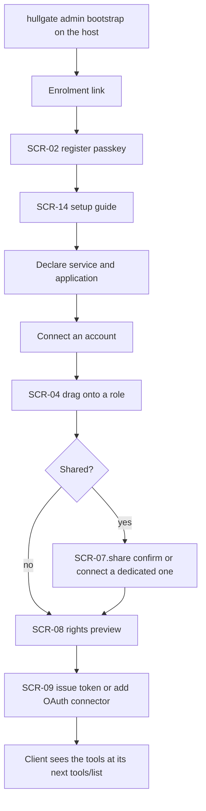
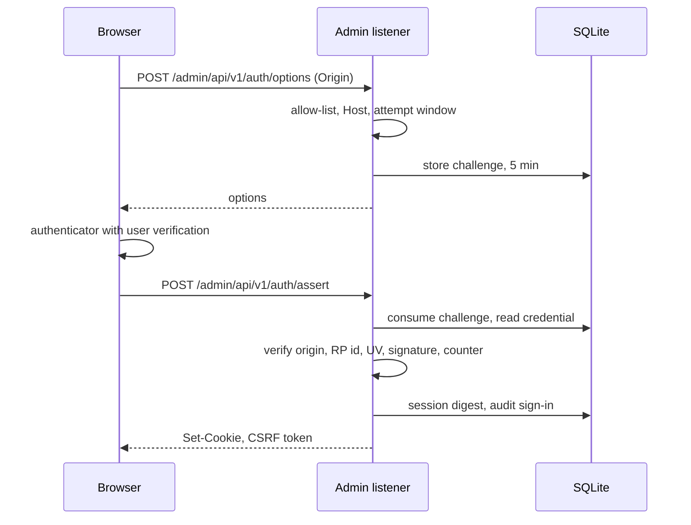
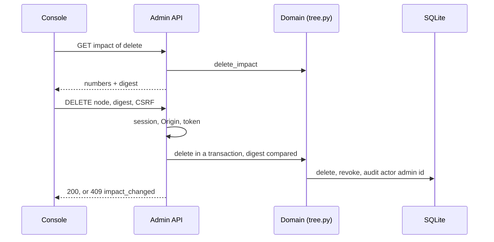
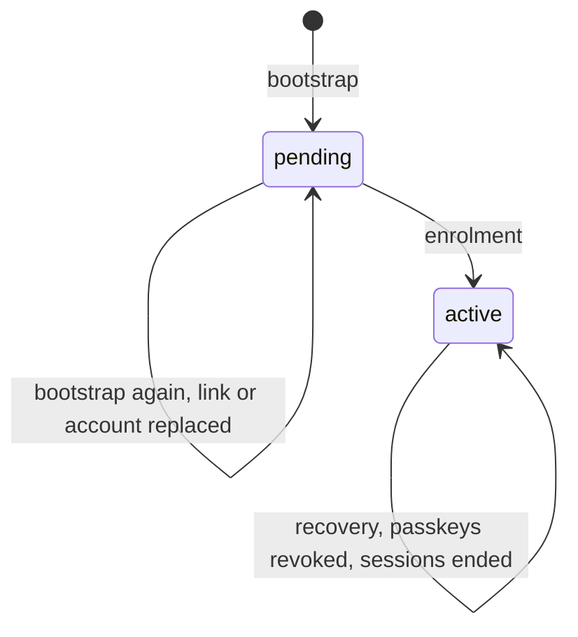
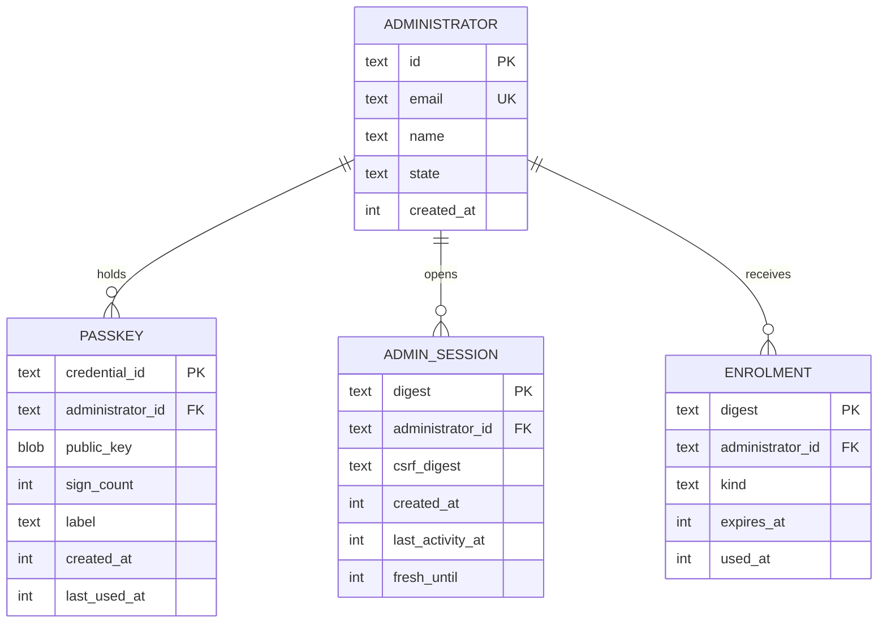

# F-016 · Admin console

## Metadata

| Field | Value |
|-------|-------|
| **Priority** | P2 |
| **Branch** | `feat/HULL-11-admin-console-slice-5` (one branch per slice, §10; slice 1 was `feat/HULL-11-admin-console-lot-a`, slice 2 `feat/HULL-11-admin-console-slice-2`, slice 3 `feat/HULL-11-admin-console-slice-3`, slice 4 `feat/HULL-11-admin-console-slice-4`) |
| **Last updated** | 2026-11-18 |

## 1. Context & Objective

### Current State

Constat of 2026-11-01, commit `a8fa639`:

- Everything is managed from `hullgate` inside the container: `src/hullgate/cli.py` declares 48 subparsers (`grep -c 'add_parser('`) over 9 groups: `tree`, `settings`, `token`, `audit`, `client`, `export`, `service`, `application`, `connection` and their verbs.
- The admin listener serves `/healthz` and nothing else (`src/hullgate/app.py:112`, BR-068). On the production server it is published on `127.0.0.1:14791` only, with `ADMIN_URL: http://127.0.0.1:14791` (`deploy/compose.prod.yaml`), and BR-068's reason stands: inside the Traefik network the port answers to neighbouring containers.
- The only human authentication is the TOTP barrier on the OAuth consent page (BR-060). There is no administrator account, no session, no cookie other than the consent one. Audit actor for an operator act is the constant `operator-cli` (`src/hullgate/audit.py:17`).
- A prototype was validated by the operator on 2026-10-28 (#18): three-column view (library, tree, inspector), drag and drop placement, map view, rights preview, tokens, tools, audit, statistics. Everything in it is simulated. It has no sign-in, no organisation screen, no history, no import.
- Features that deferred work here: F-004 (public admin name and router), F-005 (web UI, passkey, undo, YAML import, prototype corrections), F-006 (Library screen, web OAuth return route, second `redirect_uri`), F-008 (`list_changed`, see §Out of Scope).

### Objective

An operator administers the gateway from a browser, on the same rules as the CLI: everything the CLI does on the tree, tokens and library is reachable from the console, what the AI will see is visible before a client is connected, a change applies at once and can be undone where undoing means something, and a gateway exposed on the internet cannot be taken over with less than a passkey.

### Expected Impact

- The operator's routine acts (add a role, place a connection, issue a token, read a refusal) go from a chain of `docker exec` commands to one screen. Target: first connector working in fifteen minutes from a fresh instance (PDF p. 17), measured at AC-OP-03.
- The rights of a role can be read before connecting a client, tool by tool, with the rule hiding each hidden tool.
- No admin route answers without a session, on either listener; the takeover row of the PDF threat table (p. 17) is held by testable rules, not by intent.
- The global lockout of the TOTP barrier (BR-073, F-005 §12 risk) stops being a way to block authorisations once a passkey can pass it.

### Open Product Questions

None is left unanswered in the text: each is written on a default, recorded in §9, and the ones with no safe default are returned to the orchestrator as raises: Q1 and Q3 below. Q2 and Q4 were settled by the operator on 2026-11-01.

- **Q1 · `list_changed`.** The ticket and PDF p. 6 ask that connected clients be notified. F-008 Q1 = a (frozen, H1) made the access point stateless, with no session and no GET stream: nothing can be pushed. Written on: not pushed, BR-215. Options: (a) keep stateless and tell the operator so in the console; (b) open a ticket for incoming sessions (F-008 Q1 = b: session table, expiry, cut at revocation, GET stream), which reopens BR-067 and the bench. Recommendation: (a). Confirmed at the freeze go of 2026-11-14: (a).
- **Q2 · Several administrators — settled.** One administrator in 1.0.0; invitations, mail and peer recovery move to 1.1.0 (§Out of Scope).
- **Q3 · Public admin name on the production server for 1.0.0.** BR-230 ships the route off by default. Written on: off, tunnel over SSH. Options: (a) stay on the tunnel for 1.0.0: `ADMIN_RP_ID` is `localhost`, no passkey on the barrier, BR-073's lockout stays; (b) open a public name: one DNS record, an allow-list decision, and `ADMIN_RP_ID` set to the parent domain of `ADMIN_HOST` and `MCP_HOST` **before the first enrolment**, because BR-202 ties every passkey to it; the reach of that choice is that every subdomain of the parent can request assertions; (c) serve the console on `MCP_HOST` itself (`ADMIN_HOST` = `MCP_HOST`, `PathPrefix(/admin)`), which gives the barrier passkey with no parent domain. Leaving the tunnel later, under (b) or (c), re-enrols the administrator through BR-228. Recommendation: (a) for 1.0.0, then (b) once HULL-13 runs on real clients. Confirmed at the freeze go of 2026-11-14: (a).
- **Q4 · Statistics screen — settled.** It leaves F-016 for HULL-68 (F-017), on this console's shell (§3.17).

## 2. Scope

Ticket HULL-11 (step 6 of the plan of ticket #1) plus the deferrals listed in §1.

- **Administrator and sign-in** (lot A): the instance's administrator, host-side bootstrap, passkey sign-in, enrolment links, short sessions, CSRF defence, Host check, attempt limits, reliable client address, optional IP allow-list, fresh re-authentication for security acts.
- **JSON admin API and console shell** (lot A): `/admin/api/v1/…` on the admin listener, static SPA under `/admin`, build, gate, tests.
- **Console core** (lot B): Tree, Library, Role inspector, Tokens, Audit screens; connection authorisation from the console; impact shown before irreversible acts.
- **Policy surfaces** (lot C): Rights preview, Tools screen, editing of mode, lists, argument rules and pin on a placement; all reading what F-015 delivers.
- **History and import** (lot D): undo of the reversible changes, YAML import with diff preview.
- **Organisation and exposure** (lot E): Organisation screen, recovery from the host, first-run guide, optional public routing, passkey on the barrier.
- **Corrections of the prototype** against frozen rules (§3.2).

## Out of Scope

- **Several administrators, invitation by e-mail, mail transport, recovery issued by a peer** — 1.1.0 (operator, 2026-11-01). The account tables can hold several.
- **Administrator e-mail or name change, handover, removal** — 1.1.0, with the account management.
- **Statistics screen** — HULL-68 (F-017), on this console's shell, §3.17; it reads the call events HULL-68 builds.
- **Alert channels, upstream health** — HULL-69; F-008's "#11 / #12" row on upstream health lands there.
- **`notifications/tools/list_changed` pushed to clients** — Q1; candidate ticket on incoming sessions.
- **Recovery by e-mail** (PDF p. 6) — a mailbox would be enough to take over the gateway; held by BR-228, candidate ticket if the operator wants it, §9.
- **Console without a passkey on a local URL** (PDF p. 17) — refused: a loopback `ADMIN_URL` proves nothing about who reaches the port, §9.
- **Differentiated admin roles** — v2 (PDF p. 2).
- **Several organisations per instance** — HULL-67; screens use the URLs the server returns and hold no path scheme (BR-211), so F-014's `/o/<id>/p/…` costs the console nothing.
- **Declared ceiling of a connection's provider rights** (prototype "Provider rights"; F-015 §Out of Scope sends it here) — not built: the sheet shows the scopes granted, and the provider enforces them. §9.
- **Retention and purge of the audit, wider audit queries** — HULL-68; the Audit screen reads what exists.
- **Domain change from the console** — URLs are configuration (PDF p. 17); the Organisation screen shows them read-only.
- **French console and CSV export** — neither is needed for the objective of §1, and a second dictionary doubles the string work of every lot. Console strings stay in one dictionary, so French can be added later. Departs from #18's FR/EN decision; server refusal texts are English in any case (BR-131). Candidate for a later feature.
- **Other console languages.**
- **Touch devices** — supported: current desktop Chromium, Firefox and Safari. Drag and drop and the three columns are not designed for touch; "Place in…" remains.
- **Rate limiting of the API beyond sign-in** — only an authenticated administrator reaches it.
- **`design/amaterasu/` fonts and assets** — not used (§8, #41).

## 3. Functional Spec

### 3.1 Principles

- One rule set. The API calls the operations the CLI calls; a refusal is the same refusal (BR-211).
- The console decides nothing: URLs, effective settings, rights and impacts all come from the server.
- All paths live under `/admin` on the admin listener so that the proxy can route either a dedicated name or a path of the MCP name (PDF p. 6). The public listener keeps answering 404 on `/admin` (BR-068 v2).

### 3.2 Prototype corrections

The prototype is the reference for layout, behaviour and density. It gives way to frozen rules on these points, constat of 2026-11-01 on `design/prototype-admin/project/Main.dc.html`. Sweep: every string of its `I18N.en` dictionary is re-read against the rule of the concept it names, when the dictionaries are written.

| Prototype | Rule | Console |
|---|---|---|
| "frozen" for a locked node (`badge_frozen`, `lock_msg`) | BR-049, glossary | "locked"; tool definitions are "pinned", F-015's term |
| "only a token issued on {env} or below is accepted" (`tok_hint_sens`) | BR-051 | "only a token issued on this role" |
| Revoking removes the placements (`rev_body`, `rev_pl`, `t_revoked`) | BR-095 | Revoke keeps name, prefix and placements; `Remove` is a separate act |
| "An unclassified tool is hidden on every role" (`tools_intro`) | F-015 | Text follows F-015's classification rule |
| Wordmark of the former product name, logo, Google Fonts `<link>` | F-010, BR-212 | `hullgate`, self-hosted open fonts |
| Statistics tab | §Out of Scope | absent until HULL-68 |

### 3.3 Sign-in (SCR-01) and enrolment (SCR-02)

SCR-01 is one button, "Sign in with a passkey", using a discoverable credential: no e-mail is typed, so the page reveals no account.

SCR-02 opens from an enrolment link: it shows the account's e-mail, asks for a passkey label and runs the registration ceremony. On success the session opens.

#### Visual States

- **SCR-01**: nominal
- **SCR-01.refused**: generic failure, retry
- **SCR-01.limited**: 429, wait
- **SCR-01.blocked**: 403 of the allow-list (no detail)
- **SCR-01.unsupported**: browser without WebAuthn
- **SCR-02.expired**: link used, expired or replaced
- **SCR-02.unsupported**: browser without WebAuthn

### 3.4 Shell (SCR-03)

Top bar: wordmark and organisation name, tabs (Tree, Tokens, Tools, Audit, Organisation), badge on Tools for the count to classify, theme switch (dark by default, #18), account menu (passkeys, sign out). A banner appears when the vault is unavailable (BR-064): the readiness reason travels in `GET /admin/api/v1/meta`, the admin listener having no `/readyz` and the CSP forbidding the public origin. Writes needing the vault are refused by the server and the screen says why.

#### Visual States

- **SCR-03**: nominal
- **SCR-03.session-expired**: any 401 returns to SCR-01 and comes back to the same screen after sign-in
- **SCR-03.vault-down**: banner
- **@dark**, **@light**

### 3.5 Tree (SCR-04)

Three collapsible columns (`[` and `]`), as validated in #18: Library on the left, tree in the centre, inspector on the right, with a List view and a Map view.

- Add, rename (double-click or F2), move and delete a node in place. Levels, segments and locks are the server's (BR-044, BR-049); the refusal text is the server's.
- Drag a connection from the Library onto a role to place it. Dropped on a project or environment: a dialog asks which roles below. Every drag has a keyboard path, "Place in…" (BR-232).
- Sensitive environments and locks are marked on the node. Rename, move, delete, sensitivity go through the impact dialog (BR-214): tokens revoked, OAuth lineages cut, URLs that stop answering, shares created.
- Map view: hovering or selecting a connection highlights its placements.

#### Visual States

- **SCR-04**: nominal
- **SCR-04.empty**: no client yet, entry to the guide (SCR-14)
- **SCR-04.map**
- **SCR-04.locked**: read-only subtree, names the locking node
- **SCR-04.narrow**: columns collapse into rails

### 3.6 Inspector (SCR-05 role, SCR-06 other nodes)

SCR-05 (role): MCP URL with copy button (URL from the server), Rights preview summary (SCR-08), placed connections with their mode and lists, inherited settings with value and origin (BR-048), tokens on the role. SCR-06 (node): settings, sensitivity on an environment, lock, roles below.

#### Visual States

- **SCR-05**: nominal
- **SCR-05.empty**: no placement
- **SCR-05.sensitive**: writes closed by default, openings listed
- **SCR-06**: nominal
- **SCR-06.overridden**: value set here, restore inheritance

### 3.7 Library and connection sheet (SCR-07)

Services and their connections: account, granted scopes, OAuth state, expiry, placements ("Where is it used"), tool prefix. Acts: connect, re-authenticate, revoke, remove, change prefix, replace a provided token, declare a service, an upstream, an application, run `connection tools` diagnostics.

Connect (SCR-07.connect): choose service and application, name, account, then either the browser goes to the provider and comes back (BR-216), or, when the application has no web return URI, the console shows the authorisation URL and a field to paste the return URL, the F-006 path.

Share confirmation (SCR-07.share, BR-078 v3): placing a connection that would be shared across clients, or between a sensitive and a non-sensitive role, opens a dialog with the warning, the recommendation of a dedicated connection with a one-click "Connect a dedicated one", and an explicit checkbox.

#### Visual States

- **SCR-07**: nominal
- **SCR-07.empty**
- **SCR-07.reauth-required**, **SCR-07.pending**
- **SCR-07.expiring** (slice 4): a connection the server reports as expiring (BR-238); the sheet shows the date and that the operator must act
- **SCR-07.connect**, **SCR-07.connect-paste**, **SCR-07.share**

### 3.8 Rights preview (SCR-08)

For a role, or a token on a role: the tools exposed, and for each hidden tool the rule hiding it; openings in a sensitive environment listed; grouped actions shown when the schema enumerates them (PDF p. 9). The token variant answers "Test a token against a role" of the prototype: a token is chosen from the list, its value is never typed.

#### Visual States

- **SCR-08**: nominal
- **SCR-08.empty**: nothing placed
- **SCR-08.unknown**: an upstream could not be read; those tools are marked unknown, never absent (BR-217)
- **SCR-08.out-of-scope**: the token does not reach this role, with the reason

### 3.9 Tokens (SCR-09)

Operator tokens and OAuth lineages per node: label, node, client, issue, expiry, last use when known, state. Issue on a node with duration under BR-052's ceiling; the value is shown once with a Copy button and "I copied it — hide" (BR-053 v3). Revoke in one click. OAuth clients (admission mode, removal, DCR switch) live in a section of this screen.

#### Visual States

- **SCR-09**: nominal
- **SCR-09.empty**
- **SCR-09.value-shown**
- **SCR-09.sensitive-ceiling**: duration capped

### 3.10 Tools (SCR-10)

The queue "to classify", the pinned tools and detected changes, with the acts F-015 defines (`tool queue`, `tool classify`, `tool diff`, `tool validate`): classify, validate, keep suspended. This screen is a view on F-015's operations (BR-211) and adds no rule. From slice 4 it also reads the catalogue of classified tools (an API-only read, §9) and offers on a classified tool the CLI's reclassify and clear acts, under BR-211's parity (review 579 raise 1, N2).

#### Visual States

- **SCR-10**: nominal
- **SCR-10.empty**: nothing to classify
- **SCR-10.diff**: definition change, before and after

### 3.11 Audit and history (SCR-11)

The journal in order, newest first, filterable by time, actor, path prefix, action and result, with paging from the server; export of the current filter (BR-218). A row showing a change displays who, when, before and after, and "Undo" when BR-220 allows it, or the reason it does not.

#### Visual States

- **SCR-11**: nominal
- **SCR-11.empty**: no match
- **SCR-11.undo-confirm**, **SCR-11.undo-stale**

### 3.12 Import (SCR-12)

Upload a YAML export; the preview lists what would be created, changed and deleted, with the impact of each deletion and the deletions off by default; apply. Download of the current export offered beside Apply.

#### Visual States

- **SCR-12**: nominal
- **SCR-12.preview-empty**: nothing differs
- **SCR-12.refused**: format, keys or size, with the location
- **SCR-12.stale**: state moved since the preview

### 3.13 Organisation (SCR-13)

The administrator's account (passkeys count, last sign-in), outbound OAuth applications with the URIs to copy, IP allow-list, public URLs read-only, organisation name.

#### Visual States

- **SCR-13**: nominal
- **SCR-13.allowlist-self**: refusal naming the caller's address
- **SCR-13.fresh-required**: passkey asked again (BR-210)

### 3.14 Setup guide (SCR-14)

Shown while the instance has no client, service, connection, placement or issued credential: five steps, each done or not by reading the state, each linking to the real screen; the OAuth step shows the return URIs to copy and, for each declared service, the scopes configured on it; the gateway asserts no provider's permissions, so on a fresh instance the step shows none (PDF p. 17).

#### Visual States

- **SCR-14**: nominal
- **SCR-14.done**: dismissed, reachable from the Organisation screen

### 3.15 API surface

Prefix `/admin/api/v1`, JSON only, English keys and codes (BR-131). A refusal is `{"code": "<closed_code>", "message": "<text>"}`, status 400, 401, 403, 404, 408, 409, 413, 421, 422, 429 or 503. A request body not received in full within 30 seconds of its first byte being awaited is refused `408 request_timeout` and the connection closed (HULL-85). Resource groups: `auth`, `session`, `passkeys`, `allowlist`, `nodes`, `settings`, `tokens`, `clients`, `services`, `applications`, `connections`, `placements`, `rights`, `tools`, `audit`, `changes`, `import`, `export`, `setup`, `meta`. `GET /admin/api/v1/meta` gives URLs, version, feature flags (web return available). Paths and bodies are settled at implementation and listed in `docs/admin-api.md`.

### 3.16 Configuration

| Variable | Default | Role |
|---|---|---|
| `ADMIN_URL` | required (BR-032) | exact origin of the console; a hostname, not an IP (BR-202) |
| `ADMIN_RP_ID` | host of `ADMIN_URL` | WebAuthn relying party id |
| `TRUSTED_PROXIES` | empty | CIDRs whose `X-Forwarded-For` is read (BR-208) |
| `ADMIN_HOST` | empty | deployment: opens the public route (BR-230) |

The default `ADMIN_RP_ID` never gives the barrier passkey when the console and `MCP_HOST` are sibling names: that takes the parent domain, set before the first enrolment, or one shared name (Q3, BR-060 v2). Changing any of these later re-enrols everyone (BR-202).

On the production server `ADMIN_URL` moves from `http://127.0.0.1:14791` to `http://localhost:14791`, reached over `ssh -L 14791:127.0.0.1:14791`.

### 3.17 What the shell offers HULL-68 (F-017)

The Statistics screen is built by F-017 on what lots A and B leave:

- **A tab**: the shell's tabs come from one route table; a screen is added by one entry, and no empty tab is shown before it.
- **An API group**: a new `/admin/api/v1/…` group sits in the same application. Host check, allow-list, session, CSRF and security headers apply by construction, and the sweeps of BR-068 v2, BR-205, BR-213 and BR-234 cover it with no new test.
- **The tree**: the tree view has a read-only mode (no drag, rename, delete or impact dialog), a selection event, and an optional per-node decoration: a level, a length and a short text, all computed by a server-side report, subtree sums and rate included. The console maps a level to a colour and a length to a width, nothing more (BR-211). The stats view of the prototype needs them; F-016 uses none. This is a hook, not a rule: F-017 may change its contract without versioning anything of F-016.
- **Reuse**: the filter and paging pattern of SCR-11, `web/src/tokens.css`, the dictionary, and BR-218's read of the journal.
- **Limits it inherits**: charts are SVG or a self-hosted library (BR-212's CSP), its dependencies fall under BR-231, and dynamic styles go through CSSOM, never an inline `style` attribute (BR-212).

Not offered: the event store, aggregates, any chart component.

## 4. Business Rules

### Naming Convention

`BR-NNN`, sequential and global: `conventions/br-identifiers.md`. Range allocated by the orchestrator: BR-200 to BR-239; BR-226, BR-227 and BR-233 were withdrawn before any freeze and are not reused; BR-237 and BR-239 stay free.

### Lifecycle

Per `conventions/br-lifecycle.md`: inline here until `close-feature` Phase 3.

### Overlap scan

Filter on the `Statement` column of `business-rules/index.md` (131 rules, 2026-11-01), two passes. Pass 1 on `passkey|session|CSRF|IP|invit|operator|admin|undo|histor|import|preview|list_changed|notification|cookie|TOTP|audit|barrier|e-mail` and their French forms: 20 lines retained. Pass 2 on `share|redirect|return|export|Traefik|cache|gate|lock|image|setting|secret` and their French forms: 38 more. 58 retained of 131. BR-046, BR-051, BR-052 and BR-082 escaped the filter and were added by reading F-005 and F-006 §Out of Scope. Every overlap below was settled on the rule's text; the off-topic lines on their index statement.

Overlaps:

| Rule | Verdict | Resolution |
|---|---|---|
| BR-029 | overlap | new version (C2): the rule allows only `uv.lock` dependencies, and the console build stage installs from another lockfile |
| BR-032 | overlap | new version (C2): the rule enumerates the variables, and three join |
| BR-034 | overlap | new version (C2) |
| BR-035 | overlap | new version (C2): one more failing step |
| BR-041 | overlap | new version (C2) |
| BR-053 | overlap | new version (C2) |
| BR-060 | overlap | new version (C2) |
| BR-061 | overlap | new version (C2): "pre-registered by the CLI" no longer holds |
| BR-066 | overlap | new version (C2): more events, new actor form |
| BR-068 | overlap | new version (C2) |
| BR-072 | neighbour | new rule (C1): BR-203 and BR-204 can be broken while BR-072 holds and the reverse |
| BR-073 | overlap | new version (C2) |
| BR-078 | overlap | new version (C2) |
| BR-079 | overlap | clarification (C3): the signal also appears in the console |
| BR-082 | overlap | new version (C2) |
| BR-086 | overlap | clarification (C3) |
| BR-103 | neighbour | new rule (C1): BR-231 judges another lockfile |
| BR-112 | neighbour | new rule (C1): BR-215 adds what the operator is told and the absence of a restart |
| BR-131 | overlap | clarification (C3): the API's keys and codes are closed vocabularies the rule already binds |

Applied unchanged, F-016 obeys them: BR-042, BR-043, BR-045, BR-046, BR-048, BR-049, BR-051, BR-052, BR-064, BR-065, BR-069, BR-070, BR-076, BR-081, BR-083, BR-087, BR-095, BR-098, BR-100. BR-069 and BR-076 escaped the filter too.

Off topic, 26 lines (bench, quality tools, OAuth inbound, vault, upstream client, image and deployment): BR-003, BR-010, BR-016, BR-020, BR-021, BR-028, BR-030, BR-031, BR-036, BR-037, BR-040, BR-059, BR-071, BR-080, BR-089, BR-099, BR-101, BR-102, BR-104, BR-105, BR-114, BR-119, BR-120, BR-122, BR-124, BR-125.

### Administrators and sign-in

### BR-200 · An administrator is a named account with every right

> **Extracted on 2026-11-16.** Current version: [`business-rules/BR-200.md`](../business-rules/BR-200.md).
> The content below reflects the state of this BR at the time of feature F-016 (v1).

*`definitional` · `strict` · Candidate state: `verified` — `tests/unit/test_br_200_administrators.py`.*

**Rule** — An administrator is an account of the organisation with an e-mail, a display name and a state, `pending` or `active`, and an active one has every right.

**Clarifications**
- An instance has one administrator in 1.0.0, held by BR-201's refusals, not by the model; the tables can hold several. The unit test reads the fields and the state set.
- `pending`: created by the host, not enrolled yet.
- The human the rules call "the operator" acts as an administrator in the console and as `operator-cli` in the CLI.

### BR-201 · The first administrator comes from the host, and only from it

> **Extracted on 2026-11-16.** Current version: [`business-rules/BR-201.md`](../business-rules/BR-201.md).
> The content below reflects the state of this BR at the time of feature F-016 (v1).

*`behavioral` · `strict` · Candidate state: `verified` — `tests/integration/test_br_201_bootstrap.py`.*

**Rule** — `hullgate admin bootstrap <email>` creates the first administrator and prints its enrolment link once; it is refused when an active administrator exists.

**Clarifications**
- No default credential, no open setup page: reaching the listener first gives nothing. No route creates an account while none exists, a consequence of BR-068 v2.
- With no active administrator, rerunning the command reissues the link, which replaces the old one (BR-203), audited; on another e-mail it replaces the `pending` account, so a typo at bootstrap has a way out. The 30-minute link will expire at least once on a first install.
- Printing the link is the BR-053 discipline applied to a link: standard output, once, in the form `ENROLMENT-LINK: <url>`.

**Example**
- **Given** a fresh instance
- **When** `/admin` is opened
- **Then** SCR-01 is shown, every sign-in fails, and no route offers to create an account

### BR-202 · The console is entered with a passkey and nothing else

> **Extracted on 2026-11-16.** Current version: [`business-rules/BR-202.md`](../business-rules/BR-202.md).
> The content below reflects the state of this BR at the time of feature F-016 (v1).

*`behavioral` · `strict` · Candidate state: `verified` — `tests/integration/test_br_202_passkey.py`, `tests/browser/test_br_202_sign_in.py` (virtual authenticator).*

**Rule** — A console session opens only on a WebAuthn assertion with user verification, for a registered credential of an active administrator, from an origin equal to `ADMIN_URL`, under the relying party id `ADMIN_RP_ID`, on a single-use server challenge of at most 5 minutes; no password, no TOTP and no local-address exemption exists.

**Clarifications**
- A signature counter that goes backwards is refused and audited, when the authenticator reports a non-zero counter.
- Startup is refused, BR-032 form, when `ADMIN_RP_ID` is an IP address or is not `ADMIN_URL`'s host or one of its parent domains: WebAuthn forbids an IP, and a console configured on `127.0.0.1` could never register a passkey.
- Discoverable credentials: nothing is typed before the ceremony.
- Attestation is not requested.
- Changing `ADMIN_RP_ID` invalidates every passkey; recovery goes through BR-228.

### BR-203 · An enrolment link is single-use, short-lived, and kept as a digest

> **Extracted on 2026-11-16.** Current version: [`business-rules/BR-203.md`](../business-rules/BR-203.md).
> The content below reflects the state of this BR at the time of feature F-016 (v1).

*`behavioral` · `strict` · Candidate state: `verified` — `tests/integration/test_br_203_enrolment.py`.*

**Rule** — An enrolment link carries 256 random bits, is stored as its SHA-256 digest, is bound to one account, expires after 30 minutes, is consumed by one successful registration, and is replaced by any newer link of that account.

**Clarifications**
- A used, expired, replaced or unknown link gets one and the same page, SCR-02.expired.
- The link is a URL path segment, not a query string, and the page takes it out of the address bar before any request after the shell's own; `Referrer-Policy: no-referrer` protects the shell's requests.

### BR-204 · An admin session is short, server-side, and kept as a digest

> **Extracted on 2026-11-16.** Current version: [`business-rules/BR-204.md`](../business-rules/BR-204.md).
> The content below reflects the state of this BR at the time of feature F-016 (v1).

*`behavioral` · `strict` · Candidate state: `verified` — `tests/integration/test_br_204_sessions.py`.*

**Rule** — An admin session is a random 256-bit value held in an `HttpOnly`, `SameSite=Strict`, `Path=/admin` cookie, `Secure` whenever `ADMIN_URL` is `https`, and stored as its digest; it ends after 30 minutes without a request, 8 hours after sign-in, at sign-out, and, the session performing the act excepted, when one of its passkeys is deleted.

**Clarifications**
- The sign-out and the expiry delete the row: a value replayed afterwards is unknown.
- A background poll does not extend a session: only a request the operator caused does (`X-Hullgate-Activity: 1` set by the console on user-driven calls; polling is limited to the banner of SCR-03).
- Sessions survive a restart, being in the database.
- The one exemption from `Secure` is a loopback `ADMIN_URL`: `http://localhost` carries no TLS, and browsers disagree on keeping a `Secure` cookie there. WebAuthn already treats `localhost` as a secure context. An `http` `ADMIN_URL` on any other host is refused at startup.
- `Path=/admin` keeps the value off the public listener's code path if the console shares `MCP_HOST` (Q3).

### BR-205 · A state-changing request proves where it comes from

> **Extracted on 2026-11-16.** Current version: [`business-rules/BR-205.md`](../business-rules/BR-205.md).
> The content below reflects the state of this BR at the time of feature F-016 (v1).

*`behavioral` · `strict` · Candidate state: `verified` — `tests/integration/test_br_205_csrf.py`.*

**Rule** — Any request under `/admin/api` other than `GET` is refused with 403 `csrf_refused` unless its `Origin` header equals the origin of `ADMIN_URL` and its `X-CSRF-Token` header equals the token bound to the session; no CORS header is ever sent.

**Clarifications**
- The sign-in and enrolment ceremonies have no session yet: they check `Origin` and the single-use challenge.
- The token is returned at sign-in and by `GET /admin/api/v1/session`, under the session cookie, so that a reload, a second tab or the BR-216 callback finds it again.
- A sweep test lists every registered non-`GET` route and asserts the check, against a named exemption list: `auth/options`, `auth/assert` and the enrolment ceremony.

### BR-234 · A `GET` changes nothing

> **Extracted on 2026-11-16.** Current version: [`business-rules/BR-234.md`](../business-rules/BR-234.md).
> The content below reflects the state of this BR at the time of feature F-016 (v1).

*`behavioral` · `strict` · Candidate state: `verified` — `tests/integration/test_br_205_csrf.py` (row count on every table around each `GET` route).*

**Rule** — No `GET` under `/admin` changes a stored value; a `GET` route that writes fails the sweep.

**Clarifications**
- The audit trace of a read and the `last_activity_at` of a session are not changes.

### BR-206 · The admin listener answers only to its configured host

> **Extracted on 2026-11-16.** Current version: [`business-rules/BR-206.md`](../business-rules/BR-206.md).
> The content below reflects the state of this BR at the time of feature F-016 (v1).

*`behavioral` · `strict` · Candidate state: `verified` — `tests/integration/test_br_206_host.py`.*

**Rule** — A request to the admin listener whose `Host` header differs from the host and port of `ADMIN_URL`, compared after default-port normalisation, receives 421 with no body, `/healthz` excepted.

**Clarifications**
- This closes DNS rebinding toward a tunnel on the operator's machine and calls from Traefik-network neighbours by container name.
- It is not an authentication: a neighbour can forge the header, and BR-068 v2 is what stops it.

### BR-207 · Sign-in attempts are limited by client address

> **Extracted on 2026-11-16.** Current version: [`business-rules/BR-207.md`](../business-rules/BR-207.md).
> The content below reflects the state of this BR at the time of feature F-016 (v1).

*`behavioral` · `strict` · Candidate state: `verified` — `tests/integration/test_br_207_attempts.py`.*

**Rule** — After 5 failed sign-in or enrolment attempts from a client address in 15 minutes (sliding window), that address receives 429 with a generic message on those routes, without the attempt being evaluated, until the window clears; each failure and each refusal is audited.

**Clarifications**
- The counter is in the database, like BR-073's.
- Client address: BR-208. Behind a proxy that is not declared, every caller shares the proxy's address and the limit becomes global; this is why BR-230 requires `TRUSTED_PROXIES`.
- An unknown credential and a wrong signature are the same failure, with the same message.
- `auth/options` is no failure: it is bounded instead by at most 5 live challenges per client address, then 429. Expired challenges and attempts are purged at each sign-in.
- `hullgate admin attempts clear` empties the window from the host. Over the tunnel every caller may share Docker's bridge address (hypothesis, AC-OP-01), hence one window for all.

### BR-208 · A forwarded client address is believed only from a declared proxy

> **Extracted on 2026-11-16.** Current version: [`business-rules/BR-208.md`](../business-rules/BR-208.md).
> The content below reflects the state of this BR at the time of feature F-016 (v1).

*`behavioral` · `strict` · Candidate state: `verified` — `tests/unit/test_br_208_client_address.py`.*

**Rule** — The client address of a request is its socket peer, unless that peer lies in `TRUSTED_PROXIES`, in which case it is the rightmost `X-Forwarded-For` entry outside `TRUSTED_PROXIES`; with `TRUSTED_PROXIES` empty, forwarded headers are ignored.

**Clarifications**
- uvicorn's default `proxy_headers` rewrites the client address from forwarded headers before this function runs, so both listeners set `proxy_headers=False`, in lot A.
- F-005 deferred this to #12; the console needs it first. HULL-70 (`X-Forwarded-*` from declared proxies) reuses this function.
- A peer in `TRUSTED_PROXIES` with no usable header gives the peer's address.

### BR-209 · An optional IP allow-list closes the console, without locking its author out

> **Extracted on 2026-11-16.** Current version: [`business-rules/BR-209.md`](../business-rules/BR-209.md).
> The content below reflects the state of this BR at the time of feature F-016 (v1).

*`behavioral` · `blocking` · Candidate state: `verified` — `tests/integration/test_br_209_allowlist.py`.*

**Rule** — When the organisation's list of CIDRs is non-empty, every request under `/admin` from a client address outside it receives 403, after the Host check of BR-206 and before any other check.

**Clarifications**
- Empty list: no restriction. The list is read from the database at each request, so it applies at once.
- Each change is audited with before and after.

### BR-235 · The allow-list cannot lock out its author, and the host can always clear it

> **Extracted on 2026-11-16.** Current version: [`business-rules/BR-235.md`](../business-rules/BR-235.md).
> The content below reflects the state of this BR at the time of feature F-016 (v1).

*`behavioral` · `blocking` · Candidate state: `verified` — `tests/integration/test_br_209_allowlist.py`.*

**Rule** — An update that would exclude the caller's own address is refused with 409 `allowlist_self`, and `hullgate admin allowlist clear` empties the list from the host.

### BR-210 · A security act asks for the passkey again

> **Extracted on 2026-11-16.** Current version: [`business-rules/BR-210.md`](../business-rules/BR-210.md).
> The content below reflects the state of this BR at the time of feature F-016 (v1).

*`behavioral` · `strict` · Candidate state: `verified` — `tests/integration/test_br_210_fresh.py`.*

**Rule** — Adding or deleting a passkey and changing the allow-list require an assertion of at most 5 minutes old; without one the API answers 403 `fresh_auth_required` and the act does nothing. `POST /admin/api/v1/session/fresh` takes an assertion and writes `fresh_until`; session value and CSRF token do not change.

**Clarifications**
- Deleting one's last passkey is refused: the account would have no way back but BR-228.
- The acts are named: this list is the rule's population. A later feature adding an act of the same family adds it here by a new version.

### Console and API

### BR-211 · One rule set, decided on the server

> **Extracted on 2026-11-16.** Current version: [`business-rules/BR-211.md`](../business-rules/BR-211.md).
> The content below reflects the state of this BR at the time of feature F-016 (v1).

*`behavioral` · `strict` · Candidate state: `verified` — `tests/integration/test_br_211_parity.py`.*

**Rule** — Every API write calls the domain operation the CLI calls for the same act and returns its refusal; the console computes no URL, effective setting, right or impact, and shows the server's values and refusal texts; a CLI verb neither mapped nor excluded fails the parity test.

**Clarifications**
- The operator's "validation at entry" (PDF p. 5) is this rule: a refusal comes from the server, before anything is stored. The console may disable a control the server has said is refused, never decide it.
- Population: the 48 subparsers of `src/hullgate/cli.py` at `a8fa639` (`grep -c 'add_parser('`). Prescribed sweep, replayed after each lot: every CLI verb is mapped in `test_br_211_parity.py` to an API call or to an exclusion with its reason. Exclusions at this date: `audit tail` (replaced by the audit route), `connection authorize` stdin handling (replaced by BR-216's paste field), `admin *` and `import` CLI forms (host only by design).
- Verbs added by later features enter the table in the lot that adds them. Known on 2026-11-01: `audit query`, `audit export` (mapped, F-017, on BR-218's routes); `stats` (mapped, F-017's `stats` group); `alert list`, `alert channels` (mapped, F-019's `alerts` group); `alert test` (excluded: host only); `consent list`, `consent approve` (F-020, excluded: host only, BR-310 gives approval no route and the list exists to compare a reference before it).
- An act present in the API and not in the CLI is either a read or named in §9.
- Audit actor of an API write: `admin:<administrator id>`.

### BR-212 · The console is a self-contained bundle; the image holds no Node

> **Extracted on 2026-11-16.** Current version: [`business-rules/BR-212.md`](../business-rules/BR-212.md).
> The content below reflects the state of this BR at the time of feature F-016 (v1).

*`behavioral` · `strict` · Candidate state: `verified` — `tests/container/test_br_212_bundle.py`, `tests/browser/test_br_212_csp.py`.*

**Rule** — The console is a static bundle built at image build time and served by the admin listener, with no external origin at runtime, under `Content-Security-Policy: default-src 'self'; script-src 'self'; style-src 'self'; img-src 'self' data:; connect-src 'self'; font-src 'self'; base-uri 'none'; form-action 'self'; frame-ancestors 'none'`; the runtime image contains no Node, and a Node binary in it or an external request fails the test.

**Clarifications**
- Every response of `/admin` also carries `X-Content-Type-Options: nosniff` and `Referrer-Policy: no-referrer`.
- The HTML shell holds no data, needs no session, and is the same for everyone; data needs the API.
- Without a built bundle (unit and integration tests) `/admin` is 404 and the API works.
- Fonts are self-hosted, under an open licence recorded beside them (§8).

### BR-213 · The admin API returns no secret, with one exception shown once

> **Extracted on 2026-11-16.** Current version: [`business-rules/BR-213.md`](../business-rules/BR-213.md).
> The content below reflects the state of this BR at the time of feature F-016 (v1).

*`behavioral` · `strict` · Candidate state: `verified` — `tests/integration/test_br_213_no_secret.py`.*

**Rule** — No admin API response carries a token value, an upstream secret, a client secret, a digest in full or an enrolment link, except, once, the issue response of an operator token (BR-053 v3).

**Clarifications**
- Sweep: the test walks every read route on a seeded base holding known values and searches the bodies for them.
- A secret entering (provided token, application secret) travels in a request body, BR-086.
- Every API response has `Cache-Control: no-store`, so that the exception stays out of any cache.

### BR-214 · An irreversible write quotes the impact it was shown

> **Extracted on 2026-11-14.** Current version: [`business-rules/BR-214.md`](../business-rules/BR-214.md).
> The content below reflects the state of this BR at the time of feature F-016 (v1).

*`behavioral` · `strict` · Candidate state: `verified` — `tests/integration/test_br_214_impact.py`.*

**Rule** — An API write that deletes, revokes or changes a path or a sensitivity is refused with 409 `impact_changed` unless it carries the digest of the impact the server computes at that moment, obtained from the matching read.

**Clarifications**
- Population at `a8fa639`: `tree.delete`, `tree.rename`, `tree.move`, `tree.sensitive` (`delete_impact`, `move_impact`, `sensitive_impact` in `src/hullgate/tree.py`; rename uses the move plan), and, with impacts written by this feature, `connection revoke`, `connection remove`, `client remove`, `application remove`, `service remove`. Prescribed sweep: every API write whose operation revokes or deletes is in the test's table.
- The dialog shows the numbers: tokens revoked, lineages cut, placements removed, URLs that stop, shares created (BR-079).
- Two tabs editing the same setting: last write wins, both audited; §9.

### BR-215 · A change applies at the next request, and the console says when clients see it

> **Extracted on 2026-11-14.** Current version: [`business-rules/BR-215.md`](../business-rules/BR-215.md).
> The content below reflects the state of this BR at the time of feature F-016 (v1).

*`behavioral` · `blocking` · Candidate state: `verified` — `tests/integration/test_br_215_immediate.py`.*

**Rule** — A change made from the console binds the next authorisation and the next `tools/list` of any client with no restart; the gateway pushes no `notifications/tools/list_changed`, and after a change affecting a role's tools the console states that connected clients see the new list at their next `tools/list`; a change that needs a restart fails the test.

**Clarifications**
- Authorisation is already read from the database at each request (BR-112, BR-113), which holds whatever process wrote it.
- Q1, ticket text departed from: §9.

### BR-216 · A connection can be authorised from the console, with the code out of every log

> **Extracted on 2026-11-14.** Current version: [`business-rules/BR-216.md`](../business-rules/BR-216.md).
> The content below reflects the state of this BR at the time of feature F-016 (v1).

*`behavioral` · `strict` · Candidate state: `verified` — `tests/integration/test_br_216_web_return.py`, `tests/browser/test_br_216_connect.py`.*

**Rule** — For an application whose web return URI is registered, the console opens the authorisation with `redirect_uri` `${ADMIN_URL}/admin/oauth/callback`; that route serves the console, which sends `code` and `state` by POST under the session, then removes them from the address bar; the listener logs neither the query string of that route nor any authorisation code.

**Clarifications**
- The session cookie is `SameSite=Strict`, so it is absent from the redirect coming from the provider: the callback itself must carry no effect. The POST is same-site, session and CSRF checks apply, and `state` keeps BR-082.
- Constat: `src/hullgate/__main__.py` sets no `access_log` at `a8fa639`, so uvicorn's default access log prints query strings. The admin listener's logging is changed by this rule.
- A declared application carries the flag "web return registered", set by the operator after adding the URI at the provider. The URI of the application stays (F-006): the web URI is a second one.
- An application without the web return stays on the paste path. A dynamic registration declares both URIs.

### BR-217 · The rights preview is the relay's own decision

> **Extracted on 2026-11-15.** Current version: [`business-rules/BR-217.md`](../business-rules/BR-217.md).
> The content below reflects the state of this BR at the time of feature F-016 (v1).

*`behavioral` · `strict` · Candidate state: `verified` — `tests/integration/test_br_217_preview.py`.*

**Rule** — For a role, the preview shows what F-015's `policy preview` returns, from the evaluator `tools/list` uses (BR-123), with the reason hiding each hidden tool; for a token on a role, it first says whether the token reaches that role and why, then shows the role's preview; an upstream it could not read is marked unknown, never absent; a difference from `tools/list` fails the test.

**Clarifications**
- A test asserts equality between the preview's exposed names and a real `tools/list` under the same token, on the isolation fixture.
- In v1 a token narrows no tool (F-015 §Out of Scope): its rights are those of the role it opens. Token variant: the token is picked by identifier; the check runs the coverage steps of the authorization order (BR-055, BR-051) without using the token and without writing a last-use.
- The listing is fresh and audited, as F-015 states; no tool is called.

### BR-218 · The audit screen reads and exports; it writes nothing

> **Extracted on 2026-11-16.** Current version: [`business-rules/BR-218.md`](../business-rules/BR-218.md).
> The content below reflects the state of this BR at the time of feature F-016 (v1).

*`behavioral` · `strict` · Candidate state: `verified` — `tests/integration/test_br_218_audit_read.py`.*

**Rule** — The API offers filtered, paged reading and a JSON Lines export (at most 100 000 entries per export) of the audit, and no route writes to it other than as a trace of an act; each export is itself audited with its filter.

**Clarifications**
- Filter on time, actor, path prefix, action, result. Paging by `seq`.
- The entries carry no secret (BR-066), so the export needs no further redaction.

### History and undo

### BR-219 · Undoing is a new change

> **Extracted on 2026-11-15.** Current version: [`business-rules/BR-219.md`](../business-rules/BR-219.md).
> The content below reflects the state of this BR at the time of feature F-016 (v1).

*`behavioral` · `strict` · Candidate state: `verified` — `tests/integration/test_br_219_undo.py`.*

**Rule** — Undoing an audit entry performs a new change restoring its `before`, through the same domain operation and the same refusals as a direct act, audited with the entry it undoes; the audit keeps both and is never altered.

**Clarifications**
- An undo is a change of the same class, so it can itself be undone.
- A refusal of the direct act (BR-049 lock, BR-078 share confirmation, BR-076 prefix, BR-214 impact) refuses the undo.
- Undoing an unplacement that recreates a share asks the confirmation again: the old one went with the placement. SCR-11.undo-confirm carries the checkbox when the server's refusal says so, and the undo entry records the new confirmation.

### BR-220 · Only a closed list of changes can be undone

> **Extracted on 2026-11-15.** Current version: [`business-rules/BR-220.md`](../business-rules/BR-220.md).
> The content below reflects the state of this BR at the time of feature F-016 (v1).

*`definitional` · `strict` · Candidate state: `verified` — `tests/unit/test_br_220_undoable.py`.*

**Rule** — The undoable changes are: `settings.set`, `settings.unset`, node lock and unlock, `tree.sensitive`, placement and unplacement, tool prefix change, and the placement policy changes F-015 audits with `before` and `after`; every other change is not undoable, and the API says why.

**Clarifications**
- Not undoable, with their reason: node delete (BR-045, a deleted node never returns), rename and move (BR-046, cut lineages do not come back, and the rename back is a direct act), token issue and revocation, connection authorisation, revocation and removal, administrator acts, and an import, whole or in part: an entry carrying an import identifier answers `part_of_import`, whatever its class, since a document applies in full or not at all.
- Undoing `tree.sensitive` restores the flag, not tokens the change affected; its impact dialog says so.
- An undoable class must write machine-readable `before` and `after`. Sweep at each lot: every action of the list has a test asserting both.

### BR-221 · A change whose state has moved cannot be undone

> **Extracted on 2026-11-15.** Current version: [`business-rules/BR-221.md`](../business-rules/BR-221.md).
> The content below reflects the state of this BR at the time of feature F-016 (v1).

*`behavioral` · `strict` · Candidate state: `verified` — `tests/integration/test_br_221_undo_stale.py`.*

**Rule** — An undo is refused with 409 `undo_stale` when the current value of what the entry changed differs from the entry's `after`, showing both; no change is overwritten blindly.

**Clarifications**
- The comparison is on the whole `after` document of the entry's class: a mode changed after a placement makes that placement's undo stale.

**Example**
- **Given** a setting changed from `30d` to `7d`, then to `14d`
- **When** the first entry is undone
- **Then** 409 `undo_stale`, current `14d`, expected `7d`; the second entry can be undone

### Import

### BR-222 · An import is previewed, and the preview writes nothing

> **Extracted on 2026-11-15.** Current version: [`business-rules/BR-222.md`](../business-rules/BR-222.md).
> The content below reflects the state of this BR at the time of feature F-016 (v1).

*`behavioral` · `strict` · Candidate state: `verified` — `tests/integration/test_br_222_import_preview.py`.*

**Rule** — Importing a YAML document first returns the list of creations, changes and deletions with the impact of each and a digest of document and state, writing nothing; applying requires that digest, and a state or document that differs gets 409 `import_stale`.

**Clarifications**
- An export of the current state previews as empty, byte for byte the BR-070 document: it is the round-trip test.
- `hullgate import --preview <file>` and `--apply <digest> <file>` give the same on the CLI.

### BR-223 · An import applies in full or not at all, under the ordinary rules

> **Extracted on 2026-11-15.** Current version: [`business-rules/BR-223.md`](../business-rules/BR-223.md).
> The content below reflects the state of this BR at the time of feature F-016 (v1).

*`behavioral` · `strict` · Candidate state: `verified` — `tests/integration/test_br_223_import_apply.py`.*

**Rule** — Applying an import runs in one transaction, through the domain operations and their refusals; any refusal rolls everything back and names the path that caused it, and each change is audited under one import identifier.

**Clarifications**
- Locks, levels, segments, sensitivity and share confirmations hold. A share the import would create is listed in the preview and needs its confirmation at apply (BR-078 v3).
- A sensitive environment made non-sensitive by the document is shown as a change with its BR-214 impact.

### BR-224 · An import deletes only what it was told to, and identifies by path

> **Extracted on 2026-11-15.** Current version: [`business-rules/BR-224.md`](../business-rules/BR-224.md).
> The content below reflects the state of this BR at the time of feature F-016 (v1).

*`behavioral` · `strict` · Candidate state: `verified` — `tests/integration/test_br_224_import_delete.py`.*

**Rule** — Nodes, placements and connections are matched by path and name; what exists and is missing from the document is a deletion, listed and applied only when the apply request says `apply_deletions: true`; a segment change is a deletion plus a creation and is never inferred as a rename.

**Clarifications**
- A rename inferred from similarity could keep or cut lineages by a guess (BR-046).
- A setting override missing from the document is a change (back to inherited), not a deletion.

### BR-225 · An import refuses what it does not know, and brings back no secret

> **Extracted on 2026-11-15.** Current version: [`business-rules/BR-225.md`](../business-rules/BR-225.md).
> The content below reflects the state of this BR at the time of feature F-016 (v1).

*`behavioral` · `strict` · Candidate state: `verified` — `tests/integration/test_br_225_import_refuse.py`.*

**Rule** — An import is refused when the document exceeds 1 MiB, is not the safe YAML subset, carries a `format` other than the current export format, or holds an unknown key; 413 for the size, 422 for the rest.

**Clarifications**
- Safe loading: no tag, no alias expansion beyond the parser's bounds.
- The format is the one `hullgate export` writes at that build: `format: 3` at `a8fa639`; F-014 and F-015 raise it.
- The organisation identifier of the document (`organisation.id`, F-014): on an instance with an empty tree the import adopts it, so a restored tree keeps its URLs; on any other instance a different identifier is refused with `import_foreign_organisation`.

### BR-236 · An import brings back no secret

> **Extracted on 2026-11-15.** Current version: [`business-rules/BR-236.md`](../business-rules/BR-236.md).
> The content below reflects the state of this BR at the time of feature F-016 (v1).

*`behavioral` · `strict` · Candidate state: `verified` — `tests/integration/test_br_225_import_refuse.py`.*

**Rule** — Connections an import creates have no tokens and wait for an authorisation, and applications it creates have no secret.

**Clarifications**
- PDF p. 15: reimporting on a new instance requires re-authenticating connections. The preview says how many.

### Organisation

### BR-228 · Lost access returns through the host, and the lost passkey dies with it

> **Extracted on 2026-11-15.** Current version: [`business-rules/BR-228.md`](../business-rules/BR-228.md).
> The content below reflects the state of this BR at the time of feature F-016 (v1).

*`behavioral` · `strict` · Candidate state: `verified` — `tests/integration/test_br_228_recovery.py`.*

**Rule** — An administrator who lost a passkey recovers through `hullgate admin recover <email>` on the host, which revokes every passkey of the account, ends its sessions and prints an enrolment link once; no route issues a recovery link.

**Clarifications**
- Departure from PDF p. 6, §9.
- After a change of `ADMIN_RP_ID` this is the way back.
- The account stays `active` with no credential until the link is used; an expired link is reissued by rerunning the command (BR-203).
- On a `pending` account the command is refused, naming `admin bootstrap`.
- The runbook has the operator enrol a second passkey at the first sign-in, the cheap insurance against this path.
- Each issue is audited.

### BR-229 · The setup guide reads the state, and has no acts of its own

> **Extracted on 2026-11-15.** Current version: [`business-rules/BR-229.md`](../business-rules/BR-229.md).
> The content below reflects the state of this BR at the time of feature F-016 (v1).

*`behavioral` · `warning` · Candidate state: `verified` — `tests/integration/test_br_229_guide.py`.*

**Rule** — The guide's steps are computed from the instance's state (a client, a service, a connection, a placement, an issued credential exist) and each links to the ordinary screen; the guide writes nothing but its own dismissal, and a step that disagrees with the state is signalled by the test.

### BR-230 · The public admin route is opt-in and proven

> **Extracted on 2026-11-15.** Current version: [`business-rules/BR-230.md`](../business-rules/BR-230.md).
> The content below reflects the state of this BR at the time of feature F-016 (v1).

*`behavioral` · `strict` · Candidate state: `verified` — `tests/unit/test_br_230_public_route.py`, `tests/unit/test_br_230_verification.py` and the live smoke `tests/container/test_br_230_route.py` (tunnel, dedicated and shared names; 55 passed under `make test-container` on `280b1ee`).*

**Rule** — A Traefik router toward the admin listener exists only when `ADMIN_HOST` is set, under TLS, and the deployment refuses to start the route when `ADMIN_URL` is not `https://${ADMIN_HOST}` or `TRUSTED_PROXIES` is empty.

**Clarifications**
- Same name as `MCP_HOST` is allowed: the router then matches `PathPrefix(/admin)`. A dedicated name is the default advice.
- With `ADMIN_HOST` empty, `make prod-smoke` keeps proving `admin-not-routed` (BR-034 v2).
- Delivered as an extra compose file applied by `deploy/ops.sh` when the variable is set.

### Quality and access

### BR-231 · A console lockfile with an unexempted known vulnerability fails the audit

> **Extracted on 2026-11-16.** Current version: [`business-rules/BR-231.md`](../business-rules/BR-231.md).
> The content below reflects the state of this BR at the time of feature F-016 (v1).

*`behavioral` · `blocking` · Candidate state: `verified` — `qa-web-audit` (`make qa`), with `tests/unit/test_br_231_web_audit.py`.*

**Rule** — `qa-web-audit` audits the production dependencies of the console's lockfile and returns `FINDINGS` on a known vulnerability not covered by a dated exemption, in the form of the QA line (BR-098).

**Clarifications**
- Enters as a blocking tool only once its first run is green (BR-100); otherwise `info`.
- The console's build-only dependencies are audited too, reported, never blocking: the bundle is what ships.

### BR-232 · The console's main flows work from the keyboard

> **Extracted on 2026-11-14.** Current version: [`business-rules/BR-232.md`](../business-rules/BR-232.md).
> The content below reflects the state of this BR at the time of feature F-016 (v1).

*`behavioral` · `blocking` · Candidate state: `verified` — `tests/browser/test_br_232_keyboard.py`.*

**Rule** — The sign-in, place a connection, issue a token and delete a node flows complete by keyboard alone, with visible focus; a flow that cannot fails the test. Every other act available by pointer is expected to do the same, and an axe audit run in `tests/browser` reports what it finds, as a warning.

**Clarifications**
- Inherits the keyboard paths of #18 ("Place in…", F2, Delete, `[`, `]`).

### BR-238 · A connection that cannot renew itself is expiring within a threshold

> **Extracted on 2026-11-15.** Current version: [`business-rules/BR-238.md`](../business-rules/BR-238.md).
> The content below reflects the state of this BR at the time of feature F-016 (v1).

*`behavioral` · `strict` · Candidate state: `verified` — `tests/integration/test_br_238_expiring.py`, `web/src/screens/ConnectionSheet.test.ts`.*

**Rule** — A connection is expiring when it cannot renew its own access and that access ends within the threshold: a provided token whose expiry is known, or an OAuth connection whose refresh token has a known expiry; the threshold is one global setting, 7 days by default, which the operator changes from the console or the CLI. A connection that renews itself, or whose end is unknown, is never expiring.

**Clarifications**
- The server computes the state and the API returns it; the console shows it (BR-211).
- An upstream's `refresh_token_expires_in`, when it sends one, is stored with the token set; absent, the refresh token's end is unknown.
- The setting accepts whole days from 1 to 90; a change applies at the next read, writes `settings.changed`, and leaves no connection state behind.

### Rules touched

Version numbers are the ones in force at drafting. BR-053 is also touched by F-011, BR-061 and BR-068 by F-014, BR-066 by F-015: whichever merges later carries the earlier text forward and takes the next number.

### BR-029 · v2 · Reproducible image: pinned bases, locked dependencies only

*`behavioral` · `blocking` · Candidate state: `verified` — existing test, extended.*

**Rule** — The image is built from base images pinned by multi-architecture index digest and installs only the dependencies frozen by `uv.lock` (`uv sync --locked`) and, in the console build stage, by `web/package-lock.json` (`npm ci`); the build tools `uv` and Node do not stay in the runtime image. A `FROM` without a digest or a lock out of sync fails the build or the test.

### BR-032 · v4 · Configuration by environment variables and mounted secrets

*`behavioral` · `blocking` · Candidate state: `verified` — existing test, extended.*

**Rule** — BR-032 v3 unchanged, with the variables of §3.16 added to its enumeration (`ADMIN_RP_ID`, `TRUSTED_PROXIES`, `ADMIN_HOST`), all optional, and with BR-202's and BR-204's refusals counted as invalid values.

### BR-034 · v2 · The administration has its own port, and is routed only by BR-230

> **Extracted on 2026-11-15.** Current version: [`business-rules/BR-034.md`](../business-rules/BR-034.md).
> The content below reflects the state of this BR at the time of feature F-016 (v2).

*`behavioral` · `strict` · Candidate state: `verified` — `tests/unit/test_br_230_public_route.py`, `tests/unit/test_br_230_verification.py` and the live smoke `tests/container/test_br_230_route.py` (tunnel, dedicated and shared names; 55 passed under `make test-container` on `280b1ee`).*

**Rule** — The administration listens on a port distinct from the public listener; on the production server that port is published on `127.0.0.1` only, and no Traefik router reaches it unless BR-230's route is enabled.

### BR-035 · v2 · The quality gate fits in one command

*`behavioral` · `blocking` · Candidate state: `verified` — unchanged carrier, plus `tests/unit/test_br_035_web_step.py`.*

**Rule** — The v1 quality gate is the single command `make gate`; it fails as soon as the lock is out of sync, format or lint report a difference, strict typing finds an error, a unit or integration test fails, the SDK guard refuses, or the `web` step fails (console lockfile in sync, typecheck, lint, unit tests).

**Clarifications added**
- The `web` step uses a local Node of the pinned version, otherwise the pinned image through Docker, otherwise `GATE: KO web`. The session toolbox gains that Node.
- New category `browser` (`make test-browser`, pinned Playwright image, virtual authenticator): outside `make gate`, required before PR when the diff touches `web/` or `src/hullgate/admin/`. Implementation adds it to `test-categories` in `.cairn/project-context.yaml`.

### BR-041 · v2 · Only declared routes reach the gateway through Traefik

> **Extracted on 2026-11-15.** Current version: [`business-rules/BR-041.md`](../business-rules/BR-041.md).
> The content below reflects the state of this BR at the time of feature F-016 (v2).

*`behavioral` · `strict` · Candidate state: `verified` — `tests/unit/test_br_230_public_route.py`, `tests/unit/test_br_230_verification.py` and the live smoke `tests/container/test_br_230_route.py` (tunnel, dedicated and shared names; 55 passed under `make test-container` on `280b1ee`).*

**Rule** — On the production server, the gateway is reachable from outside only through the existing Traefik, in TLS, on the name `MCP_HOST` toward its public listener and, when BR-230 opens it, on `ADMIN_HOST` toward its admin listener; the container publishes no public port on the host. A deviation fails `make prod-smoke`.

### BR-053 · v3 · Operator token: value shown once, only the digest is kept

> **Extracted on 2026-11-14.** Current version: [`business-rules/BR-053.md`](../business-rules/BR-053.md).
> The content below reflects the state of this BR at the time of feature F-016 (v4; drafted as v3 before F-011 took that number).

*`behavioral` · `strict` · Candidate state: `verified` — existing test, plus `tests/integration/test_br_213_no_secret.py`.*

**Rule** — `hullgate token create` prints the token value once on standard output, and the API's issue response returns it once; no later command, response, output or log shows it again.

### BR-060 · v2 · No code without the operator's authentication at the barrier

> **Extracted on 2026-11-15.** Current version: [`business-rules/BR-060.md`](../business-rules/BR-060.md).
> The content below reflects the state of this BR at the time of feature F-016 (v2).

*`behavioral` · `strict` · Candidate state: `verified` — existing test, plus `tests/integration/test_br_060_passkey.py`.*

**Rule** — The authorization server issues a code, whatever the client's admission mode, only after a valid TOTP code (RFC 6238) of the operator, never twice the code of the same time step, or a passkey assertion of an active administrator under the conditions of BR-202, entered on the barrier page; with neither a TOTP secret configured nor a passkey usable at this origin, every authorisation is refused at `/authorize`, after checking the client and the `redirect_uri`: `access_denied` by redirect to a checked `redirect_uri`, an error page otherwise (same form as BR-058).

**Clarifications added**
- The barrier offers the passkey only when the host of `PUBLIC_URL` is `ADMIN_RP_ID` or a subdomain of it. Under `localhost` it stays TOTP only.
- The audit records which factor passed.
- The barrier's origin is `PUBLIC_URL`'s; BR-202's origin check reads it for this page.

### BR-061 · v2 · Admitted clients

> **Extracted on 2026-11-14.** Current version: [`business-rules/BR-061.md`](../business-rules/BR-061.md).
> The content below reflects the state of this BR at the time of feature F-016 (v2).

*`behavioral` · `strict` · Candidate state: `verified` — existing test, extended.*

**Rule** — BR-061 v1 unchanged, except that a client is pre-registered by the operator, through the CLI or the console.

### BR-066 · v5 · Audit (additions)

> **Extracted on 2026-11-15.** Current version: [`business-rules/BR-066.md`](../business-rules/BR-066.md).
> The content below reflects the state of this BR at the time of feature F-016 (v6; drafted as v5 before F-015 took that number).

*`behavioral` · `strict` · Candidate state: `verified` — existing test, extended.*

**Rule** — BR-066 v4 unchanged, with added to the events: administrator created, activated; enrolment link issued, used, refused; sign-in success, failure and limit; sign-out; passkey added or deleted; allow-list change; undo, with the entry undone; import applied, with its identifier; audit export. Actor form `admin:<id>` beside `operator-cli`. The prohibition on secret values covers enrolment links and session values.

### BR-068 · v2 · No admin route without authentication

*`behavioral` · `strict` · Candidate state: `verified` — `tests/integration/test_br_068_no_admin_routes.py`, rewritten.*

**Rule** — No listener serves a route that reads or modifies the tree, settings, tokens, clients, connections, administrators or the audit without an authenticated administrator session; the admin listener serves `/healthz`, the data-free console shell and the sign-in and enrolment ceremonies without one, and the public listener serves only its probes and its organisation-scoped routes (access points, OAuth servers, `/.well-known/…` metadata, in the form F-014 fixes).

**Clarifications added**
- A sweep test walks every registered route of the admin application and asserts 401 without a session, except the listed ones.
- Reason unchanged: port 4791 answers neighbouring containers. No network position is treated as authentication.

### BR-073 · v2 · The TOTP barrier closes after five failures in fifteen minutes

> **Extracted on 2026-11-15.** Current version: [`business-rules/BR-073.md`](../business-rules/BR-073.md).
> The content below reflects the state of this BR at the time of feature F-016 (v2).

*`behavioral` · `strict` · Candidate state: `verified` — existing test, extended.*

**Rule** — While the barrier counts 5 wrong codes or more in the last 15 minutes (sliding window), it refuses any TOTP entry without evaluating it, with a generic message and a 429 status, and issues no code by that factor; a passkey assertion stays evaluated.

**Clarifications added**
- A failed passkey assertion falls under BR-207, not under this window. A third party can therefore no longer block authorisation when a passkey is usable at this origin (F-005 §12 risk lifted in that configuration only).

### BR-078 · v3 · A share requires a confirmation traced on the placement and in the audit

> **Extracted on 2026-11-14.** Current version: [`business-rules/BR-078.md`](../business-rules/BR-078.md).
> The content below reflects the state of this BR at the time of feature F-016 (v3).

*`behavioral` · `strict` · Candidate state: `verified` — existing test, extended, plus `tests/browser/test_br_078_share.py`.*

**Rule** — Placing a connection on a role of another client than its original client, or on a role whose effective sensitivity (BR-047) differs from that of a role where it is already placed, is refused (code 2, API 409 `share_confirmation_required`) without `--confirm-share` or the API's equivalent; with it, the warning and the confirmation are written to the audit and the confirmation is kept on the placement. The console shows the warning, recommends a dedicated connection, and requires an unticked-by-default checkbox.

### BR-079 · A share-creating change is signalled (clarification)

> **Extracted on 2026-11-14.** Current version: [`business-rules/BR-079.md`](../business-rules/BR-079.md).
> The content below reflects the state of this BR at the time of feature F-016 (v1).

Add: the console signals it too, in BR-214's dialog, before acting. That dialog and SCR-07.share also say that the neighbours of a shared connection share its call limit (F-020 BR-304).

### BR-082 · v3 · Outbound authorisation (change)

> **Extracted on 2026-11-14.** Current version: [`business-rules/BR-082.md`](../business-rules/BR-082.md).
> The content below reflects the state of this BR at the time of feature F-016 (v3).

*`behavioral` · `strict` · Candidate state: `verified` — existing test, plus BR-216's.*

**Rule** — BR-082 v2 unchanged, except that the authorisation is opened by the CLI or the console, and the `redirect_uri` sent at opening and at exchange is the one chosen at opening (application URI, or BR-216's).

**Clarifications added**
- "No new route" of its first clarification ends here: BR-216 is that route.

### BR-086 · A secret enters by a file, never by an argument (clarification)

> **Extracted on 2026-11-14.** Current version: [`business-rules/BR-086.md`](../business-rules/BR-086.md).
> The content below reflects the state of this BR at the time of feature F-016 (v2).

Add: in the console a secret enters in the body of a POST, never in a URL, and is never echoed back (BR-213).

### BR-131 · Closed vocabularies (clarification)

> **Extracted on 2026-11-15.** Current version: [`business-rules/BR-131.md`](../business-rules/BR-131.md).
> The content below reflects the state of this BR at the time of feature F-016 (v3; clarification without a version change).

Add: the keys and refusal codes of the admin API, its cookie and header names (`hullgate_admin`, `X-CSRF-Token`, `X-Hullgate-Activity`) are closed vocabularies under this rule; they are not pinned by the surface snapshot until the API is, which lot A adds.

### BR-182 · Only the operator validates a change, after reading it (clarification)

> **Extracted on 2026-11-15.** Current version: [`business-rules/BR-182.md`](../business-rules/BR-182.md).
> The content below reflects the state of this BR at the time of feature F-016 (v1).

Add: a field whose value changed between a string and a non-finite number of the same spelling carries a type mark in `tools/diff`, and SCR-10 shows it; `docs/admin-api.md` says so (review 8, N7).

## 5. Acceptance Criteria

### Sign-in and session

- [x] **AC-01** (BR-200, BR-201) On a fresh instance no route creates an account; `hullgate admin bootstrap` prints a link once; a run after enrolment is refused; a run before enrolment reissues and replaces the link, on another e-mail replaces the `pending` account; no route adds or removes an administrator.
- [x] **AC-02** (BR-202) Sign-in works with a virtual authenticator; without user verification, from another origin, with a replayed challenge or with an unknown credential it fails with one same message. Startup with `ADMIN_URL=http://127.0.0.1:…` under default `ADMIN_RP_ID` is refused with a message naming the variable.
- [x] **AC-03** (BR-203) A link works once; used, expired, replaced and unknown give the same page; the base holds its digest only.
- [x] **AC-04** (BR-204) Idle and absolute expiries hold under a fake clock; polling does not extend; the cookie has `HttpOnly`, `SameSite=Strict`, `Path=/admin`, and `Secure` under an `https` `ADMIN_URL` only; startup refuses `http` on a non-loopback host; a session ended by sign-out answers 401 on the next request.
- [x] **AC-05** (BR-205, BR-234) Every non-`GET` route outside the named exemptions refuses a missing or foreign `Origin` and a wrong token, by a sweep over all routes; no `GET` writes; `GET /admin/api/v1/session` returns the token; no CORS header anywhere.
- [x] **AC-06** (BR-206) A foreign `Host` gets 421, a default port normalised matches; `/healthz` answers.
- [x] **AC-07** (BR-207, BR-208) The sixth attempt in the window gets 429 and is not evaluated; behind a declared proxy two forwarded addresses count apart; an undeclared peer's header is ignored, `proxy_headers=False` being read from both `uvicorn.Config`; a sixth live challenge from an address gets 429; `admin attempts clear` reopens the window.
- [x] **AC-08** (BR-209, BR-235) A non-empty list refuses others with 403 before any route; self-exclusion is refused; the CLI clears it.
- [x] **AC-09** (BR-210) Each listed act answers `fresh_auth_required` after 5 minutes and succeeds after a new assertion.

### Console

- [x] **AC-10** (BR-211) The parity table covers every CLI verb, or names the exclusion; a refused act returns the CLI's reason; each write's audit actor is `admin:<id>`.
- [x] **AC-11** (BR-212) Runtime image has no `node` binary; browser run shows no external request and no CSP violation; `/admin` shell has no data.
- [x] **AC-12** (BR-213, BR-053 v3) The seeded-values sweep finds no secret in any read; a token value appears in its issue response only.
- [x] **AC-13** (BR-214) A stale digest gets 409 for each act of the population; the dialog shows the server's numbers.
- [x] **AC-14** (BR-215) A placement removed in the console is refused at the next `tools/call` and absent from the next `tools/list`, without restart; the console shows the message.
- [x] **AC-15** (BR-216, BR-082 v3) Against the fake provider: the browser flow ends in an active connection, the address bar is clean, `code` is in no log; an application without the web return shows the paste path.
- [x] **AC-16** (BR-217) Preview names equal a real `tools/list` under the same token; an unreachable upstream shows unknown; a token out of scope shows the reason, and its last use is unchanged.
- [x] **AC-17** (BR-218, BR-066 v5) Filters and paging hold; an export is audited.
- [x] **AC-18** (BR-078 v3) A share cannot be placed without the ticked confirmation; placement and audit keep it; "Connect a dedicated one" opens the connect dialog.
- [x] **AC-19** (BR-232) The four named flows run by keyboard alone in `tests/browser`; the axe report is attached to the PR.
- [x] **AC-20** §3.2 A unit test asserts each corrected string of the table in the dictionary, and that the former strings are absent.
- [x] **AC-37** (§3.17) A unit test shows the tree view read-only, emits its selection event, and renders a level, length and text passed to it; a route-table test adds a tab with one entry.
- [x] **AC-38** (BR-238) A connection on a provided token expiring in 6 days is reported expiring and shown on SCR-07.expiring; with the threshold set to 5 days it no longer is; an OAuth connection that renews itself never is.
- [x] **AC-21** All visual states of §3 are present in the browser run's captures, dark and light, read by hand at review.

### History and import

- [x] **AC-22** (BR-219, BR-220) Each undoable class is undone, audited with the entry, and undone again; each non-undoable class says why; an entry of an import answers `part_of_import`.
- [x] **AC-23** (BR-221) Scenario of the rule's example.
- [x] **AC-24** (BR-222) Export then preview is empty; preview writes nothing, by a row count on every table; a changed state gets `import_stale`.
- [x] **AC-25** (BR-223) A refusal on the last item rolls all back and names the path.
- [x] **AC-26** (BR-224) Without `apply_deletions` nothing is deleted; a changed segment appears as delete plus create.
- [x] **AC-27** (BR-225, BR-236) Oversize, tags, wrong format and unknown key are each refused with the location; imported connections hold no token; a foreign organisation identifier is refused on a populated instance and adopted on an empty one.

### Organisation

- [x] **AC-29** (BR-228) The host CLI revokes every passkey, ends the account's sessions and restores access; an old credential then fails; on a `pending` account it is refused, naming `admin bootstrap`; no route issues a recovery link.
- [x] **AC-30** (BR-229) The guide tracks the state and writes only its dismissal.
- [x] **AC-31** (BR-230, BR-034 v2, BR-041 v2) The smoke proves `admin-not-routed` by default and `admin-routed` with `ADMIN_HOST`; deployment refuses without `TRUSTED_PROXIES`.
- [x] **AC-32** (BR-060 v2, BR-073 v2) With a passkey usable at the origin the barrier passes by passkey, audited; TOTP locked does not lock it; under `localhost` only TOTP is offered.

### Quality

- [x] **AC-33** (BR-035 v2, BR-231) A failing console unit test gives `GATE: KO web`; `qa-web-audit` prints its QA line.
- [x] **AC-34** The isolation bench's v1 target still returns 16 of 16 and its controls after lot A (`make bench-sdk` path), the admin surface having been added to the image.
- [x] **AC-35** (BR-068 v2) The route sweep gives 401 without session on every route but the listed ones, and the public listener keeps 404 on `/admin`.
- [x] **AC-36** (BR-029 v2) The image builds for amd64 and arm64 from one `Dockerfile`, the Node base pinned by digest.

### Played by the operator

- [x] **AC-OP-01** (BR-201, BR-202, BR-204, operator, on the production server, after slice 1) — bootstrap, enrol two passkeys, sign in, sign out, over the SSH tunnel. Protocol: **instrument bounded** to steps A1 to A6 of `docs/guides/admin.md`, its step P1 first when `.env` holds no `TRUSTED_PROXIES`. **Readings to record, not assert**: browser and version; the cookie's attributes as the browser's tools show them; the client address the gateway sees for the tunnel (SCR-13, or `audit tail`). **To post**: the `VERIFY-ADMIN` banner; the `ENROLMENT-LINK` line with its value cut; `hullgate audit tail -n 3 --json`. **Identifiers read back**: the e-mail and administrator id from `hullgate admin list`. **Patterns**: `^ENROLMENT-LINK: `, `^VERIFY-ADMIN: 4/4 OK$`, `"actor": "admin:`.
- [x] **AC-OP-02** (BR-215, BR-217, operator, on the production server, after slice 3) — place a connection, read the preview, issue a token on the role in the console's Tokens tab, connect Claude Code to the role's MCP URL with an `Authorization: Bearer` header carrying that token, see the tools; change a mode; see Claude Code's list change at its next `tools/list`. Protocol: **instrument bounded** to steps C1 to C3 of `docs/guides/admin.md`, the client being Claude Code, added on the operator's workstation (your account, POSIX shell, folder `~/hullgate-acop02`; the `local` scope binds the entry to that folder and writes nothing into a repository), the token read from the terminal, never typed on the command line:
  ```sh
  mkdir -p ~/hullgate-acop02 && cd ~/hullgate-acop02
  read -rs HG_TOKEN   # paste the value Tokens → Issue showed once, then Enter
  claude mcp add --transport http --scope local hullgate-acop02 "<mcp-url>" --header "Authorization: Bearer $HG_TOKEN"
  unset HG_TOKEN
  claude
  ```
  `<mcp-url>` is the inspector's **Copy** value, `https://<MCP_HOST>/o/<org-id>/p/<role-path>/mcp`. In Claude Code, `/mcp` → `hullgate-acop02` shows its tools; after the mode change, `/mcp` → `hullgate-acop02` → **Reconnect** makes the next `tools/list` (Claude Code keeps its list until reconnected: the client's behaviour, Q1 = a). Afterwards, same folder: `claude mcp remove hullgate-acop02 --scope local`, then revoke the token in the Tokens tab (Claude Code stored it in clear in its config). **Readings to record**: tool count in the preview, before and after the mode change; `claude --version`. **To post**: `hullgate policy preview <role> --json` before and after; `hullgate audit tail -n 5 --json`; never `claude mcp get`, which prints the header. **Identifiers read back**: `<role>` from `tree show`, `<connection>` from `connection list`. **Patterns**: `"actor": "admin:`, and the preview's `exposed` names equal to Claude Code's list by eye.
- [x] **AC-OP-03** (BR-229, operator, on a fresh local instance on the operator's workstation, after slice 4) — first working connector, setup guide followed, on the repository's development composition `compose.yaml` under a project name of its own, so that no earlier volume is reused. Prerequisites: git, uv, Docker with Compose v2, Claude Code, a browser with passkeys; ports 4790 and 4791 free (stop a running `hullgate-dev` first). `compose.yaml` mounts no connections key, without which every connection is unavailable (BR-088): block 1 creates it in the instance's volume, as the browser bench does. Protocol:
  1. *Workstation, your account, POSIX shell, folder `~`, then the new clone* — the volume check must print `0` before anything is built:
     ```sh
     docker volume ls -q --filter name='^hullgate-acop03_data$' | wc -l
     git clone "$REPOSITORY_URL" ~/hullgate-acop03 && cd ~/hullgate-acop03
     git log --oneline -1
     make sync
     mkdir -p secrets
     uv run --locked --no-sync python -m hullgate.keys signing-key secrets/signing_key
     uv run --locked --no-sync python -m hullgate.keys totp-secret secrets/authorize_totp --label hullgate-acop03
     chmod 0444 secrets/signing_key secrets/authorize_totp
     P="docker compose -p hullgate-acop03"
     $P build
     $P run --rm --entrypoint python hullgate -m hullgate.keys connections-key /data/connections_key
     $P run -d --service-ports --name hullgate-acop03 -e CONNECTIONS_KEY_FILE=/data/connections_key hullgate
     curl -sS -o /dev/null -w '%{http_code}\n' http://127.0.0.1:4790/readyz
     ```
     `$REPOSITORY_URL` as in the installation guide's parameter table. Expected: `0` first, `200` last. The TOTP URI the second key command prints is this throwaway instance's: not posted. The volume check prints `1` → an earlier replay left its volume: removing it (`$P down -v` in its clone) is the operator's call, or replay under another project name.
  2. *Workstation, your account, POSIX shell, folder `~/hullgate-acop03`* — the measure starts:
     ```sh
     date -u '+T0 %H:%M:%S'
     docker exec hullgate-acop03 hullgate admin bootstrap "<email>" --name "Operator"
     ```
     Expected: `administrator pending: adm_… <email>`, then `ENROLMENT-LINK: http://localhost:4791/admin/enrol/…`.
  3. *Workstation, your browser* — open the link, enrol one passkey, open the setup guide and follow its steps through the ordinary screens: a service whose MCP upstream this container reaches, with a credential you hold for it; its connection; its placement on a role; a token issued on that role in the Tokens tab (1 h). Copy the role's MCP URL from the inspector: `http://127.0.0.1:4790/o/<org-id>/p/<role-path>/mcp`.
  4. *Workstation, your account, POSIX shell, folder `~/hullgate-acop03`* — Claude Code, token read from the terminal:
     ```sh
     read -rs HG_TOKEN   # paste the value Tokens → Issue showed once, then Enter
     claude mcp add --transport http --scope local hullgate-acop03 "<mcp-url>" --header "Authorization: Bearer $HG_TOKEN"
     unset HG_TOKEN
     claude
     ```
     In Claude Code, `/mcp` → `hullgate-acop03`: the first tool listed ends the measure. At once, in a second terminal (same machine, account, shell): `date -u '+T1 %H:%M:%S'`.
  5. *Workstation, your account, POSIX shell, folder `~/hullgate-acop03`* — read back:
     ```sh
     docker exec hullgate-acop03 hullgate admin list --json
     docker exec hullgate-acop03 hullgate tree show / --json
     docker exec hullgate-acop03 hullgate connection list --json
     docker exec hullgate-acop03 hullgate audit tail -n 5 --json
     ```
  **Reading to record, not assert**: T1 − T0 in minutes, from the `ENROLMENT-LINK` line to the first tool listed by Claude Code; the 15 minutes of §1 is a target; the upstream chosen. **To post**: the `T0` and `T1` lines; the `200` of block 1; the `ENROLMENT-LINK` line with its value cut; the guide's last state; `audit tail -n 5 --json`. **Identifiers read back**: the e-mail and administrator id from `admin list`; `<org-id>` (`public_id`) and `<role-path>` from `tree show`; `<connection>` from `connection list`. **Patterns**: `^T0 `, `^200$`, `^ENROLMENT-LINK: `, `^T1 `, `"actor": "admin:`. **Afterwards, the operator's choice**: `claude mcp remove hullgate-acop03 --scope local`; `docker rm -f hullgate-acop03`; `docker compose -p hullgate-acop03 down -v` in the clone, which deletes this instance's volume and nothing else.
- [x] **AC-OP-05** (BR-230, BR-060 v2, operator, only if Q3 opens a public name) — sign in from outside, pass the barrier by passkey. **To post**: the `make prod-smoke` lines and `audit tail -n 3 --json`. **Readings to record**: the `ADMIN_RP_ID` in force. **Patterns**: `admin-routed: OK`, `"factor": "passkey"`.

Each operator gesture lands in the runbook `docs/guides/admin.md`, in the BR-042 form. `make verify-admin` is the read-only check it uses: `/healthz`, 421 on a foreign `Host`, 401 on the API without a session, CSP on the shell, ending on `VERIFY-ADMIN: 4/4 OK`.

## 6. Diagrams

| Type | Decision |
|---|---|
| Userflow | 6.1 |
| Sequence | 6.2, 6.3 |
| State machine | 6.4 |
| ER | 6.5 |
| Class | Skipped: no OO hierarchy, the API is a thin layer over existing functions |

### 6.1 Userflow



### 6.2 Sequence — sign-in



### 6.3 Sequence — irreversible write



### 6.4 State machine — administrator



### 6.5 ER



`ENROLMENT.kind` is `bootstrap` or `recovery`. Plus `webauthn_challenge`, `admin_attempt` (address, at), `admin_allowlist` (cidr), and on existing tables: `application.web_return` (bool), `placement.share_confirmed_by` and `share_confirmed_at`.

## 7. States & Captures

- **Freeze marker**: none
- **Package-status**: absent

`drivers.design.type` is `none`. The visual states of §3 are the coverage list; AC-21 keeps them as captures under `docs/captures/F-016/` from the browser run, dark and light.

## 8. Design & Prototypes

- **Design package**: no package; references `design/prototype-admin/` and the artifact of #18.
- **Package-status**: absent.
- **Design brief**: dense console in the blue of #18, dark by default, a wordmark in capitals now reading HULLGATE, tooltips on model terms.
- **Tokens**: colours and spacing are copied into `web/src/tokens.css` as project values. They come from the prototype's CSS, itself derived from `design/amaterasu/`; #41 forbids publishing that package as is, and the console depends on no file of it.
- **Fonts**: Inter, Inter Tight, Space Grotesk, JetBrains Mono, all under the SIL Open Font License, the substitutes the prototype already uses (constat: its Google Fonts `<link>`), self-hosted with their licences. TWK Lausanne and Neo Sans Pro are not used.
- **Non-prescriptive**: the implementer owns markup and component structure; the prototype source is a behaviour reference, `support.js` is not reused.

## 9. Implementation Notes

### Dependencies (prerequisite features)

- F-005, F-006, F-008, F-010 — implemented.
- **F-015 / HULL-10 — drafted in parallel (`draft` on 2026-11-01), must be Done before lot C.** Lot C calls its `hullgate policy` operations and `policy preview`, with their audited `before` and `after`; its audit action names enter BR-220's list by name at lot C. Lots A, B, D (minus policy changes) and E do not depend on it. Read on its draft, never on its rule numbers.
- **F-014 / HULL-42 — drafted in parallel, must be merged before lot D**: import reads its `organisation.id` and its `format` (BR-225). BR-068's public route list follows its form. The console is on its own origin, `ADMIN_URL`, unless Q3 (c) is chosen.
- Downstream: HULL-68 / F-017 (Statistics on the shell, §3.17, after lot B; extends BR-218's reading), HULL-69 (alert channels in the Organisation screen), HULL-70 (reuses BR-208), HULL-13 (the operator may use the console for the switch), HULL-67, F-011 / HULL-66 (token prefix, no console impact).

### Technical Constraints

- Python 3.13, Starlette, SQLite, as `project.stack`. New dependencies are permissive-licence only (#41): `webauthn` (py_webauthn, BSD-3) for the ceremonies, a safe YAML parser for import (PyYAML, MIT).
- Console: Svelte 5, TypeScript, Vite, as a plain SPA (no SvelteKit, no server rendering). `web/` holds sources and `package-lock.json`; the `Dockerfile` gains a build stage; nothing built is committed.
- Non-functional: first screen under 2 seconds on the tunnel, bundle under 500 KiB gzipped excluding fonts; API list routes paged; console lists held up to 2 000 nodes.
- Dynamic styles (column widths, map highlights) go through CSSOM, never an inline `style` attribute: `style-src 'self'` blocks it silently (BR-212).
- The admin application is built with the database, vault and domain modules; `build_admin_app()` loses its no-argument signature. It must not import the relay's upstream client path at startup failure: `/healthz` keeps answering.
- The CLI runs in another process, so nothing relies on in-memory invalidation (BR-112 clarification holds for the API too since it reads the same base).

### Architecture Decisions

Every line below is **tranché en autonomie déléguée**, unless marked raised.

| Question | Decision | Rationale |
|---|---|---|
| Readiness | `ready`, not `split`: the screens share sign-in, API and shell, and cannot be accepted without them; one surface, delivered in lots | The check is close. Lots A to E can be cut at any boundary. Orchestrator named one spec with lots; phase 0 said the same |
| UI stack | SPA + JSON API, Svelte 5 (`technical-autonomy: decide`), not HTMX of PDF p. 21 | The validated prototype is a rich interactive client (drag and drop, map, live preview); server rendering would rewrite it. ADR by implementation at lot A close |
| Which listener | Admin listener, under `/admin`; BR-068 v2 | Separate port routed independently (PDF p. 6), keeps the public listener's rule intact |
| Network position as trust | None. Passkey always, also on `localhost` | On the production server a loopback `ADMIN_URL` coexists with a port open to Traefik neighbours; PDF p. 17's exemption would be an open door |
| Local without passkey (PDF p. 17) | Dropped | Follows from the above; WebAuthn works on `localhost` |
| `Secure` on the tunnel | Exempted for a loopback `ADMIN_URL` only | Browsers disagree on `Secure` over `http://localhost`, and failing there would lock the operator out at the first step |
| Rows of an import | Not undoable one by one | A document applies in full or not at all; a partial undo would break that |
| E-mail recovery (PDF p. 6) | Dropped: host only | A mailbox must not be enough to reach every account; the ticket names invitation only |
| Statistics screen (ticket body) | Operator, 2026-11-01: HULL-68 | §3.17 says what the shell gives it |
| `list_changed` | **Raised, Q1.** Written on: not pushed | F-008 Q1 = a |
| Several administrators | Operator, 2026-11-01: 1.1.0 | One administrator in 1.0.0 |
| Disposable state | Operator, 2026-11-01: nobody uses the tool, data on the production server is disposable | No provision for applications or audit entries that predate this feature |
| Public name on the production server | **Raised, Q3.** Written on: off | Operator decision: DNS, allow-list, RP id fixed before the first enrolment |
| Barrier passkey | Added to the barrier, TOTP kept | PDF p. 13 "passkey or TOTP"; ADR-003 announced it; only way to lift BR-073's lockout |
| Discoverable credentials | Required | No e-mail typed, no enumeration surface |
| Session durations | 30 min idle, 8 h absolute | "Short sessions", PDF p. 6; a tunnelled working session |
| Fresh re-authentication | Only security acts, BR-210 | Asking on every delete would train the operator to approve |
| Concurrent edits | Last write wins on settings; digest on irreversible acts | One administrator, several tabs; BR-214 covers what cannot be undone |
| Undo scope | Closed list, BR-220 | "Can be undone" (PDF p. 6) cannot hold against BR-045 and BR-046; reversible acts undo, the others say why |
| Rename in import | Never inferred | BR-046 cuts lineages; a guess must not do so |
| CLI parity for import | `hullgate import` added | One rule set, and the CLI stays complete |
| Audit screen in F-016, not HULL-68 | Read and export of the existing journal | Validated in #18, needed for undo; HULL-68 adds events and retention |
| Frontend tests | New category `browser` | WebAuthn, drag and drop and CSP cannot be proved otherwise |
| Console languages | English only in 1.0.0, one dictionary | Stress-test m16; departs from #18, to be seen at the freeze |
| Declared provider-rights ceiling | Not built, granted scopes shown | It would be a second, unenforced statement of what the provider already enforces |
| Foreign organisation identifier at import | Adopted on an empty instance, refused elsewhere | F-014 leaves it here; a restore must keep URLs, a merge must not change them |

The glossary terms this spec coins are written by the orchestrator before the freeze (X17).

**ADRs to write** at `close-feature` by implementation (`conventions/adr.md`): (1) SPA and JSON API on the admin listener; (2) administrators, passkeys and sessions, completing ADR-003.

### Data Model Impact

- Migration: yes, the next free version.
  - *Delta (lot A, 2026-11-14)*: **migration 8**, the next free number on `main` (F-015 took 7), with lot A's tables only: `administrator`, `passkey`, `admin_session`, `enrolment`, `webauthn_challenge` (challenge, purpose `sign_in` / `enrol` / `fresh` / `passkey`, administrator, enrolment digest, client address, expiry), `admin_attempt`, `admin_allowlist`. `application.web_return` and the placement's share columns are lot B's, in its own migration.
  - *Delta (slice 2, 2026-11-14)*: **migration 9**, the next free number on `main` at `04ad43e`: `application.web_return` (BR-216), `pending_auth.redirect_uri` (the `redirect_uri` chosen at opening, sent again at the exchange, BR-082 v3), `placement.share_confirmed_by` and `share_confirmed_at` (BR-078 v3).
- New tables and columns: §6.5. Not in the export (BR-070 unchanged): administrators and passkeys are not part of the tree. Present in backups (public keys and digests only).
- No change to `audit`'s columns; `before` and `after` hold JSON for the BR-220 classes.

### Components to Create / Modify

**Created**
- `src/hullgate/admin/` — `app.py` (routes, middleware order, the only statement of it: Host, allow-list, security headers, session, CSRF), `auth.py`, `sessions.py`, `api_*.py`, `undo.py`, `import_yaml.py`, `client_address.py`
- `web/` — Svelte console
- `tests/browser/`, `tests/integration/test_br_2*`
- `docs/admin-api.md`, `docs/guides/admin.md`
- `deploy/compose.admin.yaml`

**Modified**
- `src/hullgate/app.py` — `build_admin_app`
- `src/hullgate/__main__.py` — wiring, admin listener logging (BR-216), `proxy_headers=False` on both listeners (BR-208)
- `src/hullgate/config.py` — §3.16
- `src/hullgate/cli.py` — `admin`, `import`
- `src/hullgate/oauth.py` — barrier passkey
- `src/hullgate/audit.py`, `tree.py`, `tokens.py`, `connections.py`, `clients.py` — actor parameter, impacts, `before`/`after`
- `src/hullgate/connections.py` — `redirect_uri` choice, `web_return`
- `Dockerfile`, `Makefile` (`verify-admin`), `deploy/compose.prod.yaml`, `deploy/env.example`, `deploy/ops.sh`, `deploy/smoke/probe.py`
- `.cairn/project-context.yaml` — `test-categories` and quality-gate comment, at implementation

### Pitfalls Discovered

Lot A (2026-11-14), deltas and findings of the implementation:

- **CSRF token derived, not stored.** The token is the base64url SHA-256 of a domain-separated form of the session value; `admin_session.csrf_digest` holds its digest. `GET session` can then return it again (BR-205) while the base keeps digests only (BR-204).
- **Routes §3.15 does not name**, settled here and listed in `docs/admin-api.md`: `enrol/options`, `enrol/verify` (BR-205's "enrolment ceremony"), `session/signout`, `session/fresh/options`, `passkeys/options`. `meta` needs a session: it carries URLs and the readiness reason.
- **BR-211's parity table is lot-staged.** In lot A no CLI verb has a route yet: the table gives each verb a route, an exclusion with its reason, or the later lot that maps it (`planned`); a planned verb whose lot has shipped fails the test. `admin bootstrap`, `admin list`, `admin attempts clear` and `admin allowlist clear` are excluded, host only. `hullgate admin <verb>` reaches the `admin` group for these four verbs; any other verb keeps the historical prefix form (`hullgate admin tree show`).
- **The admin listener writes no access log from lot A**, not only for BR-216's codes: an enrolment link travels in the path (BR-203, BR-066 v5).
- **`ADMIN_URL` on the production server is set by `deploy/compose.prod.yaml`, not by `.env`** (constat at `f4c3439`: `ADMIN_URL: http://127.0.0.1:${ADMIN_LOCAL_PORT:-14791}` in the compose file, no such key in `deploy/env.example`). §10's "first step changes `ADMIN_URL` in `.env`" does not match the repository: lot A changes the compose file, and step A1 of `docs/guides/admin.md` checks, before `make deploy`, that `.env` carries no `ADMIN_URL`.
- **Every fixed `ADMIN_URL` of the repository moved to a hostname**: the dev `compose.yaml`, `ops.sh restore-check`, the container tests, the bench's `v1.compose.yaml` and harness (BR-202 would refuse them at startup). `make verify-auth`'s `admin-routes` check now reads 401 on `/admin/api/v1/session` under the console's Host (it read 404 on `/admin`).
- **A failed fresh assertion** counts in BR-207's window and answers 403 `fresh_auth_failed`, not 401, which would send the console back to sign-in.
- **Fonts**: lot A bundles Inter (400, 600) and JetBrains Mono (400), latin subsets, from `@fontsource` packages (OFL 1.1, `web/FONTS.md`); Inter Tight and Space Grotesk come with the screens that use them.
- **Node in the session**: the toolbox is not changed; the gate's `web` step uses BR-035 v2's fallback, the pinned `node` image through Docker, on a copy of `web/`.
- **`tests/browser` dependencies** (Playwright 1.65.0, pytest) are pinned by hash in `tests/browser/requirements.txt` and installed in the pinned Playwright image, outside `uv.lock`; mypy reads `playwright` as untyped.
- **AC-12 and AC-10 in lot A**: no route issues an operator token before lot B (BR-053 v3's API half), so the BR-213 sweep covers lot A's read routes and the issue exception is lot B's; the actor test covers lot A's writes (passkeys, allow-list, sign-out).
- **WebAuthn pitfall**: an authenticator already holding one of the account's credentials refuses to create another (`excludeCredentials`), as the standard requires. The browser test adds the second passkey from a second virtual authenticator; the runbook tells the operator to use another device.

Slice 2 (2026-11-14), deltas and findings of the implementation:

- **The actor travels in a context, not in each signature.** The domain modules wrote `operator-cli` literally (43 calls). They now write `audit.actor()`, which is `operator-cli` unless the admin API runs the operation inside `audit.acting_as("admin:<id>")`. The API therefore calls the very functions the CLI calls (BR-211), and the CLI's audit is unchanged.
- **Digest and act in one transaction.** `db.transaction` opened inside an open transaction is now a savepoint, so the API compares the quoted impact digest and runs the domain operation in one transaction (BR-214) for the tree acts and the client, application and service removals. `connection revoke` and `connection remove` reach the provider outside any transaction (BR-097) and may wait for a renewal lease: they receive the digest comparison as a `precondition` the domain runs inside the erasing transaction, after the wait. `application reregister`, in the population since review 575 (B3), runs the same comparison before the provider call and again in its writing transaction.
- **BR-214's sweep.** `test_br_214_impact.py` classifies every write route of the admin API by method and path, from a declared list: guarded (the population), exempt with its reason, or not destructive with what it changes; an unclassified route fails the sweep. Exempt: `tokens/revoke` (one token in one click, SCR-09), `placements/remove` and `settings/unset` (undoable, BR-220), `services/upstream` (its removal keeps the CLI's `confirm`), `connections/tools` with `purge_names` (releases tool name reservations, BR-110, under the CLI's `confirm`), `DELETE passkeys/{credential_id}` (slice 1, a security act under a fresh passkey, BR-210).
- **List routes other than `audit` are not paged.** `GET nodes`, `tokens`, `clients`, `connections`, `services` and `applications` return every row, bounded by the size of the tree and the library; paging (BR-218) is `audit`'s alone.
- **Routes and codes** are listed in `docs/admin-api.md` §Routes of slice 2. A domain refusal is 409 `refused` with the CLI's text; added codes: `impact_changed` (with the current impact), `share_confirmation_required` (with its reasons), and 503 `key_unavailable`, `provider_unavailable`, `connection_unavailable`, `policy_unavailable`. Paths and connection names travel in bodies and query strings, never in a path segment.
- **API-only acts (BR-211's clarification).** `PUT applications/web-return` sets BR-216's "web return registered" flag, which has no CLI verb in this slice (a new verb would move the CLI contract surface of BR-131 for a flag only the console uses); `POST connections/callback` is the console's form of `connection authorize`. Both are named in the parity test's `API_ONLY` table with the reads.
- **A dynamic registration declares both return URIs**, the loopback one and `${ADMIN_URL}/admin/oauth/callback`, from the CLI and the API alike, and sets the web return (BR-216's last clarification). An application declared by hand keeps its flag off until the operator sets it.
- **The audit export is a `POST`.** BR-234's sweep counts the rows of every table around each `GET`, the audit included, and an export writes its own trace (BR-218).
- **The route sweeps need concrete values**: `tests/admin_support.py` holds `SAMPLES` (`impacts` needs an act) and `PATH_PARAMS`; a `GET` added with a required query and no sample fails BR-234's sweep, which is the intended guard.
- **`service declare` and `service upstream` reach the network inside the database call**, as in the CLI: up to BR-084's 10 s, during which the process's other requests wait for the store. Kept as is (rare operator acts); a candidate for a later change of those operations, not of the API.
- **BR-215's notice** is the `tools_notice` field of the answers of tree, placement and connection writes; the access point announces no `listChanged` capability, which the test reads at `initialize`.
- **BR-211's parity table** is relabelled from lots to slices; slice 2's verbs are all mapped, `export` waits for slice 5 and the policy and tool verbs for slice 3.
- **SCR-07.expiring is not drawn in slice 2.** It moved to slice 4 (§10), its threshold set by the operator first (§12); until then the sheet shows the expiry date only, and the console decides no "expiring" state (BR-211).
- **The browser run gains a fake OAuth provider** (AC-15): `tests/browser/provider.py` (standard library) on the run's own Docker network as `gitea.example.test:8443`, behind a throwaway CA made by `run.sh` and mounted over the gateway's OpenSSL CA file (BR-084 ignores `SSL_CERT_FILE`); BR-212's external-request check exempts the provider's origin, leaving for it being BR-216's flow. The axe audit uses axe-core 4.10.3 (MPL-2.0, test runner image only, checked by hash), evaluated through CDP because the CSP blocks injected scripts.
- **The share refusal shows the server's text** in SCR-07.share, as BR-211 wants; the domain's text names no CLI option and the CLI appends ": add --confirm-share" (review 575, N7). The dialog's checkbox is the console's form of that flag.
- **Review finding N5 of slice 1** carried: `test_br_206_non_ascii_port_gets_421` now sends the raw byte `0xb2`, the input the listener failed on before the fix, plus a direct test of the port parser on `²`.

Slice 3 (2026-11-15), deltas and findings of the implementation:

- **No migration.** Slice 3 reads and writes F-015's tables only (placement policy, tool catalogue, pinned definitions).
- **Routes**, listed in `docs/admin-api.md` §Routes of slice 3: `POST rights` (`policy preview`), the placement policy under `placements/…` (`GET placements/policy`, `PUT placements/mode`, `POST placements/lists` and `…/remove`, `PUT placements/arguments` and `POST …/remove`, `PUT placements/pin`, `POST placements/tool-pins` and `…/remove`), the catalogue under `tools/…` (`GET tools/queue`, `POST tools/classify`, `tools/accept`, `tools/diff`, `tools/validate`). All 15 F-015 verbs are mapped in BR-211's parity table; no slice 3 act is API-only.
- **The rights preview and `tools/diff` are `POST`.** Their fresh upstream listing is audited, records the catalogue and may suspend a pinned tool (F-015 BR-173, BR-181): a `GET` doing so would fail BR-234's sweep.
- **`GET placements/policy` reads a subtree** (`?path=`, default `/`) or one placement (`?connection=&role=`), as a list: the route sweeps call every `GET` on a base with no placement and expect 200 (slice 2's pitfall); `policy.shown_under` is that read.
- **What the CLI checked before the domain moved into it** (slice 2 review's lesson): `policy add` refusing tool names together with `--class` is `policy.add_to_list`; `policy arg`'s listing at entry is `relay.argument_at_entry`. The CLI and the API call them; the CLI's texts are unchanged.
- **The token variant of BR-217** (`POST rights` with `token`, an identifier) plays steps 4 (expiry) to 7 of BR-055 through `authorization.authorize` itself, on a credential built from the token's row: an operator token, or an OAuth lineage with its `resource` as audience and its `scope`. Nothing is written, and no token table has a last-use column to leave unchanged; the test reads the token tables and the audit around the call. For a lineage, the lineage's expiry stands for the expiry of the access tokens it issues.
- **Policy write classes for BR-214's sweep**: the removals (`placements/lists/remove`, `placements/arguments/remove`, `placements/tool-pins/remove`) and `tools/validate` (which drops the baseline of a tool gone upstream) are exempt with their reason: undoable policy changes (BR-220) touching no token, placement or path; every other slice 3 write is not destructive.
- **Round 2 follow-ups of review 577 carried**: `POST applications` with `"secret": ""` is refused as the CLI refuses an empty secret file (an absent `secret` stays allowed); the reregister test changes the impact during the provider call, witnessing the comparison in the writing transaction; the final-newline test reads the stored and the delivered value.

Slice 3, round 1 of review 579 (2026-11-15), deltas:

- **A validation names what it lifts** (BR-182). A row's Validate on SCR-10 sends the row's role as `path` and its tool; the connection's Validate sends the node of the read whose changes are on screen, kept as it was when the read left (a node chosen meanwhile is not that scope). `POST tools/validate` and `POST rights` read `tool` and `token` as given: an empty string is a name, refused as the CLI refuses `--tool ""` (`unknown tool for service …`) or as an unknown token, never "every tool" or "no token".
- **Upstream text Python carries and UTF-8 cannot encode** (a lone surrogate, `"\ud800"` in the upstream's JSON) answers 200 on `tools/diff` and `rights`: the policy routes write such a document ASCII-escaped, as the CLI's `--json` forms do (`admin.base.TextJSONResponse`); any other document is unchanged. A request body holding one was already refused (400) before any handler.
- **The policy object carries `names`** (API only; `policy show --json` is unchanged): the upstream names behind its labels, in the labels' order for `open`, `deny`, `allowlist` and `pinned_tools`, by label for `arguments`. The console's remove buttons send that name, so an entry whose label differs from its name (control characters, more than 256 characters) can be removed from SCR-05.policy.
- **SCR-10 dictionary lines**: classification of a tool that left the queue is changed from the CLI for now (`tools.reclassify_cli`, review 579 raise 1, option c; a catalogue read is not in this slice); a pinned tool shown suspended with no pinned digest after `pin on` on a placement that already held a baseline is BR-187's case, and is validated like a change (`tools.no_baseline`, raise 2, option a).

Slice 3, round 2 of review 581 (2026-11-15), deltas:

- **A non-finite number in upstream text** (`NaN`, `Infinity`, `-Infinity`: the upstream's JSON may carry them and `json.loads` reads them) answers 200 on the policy routes, written as the string of the token the CLI's `--json` prints (`"NaN"`, `"Infinity"`, `"-Infinity"`), so the answer stays JSON a browser parses; `docs/admin-api.md` states it.
- **Empty selectors of the reads**: `GET placements/policy` with `connection` or `role` given empty, and `GET tools/queue` with `service` given empty, are names refused as the CLI refuses them, never "every placement" or "every service". An empty `path` stays the root, as the tree reads `""` everywhere.
- **SCR-10's read form carries `aria-busy`** while a read or a validation runs.
- **A tool name holding a lone surrogate** breaks the relay's listing itself (review 581 raise 1): out of this PR, ticketed separately by the orchestrator.

Slice 4 (2026-11-15), deltas and findings of the implementation:

- **Migration 12** adds `connection.refresh_expires_at`, seeds the global `connection_expiry_days=7`, stores the instance's guide dismissal in singleton `admin_setup`, and adds the `barrier` challenge purpose; rebuilding the challenge table preserves existing challenges.
- **A known provided-token end is operator metadata**, never guessed by decoding the token: an optional ISO 8601 timestamp with timezone, `--expires-at` on the CLI's provided add and reauthorise, `provided.expires_at` on the API. Replacement without the field clears the old deadline.
- **The expiry boundary** is `end <= now + days * 86400` on active connections; an elapsed known end still needs attention. The server returns `expiring` and `access_ends_at`, stores no derived flag, and only the organisation root may set the threshold; it cannot be unset. SCR-07.expiring shows the end and the action to take.
- **A refresh token's end follows that token.** With no `refresh_token_expires_in`, a new or rotated token has an unknown end; an unchanged token retains its known end. A supplied duration is a nonnegative integer with a representable UTC result; malformed or overflowing metadata is a provider anomaly, not a storage or date exception.
- **Guide visibility** is any of the five steps missing and the instance not dismissed. Completion is always read from current rows, never stored or inferred by the console; a revoked but previously issued credential still counts as issued. Dismissal is the guide's only write, and Organisation reopens it. The configured-scopes wording is settled in §3.14 by the retouch at `5624b08`.
- **Routes**, listed in `docs/admin-api.md` §Routes of slice 4: `GET organisation`, `GET setup`, `POST setup/dismiss`, `GET tools/catalogue`. The catalogue orders by service/name, accepts `limit` 1–500 (default 100), and pages with paired `after_service` and `after_name` cursors; classified tools removed upstream remain visible. Reclassify and clear use the CLI's existing domain operation and lock refusal (BR-211).
- **The API-only diff `type_marks`** carry a JSON Pointer path and old/new `number` or `string` beside the JSON-safe values. Both directions of a non-finite-number/string change are marked, including nested definitions; CLI text and JSON rendering are unchanged (BR-182).
- **Barrier WebAuthn uses the existing consent endpoint**, with POST decisions `passkey-options` and `passkey`, a `barrier` challenge bound to the pending consent digest in the existing digest column and to the normalised client address, the exact public Origin and the existing double-submit cookie. A constant CSP-hashed script submits the final native form. It issues no admin session. The public Origin's hostname and default port are canonicalised as browsers do; the BR-207 passkey window is shared with console authentication, never with the TOTP failure counter.
- **Public routing is explicitly selected by `ADMIN_HOST`.** The extra compose file requires exact `ADMIN_URL=https://<ADMIN_HOST>` and nonempty trusted proxy CIDRs, uses priority 1000 for a shared hostname, and leaves the host's admin port on loopback. The runbook covers RP migration and recovery, and re-registration of provider return URIs when the console origin moves.
- **Recovery is host-only** and leaves the existing account active but credentialless until re-enrolment. Link issuance revokes every session and passkey, invalidates account-bound challenges and replaces unused recovery links in the same transaction; a pending account is refused with `admin bootstrap` guidance. No HTTP handler initiates it.
- **Closure evidence**: AC-29, AC-30, AC-32 and AC-38 on the tests recorded in `.cairn/runs/acts/HULL-11-codex-implementation-1.md` §Round 4; AC-31 on the live smoke `tests/container/test_br_230_route.py` (`make test-container`, 55 passed on `280b1ee`); SCR-07.expiring on `test_ac_21_expiring_threshold` (browser, 46 passed on `280b1ee`), its dark and light captures read by hand at closure. The operator checks stay in their block; slice 5 remains due.

Slice 4, round 2 of counter-review 6 (2026-11-15), deltas:

- **Barrier passkey refusals audit the full IPv6 peer** (BR-313). Counting and challenge binding still use the normalised `/48` key; two peers in the same key share the limit while the audit distinguishes their addresses (`test_br_313_passkey_failures_and_closures_keep_full_ipv6`).
- **The smoke's public-route verdict includes dedicated-name isolation.** A failed or absent `public-admin-404` makes `SMOKE admin-routed KO` when the names differ; the shared-name case needs no such check (`test_br_230_smoke_aggregates_public_isolation`).
- **Verification probes the effective admin origin.** With the overlay it reads configured `ADMIN_URL`; in tunnel mode it reads `localhost:<ADMIN_LOCAL_PORT>` from the base composition. `verify`, `verify-auth` and `verify-admin` cover tunnel, dedicated and shared names; the public shell must answer 200 and its unauthenticated session API 401, with readiness passing first. The six-check total stays, `admin-public` names the public-mode result (`test_br_230_ops_verifies_effective_origin`, `test_br_230_ops_rejects_routing_deviations`).

Slice 4, round 3 of review 594 (2026-11-15), deltas:

- **Unencodable credential fields are refused before SQLite binding.** A decoded challenge whose UTF-8 encoding fails follows the reader's existing empty-value refusal; an unencodable credential identifier becomes `invalid_assertion`. Refusal counting and full-address audit commit, and an identified challenge is consumed; an invalid challenge identifies no row and leaves unrelated live challenges intact (`test_b1_surrogates_are_counted_and_audited`).
- **Provided-token expiry must fit the UTC calendar**, including after applying its offset: add and replacement refuse out-of-range values through CLI/API with unchanged rows. ISO output keeps four-digit years, including `0001` (`test_n1_out_of_utc_calendar_is_refused`, `test_n1_calendar_edges_round_trip`).
- **Proxy trust is Traefik's own address**, `/32` or `/128`, excluding its subnet and network gateway. The runbook's D3 sends ordinary and forged `X-Forwarded-For` requests through the loopback publication against a gateway-excluding allow-list: both must answer 403, and 401 fails the check. Local documentation/ASGI tests prove the example, not a live deployment (`test_n2_runbook_limits_trust_and_checks_forged_headers`, `test_n2_runbook_proxy_address_blocks_loopback_forgery`).
- **The pre-Docker host comparison matches startup**: `ops.sh` lowercases `ADMIN_HOST` before comparing exact `ADMIN_URL`; a canonical lowercase URL is required with either host spelling (`test_n3_ops_and_application_agree_before_docker`).

Slice 5 (2026-11-15), deltas and findings of the implementation:

- **Shared domain operations, no migration.** `changes.py` and `importing.py` serve the CLI and JSON API; `admin/history.py` only adapts their requests/results. The closed undo list includes `settings.changed` (BR-238) and lock/unlock's existing setting actions. Placement/unplacement now record the complete declarative policy; policy audit details retain raw upstream names beside display labels, and connection identity is checked. Historical entries lacking those snapshots say `history_snapshot_unavailable`; append-only history is never backfilled.
- **An undo is an ordinary act plus a reversible envelope.** New domain events and `change.undo` carry `undo_of`; the envelope preserves the original class and complete before/after documents. Provider access/renewal and fresh argument-rule listings are prepared first, outside any write transaction and process-wide database lock, including restoration of an unplacement. Renewal outcomes commit independently. State is checked again with comparison, sensitivity impact validation and mutation in one writing transaction. A refusal rolls back domain events and appends a refused undo. A recreated share needs a new explicit confirmation. A sensitivity undo restores only the flag, with a visible notice that tokens do not return.
- **Import's bounded YAML and digest.** Current export format is 5 (F-014/F-015). Unique text keys, UTF-8 encodable values, no tags/anchors/aliases, 32 collection levels and 50,000 parser events bound safe loading. The 1 MiB cap is on decoded UTF-8 YAML; JSON transport on only the import routes admits its worst-case sixfold escaping plus envelope. Bad shapes, lone surrogates, typed YAML dates and calendar-edge parser errors are located refusals, never store/bind errors. Input is parsed once before taking a database lock; current state is built directly as a structured export, without parsing YAML. Export escapes YAML-disallowed display-name characters (U+FFFE/U+FFFF) while preserving non-BMP text. Preview is a read snapshot with no audit/domain writes or upstream requests. Its digest binds exact document text, relevant configuration and credential rows, and impacts; ordinary admin reads/session activity do not stale it.
- **All-or-nothing apply.** The preview is recomputed under `BEGIN IMMEDIATE`, then the lock is released for service discovery, credential renewal, fresh upstream listings and removal lease waits. The API uses a connection owned by the act, so preparation never holds `Database.call`'s process lock. A state guard tracks the act's own committed renewal writes and detects concurrent changes; a provider rotation is committed even when that guard detects a race. The writing transaction rechecks the guard and each domain refusal before applying the plan. Changes run in dependency order through domain operations, and all their audit entries carry one `import_id`. A late refusal rolls everything back and appends one located refusal. Destructive composite routes are covered by their own compared digests in BR-214's write sweep: undo's sensitivity impact and import's full plan. Provider token revocations and BR-075's best-effort WAL truncation are deferred until after the local commit. Removal rechecks its prepared lease without waiting under the writing transaction. A refused undo or rolled-back import therefore retains any renewed credential while rolling back its configuration changes.
- **Matching, omission and replacement.** Paths/names identify entries; segment edits are delete plus create. Deletions default off; overrides on an omitted node are retained with it (including locks), while omitted overrides on a retained node return to inheritance. Catalogue observation names are retained; omission clears a manual classification. Service changes update in place after discovery, preserving tool catalogue rows, manual classifications and the MCP upstream declaration; scope comparison includes Gitea's implicit `openid` so repeat previews converge. Service changes still refuse while referenced. Application changes retain ordinary remove/declaration and its reference refusals; a connection's service/application cannot be reassigned. Creation of an environment follows the document's explicit role list: its temporary implicit principal is removed in the same transaction and recreated only if listed, so it cannot appear as a surprise deletion on the next preview. Share impacts conservatively include existing placements even when deletions are proposed, so they also cover apply without deletions.
- **Restore has no credentials or baseline.** New connections are `reauth_required`; applications retain their public declared/dynamic identity without a secret or provider registration. Exported argument policies on a connection without credentials are structurally/catalogue checked, and definitions pin at the first authorized listing; an authorized connection uses the ordinary fresh-schema argument check. This resolves the absent-schema case of a secret-free export; no schema or pinned definition is invented. The preview reports the number needing authorization.
- **The empty-tree identifier exception is explicit.** BR-225 adoption temporarily drops and recreates the unchanged `node_public_id_permanent` trigger inside the importing transaction. A rollback restores both identifier and trigger. SQL updates outside this narrow operation remain refused. BR-160 v2 at `f2f319c` records this exception under the operator's decision (review 605 R1); no further rule change is needed.
- **Routes and screens.** `docs/admin-api.md` documents `GET changes`, `POST changes/undo`, `GET export`, `POST import/preview`, `POST import/apply`, CLI `undo` and `import`, codes and payloads. SCR-11 renders the server plan, stale comparison and fresh share confirmation; SCR-12 renders server diff/impact and the reauthorization count, both checkboxes start off, text edits discard the plan, and current export is downloadable beside Apply. No browser decision substitutes for a server verdict.
- **Closure scope and preserved history.** Slice 5's eight new rules are extracted verbatim; audit additions take BR-066 v6, retaining F-015 v5 and all existing clarifications, including its now-incomplete CLI-only actor descriptions. BR-131 is `Clarification (no version)` at v3. Review 600's four `drafted-by` corrections name `model:gpt-6.1-sol`. Earlier slice-1 inline rules and BR-218's explicit F-017 overlap remain for feature-level consolidation; this is the requested slice closure, not operator acceptance. The orchestrator recorded browser 50 passed on `0b91385` and container 70 passed on `70a53e6`. Review 605 adds the missing slice-1 state scenarios and both-theme capture calls; captures committed at `70a53e6` comprise 116 images covering every §3 state in both themes, read by hand across the slice reviews. Review 616 replayed the gate (2976 passed) and 109 container tests on the trial merge. No deployment is claimed.

## 10. Phases

Feature delivered in 5 slices — one PR each. Each slice passes `make gate`, `make qa`, its `browser` run when applicable, and leaves `main` deployable: a slice adds surfaces, and nothing depends on a later one.

### Slice 1 — Identity and shell

- Rules: BR-068 v2, BR-200 to BR-213, BR-234, BR-235, BR-029 v2, BR-032 v4, BR-035 v2, BR-066 v5, BR-131, BR-231

Sign-in, enrolment, sessions, middleware, API skeleton with `meta`, build stage, gate step, browser category, shell with an empty tree view. Bench replay (AC-34).

- [x] AC-01 to AC-12, AC-33 to AC-36
- [x] Runbook for bootstrap and tunnel (`docs/guides/admin.md`); `ADMIN_URL` is set by `deploy/compose.prod.yaml`, and the runbook's first step checks `.env` holds none, before `make deploy`

### Slice 2 — Console core

- Rules: BR-214, BR-215, BR-216, BR-232, BR-053 v4, BR-061 v2, BR-078 v3, BR-082 v3, BR-079, BR-086 (clarifications); BR-218 delivered, kept inline (F-017 carries a clarification of it inline, INV-001)

Tree (list and map), inspector, Library, connect, Tokens, Audit; the shell's route table and tree decoration of §3.17.

- [x] AC-13 to AC-15, AC-17 to AC-21 for its screens (SCR-07.expiring excepted, slice 4), AC-37

### Slice 3 — Policy surfaces (after F-015 is Done)

- Rules: BR-217 extracted

Rights preview, Tools, placement mode and lists; the policy changes of BR-220's list shown as undoable entries once slice 5 lands.

- [x] AC-16, remaining AC-20 and AC-21

### Slice 4 — Organisation and exposure

- Rules: BR-228, BR-229, BR-230, BR-238 extracted; BR-034 v2, BR-041 v2, BR-060 v2, BR-073 v2, BR-182 (clarification)

Divided inside its PR into E1 Organisation screen (BR-228), E2 setup guide (BR-229), E3 public route (BR-230, BR-034 v2, BR-041 v2), E4 barrier passkey (BR-060 v2, BR-073 v2), E5 expiring and catalogue (BR-238, the catalogue read and acts of §3.10, BR-182's type mark).

- [x] AC-29 to AC-32 (AC-31: `test_br_230_route.py`, `make test-container` 55 passed on `280b1ee`)
- [x] AC-21 for SCR-07.expiring (BR-238), AC-38 (`test_ac_21_expiring_threshold`, browser 46 passed on `280b1ee`; `SCR-07.expiring` dark and light read by hand by the orchestrator at closure)

### Slice 5 — History and import (after F-014 is merged) *(last)*

- Rules: BR-219 to BR-225 and BR-236 extracted; BR-066 v6 (v5 was taken by F-015), BR-131 clarified without a version change

Undo (BR-220's whole list, F-015's policy changes included), history actions on SCR-11, SCR-12, `hullgate import`.

- [x] AC-22 to AC-27 (`tests/unit/test_br_220_undoable.py`, `tests/integration/test_br_219_undo.py`, `test_br_221_undo_stale.py`, `test_br_222_import_preview.py`, `test_br_223_import_apply.py`, `test_br_224_import_delete.py`, `test_br_225_import_refuse.py`)
- [x] AC-21 for SCR-11.undo-confirm/undo-stale and SCR-12/preview-empty/refused/stale: `tests/browser/test_ac_21_history_import.py`; browser run 50 passed on `0b91385` (image `hullgate:s5dbg`), dark/light captures committed at `70a53e6` (116 images, every §3 state in both themes); global AC-21 met, read by hand across the slice reviews
- [x] Installed-image import gate: `tests/container/test_br_222_import_cli.py`; container run 70 passed on `70a53e6` (image `hullgate:s5`)

### Operator checks — after deployment, before accept-feature

Not part of any slice: `close-feature` cannot tick them, and start-feature step 7a does not read them. Each is the operator's, played on the deployment of the slice it follows; `accept-feature` requires them all.

- [x] AC-OP-01 — after slice 1, on the production server: runbook `docs/guides/admin.md` A1 to A6, P1 first when `.env` holds no `TRUSTED_PROXIES` — played 2026-11-18 (guide A2 to A6), evidence `.cairn/runs/acts/HULL-11-acop-evidence.md`
- [x] AC-OP-02 without preview — after slice 2, on the production server: runbook `docs/guides/admin.md` B1 to B4 — played 2026-11-18 (B2 to B4, client Claude Code)
- [x] AC-OP-02 — after slice 3, on the production server: runbook `docs/guides/admin.md` C1 to C3 — played 2026-11-18 (C2, C3; preview and clients agree at 36 and, at the higher mode, at 61)
- [x] AC-OP-03 — after slice 4, on a fresh local instance on the operator's workstation: §5 protocol, `compose.yaml` under the project name `hullgate-acop03` — played 2026-11-18 at `97d0ef6`: 16 min 35 s (reading; target 15); the guide's step links did not open their screen, ticket #109
- [x] AC-OP-05 — after slice 4, only if Q3 opens a public name — not opened: Q3 = (a), nothing to play

## 11. Tests

### unit

| Test | BR / Concern | File |
|---|---|---|
| `test_BR_200_*` | BR-200 | `tests/unit/test_br_200_administrators.py` |
| `test_BR_208_*` | BR-208 | `tests/unit/test_br_208_client_address.py` |
| `test_BR_220_*` | BR-220 | `tests/unit/test_br_220_undoable.py` |
| `test_BR_231_*` | BR-231 | `tests/unit/test_br_231_web_audit.py` |

### integration

Through the ASGI client with a software authenticator written for the tests (`cryptography`), named per rule as in §4: BR-201 to BR-207, BR-209 to BR-211, BR-213 to BR-219, BR-221 to BR-225, BR-228 to BR-230 (route part), BR-234 to BR-236, BR-060 v2, BR-068 v2, BR-073 v2, BR-078 v3. Sweeps of BR-205, BR-068 v2, BR-211, BR-213 and BR-214 enumerate the routes from the application object, so a route added later is covered without a new test.

### container

`tests/container/test_br_212_bundle.py`, `tests/container/test_br_230_route.py`, `tests/container/test_br_222_import_cli.py`; the existing image tests extended to the new stage. Slice 5's installed CLI round trip passed in the orchestrator's container run: 70 passed on `70a53e6`; review 616 replayed the gate (2976 passed) and 109 container tests on the trial merge.

### browser

Playwright in a pinned image, Chromium with a CDP virtual authenticator, against a real container with a fake provider. BR-202, BR-212, BR-216, BR-078 v3, BR-232, and the captures of AC-21. Slice 5 adds `tests/browser/test_ac_21_history_import.py` for SCR-11/12, included in the orchestrator's browser run: 50 passed on `0b91385`. Review 605 extends `test_br_202_sign_in.py` with limited, blocked and session-expired scenarios and the missing light captures, using `both_themes` and shared accessibility reporting; the captures committed at `70a53e6` comprise 116 images covering every §3 state in both themes, read by hand across the slice reviews.

### web

Console unit tests (Vitest), corrected strings of §3.2, formatting, in the gate's `web` step.

BRs not tested directly: none. New test blocks take the next free block (`conventions/workflow.md` §Rules).

## 12. Risks & Watchpoints

- **Security**: the feature opens the first authenticated human surface over the data of every account. The review should attack the middleware order, the route sweeps, and session fixation at enrolment.
- **Scope**: the largest feature so far (34 rules, 14 screens). Lots are the mitigation; D can move to 1.1.0 at the cost of "can be undone" and import, both PDF requirements.
- **Dependency**: F-015 is a draft; a change to `policy preview` or its queue before its freeze moves lot C.
- **Technical**: a passkey is bound to its RP id. An operator who enrols on `localhost` and later opens `ADMIN_HOST` re-enrols through BR-228, and again if `ADMIN_RP_ID` then moves to the parent domain. Runbook states it before the first enrolment.
- **Technical**: changing `ADMIN_URL` also stales every "web return registered" flag: the URI must be added at each provider again (BR-216). Runbook names it.
- **Deployment**: the production server's current `ADMIN_URL=http://127.0.0.1:14791` makes the gateway refuse to start under lot A (AC-02). The `.env` change comes first, runbook step 1.
- **Availability**: over the tunnel five fumbled sign-ins may close the console for all callers (BR-207). `admin attempts clear` reopens it.
- **Technical**: Node and Playwright add a build and test toolchain to a session without Node (`which node` empty on 2026-11-01); Docker answers (29.9.2), and 123 G are free on `/workspace`. The bench's 10 G minimum holds (BR-021).
- **Technical**: the migration number depends on F-014 and F-015 merging first.
- **Supply chain**: npm brings a much larger dependency tree than `uv.lock`. Dependencies stay few, the lockfile is committed, BR-231 audits it, and nothing from it runs on the server.
- **UX**: losing every passkey needs host access. Runbook names the CLI path.
- **Hypotheses to confirm at first operator step**: the client address seen over the tunnel (AC-OP-01).
- ~~**Expiring threshold (SCR-07.expiring)**~~ — closed 2026-11-15 by BR-238 (7 days, global, operator-adjustable, only connections that cannot renew themselves).

## Stress-test

**Passe du 2026-11-01** — model:claude-fable-5-1 (delegated, product, devil's advocate), six axes.
**32 findings — 2 critical, 6 major, 24 minor ; 32 retenus, 0 écartés.**

Arbitrated by the orchestrator (`.cairn/runs/acts/milestone-1.0.0-arbitration-1.md`), applied by the author by retouch. Full statements: `.cairn/runs/acts/HULL-11-stress-test-1.md`.

Critiques :
- **C1** · axe F · BR-213 vs BR-228 — a peer's recovery link had no legal channel. Sort : corrigé — added to BR-213's exceptions; BR-228 names the channel with and without a transport.
- **C2** · axe B · Q3, BR-060 v2, §3.16 — Q3 (b) carried a wrong cost: the default RP id gives no barrier passkey on a sibling name. Sort : corrigé — Q3 rewritten per X15 with the parent-domain RP id before the first enrolment and a shared-name option; §3.16 and §12 state it; spec stays on no public name.

Majors :
- **M1** · axe E · BR-032 — eight variables added, rule not versioned. Sort : corrigé — BR-032 v4.
- **M2** · axe E · BR-061, BR-079 — "by the CLI" in their text. Sort : corrigé — BR-061 v2, BR-079 clarification.
- **M3** · axe B · BR-201, BR-203 — expired bootstrap link undefined. Sort : corrigé — rerun on the `invited` e-mail reissues, AC-01.
- **M4** · axe B · BR-204 — a strict `Secure` resting on a hypothesis. Sort : corrigé — first option of the finding: `Secure` under `https`, loopback exempted, `http` elsewhere refused; AC-04 and its clause re-asked; hypothesis removed.
- **M5** · axe A · AC-OP-01 to 05 — no protocol. Sort : corrigé — one protocol per criterion, `make verify-admin` added as the bounded instrument, clause question re-asked on each.
- **M6** · axe F · BR-220 vs BR-223 — undo of an import's rows left open. Sort : corrigé — not undoable, `part_of_import`; AC-22.

Minors :
- **m1** · axe E · §Overlap — rules cited as constraints listed off topic. Sort : corrigé — moved to "applied", BR-069 and BR-076 added.
- **m2** · axe F · §3.4 — no `/readyz` on the admin listener. Sort : corrigé — readiness in `meta`.
- **m3** · axe F · BR-209, BR-206 — two orders. Sort : corrigé — Host first, one statement.
- **m4** · axe A · BR-206 — port in `Host`. Sort : corrigé — default-port normalisation, AC-06.
- **m5** · axe B · BR-207, BR-209 — tunnel address, no reset. Sort : corrigé — `admin attempts clear`, hypothesis read at AC-OP-01, §12.
- **m6** · axe B · BR-205 — token lost on reload. Sort : corrigé — `GET /admin/api/v1/session`.
- **m7** · axe B · BR-202, BR-207 — challenges unbounded, no purge. Sort : corrigé — 5 live per address, purge at sign-in.
- **m8** · axe A · BR-221 — comparison granularity. Sort : corrigé — whole `after`.
- **m9** · axe B · BR-219 — undo recreating a share. Sort : corrigé — confirmation asked again.
- **m10** · axe A · BR-204, BR-210 — self sign-out, fresh route unnamed. Sort : corrigé — acting session excepted, `session/fresh` writes `fresh_until` only.
- **m11** · axe F · §3.15 — status list. Sort : corrigé — 401, 413, 421, 503 added.
- **m12** · axe F · BR-205 — sweep exemptions. Sort : corrigé — named list.
- **m13** · axe B · BR-204, BR-230 — cookie on public routes. Sort : corrigé — `Path=/admin`.
- **m14** · axe F · §3.3 — no unsupported state on sign-in. Sort : corrigé — SCR-01.unsupported.
- **m15** · axe A · BR-232, AC-20, AC-21 — instruments short of the population. Sort : corrigé — rule bounded to the four flows, axe report as warning; AC-20 asserts the strings; AC-21 read by hand; clause question re-asked.
- **m16** · axe C · §3.4, BR-218 — French and CSV beyond the objective. Sort : corrigé — both to §Out of Scope; map view kept; departs from #18, flagged in §9.
- **m17** · axe C · §Out of Scope — Statistics leaving the ticket. Sort : corrigé — raised as Q4 (X16).
- **m18** · axe D · §Out of Scope — silent gaps. Sort : corrigé — browsers, touch, API rate limit, refusal language in §Out of Scope; web URI re-registration in §12.
- **m19** · axe E · §9, F-014 — lot D does wait for F-014. Sort : corrigé — stated; the note to F-014's author on "single origin" is carried by the report, outside this spec.
- **m20** · axe A · joined obligations. Sort : corrigé — BR-233, BR-234, BR-235, BR-236 split out; BR-201 and BR-213's second clauses moved to clarifications.
- **m21** · axe A · no response to violation. Sort : corrigé — one clause each on BR-211, BR-212, BR-215, BR-217, BR-229, BR-232.
- **m22** · axe A · glossary. Sort : corrigé — §9 says the orchestrator writes the terms before the freeze (X17); no criterion added.
- **m23** · axe B · AC-02, lot A — refusal on the production server's current value. Sort : corrigé — env first, runbook step 1, §12, §10.
- **m24** · axe F · 6.4, BR-203 — arrows, "before any other request". Sort : corrigé — both.

Addendum 2026-11-01, pass 1b: Y2 — the prototype row of the §3 table no longer spells the former name (found at line 102, not 98: the line moved with the retouch).

Addendum 2026-11-01, pass 3 (arbitration Z4, no new pass played; the trace above is unchanged): F-014 no longer touches BR-066, and F-011 adds no migration, so it leaves the migration dependency.

**Passe du 2026-11-01** — model:claude-fable-5-1 (delegated, product, devil's advocate), six axes on what retouch 3 changed.
**10 findings — 0 critical, 2 major, 8 minor ; 10 retenus, 0 écartés.**

Arbitrated by the orchestrator (`.cairn/runs/acts/milestone-1.0.0-arbitration-1.md` §Pass 4, A5, A12), applied by the author by retouch. Full statements: `.cairn/runs/acts/HULL-11-stress-test-2.md`. Also applied under A5 and A12, from the F-017 report (M16, M17) and F-020: §3.17's read-only tree and selection event, BR-211's later verbs, `proxy_headers=False` in lot A.

Majors :
- **M1** · axe B · BR-201, BR-200 — a typo at bootstrap had no way out. Sort : corrigé — a run before enrolment on another e-mail replaces the `pending` account; AC-01.
- **M2** · axe B · BR-228, BR-210, 6.4 — recovery left the lost passkey valid. Sort : corrigé — option (a): `recover` revokes every passkey; runbook enrols a second passkey; AC-29, AC-OP-01, 6.4.

Minors :
- **m1** · axe B · BR-228, BR-201 — `recover` on an unenrolled account undefined. Sort : corrigé — refused, naming `admin bootstrap`; `ENROLMENT.kind` named in 6.5.
- **m2** · axe D · §Out of Scope — account edits unstated. Sort : corrigé — one line, 1.1.0.
- **m3** · axe A · BR-200 — definition joined to a cardinality. Sort : corrigé — "one in 1.0.0" moved to a clarification pointing to BR-201; what the unit test reads is said.
- **m4** · axe A · BR-200, X17 — state `invited` with nobody invited. Sort : corrigé — renamed `pending`; pass 1's M3 outcome keeps the old name as history.
- **m5** · axe A · AC-01 — two clauses on the same run. Sort : corrigé — before and after enrolment separated.
- **m6** · axe A · §3.17 — who buckets. Sort : corrigé — level, length and text come computed by a server-side report (A5).
- **m7** · axe D · §3.17, BR-212 — `style-src 'self'` on dynamic styles. Sort : corrigé — CSSOM stated in §3.17 and §9.
- **m8** · axe C · §3.17, AC-37 — a contract frozen for F-017. Sort : corrigé — kept, stated as a hook F-017 may change.

Addendum 2026-11-01, pass 4b (arbitration B1, no new pass played; the trace above is unchanged): BR-211 excludes `consent list` and `consent approve` and drops `barrier clear`, which F-020 removed; BR-079 says neighbours share the limit; HULL-70 M10 and m11 stay with F-020 (BR-300, BR-207 v2).

Addendum 2026-11-01, retouch 6 (operator decision, no new pass played): HULL-57 and HULL-58 stay plain tickets with no spec and no new rule, their citations here now name the ticket, in the trace too; HULL-57 versions no rule, so the version note loses it and BR-078 v3 stands.

**Retouche du 2026-11-16** — gel, human:sstolz

**Retouche du 2026-11-17** — correction : M5

## 13. Changelog

| Date | Author | Change |
|------|--------|--------|
| 2026-11-01 | Claude (product, model:claude-opus-5-5) | Spec creation, delegated drafting of HULL-11 (steps 1 to 20), returned in `draft` |
| 2026-11-01 | Claude (product, model:claude-opus-5-5) | Stress-test pass 1 applied by retouch per the orchestrator's arbitration; `ready-for-freeze` |
| 2026-11-01 | Claude (product, model:claude-opus-5-5) | Operator answers Q2 (b) and Q4 applied: BR-226, BR-227, BR-233, E5, AC-28, AC-OP-04 and peer recovery withdrawn; §3.17 added; provisions for pre-existing data dropped. Outcomes C1, M1 and m20 of the trace are superseded on these points. Beyond fixing a finding: back to `draft` |
| 2026-11-01 | Claude (product, model:claude-opus-5-5) | Stress-test pass 2 applied by retouch (arbitration §Pass 4, A5, A12); `ready-for-freeze` |
| 2026-11-14 | Claude (implementation, model:claude-opus-5-5) | Lot A: `in-development`, branch, migration 8, §9 deltas and pitfalls, `decisions` ADR-006 and ADR-007; rules stay inline until the feature closes after its last lot |
| 2026-11-14 | Claude (orchestrator, model:claude-opus-5-5) | §10 restated as 5 canonical slices (BR-492) under the operator's go: lots A, B, C, E, D become slices 1 to 5 (history and import last, since it waits on F-014); BR-220 sits in slice 5 alone; slice 1 checked on `main` 721c391 (PR #77, review 571 approved, AC-34 16/16 at b76ae68); its runbook item restated to the delivered form (`ADMIN_URL` in the compose file, not `.env`) |
| 2026-11-14 | Claude (implementation, model:claude-opus-5-5) | Slice 2: branch `feat/HULL-11-admin-console-slice-2` (Metadata), migration 9, §9 deltas and pitfalls of slice 2; BR-214, BR-215, BR-216, BR-232 extracted, BR-053 v4 (v3 was taken by F-011), BR-061 v2, BR-078 v3, BR-082 v3 versioned, BR-079 and BR-086 clarified, all with banners in §4; BR-218 delivered but kept inline, F-017 carrying a clarification of it inline (INV-001); slice 2's `Rules:` line rewritten on the extraction; its criteria ticked except the operator's |
| 2026-11-14 | Claude (orchestrator, model:claude-opus-5-5) | SCR-07.expiring moved from slice 2 to slice 4 under the operator's go (option a of review 575's raise 2): no server state, no threshold; threshold left to the operator before slice 4 |
| 2026-11-15 | Claude (implementation, model:claude-opus-5-5) | Slice 3: branch `feat/HULL-11-admin-console-slice-3` (Metadata), no migration, §9 deltas of slice 3; BR-217 extracted with its banner in §4; slice 3's `Rules:` line rewritten on the extraction; its criteria ticked except the operator's |
| 2026-11-15 | Claude (orchestrator, model:claude-opus-5-5) | Slice 4 retouch under the operator's go: BR-238 (expiring threshold, closes the §12 open point), §3.10 catalogue read and reclassify/clear (N2, review 579), BR-182 touched for the diff's type mark (N7, review 8), AC-38, slice 4 rules and E5 |
| 2026-11-15 | Claude (orchestrator, model:claude-opus-5-5) | §10: operator checks moved out of the slices into their own block (start-feature 7a read differently by two runtimes, HULL-11-implementation-13), content unchanged; operator go |
| 2026-11-15 | Claude (orchestrator, model:claude-opus-5-5) | §3.14: guide scopes are the declared services' configured scopes (review 594 raise, operator option a); code unchanged |
| 2026-11-15 | Codex (implementation-coder, model:gpt-6.1-sol) | Slice 4: branch `feat/HULL-11-admin-console-slice-4` (Metadata), migration 12, §9 deltas of slice 4 and rounds 2–3, §3.14 carries the approved wording of `5624b08`; BR-228, BR-229, BR-230, BR-238 extracted with banners in §4; BR-034, BR-041, BR-060, BR-073 versioned to v2, BR-182 clarified without a version change, all with banners; slice 4's `Rules:` line rewritten on the extraction; AC-29, AC-30, AC-32 and AC-38 ticked on their tests, AC-31 ticked by the orchestrator on the container run (55 passed on `280b1ee`), AC-21 SCR-07.expiring ticked by the orchestrator on the browser run (46 passed on `280b1ee`) and its reviewed dark/light captures; global AC-21 stays open for slice 5; operator checks untouched |
| 2026-11-15 | Claude (orchestrator, model:claude-opus-5-5) | Review 598 B1: the operator validated the reworded v1 clarifications of BR-034, BR-041, BR-060 and BR-073 as written at closure (option a; before/after shown in session) |
| 2026-11-15 | Codex (implementation-coder, model:gpt-6-astra) | Slice 5: undo of the whole BR-220 list through CLI domain operations, immutable linked history and stale/impact/share refusals; safe format-5 YAML preview/import, transactional apply, opt-in deletions, empty-tree identity adoption and secret-free restore; SCR-11 history actions and SCR-12. No migration. BR-219–225 and BR-236 extracted verbatim with §4 banners; BR-066 v6 preserves F-015, BR-131 clarified without a version change; review 600 provenance corrections. AC-22–27 ticked on local gate tests; browser/container checks left unticked and named in §10 for the orchestrator, operator checks unchanged. §9, API documentation, changelog and capability map updated. |
| 2026-11-15 | Claude (product, model:claude-opus-5-5) | §3.15: status 408 `request_timeout` for a body not received within 30 s (HULL-85 review 604 B2, operator decision D2); fixed deadline, not a setting (D1) |
| 2026-11-15 | Claude (orchestrator, model:claude-opus-5-5) | Slice 5: browser (48 passed, `15c86d9`) and container (56 passed, `884353e`) runs; their two §10 items ticked; dialog trap fix (Escape and Tab when the focused control is disabled) |
| 2026-11-15 | Claude (product, model:claude-opus-5-5) | BR-160 v2: exception for the adoption of an imported identifier on an empty tree (BR-225), review 605 R1, operator go on the text shown; BR-160 touched by this feature |
| 2026-11-15 | Codex (implementation-coder) | Review 605: B1 provider preparation/committed renewal, lease rechecks and WAL checkpoint; B2 in-place services and convergent scopes; B3 missing state scenarios/capture calls; N1–N5 parser placement, accepted names, explicit roles, closure evidence and undo reason text; regression tests and §9/§11 updated. |
| 2026-11-15 | Codex (documentation, model:gpt-6.1-sol) | Closure texts brought to the final runs (review 616 N3), AC-21 ticked, BR-160 in br-touched and its Versioning reason (N4) |
| 2026-11-16 | Codex (implementation-coder, model:gpt-6-astra) | BR-207 v1 extracted verbatim while closing F-020; its current v2 applies BR-301, with v1 archived. No acceptance or status change. |
| 2026-11-16 | Codex (documentation, model:gpt-6.1-sol) | Extracted the 17 remaining F-016 introduced rules (BR-200–206, BR-208–213, BR-218, BR-231, BR-234–235) verbatim from §4 with banners, checked existing test references and later-feature relationships, and rendered the business-rule index; control limits and pending clarifications recorded in `.cairn/runs/acts/HULL-11-codex-extraction-1.md`. Documentation only; no acceptance or status change. |
| 2026-11-16 | Codex (implementation-coder, model:gpt-6-astra) | F-022 slice 1, freeze `10d166e`: S11 guide references, P1 private trial references and F1 private procedure mentions only where applicable. |
| 2026-11-16 | Codex (implementation-coder, model:gpt-6-astra) | F-022 slice 2, freeze `10d166e` (retouch 2 `7aac9e6`): §3.2 substitutions only; inline rule clarifications without version where applicable. |
| 2026-11-17 | Claude (product, model:claude-opus-5-5) | AC-OP-01 to AC-OP-03 protocols completed (M5): AC-OP-01 names guide steps A1 to A6 (P1 first), resolving §10's B1 to B4, which stay with AC-OP-02 without preview; AC-OP-02 names Claude Code with an `Authorization: Bearer` header carrying a console-issued token, with its command; AC-OP-03 gets a replayable workstation protocol on `compose.yaml` (project `hullgate-acop03`, connections key in the volume, BR-088); "lot A/C" read "slice 1/3"; operator go on the text shown |
| 2026-11-18 | orchestrator (model:claude-opus-5-5) | Closure state: status implemented, closed 2026-11-18, index rendered, before acceptance (as for F-020). |
| 2026-11-18 | Claude (product, model:claude-fable-5-2) | Acceptance (HULL-11): 41 criteria met, §5 and the §10 operator checks ticked; AC-OP-05 not opened (Q3 = a); the setup guide link defect seen at AC-OP-03 goes to #109 under the operator's decision |
