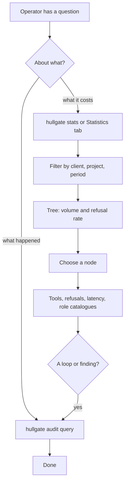
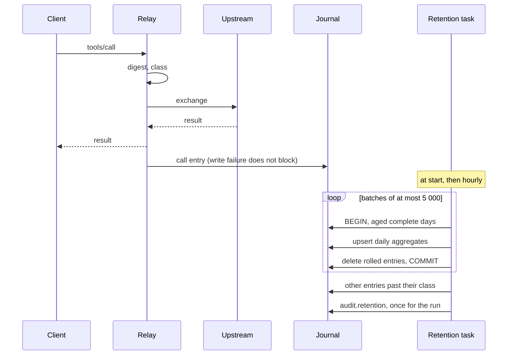
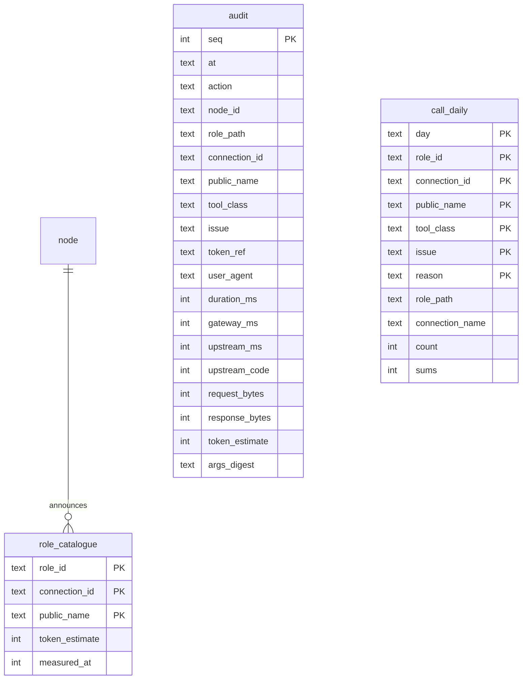

# F-017 · Call events, retention, audit queries, analyses and the Statistics screen

## Metadata

| Field | Value |
|-------|-------|
| **Priority** | P2 |
| **Branch** | `feat/HULL-68-call-events` (one branch per lot, §10) |
| **Last updated** | 2026-11-14 |

## 1. Context & Objective

### Current State

Constat of 2026-11-01, commit `309d0f0`.

- Every tool call writes one `relay.tool_call` entry in the `audit` table (BR-122): actor, role, connection, names, issue, duration, sizes. Most of it sits in a JSON `detail` column, with no index on connection or tool.
- The table is append-only by trigger and has no retention (`src/hullgate/migrations.py:109-112`, BR-066). It grows by one row per call, for ever (F-008 §12).
- The only reader is `hullgate audit tail -n N` (`src/hullgate/cli.py:123`). F-016 adds a filtered read and export to the console (BR-218) and leaves retention here.
- Nothing measures context cost, latency split, repetition or token use. Objective 5 of the specification ("usage, coût en contexte, anomalies", l. 35) is unmet.
- Token "last used" does not exist; F-016's Tokens screen shows it "when known".
- Process logs are plain text, and uvicorn's default access log prints query strings (`src/hullgate/__main__.py:43-63`; BR-216 changes the admin listener only).
- The gateway has no periodic task (F-006 D1 refused one). The production server runs one scheduled job, the nightly backup at 03:15 (user `<user>`, since 2026-11-01).

Nobody uses the tool yet and all data on the production server is disposable (operator, 2026-11-01): nothing here carries live data forward.

### Objective

Make every call measurable from one store, keep that store bounded, and let the operator read it from the command line and the console, without storing client data by default.

### Expected Impact

- An operator answers "what did this client's agents do in the last 24 hours, and what was refused?" with one command.
- The journal stops growing without bound: 90 days of call detail, 1 year of everything else, with daily aggregates for the year.
- The operator can see which tools cost context and are never used, which is what mode and list choices (F-015) need.
- Loops, refusal bursts and sleeping tokens that wake up are visible without instrumenting a client.

### Open Product Questions

None is left open in the text. Each choice is written on a default and recorded in §9 as « tranché en autonomie déléguée ». The two choices the operator holds are listed under §9 Open at the freeze.

## 2. Scope

- **Call entry**: origin, class, latency split, token estimate and arguments digest added to `relay.tool_call` (BR-240 to BR-242).
- **Retention**: 90 days for traffic entries, 365 for all others, daily aggregates for 365 days, run by the gateway itself (BR-243 to BR-245).
- **Audit queries**: `hullgate audit query` and `hullgate audit export` on the filters of the console's Audit screen, plus connection and tool (BR-246).
- **Last use** of operator tokens and OAuth lineages (BR-247).
- **Role catalogue**: what a role announces, and its weight (BR-248).
- **Analyses**: a closed set of reports, the same from the CLI and the API (BR-249 to BR-253).
- **Statistics screen** on the F-016 shell (BR-254, BR-255).
- **Structured logging** on both listeners (BR-259, BR-260).
- **Runbook** `docs/runbooks/events-<server>.md` (BR-042).

Why one spec: the operator's split go of 2026-11-01 defined this child with these parts, on the reason "everything here reads one store". Structured logging is the one exception: it reads no store, and is kept here as the sibling output of the same events (§9). Debug capture, the other exception, left for 1.1.0 (arbitration A8).

## Out of Scope

| Item | Destination |
|---|---|
| Alert channels and delivery | HULL-69. It sends one reading of its own, `refusal_burst` (F-019 BR-293), on its own population and setting. Everything BR-252 and BR-253 define shows in reports and on the Statistics tab only: `refusal_concentration`, `unusual_destructive`, `new_oauth_client`, `dormant_token_wake`, loops. Sending those is a candidate ticket (F-019 §Out of Scope), so in 1.0.0 they reach whoever opens the tab (§12) |
| Rate limiting, CIMD saturation, barrier lockout, raw body bound | HULL-70, upstream of this feature (§9) |
| `X-Forwarded-*` from declared proxies | delivered by BR-208 (F-016); client addresses are not stored in call entries (§9) |
| Client IP address in a call entry | not stored: not asked by the specification's event table, and it is personal data |
| OpenTelemetry export, Parquet, DuckDB | specification l. 919-920: only if hosting requires it |
| Exact tokenizer | specification l. 920-921: an approximation |
| Audit screen changes | F-016 keeps SCR-11; call entries already appear there. Only the two filters of BR-218's clarification are added |
| Debug capture | 1.1.0 (arbitration A8, open at the freeze): nobody uses the tool, and it does not read the store. Arguments and results stay unrecorded in 1.0.0. Its future spec inherits two points of the stress-test of F-017: it refuses BR-186's sensitive placements, not only BR-047's sensitive roles (M4), and it states what backups keep past its erasure (M6) |
| Thresholds of BR-252 and BR-253 as settings | constants in 1.0.0 |
| Latency and error-rate thresholds | none in 1.0.0: reports show the values, nothing compares them to a limit. F-019 §Out of Scope sends them here; they are a candidate ticket |
| Upstream health screen | the `latency` and `oauth` reports and the Statistics screen carry the data; a dedicated screen is a candidate ticket |
| Docker log rotation on the production server | stays an operator gesture (F-004 §Out of Scope) |
| External monitoring of `/readyz` | none in 1.0.0: F-019 Q2 ships no watcher; candidate ticket |
| Migration, backfill or compatibility for live data | none: disposable data (operator, 2026-11-01). Entries written before this feature are not converted |
| Multi-organisation scoping of reports | HULL-67 |
| `hullgate export`, import | BR-070 and BR-222 unchanged: last use, role catalogues and daily aggregates are measures, not configuration, and stay out of the export |
| Bounding the journal by size | bounded by age only; a flood is HULL-70's matter |
| Erasure on request of an entry, an address or a client | none: BR-243's guard forbids it, by design. Candidate ticket if the product is hosted for others (HULL-67) |

## 3. Functional Spec

### 3.1 Vocabulary

| Term | Meaning |
|---|---|
| **Call entry** | The `relay.tool_call` journal entry of one `tools/call` (BR-240) |
| **Traffic entry** | An entry of the closed list of BR-243, kept 90 days |
| **Daily aggregate** | One row per UTC day and dimension, holding counts and sums of rolled entries (BR-244) |
| **Arguments digest** | Keyed, truncated digest of a call's arguments, comparable within a salt period (BR-241) |
| **Token estimate** | `ceil(bytes / 4)`, an approximation of context cost (BR-242) |
| **Role catalogue** | What a role announces at `tools/list`: public names and their weight (BR-248). Not F-015's **Tool catalogue**, one row per service and upstream name |
| **Chain** | Consecutive call entries of one token on one role, gaps under 5 minutes (BR-252) |
| **Loop** | The same call repeated in a burst (BR-252) |
| **Finding** | One row of the `security` report (BR-253) |
| **Weighted refusals** | Refusals counted with `rate_limited.refused` entries weighing `suppressed` + 1 (BR-249) |
| **Refusal rate** | Weighted refusals over calls plus weighted refusals (BR-249) |

### 3.2 Call entry

| Group | Field | Source |
|---|---|---|
| Context | role id and path, connection id and name, public name, upstream name | BR-122 |
| Context | tool class `read`, `write`, `destructive`, absent when no tool was resolved | F-015 |
| Origin | actor, `token_ref` (operator token id or lineage id), `user_agent` | new |
| Result | `result`, issue, reason, `upstream_code` | BR-122, new |
| Cost | `duration_ms`, `gateway_ms`, `upstream_ms`, request and response bytes, `token_estimate` | BR-122, new |
| Fingerprint | `args_digest` | new |

The specification's "session MCP" field has no value: the access point is stateless (F-008 Q1 = a, BR-067), so no session identifier exists. Chains stand in for it (§9).

The specification also records "Claude.ai versus Claude Code". The actor holds the `client_id`, which is what the gateway knows; the user agent is indicative.

One form: BR-122's fields stay in `detail` exactly as written today, and the fields above are also written as columns, which the indexes and reports read. So `audit tail` and any reader of `detail` see no change, at the cost of a little duplicated storage.

A call refused by a limit has no call entry (F-020 BR-122 v3): its trace is `rate_limited.refused` (BR-312), which counts in reports under its weight.

### 3.3 Audit commands (SCR-01)

```
hullgate audit tail [-n N] [--json]                                   # unchanged
hullgate audit query [filters] [--limit N] [--json]
hullgate audit export [filters]                                       # JSON Lines on standard output

filters: --since <n>(m|h|d) | --from <iso> --until <iso>
         --client <segment> --project <client/project> --path <prefix>
         --connection <client/name> --tool <public name>
         --actor <id> --action <action> --refused | --result <result>
```

The specification's example reads:

```
hullgate audit query --client mpx --since 24h --refused
```

`--limit` defaults to 100, at most 10 000. Without a time filter, `query` and `export` read the last 24 hours. Output order is newest first, as on the Audit screen, so an export under its cap keeps the newest entries. `--json` prints `audit tail`'s keys plus an object `call` holding the fields of §3.2, on a call entry.

Results: 0 with or without matches; 2 on a refusal, with a message naming the filter.

### 3.4 Statistics commands (SCR-02)

```
hullgate stats <report> [--client <segment>] [--project <client/project>] [--role <path>]
                        [--connection <client/name>] [--since <n>(h|d)] [--by <dimension>] [--json]
```

`<report>` is one of the closed set of BR-249. `--since` defaults to `30d`, at most `365d`. A window of 24 hours or less is exact; a longer one is rounded down to the start of a UTC day. `--by` applies to `usage` only: `client`, `project`, `environment`, `role`, `connection`, `tool`; on another report it is refused.

Every output states its coverage: the window, whether it reached daily aggregates, and which measures that makes unavailable (BR-249). A role never listed reads `not_measured` in `tools` and `catalogue`.

Results: 0 with or without data; 2 on a refusal, with a message naming the filter.

### 3.5 Statistics screen (SCR-03)

A `Statistics` tab, placed just before Organisation, added by one entry of the route table (F-016 §3.17). No other tab changes.

| Zone | Content |
|---|---|
| Filter bar | Period (24 hours, 7 days, 30 days, 90 days, 1 year; 30 days by default), client, project. State in the address bar |
| Tree | From the `tree` report: every node of the tree, read-only, with its calls and weighted refusals summed over its subtree, a bar and a colour. Bar length follows call volume, colour follows the refusal rate (under 2 %, 2 to 6 % inclusive, above 6 %, prototype legend). A switch shows volume alone. Choosing a node narrows the tables below it. A line **Removed nodes** sums entries whose role no longer exists (BR-250). All values are the server's (BR-255) |
| Tables | Most used tools; never used tools; refusals by reason; latency and error rate by connection; catalogue weight by role |
| Findings | Loops and findings of the period, with their coverage, linking to the Audit screen filtered on the same actor, role and time. None of them is sent anywhere |

#### Visual States

- **SCR-03**: nominal
- **SCR-03.empty**: no call in the period
- **SCR-03.no-catalogue**: a role never listed shows "not measured yet" in place of weights and never-used tools (`not_measured`)
- **SCR-03.partial**: period beyond 90 days: percentiles, findings and chains show "not available past 90 days"
- **SCR-03.removed-only**: a period in which only removed nodes have entries (a client or project filter excludes them, BR-250)
- **SCR-03.error**: API failure, with retry
- **@dark**, **@light**

### 3.6 API surface

A new group `stats` under `/admin/api/v1`, `GET` only: `GET /admin/api/v1/stats/<report>`, with the filters of §3.4 as query parameters. It sits in F-016's application: host check, allow-list, session and security headers apply by construction (§3.17 of F-016). The Tokens group gains `last_used_at`.

The statistics tree needs more of F-016 than §3.17's decoration: a read-only mode of the tree view with no drag, rename or delete, printed values per node, a selection event, and a line outside the tree. F-016 §3.17 aligns on this (arbitration A5).

## 4. Business Rules

### Naming Convention

`BR-NNN`, sequential and global. Allocation fixed by the orchestrator: BR-240 to BR-269. Used: BR-240 to BR-255, BR-259, BR-260. BR-256 to BR-258 were the debug capture, withdrawn before any freeze (A8); the numbers are not reused.

### Lifecycle

Per `conventions/br-lifecycle.md`: inline here during dev, extracted at `close-feature`.

### Overlap scan

Filter over the `Statement` column of `business-rules/index.md`, then over the §4 of the open specs F-011, F-014 to F-016 and F-018 (a private operations spec of the maintainer, not published) to F-021, and of the specs of HULL-57 and HULL-58, withdrawn since: *audit, journal, retention, purge, statistic, aggregate, debug, last use, digest, hash, standard error, journalise, event*, French and English forms.

**14 lines retained of 131 in the index**, plus 11 rules of open specs (BR-185, BR-188, BR-208, BR-211, BR-216, BR-218, BR-219, BR-231, BR-293, BR-312, BR-313). Each was opened.

| Rule | Verdict | Resolution |
|---|---|---|
| BR-002, BR-013 | off topic | Bench journal |
| BR-003 | off topic | Retained artefacts of the bench |
| BR-005, BR-029 | off topic | Image digests |
| BR-021 | off topic | Bench disk |
| BR-103 | off topic | `qa-audit`, dependencies |
| BR-231 | off topic | Console lockfile |
| BR-065 | off topic | Issuance and its entry; retention leaves it unchanged |
| BR-053 | off topic | Value shown once; last use is no value |
| BR-068 | off topic | The new routes fall under its v2 |
| BR-072 | off topic | Secrets in clear; nothing here holds one |
| BR-185, BR-188 | off topic | Policy entries, which keep the default class of BR-243 or feed `reason` |
| BR-208 | off topic | Client address; not stored here |
| BR-293 | off topic | F-019's alert, its own token and setting; BR-253's `refusal_concentration` is a report (A6) |
| BR-312, BR-313 | off topic | F-020 writes these entries; BR-243 and BR-249 place them |
| **BR-066** | overlap | **new version (C2)**: a state that satisfied "no command deletes an entry" stops being the rule |
| **BR-122** | overlap | **new version (C2)**: entries gain fields; "sa rétention est de #12" is settled |
| **BR-131** | overlap | **clarification (C3)**: it already requires English for the new CLI, audit and API values; the pinned table gains them |
| **BR-218** | overlap | **clarification (C3)**: two filters added to the read; "filter on" is a case list, and no assertion changes |
| **BR-211** | overlap | **clarification (C3)**: it already requires every CLI verb to be mapped or excluded; `audit query`, `audit export`, `stats <report>` join its sweep, mapped to the audit and stats routes |
| **BR-219** | overlap | **clarification (C3)**: "the audit keeps both and is never altered" holds for a retained entry; an entry past its class leaves whole under BR-243, and an undone change then shows no link |
| **BR-216** | overlap | **new rule (C1)**: BR-260 can be violated on the public listener while BR-216 holds on the admin one, and the reverse for a `code` shown in the page |

Version numbers follow F-016 §4: F-014, F-015, F-016, F-019 and F-020 also touch BR-066, BR-122 or BR-131 (F-020 writes BR-066 v6 and BR-122 v3 ahead of this feature), so whichever merges later carries the earlier text forward and takes the next number.

One object's parts (`templates/business-rule.md` §Rule): BR-243 is the guard on one row's life, BR-245 one run, BR-249 one report's contract. Each could be violated in part, but none has a meaning apart from its object, so they are kept whole.

### The call entry

### BR-240 · A call entry records origin, class, cost and outcome

*`behavioral` · `strict` · Candidate state: `verified` — `tests/unit/test_br_240_call_entry.py`: one call per issue of BR-122 reads back every field of §3.2.*

**Rule** — Every `relay.tool_call` entry carries, in addition to BR-122's fields, the token reference, the user agent, the tool class, the gateway and upstream parts of the duration, the upstream error code when one exists, the token estimate of the response and the arguments digest; a field the call never reached is absent, never zero, and an entry that cannot be written is logged while the call is served.

**Clarifications**
- `token_ref` is the operator token id or the lineage id. Never a value, a digest of a value or a `jti`.
- `user_agent` is the request header, filtered to printable ASCII and truncated to 128 characters: hostile input, as in BR-122.
- `upstream_ms` sums the exchanges of the call, retry of BR-127 included. `gateway_ms` is `duration_ms - upstream_ms`, at least 0. Both are absent from a call that reached no upstream, where `duration_ms` is the whole.
- `upstream_code` is an HTTP status or JSON-RPC code, an integer; never a body.
- Class: the one F-015 used for the decision, read at the call. Absent for an unknown tool.
- One entry per call at its end, a write failure not blocking the result: BR-122 unchanged.
- `response_bytes` is the upstream's size, `token_estimate` what the client received (BR-242). They differ on `response_too_large`, where the client received the refusal text.

### BR-241 · The arguments digest is keyed by a salt that never reaches the disk

*`behavioral` · `strict` · Candidate state: `verified` — `tests/unit/test_br_241_args_digest.py`: same arguments give the same digest within a salt period and a different one after it; key order does not change it; no column of any table holds the salt, read by a sweep of a test database.*

**Rule** — The arguments digest is the HMAC-SHA-256 of the arguments' compact canonical JSON, truncated to 128 bits, under a 256-bit salt drawn in process memory at start and replaced every 24 hours; the salt is written nowhere.

**Clarifications**
- A plain hash would let anyone holding a backup test guesses against low-entropy arguments. Without the salt, a digest proves nothing but equality with another digest of the same period.
- Consequence accepted: two identical calls on either side of a restart or a salt change do not compare equal. Loops are measured in 60 seconds, so at most one burst per day is cut in two.
- The digest covers the arguments the client sent, before any policy reading. A call refused before its arguments were parsed has none.
- BR-066's "no complete digest" covers secrets and holds a fortiori: this is neither a digest of a secret nor complete.

### BR-242 · A token estimate is a size divided by four, and says so

*`definitional` · `strict` · Candidate state: `verified` — `tests/unit/test_br_242_token_estimate.py`.*

**Rule** — A token estimate is `ceil(bytes / 4)` of the UTF-8 serialised payload the client receives: the relayed result for a call, the announced definition for a role catalogue row.

**Clarifications**
- Specification l. 920-921: an approximation, not a tokenizer. Reports label it "estimated tokens".

### Retention

### BR-243 · A journal entry leaves only by age, and by its class

*`behavioral` · `strict` · Candidate state: `verified` — `tests/unit/test_br_243_retention_classes.py`: a store-level `DELETE` of a younger entry, seeded with dated rows, aborts for each class; `UPDATE` always aborts; the constant list equals the guard's list. `tests/unit/test_br_243_population.py`: an AST walk of every `audit.write` call site resolves its action.*

**Rule** — An entry whose action is one of `relay.tool_call`, `relay.list_omitted`, `relay.upstream_request_refused`, `relay.signal_pause`, `access.refused`, `rate_limited.refused`, `oauth.authorize`, `oauth.token`, `oauth.revoke`, `oauth.register`, `oauth.consent` is a traffic entry, kept 90 days; every other entry is kept 365 days; the store aborts a younger deletion and any update, whatever the caller.

**Clarifications**
- The store itself refuses, by the append-only triggers rewritten with an age condition: no code path can shorten retention. The trigger reads SQLite's clock, so tests seed dated rows; an injected clock does not reach it.
- The five `oauth.*` actions are the refusals of routes open to anyone and the barrier's failures. They join the list so that every entry carrying a client address (F-020 BR-313) lives 90 days: an address is personal data, and an update cannot blank it later. Open at the freeze (§9).
- Population, dated constat, 2026-11-01, `309d0f0`: `audit.write` call sites, not a regex over literals, which misses `oauth.code.issue`, `oauth.token.issue`, `oauth.access.revoke`, `oauth.client.register`, `refuse_action()` and the `action=action` of `tree.py:386`, `lifecycle.py:209`; a wider regex finds 58 names. Prescribed sweep: the AST walk above, replayed after F-015, F-016, F-019 and F-020 land. A non-literal action is resolved by a declared list in the test. A new action not in the rule is kept 365 days, the safe side; the list is widened only by a schema change.
- The specification's "configuration, 1 an" is the 365-day class. Issuances, revocations and every other entry share it.
- A change older than 365 days leaves the journal, so the Audit screen no longer shows it and offers no undo. Nothing in BR-220 or BR-221 needs to change: undo starts from an entry, and there is none.
- A backup keeps what it copied: with BR-038's rotation of 14 and the nightly job, an entry can outlive its class by up to 14 days in a backup file (§12).

### BR-244 · Detail is rolled into daily aggregates in the transaction that removes it

*`behavioral` · `strict` · Candidate state: `verified` — `tests/unit/test_br_244_rollup.py`: over a seeded journal, calls, refusals, errors and byte sums per dimension are equal before and after a run, `rate_limited.refused` adds its weight, and a crash injected before commit leaves both unchanged.*

**Rule** — Each batch moves call entries, `access.refused` and `rate_limited.refused` entries of UTC days older than 90 days into those days' daily aggregates and deletes them in one transaction; a batch that cannot do both does neither; a daily aggregate is kept 365 days from its day.

**Clarifications**
- Dimensions: day, role id, connection id, public name, tool class, issue, reason. Role path and connection name are kept alongside. Dimensions are `NOT NULL`, an absent value stored as the empty string, or SQLite's distinct NULLs would defeat the upsert.
- Measures: count (`suppressed` + 1 for `rate_limited.refused`), sum of duration, gateway, upstream, request bytes, response bytes, token estimate. No percentile, digest, token reference, user agent or address.
- Only complete days roll: the cut is the start of a UTC day, so a partly aged day stays in detail until it has fully aged, up to 24 hours past the 90 days. A row is either detail or aggregate, so no report counts it twice.
- The other traffic entries age out without aggregates.

### BR-245 · The gateway runs retention by itself, in bounded steps, and traces it

*`behavioral` · `blocking` · Candidate state: `verified` — `tests/integration/test_br_245_retention_run.py`: with an injected clock for the schedule and seeded dated rows, a run at start and at each hour; 12 000 aged entries leave in batches of at most 5 000; a failed run is logged, served traffic is untouched, and the next run completes.*

**Rule** — The server process runs retention at start and then every hour, removing every entry and aggregate past its class, at most 5 000 entries per transaction, and writes one `audit.retention` entry per run that removed something; a failed or unavailable store ends the run, logged, without touching served requests.

**Clarifications**
- In the gateway rather than in cron: a local install should not need one, it is one operator gesture less, and a quiet gateway still purges. The production server's nightly cron runs backups only.
- A periodic task in the server process, on the lifespan, with one instance by construction. F-019 runs its own 60-second task; the two share nothing.
- The entry carries counts per class, aggregates written, the oldest entry kept and the duration. Actor `gateway`, 365-day class.
- SQLite reuses freed pages; the file does not shrink, and `VACUUM INTO` backups are compact (BR-038). Accepted.

### Reading the journal

### BR-246 · The command line reads the journal with the console's filters

*`behavioral` · `blocking` · Candidate state: `verified` — `tests/integration/test_br_246_audit_query.py`: each filter alone and with `--since`; a prefix `mpx` does not match `mpx2`; CLI and API return the same rows for the same filter; an export writes one `audit.export` entry.*

**Rule** — `hullgate audit query` and `hullgate audit export` apply the same read function as BR-218 with the same filters, plus connection and tool; an export is at most 100 000 entries, JSON Lines, and is itself audited with its filter; a filter that cannot be applied is refused, never ignored.

**Clarifications**
- A path filter matches whole segments, on the role path of a call entry and on the recorded path of any other entry. The journal is history: it reads the path as written, not the current tree.
- `--client` is a path filter of one segment, `--project` of two.
- An export reaching the cap says so on standard error and exits 0: the stream stays pure JSON Lines, the same rows as the API's export for one filter.
- `audit tail` keeps its form: F-015 AC-OP and F-018 (a private operations spec of the maintainer, not published) AC-OP-02 read it.
- Reading writes nothing, except the export's trace.

### BR-247 · A token's last use is known to five minutes, and survives retention

*`behavioral` · `blocking` · Candidate state: `verified` — `tests/unit/test_br_247_last_use.py`: 100 requests in one minute give one write; a request after 5 minutes moves it and keeps the former value; a refused request does not; a write failure does not change the response; the rights preview leaves it unchanged.*

**Rule** — A request accepted at the access point records the use of its operator token or lineage at most once per token in 5 minutes, the former value kept beside it; a refused request, a preview or a failed write records nothing and changes no response.

**Clarifications**
- This is the "écriture par requête" F-005 refused: bounded to one write per token per 5 minutes, it no longer is one.
- Kept on the token's own row (`last_used_at`, `previous_used_at`), so it lasts as long as the token, past the 90 days of detail. `dormant_token_wake` reads the two (BR-253).
- `hullgate token list` and the API show the last value; "when known" in F-016 SCR-09 becomes "never used" when empty.
- The throttle is in memory: a restart costs at most one extra write per token.

### Role catalogue and reports

### BR-248 · A role catalogue is recorded at `tools/list`, only when it changes

*`behavioral` · `blocking` · Candidate state: `verified` — `tests/integration/test_br_248_role_catalogue.py`: a first list writes; an identical list writes nothing; a changed list replaces; an omitted connection keeps its rows; an unplaced connection loses them; a narrowed definition (BR-179) is measured as announced; a failed write logs and serves the list.*

**Rule** — When a successful `tools/list` differs from the role catalogue, the gateway replaces the rows of the connections it carried with the announced public names, each with its token estimate and the time; an identical list writes nothing, and a failed write is logged while the list is served.

**Clarifications**
- The role catalogue is what the role announces after policy, in the role's own name space: that is the context cost the client pays.
- Compared by a hash of the list held per role, in memory; a restart costs one comparison against the stored rows.
- An omitted connection (BR-111) keeps its previous rows: its failure changes nothing the role would pay once it recovers, so weight and never-used do not flip.
- Removing a placement or a role removes its rows.

### BR-249 · Reports are a closed set, the same from the CLI and the API, and state their coverage

*`behavioral` · `blocking` · Candidate state: `verified` — `tests/integration/test_br_249_reports.py`: each report on a seeded store gives equal JSON through `hullgate stats --json` and the API; a window of 120 days states aggregates used and unavailable measures; an unknown report or `--by` on another report is refused.*

**Rule** — The reports are `tree`, `usage`, `tools`, `refusals`, `latency`, `catalogue`, `behaviour`, `security`, `oauth`; one function computes each for both surfaces, and each result states its window, whether it read daily aggregates, and which measures that left unavailable; a measure unavailable is named, never given as zero.

**Clarifications**

| Report | Gives | Past 90 days |
|---|---|---|
| `tree` | By node: calls and weighted refusals summed over the subtree, refusal rate, level 0, 1 or 2, bar length 0 to 100 against the largest node of the same level; the `removed` line | yes |
| `usage` | Calls, weighted refusals, estimated tokens by `--by`, with the previous equal window as trend | yes |
| `tools` | Most used; never used on a role (role catalogue minus calls in the window); largest responses by estimated tokens received, with the count of `response_too_large` apart | yes, from sums |
| `refusals` | Weighted count by reason | yes |
| `latency` | By connection: p50, p95, upstream failure rate, tool error rate | counts only |
| `catalogue` | By role: tool count, estimated tokens, time measured | current state |
| `behaviour` | Loops and chains (BR-252) | no |
| `security` | Findings (BR-253) | no |
| `oauth` | By connection: state, last renewal outcome, failed renewals in the window | yes |

- **What counts.** A *call* is a call entry with result other than `refused`: it is what `usage`, `tools`, `latency` and `tree` count, and only a call makes a tool "used". *Weighted refusals* are `relay.tool_call` with result `refused`, `access.refused`, and `rate_limited.refused` with weight `suppressed` + 1. `behaviour` reads every call entry, refused included: a looping agent is one whatever it was answered. A limited call has no call entry, so it weighs in refusals and is invisible to `behaviour` (§12).
- **Refusal rate**: weighted refusals over calls plus weighted refusals; a node with neither has no rate and level 0. Level 0 under 2 %, level 1 from 2 % to 6 % inclusive, level 2 above. Computed here, never in a browser (BR-255).
- **Percentile**: nearest rank over call entries that reached the upstream.
- **Upstream failure rate**, the same placement as F-019 §3.2: failing `upstream_unavailable`, `deadline_exceeded`, `uncertain_outcome`; alive `ok`, `tool_error`, `response_too_large` (the tool ran, BR-184); the other issues count for neither. Rate: failing over failing plus alive. Tool error rate: `tool_error` over alive.
- **Trend**: unavailable when the previous window reaches past the 365 days of aggregates.
- The `oauth` report reads state and the journal, never a token: it works without the key. It shows no expiry: `connection.expires_at` is the access token's, renewed at use, and the gateway knows no provider refresh expiry (F-019 §1).
- A report over a 90-day window on 500 000 detail entries answers within 2 seconds in the toolbox (AC-14).

### BR-250 · Reports attribute by node identity, and removed roles stay counted

*`behavioral` · `blocking` · Candidate state: `verified` — `tests/integration/test_br_250_attribution.py`: a renamed role keeps its counts under its new path; a moved one follows; a deleted one lands in Removed nodes; totals match.*

**Rule** — Reports group entries by role id on the current tree; an entry whose role no longer exists is summed in a `removed` line with its recorded path, an entry with no role in a `no_role` line of `refusals`, and the total of a report equals the sum of its lines; a report whose lines do not sum is an error.

**Clarifications**
- Different from BR-246 on purpose: the journal answers "what was written", a report answers "what does this node cost".
- A client or project filter reads the current tree, so it excludes `removed`. An unfiltered report includes it.
- `no_role`: a `rate_limited.refused` of surface `oauth`, `register` or `credential` has no node (BR-312). It is not on the tree.

### BR-251 · Statistics show metadata only

*`behavioral` · `strict` · Candidate state: `verified` — `tests/integration/test_br_251_report_content.py`: a sentinel argument and result, and token values, in no report output; no report exposes `args_digest`; a hostile `client_id` reads reduced.*

**Rule** — A report holds counts, sums, durations, names of tools, connections and nodes, token references, actors and reasons; a field outside this list, an argument, a result, a secret or an arguments digest in a report is an error.

**Clarifications**
- `behaviour` shows that a call repeated, with tool and count; never the digest.
- `token_ref` is an identifier already shown on the Tokens screen.
- An actor can be a `client_id`, which an attacker may choose (a CIMD URL, F-019 BR-297): reports filter it to printable ASCII and truncate it to 128 characters, as BR-240 does for the user agent.

### BR-252 · A loop and a chain have fixed definitions

*`definitional` · `strict` · Candidate state: `verified` — `tests/unit/test_br_252_behaviour.py`: 5 and 4 repeats in 60 s; 5 repeats in 61 s; different digests; a gap of exactly 5 minutes; chains cut at five tools.*

**Rule** — A loop is at least 5 call entries of one token with the same public name and arguments digest within 60 seconds; a chain is the sequence of call entries of one token on one role with gaps under 5 minutes, reported by its first five tools and how often that sequence occurred.

**Clarifications**
- The specification says "par session". The access point has no session (F-008 Q1 = a), so a gap stands in: a client's own session boundary is not visible (§12).
- Figures are constants in 1.0.0.

### BR-253 · A security finding is one of four, each with a fixed test

*`definitional` · `strict` · Candidate state: `verified` — `tests/unit/test_br_253_findings.py`: each kind at its threshold and one under; a window reaching before its look-back reports the shortened part in coverage.*

**Rule** — A finding is `refusal_concentration` (at least 10 weighted refusals in 5 minutes on one role or for one authenticated actor), `unusual_destructive` (a call of class `destructive` on a role that made no call of that tool in the previous 30 days), `new_oauth_client` (a `client_id` whose first retained call entry falls in the window, with 30 days of detail before it) or `dormant_token_wake` (a token whose last use follows its former use by at least 30 days).

**Clarifications**
- `refusal_concentration` is this report's name. F-019 owns the token `refusal_burst`, a different population (the barrier) and an adjustable setting: the two can disagree, and only F-019's is sent (A6). `anonymous` is no actor; its refusals count for the role.
- `unusual_destructive` counts calls that ran: a client trying a tool F-015 hides is refused, and is no finding.
- `dormant_token_wake` reads BR-247's two values, so it sees a sleeper of any length, and a token's first use is no finding. It reports the latest wake of each token.
- **Look-back.** `unusual_destructive` and `new_oauth_client` read detail and need 30 days before the moment judged. So they judge at most the last 60 days of a window and nothing on an instance younger than 30 days, and coverage states the part judged.
- A finding is a reading, not an act: nothing is refused, written or sent.

### Statistics screen

### BR-254 · The statistics API only reads

*`behavioral` · `strict` · Candidate state: `verified` — `tests/integration/test_br_254_stats_api.py`, with F-016's sweeps of BR-068 v2, BR-213 and BR-234 covering the group.*

**Rule** — The `stats` API group answers `GET` only, requires an administrator session, writes nothing and returns the report functions' output unchanged.

**Clarifications**
- A malformed filter is a 422 with a closed code. An unknown report is a 404.
- The screen does not poll, so a page left open does not hold a session (BR-204).

### BR-255 · The Statistics screen shows what the server computed

*`behavioral` · `blocking` · Candidate state: `verified` — `tests/browser/test_br_255_statistics.py`: tab present once; tree decoration and table values equal the API's; each state of §3.5 captured; a period past 90 days shows the unavailable measures.*

**Rule** — The Statistics tab draws the tree and tables from the API alone, computes no sum, rate, percentile, level or bar length in the browser, and names any measure its period makes unavailable; a value the API did not give is not drawn.

**Clarifications**
- Sums, rate, level and bar length come from the `tree` report, per BR-211. The prototype computes them in the page (`Main.dc.html:1883-1887`); the console does not.
- Charts are SVG, with no library: bars and a table cover the prototype, and BR-212's CSP holds. No new dependency.
- The screen is in the single English dictionary (BR-131).

### Structured logging

### BR-259 · A log line is one JSON object on standard error

*`behavioral` · `blocking` · Candidate state: `verified` — `tests/integration/test_br_259_log_format.py`: a real server's startup, access, refusal and exception lines each parse; keys belong to the closed set.*

**Rule** — Every log line of the server process, both listeners and uvicorn included, is one JSON object on standard error with keys `at`, `level`, `logger`, `message`, and for an access line `listener`, `method`, `path`, `status`, `duration_ms`; a record that cannot be serialised is written with its level and logger alone, never as plain text.

**Clarifications**
- JSON only, no format switch: one output to test, read by `make logs`.
- `/healthz` and `/readyz` access lines are not written: Docker's health check would otherwise add one every interval.
- Standard error, so BR-066's and BR-122's "logged on the error output" hold unchanged.
- Exception: a configuration failure before logging starts stays plain text (BR-032's message). A CLI command is not the server: its output is unchanged.
- Population: dated constat `309d0f0`. Prescribed sweep after the lot's deltas: `grep -rn "print(" src/hullgate` outside `cli.py`, `backup.py`, `verify_*.py`, each hit moved to the logger or justified.

### BR-260 · A log line holds no query string, secret or one-time path

*`behavioral` · `strict` · Candidate state: `verified` — `tests/integration/test_br_260_log_hygiene.py`: the OAuth flows, an enrolment link and a failed upstream call run with sentinels; a sweep of the captured stream finds none.*

**Rule** — The path of an access line carries no query string, and a route that holds a one-time value in its path logs its template; an argument, a result, a header value, a token, a code or an upstream body in a log line is an error.

**Clarifications**
- uvicorn's default access log prints query strings, where `code` and `state` travel (`src/hullgate/__main__.py:43-63`). BR-216 closes this on the admin listener; this rule covers both and replaces its mechanism, not its statement.
- One-time paths: F-016's enrolment link (BR-203). Prescribed sweep at implementation: every route with a path parameter on both listeners, classified.
- A role path in an access line is not a secret: it is the URL.

### Rules touched

### BR-066 · next version · Audit

**Rule** — Unchanged but for the population: added `audit.retention`.

**Clarifications** — "Table en ajout seul : aucune commande ni migration ne modifie ni ne supprime une entrée (rétention : #12)" is replaced by: *no command or migration modifies an entry; an entry leaves only under BR-243 and BR-244, by the retention run.*

### BR-122 · next version · Call entries

**Rule** — Unchanged, with BR-240's fields added.

**Clarifications** — "L'audit croît d'une ligne par appel ; sa rétention est de #12" is replaced by *traffic class, BR-243*. "Elle n'écrit jamais d'argument" holds: the digest is not an argument (BR-241).

### BR-131 · clarification

The pinned table gains: commands `audit query`, `audit export`, `stats`; flags of §3.3 and §3.4; report names; finding kinds; the audit action of BR-066; API keys of §3.6; log keys of BR-259.

### BR-218 · clarification

Filters gain connection and tool. Everything else stands; the journal now holds call fields, which its export carries.

### BR-211 · clarification

The sweep's list gains `audit query` and `audit export`, mapped to the audit route, and `stats <report>`, mapped to `GET /admin/api/v1/stats/<report>`, in the lots that add them.

### BR-219 · clarification

"Never altered" holds; an entry leaves whole, by age, under BR-243.

## 5. Acceptance Criteria

### Call entries

- [ ] **AC-01** (BR-240, BR-122) A call of each issue reads back the fields of §3.2; a call that reached no upstream has no upstream part.
- [ ] **AC-02** (BR-241) Digests equal within a period, differ across one; no salt in any table.
- [ ] **AC-03** (BR-242) Estimates match the fixed examples, with non-ASCII payloads.
- [ ] **AC-04** (BR-240, BR-066) The suite's final sweep finds no argument, result or token in any clear column of any database.

### Retention

- [ ] **AC-05** (BR-243) A store-level delete of a younger entry aborts for both classes; update always aborts; the constant equals the guard.
- [ ] **AC-06** (BR-244) Totals per dimension hold across a run; a crash leaves both sides whole.
- [ ] **AC-07** (BR-245) Runs at start and hourly with an injected clock, in batches, under served traffic; failure is logged and served traffic unchanged.
- [ ] **AC-08** (BR-243) `test_br_243_population.py` passes after F-015, F-016, F-019 and F-020 have landed: every `audit.write` call site resolves; each action they added is named in the PR with its class.

### Reading

- [ ] **AC-09** (BR-246, BR-218) Each filter, alone and combined, on CLI and API, same rows; the specification's example runs; `audit tail --json` for a call entry is byte-equal to a golden row of today's form; an export is audited, capped, and its stream parses line by line.
- [ ] **AC-10** (BR-247) Throttle, former value, refusal, failure and preview cases hold; `token list` and the API show the value.
- [ ] **AC-11** (BR-248) Role catalogue written on change only; an omitted connection keeps its rows.
- [ ] **AC-12** (BR-249, BR-250) Every report through both surfaces, equal; rename, move and delete attributed; totals match; a seeded `rate_limited.refused` with `suppressed` 9 weighs 10 in `refusals` and `tree`, from detail and from aggregates.
- [ ] **AC-13** (BR-251) Sentinels absent from every report.
- [ ] **AC-14** (BR-249) On a generated store of 500 000 detail entries and 12 months of aggregates, each report over a 90-day window answers within 2 seconds in the toolbox; the figure is recorded in the PR.
- [ ] **AC-15** (BR-252, BR-253) Thresholds and one under; coverage states the judged part of a 90-day window.

### Console

- [ ] **AC-16** (BR-254, BR-211) Group `GET` only; the sweeps of BR-068 v2, BR-205, BR-213, BR-234 report it covered; the parity sweep maps the new verbs.
- [ ] **AC-17** (BR-255) Browser run: states of §3.5 captured, dark and light; the tree's printed values, colours and bars equal the `tree` report's; no external request; no CSP violation.
- [ ] **AC-18** (BR-212, BR-231) No new npm dependency; `make qa` holds.

AC-19 to AC-21 are withdrawn with the debug capture (A8); numbers are kept so the trace stays readable.

### Logging

- [ ] **AC-22** (BR-259) All server lines parse, on both listeners; probe lines absent.
- [ ] **AC-23** (BR-260) Sentinels absent from the stream through OAuth, enrolment and a failed upstream.

### Integration

- [ ] **AC-24** `make gate` OK; `make test-container`, as the diff requires; `make test-browser` for lot C; `make qa` lines in each PR.
- [ ] **AC-25** (BR-071) Bench `v1` replayed after lot A: 16/16 and all controls, since the relay's write path changes.
- [ ] **AC-26** (BR-131) Pinned table extended; the contract sweep is green.
- [ ] **AC-27** (BR-042) Runbook tests hold on `docs/runbooks/events-<server>.md`; every block states machine, user, shell and folder.
- [ ] **AC-28** (BR-069) A fresh database reaches the new schema, triggers and indexes included.

### Operator

- [ ] **AC-OP-01** (BR-240, BR-246, BR-249, BR-255, operator, after the deployment, on the operator's go, BR-043) — a real call read back through every surface. Protocol: **instrument bounded** to `docs/runbooks/events-<server>.md`, sections "Check" and "First reading". **Identifiers read back**: the role path, connection and public name of the call the operator makes from Claude.ai. **Readings to record, not assert**: `duration_ms`, `gateway_ms`, `upstream_ms`, `token_estimate` of that entry; the figures of the tab. **To post**: `make verify`'s last line; `hullgate audit query --since 1h --tool <public name> --json`; `hullgate stats usage --since 24h --json`; `hullgate stats catalogue --role <path> --json`. **Patterns**: `^VERIFY: 6/6 OK$`; `"action": "relay.tool_call"`; `"token_estimate": [0-9]+`. **Read by hand**: no argument or result value in the posted lines; the Statistics tab over the SSH tunnel shows the same calls for that node as `hullgate stats tree --json`.

## 6. Diagrams

| Type | Decision |
|---|---|
| Userflow | §6.1 |
| Sequence | §6.2: relay, journal, retention |
| State machine | Skipped: with the debug capture gone, no stateful component remains; an entry is detail, aggregate or gone (BR-244) |
| ER | §6.3: schema change |
| Class | Skipped: no OO hierarchy; report functions and one periodic task |

### 6.1 Userflow



### 6.2 Sequence



### 6.3 ER



## 7. States & Captures

- **Freeze marker**: none
- **Package-status**: absent

`drivers.design.type` is `none`. The visual states of §3.5 are the coverage list; AC-17 keeps them as captures under `docs/reviews/`.

## 8. Design & Prototypes

- **Design package**: no package; references `design/prototype-admin/project/Main.dc.html`, view `isStats` (lines 634-644) and `statRows` (lines 1882-1887).
- **Package-status**: absent.
- **Brief**: the prototype's stats view is the reference: a tree in one card, indented rows, bar for volume, three-level legend, calls and refusal rate columns. This feature adds the filter bar, the tables and the findings under it, in the same density, and replaces the prototype's fixed "last 24 hours" with the period.
- **Integration notes**: tokens, dictionary and the read-only tree of §3.6 from F-016 §3.17.

## 9. Implementation Notes

### Dependencies (prerequisite features)

- **F-015 / HULL-10** — open, `ready-for-freeze` at this date. Upstream: the tool class of BR-240 and the class of `unusual_destructive`.
- **F-016 / HULL-11** — open, `draft` at this date. Upstream for lot C: lots A and B (shell route table, tree view, API group, BR-218's read). Lot B's `audit query` reuses BR-218's function; if lot B of F-016 is not merged when this lot starts, the function moves here and F-016 reuses it. Reread at `start-feature`.
- **F-020 / HULL-70** — open, `draft`. **Upstream**, ahead in the milestone order: `rate_limited.refused` and `suppressed` (BR-312), the address on refusals (BR-313), and BR-066 v6, BR-122 v3, which this feature carries forward.
- **F-011, HULL-57, HULL-58, F-014** — ahead in the milestone order; F-011 and F-014 are `draft`. Names, English code, migration number "next free".
- **Downstream**: F-019 / HULL-69 reads `issue` and refusals in the journal, from columns once this feature lands (it moves its reader, F-019 §9). F-018 (a private operations spec of the maintainer, not published) needs nothing here and its AC-OP reading of `audit tail` is preserved. F-021 follows.

### Technical Constraints

- Python 3.13, `mypy --strict`, no new dependency. Console: Svelte 5, no new npm package.
- One write path per call: no second table to keep in step with the journal.
- Writes stay at the call's end and non-blocking (BR-122).
- Schema: one additive schema step under BR-069's runner, next free number. A fresh database needs it; no data is converted. The migration replaces the two append-only triggers with BR-243's.
- A session has no Node (F-016 §12): lot C runs `make test-browser` in the pinned image.
- `tests/unit/test_br_066_audit.py:72,74` read the French trigger text, kept verbatim by HULL-57. The replaced triggers take an English text, and those assertions move with them.
- The new terms enter `domain-glossary.md` through the orchestrator before the freeze (X17); no criterion here.
- No action toward production by a session without the operator's go (BR-043).

### Architecture Decisions

> Each row below is « tranché en autonomie déléguée » unless marked otherwise. Technical choices follow `technical-autonomy: decide`. HOW-level ADRs are implementation's.

| Question | Decision | Rationale |
|---|---|---|
| Readiness of the ticket | `ready`, on the operator's split go | Read alone three parts could be accepted separately; the go defined this child and says what holds it: "everything here reads one store". Delivered in four lots |
| Structured logging in this ticket | Kept | Operator's go names it. Reads no store (claim correction in the readiness comment); it is the sibling output of the same events, and lot D keeps it separable |
| One store or a separate event table | **One**: call fields are columns of `audit`, with partial indexes, and `detail` stays whole | The specification's table says two flows; its text says "un seul chemin d'écriture". A second table means two sequences, a merged view for the Audit screen and `audit tail`, or two writes per call. F-015 and F-018 (a private operations spec of the maintainer, not published) AC-OP read `relay.tool_call` in the audit. Rejected: `call_event` table with a union view |
| Retention classes | Two, by closed action list; a new action defaults to 365 days. Every entry carrying an address is traffic | Specification l. 907-913. Default errs towards keeping; the address list follows F-020 BR-313 |
| Which entries are rolled up | `relay.tool_call`, `access.refused`, `rate_limited.refused` | The three the reports count (arbitration A4); the other traffic entries are diagnostics |
| Refused requests in reports | Included, weighted | The specification's "refus" does not stop at the relay; `suppressed` + 1 keeps a limited agent's real count (A4). OAuth route refusals are not counted: open to anyone, HULL-70's matter |
| Percentiles past 90 days | Not given, stated in coverage | Daily percentiles do not combine. Rejected: stored histograms, a cost for a rare view |
| Retention trigger | Periodic task in the server process, hourly | F-006 D1's refusal concerned renewal. Rejected: cron (the production server has one for backups, but local installs do not, and it is an operator gesture), at-use (a quiet gateway never purges) |
| Purge guard | In the store, by age | "Append-only" stays true by construction for anything younger than its class |
| Arguments digest | HMAC with an in-memory salt rotated daily | Loops need equality in minutes, never across days; a plain hash would be a guessing oracle in backups. Departs from the specification's plain "hash" for that reason |
| Token estimate from bytes | `ceil(bytes / 4)` | Specification says "par caractères"; bytes are what the relay holds, and ASCII-heavy payloads match. Non-ASCII overestimates slightly |
| Session in the event | Absent; chains by time gap | BR-067: no session exists. Rejected: reopening F-008 Q1 |
| Client kind (Claude.ai, Claude Code) | Actor and user agent, no derived label | A label would be a guess on `client_id` values; the specification itself calls the agent indicative |
| Client address in the event | Not stored | Not in the specification's event table; personal data; nothing here reads it |
| Last use storage | On the token's row, throttled to 5 minutes | Survives 90 days, costs bounded writes; F-005's objection was one write per request |
| Report names and thresholds | Fixed constants | Nothing yet tells which to tune |
| Chains and aggregates, unexercised in 1.0.0 | Kept | Data lost at rollup cannot be rebuilt; chains are the specification's "enchaînements" and cost one query |
| Statistics charts | SVG, no library | Bars and tables match the prototype; BR-212's CSP and BR-231 stay unmoved |
| Statistics tree | Served by a `tree` report | Arbitration A5; BR-255 forbids computing it in the page |
| Tab position | Before Organisation | F-016's order keeps Organisation last; prototype has no Organisation tab |
| Live data | No conversion, no compatibility | Operator, 2026-11-01 |
| Log stream | JSON on standard error, no format switch | Keeps BR-066's wording; one form to test |
| Probe access lines | Dropped | Health checks would drown the log |

### Open at the freeze

- **Debug capture leaves for 1.1.0** (arbitration A8). Written on: out of F-017. Option: bring it back with M4 and M6 applied.
- **OAuth route refusals and barrier failures are traffic entries** (C1, M18, BR-243). Written on: 90 days, so every client address leaves together. Option: keep them 365 days, which keeps addresses a year in an append-only table.
- Confirmed at the freeze go of 2026-11-14: debug capture to 1.1.0, OAuth route refusals and barrier failures kept 90 days.

### Data Model Impact

- Migration: one schema step, no data conversion.
- `audit`: new nullable columns of §6.3; partial indexes on `(node_id, at)`, `(connection_id, at)`, `(public_name, at)`, `(token_ref, at)` for call entries, and on `at`. `detail` stays as written today (§3.2).
- New tables: `call_daily`, `role_catalogue`. F-015's `tool_catalog` is another object.
- `operator_token`, `lineage`: `last_used_at`, `previous_used_at`.
- Triggers on `audit` replaced (BR-243).

### Components to Create / Modify

**Created**
- `src/hullgate/retention.py` — the periodic task, roll-up and purge
- `src/hullgate/stats.py` — report functions
- `src/hullgate/logs.py` — JSON formatter and access logging
- `src/hullgate/admin/stats.py` — API group (path per F-016)
- `web/src/screens/Statistics.svelte` — path per F-016
- `docs/runbooks/events-<server>.md`

**Modified**
- `src/hullgate/relay.py`, `src/hullgate/mcp_endpoint.py`, `src/hullgate/authorization.py` — call fields, token reference, user agent, last use, role catalogue
- `src/hullgate/audit.py`, `src/hullgate/migrations.py`, `src/hullgate/cli.py`, `src/hullgate/tokens.py`, `src/hullgate/app.py`, `src/hullgate/__main__.py`
- `tests/unit/test_br_131_contract_surface.py` — pinned table
- `README.md`, `CHANGELOG.md`

### Pitfalls Discovered

To be filled in during dev.

## 10. Phases

Feature delivered in 4 slices — one PR each, each reviewed apart.

### Slice 1 — Call entries and retention

- Rules: BR-240 to BR-245, BR-247, BR-066, BR-122

- [ ] Schema step; bench replay (AC-25)

### Slice 2 — Reading

- Rules: BR-246, BR-248 to BR-253, BR-218, BR-219, BR-131 (commands), BR-211 (the sweep's list)

- [ ] Its criteria

### Slice 3 — Statistics screen (after F-016 slices 1 and 2)

- Rules: BR-254, BR-255

- [ ] Browser run

### Slice 4 — Logging *(last)*

- Rules: BR-259, BR-260, BR-131

- [ ] Runbook; AC-OP-01 after the deployment

## 11. Tests

### unit

| Test | BR | File |
|---|---|---|
| `test_BR_240_*` | BR-240 | `tests/unit/test_br_240_call_entry.py` |
| `test_BR_241_*` | BR-241 | `tests/unit/test_br_241_args_digest.py` |
| `test_BR_242_*` | BR-242 | `tests/unit/test_br_242_token_estimate.py` |
| `test_BR_243_*` | BR-243 | `tests/unit/test_br_243_retention_classes.py`, `tests/unit/test_br_243_population.py` |
| `test_BR_244_*` | BR-244 | `tests/unit/test_br_244_rollup.py` |
| `test_BR_247_*` | BR-247 | `tests/unit/test_br_247_last_use.py` |
| `test_BR_252_*` | BR-252 | `tests/unit/test_br_252_behaviour.py` |
| `test_BR_253_*` | BR-253 | `tests/unit/test_br_253_findings.py` |

### integration

| Test | BR | File |
|---|---|---|
| `test_BR_245_*` | BR-245 | `tests/integration/test_br_245_retention_run.py` |
| `test_BR_246_*` | BR-246, BR-218 | `tests/integration/test_br_246_audit_query.py` |
| `test_BR_248_*` | BR-248 | `tests/integration/test_br_248_role_catalogue.py` |
| `test_BR_249_*` | BR-249 | `tests/integration/test_br_249_reports.py` |
| `test_BR_250_*` | BR-250 | `tests/integration/test_br_250_attribution.py` |
| `test_BR_251_*` | BR-251 | `tests/integration/test_br_251_report_content.py` |
| `test_BR_254_*` | BR-254 | `tests/integration/test_br_254_stats_api.py` |
| `test_BR_259_*` | BR-259 | `tests/integration/test_br_259_log_format.py` |
| `test_BR_260_*` | BR-260 | `tests/integration/test_br_260_log_hygiene.py` |

### browser

| Test | BR | File |
|---|---|---|
| `test_BR_255_*` | BR-255 | `tests/browser/test_br_255_statistics.py` |

`browser` is F-016's category; it enters `test-categories` there.

### Existing tests extended

`tests/unit/test_br_066_audit.py` (final sweep covers the new columns and tables), `tests/unit/test_br_122_call_audit.py`, `tests/unit/test_br_131_contract_surface.py`, `tests/unit/test_br_042_runbooks.py`.

A new test block is the next free block.

## 12. Risks & Watchpoints

- **Privacy — metadata and addresses**: tool names, sizes and timing describe what an agent did for a client. Retained 90 days by design, specification l. 909-911, and client addresses on refusals with them. Backups outlive that by up to 14 days (BR-038's rotation).
- **Pull only**: in 1.0.0 loops and the findings other than F-019's `refusal_burst` reach a human only if one opens the tab or runs the report.
- **A limited agent**: a call refused by a limit has no call entry, so `behaviour` does not see a loop once HULL-70 throttles it; the weight in `refusals` is its trace. `suppressed` is a floor (BR-312).
- **`unusual_destructive` is coarse**: every unannotated tool defaults to `destructive` (F-015 BR-171), so a first use is noise; and on a grouped tool the class is per tool, so a first merge through a tool used daily raises nothing, the method being an argument.
- **Retention and the clock**: the delete guard reads wall-clock time. A clock set far ahead would let the store accept deletions of young entries, and the run would take them. Accepted on a host under NTP.
- **Functional — chains**: a time gap is not a client session. Two concurrent agents under one token merge into one chain; the report is indicative.
- **Functional — `new_oauth_client`** reads retained detail: a client absent for 91 days reads as new. Accepted, stated in the report's coverage.
- **Performance**: a report scans its window. Partial indexes and AC-14 cover the expected volume (4 or 5 clients, specification l. 918). A larger deployment would need the aggregates for recent days too.
- **Technical — digest cost**: at most 1 MiB per call (BR-129), small next to the upstream exchange.
- **Technical — write load**: last use and the role catalogue add bounded writes; the periodic task competes for SQLite's single writer, bounded by its batch size; AC-07 runs it under served traffic.
- **Technical — the bench**: the relay's write path changes, so lot A replays it (10 GB free needed, BR-021).
- **Dependency**: F-015, F-016 and F-020 are not frozen. A change of class names, of the tree view, of BR-218's filters or of `rate_limited.refused` reaches lots A to C.
- **Dependency — BR-066 and BR-122 version numbers**: several open specs touch them; see §4.
- **Undo**: a change past 365 days leaves the journal and can no longer be undone (BR-243). Accepted.

## Stress-test

**Passe du 2026-11-01** — model:claude-opus-5-5 (strong tier, fresh context), six axes; triage under `milestone-1.0.0-arbitration-1.md` pass 4.
**46 findings — 2 critical, 22 major, 22 minor ; 46 retenus, 0 écartés.**

Critiques :
- **C1** · axe E · §9, §Out of Scope, BR-243, BR-249 vs F-020 — HULL-70 called independent; limited calls absent from traffic list and reports. Sort : corrigé — `rate_limited.refused` is a traffic entry, rolled up, weighing `suppressed` + 1 (A4); F-020 is upstream in §9; every BR-313 entry carrying an address is traffic, open at the freeze; §4's version note names F-019 and F-020.
- **C2** · axe F · BR-249, BR-254, BR-255, §3.5 — No report fed the tree. Sort : corrigé — report `tree` with subtree sums, rate, level and bar length (A5); `environment` joins `--by`; AC-12 and AC-17 read it.

Majors :
- **M1** · axe E · BR-252, BR-253, §Out of Scope, §9 — "HULL-69 sends" was false. Sort : corrigé — only F-019's alert is sent; the others are pull-only, named in §Out of Scope and §12 (A6).
- **M2** · axe A · BR-253 vs F-019 BR-293 — One token, two readings. Sort : corrigé — finding renamed `refusal_concentration` (A6), population listed, subject by authenticated actor.
- **M3** · axe F · BR-249 vs BR-184, F-019 §3.2 — Failure placement disagreed. Sort : corrigé — F-019's placement adopted; `response_too_large` is alive (A7).
- **M4** · axe B · BR-256 vs BR-186 — Capture on a sensitive placement. Sort : différé — debug capture left for 1.1.0 (A8); the point is written in §Out of Scope for its spec.
- **M5** · axe F · §1, BR-245, §9 — "No cron on the production server" was false. Sort : corrigé — fact corrected in the three places (A14); the choice rests on local installs, the operator gesture and a quiet gateway.
- **M6** · axe B · BR-257, BR-258, §12 — Backups outlive erasure. Sort : différé — debug capture left for 1.1.0 (A8), point in §Out of Scope; the same bound for metadata and addresses is stated in BR-243 and §12.
- **M7** · axe A · §3.1, BR-248, §6 vs F-015 — "Catalogue" collided. Sort : corrigé — Role catalogue, table `role_catalogue` (A6).
- **M8** · axe A · BR-249, BR-252, BR-253 — "Call" unsettled for refused entries. Sort : corrigé — "What counts" in BR-249; `unusual_destructive` counts calls that ran.
- **M9** · axe B · BR-253, BR-247 — The longest sleeper raised nothing. Sort : corrigé — `previous_used_at` on the token row; `dormant_token_wake` reads the two.
- **M10** · axe B · BR-253, §3.4 — Look-back vanished at a 90-day window. Sort : corrigé — findings judge at most the last 60 days, coverage states it; `new_oauth_client` reworded.
- **M11** · axe F · BR-248 — Two clarifications contradicted. Sort : corrigé — an omitted connection keeps its rows.
- **M12** · axe A · BR-249 `oauth` — "Expiry within 7 days" read the access token. Sort : corrigé — column dropped, last renewal outcome instead.
- **M13** · axe F · §3.5 vs BR-218 — Link on a filter that does not exist. Sort : corrigé — findings link by actor, role and time.
- **M14** · axe F · §9, §3.2, BR-246 — "Move to columns, same shape" had no reading. Sort : corrigé — fields duplicated into columns, `detail` whole; AC-09 reads a golden row.
- **M15** · axe F · BR-251 vs BR-253 — A hostile `client_id` printed raw. Sort : corrigé — actors listed in BR-251, reduced as the user agent is.
- **M16** · axe E · §3.3, §3.4 vs BR-211 — New verbs not in the parity sweep. Sort : corrigé — BR-211 clarified, overlap row, AC-16.
- **M17** · axe E · §3.5, §8 vs F-016 §3.17 — The tree needs more than a decoration. Sort : corrigé — §3.6 states the need (read-only mode, printed values, selection event, outside line); F-016 §3.17 aligns on it (A5).
- **M18** · axe A · BR-243, AC-08 — The regex could not see the population. Sort : corrigé — AST walk of `audit.write` call sites, `test_br_243_population.py`, AC-08; anonymous OAuth refusals decided as traffic, open at the freeze. Clause question re-asked on AC-08: each clause has its instrument.
- **M19** · axe A · AC-OP-01 — No protocol. Sort : corrigé — form of F-019 AC-OP-01: bounded instrument, identifiers read back, readings, patterns, read by hand. Clause question re-asked: the two hand-read clauses are named.
- **M20** · axe A · BR-240 and others — No response named. Sort : corrigé — each `behavioral` rule names its response; BR-252 and BR-253 are `definitional` `strict`.
- **M21** · axe A · BR-243, BR-245, BR-249 and the debug rules — Joined obligations. Sort : corrigé — the three kept as one object's parts, justified in §4; the debug rules left with A8.
- **M22** · axe C · §2, §10, BR-256 to BR-258 — Debug capture is a second exception. Sort : corrigé — removed, for 1.1.0 (A8), open at the freeze; lot D is logging.

Minors :
- **m1** · axe B · BR-249, §3.4 — Windows and trend. Sort : corrigé — rounded to UTC days past 24 hours; trend named unavailable.
- **m2** · axe F · BR-253 — First call as a wake. Sort : corrigé — the rule needs a former use.
- **m3** · axe A · BR-243, BR-245 — Nothing obliged removal. Sort : corrigé — BR-245 removes everything past its class; "at least" dropped.
- **m4** · axe F · BR-244, BR-245, §6.2 — Transaction against batch. Sort : corrigé — one transaction per batch; one `audit.retention` per run.
- **m5** · axe F · §3.5 — `removed-only` state. Sort : corrigé — reworded.
- **m6** · axe A · §3.5 — Rate undefined. Sort : corrigé — defined in BR-249, bounds included.
- **m7** · axe F · §6, BR-244 — NULLs in a composite key. Sort : corrigé — dimensions `NOT NULL`, connection name added.
- **m8** · axe B · §3.4 — Exit codes and edge cases. Sort : corrigé — stated for `stats`, `--by` refused elsewhere, `not_measured`; the `debug` part left with A8.
- **m9** · axe B · §3.3, BR-246 — Export defaults and trailer. Sort : corrigé — 24 hours, newest first, notice on standard error.
- **m10** · axe B · BR-256, BR-258 — Capture end and header. Sort : différé — with the debug capture (A8).
- **m11** · axe A · BR-249, AC-14 — Two readings of the target. Sort : corrigé — toolbox, 90-day window.
- **m12** · axe E · §9 — Stale statuses. Sort : corrigé — F-011, F-014 and F-016 read `draft`, dated.
- **m13** · axe E · §Out of Scope, BR-245, §9 — Wrong claims on F-019. Sort : corrigé — no watcher in 1.0.0; F-019 has its own task.
- **m14** · axe D · §Out of Scope — Latency threshold unowned. Sort : corrigé — none in 1.0.0, one line.
- **m15** · axe D · BR-070, BR-222 — Export silent on measures. Sort : corrigé — stated out of the export.
- **m16** · axe D · §Out of Scope — Two assumptions. Sort : corrigé — bound by age, no erasure on request.
- **m17** · axe A · BR-240, BR-242 — Estimate and size diverge. Sort : corrigé — estimate is what the client receives; `tools` reads it and counts `response_too_large` apart.
- **m18** · axe A · §9 — Declaration of terms. Sort : corrigé — X17 line in §9.
- **m19** · axe C · BR-244, AC-14 — Paths unexercised in 1.0.0. Sort : accepté — data lost at rollup cannot be rebuilt, chains cost one query; §9.
- **m20** · axe E · BR-243 vs BR-219, trigger text kept by HULL-57 — Not reconciled. Sort : corrigé — BR-219 clarified, those assertions move (§9).
- **m21** · axe B · §12, BR-245 — Guard and injected clock. Sort : corrigé — instruments seed dated rows.
- **m22** · axe B · BR-253 — Class says little. Sort : accepté — the finding is coarse, §12.

Addendum 2026-11-01, retouch 6 (operator decision, no new pass played): HULL-57 and HULL-58 stay plain tickets with no spec and no new rule, their citations here now name the ticket, in the trace too; HULL-57 versions no rule, so the version note loses it, and the dependency stays.

**Retouche du 2026-11-16** — gel, human:sstolz

## 13. Changelog

| Date | Author | Change |
|------|--------|--------|
| 2026-11-01 | model:claude-opus-5-5 | Spec creation, delegated drafting of HULL-68 (split from HULL-12), steps 1 to 19, returned in `draft`. Read F-011, the drafts of HULL-57 and HULL-58, F-014 to F-016 and F-018 (a private operations spec of the maintainer, not published) in their state of the day. Step 20 reattributed to the orchestrator; no stress-test yet |
| 2026-11-01 | model:claude-opus-5-5 | Retouch: stress-test 46 findings applied under arbitration pass 4 (A4 to A8, A14, default rule). Debug capture withdrawn; `tree` report added; `refusal_concentration`, Role catalogue, `rate_limited.refused`. `ready-for-freeze` |
| 2026-11-15 | Claude (orchestrator, model:claude-opus-5-5) | §10 transcribed into canonical slices (start-feature step 7a), same content and order, dependencies renamed to F-016 slices; operator go |
| 2026-11-16 | Codex (implementation-coder, model:gpt-6-astra) | F-022 slice 1, freeze `10d166e`: S11 guide references, P1 private trial references and F1 private procedure mentions only where applicable. |
| 2026-11-16 | Codex (implementation-coder, model:gpt-6-astra) | F-022 slice 2, freeze `10d166e` (retouch 2 `7aac9e6`): §3.2 substitutions only; inline rule clarifications without version where applicable. |
