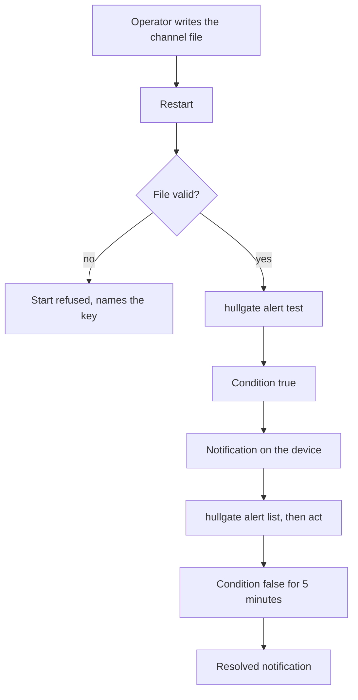
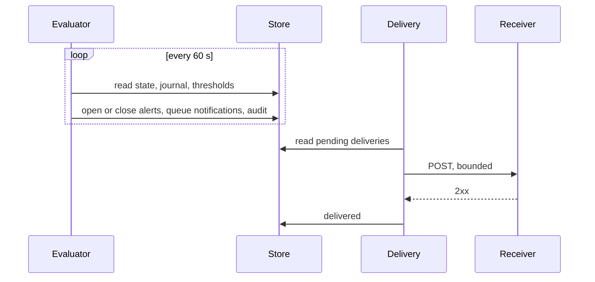
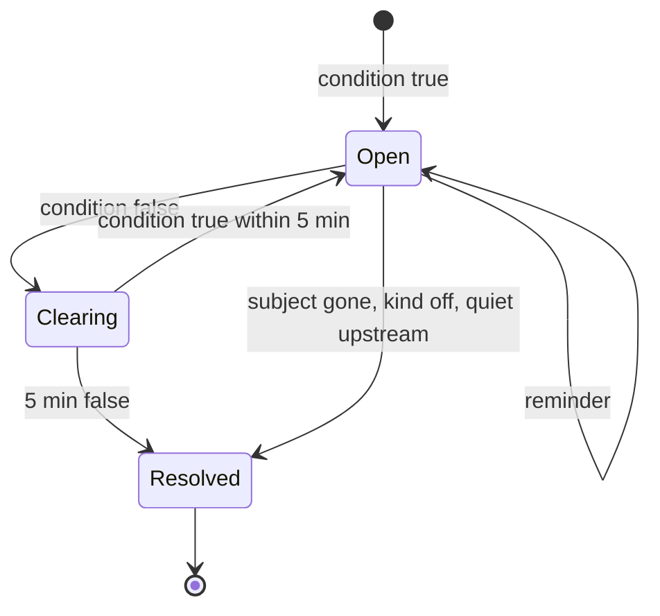
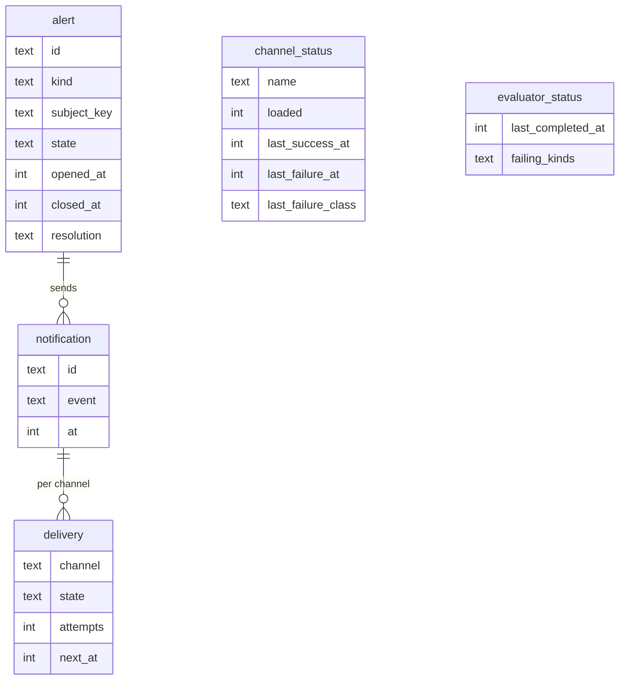

# F-019 · Threshold alerts over webhook and ntfy

## Metadata

| Field | Value |
|-------|-------|
| **Priority** | P2 |
| **Branch** | one branch per lot: `feat/HULL-69-alert-engine`, `feat/HULL-69-tool-suspended`, `feat/HULL-69-console` (§10) |
| **Last updated** | 2026-11-14 |

## 1. Context & Objective

### Current State

Constat of 2026-11-01, commit `309d0f0`.

- The gateway tells nobody anything. Failures are visible only when the operator runs `hullgate connection status` or `hullgate audit tail`.
- F-006 accepted three risks "until HULL-12": a refresh token with an absolute life (Notion 180 days, Google test apps 7 days) surfaces only as `reauth_required`; a deployment that forgets the connections key looks healthy, `/readyz` green, every connection unusable; and no alert precedes an expiry (§12, §Out of Scope l. 75, 81).
- F-008 left "upstream down alert" to HULL-11 / HULL-12. F-015 suspends a pinned tool and writes `tool.suspended`, leaving delivery to HULL-12 (BR-181). F-018 (a private operations spec of the maintainer, not published) renews operator tokens by hand, weekly on a sensitive role, framed only by a date (BR-282 (a private operations spec of the maintainer, not published)).
- F-004 left external monitoring of `/readyz` to HULL-12.
- No background task exists: F-006 D1 refused one for renewal, and `lifecycle` runs at use. The server process runs two uvicorn listeners and a lifespan hook (`src/hullgate/app.py`, `src/hullgate/__main__.py`).
- Dates known to the store: `operator_token.expires_at`, `lineage.expires_at`, `application.secret_expires_at`. A connection's `expires_at` is its access token's, renewed at use; no provider refresh-token expiry is stored.
- `connection.fail_count` counts failures since the last renewal. `audit` holds `access.refused`, `oauth.consent` and `relay.tool_call` with its `detail.issue`.
- Correction of a fact in `.cairn/runs/acts/HULL-12-drafting-1.md` point 3: the production server does have a cron since 2026-11-01 (arbitration X2). It does not change the choice in §9.

### Objective

When something on the gateway needs a human, the operator hears about it on a channel they already watch, once, with enough to act and without any secret, including when the database or the keys are the thing that failed.

### Expected Impact

- A condition of §3.2 reaches a configured channel within 3 minutes of the moment the gateway holds it, read end to end at AC-OP-02. A definition changed upstream is held only once a listing has seen it (§12).
- A condition lasting a week produces one notification, seven reminders and one resolution, not one per check (AC-03).
- The forgotten-key deployment of F-006 §12 is seen within 2 minutes of the start (AC-08).
- A weekly operator-token renewal is announced 2 days before the expiry (AC-06, BR-282 (a private operations spec of the maintainer, not published)).

### Open Product Questions

None is left unanswered in the text: each is written on a default, recorded in §9, and the two with a real cost either way are returned to the orchestrator.

- **Q1 · Where channels are configured.** PDF p. 5 lists "configure the alert channels" in the Organisation screen; F-016 §9 repeats it. Written on: a mounted file, read-only in the console (BR-295). A channel stored in the database is encrypted by the connections key, so the alert about a lost key could not be delivered, nor one about a database that cannot be read, and a stolen console session could silence or redirect alerts. Options: (a) mounted file; a change means editing a file on the host and restarting; (b) database, editable in the console, `key_unavailable` and `gateway_not_ready` undeliverable, schema and API larger; (c) both, file first, console adds. Recommendation: (a). Confirmed at the freeze go of 2026-11-14: (a), mounted file.
- **Q2 · A dead process cannot alert.** The `/readyz` question of F-004. `gateway_not_ready` covers a live process that is not ready; a stopped container or an unavailable production server is silent. Written on: nothing shipped, the runbook names `/readyz` as the target for any external monitor. Options: (a) as written, no watcher in 1.0.0; (b) a dead-man's ping: the gateway calls a URL every 5 minutes and the external service alerts on its absence, about one more rule and an external account; (c) a cron on another host. Recommendation: (a) for 1.0.0, (b) as a candidate ticket. Confirmed at the freeze go of 2026-11-14: (a), a dead process does not alert.

## 2. Scope

Ticket HULL-69, split from HULL-12 (comment 11261), and the deferrals of §1.

- **Alert model**: eight kinds, one open alert per key, fired, reminded, resolved, recorded.
- **Evaluation**: a task of the server process, independent of traffic.
- **Thresholds**: declared settings with defaults; four kinds can be turned off, four cannot.
- **Channels**: `webhook` and `ntfy`, declared in a mounted file.
- **Delivery**: bounded outbound call, retries, failure isolated from the relay.
- **Surfaces**: `hullgate alert list`, `channels`, `test`; a read-only section of the Organisation screen.
- **Runbook**: `docs/runbooks/alerts.md`, in English, on the Where · Who · Shell · Directory form.

## Out of Scope

| Item | Where it goes |
|---|---|
| E-mail channel | v2 (PDF p. 19); no mail transport in 1.0.0 (F-016 Q2) |
| External watcher of `/readyz`, dead-man's ping | Q2, candidate ticket |
| Active probing of upstreams | candidate ticket: it spends the connection's token and upstream quota; detection stays passive (§9) |
| Expiry of a provider's refresh token or of a provided token | candidate ticket: the gateway does not know the date; it surfaces as `connection_failing` |
| Sending F-017's findings and loops (BR-252, BR-253) | they show in its reports and tab (arbitration A6); candidate ticket. PDF p. 19 and this ticket name refusal bursts only, and each kind is one more line of BR-290 |
| A channel reached in `http` or on a private address, as a self-hosted ntfy on the docker network would need | candidate ticket, unless the operator picks self-hosting at AC-OP-01 |
| A tool that disappears from a pinned placement | no suspension, so no alert; it shows `removed` in `tool diff` (BR-182) |
| A definition change on an unpinned tool | no suspension, so no alert; `auto` leaves non-sensitive placements unpinned, and "frozen tool modified" means pinned tools |
| A failed refusal with no verified credential: internet noise, barrier failures, `client_id`-only refusals | never alerts (A9); HULL-70 limits it |
| Latency and error-rate thresholds, upstream health tables | HULL-68 (Statistics screen); F-008's "HULL-11 / HULL-12" row is split: the alert here, the screen there |
| Rate limiting, which a burst alert only reports | HULL-70 |
| Per-channel routing, silences, acknowledgement, escalation, grouping of notifications | candidate ticket; every channel receives every notification |
| HMAC signature of webhooks | candidate ticket; the optional bearer token covers both channels |
| Editing channels from the console | Q1 |
| A dedicated alerts page, a badge in the shell | candidate ticket; SCR-13 holds the read-only section |
| Migration or compatibility for live data | none: nobody uses the tool, the production server's data is disposable |

## 3. Functional Spec

### 3.1 Model

An **alert** is a condition true of one subject. The **alert key** is its kind plus its subject. At most one alert is **open** per key. It fires when the condition becomes true, is reminded while it stays true, and closes as BR-291 says.

The **evaluator** is a task of the server process. Every 60 seconds it reads the state of the store and the journal of calls, compares them with the thresholds, and records what changed. Delivery is a separate step that reads what was recorded (§3.6).

Nothing here changes the outcome of a request to a running process: an alert closes nothing, revokes nothing, and leaves `/readyz` as BR-033 defines it.

### 3.2 Kinds

| Kind | Severity | Subject | True when | Setting | Source |
|---|---|---|---|---|---|
| `refusal_burst` | `warning` | a role, or an actor with a verified credential | BR-293 | `alert_refusal_burst` | journal |
| `connection_failing` | `critical` | a connection | the connection is `reauth_required` | none | store |
| `renewal_failing` | `warning` | a connection | `fail_count` ≥ threshold (OAuth health) | `alert_renewal_failures` | store |
| `token_expiring` | `warning` | an operator token, an OAuth lineage, an application secret | live, expires within the notice, and no replacement | `alert_expiry_notice` | store |
| `tool_suspended` | `critical` | a (placement, tool) | its `pinned_definition` row has `suspended_at` set (F-015) | none | store |
| `upstream_down` | `warning` | a connection | at least threshold failing entries in the last 5 minutes and no alive entry after the first of them | `alert_upstream_failures` | journal |
| `key_unavailable` | `critical` | the instance | the connections key is unavailable (BR-088) and a connection that is not removed exists; checked at each evaluation, without waiting for a use | none | key file, store |
| `gateway_not_ready` | `critical` | the instance | the `/readyz` predicate (BR-033) was false at two evaluations in a row | none | readiness |

Details:

- **No replacement** (`token_expiring`): an operator token, when no live token with the same node and the same label expires after the notice; a lineage, when no live lineage of the same client on the same role does. An old token left to expire (BR-282 (a private operations spec of the maintainer, not published)) stays quiet once its successor is issued under its label; a sibling with another label covers nothing. An application secret has no replacement test; `secret_expires_at` null means no alert.
- **At birth** (`token_expiring`): a token issued for less than the notice opens at the next evaluation. A lineage has a fixed date (BR-052), so each one on a sensitive node alerts before its 7 days (§12).
- **Failing and alive entries** (`upstream_down`), by `issue` of BR-122, constat of 2026-11-01. Failing: `upstream_unavailable`, `deadline_exceeded`, `uncertain_outcome`, from `relay.tool_call` and `relay.list_omitted`, when `detail.cause` is `upstream`. Alive: `ok`, `tool_error`, and `response_too_large`, the tool having run (BR-184). The other issues count for neither: they say nothing of the upstream (`refused`, `request_too_large`, `upstream_busy`, `connection_reauth_required`, `cancelled`, `internal_error`). Sweep at implementation: the closed list of BR-122 as it stands then, every value placed in one of the three.
- **`detail.cause`** (BR-122 clarification): `local` when no exchange with the upstream failed: the three `upstream_unavailable` of `Relay._access` (`relay.py:880-888`, constat of `309d0f0`: renewal back-off, key or integrity, store) and an omission for `version`, `session` or `pagination`, where the upstream answered; `upstream` otherwise. A lost key opens `key_unavailable`, not `upstream_down` on every connection.
- **Once open**, `upstream_down` stays true until an alive entry arrives: its window ages out when traffic stops, and that proves nothing.
- **`tool_suspended`** covers BR-181 and BR-187, a changed tool and a new one, both holding a row with `suspended_at` (F-015 BR-181). It reads that state, never the `tool.suspended` entry, which is a trace. A second change on an open alert sends nothing new.
- **`key_unavailable` is the connections key** (BR-088). The signing key missing is `gateway_not_ready`, reason `signing_key_unavailable`: other effects, other cure, and the runbook's table says so.

### 3.3 Thresholds

Declared settings (BR-048), so that they inherit, obey the lock (BR-049), are audited as `settings.set`, appear in the export (BR-070) and are undoable in the console.

| Setting | Default | Unit | `0` |
|---|---|---|---|
| `alert_refusal_burst` | `10` | refusals in 5 minutes | turns the kind off |
| `alert_renewal_failures` | `3` | failures in a row | turns the kind off |
| `alert_upstream_failures` | `3` | failing entries | turns the kind off |
| `alert_expiry_notice` | `2d` | duration | turns the kind off |
| `alert_reminder` | `24h` | duration | no reminders |

The value read is the effective one at the subject's node: the role for `refusal_burst` by role and for a lineage, the token's node for an operator token. A connection, an application, an actor and the instance have no node: they read the organisation's value. Turning a kind off resolves its open alerts with resolution `disabled`.

Counts are integers from 0 to 100000. Durations are `0`, or `<n>h` or `<n>d` from 1 hour to 30 days.

### 3.4 Channels

`ALERT_CHANNELS_FILE`, default `/run/secrets/alert_channels`, a mounted secret, read by the server once at start. JSON, parsed by the standard library (D14), a closed set of keys:

```json
{
  "version": 1,
  "channels": [
    {"name": "phone", "kind": "ntfy", "url": "https://ntfy.example/hullgate-topic", "token": "tk_example"}
  ]
}
```

`name`: `[a-z0-9-]{1,32}`, unique. `kind`: `ntfy` or `webhook`. `url`: BR-296. `token`: optional, sent as `Authorization: Bearer`.

- At most 8 channels. A change takes effect at the next restart of the server.
- `alert channels` and `alert test` are separate processes and read the file as it is on disk. The server stores at start the names it loaded, and `alert channels` flags a name it does not hold (`not_loaded`): `delivered` from `alert test` proves the channel, not that the server uses it.
- Absent, or an empty `channels`: no channel. The gateway starts, logs one warning, records alerts; `alert channels` says none.
- Invalid: the process refuses to start, naming the channel and the key, never a value (BR-032).
- The URL is a secret: an ntfy topic or a webhook path is a bearer. It is shown nowhere; the surfaces print name and kind.

### 3.5 Notification

Webhook: `POST` of this JSON. Ntfy: `POST` to the topic URL with `Title: hullgate <severity> <kind>`, `Tags: <kind>`, `Priority: 5` for `critical` and `3` for `warning`, and the text body `<event> <subject.type> <subject.name>[ on <subject.role>][ value=<value>][ threshold=<threshold>][ reason=<reason>][ resolution=<resolution>] since <since>`. Header values are ASCII: anything else becomes `?`.

| Field | Content |
|---|---|
| `version` | `1` |
| `notification` | identifier of this notification, stable across its retries and shared by its channels |
| `alert` | identifier of the alert |
| `event` | `fired`, `reminder`, `resolved`, `test` |
| `kind`, `severity` | §3.2 |
| `subject` | `{"type": …, "name": …, "role": …}`; `type` in `role`, `operator_token`, `oauth_client`, `connection`, `lineage`, `application`, `placement_tool`, `instance`; `name` per BR-297 |
| `value`, `threshold` | integers or null; the count, or the seconds left |
| `reason` | closed token: the BR-088 reason of `key_unavailable`; for `gateway_not_ready`, the `/readyz` reason, with `signing_key_unavailable` in place of its `key_unavailable`; otherwise null. A reason that changes on an open alert updates it and sends nothing |
| `resolution` | on `resolved`: `cleared`, `subject_removed`, `expired`, `no_recent_traffic`, `disabled` |
| `since`, `at` | UTC, ISO 8601 |
| `instance` | host of `PUBLIC_URL` |

### 3.6 Delivery

One delivery per (notification, channel). Attempted at once, then after 1, 5, 15 and 60 minutes, then hourly, until 24 hours after the first attempt, then given up. A status 2xx is success; 429 honours `Retry-After`, capped at 1 hour; anything else is a failed attempt, of class `address_refused`, `timeout`, `connection_failed`, `http_status`, `redirect` or `response_too_large`. No order is promised across notifications: `alert` and `at` let a receiver sort them.

At start, pending deliveries of a channel the file does not hold are given up and audited: a removed or renamed channel, or a restored backup.

### 3.7 Commands

| Command | Effect |
|---|---|
| `hullgate alert list [--all] [--json]` | Open alerts, with `--all` the resolved ones kept; each with kind, severity, subject, since, last notification, `resolution` when closed, and per channel `delivered`, `pending` or `given_up`. Last lines give the number of channels, the time of the last completed evaluation and the kinds whose last evaluation failed, and `EVALUATOR-STALE` when it is more than 3 minutes old |
| `hullgate alert channels [--json]` | Name, kind, last success, last failure with its class, `not_loaded` when the server does not hold it. No URL, no token |
| `hullgate alert test <channel>` | Sends one `test` notification, audited; prints `ALERT-TEST: delivered` or `ALERT-TEST: failed <class>`; code 0 if delivered, 1 otherwise, 2 for an unknown channel |

All three run inside the container, as every `hullgate` command. `alert test` fails with a typed message when the file holds no such channel.

### 3.8 Console (SCR-13.alerts)

A read-only section of the Organisation screen (F-016 §3.13): open alerts as in `alert list`, then channels as in `alert channels`, then a line saying that channels are changed in the mounted file. Thresholds stay in the ordinary settings of SCR-05 and SCR-06. Reads through `GET /admin/api/v1/alerts`, a new resource group `alerts`, behind a session like any other (BR-068 v2).

#### Visual States

- **SCR-13.alerts**: open alerts and channels
- **SCR-13.alerts.none-open**: "No open alert", channels still listed
- **SCR-13.alerts.no-channel**: warning that alerts are recorded and sent nowhere

### 3.9 Runbook

`docs/runbooks/alerts.md`, sections "Channel file" (writing it on the production server, the secret in `deploy/compose.prod.yaml`, a restart; two channels recommended, a sole channel failing being silent), "Check" (`alert test`, `alert channels`, `alert list`), "Drill" (AC-OP-02), "Kinds" (each kind, which key, what to do), "External monitor" (pointing one at `/readyz`, Q2).

## 4. Business Rules

Overlap scan (`conventions/br-identifiers.md` §Overlap), read on 2026-11-01. Filter on the `Statement` column of `business-rules/index.md` on `alert|notif|webhook|ntfy|seuil|threshold|burst|rafale|expir|échéan|health|santé|readyz|arrière-plan|background|réglage|setting|sortant|outbound|fail|échec|panne|canal|channel`: **18 lines retained of 131.**

| Rule | Verdict |
|---|---|
| BR-001, BR-082, BR-091, BR-093, BR-107, BR-111, BR-116, BR-117, BR-120 | off topic |
| BR-033 | off topic: `gateway_not_ready` reads its predicate, the rule is unchanged |
| BR-049 | off topic: the new settings fall under it as they stand |
| BR-064 | off topic: no refusal is added |
| BR-068 | off topic: `alerts` sits behind the session of F-016's v2 |
| BR-080 | off topic: `connection status` stays as it is |
| BR-108 | off topic: concurrency toward an upstream; BR-296 keeps delivery out of those pools |
| BR-048 | overlap — clarification (C3): new declared keys, as F-015 did |
| BR-066 | overlap — new version (C2): more events |
| BR-125 | overlap — clarification (C3): the rule names two clients and forbids building at the call; a third usage keeps its letter |

BR-131, read outside the filter: overlap — clarification (C3): new closed vocabulary added to its table. BR-122, likewise: overlap — clarification (C3): one more `detail` field.

Read outside the filter, the statements carrying none of the words: BR-032, overlap — new version (C2), one variable added to its enumeration; BR-070, BR-072, BR-085, BR-087, BR-088, BR-092, BR-094, BR-122, off topic, all read and left unchanged; BR-084 and BR-106, neighbours — new rule (C1): BR-296 can be violated while both hold, and both stay unchanged, they cover provider calls and upstream calls only. In-flight: BR-181 and BR-185 (F-015), BR-208 (F-016), BR-282 (F-018, a private operations spec of the maintainer, not published), off topic, this spec reads their outcomes. BR-253 (F-017), finding `refusal_concentration` (arbitration A6; this spec owns the token `refusal_burst`): neighbour — new rule (C1): a finding is a reading of a report, nothing is sent; an alert can be off while the finding shows, and the reverse. BR-293 takes its window and its figure as default. F-020 BR-312 and BR-122 v3: off topic as rules, BR-293 reads their entry.

Version numbers are the ones in force at drafting; whichever feature merges later carries the earlier text forward and takes the next number (F-016 §4).

BR-292, BR-295, BR-298 and BR-299 join obligations that can be violated apart. They stay joined: the allocation is spent, and each rule's parts are the faces of one object, the task, the file, the delivery, the reading. Each part has its own case in the rule's test.

### BR-290 · An alert is one kind on one subject, open at most once

*`definitional` · `strict` · Candidate state: `verified` — `tests/unit/test_br_290_kinds.py`: the kinds are exactly the eight of §3.2, each with its severity; `tests/integration/test_br_290_one_open.py`: a condition true over ten evaluations leaves one open row, and a concurrent insert of the same key fails.*

**Rule** — The kinds of alert are the closed list of §3.2, each with its severity, its subject and its condition, and at most one alert is open per (kind, subject).

**Clarifications**
- A new kind is a change of this rule.
- A subject with no live object cannot fire: a connection `removed`, a node deleted.

### BR-291 · An alert notifies when it fires, while it lasts and when it ends

*`behavioral` · `blocking` · Candidate state: `verified` — `tests/integration/test_br_291_lifecycle.py`, on a fake clock: fired once, reminded at each `alert_reminder`, resolved after 5 minutes false, and a condition back within the 5 minutes sends nothing.*

**Rule** — An alert sends one `fired` notification when it opens, one `reminder` each `alert_reminder` while it is open, and one `resolved` when it closes; it closes when its condition has stayed false for 5 minutes, at once when its subject is gone or its kind is turned off, and, for an `upstream_down`, after 1 hour without any failing entry for its subject; an evaluation that cannot record a change makes it at the next.

**Clarifications**
- `upstream_down` needs traffic to prove recovery (§9). Its quiet closure carries `no_recent_traffic`, which says the outage is unproven either way, not that the upstream recovered. A neutral entry neither holds it open nor closes it.
- A token, a lineage or a secret that reaches its date closes its `token_expiring` at once with `expired`: the notice went unheeded, and the `resolved` notification says so. A revoked one closes with `subject_removed`.
- A key that fires again after a closure is a new alert.
- An alert open when the kind is off and on again is a new one.

### BR-292 · Evaluation runs in the server process, whatever the traffic

*`behavioral` · `blocking` · Candidate state: `verified` — `tests/integration/test_br_292_evaluator.py`: with no request, a token enters its notice and the alert opens; an exception in one kind leaves the others evaluated, is logged, and shows in `alert list`; a task killed is restarted; `/readyz` unchanged; a store that cannot be read or written still delivers `gateway_not_ready`.*

**Rule** — The server process evaluates every kind every 60 seconds, without any request, whichever process wrote the state; a failure of the evaluator changes no request's outcome and no probe's, an evaluation that fails on one kind still evaluates the others, and every failure is logged and shown by `alert list`.

**Clarifications**
- A `hullgate` command run in the container never evaluates: only the server does, so a CLI write is seen at the next evaluation.
- All state is read again at each evaluation, so a restart loses nothing but a burst that ended while the process was down.
- The task is supervised: killed, it is restarted. Nobody can otherwise tell no alert from no evaluation; `EVALUATOR-STALE` says which.
- When the store cannot be read or written, `gateway_not_ready` is held in memory and delivered from the channels already read, on the §3.6 schedule held in memory, with no reminder. When the store returns it is recorded, once, against any row already open, and its `resolved` follows the ordinary path. A restart in that state loses it; accepted, §12.
- The evaluator holds no upstream token, decrypts nothing, calls no upstream or provider. F-006 D1 stands: renewal stays at use.
- The first evaluation runs 60 seconds after the start.

### BR-293 · A refusal burst counts refusals of a verified credential, by role and by actor

*`behavioral` · `blocking` · Candidate state: `verified` — `tests/integration/test_br_293_burst.py`: at the threshold on one role it opens; a token refused on several roles opens on the actor, each role being under; a `rate_limited.refused` with `suppressed: 9` weighs 10; each entry of the uncounted list leaves the count at zero.*

**Rule** — `refusal_burst` is true of a role when the refusals of a verified credential on that role in the last 5 minutes reach `alert_refusal_burst`, and of an actor when its refusals across all roles reach the organisation's value; the refusals counted are `access.refused` at step 5 or later, `relay.tool_call` with result `refused`, and `rate_limited.refused` on surface `token` or `connection`, weighing `suppressed` + 1; any other entry is ignored.

**Clarifications**
- A verified credential is authentic and unexpired: it passed step 4 of BR-055. Only then is an actor a holder the operator gave a token to, or an OAuth client that passed the barrier, which bounds the keys by the operator's own acts.
- Population, constat of 2026-11-01, `309d0f0`, instrument `grep -n 'refused' src/hullgate/*.py`, with `rate_limited.refused` from F-020. Not counted: `access.refused` at steps 3 and 4, the 401 opening every OAuth discovery and every expired one-hour token; `oauth.consent` and every other `oauth.*` refusal, whose actor is a `client_id` anyone can mint; `rate_limited.refused` on surfaces `oauth`, `register`, `credential`; `connection.tools_refused`, a diagnostic command; `connection.authorize_refused`, an operator's act; `relay.upstream_request_refused`, the upstream's doing; `connection.integrity_error` and `connection.key_unavailable`, not a caller's. Sweep at implementation, after F-015, F-016, F-017 and F-020: every audit write with result `refused` is placed in or out, in the test's list.
- F-015's policy reasons are `relay.tool_call` refusals and count. A limited call has no `relay.tool_call` entry (BR-122 v3), hence `rate_limited.refused`: an agent looping past its limit is the case this alert exists for. `suppressed` arrives with the next entry and is a floor (BR-312).
- An entry with no node counts for its actor alone.
- BR-253 reports `refusal_concentration` from the same window and figure, as a constant. Overriding `alert_refusal_burst` separates the alert from the report, which stays constant in 1.0.0.
- One burst from one token on one role opens two alerts, role and actor. Accepted: the two say different things and the volume is small.

### BR-294 · Thresholds are declared settings, and critical kinds have none

*`behavioral` · `blocking` · Candidate state: `verified` — `tests/integration/test_br_294_thresholds.py`: defaults read, a role override applied to that role's burst, an invalid value refused, a locked node refused, `0` resolves open alerts with `disabled`.*

**Rule** — The thresholds are the settings of §3.3, read at their effective value on the subject's node, or at the organisation's for a subject with no node; `0` turns off a kind that has a setting, and `connection_failing`, `tool_suspended`, `key_unavailable` and `gateway_not_ready` cannot be turned off.

### BR-295 · Channels come from a mounted file, and only from it

*`behavioral` · `blocking` · Candidate state: `verified` — `tests/integration/test_br_295_channels.py`: valid, absent, empty and each invalid form, `not_loaded` shown; `tests/unit/test_br_295_no_secret.py`: planted URL and token absent from outputs, logs, audit and the database file.*

**Rule** — The gateway reads its channels from `ALERT_CHANNELS_FILE` at start, kinds `webhook` and `ntfy`, and stores neither their URLs nor their tokens; an invalid file refuses the start, an absent or empty one leaves the gateway running with no channel, and no surface shows a URL or a token.

**Clarifications**
- Read at start by the server, which stores the names it loaded and nothing else of the file. A restart applies a change.
- The refusal names the channel and the key, never a value.
- No channel exists in the export, the import, the audit or the backup. A rebuilt instance gets them by mounting the file.

### BR-296 · A delivery is a bounded call to the declared URL alone

*`behavioral` · `strict` · Candidate state: `verified` — `tests/integration/test_br_296_outbound.py`, a local TLS receiver and an injected resolver as `tests/unit/test_br_084_outbound_bounds.py` does: redirect not followed, 10 s deadline, oversized response cut, loopback, link-local and private addresses refused, `http` refused at the file, IPv4 fallback when the first address is IPv6.*

**Rule** — A delivery is one `POST` to the URL of its channel, in https, without following a redirect, under a hard 10-second deadline on the whole exchange and 64 KiB of response, to public addresses only, checked at each call against the resolved addresses; any departure is a failed attempt of its class, `address_refused` for an address.

**Clarifications**
- The URL takes no user information or fragment. A query is allowed.
- The response body is discarded, never logged.
- BR-084 and BR-106 are unchanged: they cover provider and upstream calls only.

### BR-297 · A notification carries closed fields and no foreign text

*`behavioral` · `strict` · Candidate state: `verified` — `tests/unit/test_br_297_content.py`: the JSON keys are exactly §3.5's; a hostile tool description, a control character in a tool name, a non-ASCII name, a CIMD `client_id` and a planted token are absent from body and headers.*

**Rule** — A notification carries the fields of §3.5 and nothing else: no secret, no full digest, no tool description, no argument, no result, no upstream or provider text, no client-supplied string, and every name in it is reduced to printable characters and 80 of them, a character outside becoming `?`.

**Clarifications**
- The one foreign string is the public tool name of a `tool_suspended`, which for a new tool the distrusted upstream chose: it passes BR-110's filter, then the reduction. The old or new definition never appears, being the text an attacker wrote (§12). The operator reads it with `tool diff` (BR-182).
- An operator token is named by its identifier and label, as `token list` prints them. Those are the gateway's and the operator's.
- An OAuth actor is named `client-<first 8 hex of the SHA-256 of its client_id>`, and a lineage by its identifier: a `client_id` can be a CIMD URL. The same goes for `alert list` and SCR-13.alerts.
- The reduction applies to `subject.name` and every field of the ntfy body; §3.5 makes headers ASCII.

### BR-298 · Delivery retries, and its failure touches nothing else

*`behavioral` · `blocking` · Candidate state: `verified` — `tests/integration/test_br_298_retry.py`, on a fake clock and a fake receiver: the schedule of §3.6, given up at 24 hours and audited, 429 honoured and capped; a pending delivery survives a restart; pending deliveries of an unknown channel are given up at start; a receiver that hangs delays neither the evaluation, the other channel nor a `tools/call`.*

**Rule** — Each notification is delivered at least once to each channel on the schedule of §3.6, its pending deliveries survive a restart, a delivery given up is audited, and a delivery that fails or hangs delays neither the evaluation, nor another channel, nor any request, and changes no alert's state.

**Clarifications**
- At least once: a lost response repeats a notification. `notification` is stable across retries so that a receiver can drop the duplicate.
- A `critical` notification gets no faster path.
- `gateway_not_ready` with the store down is the one exception to surviving a restart (BR-292).
- With no channel, notifications are recorded as having no delivery; a channel added later receives no past notification, only reminders of alerts still open.

### BR-299 · Alerts can be read without any channel

*`behavioral` · `blocking` · Candidate state: `verified` — `tests/integration/test_br_299_surfaces.py`: `list`, `channels` and `test`, codes and JSON keys, `test` audited, no URL in any output; `tests/integration/test_br_299_console.py` after lot C.*

**Rule** — `hullgate alert list`, `alert channels` and `alert test` show every open alert and each channel's delivery state whether or not a channel works, and the console shows the same reading in a read-only section; neither lets an alert be closed by hand.

**Clarifications**
- An alert ends when its condition does. Hiding one would be a silence, out of scope.
- Resolved alerts are kept 90 days; the audit keeps their trace for as long as it keeps anything.

### BR-032 · next version · Configuration by environment variables and mounted secrets

*`behavioral` · `blocking` · Candidate state: `verified` — existing test, extended.*

**Rule** — BR-032 as in force, with `ALERT_CHANNELS_FILE` added to its enumeration, optional, and with BR-295's refusal counted as an invalid value.

### BR-066 · next version · Audit (additions)

*`behavioral` · `strict` · Candidate state: `verified` — `tests/integration/test_br_299_surfaces.py` reads each action back; the sweep of `tests/unit/test_br_295_no_secret.py`.*

**Rule** — BR-066 as in force, with added to the events: alert fired and resolved, delivery given up, channel test, actor `gateway` except for a test. The prohibition on secret values covers channel URLs and tokens.

**Clarifications**
- Actions: `alert.fired`, `alert.resolved`, `alert.delivery_given_up`, `alert.test`. A successful delivery writes no entry: its state is in `alert list`.

### BR-048 · Declared settings (clarification)

**Clarification** — The settings of §3.3 are declared, with the bounds it states. Their duration validator accepts `0`, which `parse_duration` refuses.

### BR-125 · One outbound client per usage (clarification)

**Clarification** — Alert delivery is a third usage, with its own client, built once per process. Neither of the other two is used for it.

### BR-122 · Tool-call audit (clarification)

**Clarification** — `relay.tool_call` and `relay.list_omitted` entries with issue `upstream_unavailable`, `deadline_exceeded` or `uncertain_outcome` carry `detail.cause`, `local` or `upstream` (§3.2). The closed issue list does not change.

### BR-131 · Closed vocabularies (clarification)

**Clarification** — The pinned table gains: the group `alert` and its verbs and options; the `--json` keys of §3.7; the keys of §3.4 and §3.5; the kinds, severities, events, resolutions, reasons and failure classes; `detail.cause`; the audit actions of BR-066; the settings of §3.3.

## 5. Acceptance Criteria

### Firing

- [ ] **AC-01** (BR-290) The kinds are exactly the eight of §3.2; one condition, one open row.
- [ ] **AC-02** (BR-291, BR-292) On a fake clock, each of the eight kinds, driven to its condition, opens and queues one `fired` within two evaluations, with no request served in between, except that `refusal_burst` and `upstream_down` read entries written directly.
- [ ] **AC-03** (BR-291) A condition held 7 simulated days and 1 hour gives one `fired`, 7 `reminder` and, once false for 5 minutes, one `resolved`. With `alert_reminder` at `0`, no `reminder`.
- [ ] **AC-04** (BR-291) A condition false for 4 minutes, then true, sends nothing. A subject removed closes at once with `subject_removed`.
- [ ] **AC-05** (BR-293) Burst: threshold on a role, across roles on an actor, `rate_limited.refused` weighed `suppressed` + 1, each uncounted entry at zero, `oauth.consent` and step 3 and 4 refusals included. Ten thousand refused consents under fresh `client_id` open nothing.
- [ ] **AC-06** (§3.2) `token_expiring`: a token inside its notice opens; a successor issued on the node resolves it with `cleared`; left alone, it closes with `expired` at its date; a lineage likewise; a live sibling with another label leaves the alert open; an application with a null date never opens; a connection's access-token date never opens.
- [ ] **AC-07** (§3.2) `upstream_down`: three failing entries open; one `ok` between them does not; an entry of each neutral issue changes nothing; each `local` cause counts for nothing, and a removed key opens `key_unavailable` with no `upstream_down`; an hour with no failing entry closes with `no_recent_traffic`. The issue test iterates BR-122's closed list, so a new issue fails until placed.
- [ ] **AC-08** (§3.2, BR-292) `key_unavailable`: the key file removed, a connection present, no request: open within 2 minutes, delivered; with no connection, nothing.
- [ ] **AC-09** (BR-292) `gateway_not_ready`: one false evaluation sends nothing, two do. The database file made unreadable, the first attempt failing: delivered at the retry, then recorded once when it returns, with no reminder meanwhile.
- [ ] **AC-10** (§3.2, F-015) `tool_suspended`: a row with `suspended_at` opens, with no audit entry present; a second change sends nothing; `tool validate` resolves; a new tool under BR-187 opens; a suspension set with the server stopped opens after the start.
- [ ] **AC-11** (BR-292) An exception raised in one kind leaves the others evaluated, `/readyz` and a `tools/call` unchanged, writes a log line and shows in `alert list`. The task killed is restarted. With no evaluation for 3 minutes, `alert list` prints `EVALUATOR-STALE`.

### Thresholds

- [ ] **AC-12** (BR-294, BR-048) Defaults of §3.3 read on a fresh instance; a role override applies to that role alone; a locked node refuses; an invalid value is refused; `0` closes open alerts with `disabled`; no setting exists for the four critical kinds.

### Channels and delivery

- [ ] **AC-13** (BR-295, BR-032) Valid file: channels read. Absent: starts, one warning. Each invalid form (not JSON, unknown key, duplicate name, third kind, ninth channel, `http`, user information): the process exits with BR-032's refusal, naming no value. A channel added on disk shows `not_loaded` until a restart.
- [ ] **AC-14** (BR-295, BR-066) With a planted URL and token, a sweep of stdout, stderr, the audit, `alert` commands, the export and the database file finds neither.
- [ ] **AC-15** (BR-296) The cases of the rule on a local TLS receiver with an injected resolver, a dual-stack name included.
- [ ] **AC-16** (BR-297) Webhook body and ntfy request match §3.5's templates exactly; hostile names are reduced; a non-ASCII name delivers; no definition text and no `client_id` appears.
- [ ] **AC-17** (BR-298) The §3.6 schedule; given up at 24 hours, audited; 429 capped; a pending delivery resumes after a restart; pending deliveries of a channel no longer in the file are given up at start, audited.
- [ ] **AC-18** (BR-298, BR-125) While a receiver hangs on its 10-second deadline, 20 `tools/call` against the fake upstream and one evaluation complete before that deadline, and the other channel delivers. The relay and renewal clients are not used.

### Surfaces

- [ ] **AC-19** (BR-299) `alert list`, `channels`, `test`: outputs, exit codes, `--json` keys, `test` audited, no command closes an alert.
- [ ] **AC-20** (BR-299, lot C) SCR-13.alerts in its three states, reading what `alert list` reads, without a session 401, no write route.
- [ ] **AC-21** The disposable container of `make restore-check` (BR-039) and the bench's `v1` target send nothing: neither mounts a channel file. `tests/unit/test_no_channel_in_disposables.py` reads the recipes, it does not run them.
- [ ] **AC-22** `make gate` green; `docs/runbooks/alerts.md` exists with the sections of §3.9, each step opening on Where · Who · Shell · Directory.

### Operator, on the production server

- [ ] **AC-OP-01** (BR-295, BR-296, BR-297, BR-298, operator, after lot A) — a real channel on the operator's device. Protocol: **instrument bounded** to `docs/runbooks/alerts.md`, sections "Channel file" and "Check". **Readings to record, not assert**: receiver used (self-hosted or public ntfy, or a webhook service); delay between the command and the device. **To post**: output of `hullgate alert test <name>`; `hullgate alert channels`; `hullgate audit tail -n 3 --json`. **Identifier read back**: the channel name. **Patterns**: `^ALERT-TEST: delivered$`, `"action": "alert.test"`.
- [ ] **AC-OP-02** (BR-292, operator, after lot A) — a real condition. Protocol: the runbook's section "Drill": `hullgate token create --duration 1h --label <label>` on a disposable node, which opens at birth; read the device; revoke it. **Reading to record**: delay from issue to the device, end to end, against §1's 3 minutes. **To post**: `hullgate alert list --all --json` after the resolution. **Identifier read back**: the label. **Patterns**: `"kind": "token_expiring"`, `"resolution": "subject_removed"`.

## 6. Diagrams

| Type | Decision |
|---|---|
| Userflow | 6.1 |
| Sequence | 6.2: process, store, receiver |
| State machine | 6.3: alert |
| ER | 6.4: new tables |
| Class | skipped: no hierarchy, one module |

### 6.1 Userflow



### 6.2 Sequence



### 6.3 State machine



### 6.4 ER



## 7. States & Captures

- **Package-status**: absent. One read-only section; §3.8 lists its states.

## 8. Design & Prototypes

- **Design package**: no design assets. The section follows SCR-13's patterns.

## 9. Implementation Notes

### Dependencies (prerequisite features)

- HULL-10, F-015: `pinned_definition.suspended_at`, the state of a suspension, written whatever becomes of the audit entry (F-015 BR-181). Blocks lot B only.
- HULL-11, F-016: SCR-13, the `alerts` resource group on its API, session rules. Blocks lot C only.
- HULL-68, F-017, landing first (milestone order): one store, call fields as columns of `audit`, partial indexes on role, connection and `at`, which `refusal_burst` and `upstream_down` read. Retention leaves the 5-minute window alone. BR-245's hourly task and this evaluator are two tasks on one lifespan.
- HULL-70, F-020, landing first: `rate_limited.refused` joins BR-293's population (arbitration A4), and F-017's BR-243 keeps it as a traffic entry.
- HULL-13, F-018 (a private operations spec of the maintainer, not published): downstream, gains BR-282 (a private operations spec of the maintainer, not published)'s notice. Nothing in it requires this feature.
- HULL-12: parent, delivery. Downstream: nothing.

### Technical Constraints

- Python stack of the project; no new dependency: `Outbound` for the call, the standard library's `json` for the channel file (D14). The project has no YAML parser.
- The evaluator is an asyncio task of the lifespan in `build_public_app`, its reads on a worker thread. A held write transaction across a delivery is forbidden (F-006 §12: SQLite's global lock turns into 503s).
- One server process. The unique open key protects against a brief overlap at deployment.
- English everywhere (HULL-57, arbitration X7). Audit and notification tokens are closed vocabularies under BR-131.

### Architecture Decisions

All below are *tranché en autonomie déléguée*, Phases 2 to 4 of a delegated run.

| Question | Decision | Rationale |
|---|---|---|
| D1 · What runs the evaluation | In the server process, tranché en autonomie déléguée | Time-based conditions need a clock with no traffic. A cron exists on the production server (X2) but would add a host dependency and tie alerts to one machine. F-006 D1 refused background renewal, not a background reader: BR-292 keeps renewal at use |
| D2 · Channels | Mounted file, tranché en autonomie déléguée, **Q1** | §1 Q1. Secrets out of the store, delivery independent of database and key, no console surface to silence alerts |
| D3 · Trigger model | State and window read at each evaluation, not events pushed from each write site, tranché en autonomie déléguée | No write site changes, CLI writes are seen, a restart loses nothing but a finished burst. Holds for all eight kinds: `tool_suspended` reads `suspended_at` (A10) |
| D4 · `/readyz` | Internal `gateway_not_ready`; nothing external shipped, tranché en autonomie déléguée, **Q2** | F-004's deferral answered for a live process; a dead one needs something outside |
| D5 · Passive detection | From the journal for `upstream_down`, from the listing for a definition change, tranché en autonomie déléguée | A probe spends tokens and quota on every connection, and an upstream call from the evaluator would break BR-292's clarification. Cost: no traffic, no detection, hence `no_recent_traffic` |
| D6 · OAuth health | `renewal_failing` on `fail_count`, `connection_failing` on the state, tranché en autonomie déléguée | The ticket names both; one is transient, one needs a human. Different severities |
| D7 · `token expiring` covers | Operator tokens, lineages, application secrets, tranché en autonomie déléguée | The dates the store holds. A connection's access token renews at use: an alert would be noise. A lineage's expiry stops a Claude.ai connector, so it counts |
| D8 · Added kind `key_unavailable` | In, tranché en autonomie déléguée | Not in the ticket; F-006 §12 sends exactly this risk to HULL-12 |
| D9 · Thresholds | Declared settings, tranché en autonomie déléguée | Inheritance, lock, audit, export and undo come for free, and the PDF asks for no threshold screen |
| D10 · Default values | Those of §3.3, tranché en autonomie déléguée | 10 in 5 minutes is BR-253's figure, so that a finding on the Statistics screen and an alert agree by default. 2 days leaves room before BR-282 (a private operations spec of the maintainer, not published)'s day 6. The others have no source. Revisit after a month of use |
| D11 · Bearer on both channels, no HMAC | Tranché en autonomie déléguée | One mechanism; ntfy supports it |
| D12 · Delivery failure of one channel told to the other | No, tranché en autonomie déléguée | Scope; visible in `alert channels` and the audit |
| D13 · Console | Read-only section, tranché en autonomie déléguée | Follows D2; BR-299 |
| D14 · Channel file format | JSON, standard library, tranché en autonomie déléguée (A15) | No YAML parser in the project; a dependency on a file of secrets for a five-key format is not worth it. Cost: no comments in the file |
| D15 · Which refusals count | Verified credentials only (A9) | Anyone can mint a `client_id`: counted, each would open an alert with its own text on the operator's phone. Cost: an unauthenticated flood never alerts |

Glossary: the terms this spec coins are written by the orchestrator before the freeze (X17); no criterion holds them.

Spec state: no new `status` value (step 23a skipped).

### Data Model Impact

- Migration: yes, one, next free number, additive.
- New tables: `alert`, `notification`, `delivery`, `channel_status`, `evaluator_status` (§6.4), with a unique partial index on the open (kind, subject). `channel_status` holds names and outcomes, never a URL.
- Settings: five declared keys, no table change.
- The evaluator deletes resolved alerts older than 90 days, their notifications and deliveries. `audit` is never touched.
- No migration or compatibility for live data: the production server's data is disposable.

### Components to Create / Modify

**Created**
- `src/hullgate/alerts.py` — kinds, evaluation, lifecycle
- `src/hullgate/alert_delivery.py` — channel file, notification forms, delivery
- `docs/runbooks/alerts.md`
- `tests/unit/test_br_29*`, `tests/integration/test_br_29*`

**Modified**
- `src/hullgate/app.py` — task in the lifespan
- `src/hullgate/__main__.py`, `src/hullgate/config.py` — `ALERT_CHANNELS_FILE`, start refusal
- `src/hullgate/tree.py` — `SETTINGS`
- `src/hullgate/relay.py` — `detail.cause`
- the table of BR-131's test
- `src/hullgate/migrations.py`
- `src/hullgate/cli.py` — group `alert`
- `deploy/compose.prod.yaml`, `deploy/env.example` — secret `alert_channels`
- Console (lot C): SCR-13, `/admin/api/v1/alerts`, `docs/admin-api.md`
- `README.md`, `CHANGELOG.md`

### Pitfalls Discovered

To be filled in during dev.

## 10. Phases

Feature delivered in 3 slices — one PR each.

### Slice 1 — Engine, channels, CLI

- Rules: BR-290 to BR-299 except the console part of BR-299; BR-032, BR-048, BR-066, BR-122, BR-125, BR-131

- [ ] Every kind but `tool_suspended`; AC-01, AC-02 on seven kinds, AC-03 to AC-09, AC-11 to AC-19, AC-21, AC-22
- [ ] Deployed; AC-OP-01 and AC-OP-02 played, planned right after the merge

### Slice 2 — `tool_suspended` (F-015's pinning is implemented)

- Rules: BR-290 (the eighth kind)

- [ ] AC-10

### Slice 3 — Console (after F-016 slice 4, which ships SCR-13) *(last)*

- Rules: the console part of BR-299

- [ ] SCR-13.alerts; AC-20

Slice 1 ships seven kinds of a closed list of eight: `tool_suspended` is declared and cannot fire until slice 2.

## 11. Tests

### unit

| Test | BR / Concern | File |
|---|---|---|
| `test_BR_290_*` | BR-290 | `tests/unit/test_br_290_kinds.py` |
| `test_BR_295_*` | BR-295, BR-066 | `tests/unit/test_br_295_no_secret.py` |
| `test_BR_297_*` | BR-297 | `tests/unit/test_br_297_content.py` |
| `test_no_channel_*` | AC-21 | `tests/unit/test_no_channel_in_disposables.py` |

### integration

| Test | BR / Concern | File |
|---|---|---|
| `test_BR_290_*` | BR-290 | `tests/integration/test_br_290_one_open.py` |
| `test_BR_291_*` | BR-291 | `tests/integration/test_br_291_lifecycle.py` |
| `test_BR_292_*` | BR-292, each kind, BR-122 clarification | `tests/integration/test_br_292_evaluator.py` |
| `test_BR_293_*` | BR-293 | `tests/integration/test_br_293_burst.py` |
| `test_BR_294_*` | BR-294, BR-048 | `tests/integration/test_br_294_thresholds.py` |
| `test_BR_295_*` | BR-295, BR-032 | `tests/integration/test_br_295_channels.py` |
| `test_BR_296_*` | BR-296, BR-125 | `tests/integration/test_br_296_outbound.py` |
| `test_BR_298_*` | BR-298 | `tests/integration/test_br_298_retry.py` |
| `test_BR_299_*` | BR-299, BR-066, BR-131 | `tests/integration/test_br_299_surfaces.py`, `tests/integration/test_br_299_console.py` |

### container

| Test | BR / Concern | File |
|---|---|---|
| `test_alert_channels_secret_*` | the secret mounted read-only for UID 10001 (BR-030) | `tests/container/test_alert_channels.py` |

A new test block is "the next free block" (`conventions/workflow.md` §Rules). No bench change: the relay's behaviour does not move.

## 12. Risks & Watchpoints

- **Functional — a stopped gateway is silent.** Q2. The worst failure is the one this feature cannot report.
- **Functional — no traffic, no detection.** An upstream unused at night fails silently until the first call. Likewise a pinned definition changed on an idle role: F-015 detects at a listing, so a rug-pull nobody lists is not held, and §1's 3 minutes run from the listing. Accepted, D5.
- **Functional — alert fatigue.** Defaults are guesses (D10). A role in a retry loop reminds daily until fixed. `0` is the lever.
- **Functional — one upstream release, many alerts.** A release changing every description opens one critical alert per (placement, tool): as many priority-5 notifications as tools, then daily reminders until validated. Accepted; grouping is out of scope.
- **Functional — weekly lineage alerts.** Each Claude.ai connector on a sensitive node alerts before its 7 days, and only the client's re-consent cures it. The lever is `alert_expiry_notice: 0` on the node, which also silences its operator tokens. Accepted.
- **Functional — a sole channel dying is silent.** Everything goes `given_up` in an audit nobody reads (D12). The runbook recommends two channels.
- **Functional — a typo in the channel file stops the next start** (BR-295), with the relay. Kept, as BR-032 does for every setting: a start with no channel would be silent.
- **Functional — no channel configured.** Alerts accumulate unseen; the warning is one log line and SCR-13.alerts.no-channel.
- **Security — the channel file.** It holds bearers in clear on the host, like the three existing secrets, outside the backup. Lost, it is rewritten; leaked, the attacker reads metadata and can forge alerts.
- **Security — the receiver learns the tree.** Role paths, connection names and token labels leave the host, possibly to a public ntfy server. This is metadata the operator chooses to send; a topic on ntfy.sh is readable by anyone who guesses its name. The runbook says so and asks for an unguessable topic, or self-hosting.
- **Security — hostile text toward an AI.** A notification read by an agent is a channel for prompt injection; BR-297 keeps upstream text out, and reduces client identifiers.
- **Security — an unauthenticated flood never alerts** (D15). Internet noise and barrier failures stay in the audit, the Statistics tab and F-020's limits. A holder of a valid credential can still tire the operator: that is the alert's job.
- **Technical — the store is the failing part.** BR-292's memory path is lost at restart. A disk-full state that loops restarts sends nothing durable.
- **Technical — journal scan cost.** Each evaluation reads 5 minutes of the journal, on F-017's index on `at`.
- **Dependency — host assumptions, to confirm at AC-OP-01, not facts.** H1: the production server reaches the chosen receiver in https outbound, from a public address. H2: a compose `secrets:` entry needs its file to exist on the host, so `alert_channels` must be created before the first `make deploy` of lot A, even with an empty `channels`; the runbook's first step, and the cutover note in F-010-product applies: verify the path on the production server before freezing the command.
- **Dependency — F-017 and F-020.** §9.

## Stress-test

**Passe du 2026-11-01** — model:claude-opus-5-5 (delegated act HULL-69-stress-test-1, strong tier, fresh context), six axes.
**35 findings — 3 critical, 10 major, 22 minor ; 35 retenus, 0 écartés.**

Arbitration: `.cairn/runs/acts/milestone-1.0.0-arbitration-1.md` §Pass 4, default rule of Pass 1. Detail of each finding: `.cairn/runs/acts/HULL-69-stress-test-1.md`.

Critiques :
- **C1** · axe F · §BR-293, §12 — `oauth.consent` refusals counted a `client_id` anyone can mint: unbounded alerts with attacker text. Sort : corrigé — only refusals of a verified credential count, no client-supplied string in any alert (A9); BR-293 rewritten, BR-297, D15.
- **C2** · axe E · §3.2, BR-292, §6.4 — `tool_suspended` fired from a journal entry F-015 does not contract. Sort : corrigé — reads `pinned_definition.suspended_at`, `evaluator_position` removed (A10); F-015 BR-181 carries the guarantee.
- **C3** · axe E · §BR-293, §9, §4 — F-020 removes the rows BR-293 counted: a limited loop stayed silent. Sort : corrigé — `rate_limited.refused` on `token` and `connection`, weight `suppressed` + 1 (A4); §9, §4 and the sweep name F-020.

Majors :
- **M1** · axe B · §3.2, AC-07 — `upstream_unavailable` includes local causes. Sort : corrigé — `detail.cause`, BR-122 clarification, AC-07 (A10).
- **M2** · axe D · §BR-292, §1, §12 — a change on an idle role is not detected. Sort : corrigé — impact reworded, §12 and D5.
- **M3** · axe B · §3.2, AC-06 — any sibling counted as a successor. Sort : corrigé — same label; AC-06 gains the case.
- **M4** · axe F · §10, AC-11 — lot A could not pass AC-11. Sort : corrigé — the restart clause moved to AC-10, lot B.
- **M5** · axe A · §3.4, §3.7, BR-295 — "read at start" did not cover the commands; `alert channels` had no columns. Sort : corrigé — commands read the disk, `not_loaded`, `channel_status`, closed failure classes.
- **M6** · axe B · BR-292, §6.2, BR-298, AC-09 — store-down path undefined. Sort : corrigé — memory schedule, no reminder, recorded once on return; AC-09 gains the failed first attempt.
- **M7** · axe B · BR-292, §3.7 — no alert and no evaluation looked alike. Sort : corrigé — logged, supervised, `evaluator_status`, `EVALUATOR-STALE`; AC-11.
- **M8** · axe E · §Out of Scope — contradiction with F-017. Sort : corrigé — here, the row states A6 and the token `refusal_burst` is this spec's; F-017's lines are its retouch's.
- **M9** · axe E · §9 — no YAML parser exists. Sort : corrigé — JSON, standard library, D14 (A15).
- **M10** · axe F · §9, frontmatter — BR-131 undeclared. Sort : corrigé — clarification, frontmatter, §4.

Minors :
- **m1** · axe A · BR-291, BR-292, BR-293, BR-296, BR-297, BR-298 — no response stated. Sort : corrigé — one clause each, `address_refused` in BR-296.
- **m2** · axe A · BR-292, BR-295, BR-298, BR-299 — joined obligations. Sort : corrigé — reason recorded in §4: allocation spent, one object each, a case per part.
- **m3** · axe A · §5 — glossary undecided. Sort : corrigé — one line in §9 (X17).
- **m4** · axe A · AC-21, AC-18, §1 — no file, no bound, no end-to-end reading. Sort : corrigé — test file named, relative bound, impact read at AC-OP-02.
- **m5** · axe A · AC-OP-02, §3.9, §3.7 — no identifier, undeclared sections and key. Sort : corrigé.
- **m6** · axe A · §3.2, §3.5 — two keys under one word. Sort : corrigé — `signing_key_unavailable`, runbook section "Kinds".
- **m7** · axe A · §3.5, AC-16 — ntfy form undefined, latin-1 failure. Sort : corrigé — templates, ASCII headers.
- **m8** · axe A · §3.5, §3.6 — `delivery` named two things. Sort : corrigé — field `notification`.
- **m9** · axe B · §3.3, BR-048 — `0` refused by `parse_duration`. Sort : corrigé — validator and bounds.
- **m10** · axe B · BR-298, §3.4 — pending rows of an unknown channel. Sort : corrigé — given up at start, audited.
- **m11** · axe B · BR-293 — discovery 401s and the operator's own denial counted. Sort : corrigé — by A9: step 5 or later, no `oauth.consent`.
- **m12** · axe B · §3.2 — open at birth, weekly lineages. Sort : accepté — stated in §3.2, risk in §12.
- **m13** · axe B · §3.2, §12 — one release, many critical alerts. Sort : accepté — risk in §12; grouping out of scope.
- **m14** · axe B · §12, D12 — sole channel dying. Sort : corrigé — §12, runbook recommends two.
- **m15** · axe F · §3.1, BR-295 — sentence wider than the rule. Sort : corrigé — narrowed to a running process, refusal kept, §12.
- **m16** · axe F · BR-291, AC-07 — a retrying client held the alert open. Sort : corrigé — "without any failing entry".
- **m17** · axe F · BR-297 — public tool name is upstream text. Sort : corrigé — exception stated.
- **m18** · axe F · §3.1, BR-291 — closures disagreed. Sort : corrigé — §3.1 points at BR-291, `expired` at once, reason updates silently.
- **m19** · axe C · BR-296 — `internal` served nobody. Sort : différé — §Out of Scope; a self-hosted choice at AC-OP-01 reopens it.
- **m20** · axe C · §3.6 — order held a `resolved` behind retries. Sort : corrigé — dropped.
- **m21** · axe D · §Out of Scope — two silent cases. Sort : corrigé — one row each.
- **m22** · axe E · §9, §12 — fallback against the milestone order. Sort : corrigé — dropped.

Addendum 2026-11-01, retouch 6 (operator decision, no new pass played): HULL-57 and HULL-58 stay plain tickets with no spec and no new rule, their citations here now name the ticket, in the trace too; the dependency is unchanged.

**Retouche du 2026-11-16** — gel, human:sstolz

## 13. Changelog

| Date | Author | Change |
|------|--------|--------|
| 2026-11-01 | model:claude-opus-5-5 | Draft, delegated drafting act HULL-69-drafting-1, steps 1 to 19; F-017 read once on disk: default and §9 aligned on it |
| 2026-11-01 | model:claude-opus-5-5 | Retouch act HULL-69-retouch-1: 35 findings applied under arbitration §Pass 4 (A4, A6, A7, A9, A10, A15); `ready-for-freeze` |
| 2026-11-15 | Claude (orchestrator, model:claude-opus-5-5) | §10 transcribed into canonical slices (start-feature step 7a), same content and order, dependencies renamed to F-016 slices; operator go |
| 2026-11-16 | Codex (implementation-coder, model:gpt-6-astra) | F-022 slice 1, freeze `10d166e`: S11 guide references, P1 private trial references and F1 private procedure mentions only where applicable. |
| 2026-11-16 | Codex (implementation-coder, model:gpt-6-astra) | F-022 slice 2, freeze `10d166e` (retouch 2 `7aac9e6`): §3.2 substitutions only; inline rule clarifications without version where applicable. |
| 2026-11-24 | Claude (implementation, model:claude-opus-5-5) | F-025 §3.8 rewrite pass, freeze `1427c98`: private-forge `#N` written `HULL-N`, citation form only. |
