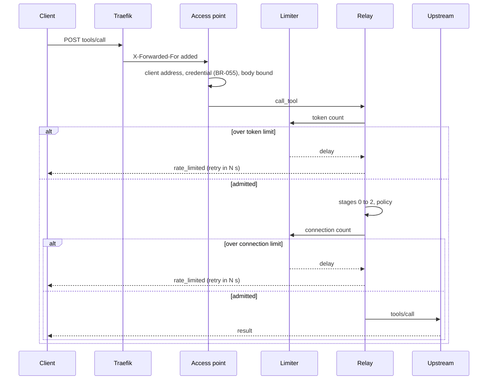
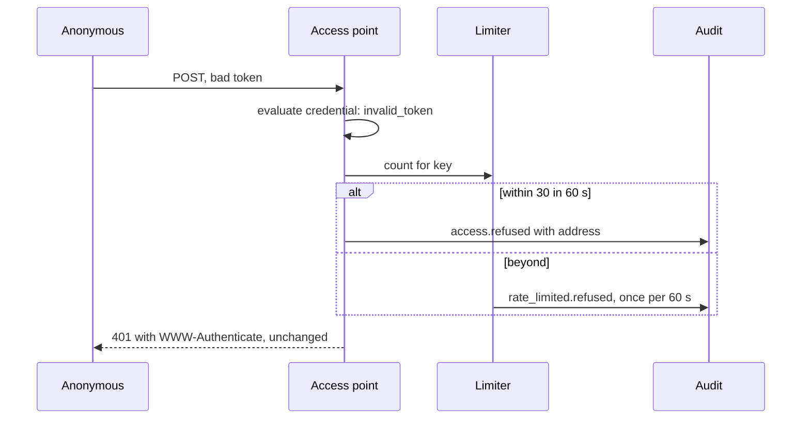
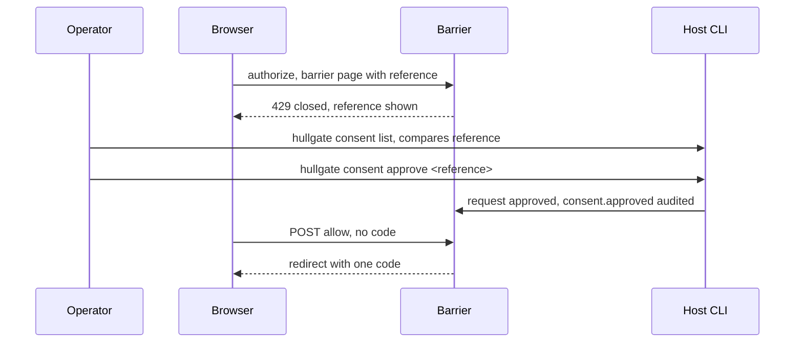

# F-020 · Rate limiting and trusted client address

## Metadata

| Field | Value |
|-------|-------|
| **Priority** | P2 |
| **Branch** | `feat/HULL-70-rate-limiting-client-address` |
| **Last updated** | 2026-11-17 |

## 1. Context & Objective

### Current State

Facts read on `main` at `309d0f0`, 2026-11-01, and on the open specs of the 1.0.0 run. The specification is the extract of attachment 45 of #1, cited by line.

- **No preventive limit exists.** The specification asks for rate limiting "per token and per connection to slow down a looping agent" (l. 505). F-006 and F-008 sent it to #12; the split gave it to this ticket. What exists is reactive or concurrent: 4 exchanges per connection and 32 in total (BR-108), a "not before" date after an upstream 429 (BR-124), neither of which stops a loop running at a rate the upstream tolerates.
- **Every refusal writes a row.** `RoleEndpoint._audit_refusal` and `AuthorizationServers._refused` write one audit row per refusal (BR-066), inside a write transaction. An anonymous client sending bad tokens grows the table and takes the write lock at its own rate, with no bound.
- **The OAuth routes are anonymous and unlimited** apart from the barrier. `register` (BR-066: actor `anonymous`) writes a client row per call when dynamic registration is on. F-005 §Out of Scope line 84 and F-008 line 78 asked to reconsider this here.
- **CIMD saturation** (comment 9775 on #12, F-005 §12): `Fetcher` holds 16 slots (`src/hullgate/cimd.py:36`) and answers `cimd_busy` when they are full. One anonymous source sending `client_id` URLs whose names resolve slowly keeps them full; legitimate CIMD clients are refused.
- **Barrier lockout** (BR-073, F-005 §12): the failure window is global because no reliable client address existed (`consent_failure` holds a time only, `oauth.py:1405`). One third party holding a valid pending request can keep authorisation closed for everyone by failing five codes per fifteen minutes. F-016's passkey lifts this only when a passkey is usable at the origin; with no public admin name on the production server (F-016 Q3, written on the tunnel) it is unreachable there, so the lockout stays this feature's to solve.
- **Client address.** F-016 BR-208 defines the address and `TRUSTED_PROXIES` for the console. The public listener reads no address. In `__main__.py` neither listener sets `proxy_headers`; uvicorn's default is on, and rewrites `scope["client"]` from `X-Forwarded-For` for a peer in `FORWARDED_ALLOW_IPS` (default `127.0.0.1,::1`), so the socket peer BR-208 reads is not always the socket peer.
- **Raw body.** `_read_body` (`mcp_endpoint.py:361`) reads a POST to the access point without bound; BR-129 bounds only the arguments, after parsing (F-008 §12). A token holder can exhaust memory with one request. The OAuth routes are already bounded (`BODY_MAX`, 64 KiB, `oauth.py:60`).
- **Behind Traefik.** On the production server every public request arrives from Traefik (BR-041). Without a declared proxy, every address-keyed limit below becomes one key shared by all callers. `deploy/compose.prod.yaml` sets no `TRUSTED_PROXIES`, and F-016 BR-230 requires it only when the admin route opens.

Nobody uses the gateway yet and all data on the production server is disposable (operator, 2026-11-01): nothing here migrates or preserves live data.

### Objective

Before real clients arrive (#13), one looping agent cannot exhaust a token's or a connection's calls unnoticed, and one anonymous source, one limit key (BR-301), cannot grow the audit at its own rate, fill the CIMD slots, shut the operator out of authorising a client or exhaust memory, with every limit keyed on an address that a client cannot forge.

### Expected Impact

- A loop on one token is stopped at 120 calls per minute by default, and told when to retry, with no upstream exchange.
- A flood of bad credentials from one key writes at most one audit row per minute beyond its first 30 refusals, instead of one per request, and legitimate clients sharing that key see no change.
- One key holds at most 2 of the 16 CIMD slots. A closed barrier no longer stops the operator: one pending request can be approved from the host, with no factor to guess.
- No access-point request holds more than 2 MiB of body in memory.

### Open Product Questions

None is left unanswered in the text; each is written on a default recorded in §9. Q1 is the operator's, open at the freeze.

- **Q1 · Barrier lockout.** Per-address windows would let a distributed attacker make 5 guesses per address per 15 minutes without bound, so a ceiling for all addresses must remain, and any ceiling leaves a lockout, re-closed by a few wrong POSTs faster than an operator can clear it. A guess succeeds with probability 3 in 10⁶ (current step ± 1, `keys.py:130`). Written on, by the orchestrator's arbitration (A11): (d) the global window stays at 5, 480 guesses a day and about 4.2% over 30 days of sustained attack, as today, and the lockout stops mattering to the operator through host approval of one pending request (BR-310). Options set aside: per-key windows with a ceiling of (b) 10, about 8.3%, or (c) 20, about 15.9%, which raise the guess rate and still lock out against a source with a few keys. Cost of (d): one rule, two commands, a third way past the barrier (BR-060 v3). Recommendation: (d). Confirmed at the freeze go of 2026-11-14: (d).

## 2. Scope

- **Client address on the public listener**: BR-208 reused unchanged, applied once per request; the HTTP server's own forwarded handling turned off on both listeners (BR-300). `X-Forwarded-For` is the only forwarded header read: URLs come from configuration (specification l. 842).
- **One limit key** for an address: IPv4-mapped forms folded, IPv6 grouped by /48 (BR-301), on every address-keyed limit, F-016's sign-in window included.
- **Production declares its proxies**: deployment refuses without `TRUSTED_PROXIES` (BR-302); the smoke proves a forged entry changes nothing (BR-315).
- **Tool-call limits**: per token and per connection, as two inherited settings (BR-303, BR-304), one window definition (BR-305), one result code (`rate_limited`, BR-116 v3).
- **Anonymous surface**: per-address budgets on the OAuth routes but `token` (BR-306) and on `register` (BR-307), and no audit write beyond a budget of unknown credentials (BR-308).
- **CIMD saturation**: at most 2 live fetches per address (BR-309).
- **Barrier lockout**: the global window stays exact under concurrency (BR-073 clarification), and the operator approves one pending request from the host (BR-310, BR-060 v3).
- **Raw body bound** on the access point (BR-311).
- **Audit of limits**: one coalesced entry per key and minute (BR-312), and the client address on refusal entries (BR-313).
- **Bounded limiter memory** (BR-314).

## Out of Scope

- **Limits on `tools/list` and other authenticated MCP methods.** The specification targets a looping agent's calls; `tools/list` is served from a cache (BR-112). A token holder flooding them costs CPU, and up to 2 MiB per concurrent request, since nothing bounds a holder's concurrent requests. Candidate for the backlog if HULL-68's events show it.
- **Alerts on limits** — HULL-69 reads `rate_limited.refused`, including its `suppressed` count.
- **Events and statistics of limited calls** — HULL-68. A limited call has no `relay.tool_call` row (BR-122 v3); see §9 Downstream.
- **Client address on entries other than refusals** — HULL-68 decides what its event carries.
- **Per-connection values stored on the connection.** The limit value is read at the role called (BR-304); a per-connection column, its CLI, export and console field are not worth it for 1.0.0.
- **Limit values for the anonymous surface as settings.** They are constants; no use yet justifies a knob.
- **A persistent limiter or several gateway processes.** One container, one process (§9). A restart clears the in-memory windows.
- **Enumeration of role paths at the access point.** A 404 is not counted or written, so role paths stay enumerable at full rate with no trace; accepted at F-005 (H13), and F-014's identifier gates them.
- **Slow-request defence** (a client trickling a body or headers). Bytes held are bounded by BR-311; time held belongs to Traefik's timeouts.
- **Traffic bound in the proxy.** Traefik's own `ratelimit` middleware is the host's choice, outside the project (specification l. 55).
- **A stale-while-busy CIMD cache.** It would serve revoked documents during an attack, against BR-062's 10-minute bound.
- **Barrier passkey on the production server** — F-016 Q3.
- **Migration of any data.** No user, disposable data.

## 3. Functional Spec

### 3.1 Client address

`client_address(scope)` is F-016's BR-208 function. The public application calls it once at the top of each request, for `PREFIX` routes and OAuth routes alike, and keeps the result in the request state. Probes never call it. `uvicorn.Config` receives `proxy_headers=False` on both listeners, so `scope["client"]` is always the socket peer.

The **limit key** of an address (BR-301) is its IPv4 form for an IPv4 or IPv4-mapped address, and the /48 prefix for IPv6. One limit key is what this spec calls one source. The audit keeps the full address (BR-313).

### 3.2 The limits at a glance

All windows are sliding (BR-305). Budget and window of the anonymous surface are constants.

| Rule | Surface | Key | Budget | Beyond it |
|---|---|---|---|---|
| BR-303 | `tools/call` | token | `token_rate_limit`, default `120/min` | tool result `rate_limited` |
| BR-304 | `tools/call` reaching the upstream | connection | `connection_rate_limit`, default `300/min` | tool result `rate_limited` |
| BR-306 | OAuth routes but `token`, and their metadata | limit key | 60 in 60 s | 429 |
| BR-307 | `register` | limit key | 20 in 1 h | 429 |
| BR-308 | Unknown credentials at the access point and at `token` | limit key | 30 in 60 s | same answer, no audit row |
| BR-309 | CIMD fetches in progress | limit key | 2 at once | `cimd_busy` |
| BR-073 | Wrong barrier codes | all | 5 in 15 min | barrier closed for TOTP |

Not limited: `/healthz` and `/readyz` (external monitoring), an authentic credential at the access point or at `token`, the admin listener (F-016 holds it).

### 3.3 Tool-call limits

The relay's chain, with F-015 in force, gains two checks:

1. **Token check**, first of all, before BR-129's stage 0. Same answer for a known or unknown name, so it reveals nothing.
2. Stages 0 to 2 as today, policy included.
3. **Connection check**, immediately before the upstream `tools/call`, after the policy has accepted. It cannot sit at the end of stage 1: there, a name hidden by policy would answer `rate_limited` where an unknown name answers "unknown tool", which BR-113 forbids.

A token is an operator token by its identifier, or an OAuth lineage: a refresh must not reset the count. `Caller` therefore carries the token key beside the `actor`, which for OAuth is the `client_id` and is shared across lineages.

Both limits count across roles: a token covering several roles has one count, a connection placed on several has one count, and each call compares that count with the effective value of the role it is made on (BR-048). So neighbours interfere: a `10/min` role sharing a connection with a role making 50 calls a minute is refused on every call, none of them its own (BR-304, §12).

The answer is the tool result of BR-116: `isError: true`, text `rate_limited (retry in N s)`, status 200. An agent reads it in its turn, which is what slows it.

### 3.4 Anonymous surface

OAuth routes: the budget is checked first in `AuthorizationServers.__call__`, before route parsing or any database read, and `token` is outside it. A refusal is a 429 with `Retry-After`: `{"error": "rate_limited"}` on the JSON routes, the generic page on `authorize` and `consent`.

Access point and `token`: the answers of BR-055 and of the token endpoint are unchanged, and the credential is evaluated as today. The budget changes one thing: an unknown credential (BR-308) beyond it writes no entry of its own. The reading stays; the write is what is removed.

### 3.5 CIMD

`Fetcher.document(client_id, key)`: besides the 16 slots, a live worker counts against its key; a third fetch for the same key answers `cimd_busy`. The worker holds its count for as long as it lives, as for the 16 slots: a slow resolver outliving the deadline stays counted. A document in cache takes no slot.

### 3.6 Barrier

The global window of BR-073 stays at 5 in 15 minutes. Its check and its count now run in one write transaction, so parallel POSTs cannot all pass the check before the first failure lands, and that transaction purges rows past the window.

The barrier page shows a **request reference** at all times, its closed page included: a short non-secret value derived from the request's stored hash. `hullgate consent list` prints the pending requests: reference, role, client, redirect host, expiry. `hullgate consent approve <reference>` marks one approved, audited as `consent.approved`. The browser holding that request then presses *Allow* with no code; the check of an approval comes before the check of the window, so a closed barrier does not stop it. The request keeps its 10 minutes and gives one code.

### 3.7 Raw body

On a POST to the access point: a `Content-Length` above 2 MiB is refused before reading; otherwise the read stops at the first byte beyond it. The answer is 413 `{"error": "request_too_large"}`, audited as `access.body_refused`, reason `request_too_large`. It is a new action because the credential has passed by then: BR-055's refusals and their reasons are untouched. 2 MiB leaves room above BR-129's 1 MiB of compact arguments for the envelope and for whitespace; a call between the two reaches BR-129 and gets its usual result.

### 3.8 Audit of limits

Action `rate_limited.refused` (`result: refused`, `reason: rate_limited`), one entry per (surface, key) and 60 seconds: the first refusal of a period writes it, later ones add to a count in memory, and the next entry carries that count as `detail.suppressed`. Fields: BR-312.

### 3.9 Settings

| Key | Form | Default | Declared by |
|---|---|---|---|
| `token_rate_limit` | `<n>/min`, 1 to 100000 | `120/min` | BR-048 clarification |
| `connection_rate_limit` | `<n>/min`, 1 to 100000 | `300/min` | BR-048 clarification |

Both are ordinary inherited settings: `hullgate settings set`, locks (BR-049), export, the console's settings panel and undo (F-016) all apply; the code adds a validator and the two seed rows at the organisation (`Tree.effective` needs them). There is no "off" value; an operator wanting none sets a high one. A change applies at the next call: the value is read from the base, the count from memory. An unreadable base at the token check answers as stage 1's read does today (BR-064, BR-116), and no call is forwarded.

### 3.10 Configuration and deployment

`TRUSTED_PROXIES` is F-016's variable (§3.16 there). `deploy/compose.prod.yaml` passes it and requires it (`${TRUSTED_PROXIES:?…}`); `deploy/env.example` documents it; the production server's runbook gains the step that reads it (BR-042). The value is the subnet of `TRAEFIK_NETWORK`, or Traefik's own address if its composition fixes one, which is better: Docker's gateway lies inside that subnet (§9 hypothesis).

Smoke harness (BR-315): `deploy/smoke/compose.traefik.yaml` gives Traefik a fixed address on a fixed subnet and sets `forwardedHeaders.insecure=true` on its entry point, so a forged entry does reach the gateway. `deploy/smoke/env.test` sets `TRUSTED_PROXIES` to that one address. Two probe containers on the same network are then clients outside the list, with distinct addresses.

## 4. Business Rules

### Naming Convention

`BR-NNN`, sequential and global: `conventions/br-identifiers.md`. Range allocated by the orchestrator: BR-300 to BR-319; BR-316 to BR-319 stay free.

### Lifecycle

Per `conventions/br-lifecycle.md`: inline here until `close-feature` Phase 3. Versions cited are those in force once F-015 and F-016 are merged.

### Overlap scan

Filter on the `Statement` column of `business-rules/index.md` (131 rules, 2026-11-01) on `débit|rate|limit|plafon|borne|adresse|address|proxy|forward|barri|fenêtre|429|Retry|corps|body|CIMD|saturat|concurr|simultan|places|taille|audit`: **18 lines retained of 131**, each opened.

Off topic, 11: BR-002, BR-020, BR-045, BR-065, BR-068, BR-072, BR-077, BR-093, BR-094 (renewal point, not the relay), BR-103, BR-131 (applies: the new codes are English).

Overlaps, 7 from the filter and 7 outside it, read because the filter missed them or because they live in open specs:

| Rule | Verdict | Resolution |
|---|---|---|
| BR-066 | overlap | new version (C2): a limit refusal no longer writes one entry per refusal (BR-312) |
| BR-073 | overlap | clarification (C3): read to the letter it already required an exact count; atomic check and purge made explicit |
| BR-060 | overlap | new version (C2): host approval is a third way past the barrier (BR-310) |
| BR-108 | overlap | new rule (C1): concurrency can be respected while a rate is exceeded, and the reverse |
| BR-116 | overlap | new version (C2): the closed list gains `rate_limited` |
| BR-122 | overlap | new version (C2): a limited call writes no per-call entry |
| BR-124 | overlap | new rule (C1): an upstream's date against a preventive count. Its clarification sends the preventive limit here; no change |
| BR-048 | overlap | clarification (C3): two settings declared, as F-015 did |
| BR-062 | overlap | new rule (C1), BR-309: the fetch bounds hold while one address fills the slots |
| BR-113 | overlap | new rule (C1): the chain is necessary, not sufficient; §3.3 places the connection check so that BR-113's indistinguishability holds |
| BR-129 | overlap | new rule (C1), BR-311, plus clarification (C3): its "raw read is not bounded" note now points here |
| BR-055 | overlap | new rule (C1), BR-308: its answers stay; the write goes. Listed since the first pass missed it (C1 of the stress-test) |
| BR-207 (F-016) | overlap | new version (C2): counted on BR-301's key |
| BR-208 (F-016) | overlap | new rule (C1), BR-300: BR-208 defines the address, BR-300 obliges the public listener to use it |

BR-161 (F-014): clarification (C3), a limit's 429 precedes its 404 on OAuth routes; no oracle, known and unknown paths behave alike.

BR-230 (F-016) is a neighbour of BR-302, off topic after reading: it conditions a route, BR-302 conditions every deployment. New rule (C1).

### One obligation per rule

BR-302 was split (BR-315). The others are one object each: BR-300 one reader, with the server's own reader off as its condition; BR-305 the definition of a window; BR-310 one approval; BR-314 one store's bounds. BR-301 and BR-305 are `definitional`. BR-300, BR-312, BR-313 and BR-314 are `behavioral`: the response to a violation is the red test of their control.

### BR-300 · The public listener reads the client address of BR-208 only

> **Extracted on 2026-11-15.** Current version: [`business-rules/BR-300.md`](../business-rules/BR-300.md).
> The content below reflects the state of this BR at the time of feature F-020 (v1).

*`behavioral` · `strict` · Candidate state: `verified` — `tests/integration/test_br_300_client_address.py`: a forged `X-Forwarded-For` from an undeclared peer, and from a loopback peer, leaves the address at the peer; a declared peer's header gives the rightmost entry outside the list, across several header lines; `tests/unit/test_br_300_single_reader.py`: a sweep of `src/hullgate` for `scope["client"]`, `request.client` and `x-forwarded` finds them in the address module alone.*

**Rule** — Every request to an access point or an OAuth route takes its client address from BR-208's function, and no other reader of the address exists on either listener; the HTTP server's own handling of forwarded headers is off.

**Clarifications**
- `X-Forwarded-For` only. `Forwarded`, `X-Real-IP`, `X-Forwarded-Host` and `X-Forwarded-Proto` are ignored: URLs come from configuration.
- The server's handling is off because it rewrites the peer for `127.0.0.1` and `::1` by default, which would make BR-208's "socket peer" forgeable from a loopback caller.
- A rightmost entry that does not parse as an address, or a header whose entries all lie in `TRUSTED_PROXIES`, is "no usable header" in BR-208's sense: the peer's address is used.
- Several `X-Forwarded-For` lines are joined in order before the rightmost reading, or a forged first line could be the one read.

### BR-301 · An address is limited by one key

> **Extracted on 2026-11-15.** Current version: [`business-rules/BR-301.md`](../business-rules/BR-301.md).
> The content below reflects the state of this BR at the time of feature F-020 (v1).

*`definitional` · `strict` · Candidate state: `verified` — `tests/unit/test_br_301_limit_key.py`: two addresses of one /48 share a key, two /48s do not, `::ffff:192.0.2.1` and `192.0.2.1` share a key.*

**Rule** — The limit key of a client address is its IPv4 form for an IPv4 or IPv4-mapped address, and its /48 prefix for an IPv6 address; every limit keyed on an address counts by it.

**Clarifications**
- One limit key is one source. A /48 is one site's usual allocation; a /64 would hand one holder 65 536 keys.
- A dual-stack host has two keys. Whether the production server answers on IPv6 is not read (§12); without an `AAAA` record this branch is dormant.
- The key is for counting. The audit keeps the full address (BR-313).

### BR-302 · A production deployment declares its proxies

> **Extracted on 2026-11-16.** Current version: [`business-rules/BR-302.md`](../business-rules/BR-302.md).
> The content below reflects the state of this BR at the time of feature F-020 (v1).

*`behavioral` · `strict` · Candidate state: `verified` — `tests/container/test_br_302_compose.py`: composition refuses an empty value; `test_br_032_config.py`, extended: an unparsable value stops startup.*

**Rule** — The production composition refuses to start with `TRUSTED_PROXIES` empty, and the gateway refuses to start with a value that does not parse as a list of CIDRs.

**Clarifications**
- Without it every caller shares Traefik's address: every address limit becomes global, and BR-309 leaves 2 CIMD slots for the whole instance.
- A wrong or stale value parses and passes. When a peer outside the list carries `X-Forwarded-For`, the gateway logs one line per hour naming the peer, so a recreated network shows.
- The value: §3.10. With a subnet, any container on that network can forge the header (§12).

### BR-315 · The smoke proves the client address through Traefik

> **Extracted on 2026-11-16.** Current version: [`business-rules/BR-315.md`](../business-rules/BR-315.md).
> The content below reflects the state of this BR at the time of feature F-020 (v1).

*`behavioral` · `strict` · Candidate state: `verified` — `deploy/smoke/probe.py` (`make prod-smoke`, control `client-address`), on the harness of §3.10.*

**Rule** — `make prod-smoke` fails unless, through Traefik and for clients outside `TRUSTED_PROXIES`, the audited address is the client's, a forged `X-Forwarded-For` entry does not change it, and two clients are counted apart.

### BR-303 · A token's tool calls are limited per minute

> **Extracted on 2026-11-15.** Current version: [`business-rules/BR-303.md`](../business-rules/BR-303.md).
> The content below reflects the state of this BR at the time of feature F-020 (v1).

*`behavioral` · `strict` · Candidate state: `verified` — `tests/integration/test_br_303_token_limit.py`: the call above the value gets `rate_limited` with its delay, 0 `get_access` and 0 upstream exchange (BR-002), an OAuth refresh does not reset the count, a token on two roles has one count.*

**Rule** — A `tools/call` beyond the effective `token_rate_limit` of the role called, counted per token across all its roles, is refused by `rate_limited` before any other check of the relay, with no `get_access` and no upstream exchange.

**Clarifications**
- A token is an operator token or an OAuth lineage. The count survives a refresh; it does not follow a new authorisation.
- The value is read at the role called: on a token covering two roles of different values, each call compares the one count with its own role's value.
- Calls refused later in the chain (unknown tool, policy, BR-129) were admitted here and count.

### BR-304 · A connection's tool calls are limited per minute

> **Extracted on 2026-11-15.** Current version: [`business-rules/BR-304.md`](../business-rules/BR-304.md).
> The content below reflects the state of this BR at the time of feature F-020 (v1).

*`behavioral` · `strict` · Candidate state: `verified` — `tests/integration/test_br_304_connection_limit.py`: two tokens on one connection share the count; the call above the value gets `rate_limited` with no upstream `tools/call`; a name hidden by policy still gets "unknown tool" while the connection is over its limit.*

**Rule** — A `tools/call` accepted by the policy, beyond the effective `connection_rate_limit` of the role called, counted per connection across all roles and tokens, is refused by `rate_limited` without an upstream `tools/call`.

**Clarifications**
- The check comes after the policy, or a hidden name would be distinguishable from an unknown one (BR-113). It therefore costs what a policy refusal costs: at most one `get_access` and one `tools/list`.
- A call counts once, even when a 401 renews the token and retries the exchange.
- Independent of BR-108 (concurrency) and BR-124 (the upstream's date): a call admitted here can still get `upstream_busy`.
- One count, so neighbours interfere: a role with a low value is refused by its neighbours' traffic, roles of different clients included (BR-078). Accepted: the count protects one upstream. The console's share warning (BR-079) should say so.

### BR-305 · A limit counts admitted requests in a sliding window

> **Extracted on 2026-11-15.** Current version: [`business-rules/BR-305.md`](../business-rules/BR-305.md).
> The content below reflects the state of this BR at the time of feature F-020 (v1).

*`definitional` · `strict` · Candidate state: `verified` — `tests/unit/test_br_305_window.py`, with an injected clock: the budget is exact over any window, a refused request does not extend the wait, the delay is exact to the second above, with a count above a lowered or mixed value.*

**Rule** — A budget of N in T holds over every span of T ending now; a request the limit refuses does not count, BR-308 excepted, and the delay returned is the time until the count falls below the value in force, that is until the (count − value + 1)th oldest counted request leaves the window, rounded up to the second.

**Clarifications**
- A refused request not counting is what lets a loop recover: a looping agent that keeps calling gets through at the budget's rate, no worse.
- With one value the formula is the oldest entry. It differs when the count exceeds the value: a lowered setting, or one count read against several roles' values (BR-303, BR-304).
- BR-073's window is the same definition, kept in the base.

### BR-306 · The OAuth routes are limited per address

> **Extracted on 2026-11-15.** Current version: [`business-rules/BR-306.md`](../business-rules/BR-306.md).
> The content below reflects the state of this BR at the time of feature F-020 (v1).

*`behavioral` · `strict` · Candidate state: `verified` — `tests/integration/test_br_306_oauth_budget.py`: the 61st request of a key in 60 s gets 429 with `Retry-After`, in JSON or as a page by route, with no database read; another key is served; `token` and the probes are not limited.*

**Rule** — A key gets at most 60 requests in 60 seconds across the OAuth routes other than `token` and their metadata; beyond it, the request gets 429 with `Retry-After`, before any database read.

**Clarifications**
- Routes: `authorize`, `consent`, `revoke`, `register`, RFC 8414 and RFC 9728 metadata, in their F-014 form.
- `token` is out because a valid refresh must never be refused on a shared address: anyone with a Claude.ai account who knows the public URL shares the egress key (§12).
- 60 covers a full connector flow several times over. The 429 precedes BR-161's 404, as route parsing comes after it.
- Purpose: it bounds what the other refusals write and how many CIMD fetches a key can start.

### BR-307 · Dynamic registration is limited per address

> **Extracted on 2026-11-15.** Current version: [`business-rules/BR-307.md`](../business-rules/BR-307.md).
> The content below reflects the state of this BR at the time of feature F-020 (v1).

*`behavioral` · `blocking` · Candidate state: `verified` — `tests/integration/test_br_307_register_budget.py`: the 21st `register` of a key in one hour gets 429 and writes no client row.*

**Rule** — A key gets at most 20 `register` requests in one hour; beyond it, the request gets 429 with `Retry-After` and writes no client.

**Clarifications**
- `register` is the only anonymous route whose success writes a durable row. BR-306 alone would allow 86 400 rows per day per key.
- Counted on top of BR-306. Unchanged when registration is off: 404.

### BR-308 · Unknown credentials stop writing beyond a budget

> **Extracted on 2026-11-15.** Current version: [`business-rules/BR-308.md`](../business-rules/BR-308.md).
> The content below reflects the state of this BR at the time of feature F-020 (v2, clarification amended on 2026-11-15; the v3 delta is recorded in §9).

*`behavioral` · `strict` · Candidate state: `verified` — `tests/integration/test_br_308_failed_credentials.py`: from the 31st on, a key's unknown credentials get BR-055's unchanged 401 and write no `access.refused`, a sustained flood stays silent, `revoked` and `out_of_scope` are always written.*

**Rule** — When a key has presented 30 unknown credentials in the last 60 seconds, a further one gets the answer it would have had, unchanged, and writes no entry of its own; every presented unknown credential counts, written or not.

**Clarifications**
- Unknown credential, closed list: at the access point the reasons `missing_token` and `invalid_token`; at `token`, `invalid_client`, a grant matching no stored code or refresh, `unsupported_grant_type`, and `invalid_target` when the request presents no grant matching a stored row. A client identifier is public: a refusal it alone carries proves no secret and counts as unknown. A refusal with an authentic credential (`revoked`, `node_deleted`, `audience_mismatch`, `out_of_scope`, `sensitive_requires_role_token`, `insufficient_scope`, reuse detection, `invalid_target` with a grant matching a stored row) is always written, with its actor: an attacker cannot hide it by spending the key first.
- BR-055 stays whole: same status, same `WWW-Authenticate`, so a third party on a shared key cannot hold the discovery signal away from a legitimate client.
- This reconsiders F-005 line 84. The aim is not guessing (256-bit tokens): it is the unbounded audit writes, hence no status change.
- Every request counts, an exception to BR-305: otherwise a sustained flood would fall back under budget each minute and write 30 rows a minute forever.
- A 404 is not counted (§Out of Scope).

### BR-309 · An address holds at most two CIMD fetches

> **Extracted on 2026-11-15.** Current version: [`business-rules/BR-309.md`](../business-rules/BR-309.md).
> The content below reflects the state of this BR at the time of feature F-020 (v1).

*`behavioral` · `strict` · Candidate state: `verified` — `tests/integration/test_br_309_cimd_slots.py`, with a test fetcher that blocks: a third live fetch of a key gets `cimd_busy` while another key's fetch proceeds; a fetch from cache takes no slot.*

**Rule** — A key has at most 2 CIMD fetches live at once; a further one is refused `cimd_busy`, audited as today, without taking one of the 16 slots.

**Clarifications**
- A worker that outlives its deadline stays counted, as for the 16 slots.
- Closes comment 9775 for one source. Eight keys can still fill the 16 (§12), which is eight IPv4 addresses or eight /48s; pre-registered clients and cached documents are untouched, as today.

### BR-310 · The operator approves one pending request from the host

> **Extracted on 2026-11-15.** Current version: [`business-rules/BR-310.md`](../business-rules/BR-310.md).
> The content below reflects the state of this BR at the time of feature F-020 (v1).

*`behavioral` · `strict` · Candidate state: `verified` — `tests/integration/test_br_310_consent_approve.py`: with the barrier closed, an approved request gets its code and no other request does; the code goes only to the holder of the request's cookie; an expired request cannot be approved; no route approves.*

**Rule** — `hullgate consent approve <reference>` approves exactly one pending request, which then passes the barrier without a factor, closed or not, and gets one code; no route of either listener can approve.

**Clarifications**
- The reference is not a secret and replaces nothing: the code still goes only to the browser holding the request's cookie and hidden field, within the request's 10 minutes.
- The operator reads the reference on their own page and compares it with `hullgate consent list`, which names role, client and redirect host. Approving someone else's request grants that client the role, the same risk as typing a TOTP code into a page.
- No guess is involved: the guess rate is unchanged and the window is untouched.
- Whoever runs this command can already create an operator token, so it adds no authority.
- Audited: `consent.approved`, actor `operator-cli`, role, client and reference; the issuance records `factor: host_approval`.

### BR-311 · An access-point request body is bounded at 2 MiB

> **Extracted on 2026-11-15.** Current version: [`business-rules/BR-311.md`](../business-rules/BR-311.md).
> The content below reflects the state of this BR at the time of feature F-020 (v1).

*`behavioral` · `strict` · Candidate state: `verified` — `tests/integration/test_br_311_body_bound.py`: 2 MiB is served, one byte more gets 413, with and without `Content-Length`; a refused `Content-Length` reads no body.*

**Rule** — A POST to an access point whose body exceeds 2 MiB (2 097 152 bytes) gets 413 `request_too_large` before the excess is held, and no option lifts this bound.

**Clarifications**
- It runs after authentication, so it binds a token holder; an anonymous caller is refused before any body is read.
- Audited as `access.body_refused`, reason `request_too_large`, with the actor: a credential has passed, so this is none of BR-055's refusals.
- BR-129's 1 MiB on compact arguments stays, audited on `relay.tool_call`.
- `VERSION_ERROR_BODY_MAX` and the OAuth routes' `BODY_MAX` keep their lower bounds.

### BR-312 · A limit refusal writes one entry per key and minute

> **Extracted on 2026-11-15.** Current version: [`business-rules/BR-312.md`](../business-rules/BR-312.md).
> The content below reflects the state of this BR at the time of feature F-020 (v1).

*`behavioral` · `blocking` · Candidate state: `verified` — `tests/integration/test_br_312_coalesced_audit.py`, with an injected clock: 1 000 refusals in a minute write one entry; the next period's entry carries the 999 in `suppressed`.*

**Rule** — Refusals under BR-303, BR-304, BR-306 and BR-307, and unknown credentials beyond BR-308's budget, write one `rate_limited.refused` entry per surface and key in 60 seconds, carrying `surface`, the key, and in `suppressed` the refusals of that surface and key not written since the last entry.

**Clarifications**
- `surface` is closed: `token`, `connection`, `oauth`, `register`, `credential`. Actor: the token's or `anonymous`. Node and path when known. `address` per BR-313.
- A count not yet written is lost at a restart, or if the source stops: a burst from a key that stops is recorded as one refusal. Accepted: the audit says a refusal happened, the count is a floor (§12).
- Written outside the serving path's result, as a refusal is today: it is served even if the write fails (BR-066).
- Departs from specification l. 801 ("each call produces a line") for limited calls alone, deliberately: a row per refused call is what a limit must not cost.

### BR-313 · A refusal entry on the public listener carries the client address

> **Extracted on 2026-11-15.** Current version: [`business-rules/BR-313.md`](../business-rules/BR-313.md).
> The content below reflects the state of this BR at the time of feature F-020 (v1).

*`behavioral` · `blocking` · Candidate state: `verified` — `tests/integration/test_br_313_audit_address.py`: each listed entry carries `detail.address`; `relay.tool_call` and an issuance do not.*

**Rule** — Every `access.refused` and `access.body_refused` entry, every refusal of an OAuth route, every barrier failure or closure and every `rate_limited.refused` entry carries the full client address in `detail.address`; no other entry does.

**Clarifications**
- `rate_limited.refused` on `token` and `connection` carries it too, for the request that opened the period.
- This is personal data. Under F-017 BR-243, `access.refused` and `rate_limited.refused` leave after 90 days; the `oauth.*`, barrier and `access.body_refused` entries, unlisted there, after 365.

### BR-314 · The limiter's memory is bounded

> **Extracted on 2026-11-15.** Current version: [`business-rules/BR-314.md`](../business-rules/BR-314.md).
> The content below reflects the state of this BR at the time of feature F-020 (v1).

*`behavioral` · `blocking` · Candidate state: `verified` — `tests/unit/test_br_314_bounded_state.py`: 10 001 keys leave 10 000, the oldest touched gone; a stale key is dropped.*

**Rule** — Each in-memory limit holds at most 10 000 keys, evicting the least recently touched, and drops a key once its window is empty; nothing of it is persisted but the barrier's failures.

**Clarifications**
- Eviction fails open for the key evicted: an attacker cycling more than 10 000 keys gets fresh budgets and BR-312 periods, not a crash. That takes 10 001 IPv4 addresses or /48s.
- A restart clears the windows, as with BR-124's date.
- One process (§9). A second replica would double every budget.

### BR-048 · Inherited settings (clarification)

> **Extracted on 2026-11-16.** Current version: [`business-rules/BR-048.md`](../business-rules/BR-048.md).
> The content below reflects the state of this BR at the time of feature F-020 (v3).

Add: `token_rate_limit` and `connection_rate_limit` are declared settings, form `<n>/min`, 1 to 100000, defaults `120/min` and `300/min` at the organisation.

### BR-066 · v6 · Audit (additions)

> **Extracted on 2026-11-16.** Current version: [`business-rules/BR-066.md`](../business-rules/BR-066.md).
> The content below reflects the state of this BR at the time of feature F-020 (v7).

*`behavioral` · `strict` · Candidate state: `verified` — existing test, extended.*

**Rule** — BR-066 v5 unchanged, with added to the events: `consent.approved`, `access.body_refused` and `rate_limited.refused`; and, as its one exception, a refusal under BR-303, BR-304, BR-306 or BR-307, and an unknown credential beyond BR-308's budget, are audited as BR-312 says rather than by one entry each.

### BR-060 · v3 · No code without the operator at the barrier or on the host

> **Extracted on 2026-11-16.** Current version: [`business-rules/BR-060.md`](../business-rules/BR-060.md).
> The content below reflects the state of this BR at the time of feature F-020 (v3).

*`behavioral` · `strict` · Candidate state: `verified` — existing test, extended, plus `tests/integration/test_br_310_consent_approve.py`.*

**Rule** — BR-060 v2 unchanged, with a third way added to the two factors: the operator's approval of that one pending request from the host (BR-310).

**Clarifications added**
- This is no weaker a proof than the barrier's factors: it requires the host, which holds the TOTP secret.
- With neither a TOTP secret nor a usable passkey, `/authorize` still refuses, so no request is pending to approve. Unchanged in 1.0.0.

### BR-073 · Clarification

> **Extracted on 2026-11-16.** Current version: [`business-rules/BR-073.md`](../business-rules/BR-073.md).
> The content below reflects the state of this BR at the time of feature F-020 (v2).

Add: the check of the window, the evaluation of the code and the count of a failure run in one write transaction, so that parallel entries cannot pass the check together, and that transaction purges rows past the window. Replace F-005's reference to the §12 risk: the lockout stands for TOTP, and BR-310 is what lifts it for the operator.

*`tests/integration/test_br_073_barrier.py`, extended: of ten concurrent wrong POSTs, at most five are evaluated.*

### BR-116 · v3 · Gateway failures come from a closed list

> **Extracted on 2026-11-16.** Current version: [`business-rules/BR-116.md`](../business-rules/BR-116.md).
> The content below reflects the state of this BR at the time of feature F-020 (v3).

*`behavioral` · `strict` · Candidate state: `verified` — existing test, extended.*

**Rule** — BR-116 v2 unchanged, with `rate_limited` (with its delay) added to the closed list.

### BR-122 · v3 · Each tool call is audited, limited calls through BR-312

> **Extracted on 2026-11-16.** Current version: [`business-rules/BR-122.md`](../business-rules/BR-122.md).
> The content below reflects the state of this BR at the time of feature F-020 (v4).

*`behavioral` · `strict` · Candidate state: `verified` — existing test, extended.*

**Rule** — BR-122 v2 unchanged, with one exception: a `tools/call` refused under BR-303 or BR-304 is audited as BR-312 says, with no `relay.tool_call` entry. Its closed issue list does not change.

### BR-129 · Clarification

> **Extracted on 2026-11-16.** Current version: [`business-rules/BR-129.md`](../business-rules/BR-129.md).
> The content below reflects the state of this BR at the time of feature F-020 (v2).

Replace "The raw body read … is not bounded by this rule (§Out of Scope)" by a pointer to BR-311.

### BR-207 · v2 · Sign-in attempts are limited by client address

> **Extracted on 2026-11-16.** Current version: [`business-rules/BR-207.md`](../business-rules/BR-207.md).
> The content below reflects the state of this BR at the time of feature F-020 (v2).

*`behavioral` · `strict` · Candidate state: `verified` — existing test, extended.*

**Rule** — BR-207 v1 unchanged, the address being counted by its limit key (BR-301), its 5 live challenges included.

### BR-161 · Clarification

> **Extracted on 2026-11-16.** Current version: [`business-rules/BR-161.md`](../business-rules/BR-161.md).
> The content below reflects the state of this BR at the time of feature F-020 (v2).

Add: on an OAuth route, a limit's 429 (BR-306) precedes the 404 of an unknown form; known and unknown paths behave alike.

## 5. Acceptance Criteria

- [x] **AC-01** (BR-300) A forged header from an undeclared or loopback peer changes nothing; a declared proxy's header gives the rightmost entry outside the list, across several lines; `uvicorn.Config` has `proxy_headers=False` on both listeners; the sweep finds one reader.
- [x] **AC-02** (BR-301) IPv6 by /48, mapped IPv4 folded, on every address limit including BR-207's.
- [x] **AC-03** (BR-302, BR-315) Composition refuses an empty `TRUSTED_PROXIES`, startup an unparsable one; `SMOKE client-address OK` from `make prod-smoke` on the harness of §3.10.
- [x] **AC-04** (BR-303, BR-305) At `5/min`, the sixth call gets `rate_limited (retry in N s)` with 0 `get_access` and 0 upstream entry; a call passes again N seconds later, including with the count above a lowered value; a refresh does not reset the count.
- [x] **AC-05** (BR-304) Two tokens on one connection share the count; a hidden name over the limit stays "unknown tool"; a 401 retry counts once.
- [x] **AC-06** (BR-048) `settings set`, inheritance, lock and export hold for both keys; a value outside the form is refused; a change applies at the next call.
- [x] **AC-07** (BR-306) The 61st OAuth request gets 429 and `Retry-After` in the route's format, without a database read; `token` and the probes are not limited.
- [x] **AC-08** (BR-307) The 21st `register` in an hour gets 429 and writes no row.
- [x] **AC-09** (BR-308, BR-055) From the 31st on, an unknown credential gets BR-055's unchanged 401 and writes no `access.refused`; a sustained flood stays unwritten; a `revoked` credential is always written; a valid token from that key is served.
- [x] **AC-10** (BR-309) A third live fetch of a key gets `cimd_busy`, audited, while another key proceeds.
- [x] **AC-11** (BR-073) Five failures close the TOTP entry; of ten concurrent wrong POSTs, at most five are evaluated; a passkey stays evaluated where usable.
- [x] **AC-12** (BR-310, BR-060 v3) With the barrier closed, `hullgate consent approve <reference>` lets that request, and no other, get its code in its cookie holder's browser, audited with `factor: host_approval`; an expired request refuses; no route approves.
- [x] **AC-13** (BR-311) 2 MiB passes, one byte more gets 413, by `Content-Length` and by stream.
- [x] **AC-14** (BR-312, BR-066 v6, BR-122 v3) 1 000 refusals write one entry; the next carries `suppressed: 999`; no limited call has a `relay.tool_call` row.
- [x] **AC-15** (BR-313) Refusal entries carry `detail.address`, other entries do not.
- [x] **AC-16** (BR-314) The store holds at most 10 000 keys.
- [x] **AC-17** (BR-116 v3) `rate_limited` is in the closed list and its text carries no token and no upstream URL.
- [x] **AC-18** All new codes, actions, setting keys and CLI words are English (BR-131); `make gate` passes.
- [x] **AC-OP-01** (BR-302, BR-315, operator, on the production server, after deployment) — from a machine outside the production server, on each address family `MCP_HOST` publishes (`dig A`, `dig AAAA`), `curl -4` or `-6 -X POST -H 'Authorization: Bearer bad' -H 'X-Forwarded-For: 203.0.113.9' https://$MCP_HOST/o/<id>/p/<path>/mcp`, then on the host `hullgate audit tail -n 3 --json`. **To post**: the `dig` output and the audit lines. **Readings to record**: the machine's public address for each family. **Patterns**: `"address": "<that reading>"` for each family, never `203.0.113.9`, never Traefik's or Docker's gateway address. This confirms the hypothesis of §9 for each path.

Evidence for the checked criteria (test paths relative to `tests/`). AC-03 and AC-18 cite the orchestrator's runs on `03f7a16`, repeated on the closure head `736d7de` (PR #102: `make gate` pass, `SMOKE: 6/6 OK`, 164 container tests passed). The runs of the acceptance are in `.cairn/runs/acts/HULL-70-acceptance-1.md`, round 2.

| Criteria | Demonstrating tests and runs |
|---|---|
| AC-01 | `unit/test_br_300_single_reader.py`, `integration/test_br_300_client_address.py` |
| AC-02 | `unit/test_br_301_limit_key.py`, `integration/test_br_207_live_challenge_keys.py::test_br_207_live_challenges_count_by_limit_key` (three cases; all fail without `auth.new_challenge`'s `limit_key` call) |
| AC-03 | Orchestrator on `03f7a16`: `make test-container` — 164 passed, including `container/test_br_302_compose.py`; `make gate` — pass, including `unit/test_br_032_config.py`; `make prod-smoke` — `SMOKE: 6/6 OK`, including `SMOKE client-address OK` on the §3.10 harness |
| AC-04, AC-05 | `integration/test_br_303_token_limit.py`, `integration/test_br_304_connection_limit.py`, `unit/test_br_305_window.py` |
| AC-06 | `unit/test_br_048_inheritance.py`, `integration/test_br_303_token_limit.py::test_br_303_count_above_a_lowered_value` |
| AC-07, AC-08 | `integration/test_br_306_oauth_budget.py`, `integration/test_br_307_register_budget.py` |
| AC-09 | `integration/test_br_308_failed_credentials.py` (v3 multi-value and single-query cases included) |
| AC-10 | `integration/test_br_309_cimd_slots.py` |
| AC-11 | `integration/test_br_073_consent_window.py`, `integration/test_br_060_passkey.py::test_br_073_totp_lock_does_not_lock_passkey` |
| AC-12 | `integration/test_br_310_consent_approve.py` |
| AC-13 | `integration/test_br_311_body_bound.py` |
| AC-14, AC-15 | `integration/test_br_312_coalesced_audit.py`, `integration/test_br_313_audit_address.py` |
| AC-16 | `unit/test_br_314_bounded_state.py` |
| AC-17 | `integration/test_br_303_token_limit.py::test_br_303_sixth_call_is_refused_before_anything`, `integration/test_br_116_error_hygiene.py` |
| AC-18 | Orchestrator on `03f7a16`: `make gate` — pass; review 623's development-surface language check confirms English codes, actions, setting keys and CLI words. This revision adds only English test and evidence text. |
| AC-OP-01 | Operator (`human:sstolz`), 2026-11-17, deployed reference `8222b8e`: `.cairn/runs/acts/HULL-70-acop-evidence.md` — `dig` output for both published families, the machine's public address per family, and the audit `address` equal to it (IPv4 at 21:22:35Z, IPv6 at 21:36:26Z); `203.0.113.9` absent. The first IPv6 run read Docker's gateway address, the case §9's hypothesis names; it held after the operator enabled IPv6 on Traefik's network on the host (outside the repository, backlog ticket #106). |

## 6. Diagrams

| Type | Decision |
|---|---|
| Userflow | Skipped: the operator's one new flow is drawn as a sequence (§6.3) |
| Sequence | Included: public request and tool call cross listener, limiter, relay, upstream |
| State machine | Skipped: a window has no states beyond its count |
| ER | Skipped: one column on `consent_request` |

### 6.1 Sequence — a tool call

### 6.2 Sequence — unknown credential at the access point

### 6.3 Sequence — barrier closed, host approval

## 7. States & Captures

- **Package-status**: absent. No design assets.

## 8. Design & Prototypes

No design assets. No console surface of its own: the two settings appear in F-016's inherited settings panel.

## 9. Implementation Notes

### Dependencies (prerequisite features)

- F-005, F-006, F-008 — implemented.
- **F-016 / HULL-11 — planned, must be Done first**: BR-208 and its function, `TRUSTED_PROXIES`, BR-207, BR-073 v2, BR-066 v5. Reused, not redone. It sits before this ticket in the milestone order.
- **F-015 / HULL-10 — planned, must be Done first**: the policy check §3.3 sits behind; `SETTINGS` declaration precedent.
- **F-014 / HULL-42 — planned, must be Done first**: the routes' `/o/<id>` form, read through `oauth.handles` and `PREFIX`.
- **F-011 / HULL-66, HULL-57** — English base and names: new code is English.
- **Downstream**:
  - HULL-13 (F-018 (a private operations spec of the maintainer, not published)): default limits meet its parallel sub-agents. Its soak watches `rate_limited.refused` (A13).
  - HULL-68 (F-017): a limited call has no `relay.tool_call` row, and BR-308 removes `access.refused` rows beyond the budget. `rate_limited.refused` with `suppressed` is the source for those counts; it joins BR-243's closed list as a traffic entry (A4).
  - HULL-69 (F-019): `rate_limited.refused` joins BR-293's population, weight `suppressed` + 1 (A4), for the verified-credential surfaces only (A9).
  - F-016 BR-211 maps or excludes `hullgate consent list` and `consent approve` (A12), and `proxy_headers=False` lands in its lot A (A12); BR-300 then only keeps it.
  - F-017 and F-019 version BR-066, and F-017 BR-122, after this feature's v6 and v3 (milestone order).
- Declaration terms: this spec coins *limit key*, *budget*, *anonymous surface*, *coalesced refusal* and *request reference*. The orchestrator writes them before the freeze (X17).

### Technical Constraints

- Python 3.13, Starlette, SQLite. No new dependency: `ipaddress`, `collections.OrderedDict`, a lock.
- One process serves the public listener: in-memory counts are exact there. The CLI is another process: it reads and writes settings and `consent_failure` through the base, never the windows.
- The limiter is called from the event loop and from worker threads (`relay.call_tool` runs in a thread): one lock, held for constant work, no I/O under it.
- A limit refusal writes nothing in the serving path but the coalesced entry, written like a refusal today; the setting's read from the base stays on each call.

### Architecture Decisions

Every line below is **tranché en autonomie déléguée**, unless marked raised.

| Question | Decision | Rationale |
|---|---|---|
| Readiness | `ready`. Two parts: limits keyed on token, connection or address, sharing one window (BR-305) and audit (BR-312); and the raw body bound, which shares neither and could ship alone. Read literally, tool-call limits and address limits could be accepted apart, which would make three parts and a `split`. Held together by BR-305, BR-312 and the operator's go of 2026-11-01, which carved this ticket out of #12 with this list and the reason "security hardening, to land before #13". | Two parts are no `split`; a second split of a child would undo the operator's go. The stress-test found no axis requiring one. |
| Client address | Reuse BR-208 unchanged; only `X-Forwarded-For` | Specification l. 842 fixes URLs by configuration. Coordinator's note, 2026-11-01. |
| Uvicorn's own handling | Off on both listeners (BR-300) | Its default trusts loopback peers; BR-208 would otherwise read a rewritten peer |
| IPv6 key | /48 | A /64 gives one site 65 536 keys. Coarser than one host, accepted: one operator, few clients |
| Limit values for tool calls | Two inherited settings, read at the role called, counted across roles | No schema, CLI, export or console change: `settings` gives them all. Per-connection column refused (§Out of Scope) |
| Default values | Token `120/min`, connection `300/min` | Unmeasured starting points; one token alone cannot take a connection's whole budget. Revisit after the HULL-13 soak |
| Off value | None | A guard you can switch off gets switched off; a high value is one command |
| Place of the connection check | After policy, before upstream `tools/call` | At the end of stage 1 it would reveal a hidden name (BR-113) |
| OAuth key | Lineage, not `client_id` | A refresh must not reset; `client_id` is shared across lineages |
| Result of a tool-call limit | Tool result `isError`, status 200 | Same as `upstream_busy`; the agent reads it in its turn. An HTTP 429 would look like transport failure to the SDK |
| Credentials vs address budget | Always evaluated, answers unchanged, `token` outside the 429 budget; only the write of an unknown credential goes (A11) | A shared address must not shut out a token holder, nor hold BR-055's 401 away from a client that needs it to rediscover |
| Anonymous budgets | Constants: 60/60 s, 20/h, 30/60 s, 2 fetches | No use justifies a knob; values in §3.2 |
| Connection count | One count per connection, neighbours interfere | The count protects one upstream; a count per (connection, role) needs a connection's own value, refused above |
| Window shape | Sliding log | Exact, testable, same as BR-073 and BR-207; memory bounded by BR-314 |
| Audit of limited requests | Coalesced, with `suppressed` | A row per refused call is the cost limits exist to remove. Departs from specification l. 801 for these calls |
| Address in audit | Refusals and barrier failures only | Enough to read an attack; the rest is HULL-68's question on personal data |
| Barrier lockout | Window stays global at 5, plus host approval of one pending request (BR-310). **Orchestrator, A11; open at the freeze, Q1** | See Q1. A clear command loses the race: re-closing takes five POSTs |
| Body bound | 2 MiB | Twice BR-129's bound, room for envelope and whitespace |
| Live data | No migration, no compatibility | Operator, 2026-11-01: nobody uses it, data is disposable |
| Hypothesis: Traefik | Traefik is the socket peer on `TRAEFIK_NETWORK`, nothing stands in front of it, and it sets or appends `X-Forwarded-For`. **To confirm at AC-OP-01**, not read on the production server in this act (no production action). If a CDN stands in front, `TRUSTED_PROXIES` gains its ranges; no rule changes. The reading fails if a client reaches Traefik through Docker's gateway, as `docker-proxy` does on a host IPv6 address when the bridge has none, or by hairpin: the gateway lies inside a declared subnet, so such clients share Traefik's key, or with `forwardedHeaders` on could forge an entry. Hence AC-OP-01 on each family, and Traefik's own address where it can be fixed | BR-208's rightmost-untrusted reading holds for one hop outside that case |

No new `status` value: step 23a does not apply.

### Data Model Impact

- Schema step at the next free migration number: `consent_request` gains `approved_at INTEGER`; two seed rows in `setting` at the organisation (`token_rate_limit`, `connection_rate_limit`). No data carried.
- F-016's `admin_attempt.address` and its live-challenge count hold the limit key (BR-207 v2).
- The request reference is derived from `consent_request.hash`, not stored.

### Components to Create / Modify

**Created**
- `src/hullgate/limits.py` — sliding windows, bounded store, coalesced refusal counts, limit key.
- `tests/unit/test_br_301_limit_key.py`, `test_br_305_window.py`, `test_br_314_bounded_state.py`.
- `tests/unit/test_br_300_single_reader.py`, `tests/integration/test_br_300_*.py`, `test_br_303_*` to `test_br_313_*`.
- `tests/container/test_br_302_compose.py`.

**Modified**
- `src/hullgate/__main__.py` — `proxy_headers=False`.
- `src/hullgate/app.py` — client address in request state, limiter built once for the listener.
- `src/hullgate/mcp_endpoint.py` — BR-308, BR-311, token key on `Caller`.
- `src/hullgate/authorization.py`, `access_tokens.py` — lineage reaches `Outcome`.
- `src/hullgate/relay.py` — token and connection checks.
- `src/hullgate/oauth.py` — BR-306, BR-307, BR-308 at `token`, BR-073's atomic count, approval check, address on refusals, reference on the barrier pages.
- `src/hullgate/cimd.py` — per-key count.
- `src/hullgate/tree.py` — two settings. `src/hullgate/audit.py` — new actions.
- `src/hullgate/cli.py` — `consent list`, `consent approve`.
- The console's sign-in module (F-016) — BR-207 v2.
- `src/hullgate/migrations.py` — schema step.
- `deploy/compose.prod.yaml`, `deploy/env.example`, `deploy/smoke/*`, the production server's foundation runbook.

### Pitfalls Discovered

- **Already in place from F-016.** `proxy_headers=False` was set on both listeners by F-016 lot A (A12), and an unparsable `TRUSTED_PROXIES` already stops startup (BR-032 v4): BR-300 keeps the first, BR-302's startup half is the second. Both are pinned again by `tests/unit/test_br_300_single_reader.py` and `test_br_032_config.py`.
- **The single reader had two copies.** F-016's admin wrapper read the peer and `X-Forwarded-For` itself before calling BR-208's function. The reading moved into the address module (`scope_address`, `src/hullgate/admin/client_address.py`), which both listeners now call; the sweep of BR-300 would otherwise have found two readers.
- **Refusal entries are written in worker threads.** The address reaches them through a context variable (`limits.CLIENT_ADDRESS`, set once per request beside `scope["state"]["client_address"]`), which anyio copies into `to_thread` calls, so no signature of the many refusal writers changed.
- **Frozen test clocks.** The suite injects a fixed wall clock into most apps; a window on that clock never slides. The limiter takes its own monotonic clock (`Limits(clock=…)`), injected by the tests of F-020 alone.
- **The barrier's passkey** (F-016 BR-073 v2) is not on `main` yet: AC-11's "a passkey stays evaluated where usable" has nothing to evaluate in this PR; the atomic transaction covers the TOTP path, the only one.

### Implementation deltas

- **Migration number: 11.** F-014 (HULL-42) keeps migration 10 (orchestrator decision, 2026-11-15, review 585 S1). F-014 merged first (`7594827`) and `main` is merged into this branch: the runner applies 10 then 11, on a fresh database and on one at 9 (`test_br_069_fresh_and_version_9_databases_get_10_then_11`).
- **Limits on F-014's `/o/<id>/…` routes** (review 585, raise 3). Every route family reads the client address (BR-300) before anything else. BR-306's budget is taken in the authorization server before step 1 reads the identifier, so a foreign well-formed identifier, an unknown role and the instance's own route spend one budget and answer alike, 404 under it and 429 beyond it: the limiter is no oracle on the identifier. An unknown form of an authorization route (raw or decoded path naming `/oauth/` or a `/.well-known/oauth-` prefix) is counted too and answers the same 404 (BR-161 clarification); other unknown paths keep F-014's 404, uncounted. `token` and the access point stay outside BR-306; their step-1 404s are no unknown credential (BR-308). No redirect is added: the limiter answers 429 or lets the request through.
- **Phase 2 deployment implementation.** The composition now requires `TRUSTED_PROXIES`; the operator step is P1 in `docs/guides/admin.md` (the admin runbook, rather than the foundation runbook named above). The smoke uses a fixed subnet and Traefik address, preserves forged forwarding headers, and verifies 30 audited credential refusals plus one coalesced refusal for each of two untrusted client addresses. At Phase 2 its total was five controls; at closure on `03f7a16` it is six, including the added `edge-404` control. Gateway startup validation already existed; the P1 follow-up also rejects a non-empty `TRUSTED_PROXIES` value that yields no network. `make prod-smoke` observed `SMOKE: 5/5 OK` on `8a4ed4b`, replayed 5/5 by review 603 on `eda6e5e`. BR-302 and BR-315 stayed inline at Phase 2; extracted at this closure (2026-11-16).
- **Token key.** `Credential.token_key` is `operator:<id>` or `lineage:<id>`, carried by `Outcome` and `Caller`; it keys BR-303's count and BR-312's `key` for the `token` surface. The connection surface's key is the connection identifier.
- **One read for both values.** The token check reads `token_rate_limit` and `connection_rate_limit` of the role called in one read; the connection check uses the value read then. A role gone between the two reads skips the token check, and stage 1 answers "unknown tool".
- **BR-308 v2 at `token`.** The shared unknown-credential budget now includes `unsupported_grant_type` and `invalid_target` with no stored grant, including absent, empty or multiple unknown values. A matching stored code or refresh token keeps `invalid_target` always written with its actor, including when a malformed multi-value form contains that credential. **v3 delta (2026-11-16):** this protection now applies whatever the refusal, including `invalid_grant` with the right resource and `invalid_client`; all values of the grant type's own field are checked in one query, independently of exchange validation. A multi-value form consumes no grant. Responses are unchanged; this supersedes the Phase 1 exclusion of grant-less requests and unsupported grant types.
- **One key's credential log holds at most its budget.** A counted refusal drops the oldest entry beyond 30, so a flood keeps 30 timestamps, not one per presentation; the decisions are those of the full log (review 585, N2).
- **Rate expression bounded.** `RATE_RE` takes 1 to 6 digits, so a value of thousands of digits is the ordinary `invalid rate` refusal, never an exception from `int()` (review 585, N1).
- **The button is *Authorize*.** §3.6 says the operator presses *Allow*; the barrier page's button reads "Authorize" (unchanged since F-005), so the CLI's approval line names "Authorize" (review 585, N3).
- **Request reference.** The first 8 hexadecimal digits of SHA-256 of `reference:` + the stored hash, shown `xxxx-xxxx`; `consent approve` refuses an ambiguous reference. An approved request consumes no TOTP step (`totp_used` untouched). `consent list` makes the client and host it prints inert for a terminal (`pinning.escaped`).
- **BR-207 v2.** The limit key is applied inside `accounts.limited`, `accounts.record_failure` and `auth.new_challenge`, so `admin_attempt.address` and `webauthn_challenge.address` hold the key; the audit keeps the full address.
- **Body read in one place.** `_read_body(scope, receive, limit)` serves BR-311's 2 MiB bound and the version-error path's 64 KiB, so ticket #85 (read deadline, authorisation re-check) has one place to change. Not done here. It accumulates into one growing buffer: a body trickled in 1-byte events (which uvicorn delivers one per write) holds of the order of the bound, not one object per event (review 585, B2: 178 MiB traced before for 2 MiB).
- **Extraction at this PR, phase 1's rules only.** BR-300, BR-301, BR-303 to BR-314 are extracted (v1). Left inline until the closure that follows Phase 2: BR-302 and BR-315 (Phase 2), and every touched rule. Their bases are not where §4 says: BR-122 is already at v3 on `main` (F-015's clarification), so this spec's "v3" is a v4 in the file; BR-060 v2, BR-066 v5 and BR-073 v2 are F-016's, still inline in F-016 (open), and BR-066's file v5 is F-015's; BR-161 (F-014) and BR-207 (F-016) have no file yet. The code implements §4 as written (BR-048 clarification, BR-060 v3, BR-066 v6, BR-073 clarification, BR-116 v3, BR-122 v3, BR-129 clarification, BR-161 clarification, BR-207 v2); the numbering is settled at the extraction, after F-016's and F-014's.
- **Closure extraction (2026-11-16).** All 16 introduced rules now have standalone files. The nine touched rules carry F-020: BR-048, BR-073, BR-129 and BR-161 are clarifications without a version; BR-060 v3, BR-116 v3 and BR-207 v2 implement the named changes. BR-066 takes v7 (F-016 already used v6), BR-122 takes v4 (F-015 already used v3); §4 retains the drafted numbering. BR-207 was still inline in F-016: its v1 was extracted verbatim and archived before v2. Existing clarifications remain verbatim; notes name those no longer exhaustive or applicable. F-016's passkey implementation is now present and its barrier tests cover AC-11's remaining clause.
- **Closure validation boundary.** AC-02 now has a dedicated gate test for live-challenge /48 grouping and mapped IPv4 folding, with a negative control removing `auth.new_challenge`'s `limit_key` call (all three cases fail; the call is restored). On `03f7a16` the orchestrator ran `make gate` — pass, `make prod-smoke` — `SMOKE: 6/6 OK`, and `make test-container` — 164 passed. The six counted smoke controls in `deploy/smoke/smoke.sh` are `deploy-ok` (success reported as `DEPLOY: OK <sha>`), `traefik-route`, `admin-not-routed`, `client-address`, `deploy-ko-readable` and `edge-404`; `admin-routed` substitutes for `admin-not-routed` when `SMOKE_ADMIN_HOST` is set. Those instruments support AC-03 and AC-18 as recorded in §5. These are the orchestrator's observations on that head, not new runs by this coding task; the three commands were repeated on the closure head `736d7de` (PR #102: `make gate` — pass, `make prod-smoke` — `SMOKE: 6/6 OK`, and `make test-container` — 164 passed). This task's non-Docker validation and exact counts are recorded in `.cairn/runs/acts/HULL-70-codex-implementation-5.md`. The operator's check AC-OP-01 was played on 2026-11-17 on the deployed reference `8222b8e` (§5). Installation O5 pins `REF` once, P1 validates it, and O6 deploys that same value.
- **Ticket #89** (`client_id` printable and bounded) did not ride: it changes `authorize`'s refusal semantics and the CLI's audit rendering, beyond the refusals this PR writes.
- **Measured against the audit's probes** (`.cairn/runs/acts/milestone-1.0.0-codex-global-verify-1-probes.py`, which pass when the defect is observed): F3 now fails as intended, an authenticated 64 MiB body gets 413 in 0.1 s with a traced peak of 5.1 MiB (192 MiB before); F6 too, 5 of 40 concurrent wrong codes evaluated (11 and 13 before), 35 answered 429.

## 10. Phases

One PR, one branch. Delta (orchestrator instruction, 2026-11-15): Phase 1 ships in its own PR, Phase 2 in a later act; the spec stays `in-development` and the ticket open until then.

### Phase 1 — Limits

- [x] BR-300, BR-301, BR-305, BR-314 first: every other rule stands on them.
- [x] Tool calls (BR-303, BR-304), anonymous surface (BR-306 to BR-309), barrier (BR-073, BR-060 v3, BR-310), body (BR-311), audit (BR-312, BR-313).
- [x] `make gate`; bench replay if the diff touches what BR-037 names — it does not (no `mcp` or `mcp-types` change): no replay.

### Phase 2 — Deployment

- [x] BR-302, BR-315: composition, env example, runbook step, smoke harness and control; `make prod-smoke`.
- [x] Closure implementation: BR-308 v3 refusals, O5/P1/O6 pinned reference, BR extraction and touched-rule reconciliation, changelog and capability map. Local validation and remaining checks: `.cairn/runs/acts/HULL-70-codex-implementation-4.md`.
- [x] After the merge, operator's step: read the Traefik network and set `TRUSTED_PROXIES` on the production server before the deployment, which otherwise refuses. This is outside the standing go (BR-043 counts a read). Then deployment under BR-043; AC-OP-01. Done on 2026-11-17, deployed reference `8222b8e`; AC-OP-01 held on IPv4 at once and on IPv6 after IPv6 was enabled on Traefik's network on the host (backlog ticket #106).

## 11. Tests

### Unit

| Test | BR | File |
|---|---|---|
| `test_BR_300_*` | BR-300 | `tests/unit/test_br_300_single_reader.py` |
| `test_BR_301_*` | BR-301 | `tests/unit/test_br_301_limit_key.py` |
| `test_BR_305_*` | BR-305 | `tests/unit/test_br_305_window.py` |
| `test_BR_314_*` | BR-314 | `tests/unit/test_br_314_bounded_state.py` |

### Integration

| Test | BR | File |
|---|---|---|
| `test_BR_300_*` | BR-300 | `tests/integration/test_br_300_client_address.py` |
| `test_BR_303_*` | BR-303, BR-002 | `tests/integration/test_br_303_token_limit.py` |
| `test_BR_304_*` | BR-304, BR-113 | `tests/integration/test_br_304_connection_limit.py` |
| `test_BR_306_*`, `test_BR_307_*` | BR-306, BR-307 | `test_br_306_oauth_budget.py`, `test_br_307_register_budget.py` |
| `test_BR_308_*` | BR-308 | `tests/integration/test_br_308_failed_credentials.py` |
| `test_BR_309_*` | BR-309 | `tests/integration/test_br_309_cimd_slots.py` |
| `test_BR_073_*`, `test_BR_310_*` | BR-073, BR-060 v3, BR-310 | existing file extended, `test_br_310_consent_approve.py` |
| `test_BR_311_*` | BR-311 | `tests/integration/test_br_311_body_bound.py` |
| `test_BR_312_*`, `test_BR_313_*` | BR-312, BR-313, BR-066 v6, BR-122 v3 | `test_br_312_coalesced_audit.py`, `test_br_313_audit_address.py` |

### Container

| Test | BR | File |
|---|---|---|
| `test_BR_302_*` | BR-302 | `tests/container/test_br_302_compose.py` |
| `SMOKE client-address` | BR-315 | `deploy/smoke/probe.py` |

Existing tests of BR-048, BR-116, BR-129 and BR-207 are extended by a case each. The test tree carries many refusals in a row: tests that do so must use a limiter they inject, or BR-306 and BR-308 will trip them. Any new test block is "the next free block".

## 12. Risks & Watchpoints

- **Security — neighbours on the Traefik network.** With a subnet in `TRUSTED_PROXIES`, any container on that network can reach the public listener and forge `X-Forwarded-For`, evading address limits. They are the operator's own containers; the barrier's window and the tool-call limits still hold.
- **Security — one source.** A source is one limit key. Eight keys fill the 16 CIMD slots; 10 001 keys evict the limiter's store (BR-314). Pre-registered clients and cached documents are untouched. Whether the production server answers on IPv6 is not read: if it does, a /32 holds 65 536 keys, and HULL-69's alerts are what makes it visible.
- **Security — barrier lockout.** The global window stays: a third party holding a valid pending request can still close the TOTP entry, as today. Existing tokens are untouched, and the operator passes by BR-310, which needs the host. A distant operator without SSH waits, as today.
- **Security — approving the wrong request.** BR-310 relies on the operator comparing the reference. A pending request an attacker opened shows in `consent list`, and approving it grants that client the role.
- **Functional — shared egress addresses.** `register` and metadata come from the client's servers. All Claude.ai traffic may share addresses, and anyone with a Claude.ai account who knows the public URL (the identifier is public, BR-160) shares that key: they can spend its 60 a minute and 20 `register` an hour, delaying a new connection. Refreshes are out of reach (`token` is outside the budget) and existing lineages keep working. Not read on a real client; to watch during HULL-13.
- **Functional — neighbours on a connection.** One count, so one client's loop can refuse another's calls, and `retry in N s` reflects the other's traffic (BR-304). BR-078's share warning does not say so yet.
- **Functional — default limits against parallel agents.** Unmeasured; §9 Downstream.
- **Operations — first deployment.** The composition refuses until `TRUSTED_PROXIES` is set on the production server: intended, and a step of Phase 2. A wrong subnet parses, and shows only in the hourly log line, AC-OP-01 and `detail.address` showing Traefik's address.
- **Operations — audit growth.** BR-308 bounds unknown credentials to 30 rows, then 1 a minute per key while the flood lasts. BR-306 still admits up to 60 OAuth requests a minute per key, each of which may write one refusal: at most 86 400 rows a day per key, in a table with no retention until HULL-68, and 365 days after it for `oauth.*`.
- **Observability — `suppressed` is a floor.** A burst from a key that stops, or a restart, loses its count (BR-312, stress-test m14). F-019's burst reads that figure, so a short burst can stay under its threshold. Accepted: a flush would need a periodic task this feature does not otherwise have.
- **Privacy.** Client addresses enter the audit (BR-313), for the durations stated there.
- **Technical — test suite.** Limits apply to tests by default; §11.
- **Technical — memory.** BR-305's sliding log at the settings' upper bound holds 100 000 timestamps per key. The token and connection stores hold few keys and the address budgets are small, so the real size is small. Noted so that nobody raises the budgets blindly.

## Stress-test

**Passe du 2026-11-01** — model:claude-opus-5-5 (delegated, product, devil's advocate), six axes.
**31 findings — 1 critical, 11 major, 19 minor ; 31 retenus, 0 écartés.**

Arbitrated by the orchestrator (`.cairn/runs/acts/milestone-1.0.0-arbitration-1.md`, Pass 4, A4, A11), applied by the author by retouch. Full statements: `.cairn/runs/acts/HULL-70-stress-test-1.md`.

Critiques :
- **C1** · axe F · BR-308 vs BR-055 — a 429 replaced a `strict` rule's 401 and held discovery away from clients sharing a key. Sort : corrigé — BR-055's answer unchanged, only the write goes (A11).

Majors :
- **M1** · axe F · Expected Impact vs BR-305 — a sustained flood wrote 31 rows a minute. Sort : corrigé — every unknown credential counts, an exception to BR-305; OAuth's true figure in §12; Objective narrowed.
- **M2** · axe A · BR-301, BR-309, BR-314 — "one source" undefined, a /48 held 65 536 keys. Sort : corrigé — one source is one limit key, IPv6 by /48, sentences corrected, IPv6 at the production server stated as not read.
- **M3** · axe B · BR-310 — the clear loses the race to re-closing. Sort : corrigé — replaced by host approval of one pending request, BR-060 v3 (A11).
- **M4** · axe B · BR-073 — the count was not exact under concurrency. Sort : corrigé — one write transaction, concurrent test in AC-11.
- **M5** · axe F · BR-305 — the delay was wrong with a count above the value. Sort : corrigé — delay to below the value in force, mixed case tested.
- **M6** · axe B · BR-304 — neighbours on a connection interfere. Sort : corrigé — stated in §3.3, BR-304, §9 and §12; one count kept, a per-role count needing a connection's own value.
- **M7** · axe F · BR-306 vs §9 — a valid refresh could be refused on a shared key. Sort : corrigé — `token` out of BR-306, its unknown grants under BR-308; §12 rewritten with the third party.
- **M8** · axe B · §9 hypothesis — a client through Docker's gateway breaks the reading. Sort : corrigé — case stated, AC-OP-01 per family, all-entries-in-list named in BR-300, Traefik's own address preferred.
- **M9** · axe A · BR-302, AC-03 — the smoke's clients were trusted addresses. Sort : corrigé — harness in §3.10, split out as BR-315. Clause question re-asked: bounded to one control, on the named harness.
- **M10** · axe A · BR-300 — several header lines unspecified. Sort : corrigé — joined in order, tested.
- **M11** · axe A · BR-308 — "refused" and "valid" overlapped. Sort : corrigé — closed list of unknown credentials; authentic refusals always written.

Minors :
- **m1** · axe A · BR-300 — no instrument for "no other reader". Sort : corrigé — sweep added. Clause question re-asked: three named patterns, one tree.
- **m2** · axe A · AC-OP-01 — no protocol. Sort : corrigé — rewritten on F-016's form. Clause question re-asked: bounded, readings not asserted.
- **m3** · axe A · six rules — no response named. Sort : corrigé — BR-301, BR-305 `definitional`; the rest named in §4.
- **m4** · axe A · six rules — several obligations. Sort : corrigé — BR-302 split, the rest argued in §4.
- **m5** · axe A · §9 — terms unanswered. Sort : corrigé — line in §9 (X17).
- **m6** · axe F · BR-310 vs BR-073 — contradiction. Sort : corrigé — sentence gone with the clear.
- **m7** · axe F · §9 — "no I/O". Sort : corrigé — sentence corrected.
- **m8** · axe B · BR-303 — base unavailable. Sort : corrigé — §3.9.
- **m9** · axe F · §3.9 — seed rows. Sort : corrigé — schema step.
- **m10** · axe E · BR-306 vs BR-161 — Sort : corrigé — BR-161 clarification, `br-touched`.
- **m11** · axe E · BR-207 v2 — table and module absent. Sort : corrigé — §9.
- **m12** · axe E · durations, `consent_failure` purge. Sort : corrigé — real durations in BR-313, purge in BR-073; F-017 aligns (A4). The key column on that table went with the per-key window.
- **m13** · axe B · BR-302 — wrong values pass. Sort : corrigé — unparsable refused, hourly log line.
- **m14** · axe B · BR-312 — lost `suppressed`. Sort : accepté — no periodic task here; risk in §12 with F-019 in view.
- **m15** · axe D · BR-308 — 404 enumeration. Sort : différé — §Out of Scope, citing H13.
- **m16** · axe D · BR-311 — concurrent bodies. Sort : différé — §Out of Scope, "CPU only" corrected.
- **m17** · axe A · §9 defaults — unmeasured claims. Sort : corrigé — dropped.
- **m18** · axe C · readiness — R2 undefined, body bound independent. Sort : corrigé — R2 removed (A11), the row says it.
- **m19** · axe E · §10 — no actor. Sort : corrigé — operator's step.

Addendum 2026-11-01, retouch 6 (operator decision, no new pass played): HULL-57 and HULL-58 stay plain tickets with no spec and no new rule, their citations here now name the ticket, in the trace too; the dependency stays, with no rule behind it.

**Retouche du 2026-11-16** — gel, human:sstolz

## 13. Changelog

| Date | Author | Change |
|---|---|---|
| 2026-11-01 | Claude (product, model:claude-opus-5-5) | Spec creation, delegated drafting of HULL-70 (steps 1 to 20), returned in `draft` |
| 2026-11-01 | Claude (product, model:claude-opus-5-5) | Stress-test pass 1 applied by retouch per the orchestrator's arbitration (Pass 4); `ready-for-freeze` |
| 2026-11-15 | Claude (implementation, model:claude-opus-5-5) | Phase 1 implemented (HULL-70): §9 pitfalls and deltas, §10 phase 1 checked, BR-300, BR-301, BR-303 to BR-314 extracted; Phase 2 and the touched rules left for the closure that follows it |
| 2026-11-15 | Claude (product, model:claude-opus-5-5) | BR-308 v2: closed list widened to `unsupported_grant_type` and grant-less `invalid_target` (review 591 raise, operator go); rule sentence unchanged, implementation in phase 2 |
| 2026-11-16 | Codex (implementation-coder, model:gpt-6-astra) | Closure: BR-308 v3 implemented and tested; O1 pins the installation SHA; BR-302/315 extracted, all introduced/touched rules reconciled (BR-066 v7, BR-122 v4, BR-207 v2 with archived v1); §5 ticks tied to gate evidence, §9 historical deltas preserved, §10 closure tick, technical changelog and capability map synced. AC-02/03/18 and AC-OP remain open; status remains in-development for acceptance. |
| 2026-11-16 | Codex (implementation-coder, model:gpt-6-astra) | F-022 slice 1, freeze `10d166e`: S11 guide references, P1 private trial references and F1 private procedure mentions only where applicable. |
| 2026-11-16 | Codex (implementation-coder, model:gpt-6-astra) | F-022 slice 2, freeze `10d166e` (retouch 2 `7aac9e6`): §3.2 substitutions only; inline rule clarifications without version where applicable. |
| 2026-11-17 | orchestrator (model:claude-opus-5-5) | Closure state deferred by PR #102: status implemented, closed 2026-11-17, index rendered (acceptance-1 raise 1, option a). |
| 2026-11-17 | Claude (product, model:claude-fable-5-2) | Acceptance (HULL-70): AC-OP-01 ticked on the operator's evidence of 2026-11-17, last §10 line ticked, stale "must be repeated" and "stay open" sentences of §5 and §9 replaced by the runs observed on `736d7de`. |
