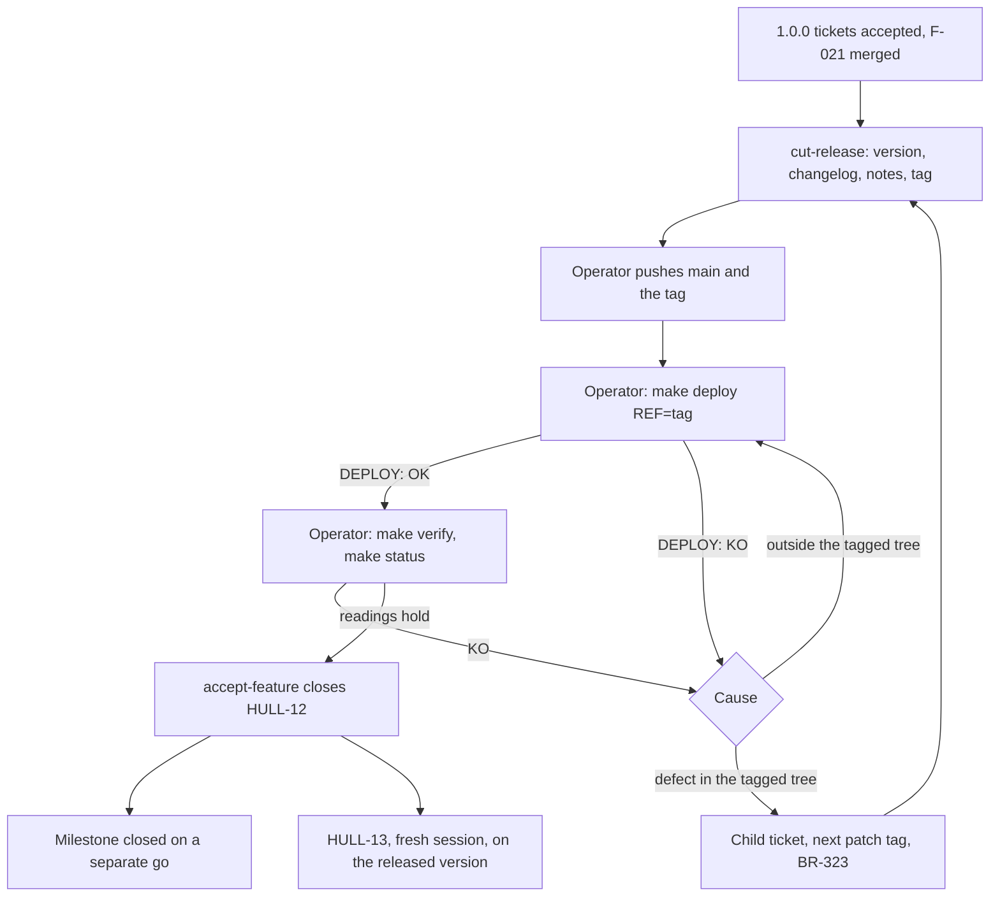

# F-021 · 1.0.0 delivery

## Metadata

| Field | Value |
|-------|-------|
| **Priority** | P2 |
| **Branch** | `feat/HULL-12-tagged-delivery` |
| **Last updated** | 2026-11-14 |

## 1. Context & Objective

### Current State

Read at `309d0f0`.

- The image is multi-architecture and built on the production server from the clone (BR-028); `make deploy REF=<ref>` already accepts a tag: it fetches tags and resolves `origin/<ref>`, then `<ref>` (BR-040, `deploy/ops.sh`). `make prod-smoke` proves it with a SHA only.
- `project-context.yaml` declares `versioning.file: VERSION`. That file does not exist, so `cut-release` step 2 has nothing to read. No tag exists in the clone, `CHANGELOG.md` has no version section, and its preamble says it carries no version number before the first release.
- The version the product reports comes from elsewhere: `pyproject.toml` `version = "0.1.0"`, read by `importlib.metadata` into `serverInfo.version` and the upstream `clientInfo`. A `VERSION` file added alone would give a tag `v1.0.0` on a gateway reporting `0.1.0`.
- Pointing `versioning.file` at `pyproject.toml` does not work either: `uv.lock` records the root package's version, and `cut-release` writes one file. Measured with uv 0.13.6 on a copy: after a bump of `pyproject.toml` alone, `uv lock --check` no longer accepts the lock (offline it tries to resolve again). The image build uses `uv sync --locked` (BR-029), so the tagged commit would not build. The release commit does not stage `uv.lock` (`cut-release` step 16).
- `uv_build` refuses `dynamic = ["version"]` (measured: `missing field version`), which rules out reading the version from a file at build time.
- After a deployment the operator reads a SHA (`make status`, `.deployed-ref`). Nothing states which version runs.

### Objective

`cut-release` runs unchanged and its tag builds; the production server runs that tag; the operator can read that it does. That is what 1.0.0 delivery means here (operator go, 2026-11-01): a version tagged by `cut-release` and deployed on the production server, no registry.

### Expected Impact

- One file holds the version; the tag, the running gateway and `make status` all say the same thing.
- A version cut changes no lock and no dependency.
- HULL-12 closes on a reading, not on a judgement.

### Open Product Questions

None for the drafting: each choice is in §9, marked `Tranché en autonomie déléguée`. One operator choice stays open at the freeze, written on the recommended option: HULL-13 leaves milestone 1.0.0 for 1.1.0 (arbitration A1).

## 2. Scope

- `src/hullgate/VERSION`, the single source of the product version, read by the code and carried by the image without a Dockerfile change.
- `pyproject.toml` version fixed to the placeholder `0.0.0`, `uv.lock` regenerated once; `versioning.file` updated in `project-context.yaml`.
- `make status` prints the running version and the tag of the deployed commit.
- `make prod-smoke` rehearses a cut: version changed alone, annotated tag, deployment by that tag.
- `CHANGELOG.md`: preamble aligned on the convention's skeleton, and the F-010 entry marked `**breaking**`, as the convention requires of a breaking change.
- `docs/guides/update.md` gains the release deployment.
- The delivery itself: `cut-release` to `v1.0.0`, then the operator's push, deployment and readings.
- Retirement of BR-024 to BR-027, the rules of the Go/Python comparison POC (F-003), whose mechanism HULL-58 removes (§3.5).

## Out of Scope

- Container registry, published image, version-tagged image names — operator go: no registry. HULL-41 (1.1.0) keeps that subject.
- CI, signed tags, SBOM, forge "release" objects — not needed for the tag to run on the production server. Candidates for later.
- Protected tags on the forge — would make BR-323 mechanical; an operator setting, not needed for one release. Candidate ticket.
- `hullgate --version` — `make status` answers the need without changing the CLI surface pinned by BR-131.
- A public version endpoint — would advertise the version to anonymous callers for no operator gain.
- Changing the `cut-release` skill — framework side; the point of this spec is that it runs as written.
- Audit and alerts — HULL-68, HULL-69, moved to 1.1.0; rate limiting — HULL-70.
- A `make prod-smoke` on the real release commit before the push — accepted: the first image from the tagged tree is built after the push, but the release commit differs from its parent, in what enters the image, by the version file alone, which is exactly what control `release-tag` rehearses.

## 3. Functional Spec

### 3.1 The version file (SCR-01)

`src/hullgate/VERSION` holds one line, `X.Y.Z`, trailing newline. Its location inside the package means it needs no Dockerfile or `.dockerignore` change: `COPY src ./src` brings it, and `uv_build` ships it in the wheel (measured on a copy: `hullgate/VERSION` in the wheel, lock accepted).

`hullgate.__version__` reads it. `pyproject.toml` keeps `version = "0.0.0"` with a comment saying it is the build tool's required field, not the product version. The seed value is `0.1.0`, the version the product reports today, so `cut-release` starts from a true current version.

### 3.2 `make status` (SCR-02)

Two lines added after the existing ones:

```
version: 1.0.0
tag: v1.0.0
```

- `version` is read **from the running container**, not from the clone: a clone moved by hand must not pass for what runs. Service stopped: `version: unknown`.
- `tag` is the `v*` tag on the commit in `.deployed-ref`; `tag: none` when that commit has none, which is normal for a deployment by SHA.

Exit code unchanged. `make verify` and its `VERIFY: n/6` banner are unchanged.

`version` and `tag` may differ. After a `DEPLOY: KO` at `/readyz` the new container runs while `.deployed-ref` keeps the old commit: a pair that differs means the deployment did not complete.

### 3.3 The cut, read against `cut-release` (SCR-03)

No step of the skill is changed. What this spec makes true, or what the person cutting will meet:

| Step | At the 1.0.0 cut |
|---|---|
| 0 | Decision gate: one stated line, recorded in the release commit body. |
| 0 (Phase 1) | Pre-flight on `git` and `docs`. |
| 2 | Reads `0.1.0` from the file. No version section in the changelog, so nothing to disagree with. |
| 3a | Consolidates the inbox, resynthesises the sections flagged INV-041. |
| 3b | `cairn check` must not return code 1. An INV-001 hit from a rule still inline, or an INV-044 line of `features/index.md` left unrendered, stops the cut. |
| 4 | Clean tree: run artefacts committed first. |
| 5, 5a | The `**breaking**` marker makes the proposal MAJOR, 1.0.0, and the milestone matches at 5a. |
| 6 | If the proposal still differs, override to 1.0.0. In `autonomous`, Phase 2 proceeds after N seconds, so the cutter states the override. Without the 5a match there is no milestone line at step 6 and nothing at 19a. |
| Red flag | MAJOR with no migration note: one line in the notes, "no prior users". |
| 8 | Writes `1.0.0` to the file; `versioning.file` is a plain one-line file, in a subfolder. |
| 11 | Asks tone and audience of the notes, once; nothing recorded yet. |
| 14 | The operator validates the notes. |
| 17a | Second consolidation, before the tag. Step 11's capture makes a `chore(learn)` commit likely, so the tag may sit one commit after `release: v1.0.0`. Both are correct. |
| 18, 19 | Annotated tag `v1.0.0`. No push by the session: the operator pushes. |
| 19a | Replaced for this release: the milestone closes on a separate go after HULL-12's acceptance (§3.4). |

### 3.4 Delivery (SCR-04)

The operator plays the deployment and produces its proof (BR-043): `make deploy REF=v1.0.0` on the production server, `make verify`, `make status`. The standing go on `make deploy` and `make verify` is not used for it.

HULL-12 waits In Review through the cut, PR merged and branch deleted. This release is a declared exception to `process-milestone` steps 11 then 14: cut, push, deployment, HULL-12's acceptance, then a separate go for the milestone closure.

A failed deployment follows BR-040: it prints the return command, nothing is automatic. Then the cause decides:

- **Cause outside the tagged tree** — disk, Traefik, a held `backups/.lock`, a failed backup: `make deploy REF=v1.0.0` is replayed. Same tag, no new version.
- **Defect in the tagged tree** — a child ticket of HULL-12 goes through `close-feature`, so `[Unreleased]` has its entry; `cut-release` then gives `v1.0.1` and the tag `v1.0.0` stays (BR-323). `1.0.1` does not match milestone `1.0.0` at step 5a, so the milestone closure is a direct go, not step 19a.

### 3.5 Retirement of the comparison POC rules (RET)

BR-024 to BR-027 govern the Python comparison POC of F-003: its report `docs/trials/poc-python.md`, the bench target `--target py-gateway`, the harness copies. HULL-58 removes that POC (`poc/py-gateway/`, the target, its compose file); it has no spec, so the retirement is declared here (operator go, 2026-11-14, option (a)). This spec removes no POC code: HULL-58's removal is a precondition (§9).

At this feature's `close-feature` Phase 3, per `br-lifecycle.md` §Retirement:

- Each of BR-024 to BR-027 takes `status: retired`, `retired-by: F-021`; the text, `version`, Versioning and `control` entries stay frozen; Traceability gains `F-021 | Retired the rule (mechanism removed)`. The index reads `retired (F-021)`.
- BR-018 and BR-023 lose the clarification that cites BR-025 and BR-026 (current text no longer invokes a retired rule), each as a new version (§4).
- `capability-map.md`: row "Recette d'isolation de passerelle MCP" stops citing the four rules, and its description stops naming the POC Python target. The map cites `active` rules only (INV-013).
- F-003 moves to `status: superseded`, `superseded-by: F-005`, which introduced the v1 target the comparison was run to choose (F-005 extends the same capability row); its `closed` date stays. Every rule F-003 introduced is then retired.

Kept as they are:

- The v1 target's control ids `BR-026` and `BR-026/N13` (`poc/isolation-bench/runner/run_bench.py`, `evidence/results-v1.json`, ADR-003 §Confirmation) stay as evidence labels: renaming them rewrites evidence. The source comment `# BR-026 : …` on the v1 branch of `run_bench.py` is reworded to name the label, not the rule.
- Records stay as written at their date: `CHANGELOG.md`, `docs/trials/poc-python.md` if HULL-58 keeps it, ADRs, specs, act reports.
- The `control` notes that name `--target py-gateway` (BR-004, BR-018, BR-020, BR-023) follow the removal of the target, HULL-58's change, not this retirement.

## 4. Business Rules

### BR-320 · The product version has one source

*`behavioral` · `blocking` · Candidate state: `verified` — `tests/unit/test_br_320_version_source.py`, the file's form, `__version__`, `serverInfo.version` and `clientInfo.version` equal to it, `pyproject.toml` and the root package of `uv.lock` at `0.0.0`.*

**Rule** — `src/hullgate/VERSION` is the only place the product version is written. Everything that reports the version reads it; `pyproject.toml` carries a constant placeholder that no release changes. A second written source turns the gate red.

**Clarifications**
- The file holds one `X.Y.Z` line, no `v`. The `v` belongs to the tag.

### BR-321 · A version cut changes no lock and still builds

*`behavioral` · `blocking` · Candidate state: `verified` — `make prod-smoke`, control `release-tag`: version file changed alone in a disposable clone, annotated tag, `make deploy` by that tag gives `DEPLOY: OK`.*

**Rule** — Changing the version file alone leaves the lock valid and the image buildable, so the commit `cut-release` tags can be deployed as it stands. A version change that needs the lock touched turns the control red.

**Clarifications**
- The image build keeps `uv sync --locked` (BR-029); this rule adds no exception to it.

### BR-322 · The operator reads what runs

*`behavioral` · `blocking` · Candidate state: `verified` — `make prod-smoke`, control `release-tag`: `make status` prints the rehearsal version and tag; `tests/unit/test_br_322_status.py` on the cases of AC-06 through `OPS_LIB`.*

**Rule** — `make status` prints the version reported by the running container and the version tag of the deployed commit. A missing line turns the control red.

**Clarifications**
- Forms: `version: <X.Y.Z|unknown>`, `tag: <vX.Y.Z|none>`.
- `unknown` covers any failed read: no running container, or a `docker exec` that fails.
- `tag` looks on the commit of `.deployed-ref` for the pattern `v[0-9]*.[0-9]*.[0-9]*`; the highest version wins. `.deployed-ref` absent, or no match, gives `tag: none`. It is not an error.
- A pair that differs means the deployment did not complete (§3.2).

### BR-323 · A published version tag never moves

*`behavioral` · `strict` · Candidate state: `not-mechanisable` — a move is a past act on the forge, and no local command can prove its absence; review and acceptance read that the tagged commit is the release commit or its `chore(learn)` child, and that it carries the version file at that version (AC-OP-01).*

**Rule** — Once pushed, a version tag is neither moved nor deleted. A moved or deleted pushed tag is a blocking review finding, and the operator decides the repair.

**Clarifications**
- A defect found after the push ships as the next patch version (§3.4).
- Before the push the tag is local; undoing the cut is a destructive git operation (guardrails §2, point 6), confirmed by the operator, and the skill then restarts from a clean tree.

### BR-324 · A version is delivered when its tag runs on the production server

*`behavioral` · `blocking` · Candidate state: `not-mechanisable` — production evidence belongs to the operator (BR-043); acceptance reads the lines posted on the ticket.*

**Rule** — A version is delivered when its tag runs on the production server, by the operator's own readings: the tag on the remote at the release commit, `DEPLOY: OK` on that commit, `VERIFY: 6/6 OK`, `make status` giving that version and tag, and the release notes in the tagged commit. Without them the acceptance stops and the ticket stays In Review.

**Clarifications**
- If `v1.0.0` has a defect and §3.4 leads to `v1.0.1`, the readings are taken on `v1.0.1`.

### Rules touched

- `BR-040`, clarification (C3) — A version tag is an ordinary `REF`: `.deployed-ref` keeps the commit SHA, and the return command names a SHA. `make prod-smoke` proves this case as well as the SHA case (control `release-tag`).
- `BR-067`, control note only — "`serverInfo.version` equal to the package version" becomes false: the package is `0.0.0`. The note reads "equal to the version file", and `tests/unit/test_br_067_version.py` compares with that file instead of `pyproject.toml`. The rule text does not change.
- `BR-024`, `BR-025`, `BR-026`, `BR-027`, retired — `status: retired`, `retired-by: F-021`; mechanism removed by HULL-58 (§3.5). No test `test_BR_024_` to `test_BR_027_` exists in `tests/` (read at `02a56b6`); the structure checks of `report_check.py --target py-gateway` go with the target.
- `BR-018`, clarification, v3 — the clarification "the Python POC adds two lines: H-9 socle requirements (BR-026), H-10 off-suite controls (BR-025)" (line 31 at `02a56b6`) goes. Rule, other clarifications, `kind` and `enforcement` unchanged.
- `BR-023`, clarification, v3 — the clarification on the Python POC's H-10 (BR-025) and H-9 (BR-026) lines (line 32 at `02a56b6`) goes. Rule, other clarifications, `kind` and `enforcement` unchanged.

## 5. Acceptance Criteria

**Version source**

- [ ] **AC-01** (BR-320) The file exists with `0.1.0`; the unit test passes; `grep -rn 'importlib.metadata' src/hullgate` is empty.
- [ ] **AC-02** (BR-320) `versioning.file` reads `src/hullgate/VERSION` and `versioning.field` stays empty; `pyproject.toml` carries `0.0.0` and its comment; `make gate` ends `GATE: OK`.
- [ ] **AC-03** (BR-320) In the built image, `hullgate.__version__` equals the file.

**Rehearsal**

- [ ] **AC-04** (BR-321, BR-040) `make prod-smoke` ends `SMOKE: 5/5 OK` with `SMOKE release-tag OK`, on a version value distinct from the seed, with `.deployed-ref` at `git rev-parse <tag>^{commit}`. The control runs before the disposable KO commit and redeploys `$SHA` when done, so the KO and rollback assertions stay as they are. The Makefile's "4 contrôles" line follows.
- [ ] **AC-05** (BR-322) In the same run, `make status` prints that version and that tag.
- [ ] **AC-06** (BR-322) `version: unknown` with the service stopped and with a failing `docker exec`; `tag: none` on an untagged commit, with `.deployed-ref` absent, and on a commit tagged only `vnext`; the highest of two version tags, by number (`v1.0.10` over `v1.0.9`); a differing pair printed as read. Exit code unchanged in every case.

**Documents**

- [ ] **AC-07** The `CHANGELOG.md` preamble follows `conventions/changelog.md`: `grep -c 'avant la première release\|before the first release' CHANGELOG.md` is 0, and the F-010 entry carries `**breaking**`: `sed -n '/^## \[Unreleased\]/,/^## \[[0-9]/p' CHANGELOG.md | grep -c '\*\*breaking\*\*'` is at least 1.
- [ ] **AC-08** *Read by hand, plus `tests/unit/test_br_042_runbooks.py`.* `docs/guides/update.md` has a release step: push, deploy by tag, verify, status, the lines to post on HULL-12, what a differing `version`/`tag` pair means, and the two failure paths of §3.4. Each block is copy-paste, as `claude`, with the machine, user, shell and folder stated.

**Retirement**

- [ ] **AC-09** (§3.5; BR-018, BR-023, BR-024 to BR-027) After HULL-58 and the closure, at the repository root: `test ! -e poc/py-gateway` exits 0; `for n in 024 025 026 027; do grep -c '^status: retired$' business-rules/BR-$n.md; grep -c '^retired-by: F-021$' business-rules/BR-$n.md; done` prints `1` eight times; `grep -E '^\| \[BR-02[4-7]\]' business-rules/index.md | grep -c 'retired (F-021)'` is 4; `grep -cE 'BR-02[4-7]|POC Python' capability-map.md` is 0; `git grep -nE 'BR-02[56]' -- business-rules/BR-018.md business-rules/BR-023.md` lists only Versioning, Traceability and Archives lines; `sed -n '/^---$/,/^---$/p' features/F-003-*.md | grep -cE '^status: superseded$|^superseded-by: F-005$'` is 2; `git grep -nE 'test_(BR|br)_02[4-7]' -- tests` is empty; `cairn check` prints `INV-013 pass` and no INV-042 error.

**Operator evidence (BR-043, BR-324), read at acceptance**

Played by the operator on the production server, as `<user>` in bash, in `<install-dir>`, after `make deploy`. `<tag>` is read back from `git tag --list 'v1.0.*'`, highest version, never imposed. Lines are posted verbatim on HULL-12.

- [ ] **AC-OP-01** `git ls-remote --tags origin 'v1.0.*'` has a peeled `refs/tags/<tag>^{}` line, so the tag is annotated, and its commit equals `git rev-parse <tag>^{commit}`. `git show <tag>:src/hullgate/VERSION` prints the tag's version without the `v`. `git log -2 --format=%s <tag>` has `release: <tag>` first, or second under a `chore(learn)` subject.
- [ ] **AC-OP-02** `make deploy REF=<tag>` prints `DEPLOY: OK <sha>`, `<sha>` being `git rev-parse <tag>^{commit}`.
- [ ] **AC-OP-03** `make verify` ends on the line `VERIFY: 6/6 OK`.
- [ ] **AC-OP-04** `make status` prints the service row with `(healthy)`, and the lines `version: X.Y.Z` and `tag: vX.Y.Z` equal to the tag.
- [ ] **AC-OP-05** `git cat-file -e <tag>:RELEASE_NOTES.md` exits 0.

## 6. Diagrams

| Type | Decision |
|---|---|
| Userflow | Included, 6.1 |
| Sequence | Skipped: one actor at a time, no message exchange beyond what `ops.sh` already does |
| State machine | Skipped: no stateful component is added |
| ER, class | Skipped: no schema change, no class |

### 6.1 Userflow



## 7. States & Captures

- **Package-status**: absent (operations only, no visual surface).

## 9. Implementation Notes

### Dependencies (prerequisite features)

- **Implementation of this spec** — lands after HULL-58, which rewrites `CHANGELOG.md` and the runbook, and after HULL-57, which rewrites the lines of `deploy/ops.sh`: branch from that `main`.
- **The cut and the deployment** — accepted first: HULL-66, HULL-57, HULL-58, HULL-42, HULL-10, HULL-11, HULL-70, HULL-85. `cut-release` itself does not block on open tickets, so the milestone run holds this order, at `process-milestone` step 14, with the exception of §3.4.
- **Downstream** — HULL-13 comes after HULL-12, in its own fresh session, on the released version (arbitration A1). F-018 (a private operations spec of the maintainer, not published) keeps its text and starts from a tagged version. Open at the freeze: HULL-13 leaves milestone 1.0.0 for 1.1.0.
- **Retirement (§3.5)** — HULL-58 merged first: it removes the Python POC. If `poc/py-gateway/` or `--target py-gateway` still exists at this feature's closure, the retirement stops there and the rules stay `active`; the closure reports it, nothing is retired over a live mechanism.
- **Milestone closure** — HULL-43 (domain registration, the operator's) and HULL-52 do not hold the delivery. Open at that go, they are named, and closing or moving them is the operator's act (`cut-release` step 19a).

### Technical Constraints

- `cut-release` is not modified, nor forked by a project script.
- BR-029 holds: `uv sync --locked`, no exception.
- BR-131's surface: no new CLI verb or make target. `make status` lines are checked against that snapshot at implementation.
- Status lines follow the English forms HULL-57 gives `deploy/ops.sh`.
- Coined terms for the glossary, none of them there today: yes, *version file*, *version placeholder*, *version cut*, *version tag*. The orchestrator writes them before the freeze (X17).
- No session act toward the production server, during implementation or at the delivery: the release deployment and its proof are the operator's (BR-043, arbitration A2).
- The push is the operator's (`cut-release` step 19).

### Architecture Decisions

| Question | Decision | Rationale |
|----------|----------|-----------|
| Where does the version live? | Tranché en autonomie déléguée: `src/hullgate/VERSION` | `pyproject.toml` breaks the lock at each cut; a dynamic version is refused by `uv_build`; a root `VERSION` needs a Dockerfile copy plus a second read path. In the package there is one path, in development and in the image |
| Keep `0.1.0` in `pyproject.toml`? | Tranché en autonomie déléguée: `0.0.0` | A value that looks like a version would be read as one. `sdk_guard` reads only `mcp` and `mcp-types` from the lock, so the one regeneration touches no evidence |
| Seed value of the file? | Tranché en autonomie déléguée: `0.1.0` | What the product reports today; `cut-release` then bumps a true current value |
| How is 1.0.0 reached? | Arbitration A2: the F-010 entry is marked `**breaking**`, so the proposal is 1.0.0; override at step 6 as a fallback | The convention already requires the marker; step 5a matches the proposed version, before any override |
| How does the operator read the version? | Tranché en autonomie déléguée: two lines in `make status`, from the running container | Smallest change; `serverInfo` needs a token, and a CLI flag would change BR-131's surface |
| Should the deployment refuse an untagged ref? | Tranché en autonomie déléguée: no | Deployment by SHA stays useful (BR-040); `tag: none` makes it visible |
| Failure of `v1.0.0` on the production server? | Tranché en autonomie déléguée: same tag replayed if the cause is outside the tree, `v1.0.1` if it is in it, tag kept (BR-323) | A moved tag leaves two meanings for one name; a new version for a full disk says nothing |
| Who deploys, who proves? | Arbitration A2: the operator, both | `DEPLOY: OK` exists only as the deployment's output, and BR-043 (`strict`) keeps the evidence his; he is at the keyboard for the push |
| When is the release cut? | Arbitration A1: before HULL-13 | Dissolves who holds the delivery once the run's session closes at HULL-13's merge |
| Readiness on the reduced scope | `ready`, comment 11269 | Replay after comment 11261; one acceptance |
| Which feature retires BR-024 to BR-027? | Operator, freeze go 2026-11-14, option (a): F-021 | F-013, which was to retire them, is withdrawn, and HULL-58 has no spec while `retired-by` takes an `F-NNN` only |
| Do the v1 control ids `BR-026`, `BR-026/N13` change? | Tranché en autonomie déléguée: no, they stay labels | Renaming rewrites evidence and ADR-003's confirmation; the label names a check of the v1 target, not the retired rule |

### Data Model Impact

- Migration: no.

### Components to Create / Modify

**Created**
- `src/hullgate/VERSION` — the version
- `tests/unit/test_br_320_version_source.py`, `tests/unit/test_br_322_status.py`

**Modified**
- `src/hullgate/__init__.py` — reads the file
- `pyproject.toml`, `uv.lock` — placeholder, one regeneration
- `.cairn/project-context.yaml` — `versioning.file`
- `deploy/ops.sh` — status lines
- `deploy/smoke/smoke.sh`, `Makefile` — control `release-tag`, banner `SMOKE: n/5`
- `tests/unit/test_br_067_version.py` — compares with the file; BR-067's control note at closure
- `CHANGELOG.md` — preamble, `**breaking**` marker
- `docs/guides/update.md` — release step
- `poc/isolation-bench/runner/run_bench.py` — the v1 branch's `# BR-026` comment names the label (§3.5)
- At closure: `business-rules/BR-018.md`, `BR-023.md` (v3), `BR-024.md` to `BR-027.md` (retired), `business-rules/index.md`, `capability-map.md`, `features/F-003-*.md` frontmatter (§3.5)

### Pitfalls Discovered

To be filled in during dev.

## 10. Phases

### Phase 1 — Ready to cut (one PR, reviewed, merged)

- [ ] AC-01 to AC-09
- [ ] `make gate`, `make test-container`, `make prod-smoke` pass
- [ ] `close-feature` before the PR: BRs extracted, entries in `[Unreleased]`

HULL-12 then waits In Review, branch deleted.

### Phase 2 — Delivery (after the other accepted tickets, before HULL-13)

- [ ] `cut-release`, push by the operator
- [ ] Operator's deployment and readings, AC-OP-01 to AC-OP-05
- [ ] `accept-feature`, then the milestone closure on its own go

## 11. Tests

### unit

| Test | BR / Concern | File |
|------|-------------|------|
| `test_BR_320_001` file form | BR-320 | `tests/unit/test_br_320_version_source.py` |
| `test_BR_320_002` `__version__`, `serverInfo`, `clientInfo` | BR-320 | same |
| `test_BR_320_003` placeholder in `pyproject.toml` and `uv.lock` | BR-320 | same |
| `test_BR_322_001` the cases of AC-06 | BR-322 | `tests/unit/test_br_322_status.py` |

### integration

None added: `test_br_067_version.py` already crosses the endpoint.

### container

| Test | BR | File |
|------|-----|------|
| Version inside the image | BR-320 | next free block in `tests/container/` |
| `SMOKE release-tag` | BR-321, BR-322, BR-040 | `deploy/smoke/smoke.sh` |

BRs not tested directly: BR-323, BR-324 (reasons in §4).

## 12. Risks & Watchpoints

- **Functional**: `cairn check` code 1 at the cut. If a closure leaves a rule inline or the index unrendered, the cut stops. It is the skill's red flag doing its job.
- **Functional**: step 8 names "plain `VERSION` file at repo root"; the file here is plain but in a subfolder. If the session reads that as an unknown layout it pauses and asks, which costs one question.
- **Functional**: `cut-release` runs in a declared exception to `process-milestone` steps 11 then 14 (§3.4); read the order there, not in the skill.
- **Functional**: until the orchestrator applies the correction of comment 11269, HULL-12's title and body still describe the batch; acceptance reads this spec, not the body.
- **Technical**: a rollback below a schema migration fails on the newer database (BR-069). Nobody uses the tool and the data is disposable, so no new rule.
- **Technical**: `ops.sh` tries `origin/<ref>` before `<ref>`, so a branch named like a tag wins. No such branch exists; the release step checks that `DEPLOY: OK` shows the tag's commit (AC-OP-02).
- **Availability**: at the 1.0.0 deployment sessions do not yet depend on the gateway. For any deployment after HULL-13, a KO at `/readyz` takes the tracker from the sessions, with no automatic return: only the operator can return.
- **Dependency**: the pre-commit hook (BR-003) forbids the real Gitea host in the tree. Release notes must not name it.

## Stress-test

**Passe du 2026-11-01** — model:claude-opus-5-5, six axes.
**23 findings — 2 critical, 8 major, 13 minor ; 22 retenus, 1 écartés.**

Arbitrage de l'orchestrateur : `.cairn/runs/acts/milestone-1.0.0-arbitration-1.md` §Pass 4 (A1, A2, règle par défaut). Rapport complet : `.cairn/runs/acts/HULL-12-stress-test-1.md`.

Critiques :
- **C1** · axe E · §9, BR-324, §6.1 — three orders disagreed on who holds the delivery. Sort : corrigé — A1: cut and deployed before HULL-13; §3.4 declares the exception to `process-milestone` steps 11 then 14; HULL-13 leaving the milestone stays open at the freeze.
- **C2** · axe F · BR-324, AC-OP-02 vs BR-043 (`strict`) — session deployment with an operator reading. Sort : corrigé — A2: deployment and proof are the operator's.

Majors :
- **M1** · axe F · AC-OP-01, BR-323 — step 17a can put the tag one commit past the release commit. Sort : corrigé — row 17a, control and AC-OP-01 accept the `chore(learn)` child; `git show`, `git log -2`.
- **M2** · axe F · §3.3 — step 5a matches the proposal, which read 0.2.0. Sort : corrigé — A2: `**breaking**` marker in AC-07, override kept as fallback.
- **M3** · axe A · BR-323 — "may be replayed" licensed destructive acts. Sort : corrigé — clarification rewritten under point 6.
- **M4** · axe F · §10 — `close-feature` placed after the merge. Sort : corrigé — moved to Phase 1; HULL-12 waits In Review.
- **M5** · axe A · AC-OP-01 to 05 — no instruments, annotated-tag trap. Sort : corrigé — machine, user, folder, expressions frozen; BR-324 aligned. Clause question re-asked: each clause has its expression.
- **M6** · axe A · §4 — rules stated no response to violation. Sort : corrigé — one response per rule.
- **M7** · axe B · §3.4, §6.1 — every KO led to a new version. Sort : corrigé — KO split by cause, child ticket named, closure by direct go.
- **M8** · axe B · §3.2, BR-322, AC-06 — states with no output. Sort : corrigé — differing pair, absent ref, failed read, tag pattern; AC-06 extended. Clause question re-asked.

Mineurs :
- **m1** · axe D · §3.3 — steps omitted. Sort : corrigé — rows added.
- **m2** · axe A · §3.3, §12 — stale counts, INV-044 misattributed. Sort : corrigé — counts dropped, attribution fixed.
- **m3** · axe F · §4 BR-040 — heading tripped INV-001 and INV-051. Sort : corrigé — cited under `### Rules touched`, outside a rule heading, the form INV-051 reads; `cairn check` shows no F-021 hit on either.
- **m4** · axe D · frontmatter — BR-067's control note goes false. Sort : corrigé — BR-067 in `br-touched`.
- **m5** · axe A · BR-323, BR-324 — two obligations each. Sort : corrigé — patch path is a clarification, milestone order moved to §9.
- **m6** · axe C · BR-324 — rule dead once met. Sort : corrigé — generalised to any version.
- **m7** · axe A · §9 — no line on coined terms. Sort : corrigé — line added (X17).
- **m8** · axe A · AC-07, AC-08 — runbook unnamed, no instrument. Sort : corrigé — path named (HULL-58 keeps it), grep on AC-07, AC-08 read by hand.
- **m9** · axe A · AC-04 — banner and position unstated. Sort : corrigé — `SMOKE: 5/5`, before the KO commit, `$SHA` redeployed.
- **m10** · axe D · tracker — title and body of HULL-12 stale. Sort : accepté — a tracker act outside this draft, the orchestrator's (BR-144); risk in §12.
- **m11** · axe B · §12 — lock-out of sessions unwritten. Sort : corrigé — one line, narrowed by A1 to deployments after HULL-13.
- **m12** · axe D · §Out of Scope — first real image after the push. Sort : corrigé — stated as accepted, with its reason.
- **m13** · axe F · §9 — landing order and HULL-43. Sort : corrigé — lands after HULL-58; HULL-43 and HULL-52 named at the closure go.

Addendum 2026-11-01, retouch 6 (operator decision, no new pass played): HULL-57 and HULL-58 stay plain tickets with no spec and no new rule, their citations here now name the ticket, in the trace too; the landing order is unchanged.

**Retouche du 2026-11-16** — gel, human:sstolz

## 13. Changelog

| Date | Author | Change |
|------|--------|--------|
| 2026-11-01 | model:claude-opus-5-5 | Spec creation, delegated drafting, returned in `draft` |
| 2026-11-01 | model:claude-opus-5-5 | Stress-test retouch: A1 (cut before HULL-13), A2 (operator deploys and proves), default rule; `ready-for-freeze` |
| 2026-11-14 | model:claude-opus-5-5 | Freeze retouch, operator go option (a): retirement of BR-024 to BR-027 (§3.5), BR-018 and BR-023 clarifications, AC-09; frozen `ready-for-dev`, validated by human:sstolz |
| 2026-11-15 | Claude (orchestrator, model:claude-opus-5-5) | HULL-68 and HULL-69 moved to 1.1.0 (operator, 2026-11-15); HULL-85 added to the order |
| 2026-11-16 | Codex (implementation-coder, model:gpt-6-astra) | F-022 slice 1, freeze `10d166e`: S11 guide references, P1 private trial references and F1 private procedure mentions only where applicable. |
| 2026-11-16 | Codex (implementation-coder, model:gpt-6-astra) | F-022 slice 2, freeze `10d166e` (retouch 2 `7aac9e6`): §3.2 substitutions only; inline rule clarifications without version where applicable. |
