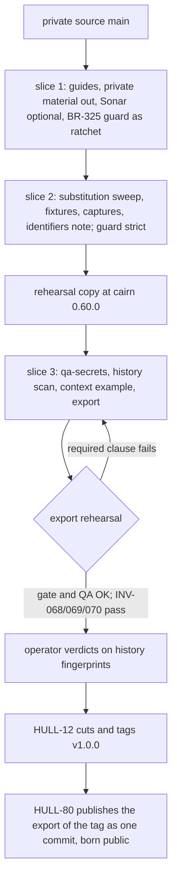

# F-022 · Public tree for 1.0.0

## Metadata

| Field | Value |
|-------|-------|
| **Priority** | — (HULL-98 carries no priority label; it blocks HULL-80 in milestone 1.0.0) |
| **Branch** | `feat/HULL-98-slice-3` (PR #105, last slice) |
| **Last updated** | 2026-11-17 |

## 1. Context & Objective

### Current State

Read at `main` `205e16c9` (2026-11-16) unless stated otherwise.

- **Sources.** `.cairn/runs/acts/HULL-98-inventory-1.md` — the read-only inventory of 2026-11-15 at `e5bc9a92` (1208 tracked paths): the spec takes from it the per-area counts, the per-file G/P/K proposals, the secret-pattern method and findings, the HULL-NN counts and its six open decisions. `.cairn/runs/acts/milestone-1.0.0-orchestrator-decisions.md` — the operator's framing of 2026-11-16 (six answers, below), the freeze decisions of the same day (below) and the order HULL-98 → HULL-12 → HULL-80 (2026-11-15). **`.cairn/runs/acts/HULL-98-denylist.md`** — the private annex of this spec: the constat's values (§A), the files and names that leave (§R), the initial denylist (§E) and the *Found* column of §3.2 (§S). This spec, the rules extracted from it, its `## Stress-test` trace and its CHANGELOG entry cite the annex by index and spell none of its values. All three are workshop files: the export drops them (§3.12).
- **Operator infrastructure in the tracked tree, outside `.cairn/`** — eight values (annex A1 to A8): the server's name, the root of its compose projects, the operator's domain, the operator's first name (provenance value, forge owner, account names), the server's SSH port and SSH login form, two workstation account names. Counts per value, files and lines, are in the annex. The inventory counts 1071 detector occurrences in 277 files outside `.cairn/` and 803 in 212 workshop files. The server's name is also a colour token in five `design/` files (not the server).
- **Private operator material.** Seven runbooks under `docs/runbooks/` name the server in their file names and steps (annex R1 to R7); two POC runbooks (`poc-go-claude-ai.md`, `poc-go-ios.md`) carry an SSH alias, account and port of the operator, and `poc/isolation-bench/runner/report_check.py` (BR-020's regression guard) checks their presence; `sonar-project.properties` points at the operator's SonarQube host; `scripts/qa_sonar.py` reads its token at `.cairn/auth/sonar/token`; `features/F-018-cairn-gateway-cutover.md` (`ready-for-freeze`) is the cutover of this workshop's own forge accounts, cited by F-015, F-017, F-019, F-020 and F-021. Five tests assert private runbook text (`test_br_042_runbooks.py`, `test_br_042_ops_findings.py`, `test_br_131_contract_surface.py`, `test_review_594.py`, `test_review_594_deploy.py`).
- **Identity.** The former provenance value (annex S8) sits on 209 `validated-by` lines (183 rule files, 18 specs, 8 ADRs) and on 30 other lines outside the workshop.
- **Secrets.** The inventory's eight detectors found 662 candidate lines (302 under `.cairn/`), no confirmed credential; 14 test-generated authorization codes sit in a workshop probe result; the two private-key markers are invalid-PEM test inputs. HULL-80 (2026-11-14) records two secret-like patterns in the history, not opened. No secret scanner exists in `make gate` or `make qa`.
- **Workshop.** 508 tracked files under `.cairn/`: `runs/` 440, `learnings/` 66, `project-context.yaml` 1, `docker/Dockerfile.project` 1. `cairn.version` is `0.57.0`; the installed framework is `0.60.0`; INV-068 to INV-070 exist from 0.58.0 and print `skip raison=version` today. `.cairn/workshop.git` does not exist.
- **Ticket identifiers.** 762 `HULL-NN` occurrences in 193 files outside `.cairn/` (inventory); reporting instructions toward a ticket (`post on HULL-NN`, `To report on #6`) sit in BR-020, BR-042, F-002, F-004, F-005, F-011, F-014, F-018, F-021, two trial reports and `test_br_042_runbooks.py` (11 lines), plus the private runbooks. The workshop's forge role accounts (`cairn-ai`, `cairn-review`) appear in 13 files outside the workshop, mostly fixtures, F-006 and BR-096.
- **Fixtures.** `tests/integration/test_br_062_cimd.py` lines 568–574 copy a real resolver answer (two of its addresses are public addresses of a hosting provider); `poc/isolation-bench/runner/adapter_contextforge.py` uses an invented non-reserved domain (`bench-isolation.dev`); `poc/isolation-bench/runner/secrets_guard.py` spells the operator's forge host as a forbidden pattern; other routable IP literals are mocked public-address cases.
- **Captures.** 117 tracked files under `docs/captures/`: 116 PNG images, never inspected for what they render, and one JSON report (`F-016/axe-report.json`).
- **No `LICENSE`, `SECURITY.md`, `CONTRIBUTING.md`** — HULL-80's.
- The publication itself (HULL-80) creates a new repository from one commit: the export of the tree HULL-12 tags. The private Gitea repository stays the full source. The tree, not the history, is what goes public.

**Operator framing of 2026-11-16** (answers to the inventory's six open decisions):

1. Generic guides ship in 1.0 — install, update, backup/restore, admin, keys/upstreams; F-018 and the POC runbooks stay private; Sonar optional, configured from the environment.
2. Supported baseline: an existing Traefik and a clone built on the target; directory, account and secret paths are parameters with documented defaults.
3. Licence MIT, `Copyright (c) 2026 Sébastien STOLZ`; the provenance value becomes `human:sstolz`.
4. `HULL-NN` kept as labelled historical identifiers (a note in README/CONTRIBUTING); "post on HULL-NN" reporting instructions removed.
5. Tests asserting the server's runbooks are rewritten against the generic guides with the same guarantees; every capture is reviewed visually before publication; a gate guard on the inventory's patterns.
6. Mocked routable IPs kept with a comment; invented domains move to `example.test` / `.invalid`; DNS snapshots neutralised. Workshop: `cairn reconfigure visibility`, workshop repository created by the operator — superseded by the freeze decision D1 (c) below.

**Operator decisions of 2026-11-16, after stress-test 1** (`milestone-1.0.0-arbitration-2.md`):

- **D1 (c)** — export-time boundary: the private source stays a plain private project until HULL-80, workshop and local context tracked there; the export of the tagged tree drops `.cairn/runs/`, `.cairn/learnings/` and `.cairn/project-context.yaml`; the public GitHub repository is born `public`, with its own workshop repository (HULL-80, operator).
- **D2** — `project.repository` is `https://github.com/sstolz/hullgate`; the context example declares GitHub as tracker and forge, project `sstolz/hullgate`, at the 1.0.0 tag.
- **D3** — BR-020 retired; `report_check.py` cleaned in the same slice.
- **D4** — this spec's freeze go covers the name retouches of F-016, F-017, F-019, F-020 and F-021, on the three conditions of §3.13.
- **D5** — F-018 (HULL-13) leaves `features/` and becomes a private operator procedure outside the public lifecycle, kept in the workshop; the citing specs keep a neutral historical mention; BR-282 kept if it is a generic product rule, retired otherwise (§4, Rules touched).
- **Migration** — none for the private source during 1.0.0: the public repository is born at cairn 0.60.0 through its context example, and the export rehearsal reads the 0.60.0 checks on its copy (§9, §12).

### Objective

The export of the tree HULL-12 tags is publishable as it is: a one-commit repository that names no part of the operator's installation, carries no secret and no workshop file, passes its own gate, and from whose guides a stranger can install, update, back up and administer hullgate — the guides played once, end to end, before publication (AC-25).

### Expected Impact

- Zero denylist match in the tracked tree outside the workshop, held by a gate test from slice 1 (a ratchet that only shrinks, strict at the end of slice 2) instead of a one-off grep (BR-325).
- Zero unjustified secret-scanner finding outside the workshop, held by a blocking quality tool whose allowlist names each accepted value by fingerprint (BR-326); every distinct history candidate judged by the operator (BR-327).
- Five generic guides carrying every step of the seven private runbooks they replace (BR-328), played end to end with their documented defaults (AC-25).
- The export rehearsal passes: gate, `make qa`, `cairn check` with INV-068 `pass`, and INV-069 / INV-070 `pass` on the rehearsal copy given a scratch local context (AC-24).

### Open Product Questions

None for the operator: the drafting's D1 to D4 and the stress-test's D5 are decided (above). Retouche 4 settles the framework version: the private source remains at 0.57.0; 0.60.0 is read on the export copy (§9 Dependencies).

## 2. Scope

- **Private material out of the tree**: the seven server runbooks (annex R1 to R7), the two POC runbooks and BR-020's guard in `report_check.py`, `features/F-018-cairn-gateway-cutover.md` with its glossary rows and index row, the private SonarQube endpoint. Each file leaves the tracked tree; the private source's history keeps it (§3.1).
- **Five generic guides** under `docs/guides/` replacing the seven server runbooks, step for step (BR-328), on one supported baseline with named parameters (BR-329); callers (README, `deploy/`, `Makefile`, `src/` docstrings, specs, rules) point at them; one end-to-end walkthrough of the guides before publication (AC-25).
- **Sonar optional** from the environment (BR-104 v2, BR-105 v2).
- **Substitution sweep** over every other tracked file outside the workshop — specs, rules, ADRs, root documents, code comments, tests, fixtures — by one substitution table (§3.2); the provenance value becomes `human:sstolz`.
- **Fixtures** name nothing real (BR-330).
- **Ticket references**: `HULL-NN` kept and explained once in `README.md` (BR-332); no instruction to report on a ticket in any file a deployer or contributor follows (BR-331).
- **Captures** looked at one by one, each with a review record, and looked at again by the review (BR-333).
- **Two guards**: a gate test on a private denylist of the operator's infrastructure, from slice 1 (BR-325), and a blocking secret-scan quality tool (BR-326).
- **History scan**: the same scanner over a mirror clone of the private source's forge, candidates masked, the operator's verdict on each distinct fingerprint (BR-327).
- **Workshop out of the export**: the private source keeps `.cairn/runs/`, `.cairn/learnings/` and its local context tracked; the export drops them; `.cairn/project-context.example.yaml` is tracked (§3.11, D1 (c)).
- **Export rehearsal**: the acceptance instrument — the export of the candidate commit, judged without a local context, then with a scratch one (§3.12).

## Out of Scope

- `LICENSE` (MIT, holder fixed by the framing: `Copyright (c) 2026 Sébastien STOLZ`), `SECURITY.md`, `CONTRIBUTING.md` (it repeats the `HULL-NN` note of BR-332), README rewritten for outside readers, GitHub CI, the forge and tracker switch of the working project, the creation of the public repository — HULL-80.
- The switch of `project.visibility` to `public`, the ignore entries of the workshop paths and the workshop repository — HULL-80, on the public repository, born `public` (D1 (c)). The private source's local context is not changed by HULL-98.
- Rewriting the private history or publishing it — the public repository starts from one commit (HULL-80); a history rewrite is a destructive operation nobody asked for.
- Rotating a credential found in the history — the operator's act (BR-327 names the verdict, not the gesture).
- Renaming `HULL-NN` or mapping it to GitHub issue numbers — framing (4).
- Rewriting the reasoning of closed specs and extracted rules beyond the substitution table — they stay history; a requirement change found during the sweep goes to its own act (§3.13).
- Specifying or running HULL-13 / F-018 — the maintainer's private operator procedure, run outside the public lifecycle from its workshop copy (D5). A public generic cutover example is not asked; candidate ticket if outside users ask.
- Citations of workshop reports (`.cairn/runs/…`, `.cairn/learnings/…`) in specs, rules and trial reports stay as history; the paths are not published (the README note of BR-332 says so).
- The first deployment of the production server from `docs/guides/update.md` — carried by F-021's operator criteria through its pending retouch (§9 Dependencies).
- The isolation bench's operator-facing ContextForge trial notes (`docs/trials/`) — kept, substituted only.

## 3. Functional Spec

### 3.1 The publication boundary

| Path | Treatment | Where it lives afterwards |
|---|---|---|
| the seven server runbooks under `docs/runbooks/` (annex R1 to R7) | leave the tree; replaced by `docs/guides/` (§3.3) | private source history; the operator follows the guides with the values of the server's `.env` |
| `docs/runbooks/poc-go-claude-ai.md`, `poc-go-ios.md` | leave the tree; BR-020 retired (D3); `report_check.py` drops its runbook-presence check; `secrets_guard.py` `HOST_SCOPE` drops the removed directory | private source history |
| `features/F-018-cairn-gateway-cutover.md`, its rows in `domain-glossary.md` (Direct route, Gateway route, Cutover states, Witness (cutover), Abandon, Rollback (cutover)), its index row | leave `features/`; BR-270 to BR-284 stay allocated, never reissued; citing specs keep a neutral mention (§3.2 row F1) | a copy under `.cairn/runs/private/` (workshop): the maintainer's private operator procedure, outside the public lifecycle (D5) |
| `sonar-project.properties` | kept without `sonar.host.url`; the host comes from the environment (BR-104 v2) | — |
| `.cairn/runs/`, `.cairn/learnings/`, `.cairn/project-context.yaml` | stay tracked in the private source; dropped by the export (§3.11, §3.12) | the private source; after HULL-80, the public repository's workshop repository |
| `.cairn/project-context.example.yaml` | created, tracked, exported (§3.11) | — |
| `.cairn/docker/Dockerfile.project`, `CLAUDE.md` | kept and exported — contributor tooling with no operator value (swept by BR-325) | — |
| everything else | kept, swept by the substitution table (§3.2) | — |

`docs/runbooks/` disappears. A guide is written in English, for a deployer who has never seen the operator's server.

### 3.2 The substitution table

One table, applied everywhere outside the workshop. It is the whole of what the sweep may change in a spec, a rule or an ADR (§3.13). The values found sit in the private annex, §S, under the same index; the freeze shows both side by side, in full (D4).

| Entry | Found (annex §S) | Becomes, in prose | Becomes, in a command, host or path |
|---|---|---|---|
| S1 | the server's name | "the production server" (or "the server") | `<server>` parameter; example `server.example.test` |
| S2 | the server's host | "the production server" | `server.example.test` |
| S3 | the operator's public names (MCP, admin, forge, SonarQube) | "the public MCP name", "the admin name", "the forge", "the SonarQube server" | `<name>.example.test` (`mcp.`, `admin.`, `git.`, `sonar.`) |
| S4 | the server's installation directory | "the installation directory" | `<install-dir>` (default §3.4) |
| S5 | the server's secrets directory | "the secrets directory" | `<secrets-dir>` (default §3.4) |
| S6 | the root of the server's compose projects | "the directory of the existing compose projects" | `<compose-root>` |
| S7 | the server's SSH login and port | "your SSH account on the server" | `<user>@<server>`, `ssh -p <ssh-port>` |
| S8 | the former provenance value | — | `human:sstolz` |
| S9 | the private forge's owner in a repository URL | "the repository" | `<repository-url>`; default `https://github.com/sstolz/hullgate` (D2) |
| S10 | a personal account name in a fixture or a probe | — | a reserved fixture name (`alice`, `bob`) |
| S11 | a private runbook path (annex R1 to R7), step `Xn` | its guide | `docs/guides/<guide>.md`, step `Xn` (§3.3) |
| S12 | the capability named after the server (annex R8) | **Deployment behind Traefik** | — (map row and every `capabilities` key citing it) |
| P1 | a POC runbook path (`docs/runbooks/poc-go-claude-ai.md`, `poc-go-ios.md`) | "the operator runbook of the trial, kept in the private source" | — (no link) |
| F1 | a citation of F-018 or of one of BR-270 to BR-284 | "a private operations spec of the maintainer, not published" | — (no link; the identifier stays as history) |

The colour token in `design/` that shares the server's name is not the server: those five files keep it, as pinned exclusions of BR-325 (annex E1). A capture whose image shows a found value is re-taken against example values, or leaves the tree (BR-333).

The workshop's forge role-account names (`cairn-ai`, `cairn-review`) are kept, in fixtures and in F-006 / BR-096: they name a role, not a person, and nothing of the operator's installation is reached through them once the forge's host is gone (S3).

### 3.3 The generic guides

| Guide | Replaces (annex) | Carries |
|---|---|---|
| `docs/guides/install.md` | R1 | prerequisites (Docker, Compose, an existing Traefik with its network and resolver, DNS, TLS), clone, `.env`, first deployment, verification, steps O1 to O9 |
| `docs/guides/update.md` | R2 | update to a tag or a SHA, rollback, the fresh-start procedure (F1 to F6) |
| `docs/guides/backup-restore.md` | R3 | backup, scheduling, restore check, in-place restore |
| `docs/guides/admin.md` | R4 | bootstrap, SSH tunnel, optional public admin route, passkey RP-ID planning, discovery of the Traefik peer and `TRUSTED_PROXIES` check (P1, D3) |
| `docs/guides/keys-and-upstreams.md` | R5, R6, R7 | creating the signing key, TOTP secret and connections key on the target, ownership `10001` and mode `0400`, their recovery and rotation; declaring upstreams (Gitea and others) |

A step keeps the identifier it had in the runbook it replaces; when two source runbooks merged into `keys-and-upstreams.md` share an identifier, the guide prefixes it with the source's letter, and the mapping says so. Each guide opens with a mapping table *runbook step → guide step* (identifiers only, the runbook named by its role — "the server's installation runbook" — never by its file name), the record that BR-328 reads. A step that only fitted the operator's server (a one-time migration of that installation, a fact of its forge) is listed in that table as `not carried — <reason>`, never silently dropped.

Each step keeps the form of BR-042: a block to paste, its expected result, what to do if it differs. A check reads the property it needs, under the identity it states (`stat -c '%u:%g %a'`, not `test -r` as root).

### 3.4 The supported baseline and its parameters

One baseline: an existing Traefik on the target, the repository cloned and its image built there (`make deploy REF=…` from the clone, `deploy/ops.sh`). `docs/guides/install.md` holds the single parameter table:

| Parameter | Meaning | Default |
|---|---|---|
| `<server>` | the target host | required, no default |
| `<user>`, `<ssh-port>` | the SSH account (docker group, sudo) and port | account required; port `22` |
| `<install-dir>` | installation directory (the clone) | `/opt/hullgate` |
| `<secrets-dir>` | mounted secrets, outside the clone's tracked files | `<install-dir>/secrets` |
| `TRAEFIK_NETWORK` | the existing Traefik's docker network | required, read from the existing Traefik |
| `MCP_HOST`, `ADMIN_HOST` | public names | `MCP_HOST` required; `ADMIN_HOST` optional (BR-230) |
| `<repository-url>` | clone URL | `https://github.com/sstolz/hullgate` (D2) |

Every other variable `deploy/env.example` declares appears in that table with its default or `required` (BR-329).

`<install-dir>` and `<secrets-dir>` are **documentation placeholders, not variables**: no file of `deploy/` reads them, and the deployment contract surface (`test_br_131_contract_surface.py`) gains no variable. The three key-path variables `deploy/env.example` declares (`SIGNING_KEY_PATH`, `AUTHORIZE_TOTP_PATH`, `CONNECTIONS_KEY_PATH`) show the documented default spelled out (`/opt/hullgate/secrets/<file>`). Compose's own defaults (`../secrets/<file>`, which resolve to `<install-dir>/secrets` from the clone) do not change. The operator's server keeps its own values in its `.env`, which is not versioned (BR-041): the example's new values change nothing there, and no `.env` addition is needed before the first deployment of the new tree.

### 3.5 Sonar, optional

`make sonar` reads its server URL and its token from the environment: `SONAR_HOST_URL`, and `SONAR_TOKEN` or `SONAR_TOKEN_FILE` (a path the operator chooses). Either missing → `SKIP` naming the missing variable, no call (BR-104 v2, BR-105 v2). `sonar-project.properties` keeps the project key and the analysed paths, no host. `make qa` still never calls Sonar (BR-104).

### 3.6 Fixtures

A fixture names nothing real (BR-330). A fixture, a bench file, an example in a test, a probe or `web/src` uses reserved names: `.test`, `.invalid`, `.example`, `example.com|org|net`, `localhost`, or the name of a public service the test exercises by that name (the `gitea.com` default of the Gitea MCP server, upstream documentation links). A globally routable IP literal that exercises a public-address rule stays and carries, on its line or the line above, a comment saying it is mocked. A copied real resolver answer is replaced by an ordered fixture of documentation addresses (RFC 5737, RFC 3849) that keeps the order and deduplication the test asserts.

### 3.7 Captures

Each of the 116 tracked images under `docs/captures/` is opened and looked at by the **implementation executant** (the first reader). Its record goes to `docs/captures/REVIEW.md`: path, SHA-256 of the file looked at, verdict, date, the first reader, what the image shows that a re-reader should check (a URL bar, an account field, a token field), and the state of its metadata — the PNG text chunks (`tEXt`, `iTXt`, `zTXt`) stripped, or listed in the record when kept. Verdict `clean`: the image shows no operator value of §3.2, no token, code, key or secret-looking field, no real account, and its kept metadata carries none either. Otherwise the capture is re-taken against example values (and recorded again) or removed with its references.

The **review** looks at all 116 images again, independently of the records' notes, and writes its own verdict per image in the review body (BR-333). The one JSON file (`docs/captures/F-016/axe-report.json`) is text: BR-325 and BR-326 read it, BR-333 does not.

### 3.8 Ticket identifiers and reporting

`HULL-NN` stays wherever it is: specs, rules, ADRs, the changelog, code comments, test commentary. `README.md` says once, in its own short section, that `HULL-NN` names a ticket of the project's private tracker before publication, kept as a historical reference, and that it is not a GitHub issue number; the same note covers `#NN` issue and pull-request numbers and review identifiers (`test_review_594*.py`), and says that citations of workshop reports (`.cairn/runs/…`, `.cairn/learnings/…`) are history whose paths are not published (BR-332). No guide, `README.md`, `deploy/` file, `Makefile` comment, code message or test fixture tells a reader to post, paste or read anything on a ticket; a guide's step records its outcome by its expected result (BR-331). Closed specs and extracted rules keep their reporting sentences as history; BR-042 v2 drops its own (§4).

### 3.9 The two guards

**Infrastructure denylist (BR-325)** — a unit test in `make gate`, built like the former-name guard (`tests/unit/test_former_names.py`), landed in **slice 1**. It reads `git ls-files` and every tracked file's content outside the workshop against a **denylist** kept at one path the guard declares under `.cairn/runs/private/`: tracked in the private source — so every checkout and every linked worktree of it holds the denylist — and dropped by the export (§3.12). Each denylist entry carries a pattern, its case rule, its token bounds, a sample it must match, and optionally pinned exclusions (path, exact literal, reason), each of which must still be found in its file. The guard reports `file:line` and the entry's index, never the matched text. A tracked file that does not decode as text is matched as bytes and named and counted on the test's output, never passed silently.

- Denylist absent and no `.cairn/project-context.yaml` (the export, a public clone, its CI) → the test is skipped, with the reason on its line.
- Denylist absent with a local context present → the test fails: the private source cannot pass the gate without its guard.

**Ratchet.** From slice 1 the guard carries a private baseline beside the denylist — the matches known at its landing (file, entry index, count). A match outside the baseline fails; a baseline count may only decrease, and a baseline row no longer matched must be removed. At the end of slice 2 the baseline is empty and removed: the guard is strict from then on.

The initial denylist is the annex's §E (E1 to E8), the constat of §1. It is never spelled in this spec, its rules, its trace or its CHANGELOG entry.

**Secret scan (BR-326)** — a quality tool `qa-secrets` of role `blocking` in `QA_TOOLS`, played by `make qa` (at `close-feature` before the PR, and by review), not by `make gate` (BR-101 keeps the gate offline and free of analysis tools). The scanner is pinned by version and image digest (BR-098), runs offline over every tracked file outside the workshop, prints its `QA` line and, per finding, path, line, detector and a masked preview. Its allowlist is tracked: one entry per value kept — path, detector, the fingerprint of the value (SHA-256 prefix, BR-327's form), reason (`test dummy`, `invalid PEM input`, `example`). A finding whose value's fingerprint has no entry is a finding, a new value in a listed file included; an entry that matches nothing is itself a finding.

### 3.10 The history scan

The scanner of BR-326 runs once over a **mirror clone of the private source's forge** — every branch, tag and note, and the pull-request refs that keep the commits of squash-merged branches. The report states the number of refs and of commits scanned. Each candidate is one line of the workshop report `.cairn/runs/acts/HULL-98-history-scan.md`: commit, path, line, detector, a fingerprint of the value (SHA-256 prefix), never the value, never a preview longer than the scanner's mask. The report counts the distinct fingerprints.

The operator gives **one verdict per distinct fingerprint**: `not a credential`, `not live`, or `rotated` (the rotation is the operator's). A fingerprint equal to a tracked allowlist entry's (§3.9) inherits that entry's reason as a `not a credential` verdict, cited. The verdicts are written in `.cairn/runs/acts/HULL-98-history-verdicts.md`, one line per fingerprint: `<fingerprint> · <verdict> · <date>[ · <allowlist reason>]`. The two candidates HULL-80 recorded on 2026-11-14 are among those judged. HULL-98 is not accepted without a verdict on each distinct fingerprint (BR-327). The session neither tests a candidate against a service nor displays it: any act on a secret is a safety checkpoint (guardrails §2 point 6).

### 3.11 The workshop and the context example

The private source stays a **plain private project until HULL-80** (D1 (c)): its `.cairn/runs/`, `.cairn/learnings/` and `.cairn/project-context.yaml` stay tracked, its `project.visibility` is not changed, and every act through HULL-12's closure and cut commits its workshop files there as today. The boundary is drawn at the **export** (§3.12), which drops those three paths.

The tracked tree gains `.cairn/project-context.example.yaml`, the context the public repository starts from:

- every contract key, no local key;
- `project.visibility: public`;
- `project.repository: https://github.com/sstolz/hullgate`; the tracker and the forge declared on GitHub, project `sstolz/hullgate` (`tracker.*`, `drivers.*.type` and the keys they need), as at the 1.0.0 tag (D2);
- `project.description` without the private ticket attachment;
- `cairn.version` at 0.60.0, the installed framework (the private source stays at 0.57.0, §9 Dependencies);
- the `quality-gate` comments rewritten without any workshop path (the toolbox Dockerfile under `.cairn/runs/acts/` is not cited).

The public repository is born `public` from the export, with its own workshop repository and ignore entries (HULL-80, operator).

### 3.12 The export and its rehearsal

**The export** of a commit is a new repository whose one commit is that commit's tree (`git archive`) without `.cairn/runs/`, `.cairn/learnings/` and `.cairn/project-context.yaml`, and without `.cairn/auth/`. Its commands are written once in the PR body; HULL-80 replays the same export on the tag. On the copy only, the export also writes the public ignore entries (`.cairn/runs/`, `.cairn/learnings/`, `.cairn/project-context.yaml`, `.cairn/workshop.git/`) that HULL-80 commits on the public repository; the private source's `.gitignore` is unchanged (D1 (c)).

**The rehearsal** is the acceptance instrument of the whole spec. In a scratch directory, the export of the candidate commit; there:

1. `make gate` → `GATE: OK` (BR-325 skipped, reason stated; every other step green);
2. `make qa` → `qa-secrets` `OK` (BR-326);
3. `cairn check` → judges the example (its first line says so), and **INV-068 prints `pass`** (the example's `cairn.version` ≥ 0.58.0);
4. with a **scratch local context** — a copy of the private source's context with `project.visibility: public`, placed in the rehearsal copy only, never committed, deleted after — `cairn check` prints **`pass` for INV-069 and INV-070**;
5. `git ls-files .cairn` lists only `.cairn/project-context.example.yaml` and `.cairn/docker/Dockerfile.project`.

On the private source, the same candidate commit passes `make gate` with BR-325 **run** (the denylist present). The rehearsal is replayed on the head of each slice that changes the tree's boundary and on the final head; its transcript goes to the PR body.

### 3.13 How the sweep edits records

- **Extracted rules.** A substitution in `## Rule`, `## Clarifications` or `## Examples` that changes no requirement is a clarification without version: a traceability row `F-022 | Clarification: operator infrastructure neutralised (no version)`, `updated` set; the rule enters `br-touched` (constat in the frontmatter, sweep below). A substitution in the title (the H1 and the index row — BR-041, BR-042, BR-324 and the capability carry the server's name there) is a record edit: no row, not in `br-touched`, the index re-rendered. A substitution elsewhere in the file (versioning rows, references, provenance) is a record edit too.
- **Closed specs** (`status: implemented`). Substituted, with one `§13` line each; no other change.
- **Open specs** (F-016, F-020 `in-development`; F-017, F-019, F-021 `ready-for-dev`). Substituted under this spec's freeze go (D4), on three conditions: the substitution table — §3.2 and the annex's §S side by side — is shown in full at the freeze; the residual-diff check below proves no other change; each spec gets, under the last block of its `## Stress-test`, the declared line `**Retouche du <date>** — gel, human:sstolz`, committed with the substitution, plus one `§13` line citing F-022 and its freeze sha. Their inline rules touched by the table (BR-034, BR-041 in F-016; BR-245 in F-017; BR-301 in F-020; BR-324 in F-021) are clarifications without version. F-017 and F-019 belong to milestone 1.1.0 and are swept all the same: their files are in the tree.
- **Residual-diff check.** In `features/`, `business-rules/` and `architecture-decisions/`, every changed line of the PR is explained by an entry of §3.2, by a `§13` / traceability / retouch line this section prescribes, or by a rule §4 versions or retires. The review reads the residual. A residual hunk that changes a requirement leaves the PR: it is raised, and goes to its own act.
- **Population.** The lists above are the constat of `205e16c9`. From slice 1 BR-325's guard replays the sweep on every gate run, the lanes' merges included; the implementation completes `br-touched` from its matches after its own deltas and after every merge of `main` into the branch.

## 4. Business Rules

### BR-325 · The tracked tree names no operator infrastructure

> **Extracted on 2026-11-16.** Current version: [`business-rules/BR-325.md`](../business-rules/BR-325.md).
> The content below reflects this rule at F-022 (v1).

*`behavioral` · `blocking` · Candidate state: `verified` — `tests/unit/test_br_325_operator_names.py`: counts denylist matches in the paths and contents of `git ls-files` outside the workshop, after pinned exclusions and, until the end of slice 2, the shrinking baseline.*

**Rule** — No tracked path or file content outside the workshop matches an entry of the operator-infrastructure denylist; a match turns `make gate` red, naming the file, the line and the entry's index, never the matched text.

**Clarifications**
- The denylist is not in the public tree: it sits under `.cairn/runs/private/`, tracked in the private source and dropped by the export. A spec, a rule, a trace or a CHANGELOG entry that needs a denylisted value cites its index in the spec's private annex and never spells it, whole or in fragments.
- Each entry carries its case rule, its token bounds and a sample it must match, so a mistyped pattern cannot pass by matching nothing; each pinned exclusion must still be found in its file (the former-name guard's form).
- A file that does not decode as text is matched as bytes, and named and counted on the test's output.
- Denylist absent: skipped, reason stated, on a checkout with no local context; red on a checkout that has one.
- Ratchet: from its landing (slice 1) to the end of slice 2, matches listed in a private baseline pass, the baseline only shrinks, and a match outside it fails; then the baseline is removed.
- Population: the constat of §1 at `205e16c9` and the prescribed sweep of §3.13. INV-070 (cairn) reads only the hosts the local context declares; this rule covers names, accounts, paths and ports as well.

### BR-326 · A pinned secret scan judges every tracked file outside the workshop

> **Extracted on 2026-11-16.** Current version: [`business-rules/BR-326.md`](../business-rules/BR-326.md).
> The content below reflects the state of this BR at the time of feature F-022 (v1).

*`behavioral` · `blocking` · Candidate state: `verified` — `qa-secrets` in `QA_TOOLS` (`Makefile` §QA_TOOLS): its `QA` line is `FINDINGS` when a scanner finding's fingerprint has no allowlist entry or an allowlist entry matches no finding.*

**Rule** — `make qa` runs a secret scanner, pinned by version and image digest, over every tracked file outside the workshop; each finding is removed or kept by a tracked allowlist entry giving its path, its detector, the fingerprint of the value it accepts and a reason; a finding whose fingerprint has no entry, or an entry matching nothing, makes the tool's verdict `FINDINGS` and blocks the PR.

**Clarifications**
- The tool's role is `blocking` (BR-099 mechanism); it is not a `make gate` step: BR-101 keeps the gate free of analysis tools.
- An entry accepts one value: a second value of the same detector in a listed file is a finding.
- Output masks every value: path, line, detector, a preview no longer than the scanner's mask.
- The scanner runs offline; which scanner is implementation's choice.
- The workshop stays tracked in the private source until HULL-80 and is dropped by the export (§3.11); its candidates are the history scan's (BR-327).
- BR-003 is unchanged: it covers the bench's retained artefacts and its pre-commit scan.

### BR-327 · History candidates go to the operator, masked

> **Extracted on 2026-11-16.** Current version: [`business-rules/BR-327.md`](../business-rules/BR-327.md).
> The content below reflects the state of this BR at the time of feature F-022 (v1).

*`behavioral` · `blocking` · Candidate state: `not-mechanisable` — whether a value is live is known only to the service that issued it; the acceptance reads the operator's verdict on each distinct fingerprint.*

**Rule** — Every secret-scanner candidate in a commit reachable from any ref of a mirror clone of the private source's forge, pull-request refs included, is reported by commit, path, line, detector and value fingerprint, without its value; each distinct fingerprint receives the operator's verdict (`not a credential`, `not live` or `rotated`), a fingerprint equal to a tracked allowlist entry's inheriting that entry's reason; without a verdict on each distinct fingerprint, the ticket is not accepted.

**Clarifications**
- The session never displays, copies, tests or rotates a candidate (guardrails §2 point 6).
- The report is `.cairn/runs/acts/HULL-98-history-scan.md`, the verdicts `.cairn/runs/acts/HULL-98-history-verdicts.md` (§3.10), both workshop files.
- The public repository is new (HULL-80): the private history is not published, the verdict guards the copies it lives in (the private source, its mirror).

### BR-328 · Each private runbook step has its generic counterpart

> **Extracted on 2026-11-16.** Current version: [`business-rules/BR-328.md`](../business-rules/BR-328.md).
> The content below reflects this rule at F-022 (v1).

*`behavioral` · `blocking` · Candidate states: `verified` — `tests/unit/test_br_328_guides.py`: every guide step named in a guide's mapping table exists in that guide with a block, an expected result and a what-if-it-differs; `not-mechanisable` — completeness against the private runbooks, which leave the tree: the review reads each runbook against its mapping table at the PR.*

**Rule** — Every step of a runbook that leaves the tree is either carried by a generic guide under the same identifier, or listed in that guide's mapping table as not carried, with its reason; a step neither carried nor listed is a blocking review finding.

**Clarifications**
- Identifier collisions inside one guide are resolved by a prefix the mapping states (§3.3).
- The guarantees the five rewritten tests asserted against the runbooks are asserted against the guides (framing 5).
- The guides are played once end to end with their documented defaults before publication (AC-25).

### BR-329 · Installation values are named parameters with a documented default

> **Extracted on 2026-11-16.** Current version: [`business-rules/BR-329.md`](../business-rules/BR-329.md).
> The content below reflects this rule at F-022 (v1).

*`behavioral` · `blocking` · Candidate state: `verified` — `tests/unit/test_br_329_parameters.py`: every variable `deploy/env.example` declares, and every `<parameter>` a guide uses, has a row in the parameter table of `docs/guides/install.md`.*

**Rule** — Every installation value the guides and `deploy/` use — server, SSH account and port, installation and secrets directories, Traefik network, public names, clone URL — is a named parameter with one row in the parameter table, stating its default or `required`; a value used without a row fails the test.

**Clarifications**
- One baseline: an existing Traefik, a clone built on the target (framing 2). Other topologies are not documented.
- `<install-dir>` and `<secrets-dir>` are documentation placeholders: `deploy/` reads no new variable, and compose's defaults do not change (§3.4).
- The operator's installation keeps its values in its unversioned `.env` (BR-041).

### BR-330 · A fixture names nothing real

> **Extracted on 2026-11-16.** Current version: [`business-rules/BR-330.md`](../business-rules/BR-330.md).
> The content below reflects this rule at F-022 (v1).

*`behavioral` · `blocking` · Candidate states: `verified` — `tests/unit/test_br_330_fixture_names.py`: every e-mail literal and URL host in `tests/`, `poc/`, `web/src/` ends in a reserved suffix or is in a pinned list of public services the tests exercise by name; `not-mechanisable` — that a routable IP literal is a mocked case, and that an address list is not a copied resolver answer, is read by review on the constat of §1.*

**Rule** — A tracked fixture names nothing real: its hosts and e-mail domains are reserved names or public services the test exercises by name, its globally routable IP literals carry a comment saying they are mocked, and no answer of a real lookup is copied into it; a host or domain outside the reserved names and the pinned list fails the test, and an uncommented routable literal or a copied answer is a blocking review finding.

**Clarifications**
- Reserved: `.test`, `.invalid`, `.example`, `example.com`, `example.org`, `example.net`, `localhost`; documentation ranges RFC 5737 and RFC 3849.
- Replacing an address keeps the property the test asserts (order, deduplication, class).

### BR-331 · No followed text asks to report on a ticket

> **Extracted on 2026-11-16.** Current version: [`business-rules/BR-331.md`](../business-rules/BR-331.md).
> The content below reflects this rule at F-022 (v1).

*`behavioral` · `blocking` · Candidate state: `verified` — `tests/unit/test_br_331_no_ticket_reporting.py`: no line of `docs/guides/`, `README.md`, `deploy/`, `Makefile`, `src/` or a test fixture matches the reporting idioms (`post|paste|report … on|to HULL-NN|#NN|the ticket`).*

**Rule** — No guide, README, deployment file, code message or test fixture instructs its reader to post, paste or read anything on a ticket; a step's outcome is its expected result; a line matching a reporting idiom fails the test.

**Clarifications**
- Specs, extracted rules and trial reports keep their reporting sentences as history; BR-042 v2 removes its own.

### BR-332 · Ticket identifiers are historical references, explained once

> **Extracted on 2026-11-16.** Current version: [`business-rules/BR-332.md`](../business-rules/BR-332.md).
> The content below reflects this rule at F-022 (v1).

*`behavioral` · `guideline` · Candidate state: `not-mechanisable` — that a mention is historical and not a live link is a reading of its sentence.*

**Rule** — `HULL-NN` identifiers are historical references to the private tracker before publication: they stay as written, the README's one note explains them, and none is rewritten or turned into a link to a public issue number; a rewritten identifier or such a link is a review finding.

**Clarifications**
- The note also covers `#NN` issue and pull-request numbers, review identifiers, and citations of workshop reports, whose paths are not published (§3.8).

### BR-333 · Every published image has a clean review record

> **Extracted on 2026-11-16.** Current version: [`business-rules/BR-333.md`](../business-rules/BR-333.md).
> The content below reflects this rule at F-022 (v1).

*`behavioral` · `blocking` · Candidate states: `verified` — `tests/unit/test_br_333_capture_review.py`: every tracked image's SHA-256 matches a `clean` record of `docs/captures/REVIEW.md` naming its first reader and its metadata state, and every record names a tracked image; `not-mechanisable` — the look itself: the review looks at every image again, independently of the records.*

**Rule** — A tracked image is published only with a review record giving its path, the SHA-256 of the file looked at, the verdict `clean`, the date, its first reader and the state of its metadata (stripped, or listed); an image whose current SHA-256 has no such `clean` record fails the gate.

**Clarifications**
- `clean`: no operator value of §3.2, no token, code, key or secret-looking field, no real account, in the image or in its kept metadata. Otherwise re-taken against example values, or removed with its references.
- First reader: the implementation executant; second look: the review, over every image, its verdicts in the review body (§3.7).
- A non-image file under `docs/captures/` is text for BR-325 and BR-326, not BR-333's.
- A new or re-taken capture needs its own record: the guard holds after 1.0.0.

### Rules touched

- **BR-020**, retired (D3) — `status: retired`, `retired-by: F-022`: its POC runbooks leave the public tree and the F-002 verdict it governed is given; its text and its `control` entries stay as they were (`br-lifecycle.md` §Retirement). `poc/isolation-bench/runner/report_check.py`, its regression guard, drops the runbook-presence check in the same slice.
- **BR-042**, new version (C2) — extracted as [BR-042 v2](../business-rules/BR-042.md) on 2026-11-16 — the actions are delivered in the generic guides (§3.3), steps keep block, expected result and what-if-it-differs; the clarification "each step also carries a *To report on #6* line" is removed, and the test's assertion of it with it.
- **BR-104**, new version (C2) — extracted as [BR-104 v3](../business-rules/BR-104.md) on 2026-11-16 (existing v2 retained; §9) — the SonarQube server URL comes from `SONAR_HOST_URL`; unset, `qa-sonar` returns `SKIP` naming it, without calling a server; `sonar-project.properties` carries no host.
- **BR-105**, new version (C2) — extracted as [BR-105 v2](../business-rules/BR-105.md) on 2026-11-16 — the token comes from `SONAR_TOKEN`, or the file `SONAR_TOKEN_FILE` names; neither set → `SKIP` naming both; every other clause unchanged.
- **BR-016**, clarification (C3) — the forge-host pattern the bench scan forbids comes from a private input in the workshop, not from `secrets_guard.py`; the rule's text already says "the host of the project's Gitea". Input absent (the export, a public clone): the scan prints a skip naming the input for the forge-host half and still enforces the public half of its pattern.
- **BR-028, BR-030, BR-032, BR-034, BR-038, BR-040, BR-041, BR-043, BR-068, BR-086, BR-088, BR-096, BR-301** (extracted), **BR-245** (F-017 inline), **BR-324** (F-021 inline), clarification without version (C3) — the substitution table applied to their `Rule`, `Clarifications` or `Examples`; for BR-324, the phrase naming the server (annex R9) reads "runs on the production server", readings unchanged.
- **BR-270 to BR-284** (F-018 inline) — leave `features/` with F-018 (D5); their numbers stay allocated. **BR-282**, read on 2026-11-16 for D5: **retired from the public record, not kept**. Its `Rule` binds the maintainer's own renewal of the role tokens on the workstation, proved by the cutover's `VERIFY-CUTOVER` and revoked at a session boundary of the maintainer's sessions — a step of the private procedure, not a behaviour of hullgate. What hullgate does for an expiring token is F-019's `token_expiring` notice, which stands on F-019's own rules; F-019's two citations of BR-282 take the neutral mention of §3.2 row F1.

**Overlap scan** (`business-rules/index.md`, 183 rows; filter on the Statement and Title columns: secret, scan, public, runbook, host, infrastructure, guide, fixture, capture, ticket, report on, sonar, denylist, and the server's name) — **34 lines retained / 183**. Verdicts after opening each file:
- off topic (runtime secrets, routes, names, product vocabulary): BR-010, BR-022, BR-030, BR-032, BR-033, BR-056, BR-070, BR-076, BR-081, BR-083, BR-086, BR-087, BR-106, BR-110, BR-113, BR-114, BR-115, BR-131, BR-160, BR-161, BR-183, BR-228, BR-229, BR-230, BR-236 — 25 (BR-030, BR-032, BR-086 touched by substitution only);
- BR-003 — overlap with BR-326 — new rule (C1): the bench's retained artefacts can be clean while a test file holds a live token, and the reverse;
- BR-016 — overlap with BR-325 — clarification of BR-016 (C3) for the forge host; BR-325 new rule (C1, BR-016 binds the bench only);
- BR-020 — overlap with §3.1 — retired (D3);
- BR-034, BR-041 — substitution only, no overlap with a new rule;
- BR-042 — overlap with BR-328 — new rule (C1): a guide can keep every step well-formed (BR-042) while dropping a runbook step that is not an F-004 action (BR-328), and the reverse; and overlap with BR-331 — new version of BR-042 (C2) for its reporting clause;
- BR-101 — overlap with BR-326 — new rule (C1); BR-326 placed in `make qa` so BR-101 stays satisfied;
- BR-104, BR-105 — overlap with §3.5 — new versions (C2).
Neighbour outside the index: the former-name guard `tests/unit/test_former_names.py` (HULL-58, no rule) — BR-325 takes its form, not its population.

## 5. Acceptance Criteria

Implementation closure on 2026-11-17 uses the evidence ledger below. Slice 1 was
APPROVED (review 629, `HULL-98-review-2.md`) and merged as `beab41c` (#103);
slice 2 was APPROVED (review 633, `HULL-98-review-4.md`) and merged as `29e21da`
(#104), with the gate green on main after each merge (orchestrator attestation).
The workshop evidence paths below are relative to `.cairn/runs/acts/`.

The export rehearsal of record is on the closure head `c0e66fe`
(`HULL-98-ac24-rehearsal-2.log`, transcript in the PR #105 body). Its gate, QA and
required public invariants passed; its `REHEARSAL: KO` is the expected INV-001
result, not a failure of those clauses (retouche 5). An earlier rehearsal on
`028f204` (`HULL-98-ac24-rehearsal-1.log`) predates scanner 1.1.0 and retouche 5.
AC-12 holds on the 21 rules of `br-touched` (retouche 6; BR-246 added at `d20aa5c`)
and AC-OP-01 on the operator's verdicts of 2026-11-17; both were read at acceptance.
No frozen criterion or requirement is rewritten by this closure.

**Boundary and guides**
- [x] **AC-01** (§3.1) `git ls-files docs/runbooks features/F-018-cairn-gateway-cutover.md` is empty; the F-018 copy exists under `.cairn/runs/private/`; `domain-glossary.md` has no F-018 row; no live caller links to a removed path: `git grep -n 'docs/runbooks/' -- README.md deploy/ Makefile src/ tests/ poc/ docs/guides/` is empty; `report_check.py` checks no runbook presence and `secrets_guard.py` `HOST_SCOPE` lists no removed directory.
- [x] **AC-02** (BR-328) The five guides exist; each opens with its mapping table; `test_br_328_guides.py` passes; the review's reading of the seven private runbooks against the tables is in the review body, one line per runbook (`carried n / not carried m`).
- [x] **AC-03** (BR-328) The guarantees of `test_br_042_runbooks.py`, `test_br_042_ops_findings.py`, `test_br_131_contract_surface.py`, `test_review_594.py`, `test_review_594_deploy.py` are asserted against the guides; the PR lists, per test, the assertions kept, moved or dropped with their reason.
- [x] **AC-04** (BR-329) `test_br_329_parameters.py` passes; `deploy/env.example` shows the three key paths under `/opt/hullgate/secrets/`; no file of `deploy/` reads `<install-dir>` or `<secrets-dir>` as a variable, and the PR's diff of `deploy/compose.prod.yaml` changes no `${…:-…}` default.
- [x] **AC-05** (BR-042 v2) BR-042 is at v2; no step of a guide carries a reporting line.
- [x] **AC-06** (BR-020) BR-020 reads `status: retired`, `retired-by: F-022`.
- [x] **AC-25** (BR-328, BR-329, objective) The guides are played end to end — install, keys, first deployment, verification, backup, restore check — with the documented defaults, against a target the session brings up in its own dockerd (a container standing for the server, a local Traefik as `deploy/smoke/` does); every step's expected result is observed, or the step is named with the reason it cannot run there (public DNS, ACME); the transcript is in the PR body.

**Sonar**
- [x] **AC-07** (BR-104 v2) With `SONAR_HOST_URL` unset, `make sonar` prints a `SKIP` naming it and opens no connection (test).
- [x] **AC-08** (BR-105 v2) With neither `SONAR_TOKEN` nor `SONAR_TOKEN_FILE`, `SKIP` naming both; with `SONAR_TOKEN_FILE`, the value reaches the scanner only through its environment (existing masking test kept); `git grep -n 'cairn/auth/sonar' -- scripts/ sonar-project.properties tests/` is empty.

**Sweep**
- [x] **AC-09** (BR-325) From slice 1, on the private source, `make gate` runs `test_br_325_operator_names.py` (not skipped) and passes; a match planted outside the baseline fails it; at the end of slice 2 the baseline is empty and removed; with the denylist moved away on a checkout holding a local context, the test fails.
- [x] **AC-10** (BR-325) With `$S8` holding annex entry S8: `git grep -h -i -F "$S8" -- ':!.cairn/' | wc -l` is `0` at the head; `git grep -h -F 'human:sstolz' -- ':!.cairn/' | wc -l` at the head equals the constat's count of the former value (239 lines) plus the lines the sweep adds with the new value (the retouch lines of §3.13, this spec's own records), those added lines listed in the PR. The new value is recorded for later freezes by a learnings capture (product inbox) before HULL-98 is accepted.
- [x] **AC-11** (§3.13) The residual-diff reading is in the PR: every changed line of `features/`, `business-rules/`, `architecture-decisions/` is a §3.2 entry or a prescribed line; residual hunks listed (expected: none). Each of the five open specs carries its `§13` line and its `**Retouche du <date>** — gel, human:sstolz` line under its last pass; on the export rehearsal copy at 0.60.0 (retouche 4), `cairn check` reports no INV-061 failure on them.
- [x] **AC-12** (§3.13, *read by hand*) `br-touched` of this spec equals the set of rules whose `## Rule`, `## Clarifications` or `## Examples` changed between the freeze commit `10d166e` and the head: the candidates are listed by `git diff --name-only 10d166e HEAD -- business-rules/` plus the inline rules of F-016, F-017, F-020 and F-021, and each hunk's section is read by hand; the PR gives the list and the reading. Each such extracted rule carries its traceability row. A rule this spec retires (BR-020) also belongs to `br-touched`, as the BR lifecycle requires, without a changed-section hunk.
- [x] **AC-13** (§3.2) The capability map reads **Deployment behind Traefik**; every `capabilities` key that cited the former name cites the new one; `cairn check` shows no capability-name error.
- [x] **AC-14** (BR-330) `test_br_330_fixture_names.py` passes; `test_br_062_cimd.py` passes on documentation addresses with the same order/deduplication assertions; `bench-isolation.dev` is absent.
- [x] **AC-15** (BR-330) Each routable IP literal of the constat (inventory §IP and address context) carries its `mocked` comment — review reads the list.
- [x] **AC-16** (BR-016) `secrets_guard.py` spells no host of the operator; the bench's pre-commit scan still refuses the forge host when the private input is present (test with a fixture input); with the input absent, it prints a skip naming the input and still refuses the public half of its pattern (test).

**Identifiers and captures**
- [x] **AC-17** (BR-331) `test_br_331_no_ticket_reporting.py` passes.
- [x] **AC-18** (BR-332) `README.md` holds the identifiers note (`HULL-NN`, `#NN`, review identifiers, workshop report citations). No `HULL-NN` token was rewritten: for every file the PR modifies, outside the removed files, the files this spec adds and BR-331's population, the `HULL-NN` tokens of its removed lines equal those of its added lines, as a multiset; the files are listed by `git diff <merge-base> HEAD -G'HULL-[0-9]' --name-only`, the comparison per file is in the PR, expected: no difference.
- [x] **AC-19** (BR-333) `docs/captures/REVIEW.md` has one `clean` record per tracked image (116), each naming its first reader and its metadata state; `test_br_333_capture_review.py` passes; the review body holds the review's own verdict on each of the 116 images, looked at independently of the records' notes.

**Guards and secrets**
- [x] **AC-20** (BR-326) `make qa` prints `QA secrets blocking OK`; each allowlist entry carries a fingerprint and a reason; a planted fake credential in a scratch copy turns it `FINDINGS`, and so does a second dummy of an allowlisted detector in an allowlisted file (tests).
- [x] **AC-21** (BR-327) `.cairn/runs/acts/HULL-98-history-scan.md` exists: it scanned a mirror clone of the forge, pull-request refs included, and states its ref and commit counts; one line per candidate (commit, path, line, detector, fingerprint), no value; the distinct fingerprints counted.

**Workshop and rehearsal**
- [x] **AC-22** (§3.11, §3.12) In the export of the final head, `git ls-files .cairn` lists only `.cairn/project-context.example.yaml` and `.cairn/docker/Dockerfile.project`; on the private source, `git ls-files .cairn/runs .cairn/learnings .cairn/project-context.yaml` is non-empty and `project.visibility` is unchanged.
- [x] **AC-23** (§3.11) The example carries every contract key and no local key, `project.visibility: public`, `project.repository: https://github.com/sstolz/hullgate`, the tracker and forge declared on GitHub for `sstolz/hullgate`, `cairn.version` at 0.60.0 (retouche 4), a description without the private attachment, and comments citing no workshop path.
- [x] **AC-24** (§3.12) The export rehearsal on the final head: `GATE: OK` with BR-325 skipped and its reason, `QA secrets blocking OK`, `cairn check` judging the example with `INV-068 pass`, then with the scratch local context `INV-069 pass` and `INV-070 pass`, `git ls-files .cairn` as AC-22; the scratch context deleted after; transcript in the PR body. While INV-001 stays red on the open specs' inline deltas (retouche 4), the criterion holds when each clause above holds, whatever the tool's final line.
- [x] **AC-26** (§9 Terms coined) `domain-glossary.md` carries one row for each of the five terms of §9 (written at `close-feature` step `12a`).

**Operator**
- [x] **AC-OP-01** (BR-327) `.cairn/runs/acts/HULL-98-history-verdicts.md` holds one line `<fingerprint> · <verdict> · <date>[ · <allowlist reason>]` per distinct fingerprint of the history report, the two 2026-11-14 candidates among them.

### Closure evidence (2026-11-17)

| Criterion | Evidence / open reason |
|---|---|
| AC-01 | `HULL-98-review-1.md` AC-01 and approved review 629: removed paths/callers absent, private F-018 copy retained, glossary and bench callers cleaned. |
| AC-02 | `HULL-98-review-1.md` seven-runbook mapping table, confirmed by review 629; `tests/unit/test_br_328_guides.py` covers mapped step structure. |
| AC-03 | `HULL-98-ac03-inventory.md`; review 629 B3 verifies the per-test kept/moved/removed assertions and reasons. |
| AC-04 | `HULL-98-review-1.md` AC-04 and review 629; parameter guard, key defaults and unchanged Compose defaults verified. |
| AC-05 | `business-rules/BR-042.md` v2; review 629 B4 confirms reporting lines removed and BR-331 guard strengthened. |
| AC-06 | `business-rules/BR-020.md`: retired by F-022; slice 1 approved and merged (#103). |
| AC-07 | `tests/unit/test_br_104_qa_sonar_guard.py` missing-host/no-call case; slice 1 approved and gate green on main. |
| AC-08 | `tests/unit/test_br_105_qa_sonar_token.py` absent-variable, environment-only and masking checks; slice 1 approved and gate green on main. |
| AC-09 | Review 629 B1 ratchet/missing-input mutations; reviews 631/633 strict guard with baseline removed; current BR-325 guard tests. |
| AC-10 | Review 633 zero former-value matches, product inbox capture; closure recount in §9 and `HULL-98-codex-implementation-6.md`. |
| AC-11 | `HULL-98-ac11-residual.md`, reviews 631/633 residual corrections and retouch records; `HULL-98-ac24-rehearsal-1.log` records INV-061 pass on the 0.60.0 copy. |
| AC-12 | Acceptance reading on `d20aa5c` (`HULL-98-acceptance-1.md`): 17 extracted rules with a changed section, each with its traceability row, three inline-only rules (BR-245, BR-246, BR-324) and the retired BR-020 (retouche 6): 21, the frontmatter's list. |
| AC-13 | `capability-map.md` and all declared capability names use the generic name; four extends rows synchronised at closure; local Cairn reading in implementation-6. |
| AC-14 | Review 631 fixture/resolver reading, review 633 approval; `tests/unit/test_br_330_fixture_names.py` and `tests/integration/test_br_062_cimd.py`. |
| AC-15 | `HULL-98-codex-implementation-2.md` mocked-address inventory; review 631 reading and review 633 N4 correction. |
| AC-16 | `tests/unit/test_br_016_private_host.py` fixture input, named absent-input skip, public-half enforcement and malformed-input refusal; review 633 approval. |
| AC-17 | `tests/unit/test_br_331_no_ticket_reporting.py`; review 629 B4 and merged slice-1 gate. |
| AC-18 | `HULL-98-ac11-residual.md` per-file token multiset ledger; review 631 AC-18 confirms unchanged identifiers and README note. |
| AC-19 | `docs/captures/REVIEW.md`; reviews 631/633 independently confirm all 116 images clean after the six replacements; BR-333 guard. |
| AC-20 | `HULL-98-ac24-rehearsal-1.log`: QA secrets blocking OK; BR-326 integration tests cover planted/second-value/stale findings; scanner 1.1.0 validation in implementation-5. |
| AC-21 | `HULL-98-history-scan.md`: orchestrator mirror scan on 2026-11-17, scanner 1.1.0, 47 refs including pull-request refs, 435 commits, 25 distinct fingerprints, masked rows. |
| AC-22 | Held on the final closure head: orchestrator rehearsal `HULL-98-ac24-rehearsal-2.log`, transcript in the PR #105 body; review 635 verified the boundary on 028f204. |
| AC-23 | `tests/unit/test_export_rehearsal.py` contract/local-key checks; review 635 contract reading; public comments corrected at 86161db (implementation-5). |
| AC-24 | Held on the final closure head: orchestrator rehearsal `HULL-98-ac24-rehearsal-2.log` (GATE: OK, QA secrets blocking OK, INV-068/069/070 pass, scratch deleted; `REHEARSAL: KO` on INV-001 only, as retouche 5 reads it), transcript in the PR #105 body. |
| AC-25 | `HULL-98-ac25-walkthrough-1.log` and `-2.log`, review 629 B2; orchestrator attests replay on 028f204: WALKTHROUGH: OK; 30 passed, 52 named skips. |
| AC-26 | `domain-glossary.md`: all five §9 terms present once; checked at closure, no glossary edit needed. |
| AC-OP-01 | `HULL-98-history-verdicts.md`: 25 verdicts for the report's 25 distinct fingerprints, operator `human:sstolz`, 2026-11-17, both 2026-11-14 candidates reconciled there; `history_secrets.py --check-verdicts` prints `History verdicts: complete`. |

The reading "the operator plays `docs/guides/update.md` for the next deployment of the production server" is not a criterion of this spec: it joins F-021's operator criteria (AC-OP-02, AC-OP-03 there already read `DEPLOY: OK` and `VERIFY: 6/6 OK`) through F-021's pending retouch; neither HULL-12 nor HULL-80 waits on HULL-98 for it.

## 6. Diagrams

| Type | Included | Reason |
|---|---|---|
| Userflow | yes | the path from the private source to the exported, publishable tree |
| Sequence | no | no message exchange between layers; the guards are single commands |
| State machine | no | no stateful component; the slices are linear |
| ER / Class | no | no schema, no class hierarchy |

### 6.1 Userflow

## 7. States & Captures

- **Package-status**: absent — no screen. The captures BR-333 reviews are existing ones.

## 9. Implementation Notes

### Dependencies (prerequisite features)

- **Framework version** — the private source stays at cairn 0.57.0 through 1.0.0: `migrate-project` raises the marker only on a check without failure, and open specs holding inline deltas of extracted rules (F-017, F-019, milestone 1.1.0) fail INV-001 until their closures (decision of 2026-11-16; migration after 1.1.0). The 0.60.0 checks run on the export rehearsal copy, whose context example declares `cairn.version: 0.60.0` (§3.12): INV-068 to INV-070 are read there (AC-24). Slice 3 measured the 0.57.1, 0.58.0 and 0.59.0 migration files on that copy; the measured results and applicable gestures are recorded below and in the slice-3 PR draft, so the example's version describes the tree truthfully.
- **Concurrent lanes integrated** — the local ancestry includes HULL-11 slice 5 (`7d9e074`, #99), HULL-70 closure (`7a34baa`, #102) and HULL-85 (`fd418ba`, #96, with rule record `00f1df1`). The approved sweep covers their records; BR-325 continues to guard later merges.
- **HULL-12 (F-021)** — downstream: tags the tree whose export this spec makes publishable. F-021's own pending retouch (§12 order, Out of Scope naming HULL-98 and HULL-80) is not this spec's; it is where the operator's reading of `docs/guides/update.md` joins F-021's operator criteria. Its substitution is this spec's (D4). Its scope item naming the server's update runbook (annex R2) becomes `docs/guides/update.md`.
- **HULL-80** — downstream, blocked by this ticket: replays the export on the tag, creates the public repository born `public` and its workshop repository, writes the ignore entries there.

### Technical Constraints

- No history rewrite; no force-push. The private source's workshop stays tracked until HULL-80; the export drops it.
- The denylist never enters the export, neither whole nor spelled in fragments; this spec and every file extracted from it cite the private annex by index.
- The scanner and its image pinned (BR-098); no network during a scan.
- The scratch local context of the rehearsal is never committed and is deleted after the rehearsal.
- Guides in English; step blocks runnable in `bash` (the operator's shell is zsh: give scripts, not long one-liners).

### Architecture Decisions

| Question | Decision | Rationale |
|---|---|---|
| Readiness: one feature or a split? | One feature, verdict `ready` | Infrastructure, secrets and workshop are three conditions on one tree at one commit, judged by one export rehearsal, for one publication; the operator framed them as one ticket (2026-11-15) and answered them together (2026-11-16). |
| Where the private runbooks go | Out of the tree; history keeps them; guides replace them | Framing (1); a copy in the workshop is not needed for runbooks the guides replace step for step. |
| Where F-018 goes | A copy in `.cairn/runs/private/`, as the maintainer's private operator procedure outside the public lifecycle | Operator decision D5. BR-282 retired from the public record (§4). |
| Default installation directory | `/opt/hullgate`, secrets `<install-dir>/secrets`, both documentation placeholders | *Decided in delegated autonomy* (framing 2 asks for documented defaults); placeholders add no contract variable and change none of compose's defaults, so the operator's `.env` needs nothing new. |
| Where the secret scan runs | `make qa`, `blocking` | BR-101 keeps `make gate` free of analysis tools; `make qa` is played before every PR and by review. |
| Where the infrastructure guard runs | `make gate`, a unit test, from slice 1 as a ratchet | Framing (5) "a gate guard"; same form as the former-name guard; landed first so the sweep and the lanes are guarded while they run. |
| Denylist location | `.cairn/runs/private/`, tracked in the private source, dropped by the export | Every checkout and worktree of the private source holds it; the export cannot carry it. |
| Who looks at the captures | The implementation executant, then the review over all images | A second, independent look; a record alone proves no look. |
| Reporting sentences in closed specs and rules | Kept as history | Framing (4) removes the instructions a reader would follow; rewriting history is outside the substitution table. |
| BR-020 | Retired, not versioned (D3) | Its mechanism (POC operator runbooks in the tree) leaves with the runbooks; the verdict it governed is given. |
| `CLAUDE.md`, `.cairn/docker/Dockerfile.project` | Kept | Contributor tooling, no operator value; BR-325 sweeps them. |
| The publication boundary (D1) | (c) at the export: the private source stays a plain private project until HULL-80 | Operator decision. No hybrid state through HULL-12's closure and cut; no dependency on a workshop repository before HULL-80; INV-068 judged on the export, where it can pass. |
| `project.repository` and tracker in the example (D2) | `https://github.com/sstolz/hullgate`, GitHub tracker and forge for `sstolz/hullgate` | Operator decision. |
| Retouch of frozen specs by substitution (D4) | Covered by this spec's freeze go, on the three conditions of §3.13 | Operator decision; the retouch line keeps INV-061 green on the swept specs. |

Terms coined (glossary rows at `close-feature` step `12a`, AC-26): **Operator infrastructure** — every name, host, domain, account, path and port of the operator's own installation; **Denylist** — the private list of patterns BR-325 matches; **Generic guide** — a deployment guide written for any installation of the baseline; **Export rehearsal** — the export of a commit, judged without a local context, then with a scratch one (§3.12); **Private source** — the Gitea repository that keeps the full history.

### Data Model Impact

- Migration: no.

### Components Delivered

**Created**
- `docs/guides/install.md`, `update.md`, `backup-restore.md`, `admin.md`, `keys-and-upstreams.md`
- `docs/captures/REVIEW.md`
- `.cairn/project-context.example.yaml`
- the denylist under `.cairn/runs/private/` (workshop); the slice-1 baseline was removed in slice 2
- the test and support files inventoried in §11; `scripts/secret_scanner.py`, `scripts/qa_secrets.py`, `qa/secrets-scanner.json`, `qa/secrets-allowlist.json`, `qa/secrets.md`
- `scripts/export_rehearsal.py`, `scripts/history_secrets.py`, `scripts/guides_walkthrough.sh`; the export/walkthrough logs, masked history report and operator verdicts file (workshop)

**Modified**
- `deploy/*`, `Makefile`, `README.md`, `CHANGELOG.md`, `brief.md`, `capability-map.md`, `domain-glossary.md`, `sonar-project.properties`, `scripts/qa_sonar.py`, `src/hullgate/keys.py`, `verify_connections.py`, `verify_relay.py`, `poc/isolation-bench/runner/secrets_guard.py` (its host pattern and `HOST_SCOPE`), `report_check.py`, `check_scope.py`, `adapter_contextforge.py`, `docs/trials/poc-go.md`, `docs/trials/poc-python.md`, specs, rules, ADRs, the tests of §1

**Deleted**
- `docs/runbooks/*` (9 files), `features/F-018-cairn-gateway-cutover.md` (copied to the workshop)

### Pitfalls Discovered

Slice 1 deltas (2026-11-16, frozen contract `10d166e`):
- BR-104 was already v2 at the frozen base. The environment change is v3, preserving v1/v2 archives; references to v2 in this frozen contract identify the requested change, not a reset of its existing version history.
- New code: `scripts/operator_names.py`; private inputs: `.cairn/runs/private/operator-denylist.json` and `operator-baseline.json`. The baseline compares counts to HEAD and rejects stale rows; after removal the guard cannot regain a baseline.
- No deployment variable or Compose default added. Key creation uses host ownership checks before an image exists; update rollback retains the healthy pre-update SHA.
- F-018's glossary population was nine rows at implementation (the six enumerated in §3.1 plus Recovery, Retirement and Route command); all nine leave. BR-282 stays allocated in the private copy, retired from the public lifecycle per D5.
- Slice 1 supplies 82 carried steps (including the relay's six policy steps), no identifier collision in the merged guide. Review 626 read the seven mappings; review 629 approved the corrected slice and walkthrough evidence (AC-02/AC-25).
- Local non-Docker validation: 3132 passed, 1 web-environment skip; format, lint, strict mypy (313 files), SDK guard and the infrastructure ratchet pass. Validation uses a temporary candidate Git index because the shared metadata is read-only; the actual checkout index is unchanged.
- Slice-1 local checks excluded Docker by instruction; the orchestrator subsequently supplied the walkthrough and full gate evidence, review 629 approved, and #103 merged as `beab41c` with the gate green on main.

Slice 2 deltas (2026-11-16, freeze `10d166e`, retouch 2 `7aac9e6`):
- §3.2 applied outside the workshop, with the pinned design colour literals and forge role accounts kept. The private baseline is removed; the gate test also refuses restoring it before a commit.
- This slice's AC-12 merge-base evidence set is: BR-016, BR-028, BR-030, BR-032, BR-034, BR-038, BR-040, BR-041, BR-043, BR-068, BR-086, BR-096, BR-245, BR-301, BR-324. Thirteen extracted rules gain clarification rows, without version changes; BR-245 and BR-324 stay inline. The frontmatter is the union across slices: it also retains BR-020, BR-042, BR-088, BR-104 and BR-105 from slice 1, matching their F-022 traceability. BR-088 has no current-section delta on this slice's base.
- BR-330, BR-332 and BR-333 are extracted verbatim with their banners. BR-333's first reading recorded 116 clean rows by four delegated readers on 2026-11-16, and its mechanical gate passes. The six captures requested by review 631 were replaced at `dbc1b76`, with fresh records; review 633 confirmed all 116 clean. Slice 2 was approved and merged as `29e21da` (#104), with the gate green on main; §5 identifies the remaining feature acceptance items.
- BR-016's private input is `.cairn/runs/private/bench-forbidden-hosts.txt`; missing input prints a named skip for the private half, while the public pattern is still checked. A malformed present input fails closed.
- BR-330 keeps scoped local Compose service labels (not internet domains), exact malformed-authority refusal cases and a reasoned list of public services. The invented bench e-mail domain is reserved in both the adapter and Compose configuration. The resolver fixture uses documentation addresses with unchanged order/deduplication assertions.
- The five open specs already had same-date retouch lines from slice 1. S8 updates each existing line; none is duplicated. All 18 other specs receive one slice-2 §13 record.
- Provenance reconciliation outside the workshop, recounted at closure with AC-10's `git grep -h -F` command: 239 constat lines + 30 subsequently extracted rule records + five open-spec retouch lines + 17 F-022 records = 291 lines. Review 633 counted 285; retouche 4 and BR-326/BR-327 extraction brought 289, and retouche 5 adds its freeze line and operator §13 row. The product inbox records the new value for later freezes.
- Slice-2 local validation was constrained by missing pinned Python packages and no Docker daemon. Offline pytest, Ruff and strict mypy invocations could not start; those failures and standard-library checks are recorded in implementation-2. `cairn check`: 33 pass, 2 fail (known INV-001 and INV-032), 6 warn, 22 skip; INV-061 was version-skipped on the private source. The orchestrator subsequently ran the full gate on main after #104; INV-061 passes on the 0.60.0 rehearsal copy without migrating the source.

Slice 3 deltas (2026-11-16 to 2026-11-17, retouches 4 and 5):
- `scripts/secret_scanner.py` 1.1.0 (updated at `86161db` for review 635 N3) is an offline byte scanner; its source SHA-256 and Python execution-image digest are pinned in `qa/secrets-scanner.json`. `qa-secrets` is blocking in `QA_TOOLS`, outside `make gate`. `qa/secrets-allowlist.json` accepts exact path/detector/value fingerprints only; stale entries fail. Scanner coverage and native/image execution distinction are documented in `qa/secrets.md`.
- `scripts/history_secrets.py` reads an existing complete bare mirror with pull-request refs, scans every reachable commit (including deleted/workshop content), emits only masked coordinates and fingerprints, and prepares inherited or pending verdicts. It never clones, fetches, tests credentials or contacts a host. The orchestrator ran the mirror scan on 2026-11-17 with scanner 1.1.0: 47 refs, 435 commits, 25 distinct fingerprints (`HULL-98-history-scan.md`). The operator gave the 25 verdicts on 2026-11-17 (`HULL-98-history-verdicts.md`); the closure act ran no scan.
- `scripts/export_rehearsal.py` archives the requested commit/tree, exports exactly the context example and project Dockerfile under `.cairn/`, and adds the four public ignore entries only on the copy. The scratch context copies local settings and uses the public example's entire contract at 0.60.0, then is deleted in `finally`. The private source context and ignore boundary are unchanged.
- Migration files measured: 0.57.1 and 0.59.0 prescribe no gestures; all seven 0.58.0 reference keys already exist in the example, so none is overwritten. Its conversation-language gesture is local-only and is applied to a scratch context if absent, never added to the contract example. No migration marker is changed in the private source.
- Review 633 N1 is corrected in the closure texts: the six replacement images and records were delivered and independently confirmed. N2 is recounted at closure above; the older PR draft accounts for the 028f204 count, and implementation-6 adds the retouche-5 lines. AC-12 retains BR-020 as the lifecycle-required retirement entry in addition to the 19 changed-section rules; the literal discrepancy review 633 raised was settled by retouche 6.
- Validation: format/lint, strict mypy (326 files), 3197 unit/integration tests passed with one Node/Docker environment skip, SDK and guard checks green; final scanner/export focused checks also pass. Actual native `make qa QA_TOOLS=secrets:blocking`: 852 files, 51 candidates, 32 justified rows, OK. Export full unit/integration run: 3196 passed, two expected skips. INV-061 and INV-068/069/070 pass on the copy; INV-001 on F-016/F-017/F-019 remains visible. These are the implementation-4 candidate results. The orchestrator subsequently recorded full gate/QA and the public-invariant rehearsal on `028f204` in `HULL-98-ac24-rehearsal-1.log`, and the mirror scan in `HULL-98-history-scan.md`; review 635 independently read the export. Scanner 1.1.0 checks are in implementation-5. The final-head replay and the operator's verdicts are recorded in §5.

## 10. Phases

Feature delivered in 3 slices — one PR each. Each slice passes `make gate` and `make qa` and leaves `main` deployable.

### Slice 1 — Guides, private material, infrastructure guard

- Rules: BR-325 (ratchet), BR-328, BR-329, BR-331, BR-020 (retired), BR-042 v2, BR-104 v3, BR-105 v2

The five guides, the parameter table, `deploy/` and callers pointed at the guides, the five tests rewritten, Sonar from the environment, private runbooks and F-018 out, `report_check.py` cleaned; the denylist, its baseline and BR-325's guard; the guides' walkthrough.

- [x] Slice 1 implementation: guides, private-material boundary, optional Sonar, rule records and infrastructure ratchet delivered; local evidence in the implementation notes.
- [x] AC-01 to AC-08, AC-09 (ratchet part), AC-17, AC-25 — review 629 APPROVED; merged `beab41c` (#103), gate green on main; walkthrough logs and replay evidence in §5.

### Slice 2 — Substitution sweep

- Rules: BR-325 (strict at the end), BR-330, BR-332, BR-333, BR-016 (clarification), the substitution clarifications of §4

The table of §3.2 over specs, rules, ADRs, root documents, code and tests; provenance; fixtures; captures and their records; the identifiers note; the baseline emptied and removed.

- [x] Slice 2 implementation: substitution sweep, strict infrastructure guard, fixture guard, private bench input, identifiers note and image review inventory; first reading recorded (116 rows, four delegated readers, 2026-11-16).
- [x] AC-09 (strict part), AC-10, AC-11, AC-13 to AC-16, AC-18, AC-19 — review 633 APPROVED; merged `29e21da` (#104), gate green on main; INV-061 passed on the slice-3 rehearsal copy.
- [x] AC-12 — held at acceptance on `d20aa5c`: 20 changed-section rules plus the retired BR-020 (retouche 6).

### Slice 3 — Secrets and export *(last)*

- Precondition: slice 2 merged; the 0.60.0 checks run on the rehearsal copy (§9 Dependencies).
- Rules: BR-326, BR-327

`qa-secrets` and its allowlist, the history scan, the context example, the export and its rehearsal, the glossary rows.

- [x] Slice 3 implementation: offline scanner, exact fingerprint allowlist, local mirror report/verdict tooling, public context example, export/rehearsal script and glossary rows. The orchestrator supplied the masked history scan and the full rehearsal, replayed on the closure head `c0e66fe` (§5).

- [x] AC-11 (INV-061 on the rehearsal copy), AC-20, AC-21, AC-23, AC-26 — recorded rehearsal, real mirror report, regression checks and glossary evidence in §5.
- [x] AC-22, AC-24 — replayed on the final closure head; transcript in the PR #105 body.

### Operator checks

- [x] AC-OP-01 — the operator's 25 verdicts, 2026-11-17.

## 11. Tests

Inventory measured by `git diff --name-only 10d166e HEAD -- tests/` at `29f4604`:
32 test/support files across the three slices. Rows describe the delivered checks,
including substitution-only fixture edits; they do not claim a new run of every suite.
The closure's targeted results and exclusions are in
`.cairn/runs/acts/HULL-98-codex-implementation-6.md`.

### unit

| File | BR / concern | Delivered coverage |
|---|---|---|
| `tests/unit/test_br_016_private_host.py` | BR-016 | Private input/public-half enforcement, named skip and malformed-input refusal. |
| `tests/unit/test_br_042_ops_findings.py` | BR-042, BR-038 | Guide labels, generic clone host and busy-lock banner. |
| `tests/unit/test_br_042_runbooks.py` | BR-042 v2 | All five guides retain complete steps, identifiers and operator checks. |
| `tests/unit/test_br_084_outbound_bounds.py` | BR-330, BR-084 | Mocked routable-address annotations retain outbound refusal/fallback assertions. |
| `tests/unit/test_br_098_qa_contract.py` | BR-098, BR-326 | Secrets tool participates in the pinned QA target/role/output contract. |
| `tests/unit/test_br_104_qa_sonar_guard.py` | BR-104 v3 | Unset host skips without a connection; existing branch/coverage guards retained. |
| `tests/unit/test_br_105_qa_sonar_token.py` | BR-105 v2 | Environment/file token selection, absent inputs, masking and environment-only scanner delivery. |
| `tests/unit/test_br_106_upstream_declaration.py` | BR-330, BR-106 | Mocked public addresses preserve upstream declaration/class assertions. |
| `tests/unit/test_br_107_upstream_bounds.py` | BR-330, BR-107 | Mocked routable addresses preserve bounds, address checks and fallback behavior. |
| `tests/unit/test_br_120_cancel_notice_bound.py` | BR-330, BR-120 | Reserved upstream host retains the cancellation deadline check. |
| `tests/unit/test_br_131_contract_surface.py` | BR-131, AC-03 | Guide command parsing and contract surface guards preserve former runbook guarantees. |
| `tests/unit/test_br_208_client_address.py` | BR-330, BR-208 | Mocked forwarding-address literals retain trusted-proxy assertions. |
| `tests/unit/test_br_325_operator_names.py` | BR-325 | Tracked paths/bytes, bounds/exclusions, public skip/private failure, shrinking ratchet and strict-mode regression mutations. |
| `tests/unit/test_br_327_history.py` | BR-327 tooling | Synthetic mirror refs and deleted candidates, masked reports, inherited verdicts/completeness, missing refs, invalid reports and stubbed native-runtime reporting. |
| `tests/unit/test_br_328_guides.py` | BR-328 | Mapping targets and block/expected/if-different structure, including missing-part mutations. |
| `tests/unit/test_br_329_parameters.py` | BR-329 | Documented parameters/defaults and rejection of undocumented values. |
| `tests/unit/test_br_330_fixture_names.py` | BR-330 | Reserved/pinned fixture hosts; unreserved-host mutation fails. |
| `tests/unit/test_br_331_no_ticket_reporting.py` | BR-331 | Reporting idioms fail; historical identifiers remain allowed. |
| `tests/unit/test_br_333_capture_review.py` | BR-333 | Tracked-image hashes, clean verdicts, reader and metadata records; incomplete/stale records fail. |
| `tests/unit/test_export_rehearsal.py` | AC-22/23/24 | One-commit export with only two Cairn files; source context preserved; scratch cleanup on failure; public contract/local-key boundary. |
| `tests/unit/test_guides_walkthrough.py` | AC-25, BR-328/329 | Extracted guide blocks parse; key overwrite protection, duplicate-path refusal and saved rollback SHA. |
| `tests/unit/test_review_594_deploy.py` | AC-03, review 594 | Generic admin guide retains trusted-proxy checks and deployment/application agreement. |

### integration

| File | BR / concern | Delivered coverage |
|---|---|---|
| `tests/integration/test_br_062_cimd.py` | BR-330, BR-062 | Documentation-address resolver fixture preserves address order, deduplication and fallback; mocked-address annotations. |
| `tests/integration/test_br_089_renewal_lock.py` | BR-330, BR-089 | Mocked address comments preserve renewal concurrency and lease assertions. |
| `tests/integration/test_br_096_account_change.py` | BR-330, BR-096 | Reserved account fixtures preserve account-change confirmation and token-revocation checks. |
| `tests/integration/test_br_097_endpoints.py` | BR-330, BR-097 | Complete reserved host in endpoint assertions; declared endpoint behavior retained. |
| `tests/integration/test_br_108_relay_endpoint.py` | BR-330, BR-108 | Mocked address comments preserve relay refusals, headers and backoff checks. |
| `tests/integration/test_br_326_secrets.py` | BR-326 | Real scanner/QA aggregator: planted and second values, stale allowances, binary population, masking, fail-closed errors, offline image protocol/pin and scanner 1.1.0 positive/negative probes. |
| `tests/integration/test_review_594.py` | AC-03, review 594 | Generic admin guide retains proxy-forgery protection; existing audit/calendar regressions retained. |

### browser

| File | BR / concern | Delivered coverage |
|---|---|---|
| `tests/browser/console_support.py` | BR-333 support | Screenshot-only placeholder substitution with selector checks and restoration; real values asserted first. |
| `tests/browser/test_ac_21_captures.py` | BR-333 | Token screenshots use explicit example values, retaining real-value assertions and restoration. |
| `tests/browser/test_br_216_connect.py` | BR-333, BR-216 | Connection screenshots use example OAuth fields; the real URL still drives the callback. |

BR-327's tooling has fixture tests; the operator's judgement about credentials
remains non-mechanisable (AC-OP-01). BR-332 is read by hand (AC-18). The guides'
walkthrough (AC-25) and full export rehearsal (AC-24) are orchestrator transcripts,
not replaced by unit tests. The three BR-327 tests that scan fixture mirrors run
with the gate (3229 passed in the closure head's rehearsal).

## 12. Risks & Watchpoints

- **Slice 3 and the framework version.** The private source is not migrated before 1.0.0 (§9 Dependencies); the export rehearsal reads the 0.60.0 checks on its copy, and slice 3 plays on the tree the migration gestures whose condition holds there.
- **The sweep outruns the lanes**: every merge of `main` after the constat can bring names back; BR-325's guard, live from slice 1, fails on any match outside its baseline.
- **A guard that reports only zero**: a denylist path typo on the private source would skip the guard if the skip condition were "denylist absent"; BR-325 fails instead when a local context exists.
- **The export is the boundary**: a path the export forgets to drop publishes the workshop; rehearsal step 5 reads it, and HULL-80 replays the same commands, never a push of the private source or of its GitHub private mirror (#81), which carries the full history.
- **Text inside images** escapes every text guard; BR-333's two looks are the only line of defence.
- **Rewritten runbook tests lose a guarantee** silently: AC-03 lists every assertion kept, moved or dropped.
- **`cairn render-index features`** loses F-018's row; BR-270 to BR-284 stay allocated (the next number is read above them).
- **Privacy**: the history scan touches values that may be live; the session never prints them (guardrails §2 point 6). The scratch local context of the rehearsal is a copy of the private context: never committed, deleted after.

## Stress-test

**Passe du 2026-11-16** — model:claude-fable-5-2 (fresh executant, strongest), six axes; arbitrated by the orchestrator (`milestone-1.0.0-arbitration-2.md`), applied by retouch (model:claude-opus-5-5). Values of the operator's infrastructure are cited by the private annex's index, never spelled.
**27 findings — 2 critical, 14 major, 11 minor ; 27 retenus, 0 écartés.**

Critiques :
- **C1** · axe F · §1, §3.1, §3.2, §3.9, AC-01, AC-10 vs BR-325 — the spec itself spelled what BR-325 hides (constat, *Found* column, denylist, runbook file names). Sort : corrigé — those values moved to the private annex `.cairn/runs/acts/HULL-98-denylist.md` (§A, §R, §E, §S), cited by index; §1, §3.1, §3.2, §3.3, §3.9, AC-10 rewritten by category; BR-325 states the discipline for rules, trace and CHANGELOG; this trace follows it.
- **C2** · axe E · §3.11, §9 D1, AC-22 vs `conventions/public-project.md` — the recommended D1 state was undefined by the framework. Sort : corrigé — operator decision D1 (c): export-time boundary; §3.11, §3.12, the objective, BR-326's population, AC-22 (moved to the export), §9 and §12 rewritten; the dependency on a workshop repository before slice 3 removed (HULL-80's).

Majors :
- **M1** · axe F · §10, §3.13, §12 — the sweep ran unguarded until slice 3. Sort : corrigé — BR-325's denylist and guard land in slice 1 as a ratchet (private baseline that only shrinks), strict at the end of slice 2; §3.9, BR-325, AC-09, §10, §11 (`test_BR_325_004`), §12.
- **M2** · axe E · §3.13, D4 vs INV-061 — the sweep changes §4/§5 of frozen specs with a `§13` line only. Sort : corrigé — operator decision D4: §3.13 adds the declared `**Retouche du <date>** — gel, human:sstolz` line per open spec, committed with the substitution, under the three conditions; AC-11 reads it.
- **M3** · axe A · §3.12, AC-24 — "no error" on INV-068/069/070 was satisfied by skips. Sort : corrigé — AC-24 requires `INV-068 pass` with the example's `cairn.version` ≥ 0.58.0, and `INV-069 pass`, `INV-070 pass` on the rehearsal copy with a scratch local context (§3.12 step 4); migration made a precondition of slice 3 (§9, §12). Clause question re-asked: each is a printed `pass` on a named copy — reachable after the migration.
- **M4** · axe B · §3.9, BR-325, `test_BR_325_003` — the skip switch on "a local context" skipped the guard in worktrees. Sort : corrigé — under D1 (c) the denylist sits at a declared path under `.cairn/runs/private/`, tracked in the private source, so every checkout and worktree holds it; the case disappears; the skip remains for the export.
- **M5** · axe F · AC-18 — "count unchanged" could not hold. Sort : corrigé — AC-18 reads the property: per modified file outside the removed files, the added files and BR-331's population, the `HULL-NN` tokens of removed and added lines are equal as a multiset, files listed by `git diff -G`. Clause question re-asked: replayable per file, expected empty.
- **M6** · axe F · §3.1, AC-01, BR-020, §9 — the POC runbooks' callers had no target. Sort : corrigé — §3.2 row P1; `report_check.py` and `HOST_SCOPE` in §3.1 and §9 Components (D3); trial reports in §9; AC-01's grep bounded to live callers.
- **M7** · axe D · §3.1, Out of Scope — F-018 left `features/` cited by five specs, its future undecided. Sort : corrigé — operator decision D5: §3.2 row F1 for citations of F-018 and its rules; HULL-13 run as a private operator procedure outside the public lifecycle (Out of Scope, §3.1, §9); BR-282 read and retired from the public record, reasoning in §4 Rules touched.
- **M8** · axe A · §1 Objective vs §5 — the objective's "a stranger can install…" had no instrument. Sort : corrigé — AC-25: the guides played end to end with the documented defaults in the session's own dockerd, transcript in the PR (slice 1). Clause question re-asked: observed expected results or named non-runnable steps — reachable.
- **M9** · axe A · §3.2, §3.4, AC-04, BR-329 — the two directory names were neither variables nor placeholders. Sort : corrigé — decided: documentation placeholders `<install-dir>`, `<secrets-dir>`; `deploy/` reads no new variable, compose's defaults unchanged, no `.env` addition (§3.4, BR-329, AC-04).
- **M10** · axe E · AC-OP-02 vs F-021 — acceptance waited on HULL-12's delivery. Sort : corrigé — AC-OP-02 leaves F-022; the reading joins F-021's operator criteria through F-021's pending retouch (§5 note, Out of Scope, §9). The F-021 side is outside this act: raised to the orchestrator.
- **M11** · axe B · §3.10, BR-327, AC-21, AC-OP-01 — population, volume and verdict record undefined. Sort : corrigé — mirror clone of the forge with pull-request refs, counts stated; one verdict per distinct fingerprint; allowlist fingerprints inherit their reason; line number added; report and verdicts files named, line form given (§3.10, BR-327, AC-21, AC-OP-01).
- **M12** · axe B · §3.9, BR-326 — an allowlist entry by path and detector blinded the file. Sort : corrigé — an entry carries the fingerprint of the value it accepts; a new value in a listed file is a finding (§3.9, BR-326, AC-20, §11).
- **M13** · axe A · §3.7, BR-333, AC-19 — who looks was undefined, metadata unread, count wrong. Sort : corrigé — first reader the implementation executant, second independent look by the review over all 116 images; metadata stripped or listed; the JSON named as text under BR-325/BR-326; counts 116 + 1 (§1, §3.7, BR-333, AC-19).
- **M14** · axe B · §3.11, AC-23, D2 — tracker and forge keys of the example undecided, gate comments cite a workshop path. Sort : corrigé — operator decision D2: GitHub tracker and forge for `sstolz/hullgate`, repository URL given; comments without workshop path (§3.11, §3.4, AC-23).

Minors :
- **m1** · axe F · AC-08 — the grep needed unlisted edits. Sort : corrigé — bounded to `scripts/`, `sonar-project.properties`, `tests/`.
- **m2** · axe A · AC-10 — the count was off by 30 and per-file; the new value unrecorded. Sort : corrigé — counted with `git grep -h … | wc -l` on both sides, 239 constat lines plus the listed additions; the value recorded by a learnings capture.
- **m3** · axe A · AC-12 — no replayable expression. Sort : corrigé — marked *read by hand*, with the candidate-listing command.
- **m4** · axe A · BR-330, BR-331, BR-332 — joined obligations, no response. Sort : corrigé — BR-330 and BR-332 stated as one object each; every `Rule` names its response.
- **m5** · axe A · §9 Terms coined — glossary rows neither yes nor no. Sort : corrigé — AC-26 holds the five rows (slice 3, `close-feature` `12a`); the Out of Scope line removed.
- **m6** · axe A · §3.9 — matching underspecified. Sort : corrigé — case rule and bounds per entry (annex §E); non-text files matched as bytes, named and counted (§3.9, BR-325, `test_BR_325_005`).
- **m7** · axe B · BR-016, AC-16 — private input absent unhandled. Sort : corrigé — skip named, public half enforced, tested (§4 Rules touched, AC-16, §11).
- **m8** · axe D · §3.1, Out of Scope — workshop report citations dead in public. Sort : corrigé — Out of Scope line; repeated in the README note (§3.8, BR-332).
- **m9** · axe D · §3.8, BR-332 — `#NN`, review identifiers and workshop account names. Sort : corrigé — the README note covers `#NN` and review identifiers; the forge role-account names kept as fixture names, reason in §3.2.
- **m10** · axe A · §3.13 — titles and `## Examples` unclassified. Sort : corrigé — titles are record edits, `## Examples` clarifications without version.
- **m11** · axe E · §9 Dependencies — migration target and blocking checks unnamed. Sort : corrigé — target 0.60.0; INV-001 (F-016 to F-020) and INV-032 named with what clears each; F-017 / F-019 at 0.60.0 raised as unverified (§9, §12).

**Retouche du 2026-11-16** — gel, human:sstolz

**Retouche du 2026-11-16** — gel, human:sstolz

**Retouche du 2026-11-16** — gel, human:sstolz

**Retouche du 2026-11-17** — gel, human:sstolz

**Retouche du 2026-11-17** — gel, human:sstolz

## 13. Changelog

| Date | Author | Change |
|------|--------|--------|
| 2026-11-16 | Claude (product, model:claude-opus-5-5) | Spec creation from HULL-98, the inventory of 2026-11-15 and the operator framing of 2026-11-16 (delegated drafting, steps 1 to 20) |
| 2026-11-16 | Claude (product, model:claude-opus-5-5) | Retouch 1: stress-test 1 (27 findings) applied per `milestone-1.0.0-arbitration-2.md` and operator decisions D1 (c) to D5; operator values moved to the private annex; `ready-for-freeze` |
| 2026-11-16 | human:sstolz (operator) | Freeze go ("ok go gel") on the nine rules and the substitution table shown in full beside annex §S; the go covers the name retouches of F-016, F-017, F-019, F-020, F-021 under §3.13 (D4); `ready-for-dev` |
| 2026-11-16 | Codex (implementation-coder, model:gpt-6-astra) | Slice 1 implementation against freeze `10d166e`: generic guides, private-material boundary, optional Sonar, rule extraction/versioning/retirement and infrastructure ratchet; local validation and pending orchestrator checks recorded in `.cairn/runs/acts/HULL-98-codex-implementation-1.md`. |
| 2026-11-16 | human:sstolz (operator) | Retouche 2: migration criterion admits INV-001 on F-017/F-019 pending deltas only; capabilities declared (INV-047); operator go on the text shown |
| 2026-11-16 | Codex (implementation-coder, model:gpt-6-astra) | Slice 2: §3.2 sweep and prescribed records; BR-330, BR-332 and BR-333 extracted; BR-016 and substitution clarifications without version; strict BR-325 with baseline removed; fixture/DNS changes and README note; first reading recorded (116 clean rows, four delegated readers, 2026-11-16), mechanical image gate passing; six images re-taken at `dbc1b76` after review 631 with screenshot-only example values and fresh records, independently confirmed by review 633; §5, §9 and §10 evidence/limits recorded, no acceptance tick asserted. |
| 2026-11-16 | human:sstolz (operator) | Retouche 3: AC-10 counts outside the workshop; AC-12 reads `br-touched` from the freeze commit across slices (review 631 raises 2 and 3); operator go on the text shown |
| 2026-11-16 | human:sstolz (operator) | Retouche 4: no migration of the private source before 1.0.0; the export rehearsal reads the 0.60.0 checks on its copy (decision (A)); operator go on the text shown |
| 2026-11-16 | Codex (implementation-coder, model:gpt-6-astra) | Slice 3: offline secret scanner and fingerprint allowlist, masked mirror scan/verdict tooling, public 0.60.0 context example, export-only ignore boundary and rehearsal, migration-file measurements and five glossary rows; review 633 N1/N2 closure corrections; evidence and limits in `.cairn/runs/acts/HULL-98-codex-implementation-4.md`. |
| 2026-11-17 | human:sstolz (operator) | Retouche 5: AC-11, AC-23, AC-24 wording after retouche 4; §3.12 export-only ignore entries (review 635 N1, N4, N6); operator go on the text shown in full. |
| 2026-11-17 | Codex (implementation-coder, model:gpt-6-astra) | Closure on the last slice (review 635 B1): implemented and closed together; evidence-led §5/§9/§10, complete §11 test inventory, diagram and capability-map sync, rendered indexes and changelog; frozen requirements and the 20-rule list preserved; AC-12, final-head rehearsal and operator acceptance remain explicit. |
| 2026-11-17 | human:sstolz (operator) | Retouche 6: AC-12 counts the retired BR-020 in `br-touched` without a changed-section hunk (review 633, 19 vs 20); operator go on the text shown in full. |
