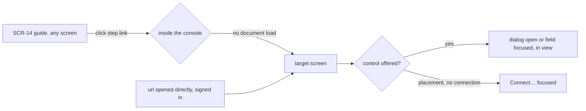

# F-023 · Setup guide links and admin guide alignment

## Metadata

| Field | Value |
|-------|-------|
| **Priority** | — (milestone 1.0.0; HULL-109 is fixed before the tag, operator decision 2026-11-18 |
| **Branch** | `fix/HULL-109-setup-guide-links` |
| **Last updated** | 2026-11-19 |

## 1. Context & Objective

### Current State

F-016 (implemented, closed 2026-11-18) delivered the setup guide (SCR-14) and the runbook `docs/guides/admin.md`. Playing AC-OP-01 to AC-OP-03 on 2026-11-18 surfaced two defects, read on `main` at `50bd49e`:

- **HULL-109.** Clicking a step link of the setup guide shows a window that flashes and closes (Chrome 157, macOS); the step's screen never opens. The links are plain anchors (`web/src/screens/SetupGuide.svelte:43`); four of the five point to `/admin/tree` (`src/hullgate/admin/organisation.py:59-68`), the screen the guide already sits on; the only test counts the links and follows none (`tests/browser/test_ac_21_organisation.py:15`). F-016 §3.14 promised "each linking to the real screen"; no criterion read it.
- **HULL-107.** The admin guide diverges from F-016 §5 as retouched at `b18f429`: B4 names a **Remove placement** button where the console reads **Unplace** (`web/src/lib/i18n.ts:354`); B4 and C2 say "a Claude client" without naming Claude Code or how the token travels; D2 runs the production composition for what AC-OP-03 plays on `compose.yaml` under the project name `hullgate-acop03`. The guide's header holds multi-word arguments and commands in variables (`F="-f deploy/compose.prod.yaml --env-file .env"`, `C="docker compose $F exec …"`), which zsh, the default macOS shell, does not word-split. The guide writes `/opt/hullgate` as if it were the only clone path.

Sources: tracker bodies of HULL-109 and HULL-107 (verbatim copy, orchestrator, 2026-11-18); `.cairn/runs/acts/HULL-11-acceptance-1.md` (finding F1, raise 3; F3, F6); `.cairn/runs/acts/console-ux-review-1.md` (G1).

### Objective

Each setup guide step opens, inside the running console, the control where its act is done, and the admin guide is the text the operator replays for AC-OP-01 to AC-OP-03, runnable as pasted under bash or zsh.

### Expected Impact

- A new operator follows the guide by its links instead of hunting the five acts through the ordinary screens (AC-OP-03 was played without them: 16 min 35 s against a 15-minute target).
- One text for one verification: the operator replays the guide, not a closed spec's §5, and finds the buttons and commands it names.

### Open Product Questions

None. The scoping choices are in §9 Architecture Decisions.

## 2. Scope

**Included**

- The five setup guide steps (§3.1): their targets served by the server, the console landing on each target without reloading the document, the target opened directly, and a browser test that follows every link.
- `docs/guides/admin.md` (§3.2): the header (shell, clone path), B4, C2, C3's re-list gesture, D2. P1 and A1 to A7 already match AC-OP-01 (played on A2 to A6 on 2026-11-18); they change only where the header's `$F` and `$C` are written in full.

## Out of Scope

- **The other guides' word lists in variables.** `docs/guides/keys-and-upstreams.md` holds the same `F=` / `C=` / `A=` pattern (ten blocks, lines 440 to 685 at `50bd49e`); `install.md`, `update.md` and `backup-restore.md` were not swept. *Différé*: the same fix applied guide by guide, a ticket proposed at close-feature.
- **F-016 §5's `$P` lines.** F-016 is a closed spec; its AC-OP-03 protocol stays as played. From F-023 on, the replay text is the guide's D2 (§3.2).
- **The UX review's other guide items** (G2 to G7, HULL-110, milestone 1.1.0): where the guide is shown, its ✓/Next marks, step 2's wording, the folded OAuth block, the Refresh button. F-023 changes where the links land, not how the guide looks.
- **Browser history beyond the shell's existing behaviour** (Back, Forward after following a link).
- **A reproduction in Chrome 157 on macOS.** The bench's Chromium is the instrument (§12).
- **A new operator criterion.** No AC-OP: every criterion is replayed by a test.
- **Narrow layouts** (SCR-04.narrow, the Library in rails): the criteria are read at the bench's default viewport.

## 3. Functional Spec

### 3.1 Setup guide step targets (SCR-14)

Each step of `GET /admin/api/setup` carries a `url`: the five values are distinct, built by the server (`src/hullgate/admin/organisation.py`), and each is a console path the shell recognises as its target. The console builds no target (BR-211). The URL's shape (path, query parameter) is the implementation's.

| Step | Screen | On landing | When the control cannot be offered |
|---|---|---|---|
| `client` | Tree | the field that adds a client: on an empty tree the first-client field, otherwise the "Add a client under ‹organisation›" field, open and focused | — |
| `service` | Tree | the Library's **Declare a service** dialog, open | — |
| `connection` | Tree | the **Connect…** dialog, open; with no service declared it shows what the ordinary dialog shows | — |
| `placement` | Tree | the Library's first connection's **Place in…** button, focused | no connection: the Library's **Connect…** button, focused |
| `credential` | Tokens | the issue form's role field, focused | — |

Landing, for every step and from the guide shown on any screen (including the guide reopened from Organisation, SCR-14.done):

- **No reload.** Following a link loads no document: the console's running state survives, and the address bar's path is the target screen's. Whether the target's query part stays in the address bar after landing is the implementation's, as long as a direct load lands (below).
- **In view.** The opened dialog or focused control is in the viewport — the guide sits above the screen and may push it below the fold.
- **Direct load.** The step's `url` opened as a new document (new tab, reload, pasted) with a valid session lands the same way. Without a session, SCR-03.session-expired applies: after sign-in the console returns to the target screen; reopening the control is not required.
- **Nothing written.** Landing writes nothing (BR-234); the guide still renders no form of its own: the dialog or field is the screen's ordinary one (BR-229). A screen refusing the act (a lock, SCR-04.locked) shows its ordinary refusal when the operator acts.

#### Visual States

No new state. SCR-14 and SCR-14.done keep their captures.

### 3.2 The admin guide (`docs/guides/admin.md`)

Each step keeps the BR-042 form (block, expected result, what to do if it differs) and its identifier (BR-328's mapping table unchanged).

- **Header.** The guide states that blocks run as pasted under bash or zsh. It states that the clone directory is the operator's choice, `<install-dir>` of the installation guide's parameter table (BR-329), and that blocks use its documented default `/opt/hullgate`, to substitute consistently. The `F=` and `C=` lines leave the header.
- **Shell portability.** No variable whose assignment's right-hand side, as written, contains whitespace is expanded unquoted in any fenced `sh` block of the guide: a command is written in full (`docker compose -f deploy/compose.prod.yaml --env-file .env exec -T hullgate hullgate admin …`). A quoted expansion (`printf '%s\n' "$COMPOSITION"`) stays.
- **B4.** Names Claude Code and carries AC-OP-02's block as retouched at `b18f429`: folder `~/hullgate-acop02`, `read -rs HG_TOKEN`, `claude mcp add --transport http --scope local hullgate-acop02 "<mcp-url>" --header "Authorization: Bearer $HG_TOKEN"`, `unset HG_TOKEN`, `claude`; `/mcp` → `hullgate-acop02` to see the tools. The placement is removed with **Unplace** (inspector → the connection → **Unplace**); the re-list is `/mcp` → `hullgate-acop02` → **Reconnect**. Afterwards: `claude mcp remove hullgate-acop02 --scope local` in the same folder, then revoke the token in the Tokens tab; never `claude mcp get`, which prints the header.
- **C2.** Connects Claude Code as in B4, by reference to B4's block, not a second copy.
- **C3.** The client's re-list is `/mcp` → `hullgate-acop02` → **Reconnect**.
- **D2.** Carries AC-OP-03's protocol (F-016 §5 at `b18f429`), five blocks on the workstation, on `compose.yaml` under the project name `hullgate-acop03`, with every `$P` written `docker compose -p hullgate-acop03` and the `P=` line removed; the clone `~/hullgate-acop03` is an example path. D2's production-composition command leaves; the `settings show /` read becomes `docker exec hullgate-acop03 hullgate settings show /`. D2's sentence on the links says each opens its step's control (§3.1). The rest of D2 (dismiss and reopen, expiry threshold) stays.

## 4. Business Rules

No rule introduced.

### BR-229 · The setup guide reads the state, and has no acts of its own *(v2)*

> **Extracted on 2026-11-18.** Current version: [`business-rules/BR-229.md`](../business-rules/BR-229.md).
> The content below reflects the state of this BR at the time of feature F-023 (v2).

*`behavioral` · `warning` · Candidate state: `verified` — `tests/integration/test_br_229_guide.py`, `tests/browser/test_br_229_links.py`.*

**Rule** — The guide's steps are computed from the instance's state (a client, a service, a connection, a placement, an issued credential exist); each step links to the ordinary screen where its act is done, and following the link inside the console opens or focuses that screen's own control for the act, without reloading the console; the guide writes nothing but its own dismissal. A step that disagrees with the state, or a link that does not land on its control, is signalled by the test.

**Clarifications**

- The five targets are distinct and served by the server (BR-211); the table of §3.1 is the population.
- A control the state cannot offer (placement with no connection) gives way to the act that must come first, focused (§3.1).
- Landing writes nothing (BR-234). The guide renders no form: the opened dialog or field is the screen's own.
- v1 → v2: "each links to the ordinary screen" is completed by where the link lands and how (HULL-109, finding F1 of HULL-11's acceptance).

### Rules touched

- **BR-229**, new version (v2, above).
- Applied, unchanged: **BR-211** (the console computes no URL), **BR-234** (a `GET` changes nothing), **BR-042** (the step form), **BR-328** (the mapping table), **BR-329** (`<install-dir>`), **BR-232** (keyboard flows; F-023 adds no flow).

**Overlap scan** (`business-rules/index.md`, 220 lines; filter on Title and Statement: guide, link, focus, navigat, reload, runbook, shell) — **11 rows retained**. BR-229 — the rule F-023 completes: new version. BR-042, BR-328, BR-329 — the guide's form, mapping and parameters: applied, no overlap with the shell-portability statement, which binds workstation blocks BR-042 does not cover (§9 D5). BR-232 — keyboard flows with visible focus: neighbour, no overlap (it names flows, not where a link lands). BR-020, BR-131, BR-201, BR-203, BR-213, BR-331 — off topic (POC runbooks, vocabularies, bootstrap, enrolment link, secrets, ticket reporting).

## 5. Acceptance Criteria

- [x] **AC-01** (BR-229) `GET /admin/api/setup` returns five steps whose `url` values are pairwise distinct and each recognised by the shell's route parser as its §3.1 screen. Instrument: `tests/integration/test_br_229_guide.py` (the five values, distinctness) and the route parser's unit test under `web/` (each value → its screen).
- [x] **AC-02** (BR-229) Empty instance, guide shown on the Tree screen, the bench's default viewport: for each of the five links, a marker set on `window` before the click survives it, the address bar's path equals the path of the step's `url`, and the §3.1 control is open or focused and in the viewport (`placement` → **Connect…** focused). Between links the console goes back to the Tree screen by its tab, an open dialog closed by Escape, without reload. Instrument: `tests/browser/test_br_229_links.py`.
- [x] **AC-03** (BR-229) Seeded instance (a client, a service, a connection): `client` → the "Add a client under ‹organisation›" field focused; `placement` → the first connection's **Place in…** focused. Same instrument.
- [x] **AC-04** (BR-229) Guide dismissed and reopened from Organisation (SCR-14.done): each link lands as in AC-02 or AC-03, marker surviving. Same instrument.
- [x] **AC-05** (BR-229) Each of the five `url` values opened with `page.goto` in a signed-in session lands on its §3.1 control. Same instrument.
- [x] **AC-06** (BR-229, BR-234) Following the five links changes no row: the audit row count and the `node`, `connection`, `placement` and `operator_token` counts read from the host before and after are equal. Same instrument.
- [x] **AC-07** In every fenced `sh` block of `docs/guides/admin.md`, no variable whose assignment's right-hand side, as written anywhere in the guide's blocks, contains whitespace is expanded outside double quotes; the guide holds no line `F=` or `C=`. Instrument: `tests/unit/test_hull_109_admin_guide.py`.
- [x] **AC-08** `docs/guides/admin.md` holds no "Remove placement"; B4 holds "Unplace", "Claude Code", `read -rs HG_TOKEN`, `claude mcp add --transport http --scope local`, `unset HG_TOKEN`, "Reconnect", `claude mcp remove` and the token's revocation; C2 names Claude Code and refers to B4; C3 holds "Reconnect". Same instrument.
- [x] **AC-09** D2 holds, in order, every command line of F-016 AC-OP-03's five blocks at `b18f429` with `$P` replaced by `docker compose -p hullgate-acop03` and the `P=` line dropped, and no `compose.prod.yaml`. The test extracts those lines from `features/F-016-admin-console.md` (§5, AC-OP-03's `sh` blocks), not from a copy of its own. Same instrument.
- [x] **AC-10** The guide's header names `<install-dir>`, says the clone directory is the operator's choice, and names bash and zsh. Same instrument. `tests/unit/test_br_042_runbooks.py`, `tests/unit/test_br_328_guides.py`, `tests/unit/test_br_329_parameters.py` and `tests/unit/test_guides_walkthrough.py` pass unchanged; `make gate` and `make test-browser` pass.

## 6. Diagrams

| Type | Included | Reason |
|---|---|---|
| Userflow | yes | the guide link, §6.1 |
| Sequence | no | no new exchange: the console reads `GET setup` as today |
| State machine | no | no new state |
| ER / Class | no | no schema change |

### 6.1 Userflow

## 7. States & Captures

- **Package-status**: absent — no design package; no new visual state (§3.1).

## 8. Design & Prototypes

No design assets.

## 9. Implementation Notes

### Dependencies (prerequisite features)

- F-016 — Admin console (implemented).

### Technical Constraints

- The browser bench is Chromium in its pinned image (`make test-browser`); the defect was seen in Chrome 157 on macOS and not reproduced. The criteria read the property (no document load, control landed), whatever the cause.
- The walkthrough (`scripts/guides_walkthrough.sh`) plays admin P1, A1 and A2 blocks: rewriting the header's `F=` / `C=` must keep them runnable.
- Step identifiers and the BR-042 markers per step are asserted by `tests/unit/test_br_042_runbooks.py`: D2 stays one step, its five blocks under one expected result and one what-if-it-differs.

### Architecture Decisions

| Question | Decision | Rationale |
|---|---|---|
| D1 · New rule or version for the links? | BR-229 v2 | The rule already says each step links to the ordinary screen; the defect is that nothing said where it lands. |
| D2 · D2 carries AC-OP-03's protocol or points to F-016 §5? | Carries it | The operator replays the guide; pointing to a closed spec's `$P` lines would keep the zsh defect. |
| D3 · B4 and C2 both carry AC-OP-02's block? | B4 carries it, C2 refers to it | Two copies of one block drift, the defect HULL-107 reports. |
| D4 · Retouch F-016 §5's `$P` lines? | No | F-016 is closed; HULL-107 leaves it to product. Its protocol is history; the guide is the replay text. |
| D5 · Shell portability as a BR-042 version? | No, feature-local (§3.2, AC-07) | BR-042 binds the server actions F-004 assumes; the defect was on workstation blocks. A rule for every guide waits for the deferred sweep (Out of Scope). |
| D6 · Placement opens the place dialog? | Focuses the first connection's **Place in…** | Which connection to place is the operator's choice; opening one would choose it. |
| D7 · Scope of the shell sweep | `admin.md` only | The two points of HULL-109 and HULL-107; `keys-and-upstreams.md` deferred. |

### Data Model Impact

- Migration: no.

### Components to Create / Modify

**Modified**
- `src/hullgate/admin/organisation.py` — five distinct targets.
- `web/src/screens/SetupGuide.svelte`, the shell's routing (`web/src/App.svelte`, `web/src/lib/routes.ts`), `TreeScreen.svelte`, `Library.svelte`, `Tokens.svelte` — landing on the target.
- `docs/guides/admin.md` — §3.2.
- `tests/integration/test_br_229_guide.py`, `tests/browser/test_ac_21_organisation.py` (the count stays, the following moves to the new file).
- `business-rules/BR-229.md` — v2 at close-feature.

**Created**
- `tests/browser/test_br_229_links.py`, `tests/unit/test_hull_109_admin_guide.py`.

### Pitfalls Discovered

- F-016 AC-OP-03 has five numbered steps but four `sh` blocks (step 3 is a browser action): D2 carries those four, step 3 as prose, plus its own `settings show` block.
- B4's `"<mcp-url>"` is a new placeholder: BR-329's test requires every guide placeholder in the installation guide's parameter table, so `install.md` gains one row.
- The browser suite shares one instance across files: the empty-instance link test is ranked before AC-21's dismissal and any seeding (`tests/browser/conftest.py`); the seeded test reopens the guide from Organisation.

## 10. Phases

Feature delivered in one phase.

### Phase 1 — Links and guide

- [x] §3.1 and §3.2 delivered; AC-01 to AC-10 met.
- [x] Tests pass (`make gate`, `make test-browser`).

## 11. Tests

### integration

| Test | BR / Concern | File |
|---|---|---|
| five distinct targets | BR-229 | `tests/integration/test_br_229_guide.py` |

### browser

| Test | BR / Concern | File |
|---|---|---|
| each link lands, no reload, in view (empty, seeded, from Organisation) | BR-229 | `tests/browser/test_br_229_links.py` |
| direct load of each target | BR-229 | same |
| nothing written | BR-229, BR-234 | same |

### unit

| Test | BR / Concern | File |
|---|---|---|
| shell portability, button and client names, D2 protocol, header | HULL-107 | `tests/unit/test_hull_109_admin_guide.py` |
| route parser maps each target | BR-229 | the route parser's test under `web/` |

## 12. Risks & Watchpoints

- **Unreproduced cause.** The flash seen in Chrome 157 may have a cause the bench's Chromium does not show. Mitigation: the criteria read the property; the operator meets the links again at the next fresh instance.
- **Header rewrite.** Every block that used `$F` or `$C` changes; the walkthrough and the BR-042 test are the guard.
- **Direct load kept in scope** (stress-test C1, accepté). A step link is an anchor the operator may open in a new tab; AC-05 costs one loop of the browser test.

## Stress-test

**Passe du 2026-11-18** — model:claude-opus-5-5 (the drafting executant, on the orchestrator's instruction), six axes.
**8 findings — 0 critical, 3 major, 5 minor ; 8 retenus, 0 écartés.**

Majors :
- **A1** · axe A · §3.2, AC-07 — "assigned value contains whitespace" was ambiguous for a command substitution (`COMPOSITION=$(git show "$REF:…")`). Sort : corrigé — the test reads the assignment's right-hand side as written; a quoted expansion stays licit.
- **A3** · axe A · AC-09 — "the test carries that list" left the reference list to drift from F-016. Sort : corrigé — the test extracts AC-OP-03's lines from F-016's file. Clause question re-asked: each line is read by the extraction and a substring search in D2, in order.
- **F1** · axe F · §3.1 vs AC-02 — §3.1 left the target's query to the implementation while AC-02 asserted path and query. Sort : corrigé — §3.1 and AC-02 read the path; the direct load (AC-05) carries the target.

Minors :
- **A2** · axe A · AC-02 — "goes back to the Tree screen" did not say how, and a reload would void the marker. Sort : corrigé — by its tab, a dialog closed by Escape, without reload.
- **B1** · axe B · §3.1 — a target kept in the address bar reopens its dialog on reload. Sort : corrigé — left to the implementation, bounded by AC-05 (§3.1 No reload).
- **B2** · axe B · AC-02 — narrow layouts collapse the Library into rails, where a control may be out of view. Sort : différé — Out of Scope, criteria read at the bench's default viewport.
- **C1** · axe C · AC-05 — the direct load could be deferred without breaking the fix. Sort : accepté — kept, §12.
- **D1** · axe D · §2 — the instruction names AC-OP-01 to AC-OP-03; a reader would assume A-steps were rewritten. Sort : corrigé — §2 says P1 and A1 to A7 already match AC-OP-01 and change only by the header's substitution.

**Retouche du 2026-11-18** — correction : bash or zsh (HULL-109 implementation stop, `read -rs` is not POSIX), human:sstolz

## 13. Changelog

| Date | Author | Change |
|------|--------|--------|
| 2026-11-18 | Claude (product, model:claude-opus-5-5) | Spec creation (HULL-109, HULL-107) |
| 2026-11-18 | Claude (product, model:claude-opus-5-5) | Stress-test pass, 8 findings applied; status ready-for-freeze |
| 2026-11-18 | Claude (product, model:claude-opus-5-5) | Slice 2 added (HULL-85, operator option (a) relayed by the orchestrator): §3.3, BR-316 clarification, AC-11 to AC-14; back to draft, second pass (6 findings applied); status ready-for-freeze |
| 2026-11-18 | Claude (product, model:claude-opus-5-5) | Slice 2 moved to F-024 on the orchestrator's decision (raise 7, option (b)); F-023 back to its first-pass text, HULL-109 only |
| 2026-11-18 | human:sstolz (operator) | Freeze: operator go on the text shown in full. |
| 2026-11-18 | human:sstolz (operator) | Retouche 1: blocks promised under bash or zsh instead of a POSIX shell or zsh (§1, §3 Header, AC-10); `read -rs` is not POSIX (Codex implementation stop); operator go on the text shown. |
| 2026-11-19 | Claude (product, model:claude-fable-5-2) | Acceptance (HULL-109, HULL-107): AC-01 to AC-10 met, §5 ticked; replayed on `main` `2eb1aaa` (comments 13510 and 13513) |
| 2026-11-24 | Claude (implementation, model:claude-opus-5-5) | F-025 §3.8 rewrite pass, freeze `1427c98`: private-forge `#N` written `HULL-N`, citation form only. |
