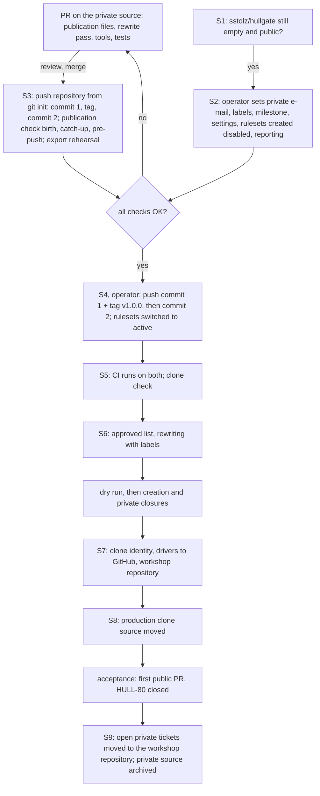

# F-025 · Public repository on GitHub

## Metadata

| Field | Value |
|-------|-------|
| **Priority** | P2 (label `prio/P2` of HULL-80) |
| **Branch** | `feat/HULL-80-github-publication` |
| **Last updated** | 2026-11-26 |

## 1. Context & Objective

### Current State

Read at `main` `ee0b862f` (2026-11-20) unless stated otherwise.

- **Sources.** HULL-80 and its comment of 2026-11-14; `features/F-022-public-release-cleanup.md` (HULL-98, `implemented`, closed 2026-11-17); the framework guide `docs/publishing-a-project.md` of the cairn home (0.60.0), a framework reference every executant reads under `$CAIRN_HOME`, not a source document of this project. No source document is deposited under `docs/sources/` for this ticket.
- **The tag.** `v1.0.0` is cut at `09a448ce` and deployed, by the generic release mechanics: F-021 (HULL-12) was not implemented before the cut, and its implementation moves to milestone `1.1.0` under HULL-12 (milestone decision N8, operator, 2026-11-21, `.cairn/runs/acts/milestone-1.0.0-orchestrator-decisions.md`, workshop). Its tree holds 1367 tracked paths, the workshop included. `main` has one commit after it, `ee0b862f`, a workshop-only `chore(learn)` commit.
- **What F-022 delivered** (taken as done, not redone): the tracked tree names no operator infrastructure (BR-325, gate guard), carries no unjudged secret (BR-326 in `make qa`, BR-327 verdicts on the private history), ships five generic guides (BR-328, BR-329), and the **export** of a commit — its tree without `.cairn/runs/`, `.cairn/learnings/`, `.cairn/project-context.yaml` and `.cairn/auth/`, plus the public ignore entries written on the copy — is judged by the **export rehearsal** (`scripts/export_rehearsal.py`, F-022 §3.12). The context example `.cairn/project-context.example.yaml` is tracked: `project.repository: https://github.com/sstolz/hullgate`, `project.visibility: public`, tracker and forge declared on GitHub for `sstolz/hullgate`, `tracker.ticket-prefix: HULL`, `cairn.version: 0.60.0` (F-022 AC-23, operator decision D2).
- **What the 1.0.0 tree does not carry** (`git ls-files` at `v1.0.0`): no `LICENSE`, no `SECURITY.md`, no `CONTRIBUTING.md`, no `.github/` directory. `README.md` is a developer's page: its `## Développement` heading and two `<étape>` / `<noms>` placeholders are French, and it opens on F-004's foundation. `pyproject.toml` declares no licence.
- **Build inputs.** `.dockerignore` admits only `pyproject.toml`, `uv.lock`, `.python-version`, `README.md`, `src/` and `web/` into the image's build context; `pyproject.toml` names `README.md` as the package readme. A change to `README.md` or `pyproject.toml` changes what the 1.0.0 image is built from; a change to `LICENSE`, `SECURITY.md`, `CONTRIBUTING.md` or `.github/` does not.
- **Forge and tracker today.** The private source (Gitea) carries the code, the issues, the pull requests and the reviews; the authoring and merging identity and the review identity are two distinct forge accounts, because the forge refuses that a PR author approves their own PR and the operator refuses AI tokens on their personal account (learnings, 2026-10-27). `access.merge-by: ai`. Open tickets on 2026-11-21: 41 — the 40 of `.cairn/runs/acts/HULL-80-tickets-reading-1.md` (workshop), 29 classed product and 11 operator, plus HULL-12, open on milestone `1.1.0` since N8 (labels `prio/P2`, `type/feature`; its title names F-021's version mechanics, its body is still an earlier, unrelated text — read by the stress-test of 2026-11-21); 16 labels (2 cairn status, 3 priority, 6 type, 5 closure cause).
- **CI today.** None (`infra.ci: none`). HULL-81 (open, milestone `1.1.0`) plans a private GitHub mirror fed by a push mirror from the private source and a self-hosted runner; HULL-80's comment of 2026-11-14 notes that a self-hosted runner on a public repository runs fork PRs' code on its host.
- **The GitHub repository.** `sstolz/hullgate` already exists and is empty — no commit (operator, 2026-11-21). No mirror of the private history was ever pushed to it; the first public commit goes to it directly (§3.2 step S1).
- **Ticket identifiers.** BR-332: `HULL-NN` identifiers are historical references to the private tracker; the README's note explains them, `#NN` numbers included; none is rewritten or turned into a link to a public issue number. The tracked tree also cites private issues and pull requests in the `#N` form: 823 candidate tokens (`#` then digits, colours and anchors not yet set apart) in 212 files of the export, read on 2026-11-21 — BR-066's retention clause, for one, cites HULL-12 that way. Three of them sit in §4 of F-017 (`ready-for-dev`).
- **Framework version.** The private source stays at cairn 0.57.0 through 1.0.0 (F-022 §9); the export carries 0.60.0 through its context example. The export rehearsal of record (F-022 AC-24) ended `REHEARSAL: KO` on INV-001 only, from the inline deltas of the open specs F-017 and F-019 (milestone `1.1.0`).

### Objective

hullgate is published under the MIT licence as a public GitHub repository whose first commit is the 1.0.0 export, readable and buildable by a stranger, with a CI that plays the gate on every change; after one switch, the public repository is the project's working repository — code, issues, pull requests and reviews — and the private source keeps only the history before the switch, while the workshop has its own private repository.

### Expected Impact

- A stranger can read what hullgate is, under which licence, how to run it, how to contribute and how to report a vulnerability, from the repository's first page (BR-337 to BR-340, BR-347).
- No commit, tag or note object of the private history is reachable from the public repository, and the only trees and blobs pushed are those of the two public trees: two commits and one tag at birth, measured before the push and on a fresh clone (BR-334, BR-345).
- The public 1.0.0 builds from the same inputs as the deployed 1.0.0 (BR-334): zero difference in the build-context paths.
- Every push and pull request on the public repository gets a gate verdict without any secret on GitHub (BR-341).
- After the switch, zero tracked change outside the workshop lands on the private source (BR-336), every migrated ticket is traceable to its `HULL-NN` (BR-343, BR-349), `#N` names a GitHub issue only (BR-344, BR-350), and no ticket is left open on the archived private tracker (BR-351).

### Product Questions

Q1 to Q10 were raised by the drafting act (context, problem, options: `.cairn/runs/acts/HULL-80-drafting-1.md`, workshop) and are **decided by the operator on 2026-11-21** (`.cairn/runs/acts/HULL-80-operator-decisions.md`, workshop); §9 Architecture Decisions keeps the discarded options. Q11, raised by the first retouch, is **decided by the operator on 2026-11-21** too (same file). Q13, raised by the second retouch, is decided with the stress-test's M5 on the orchestrator's recommendation after the operator's deferral, **confirmed by the operator on 2026-11-21**, its three readings **confirmed on 2026-11-23**. Q12, R1 and L are **decided by the operator on 2026-11-23** (same file). Q14, raised by the fourth retouch, is **decided by the operator on 2026-11-23** (same file). Q4's selection is **amended by the operator on 2026-11-24**, after the implementation's migration dry run (`.cairn/runs/acts/HULL-80-start-1.md`, workshop). No product question is open.

- **Q1 — Birth of the public repository** — *decided (operator, 2026-11-21)*: a new history from the export; the repository `sstolz/hullgate` already exists and is empty (no commit), so there is no private history to hide on it and the first public commit goes to it directly. No rewrite of the private history.
- **Q2 — The first public commit's tree** — *decided (operator, 2026-11-21)*: the export of `v1.0.0` plus the closed overlay `LICENSE`, `SECURITY.md`, `CONTRIBUTING.md` and the CI workflow, tagged `v1.0.0`; the README rewrite in the second public commit (the catch-up commit), unless the operator says otherwise.
- **Q3 — Merge and review identities on GitHub** — *decided (operator, 2026-11-21), replaced (operator, 2026-11-25)*: one identity, the owner `sstolz`, which authors and merges pull requests; no machine account — GitHub's terms allow one free machine account per person, so the two of 2026-11-21 were not allowed. The session acts on the public repository with a fine-grained personal access token scoped to `sstolz/hullgate` — contents, pull requests and issues read and write, metadata read; no `Workflows` permission (operator, 2026-11-26, after stress-test 5) —, with an expiry, provided by the operator when needed — a secret: the operator's gesture, never generated nor displayed by the session. Without `Workflows`, the session cannot change the workflow definition that runs the check guarding `main` — its triggers, runner, pins and `permissions:` — nor grant itself through a workflow what the token lacks; what the check runs, `make gate` and `make qa` and the tracked files they call, is ordinary content a session pull request can change (operator, 2026-11-26, after stress-test 6; §3.5, §12). S4 and every pull request changing `.github/workflows/` — its push and its merge — are the operator's gestures (§3.2, §3.5). This lifts, for this repository only, the operator's refusal of AI tokens on their personal account (§1, *Forge and tracker today*), within these bounds: one repository, an expiry, no `Workflows` permission. The cairn review stays mandatory, published as a comment review; GitHub requires no approval (§3.5). `access.merge-by` stays `ai`.
- **Q4 — Tracker migration** — *decided (operator, 2026-11-21), amended (operator, 2026-11-24)*: the selection of `.cairn/runs/acts/HULL-80-tickets-reading-1.md` (workshop) is approved — its 29 product tickets, plus HULL-12 (F-021's implementation, moved to `1.1.0` by milestone decision N8); 11 operator tickets stay private; only milestone `1.1.0` is recreated (§3.6). Amended on 2026-11-24: HULL-88 and HULL-89, security defects of 1.0.0, are not migrated — kept private until fixed, then each published as a GitHub security advisory through the channel of `SECURITY.md` (Q7) — so 28 migrated (27 product tickets plus HULL-12); the product part of HULL-83 becomes one new GitHub issue, on milestone `1.1.0`, and the remaining product part of HULL-39 is folded into HULL-114's migrated text, so one new issue, not two. Labels: §3.7.
- **Q5 — Identifiers after the switch** — *decided (operator, 2026-11-21)*: no new ticket prefix in the texts written on GitHub itself; a GitHub issue is cited `#N` there (the framework's artefacts: Q11, Q13); `HULL-NN` stays the historical identifier and each migrated issue carries its migration line naming it; `BR-NNN` and `F-NNN` unchanged.
- **Q6 — CI** — *decided (operator, 2026-11-21)*: GitHub-hosted runners running `make gate` and `make qa`, no secret; HULL-81 closed as superseded. `cairn check` in CI stays deferred (INV-001 red until F-017 and F-019 close).
- **Q7 — Security channel** — *decided (operator, 2026-11-21)*: GitHub private vulnerability reporting only.
- **Q8 — Contribution terms** — *decided (operator, 2026-11-21)*: inbound = outbound MIT, no CLA, no sign-off.
- **Q9 — The private source and the workshop after the switch** — *decided (operator, 2026-11-21)*: the workshop (`.cairn/runs`, `.cairn/learnings`) goes to a dedicated private repository (`docs/publishing-a-project.md` §2 of the cairn home); the private source is archived read-only (option (a) as raised) — as the switch's last gesture, S9 (§3.2), after its open tickets have moved (R1).
- **Q10 — Production's clone source** — *decided (operator, 2026-11-21)*: production clones the public repository from its next deployment.
- **Q11 — The value of `tracker.ticket-prefix` after the switch** — *decided (operator, 2026-11-21, option (a))*: after the switch `tracker.ticket-prefix` is `GH`; cairn writes `GH-N` for GitHub issue #N where it composes an identifier; on GitHub itself issues are cited `#N`; `HULL-NN` stays historical. Discarded: (b) keeping `HULL` and accepting the collision in workshop artefacts; (c) taking the question to the framework. Its `Refs` lines clause is settled by Q13.
- **Q12 — Three priority renames** — *decided (operator, 2026-11-23, the orchestrator's reading confirmed)*: `prio/P0` → `priority: critical`, `prio/P1` → `priority: high`, `prio/P2` → `priority: medium`, `priority: low` created unused (§3.7).
- **Q13 — `#N` in commits, PRs and tracked prose (with the stress-test's M5)** — *decided on the orchestrator's recommendation after the operator's deferral (2026-11-21), confirmed by the operator (2026-11-21)*: before the export, a one-off pass rewrites every tracked `#N` that designates a private-tracker issue to `HULL-N`, the cases that are not ticket references (markdown anchors, colours, line numbers) set apart by a listed, reviewed pattern set; after the switch `#N` always means a GitHub issue — in commits and their `Refs` lines, pull requests, specs, rules, changelog and docs; `HULL-N` is historical; `GH-N` appears only where cairn composes an identifier itself (branch names, workshop act reports); a guard keeps private `#N` references from coming back (§3.8, BR-344, BR-350). Its three readings are *confirmed by the operator (2026-11-23)*: a spec's `ticket:` key is a cairn-composed identifier (`GH-N`); private pull-request numbers are rewritten to `HULL-N` too, the private forge numbering issues and pull requests in one sequence; F-017 §4's three `#N` are rewritten under a declared `gel` line validated by the operator (`human:sstolz`) at that time. Discarded: `Refs GH-N` in commits and PR titles (Q11's first wording; GitHub does not link it and the framework's `conventions/workflow.md` writes the forge's form); taking it to the framework.
- **R1 — The private tickets that stay open, against the archive** — *decided (operator, 2026-11-23, option (a))*: the six private open tickets (HULL-1, HULL-3, HULL-4, HULL-13, HULL-39, HULL-83) move to the workshop's dedicated private repository as issues before the private source is archived (S9, §3.6 step 6, BR-351). Discarded: (b) archiving with the six open as frozen records; (c) deferring S9 until the six are closed.
- **L — The licence holder** — *decided (operator, 2026-11-23, option (a))*: `LICENSE` names the operator, by name or by GitHub login; if the denylist of BR-325 catches it, the operator adds the exception to the private denylist themselves — an operator gesture, never the session's (§3.3, BR-337, §12).
- **Q14 — The name on the birth headers, against the denylist** — *decided (operator, 2026-11-23, option (a))*: the author, committer and tagger name on the public birth commits and tag is the operator's GitHub login, as on their other public GitHub project, with the noreply address of M3; no header exception in the denylist (§3.1, BR-334). Discarded: (b) a header exception the operator adds to the private denylist; (c) header screening skipping the name field.

## 2. Scope

- **Publication files**, authored and reviewed on the private source before the switch: `LICENSE` (MIT, the operator as holder: L), `SECURITY.md`, `CONTRIBUTING.md`, the CI workflow under `.github/workflows/`, `README.md` rewritten for outside readers, `pyproject.toml` declaring the licence, and the context example's `tracker.ticket-prefix` set to `GH` (Q11).
- **The `#N` rewrite** of the tracked tree and its guard (Q13, §3.8).
- **The public repository's birth**: commit 1 — the export of `v1.0.0` plus the publication overlay, tagged `v1.0.0`; commit 2 — the **catch-up commit**, the export of the private source's `main` at the switch. Both judged by the export rehearsal and by a publication check that compares trees, objects, refs and headers (§3.1).
- **CI** on GitHub-hosted runners, `make gate` and `make qa`, no secret (§3.4).
- **Repository protection**: `main` and version tags protected; merges through a reviewed, green pull request (§3.5).
- **Ticket migration**: the approved open tickets of the private tracker become GitHub issues, screened by the publication guards and traced to their `HULL-NN`, under the label set of §3.7 (§3.6).
- **The switch**: the public repository becomes the working repository; the cairn drivers name GitHub; the workshop gets its own private repository; acceptance; the private tickets that stay open move to the workshop repository and the private source is archived (§3.2).
- **The switch procedure** for the maintainer, and the one-off tooling of the migration and of the rewrite: private, kept in the workshop, outside the public tree (they name the operator's installation or read private inputs).

## Out of Scope

- Rewriting or publishing the private history — the public history is new (Q1, decided; F-022 D1 (c)).
- Creating GitHub accounts, tokens or runners (the repository already exists, empty: Q1) and configuring forge settings — the operator's gestures (§3.2). Pushing to GitHub and writing on its tracker — the operator's gesture, or the session's with the token of Q3, provided by the operator: the migration (S6), on a go naming it; after S4, pull requests and their merges, under `access.merge-by` (§3.5, §3.9); a release cut's version tag, in its publication act (§3.5). S4 and every pull request changing `.github/workflows/`, its push and its merge, stay the operator's (Q3). The GitHub MCP server of the migration and of the drivers is configured by the operator with that same token; the session holds no other GitHub credential.
- A release workflow on GitHub — tag creation by GitHub Actions instead of the owner's admin bypass, publication gated by manually approved environment jobs — deferred to HULL-118 (GitHub release pipeline, milestone `1.1.0`; operator, 2026-11-26); F-025 has no release workflow.
- Rotating any credential — the operator's (BR-327).
- `cairn check` in CI — candidate ticket once F-017 and F-019 are closed (INV-001) and the framework's availability in CI is settled.
- Migrating ticket comments, closed tickets, pull requests and review threads — they stay on the private source as history; a migrated ticket carries a summary of what its comments settled (§3.6).
- Renaming `HULL-NN` in tracked files or linking them to GitHub numbers — BR-332, unchanged on that point (the `#N` → `HULL-N` rewrite of §3.8 spells a prefix, it renames no `HULL-NN`).
- The cutover of the maintainer's own forge accounts (HULL-13) — private operator procedure, outside the public lifecycle (F-022 D5).
- Moving the production server to the public repository — the operator's act on their installation (Q10, decided: from its next deployment); this spec reads it (AC-OP-07).
- Self-hosted runners and the private mirror of HULL-81 — superseded (Q6, decided); HULL-81 is closed as superseded.
- Package publication (PyPI) and image publication to a public registry — not asked; candidate ticket.
- A GitHub Release object for `v1.0.0` — the annotated tag is the release; candidate ticket.
- Issue and pull-request templates — `CONTRIBUTING.md` carries what they would ask; candidate ticket.
- Dependabot and code scanning — not asked; the CI's SHA pins are updated by hand until a candidate ticket says otherwise.
- Signed commits and tags — not asked: the two public commits and `v1.0.0` are unsigned for good (§3.1); candidate for the releases cut on the public repository.
- GitHub Discussions and the wiki — not used: the operator leaves both off at S2 (AC-OP-03).
- Migrating the private source to cairn 0.60.0 — the public repository is born at 0.60.0 through its example; the private source is archived (Q9).

## 3. Functional Spec

### 3.1 The two public commits and the publication check

| Commit | Tree | Tag | Proof |
|---|---|---|---|
| 1 — birth | the export of `v1.0.0` (F-022 §3.12) plus the **publication overlay**: `LICENSE`, `SECURITY.md`, `CONTRIBUTING.md`, `.github/workflows/<gate workflow>` — each taken from the switch commit (§3.2 S3; operator, 2026-11-26, after stress-test 6), the one source commit of both public trees | `v1.0.0`, annotated, on this commit | publication check `birth`: tree equal to export(`v1.0.0`) ∪ overlay, no other path differing; no build-context path (`pyproject.toml`, `uv.lock`, `.python-version`, `README.md`, `src/`, `web/`) differing from the tag; headers as below |
| 2 — catch-up | the export of the private source's `main` at the switch commit | none | publication check `catch-up`: tree equal to export(switch commit); no ticket-shaped `#N` outside the exclusions of §3.8; headers as below; the export rehearsal on the switch commit |

**Headers** (operator, 2026-11-21, M3; name, operator, 2026-11-23, Q14): the author, committer and tagger of commit 1, commit 2 and the tag `v1.0.0` are the operator's GitHub noreply address (`<id>+<login>@users.noreply.github.com`), with the operator's GitHub login as name. Both values are supplied by the operator at S3, never searched for, and written in no tracked file. The messages are fixed, with no trailer and no ticket reference:

| Object | Message |
|---|---|
| commit 1 | `chore(release): publish hullgate 1.0.0` — body: `First public commit: the 1.0.0 tree, with LICENSE, SECURITY.md, CONTRIBUTING.md and the CI workflow. Earlier history is not public.` |
| commit 2 | `chore(release): catch up with the working tree` — body: `The tree of the working repository at the switch: the README for outside readers, the licence metadata and the changes since 1.0.0.` |
| tag `v1.0.0` | `hullgate 1.0.0` |

The **publication check** is a script of the tree (name chosen by implementation) that builds the expected objects of the public repository from the private source and compares them with a given repository, printing one line per difference and a final `PUBLICATION: OK` or `PUBLICATION: KO <n> paths`. Its modes:

- `birth`, `catch-up` — one commit's tree, path by path, against its expected export, and its headers;
- `pre-push` — the **push repository** S3 builds: `git rev-list --all --objects` lists only commit 1, commit 2, the tag object and the trees and blobs of the two trees; `git for-each-ref` lists exactly `refs/heads/main` (commit 2) and `refs/tags/v1.0.0` (the tag object); the root commit has no parent; the headers of the two commits and of the tag read as above;
- `clone` — a fresh clone of the public repository after S4: the same reads as `pre-push`, and no commit or tag object of the clone exists in the private source (`git cat-file -e` on each).

Header screening, in every mode: each author, committer and tagger address equals the supplied noreply value and each name the supplied login; headers and messages pass the denylist of BR-325, with no header exception (Q14), and carry no other e-mail address.

**Header set of the public objects** (operator, 2026-11-24, after the review; extended to commit 2 after stress-test 4): the set is closed, each header at most once — commit 1 carries only the headers `tree`, `author` and `committer`; commit 2 only `tree`, `parent`, `author` and `committer`, its one `parent` naming commit 1; the tag `v1.0.0` only `object`, `type`, `tag` and `tagger`. Any other header, or a repeated one, fails the check. Read per mode: `birth` reads commit 1 and its tag — their sets, no parent; `catch-up` reads commit 2 alone — its set and at most one parent, commit 1 not being there to name (AC-08 runs it on a scratch commit of the PR head); `pre-push` and `clone` read the three objects — their sets, the root without parent, and commit 2's only parent being commit 1.

**Unsigned for good** (operator, 2026-11-24, after stress-test 4): `gpgsig` and `encoding` are outside the set, so the two public commits and the tag `v1.0.0` are unsigned — a commit signature is a header outside the set, a tag signature a message other than §3.1's — and stay so, since neither `main` nor a `v*` tag can be rewritten (§3.5).

The overlay is **closed** (Q2, decided by the operator on 2026-11-21): adding a path to it is a change of this spec. The README rewrite rides commit 2.

### 3.2 The switch

The switch is an ordered sequence, each step with its actor. A step whose actor is the operator is an operator gesture: the session prepares and checks, never plays it.

| Step | Actor | What | Read by |
|---|---|---|---|
| S1 | operator | reads that `sstolz/hullgate` — existing and empty on 2026-11-21 (Q1) — still holds no commit and no ref, and is public before S4 | AC-OP-01 |
| S2 | operator | turns on "Keep my email addresses private" for `sstolz`; enables private vulnerability reporting (Q7); creates the labels of §3.7, removes GitHub's default labels outside it, creates the milestone `1.1.0`; sets the repository settings of §3.5; creates the rulesets of §3.5 with enforcement `disabled` (switched to `active` at the end of S4) | AC-OP-01, AC-OP-03 |
| S3 | session | on the **switch commit** — the commit `refs/heads/main` of the private remote names when S3 runs, whatever it carries, never the `HEAD` of a local checkout (operator, 2026-11-26, after stress-tests 5 and 6); described, not defined: the commit that merges this feature's reviewed PR (under a squash merge, the squashed commit on `main`) or the last of this feature's retouches merged after it; its SHA is pasted as `switch-commit` in AC-OP-08 and every later count from the switch commit reuses that value: builds commit 1, its tag and commit 2 in a fresh `git init` push repository that never fetches the private source, with the export tool and the headers of §3.1; runs the publication check (`birth`, `catch-up`, `pre-push`) and the export rehearsal; writes the transcript to the workshop | AC-OP-08 |
| S4 | operator (never the session: commit 1 carries `.github/workflows/`, which the token of Q3 cannot push) | from the push repository, with the operator's own credential, held where the session cannot read it and leaving nothing of it in the push repository (no credential-helper entry, no token in a remote URL), pushes commit 1 and its tag `v1.0.0`, then commit 2, to `main` of the public repository, naming both refs; never `--all`, `--mirror` or `--tags`; then switches the rulesets of §3.5 to `active` — S4 closes on that switch, before any other write to the public repository. A ref refused by push protection stops S4: allowing the flagged value is the operator's decision, never the session's. After a stop the rulesets stay `disabled` and nothing else is written until S4 resumes from the same push repository; a pushed object is never rebuilt — if commit 2 must change, only commit 2 is rebuilt, on the pushed commit 1, and S3's checks run again before its push | AC-OP-02, AC-OP-03 |
| S5 | GitHub | the gate workflow runs on both pushes | AC-OP-04 |
| S6 | session, on the approved list (Q4, operator, 2026-11-21) and a credential the operator provides for it | migrates the approved tickets and opens the new issue (§3.6 step 2); the private-tracker closures of the migrated tickets (§3.6 step 5) and of HULL-41, HULL-43, HULL-52 and HULL-81 (§3.6 step 6); the tickets opened after the reading of 2026-11-21 shown for a go or classed (§3.6 step 1) | AC-OP-05 |
| S7 | operator | on a fresh clone of the public repository: `cairn init` from the example, then the local values; the clone's git identity set to the login `sstolz` and its GitHub noreply address (the values of §3.1, supplied by the operator, never searched for), the same identity set in the workshop's git directory (`workshop.git-dir`) before its commit below, and GitHub's "Block command line pushes that expose my email" turned on for `sstolz` — an account setting, applying to every push of `sstolz`, workshop included (operator, 2026-11-26, after stress-test 5); and `cairn reconfigure` of the forge, pull-request and tracker drivers toward GitHub, the driver mappings updated — `ticket.update-status` onto `backlog` / `in-progress`, `ticket.set-cause` onto the five `cause/*` labels (§3.7); `tracker.ticket-prefix: GH` (Q11), from the example; `.cairn/runs` and `.cairn/learnings` copied from the last private checkout into the new working clone and committed to the workshop's dedicated private repository (Q9, `docs/publishing-a-project.md` §2) | AC-OP-06 |
| S8 | operator | production's clone source moved to the public repository, from its next deployment (Q10) | AC-OP-07 |
| — | session (product) | **acceptance** (§3.9): readings of AC-OP-01 to AC-OP-08 recorded; acceptance writes in the first public pull request; HULL-80 closed on the private tracker | — |
| S9 | operator | after HULL-80's closure: every ticket still open on the private tracker (§3.6 step 6) moved to the workshop repository as an issue, each private ticket commented with its new issue's full URL and closed (R1); then the private source archived read-only (Q9) | BR-336, BR-351, the S9 reading lines of §3.9 |

Nothing lands on the private source's `main` after S3 outside the workshop: commit 2 must be the export of the commit S3 read, and the writes that follow the merge — acceptance included — go to the public repository (§3.9). The private-tracker side of the migration (a closing comment on each migrated ticket naming its GitHub issue by its full URL) is a write on the private tracker, done by S6.

The switch procedure itself — the steps above with the operator's values — is written as a private procedure in the workshop: it names the operator's installation, which the public tree must not (BR-325). It carries one heading `## S<n> · <actor>` per step S1 to S9, in the order and with the actors of the table above.

### 3.3 The publication files

- **`LICENSE`** — the MIT licence text, unmodified, one copyright line for 2026 naming the operator as holder, by name or by GitHub login (L, operator, 2026-11-23); the operator supplies the holder value at implementation. If the denylist of BR-325 catches it, the operator adds the exception to the private denylist themselves; the session never writes the private denylist. `pyproject.toml` declares `license = "MIT"` from the catch-up commit (a build input: not in commit 1).
- **`SECURITY.md`** — headings `## Supported versions`, `## Reporting a vulnerability`, `## What to expect`, in that order: supported versions (the latest release only); the one reporting channel (Q7), named by the literal `private vulnerability reporting` with the link `https://github.com/sstolz/hullgate/security/advisories/new`; what a report contains; what the reporter can expect (acknowledgement, fix, advisory); the request, by the literal `do not open a public issue`, not to report a vulnerability in an issue. No e-mail address.
- **`CONTRIBUTING.md`** — how a change is proposed (fork, branch, pull request to `main`), what it must pass (`make gate`; `make qa` blocking tools; `make test-container` or `make test-browser` when the diff touches their paths, per the context example's test categories), the review it gets (the cairn review, published on the pull request as a comment review; GitHub requires no approval, §3.5), one transparency sentence — the project is developed with AI assistance and its changes go through an automated review —, how the project is run (specs under `features/`, rules under `business-rules/`, ADRs; maintained with cairn, which contributors need not install), the identifier note — `#N` names a GitHub issue or pull request, except in the tree of tag `v1.0.0`, which still writes private ones that way (§3.8 step 6), `HULL-NN` a historical ticket of the private tracker (BR-332), `GH-N` in a branch name or a cairn-composed field (§3.6 step 7) GitHub issue #N (Q11, Q13, BR-344) —, the licence of contributions (Q8), where bugs and requests go (GitHub issues), where vulnerabilities go (`SECURITY.md`).
- **`README.md`** (catch-up commit) — for someone who has never seen hullgate, in English, with exactly these `##` headings in this order: `## What hullgate is` (what and for whom), `## Status` (version, what 1.0 covers, the repository of record after the switch), `## Quick start` (local), `## Deployment` (links to the five generic guides), `## Configuration`, `## Development` (the developer commands), `## Contributing` (link to `CONTRIBUTING.md`), `## Security` (link to `SECURITY.md`), `## License` (link to `LICENSE`), `## Historical references` (BR-332's note, as §3.8 rewrites it). `###` headings are free. It instructs no reader to post on a ticket (BR-331 unchanged: the contribution channels are written in `CONTRIBUTING.md` and `SECURITY.md`, outside its population).

### 3.4 CI

One workflow under `.github/workflows/`, in commit 1:

- triggers: `push` on every branch and `pull_request` toward `main`; never `pull_request_target`;
- jobs on GitHub-hosted runners only (no `self-hosted` label);
- `permissions:` read-only on contents, nothing else;
- no reference to `secrets.` and no environment needing one;
- the checkout fetches the tag `v1.0.0` (BR-350's guard reads its tree);
- steps: `make gate`, then `make qa` (its `blocking` tools decide: `qa-audit`, `qa-secrets`; `qa-sonar` prints `SKIP` without `SONAR_HOST_URL`, BR-104 v3);
- every third-party action pinned by full commit SHA.

The gate on commit 1 runs the 1.0.0 code: BR-325 skips (no denylist, no local context, F-022 §3.9), every other step green. A red first run is a publication defect, not a later fix: the export rehearsal on the birth scratch commit proves it before the push (AC-07).

Fork pull requests from first-time contributors wait for a maintainer's approval before their workflow runs (repository setting, S2).

### 3.5 Repository protection

- `main` ruleset: deletion, non-fast-forward, required linear history, pull request with 0 required approvals and squash only, required status check `gate`, every other parameter of these two rules false (no required thread resolution, no dismissal of stale reviews, no last-push approval, no strict up-to-date policy); no bypass actor — the owner merges through a pull request too. After S4, `main` takes no direct push, no force push, no deletion, and a pull request merges only by squash with the CI check green (Q3, replaced by the operator on 2026-11-25; `git.merge-strategy: squash`).
- Review: the cairn review stays mandatory on every pull request and is published as a comment review — the forge refuses an author's approval of their own pull request, and Q3 leaves one identity. It is a project rule, not a forge protection: GitHub requires no approval.
- Two tag rulesets on `refs/tags/v*` (operator, 2026-11-26, after stress-test 5): a bypass actor covers a whole ruleset, and rules of several rulesets on one ref add up. The **tag protection** ruleset — deletion, non-fast-forward, update; no bypass actor, the owner included — keeps a pushed version tag from being moved or deleted. The **tag creation** ruleset — creation; one bypass actor, `RepositoryRole` 5 (admin, the owner), bypass mode `always` (a tag push needs it) — reserves creating a version tag to the owner, the identity the session uses for a cut's publication act (Q3). This protection stands on its own: BR-323 (F-021 inline, `ready-for-dev`) says the same for releases once F-021 closes in `1.1.0`, and is not in force before. Tag creation may move from the admin bypass to GitHub Actions under HULL-118 (Out of Scope).
- S4 is the one exception to "no direct push": the rulesets, created `disabled` at S2, are switched to `active` at the end of S4, before any other write to the public repository; no bypass is granted for it.
- The workflow definition stays out of the session's reach: the token of Q3 has no `Workflows` permission, so a change under `.github/workflows/` — S4's commit 1 included — is the operator's: a pull request changing it is pushed and merged by the operator, the cairn review unchanged (operator, 2026-11-26, after stress-test 5). What this withholds is the definition — triggers, runner, pins, `permissions:` — and a workflow granting itself what the token lacks; what the check runs (`make gate`, `make qa` and the tracked files they call) is ordinary content a session pull request changes with contents write, and its own run then plays the changed version: the cairn review alone stops such a change (operator, 2026-11-26, after stress-test 6; §12).
- Repository settings (S2): squash merge only, `delete_branch_on_merge`, secret scanning and push protection on, SHA pinning of actions required, fork workflow approval for first-time contributors, wiki and Discussions off, private vulnerability reporting on (Q7).
- Before S4: "Keep my email addresses private" on for `sstolz` — a merge made through the API would otherwise carry the real address. At S7, the working clone's git identity is the login and the noreply address of §3.1, and GitHub's "Block command line pushes that expose my email" is on: the branch commits the session pushes stay reachable under the pull requests' refs after their branch is deleted, and the private-e-mail setting rewrites none of them (operator, 2026-11-26, after stress-test 5). The push block is a backstop only — it reads the author address of a push's most recent commit, and only an address registered as private — so the rule is standing: before each push to the public repository, from any clone, worktree or container, the session reads the author and committer, name and address, of every commit it pushes against the login and the noreply address of §3.1, and does not push on a difference (operator, 2026-11-26, after stress-test 6; read by AC-OP-06 on the first public pull request).
- On hullgate, private source and public repository alike, commits, pull request bodies, issue bodies and comments keep `Co-Authored-By: Claude …` and carry no `Claude-Session:` trailer and no `claude.ai/code/session_…` link (operator, 2026-11-25). A project convention outside acceptance, read by hand by the cairn review on each pull request.

### 3.6 Ticket migration

1. **Selection** — *decided (operator, 2026-11-21)*: the list of `.cairn/runs/acts/HULL-80-tickets-reading-1.md` (workshop), shown in full and approved: 29 product tickets migrated, 11 operator tickets stay private; plus HULL-12, added to the migrated tickets by the operator's Q4 answer (`.cairn/runs/acts/HULL-80-operator-decisions.md`, workshop) after milestone decision N8 moved F-021's implementation to `1.1.0`. HULL-88 and HULL-89, two of the 29, are removed from the list by the operator on 2026-11-24: security defects of 1.0.0, kept private until fixed, then each published as a GitHub security advisory through the channel of `SECURITY.md` (Q7) — a later act, never an issue of this migration; they stay open (step 6) — 28 migrated. The **approved list** is the reading's product rows except HULL-88 and HULL-89, that HULL-12 entry, and each ticket given its migration go at S6 under the rules below, each such go recorded in the workshop. The list is cited by those paths, never copied into the tracked tree. A ticket off the list is not migrated; adding one is a new go on the added ticket shown in full (critical point: a published text cannot be withdrawn). A private ticket opened after the reading of 2026-11-21 is classed at S6 as the reading classes its rows: a product-class ticket is shown to the operator in full for a migration go at S6, under the added-ticket rule above; an operator-class ticket, or one whose go is not given, stays open and joins the move of step 6 (BR-351).
2. **New issue from a private ticket** (operator, 2026-11-21; amended 2026-11-24): the product part of HULL-83 (staying open on the private tracker) is written as one new GitHub issue, without a migration line — a new text, not a migration —, on milestone `1.1.0`, HULL-83's milestone on the private tracker (the orchestrator's recommendation, validated by the operator with this text on 2026-11-24), and passes the screening of step 4. The remaining product part of HULL-39 (staying open too) is folded into HULL-114's migrated text, under HULL-114's migration line: no issue is written from HULL-39.
3. **Rewriting**: each migrated ticket's title and body are written for outside readers in English: what is asked and why, the decisions its comments settled (summarised, with their date), its acceptance hints. Its first line reads `Migrated from HULL-NN (private tracker, history not public).` Comments, attachments and links to the private forge are not carried. A body that refers to another migrated ticket cites its `HULL-NN`, never a `#N`: the GitHub numbers do not exist yet, and a published body is not edited afterwards. HULL-12's title and body are written from F-021 and its current title, never from its current body. Each issue gets its labels under §3.7, one `area/*` label among them, chosen at rewriting.
4. **Screening**: before creation, each title and body passes the denylist of BR-325, the secret scanner of BR-326 and the former-name patterns of `tests/unit/test_former_names.py`, in a dry run that writes one line per ticket (identifier, area label, verdict per guard, never the matched text) to a workshop report. A ticket with any finding is not created until rewritten and screened again.
5. **Creation**: in the dry run's order, one GitHub issue per approved ticket, with its milestone — `1.1.0` is the only milestone recreated (HULL-12 takes it, N8; so does the new issue of step 2); a ticket without one on the private tracker gets none — and its labels; the private ticket, HULL-12 included, gets a comment naming its GitHub issue by its full URL (`https://github.com/sstolz/hullgate/issues/N`), never a bare `#N`, then is closed without a closure cause (`conventions/tracker-lifecycle.md`: closed without work).
6. **The private tickets that stay** (operator, 2026-11-21; R1, operator, 2026-11-23; HULL-88 and HULL-89, operator, 2026-11-24): HULL-1, HULL-3, HULL-4, HULL-13, HULL-39, HULL-83, HULL-88 and HULL-89 — with any operator-class or unapproved ticket of step 1 opened after the reading — stay open on the private tracker until S9, where every ticket still open moves to the workshop's dedicated private repository as an issue before the archive — not screened, the destination being private — each private ticket commented with its new issue's full URL and closed without a closure cause (BR-351); HULL-41, HULL-43 and HULL-52 are closed privately; HULL-81 is closed as superseded by Q6; HULL-80 closes at acceptance, after AC-OP-07 (§3.9).
7. **Identifiers** — *decided (operator, 2026-11-21, Q5, Q11, Q13; Q13's readings confirmed 2026-11-23)*: from S6 on, GitHub issue #N is cited `#N` wherever it is written — texts on GitHub (issues, pull requests, comments, reviews), commit messages and their `Refs` lines, and the tracked prose (specs, rules, changelog, docs), a changelog entry opening on `#N · …` where it opened on `HULL-NN · …`; `GH-N` appears only where cairn composes an identifier itself — branch names, workshop act reports, and the **cairn-composed fields** of the tracked tree: a spec's `ticket:` key, the `Ticket` column `features/index.md` renders from it, a rule's `introduced-by`, a derogation's `ref`, the first cell of a rule's Traceability row, the ticket identifier in a rule's Versioning reason cell and the `Branch` row of a spec's Metadata table, which `start-feature` writes from the branch cairn composes (operator, 2026-11-24, after the review); the private trackers are the exception — on the private tracker a GitHub issue is named by its full URL (`https://github.com/sstolz/hullgate/issues/N`), never `#N`, its own `#N` naming a private ticket; an issue of the workshop repository is cited by its full URL, never `#N` nor `GH-N`, and only outside the public repository — in the workshop and on the private trackers; tracked prose and texts on GitHub never cite a workshop issue, a moved ticket keeping its historical `HULL-NN` there; the context example's `tracker.ticket-prefix` is `GH`; `HULL-NN` keeps its historical meaning (BR-332). No `#N` or `GH-N` and `HULL-NN` are ever said to be the same ticket except by the migration line.

The dry-run and creation tooling and its tests are one-off: they live in the workshop, run in the toolbox, and import the tracked guards (denylist reader, scanner, former-name patterns); the public tree gains no code that serves only the migration.

### 3.7 Labels of the public tracker

Decided by the operator on 2026-11-21; the three rows marked *Q12* are the orchestrator's reading, confirmed by the operator on 2026-11-23. Priority labels stay public. The public label set is exactly the public column below: GitHub's default labels outside it are removed at S2.

| Private label | Public label | Why |
|---|---|---|
| `backlog`, `in-progress` | kept | cairn status (`ticket.update-status`) |
| `cause/environment`, `cause/language`, `cause/method`, `cause/one-off`, `cause/spec` | kept | cairn closure cause (`ticket.set-cause`) |
| `type/bug`, `type/tech-debt` | `bug`, `tech-debt` | kept as types |
| `type/feature` | `feature` | renamed |
| `type/improvement` | `enhancement` | renamed |
| `prio/P2` | `priority: medium` | renamed |
| `prio/P1` | `priority: high` | renamed — *Q12* |
| `prio/P0` | `priority: critical` | renamed — *Q12* |
| none | `priority: low` | created, unused — *Q12* |
| `type/poc`, `type/design` | none | dropped |
| none | `documentation`, `security`, `good first issue` | added |
| none | `area/core`, `area/connections`, `area/relay`, `area/administration`, `area/operations` | added, one per section of the capability map; every migrated issue carries exactly one |

23 public labels. The driver mappings of the two kept cairn label families are updated at the switch (S7).

### 3.8 The `#N` rewrite and its guard

*Q13 with M5, on the orchestrator's recommendation after the operator's deferral, confirmed by the operator on 2026-11-21; readings of steps 1 and 3 confirmed on 2026-11-23.*

1. **The pass** — one commit of this feature's PR, before the export: every tracked `#N` outside the workshop that designates an issue or a pull request of the private forge (one numbering) is written `HULL-N`. Nothing else on the line changes.
2. **Exclusions** — a listed pattern set, reviewed in the PR: markdown anchors, colours, line and step numbers, plus pinned literals (path, exact literal, reason), as `tests/unit/test_former_names.py` pins its exclusions — among them the reporting-idiom fixtures of BR-331's test. A pinned literal no longer in its file fails the guard, so an entry cannot outlive its reason. The pattern set and the pins are tracked, in the guard's module; the pass's tool is one-off and lives in the workshop, its report (matches per pattern, counts, never a private value) too.
3. **Records** — the pass is a citation-form edit, recorded as F-022 §3.13 records its sweep, in the pass's commit:
   - an extracted rule whose `## Rule`, `## Clarifications` or `## Examples` the pass changes takes a traceability row `F-025 | Clarification: private #N written HULL-N (no version)`, its `updated` set, and enters this spec's `br-touched`, which the implementation completes from the pass's matches; a change elsewhere in a rule file (versioning rows, references, provenance) is a record edit, with no row;
   - a closed spec (`status: implemented`) the pass changes takes one `§13` line citing F-025, and no other change;
   - a frozen open spec whose §4 or §5 it changes (F-017, three tokens) takes the declared `**Retouche du <date>** — gel, human:sstolz` line under its last trace block, validated by the operator at that time (Q13 readings, operator, 2026-11-23), plus one `§13` line citing F-025;
   - a frozen open spec it changes only outside §4 and §5 (F-019, six tokens) takes one `§13` line citing F-025, and no other change;
   - **residual-diff check**: in `features/`, `business-rules/` and `architecture-decisions/`, every changed line of the pass's commit is a `#N` → `HULL-N` substitution or a record line of this step; the review reads the residual.
4. **The guard** — a unit test in `make gate`: a tracked line carrying a ticket-shaped `#N` (outside the exclusions) that is also a line of the `v1.0.0` tree fails it; the tag absent fails it, naming the tag. At the switch, the publication check's `catch-up` mode refuses a switch-commit export carrying any ticket-shaped `#N` outside the exclusions — after the pass, every `#N` there is private by construction.
5. **The 1.0.0 tree** — commit 1 keeps the `#N` of the tree as cut (BR-334: the tag's tree is not rewritten), explained by the 1.0.0 README's note; the rewrite rides commit 2.
6. **BR-332's note** (README `## Historical references`, as rewritten): `HULL-NN` names a ticket or pull request of the private tracker before publication; `#N` names a GitHub issue or pull request of this repository, except in the tree of tag `v1.0.0`, which still writes private ones that way; `GH-N`, in a branch name or a field cairn composes (the cairn-composed fields of §3.6 step 7), names GitHub issue #N; review identifiers and workshop report citations are not published.

### 3.9 Acceptance and the private source's end

- The changelog line of F-025 rides the PR (`close-feature`), so it is in commit 2.
- The readings of AC-OP-01 to AC-OP-08 are recorded by the session in the workshop's acceptance report, in the line forms of §5; they name no part of the operator's installation outside the workshop.
- The acceptance writes on the tracked tree — the spec's status, its checked criteria, their verdicts — land in the first public pull request after S7, opened by the session as the owner `sstolz` with the token of Q3, citing HULL-80 as history; none lands on the private source (BR-336).
- HULL-80 closes at acceptance, after AC-OP-07, on the private tracker, with the private forge's tracker tool — the one tracker write cairn's drivers no longer name after S7.
- S9, the archive, follows HULL-80's closure: an archived repository takes no tracker write.
- The **S9 reading** is the operator's, recorded in the workshop in fixed lines, each command fixed in the switch procedure: one `S9 moved: HULL-<NN> <workshop issue URL>` line per moved ticket; `S9 open-private: 0`, read before the archive; `S9 private-main-after-switch: 0`, AC-OP-06's count read again before the archive, from AC-OP-08's `switch-commit` value; `S9 archived: true`, read after it.

## 4. Business Rules

### BR-334 · The public history starts from the export of the version tag

> **Extracted on 2026-11-24.** Current version: [`business-rules/BR-334.md`](../business-rules/BR-334.md).
> The content below reflects this rule at F-025 (v1).

*`behavioral` · `strict` · Candidate state: `verified` — the publication check (§3.1) in `birth` mode: compares a commit's tree with export(`v1.0.0`) plus the closed overlay, path by path, the build-context paths with the tag, and the headers of the commit and of its tag with §3.1, their set included.*

**Rule** — The public repository's first commit has no parent, carries the annotated tag `v1.0.0`, and its tree is the export of `v1.0.0` plus the publication overlay and nothing else; no build-context path differs from the tag; the commit and the tag carry the identity and the messages of §3.1, and no header outside §3.1's closed set, none repeated; a birth commit or tag failing one of these clauses is not pushed.

**Clarifications**
- The overlay is the closed list of §3.1 (Q2, decided by the operator on 2026-11-21); none of its paths is a build input (`.dockerignore`, `Dockerfile` `COPY`), so the public 1.0.0 and the deployed 1.0.0 build from the same inputs.
- One object, the birth commit with its tag: its tree, parent, tag and headers are the clauses of one check, read in one run.
- `strict`: a wrong birth tree can carry a private path, and a pushed first commit cannot be replaced without a force push (§9); there is no derogation.
- The public repository exists and is empty (Q1, operator, 2026-11-21): S1 reads that it still holds no ref before S4, since a ref pushed there before commit 1 would make commit 1 not the first.
- Identity (operator, 2026-11-21, M3): the operator's GitHub noreply address, supplied by the operator, never searched for; its name (operator, 2026-11-23, Q14) is the operator's GitHub login, with no header exception in the denylist.
- Changed by the eighth retouch (operator, 2026-11-24, after the review): the header set of the birth commit and of its tag is closed (§3.1) — an extra header with any value, which the denylist and e-mail screens would let through, is refused before it is published for good.

### BR-335 · The catch-up commit is the export of the switch commit

> **Extracted on 2026-11-24.** Current version: [`business-rules/BR-335.md`](../business-rules/BR-335.md).
> The content below reflects this rule at F-025 (v1).

*`behavioral` · `blocking` · Candidate state: `verified` — the publication check in `catch-up` mode: the public repository's second commit's tree equals the export of the private source commit S3 read, path by path, and its headers read as §3.1, their set included; in `pre-push` and `clone` modes, its only parent is commit 1; plus the export rehearsal (F-022 §3.12) on that commit, gate, QA and `cairn check` lines.*

**Rule** — The public repository's second commit is the export of the private source's `main` at the switch commit, with the identity and the message of §3.1, no header outside §3.1's closed set, none repeated, and commit 1 as its only parent, judged by the export rehearsal before it is pushed; a tree that differs from that export, a header that differs from §3.1, a parent other than commit 1, or an export whose rehearsal fails a clause other than INV-001 on the open specs' inline deltas, is not pushed.

**Clarifications**
- The INV-001 exception is F-022 AC-24's reading, held while F-017 and F-019 stay open.
- Nothing lands on the private source's `main` outside the workshop after S3 (§3.2, §3.9).
- Changed by the ninth retouch (operator, 2026-11-24, after stress-test 4): the closed header set of §3.1 extends to this commit, which is published for good like the birth objects, and its only parent is commit 1 — read by `pre-push` and `clone`; `catch-up` reads the commit alone (its set, at most one parent).

### BR-336 · After the switch, the private source takes no tracked change

> **Extracted on 2026-11-24.** Current version: [`business-rules/BR-336.md`](../business-rules/BR-336.md).
> The content below reflects this rule at F-025 (v1).

*`behavioral` · `blocking` · Candidate states: `verified` — on the private source, `git log <switch commit>..main` restricted to paths outside the workshop is empty, read at acceptance (AC-OP-06) and again before the archive (`S9 private-main-after-switch: 0`, §3.9); `not-mechanisable` — the archived state is a forge setting set at S9, after acceptance, read by the operator (`S9 archived: true`, §3.9) and recorded in the workshop.*

**Rule** — From the switch commit, the private source's `main` receives no change to a tracked file outside the workshop, and the private source is archived read-only once HULL-80 is closed; a change found at acceptance fails the acceptance, and a change or a missing archive found by the S9 reading is a finding of that reading, recorded in the workshop and settled by the operator.

**Clarifications**
- Q9, decided by the operator on 2026-11-21: the private source is archived read-only. One object, the private source's closure — the archive is the forge's own enforcement of "no change" — read by two instruments at two times, each with its response: the count at acceptance, then the S9 reading (stress-test of 2026-11-23, m2).
- Changes to the tracked tree go to the public `main` through a pull request: BR-342's object, not repeated here.
- The archive comes last (S9) because an archived repository takes no tracker write, and HULL-80 closes at acceptance (§3.9).

### BR-337 · The repository is MIT-licensed from its first commit

> **Extracted on 2026-11-24.** Current version: [`business-rules/BR-337.md`](../business-rules/BR-337.md).
> The content below reflects this rule at F-025 (v1).

*`behavioral` · `blocking` · Candidate states: `verified` — a unit test: `LICENSE` equals the canonical MIT text with one copyright line for 2026 and a non-empty holder; `not-mechanisable` — that the holder names the operator is read by review.*

**Rule** — Every commit of the public repository carries `LICENSE`, the unmodified MIT licence text with one copyright line naming the operator as holder; a modified text, a second licence file or a missing file fails the test, and a holder other than the operator is a review finding.

**Clarifications**
- Contributions are licensed under the same terms, inbound = outbound, no CLA, no sign-off (Q8, decided by the operator on 2026-11-21).
- Holder (L, operator, 2026-11-23): the operator, by name or by GitHub login. A denylist match is lifted by an exception the operator adds to the private denylist themselves, never by the session (§3.3).
- Split by the stress-test of 2026-11-21 (m1): the package metadata is BR-347.
- Changed by the fifth retouch (stress-test of 2026-11-23, m1): the holder clause has its instrument (review) and its response (a review finding).

### BR-338 · SECURITY.md names one private reporting channel

> **Extracted on 2026-11-24.** Current version: [`business-rules/BR-338.md`](../business-rules/BR-338.md).
> The content below reflects this rule at F-025 (v1).

*`behavioral` · `blocking` · Candidate state: `verified` — a unit test: `SECURITY.md` carries the three headings of §3.3 in order, the literal `private vulnerability reporting` and the advisory link of §3.3, the literal `do not open a public issue`, and no e-mail address.*

**Rule** — `SECURITY.md` names exactly one reporting channel that keeps the report private, the supported versions and what a report contains, and asks reporters not to open a public issue; a missing item, a second channel or an e-mail address fails the test.

**Clarifications**
- Q7, decided by the operator on 2026-11-21: GitHub private vulnerability reporting. A personal e-mail address never appears.
- Supported versions: the latest release only, until the project says otherwise.
- Split by the stress-test of 2026-11-21 (m1): the channel's enablement on the forge is BR-348.

### BR-339 · The README speaks to a reader who has never seen hullgate

> **Extracted on 2026-11-24.** Current version: [`business-rules/BR-339.md`](../business-rules/BR-339.md).
> The content below reflects this rule at F-025 (v1).

*`behavioral` · `blocking` · Candidate states: `verified` — a unit test: the `##` headings of `README.md` are exactly the ten literals of §3.3, in order; the `## Historical references` section carries BR-332's note; the page links `LICENSE`, `CONTRIBUTING.md`, `SECURITY.md` and the five generic guides; every relative link resolves to a tracked file; `not-mechanisable` — that the page reads for an outsider is a reading, done by review.*

**Rule** — From the catch-up commit, `README.md` says in English what hullgate is and for whom, its status, how to run it locally, where the deployment guides, the licence, the contribution rules and the security policy are, and keeps BR-332's note; a heading outside the list of §3.3 or out of its order, a missing link or a relative link to an untracked path fails the test.

**Clarifications**
- One object, the README's reading path: its headings, note and links are read by one test.
- The README instructs no reader to post on a ticket: contribution channels are in `CONTRIBUTING.md`, outside BR-331's population, so BR-331 binds the README unchanged.
- The README is a build input (package readme, image): its rewrite is in the catch-up commit, not in commit 1 (BR-334).

### BR-340 · CONTRIBUTING says how a change is accepted

> **Extracted on 2026-11-24.** Current version: [`business-rules/BR-340.md`](../business-rules/BR-340.md).
> The content below reflects this rule at F-025 (v1).

*`behavioral` · `blocking` · Candidate states: `verified` — a unit test: `CONTRIBUTING.md` names `make gate`, `make qa`, the test categories of the context example with their trigger paths, the licence of contributions, the identifier note (`#N` with its `v1.0.0` exception, `HULL-NN`, `GH-N`) and links to `SECURITY.md`; `not-mechanisable` — the accuracy of the workflow description against the forge settings is read by review.*

**Rule** — `CONTRIBUTING.md` states how a change reaches `main` — pull request, the checks it must pass, the review it needs — the licence of contributions, that `#N` names a GitHub issue or pull request except in the tree of tag `v1.0.0`, that `HULL-NN` identifiers are historical, that `GH-N` in a branch name or a cairn-composed field names GitHub issue #N, and where bugs, requests and vulnerabilities go; a missing item fails the test.

**Clarifications**
- One object, the contributor's path to a merge: its items are read by one test.
- Contributors need not install cairn: the maintainer runs the spec and rule workflow; a contributor's pull request is judged by the gate and the review.
- Changed by the third retouch of 2026-11-21 (Q13): the `GH-N` note is narrowed to branch names — commits write `Refs #N` — and the note names `#N`. Changed by the fifth retouch (stress-test of 2026-11-23, m6): the `#N` note carries the `v1.0.0` exception of BR-332's note (§3.8 step 6), since commit 1 holds both. Changed by the sixth retouch (stress-test of 2026-11-23, pass 3, remark 1): the `GH-N` note covers the cairn-composed fields of §3.6 step 7 as well as branch names.

### BR-341 · CI plays the gate on every change, without a secret, on hosted runners

> **Extracted on 2026-11-24.** Current version: [`business-rules/BR-341.md`](../business-rules/BR-341.md).
> The content below reflects this rule at F-025 (v1).

*`behavioral` · `blocking` · Candidate states: `verified` — a unit test reads every workflow under `.github/workflows/`: triggers `push` and `pull_request`, no `pull_request_target`, no `self-hosted` runner, read-only `permissions`, no `secrets.` reference, every `uses:` pinned by a 40-hex SHA, steps `make gate` then `make qa`; `not-mechanisable` — that the runs are green on GitHub is read on the forge (AC-OP-04).*

**Rule** — Every push and every pull request toward `main` on the public repository runs `make gate` and `make qa` on GitHub-hosted runners, with read-only permissions, no secret and actions pinned by commit; a workflow breaking one of these properties fails the test.

**Clarifications**
- One object, the workflow file: its properties are read by one test, and each is a condition of the same verdict "CI may run untrusted code safely".
- Q6, decided by the operator on 2026-11-21: GitHub-hosted runners, `make gate` and `make qa`, no secret; HULL-81 closed as superseded.
- BR-101 is unchanged: the gate and the analysis tools stay two commands; CI calls both.
- `make sonar` is never called by CI (BR-104).

### BR-342 · main accepts a change only through a green, squash-merged pull request

> **Extracted on 2026-11-24.** Current version: [`business-rules/BR-342.md`](../business-rules/BR-342.md).
> The content below reflects this rule at F-025 (v2).

*`behavioral` · `blocking` · Candidate state: `not-mechanisable` — branch and tag protections are forge settings no tracked file proves; acceptance reads the operator's readings of the rulesets (AC-OP-03).*

**Rule** — After S4, the public `main` accepts no direct push, no force push and no deletion, its owner included; a pull request merges only by squash and with a green CI check; a pushed version tag is neither moved nor deleted; the forge refuses each such act, and a protection missing from the readings fails the acceptance.

**Clarifications**
- One object, the repository's protections: one set of rulesets, read together.
- Q3, replaced by the operator on 2026-11-25: one identity, the owner `sstolz`, which authors and merges; no machine account (GitHub's terms allow one free machine account per person); `access.merge-by` stays `ai`. The cairn review stays mandatory and is published as a comment review, since the forge refuses an author's approval of their own pull request; it is not a forge protection.
- No bypass actor on `main` nor on the tag protection ruleset after S4, the owner included; creating a version tag is reserved to the owner by a separate tag creation ruleset, the only one with a bypass, since a bypass covers a whole ruleset (§3.5; operator, 2026-11-26, after stress-test 5). The rulesets are switched on at the end of S4, before any other write to the public repository.
- The tag clause stands on its own: BR-323 (F-021 inline, `ready-for-dev`) is not in force before F-021 closes in `1.1.0`.

### BR-343 · A ticket leaves the private tracker selected, screened and labelled

> **Extracted on 2026-11-24.** Current version: [`business-rules/BR-343.md`](../business-rules/BR-343.md).
> The content below reflects this rule at F-025 (v1).

*`behavioral` · `blocking` · Candidate states: `verified` — the migration dry run (workshop tooling): one report line per selected ticket with its area label and each guard's verdict (denylist, secret scanner, former names), and the creation refused for a ticket with any finding, with no or several `area/*` labels, or with a label outside §3.7; `not-mechanisable` — the selection is the operator's, read as the approved list.*

**Rule** — A private ticket becomes a GitHub issue only if it is on the list the operator approved, its title and body pass the denylist of BR-325, the scanner of BR-326 and the former-name patterns, its body opens on its migration line naming its `HULL-NN`, and it carries only labels of §3.7 with exactly one `area/*`; its comments are not carried. A new issue written from a private ticket's text passes the same screening and label check. A ticket failing one condition is not created.

**Clarifications**
- One object, the creation's precondition: every clause is read by the same dry run before the same creation.
- Q4, decided by the operator on 2026-11-21, amended on 2026-11-24: the approved list is `.cairn/runs/acts/HULL-80-tickets-reading-1.md`, HULL-88 and HULL-89 excepted, plus the HULL-12 entry of `.cairn/runs/acts/HULL-80-operator-decisions.md` (both workshop), cited by path; a ticket added to it is a new go on that ticket shown in full (guardrails §2, *A go holds for shown content*), recorded in the workshop — a ticket given its go at S6 is on the approved list (§3.6 step 1).
- Changed by the retouch of 2026-11-21: the label clause (operator's label set and one area per migrated issue) and the new-issue sentence (the product parts of HULL-39 and HULL-83) are added to the rule. Changed by the third retouch (m1): the private closure is BR-349.
- Clarified by the seventh retouch (operator, 2026-11-24): HULL-88 and HULL-89, security defects of 1.0.0, are off the approved list — kept private until fixed, then each published as a GitHub security advisory (Q7), never created as issues by this migration; the new-issue sentence now concerns one issue, from HULL-83, HULL-39's remaining product part being folded into HULL-114's migrated text. The Rule is unchanged.
- The report lives in the workshop and spells no matched text (BR-325's form).
- A ticket rewritten after a finding is screened again before creation.

### BR-344 · No identifier names two tickets

> **Extracted on 2026-11-24.** Current version: [`business-rules/BR-344.md`](../business-rules/BR-344.md).
> The content below reflects this rule at F-025 (v1).

*`behavioral` · `blocking` · Candidate states: `verified` — a unit test reads the context example's `tracker.ticket-prefix` as `GH`; a unit test reads the tracked tree: a `GH-` followed by digits appears only in a cairn-composed field (§3.6 step 7: a spec's `ticket:` value, a `Ticket` cell of `features/index.md`, a rule's `introduced-by`, a derogation's `ref`, the first cell of a rule's Traceability row, a rule's Versioning reason cell, a spec's Metadata `Branch` row), outside pinned exclusions; the migration dry run: each migrated body's migration line names the `HULL-NN` of the approved list's row, and no body cites a GitHub issue as `HULL-N` or `GH-N`; `not-mechanisable` — that the other texts written after the switch cite GitHub issue #N as `#N`, and the private trackers by its full URL, is read by review; the private closing comments are read by AC-OP-05.*

**Rule** — After the switch, GitHub issue #N is cited `#N` wherever it is written — texts on GitHub, commit messages and their `Refs` lines, tracked prose — except on the private trackers, where it is named by its full URL, and `GH-N` only where cairn composes an identifier itself, the context's `tracker.ticket-prefix` being `GH`; `HULL-NN` keeps naming only the private ticket it named; a migrated ticket's correspondence is written only by its migration line. A migration body breaking this is refused by the dry run, a tracked `GH-N` outside a cairn-composed field fails the test, and any other departure is a review finding.

**Clarifications**
- Q5, Q11 and Q13 (Q13 confirmed by the operator on 2026-11-21, its `ticket:` reading on 2026-11-23): `#N` everywhere GitHub issues are cited; `GH` as `tracker.ticket-prefix` for the identifiers cairn composes — branch names, workshop act reports, and the cairn-composed fields of §3.6 step 7. `BR-NNN` and `F-NNN` are unchanged.
- `GH-N` and `HULL-N` never collide: the prefixes differ. `#N` and a private `#N` would: BR-350 removes the private ones from the tracked tree.
- Changed by the retouch of 2026-11-21: the rule was written on a `GH` prefix and checked by a unit test on the context example's `tracker.ticket-prefix`; both were withdrawn on Q5. Changed again by the second retouch (Q11): the `GH` prefix is back for cairn's artefacts, the unit test on the example's key restored with the value `GH`. Changed by the third retouch (Q13, M5): `Refs` lines and tracked prose write `#N`; `GH-N` narrowed to cairn-composed identifiers, with a tracked-tree test.
- Changed by the fifth retouch (stress-test of 2026-11-23, M2, M3, m5): the test admits `GH-N` in every cairn-composed field of the tracked tree, not only `ticket:`; the private trackers name a GitHub issue by its full URL, their own `#N` naming private tickets; workshop issues are cited by full URL (§3.6 step 7).
- Changed by the sixth retouch (stress-test of 2026-11-23, pass 3, M2, M3): the cairn-composed fields include the first cell of a rule's Traceability row and the ticket identifier in its Versioning reason cell; a workshop issue is cited by full URL only outside the public repository — in the workshop and on the private trackers —, and tracked prose and texts on GitHub never cite one, a moved ticket keeping its historical `HULL-NN` there (BR-325, §9).
- Read with §3.6 step 7 (stress-test 3, remark 7, applied at close-feature): "after the switch" is from S6 on; "the private trackers" are the private source's tracker and the workshop repository's; a workshop commit message names a GitHub issue by its full URL, as the private trackers do, never `#N`, which the workshop forge would link to its own issue N; this form is confirmed by the operator on 2026-11-24, after the review.
- Changed by the eighth retouch (operator, 2026-11-24, after the review): the `Branch` row of a spec's Metadata table, which `start-feature` writes from the branch cairn composes (`feat/GH-N-…` after the switch), is a cairn-composed field (§3.6 step 7). The Rule is unchanged.

### BR-345 · No commit, tag or note of the private history reaches the public repository

> **Extracted on 2026-11-24.** Current version: [`business-rules/BR-345.md`](../business-rules/BR-345.md).
> The content below reflects this rule at F-025 (v1).

*`behavioral` · `strict` · Candidate state: `verified` — the publication check in `pre-push` mode on the push repository before S4 (its objects and refs, §3.1), and in `clone` mode on a fresh clone after S4: no commit or tag object of the clone is an object of the private source.*

**Rule** — No commit, tag or note object of the private source's history is ever pushed to the public repository, and the only trees and blobs pushed are those of the two public trees: the push repository holds only commits 1 and 2, the tag `v1.0.0`, their trees and blobs, and the refs `main` and `v1.0.0`; a push repository holding anything else is not pushed, and a private object found on the public repository fails the acceptance and stops every further step of the switch until the operator decides.

**Clarifications**
- `strict`: a private object on the public forge cannot be withdrawn from every clone; there is no derogation.
- The push repository is born from `git init` and never fetches the private source (§3.2 S3): a fetch would bring the private `v1.0.0` and its history into the repository a push reads.
- Split from BR-334 by the stress-test of 2026-11-21 (m1, M2): the birth shape and the absence of private objects break separately and have separate instruments.
- Trees and blobs: commit 1's tree is the export of `v1.0.0`, so most of its trees and blobs are byte-identical to objects of the private source by construction; the rule bounds them to the two public trees, and forbids commit, tag and note objects outright (fifth retouch, stress-test of 2026-11-23, M1).
- Neighbour: BR-327 judges the secrets of the private history; this rule keeps that history off GitHub altogether. Either can hold while the other fails.

### BR-346 · The workshop lives in its own private repository

> **Extracted on 2026-11-24.** Current version: [`business-rules/BR-346.md`](../business-rules/BR-346.md).
> The content below reflects this rule at F-025 (v1).

*`behavioral` · `blocking` · Candidate states: `verified` — `git ls-files .cairn/runs .cairn/learnings` on the new working clone of the public repository, counted, is `0` (AC-OP-06, `public-workshop-paths: 0`); `not-mechanisable` — the workshop repository's existence, privacy and content are forge facts; acceptance reads the operator's reading of its first commit (AC-OP-06).*

**Rule** — From S7, `.cairn/runs` and `.cairn/learnings` are committed to a dedicated private repository, never to the public one; a workshop path tracked by the public repository, or a workshop without its repository at acceptance, fails the acceptance.

**Clarifications**
- Q9, decided by the operator on 2026-11-21; the commits follow `docs/publishing-a-project.md` §2 (`workshop.git-dir`, private remote created by the operator).
- The export keeps the workshop out of the public tree (F-022 §3.12); this rule gives it a home after the switch.
- Split from BR-336 by the stress-test of 2026-11-21 (m1).

### BR-347 · The package metadata declares MIT from the catch-up commit

> **Extracted on 2026-11-24.** Current version: [`business-rules/BR-347.md`](../business-rules/BR-347.md).
> The content below reflects this rule at F-025 (v1).

*`behavioral` · `blocking` · Candidate state: `verified` — a unit test: `pyproject.toml` declares `license = "MIT"`.*

**Rule** — From the catch-up commit, `pyproject.toml` declares the MIT licence; a missing or different declaration fails the test.

**Clarifications**
- The declaration is not in commit 1: `pyproject.toml` is a build input (BR-334).
- Split from BR-337 by the stress-test of 2026-11-21 (m1): the file and the metadata can break separately.

### BR-348 · The reporting channel SECURITY.md names is enabled

> **Extracted on 2026-11-24.** Current version: [`business-rules/BR-348.md`](../business-rules/BR-348.md).
> The content below reflects this rule at F-025 (v1).

*`behavioral` · `blocking` · Candidate state: `not-mechanisable` — a forge setting; the operator's reading (AC-OP-03).*

**Rule** — From S2, GitHub private vulnerability reporting is enabled on the public repository; a reading that finds it disabled fails the acceptance.

**Clarifications**
- Split from BR-338 by the stress-test of 2026-11-21 (m1): the file can name the channel while the forge has it off.

### BR-349 · A migrated private ticket is closed and points to its issue

> **Extracted on 2026-11-24.** Current version: [`business-rules/BR-349.md`](../business-rules/BR-349.md).
> The content below reflects this rule at F-025 (v1).

*`behavioral` · `blocking` · Candidate state: `not-mechanisable` — a private-tracker state; acceptance reads the counts and the comment lines of AC-OP-05.*

**Rule** — Each private ticket of the approved list, once its GitHub issue exists, receives a comment naming that issue by its full URL, never a bare `#N`, and is closed without a closure cause; a migrated ticket left open, without its comment, or with a comment naming its issue otherwise fails the acceptance.

**Clarifications**
- HULL-12 is no exception (stress-test of 2026-11-21, M1): it is open on milestone `1.1.0`.
- Split from BR-343 by the stress-test of 2026-11-21 (m1): the creation can hold while the closure fails.
- On the private tracker a bare `#N` links to the private ticket N, HULL-N: the full URL keeps the archived tracker from naming the wrong ticket (fifth retouch, stress-test of 2026-11-23, M3).

### BR-350 · No tracked text cites a private issue as #N

> **Extracted on 2026-11-24.** Current version: [`business-rules/BR-350.md`](../business-rules/BR-350.md).
> The content below reflects this rule at F-025 (v1).

*`behavioral` · `blocking` · Candidate states: `verified` — a gate unit test: a tracked line carrying a ticket-shaped `#N` outside the exclusions of §3.8 that is also a line of the `v1.0.0` tree fails, a stale pinned exclusion fails, the tag absent fails; the publication check's `catch-up` mode: zero ticket-shaped `#N` outside the exclusions in the switch commit's export; `not-mechanisable` — a new line citing a private number from memory is read by review.*

**Rule** — From the catch-up commit, no tracked text cites an issue or pull request of the private forge as `#N`: the one-off pass of §3.8 writes each such citation `HULL-N` before the export, the reviewed exclusions set apart; a restored private `#N` fails the gate, and a switch-commit export carrying one is not pushed.

**Clarifications**
- Q13 with M5, on the orchestrator's recommendation after the operator's deferral, confirmed by the operator (2026-11-21); private pull-request numbers rewritten too and F-017's `gel` line, confirmed 2026-11-23.
- The tree of `v1.0.0` (commit 1) keeps its `#N` as cut (BR-334); the guard reads it as the baseline of what must not come back.
- The pass touches no `HULL-NN` (BR-332) and changes nothing else on a line.

### BR-351 · The private tracker is archived with no open ticket

> **Extracted on 2026-11-24.** Current version: [`business-rules/BR-351.md`](../business-rules/BR-351.md).
> The content below reflects this rule at F-025 (v1).

*`behavioral` · `blocking` · Candidate state: `not-mechanisable` — a state of two private trackers, set at S9 after acceptance; the operator reads, before the archive, one new workshop issue per moved ticket and zero open ticket on the private tracker, recorded in the workshop as the S9 reading lines of §3.9 (`S9 moved: …`, `S9 open-private: 0`).*

**Rule** — Before the private source is archived, every ticket still open on its tracker — HULL-1, HULL-3, HULL-4, HULL-13, HULL-39, HULL-83, HULL-88 and HULL-89, and any ticket opened after the reading of 2026-11-21 that S6 did not migrate (§3.6 steps 1 and 6) — is moved to the workshop's dedicated private repository as an issue, and the private ticket receives a comment naming that issue by its full URL and is closed without a closure cause; a reading that finds an open private ticket stops the archive until it is moved.

**Clarifications**
- R1, decided by the operator on 2026-11-23 (option (a)): one private place for private work after the switch; Q9's archive stands.
- The moved texts stay private: they are not screened by the publication guards and never reach the public repository (stress-test 3, remark 6, applied at close-feature).
- Neighbours: BR-336 archives the private source; BR-349 closes the migrated tickets. Either can hold while this rule fails — an archive with a ticket left open, or every migrated ticket closed while an operator ticket is stranded.
- Added by the fourth retouch of 2026-11-23 (R1). Changed by the fifth retouch (stress-test of 2026-11-23, m4, M3, m3): the population is every open ticket, not a fixed six — a ticket opened after the reading of 2026-11-21 joins it if it is operator-class, or if its migration go is not given at S6; the comment names the new issue by its full URL; the reading has fixed lines.
- Seventh retouch (operator, 2026-11-24): HULL-88 and HULL-89, kept private until fixed (§3.6 step 1), are named in the population; the obligation is unchanged.

### Rules touched

- **BR-332**, new version (C2) — v2 at `close-feature`: the clarification "The note also covers `#NN` issue and pull-request numbers…" becomes: the note says that `#N` names a GitHub issue or pull request of the public repository, except in the tree of tag `v1.0.0`; that `GH-N` in a branch name or a cairn-composed field (§3.6 step 7) names GitHub issue #N; and that review identifiers and workshop report citations are historical (§3.8 step 6). New clarification: the one-off pass of BR-350, `#N` → `HULL-N`, is not a rewrite under this rule — it spells the prefix of an identifier and renames none. The `Rule` is unchanged; `enforcement` stays `guideline`.
- **The rules the rewrite pass changes** — clarifications without version (§3.8 step 3): a traceability row each, `updated` set, added to `br-touched` by the implementation from the pass's matches.
- BR-323, BR-325, BR-326 and BR-331 are read and kept as they are (overlap scan below).

**Overlap scan** (`business-rules/index.md`, 213 rows; filter on the Statement column: publish, publication, public repo, github, licence/license, tracker, forge, mirror, history, security, contribut, readme, workshop, ticket, pull request, merge, review, branch, workflow, continuous, export; second pass: make gate, quality gate) — **26 lines retained / 213**. Verdicts after opening each file:
- off topic (the isolation bench's "review" and "acceptance run", runtime listeners, the product's YAML export and audit export, policy preview, the smoke): BR-001, BR-005, BR-006, BR-008, BR-009, BR-012, BR-014, BR-034, BR-056, BR-070, BR-103, BR-183, BR-217, BR-218, BR-225, BR-315, BR-333 — 17;
- BR-043 — off topic: production actions; CI holds no secret and reaches no server (BR-341);
- BR-104 — off topic: `make sonar` is not called by CI (BR-341 clarification);
- BR-035 — overlap with BR-341 — new rule (C1): the gate can be one correct command while nothing runs it on GitHub, and the reverse;
- BR-101 — overlap with BR-341 — new rule (C1): CI calls the gate and `make qa` as two commands, BR-101 untouched;
- BR-325 — overlap with BR-343 and BR-334's header screening — new rules (C1): the tracked tree can be clean while a migrated issue body or a commit header names the operator's installation, and the reverse;
- BR-326 — overlap with BR-343 — new rule (C1): same, for secrets in tracker text;
- BR-327 — overlap with BR-345 — new rule (C1): every history candidate can be judged while the history is pushed, and the reverse;
- BR-331 — overlap with BR-339 and BR-340 — new rules (C1): the README can carry no reporting idiom while failing to address an outsider; contribution channels sit in `CONTRIBUTING.md`, outside BR-331's population, which keeps BR-331 unchanged; its test fixtures are pinned exclusions of BR-350;
- BR-332 — overlap with BR-344 and BR-350 — new rules (C1) and BR-332 touched (C2): tracked `HULL-NN` can stay unlinked while a GitHub issue is written `HULL-N` on the forge, or a private `#N` is read as a GitHub issue, and the reverse; the note's `#NN` clause changes meaning at the switch, hence its new version.
BR-351 (fourth retouch, R1) is read against the same filter: no indexed rule governs the private tracker's tickets at an archive; its neighbours are BR-336 and BR-349 of this spec.
Neighbour outside the index: BR-323 (F-021 inline, `ready-for-dev`, implemented in `1.1.0` under HULL-12 — N8), "a published version tag never moves" — not in force before F-021 closes; BR-342's tag clause stands on its own.

## 5. Acceptance Criteria

**Publication files and tools** (the PR on the private source)
- [x] **AC-01** (BR-337, BR-347) `LICENSE` passes the BR-337 test and `pyproject.toml` the BR-347 test.
- [x] **AC-02** (BR-338) `SECURITY.md` passes the BR-338 test.
- [x] **AC-03** (BR-339) `README.md` passes the BR-339 test; the review reads the page as an outsider and records its verdict in the review body.
- [x] **AC-04** (BR-340) `CONTRIBUTING.md` passes the BR-340 test, the identifier note included; the review compares its workflow description with §3.5 and reads by hand the review wording of §3.3 (the cairn review as a comment review, no GitHub approval) and its transparency sentence.
- [x] **AC-05** (BR-341) The workflow passes the BR-341 test; its job runs `make gate` then `make qa` in a local replay of the workflow's steps in the toolbox (transcript in the PR body: `GATE: OK`, `QA: OK` or the blocking tools' lines).
- [x] **AC-06** (BR-325, BR-332, BR-344) `tests/unit/test_former_names.py` and BR-325's guard pass on the PR head; the context example's `tracker.ticket-prefix` reads `GH` (Q11); both BR-344 unit tests pass, the tracked-tree one with a positive fixture (a scratch line carrying `GH-` and digits outside a cairn-composed field fails it) and one passing fixture per cairn-composed field of §3.6 step 7 (a scratch spec's `ticket:`, a `Ticket` cell of a scratch index, a scratch rule's `introduced-by`, a scratch derogation's `ref`, the first cell of a scratch rule's Traceability row, a scratch rule's Versioning reason cell, a scratch spec's Metadata `Branch` row, each carrying `GH-` and digits).
- [x] **AC-07** (BR-334, BR-345) On scratch repositories built from export(`v1.0.0`) plus the overlay taken from the PR head, with a scratch noreply-shaped identity: the publication check in `birth` mode prints `PUBLICATION: OK`, and in `pre-push` mode `PUBLICATION: OK`; negative controls print `PUBLICATION: KO` — a scratch commit adding one build-context path (`birth`, `KO 1 paths`), a scratch commit authored with a non-noreply address of the `example.invalid` domain (`birth`), a scratch commit carrying one header outside §3.1's set (`birth`), a scratch tag carrying one (`birth`), a push repository holding one extra commit and one holding an extra ref (`pre-push`), a clone holding a tag object of the private source (`clone`). The export rehearsal on the birth scratch commit prints `GATE: OK` with BR-325 skipped, `QA secrets blocking OK`, and fails INV-001 on F-017 and F-019 only. Transcript in the PR body.
- [x] **AC-08** (BR-335, BR-350) The publication check in `catch-up` mode and the export rehearsal, run on the PR head, print `PUBLICATION: OK` (no ticket-shaped `#N` outside the exclusions) and the F-022 AC-24 clauses (`GATE: OK` with BR-325 skipped, `QA secrets blocking OK`, `INV-068 pass`, `INV-069 pass`, `INV-070 pass`, `git ls-files .cairn` as F-022 AC-22), INV-001 on F-017 and F-019 excepted; a negative control — a scratch commit of the PR head carrying one header outside §3.1's set — prints `PUBLICATION: KO` in `catch-up` mode. Transcript in the PR body.
- [x] **AC-09** (BR-343, BR-344) The migration dry run (workshop tooling), on the approved list (the rows of `.cairn/runs/acts/HULL-80-tickets-reading-1.md`, HULL-88 and HULL-89 excepted, plus HULL-12, §3.6 step 1) and the new issue of §3.6 step 2, writes its workshop report: one line per ticket, its area label, one verdict per guard, the migration line's `HULL-NN` checked against the list's row, no matched text; HULL-12's body written from F-021; negative controls refuse a scratch body carrying a denylisted pattern by its index's sample, a scratch ticket with two `area/*` labels, a scratch ticket with a label outside §3.7 and a scratch body citing a GitHub issue as `GH-N`.
- [x] **AC-10** (§3.2) The switch procedure exists in the workshop; `grep -E '^## S[1-9] · ' <procedure>` prints nine lines, S1 to S9 in order, each naming the actor of §3.2's table; `git ls-files` lists it nowhere outside the workshop.
- [x] **AC-11** (vocabulary) `domain-glossary.md` carries the six rows whose origin is `F-025` — Public repository, Publication overlay, Catch-up commit, Switch, Publication check, Ticket migration — each defined as §1 to §3 use it; `close-feature` step `12a` confirms them.
- [x] **AC-12** (BR-350, BR-332) The rewrite pass is one commit of the PR; a word diff of that commit shows only `#N` → `HULL-N` substitutions and the record lines of §3.8 step 3 — traceability rows and `updated` values of the touched rules, one `§13` line per changed spec, F-017's `gel` line —, the residual listed in the PR (expected: none); `br-touched` of this spec equals BR-332 plus the rules whose `## Rule`, `## Clarifications` or `## Examples` the pass changed, read by hand from that commit's hunks and listed in the PR; its workshop report lists the excluded matches by pattern with their counts; the BR-350 gate test passes on the PR head, with a positive fixture (a line of the `v1.0.0` tree carrying a ticket-shaped `#N`, restored in a scratch file, fails it) and a stale-pin fixture; F-017's §4 change carries its declared `gel` line; `cairn check` fails on INV-001 only.

**Operator checks** (after the PR's merge; listed in the order of §3.2; evidence by the operator, recorded by the session in the workshop's acceptance report — BR-043's form, §3.9). Each reading is pasted as one line `<AC-OP-id> <reading>: <value>`, the value copied from the command's output, identifiers (logins, SHAs, URLs) read back from it; the command for each reading is fixed in the switch procedure (AC-10). A reading marked *read by hand* has no command: the operator copies the value from the settings page it names.
- [ ] **AC-OP-01** (BR-334, S1, S2) Before S4: `refs: 0` (lines printed by `git ls-remote` on the public repository); `visibility: public`; `collaborator: <login> <role>`, one line, the owner `sstolz` (Q3: no machine account); `email-private: true` for `sstolz`; `labels: 23`, then one `label: <name>` line per label, the set equal to §3.7's public column; `milestone: 1.1.0`, the only milestone.
- [ ] **AC-OP-08** (BR-334, BR-335, BR-345, S3) At S3, before S4: `switch-commit: <sha>`, the commit `refs/heads/main` names on the private remote when S3 runs (`git ls-remote`), equal to the commit the `birth` (overlay) and `catch-up` runs below were given; AC-OP-06 and the S9 reading reuse this value; the publication check's `birth`, `catch-up` and `pre-push` runs on the push repository, pasted in full, each ending `PUBLICATION: OK`; the `pre-push` run lists `refs/heads/main <commit 2 sha>` and `refs/tags/v1.0.0 <tag sha>`, two commits, one tag; the export rehearsal's clauses as AC-08.
- [ ] **AC-OP-02** (BR-334, BR-345) After S4, its rulesets switched on, on a fresh clone of the public repository: the publication check in `clone` mode, pasted in full, ends `PUBLICATION: OK` — two commits, root without parent, `v1.0.0` on the root, headers as §3.1, no commit or tag object of the private source; its commit SHAs equal AC-OP-08's; the session runs it on the operator's go, the clone being public.
- [ ] **AC-OP-03** (BR-342, BR-348) Read at the end of S4, after the rulesets are switched on: `ruleset: <name> <target> <ref-name include> <ref-name exclude> <enforcement>` per ruleset, three lines — include `refs/heads/main` on `main`, `refs/tags/v*` on both tag rulesets, exclude empty on all three —, then one `rule: <ruleset name> <rule JSON>` line per entry of its `rules` array: on `main`, `deletion`, `non_fast_forward`, `required_linear_history`, `pull_request` with 0 required approvals, `squash` as its only allowed merge method and its other parameters false, `required_status_checks` naming the check `gate`, strict policy false; on the tag protection ruleset (`refs/tags/v*`), `deletion`, `non_fast_forward`, `update`; on the tag creation ruleset (`refs/tags/v*`), `creation`; each ruleset's enforcement `active`; `bypass: <ruleset> <actor> <mode>` lines — none on `main`, none on the tag protection ruleset, one on the tag creation ruleset, `RepositoryRole 5 always`; `merge-methods: squash`; `delete-branch-on-merge: true`; `secret-scanning: enabled`; `push-protection: enabled`; `actions-sha-pinning: required`; `private-vulnerability-reporting: true`; `fork-pr-approval: <policy>` naming first-time contributors; `wiki: false`; `discussions: false`.
- [ ] **AC-OP-04** (BR-341) `run: <url> <head sha> <conclusion>`, two lines, the head SHAs equal to commit 1's and commit 2's, both conclusions `success`.
- [ ] **AC-OP-05** (BR-343, BR-344, BR-349, Q3) After S6: `token: <repository> <permissions> <expiry date>`, *read by hand* by the operator on the token's settings page when the token of Q3 is first provided, equal to `sstolz/hullgate`, the permissions and levels of Q3 (no `Workflows`) and a date; `late-approved: <k>`, the number of tickets given their migration go at S6 (§3.6 step 1); `approved`, `migrated` and `closed`, each equal to `28 + k`; `new: 1`; one `issue: #<N> HULL-<NN> <area label>` line per migrated issue, its body opening on its migration line; one `comment: HULL-<NN> <issue URL>` line per migrated ticket, the URL read back from its closing comment, never a bare `#N`; one `private: HULL-<NN> <state>` line per ticket of §3.6 step 6 except HULL-80 (HULL-1, HULL-3, HULL-4, HULL-13, HULL-39, HULL-83, HULL-88, HULL-89 `open`; HULL-41, HULL-43, HULL-52, HULL-81 `closed`), and one per private ticket opened after the reading of 2026-11-21, `closed` if migrated on its go, `open` otherwise; such a ticket is listed in this last clause only, never among the tickets of §3.6 step 6 (stress-test 3, remark 11, applied at close-feature).
- [ ] **AC-OP-06** (BR-336, BR-346) After S7: `workshop-commit: <sha> <tracked path count>` — the workshop repository's commit of `.cairn/runs` and `.cairn/learnings`, its private state read; `driver: <category> github` for forge, pull-request and tracker; `mapping: ticket.update-status <labels>` and `mapping: ticket.set-cause <labels>`, each concept's first MCP operation validated (context-economy safety checkpoint); `ticket-prefix: GH`; `pr-commit-identity: <sha> <author name> <author email> <committer name> <committer email>`, one line per commit of the first public pull request (§3.9), read from the headers of its pushed commits, each name equal to the login and each address to the noreply address of §3.1 (§3.5); `email-push-block: true` for `sstolz`, *read by hand* on the account's e-mail settings page; `public-workshop-paths: 0` (`git ls-files .cairn/runs .cairn/learnings` on the new working clone, counted); `private-main-after-switch: 0` (`git log <switch-commit>..main` on the private source, `<switch-commit>` the value pasted in AC-OP-08, workshop paths excluded, counted).
- [ ] **AC-OP-07** (Q10) Before production's next deployment: `origin: <url>`, the fetch line of `git remote -v` in production's checkout, equal to the public repository's URL.

## 6. Diagrams

| Type | Included | Reason |
|---|---|---|
| Userflow | yes | the switch is an ordered sequence across two forges and two actors |
| Sequence | no | no message exchange between software layers; §6.1 carries the order |
| State machine | no | the only state is "before / after the switch", stated by BR-336 |
| ER / Class | no | no schema, no code structure |

### 6.1 Userflow

## 7. States & Captures

- **Package-status**: absent — no visual surface.

## 8. Design & Prototypes

No design assets.

## 9. Implementation Notes

### Dependencies (prerequisite features)

- **HULL-98 / F-022** — public tree for 1.0.0 (`implemented`, 2026-11-17): the export, its rehearsal, the guards and the context example this spec reuses.
- **HULL-12 / F-021** — `v1.0.0` cut at `09a448ce` and deployed by the generic release mechanics; F-021 stays `ready-for-dev` and is implemented in milestone `1.1.0` under HULL-12, which migrates to GitHub with the product tickets (milestone decision N8, operator, 2026-11-21). Not a prerequisite of this spec: the public `v1.0.0` is the export of the tag as cut.
- **HULL-58** — done (HULL-80's body).
- Downstream: **HULL-81** — closed as superseded (Q6, decided by the operator on 2026-11-21). **HULL-13** — the maintainer's private cutover, unaffected. **F-017, F-019** (milestone `1.1.0`) — keep INV-001 red on the export until their closures; migrated with their tickets; F-017 takes a declared `gel` line for the rewrite pass (§3.8).
- Operator prerequisites (S1, S2, S7, S8, S9): the GitHub account owning `sstolz/hullgate` (the repository exists, empty), the fine-grained token of Q3 provided when needed, the noreply address of M3, a GitHub MCP server in the local context for the migration and the drivers, configured by the operator with the token of Q3. None exists in the session today; each is planned by this spec and is the operator's gesture or value.

### Technical Constraints

- The session creates, displays and searches for no GitHub credential; a credential it uses — the token of Q3, for S6, the pull requests of §3.5 and §3.9 and their merges, and a release cut's version tag (§3.5), never for S4 nor a pull request changing `.github/workflows/` — is provided by the operator when needed (guardrails §2 point 6). The noreply address is supplied by the operator, never searched for.
- No history rewrite, no force push, on either forge.
- The push repository is born from `git init` and never fetches the private source (BR-345).
- The first MCP operation of each concept on the GitHub MCP server is a safety checkpoint (context-economy): the migration's `ticket.create` and `ticket.comment` mappings are validated before S6's first write.
- The switch procedure, every migration and rewrite report, and the one-off tooling of the migration and of the rewrite pass stay in the workshop; the public tree names no part of the operator's installation (BR-325) — a test or script under `scripts/` reads private inputs from the workshop path, as BR-325's guard does.
- The publication overlay touches no build input (BR-334); the README and `pyproject.toml` changes ride the catch-up commit.

### Architecture Decisions

Scoping trade-offs of this spec. Q1 to Q11 are decided (operator, 2026-11-21); Q13 is decided on the orchestrator's recommendation, confirmed by the operator (2026-11-21, readings 2026-11-23); Q12, R1, L and Q14 are decided (operator, 2026-11-23).

| Question | Decision | Rationale |
|----------|----------|-----------|
| Readiness: one feature or a split? | One feature, verdict `ready` | Repository birth and publication files are one tree published once; CI and migration each need the repository to exist and cannot be accepted alone; the remaining separable part (migration) is named in the verdict, the operator may ask for its split. Its one-off tooling stays in the workshop (m10). |
| Q1 — new repository or history rewrite | *decided (operator, 2026-11-21)* — new history from the export, pushed to the existing empty `sstolz/hullgate` | F-022 D1 (c); cairn's guide recommends it; the repository holds no commit, so nothing private is on it. Discarded: rewrite of the private history. |
| Q2 — first commit's tree | *decided (operator, 2026-11-21)* — export(`v1.0.0`) + overlay (`LICENSE`, `SECURITY.md`, `CONTRIBUTING.md`, CI workflow), tagged `v1.0.0`; README in the catch-up commit | Licence present from the first public commit; the public 1.0.0 builds from the deployed 1.0.0's inputs; "1.0.0 is the first public version" holds. Discarded: (a) a tagged 1.0.0 without licence; (c) 1.0.1 as first public version. |
| Q3 — identities | *decided (operator, 2026-11-21), replaced (operator, 2026-11-25)* — one identity, the owner `sstolz`, authors and merges with a fine-grained token scoped to `sstolz/hullgate`; the cairn review published as a comment review; 0 required approvals, no bypass on `main` | GitHub's terms allow one free machine account per person, so the two machine accounts of 2026-11-21 were not allowed; the forge refuses an author's approval of their own pull request, so the review is a comment review. The operator's own account reviewing and merging, discarded on 2026-11-21, became the choice: an AI-held token on the personal account, bounded by one repository, an expiry and no `Workflows` permission (2026-11-26). Discarded: two machine accounts (2026-11-21 decision); a GitHub App as reviewer. |
| M3 — birth headers | *decided (operator, 2026-11-21, option (a))* — the operator's GitHub noreply address as author, committer and tagger; fixed messages (§3.1) | The headers are published for good and no tree guard reads them; the noreply address keeps any personal address out. Discarded: a machine account of Q3 as author of the birth. |
| Q14 — name on the birth headers | *decided (operator, 2026-11-23, option (a))* — the operator's GitHub login, with M3's noreply address; no header exception in the denylist | As on the operator's other public GitHub project; no new exception form. Discarded: (b) a header exception in the private denylist; (c) the name field unscreened. |
| Q4 — migration | *decided (operator, 2026-11-21), amended (operator, 2026-11-24)* — the product tickets of the reading but HULL-88 and HULL-89 (kept private until fixed, then GitHub security advisories), plus HULL-12 (N8): 28 migrated; 11 operator tickets and HULL-88, HULL-89 stay private; the product part of HULL-83 as one new issue on `1.1.0`, HULL-39's folded into HULL-114's text; milestone `1.1.0` only | Ticket text was written for a private tracker: publishing all of it carries the operator's installation and workshop history; a fresh start loses settled decisions. Discarded: all, none. |
| Q4 — labels | *decided (operator, 2026-11-21)*, three rows decided by Q12 (operator, 2026-11-23) — the set of §3.7, one `area/*` per migrated issue | cairn's status and cause labels kept for the driver mappings; GitHub's usual type names; areas aligned on the capability map. |
| Q5 — identifiers | *decided (operator, 2026-11-21)* — no new prefix on GitHub, GitHub issues cited `#N` there, `HULL-NN` historical with a migration line | GitHub numbers restart at 1; a cited `#N` cannot be read as a historical `HULL-NN`. Discarded: a `GH` prefix in the texts on GitHub, reusing `HULL`, placeholder issues. Framework artefacts' prefix: Q11, Q13. |
| Q6 — CI | *decided (operator, 2026-11-21)* — GitHub-hosted, gate + qa, no secret; HULL-81 closed as superseded | Hosted runners are free on public repositories and run fork code off the operator's hosts (HULL-80 comment). Discarded: self-hosted restricted, both. `cairn check` in CI deferred (INV-001). |
| Q7 — security channel | *decided (operator, 2026-11-21)* — GitHub private vulnerability reporting | No address to publish or maintain. Discarded: a dedicated reporting address. |
| Q8 — contribution terms | *decided (operator, 2026-11-21)* — inbound = outbound MIT, no CLA, no sign-off | Lowest barrier for a single-maintainer project. Discarded: DCO sign-off. |
| Q9 — private source and workshop | *decided (operator, 2026-11-21)* — workshop in a dedicated private repository; private source archived, last (S9) | One source of the tree after the switch (BR-336); the cairn guide's workshop form; the archive after HULL-80's closure, an archived repository taking no tracker write. Discarded: orphan branch, writable private source. |
| Q10 — production's clone source | *decided (operator, 2026-11-21)* — the public repository from the next deployment | The private source stops receiving commits at the switch. Discarded: keeping the private source (updates stall). |
| Q11 — `tracker.ticket-prefix` after the switch | *decided (operator, 2026-11-21, option (a))* — `GH` for the identifiers cairn composes | The framework writes `<prefix>-<number>`; `HULL` would name GitHub issue 5 as the historical `HULL-5` (BR-344). Discarded: (b) keeping `HULL`, the collision accepted in workshop artefacts; (c) a forge-number identifier form asked of the framework. |
| Q13 + M5 — `#N` in commits, PRs and tracked prose | *orchestrator's recommendation after the operator's deferral, confirmed by the operator (2026-11-21); readings confirmed 2026-11-23* — one-off rewrite of private `#N` to `HULL-N`, `#N` for GitHub everywhere after, `GH-N` only in cairn-composed identifiers, a guard (§3.8, BR-350) | `conventions/workflow.md` writes the forge's linked form `Refs #N`; one meaning of `#N` in the tree after the switch; GitHub links it. Discarded: `Refs GH-N` (not linked, departs from the framework); `GH-N` in tracked prose (M5's first proposal); taking it to the framework. |
| R1 — private open tickets at the archive | *decided (operator, 2026-11-23, option (a))* — moved to the workshop's private repository as issues before S9 (BR-351) | One private place for private work; Q9's archive unchanged. Discarded: (b) archive with six frozen open tickets; (c) S9 deferred until the six close. |
| L — licence holder | *decided (operator, 2026-11-23, option (a))* — the operator, by name or GitHub login; a denylist exception added by the operator themselves | The holder is the copyright owner; the private denylist stays an operator file. |
| m7 — cross-references in migrated bodies | `HULL-NN` only, no second edit pass | The GitHub numbers do not exist at writing; an edit pass re-publishes and re-screens 30 bodies. GitHub's search on a migration line finds the issue. |
| Switch procedure location | Workshop, private | It names the operator's installation (BR-325); F-022 D5's precedent for F-018. |

### Data Model Impact

- Migration: no. No schema, no runtime change.

### Components to Create / Modify

**Created**
- `LICENSE`, `SECURITY.md`, `CONTRIBUTING.md`, `.github/workflows/<gate workflow>`
- the publication check script under `scripts/` (modes `birth`, `catch-up`, `pre-push`, `clone`) and its unit tests
- the BR-350 guard (gate unit test, its exclusion patterns and pins)
- unit tests `tests/unit/test_br_337_*.py` to `test_br_341_*.py`, `test_br_344_*.py`, `test_br_347_*.py`, `test_br_350_*.py`
- in the workshop: the migration dry-run and creation tooling with its tests (BR-343, BR-344), the rewrite pass's tool, the switch procedure

**Modified**
- `README.md` (rewrite), `pyproject.toml` (licence), `.cairn/project-context.example.yaml` (`tracker.ticket-prefix: GH`, Q11)
- the tracked files the rewrite pass reaches (§3.8), with their records (traceability rows, `§13` lines), F-017 with its declared `gel` line

### Pitfalls Discovered

- **Implementation deltas (close-feature, 2026-11-24).**
  - `scripts/export_rehearsal.py --with-tag <tag>`: the rehearsal's scratch repository also holds the tag's export tree, tagged, as the public repository holds commit 1; without it BR-350's guard fails in the rehearsal's gate (tag absent), so AC-08 and AC-OP-08 run with `--with-tag v1.0.0`. Not named in §9 Components.
  - `scripts/publication_check.py` has a fifth mode, `build`: S3's gesture, the push repository born from `git init` (commit 1, its tag, commit 2, never a fetch of the private source), then the `pre-push` reads. The `clone` mode reads every commit and tag object of the clone's store, reachable or not, against `--private` (a fresh clone of the private remote, remark 9).
  - The rewrite pass also wrote F-025 into `touched-by` of the 36 rules it gave a Traceability row (F-022 §3.13's precedent); the residual-diff check admits that line as a record line. `business-rules/index.md` re-rendered and `br-touched` completed each in its own commit (remarks 3, 4).
  - BR-350's matcher (ticket-shaped `#N`: one to four digits, first not zero), its exclusion patterns and its pins live in the test module (remark 10); the publication check's `catch-up` mode and the workshop tooling import them. Three docstring lines the pass lengthened past 100 columns are rewrapped in a follow-up commit.
  - Pitfall: the pass lengthens a line by four characters per token; ruff's E501 caught three lines in code.

## 10. Phases

Feature delivered in one PR on the private source, then the operator's switch.

### Phase 1 — Publication files, rewrite pass and tools

- [x] AC-01 to AC-12
- [x] `make gate` green on the PR head; `make qa` blocking tools green

### Operator checks

- [ ] AC-OP-01, AC-OP-08, AC-OP-02 to AC-OP-07, in the order of §3.2

## 11. Tests

### unit

| Test | BR / Concern | File |
|------|-------------|------|
| `test_BR_334_001` | publication check `birth`: equal tree passes, an extra build-context path fails | `tests/unit/test_br_334_publication_check.py` |
| `test_BR_334_002` | header screening: a non-noreply author, committer or tagger fails; a name other than the supplied login fails; a message other than §3.1's fails; a header outside §3.1's closed set, or a repeated one, of the commit or the tag fails | same file |
| `test_BR_335_001` | publication check `catch-up`: tree equal to the export passes, one extra path fails, a ticket-shaped `#N` outside the exclusions fails; a header outside §3.1's set, a repeated one, or a second parent fails | same file |
| `test_BR_345_001` | `pre-push`: an extra commit, an extra ref or a note fails | same file |
| `test_BR_345_002` | `clone`: a tag object present in the private source fails | same file |
| `test_BR_337_001` | `LICENSE` canonical MIT text and holder | `tests/unit/test_br_337_licence.py` |
| `test_BR_347_001` | `pyproject.toml` declares MIT | `tests/unit/test_br_347_package_licence.py` |
| `test_BR_338_001` | `SECURITY.md`: headings, channel literal and link, no-public-issue literal, no e-mail address | `tests/unit/test_br_338_security_policy.py` |
| `test_BR_339_001` | `README.md`: the ten headings in order, BR-332 note, links resolving to tracked files | `tests/unit/test_br_339_readme.py` |
| `test_BR_340_001` | `CONTRIBUTING.md`: required items, identifier note with its `v1.0.0` exception | `tests/unit/test_br_340_contributing.py` |
| `test_BR_341_001` | workflows: triggers, hosted runners, permissions, no secret, SHA pins, steps | `tests/unit/test_br_341_ci_workflow.py` |
| `test_BR_344_002` | the context example's `tracker.ticket-prefix` is `GH` | `tests/unit/test_br_344_identifiers.py` |
| `test_BR_344_003` | tracked `GH-` with digits only in a cairn-composed field; positive fixture; one passing fixture per field | same file |
| `test_BR_350_001` | a tracked line with a ticket-shaped `#N` that is a line of the `v1.0.0` tree fails; positive fixture; tag absent fails | `tests/unit/test_br_350_private_refs.py` |
| `test_BR_350_002` | a pinned exclusion no longer in its file fails | same file |

### workshop (one-off tooling, run in the toolbox)

| Test | BR / Concern |
|------|-------------|
| `test_BR_343_001` | migration dry run refuses a body carrying a denylist sample, a scanner fixture, a former-name pattern; writes no matched text |
| `test_BR_343_002` | migration dry run refuses a ticket with no or two `area/*` labels, or a label outside §3.7 |
| `test_BR_344_001` | migration dry run refuses a body whose migration line names another `HULL-NN` than its row, or citing a GitHub issue as `HULL-N` or `GH-N` |

BRs without a unit test: BR-336, BR-342, BR-346, BR-348, BR-349 and BR-351 (forge settings, tracker states and past acts, operator readings AC-OP-03, AC-OP-05, AC-OP-06, and the S9 reading in the workshop; BR-336's verified half by the count of AC-OP-06).

## 12. Risks & Watchpoints

- **Privacy — history on GitHub.** A push of the private source publishes the whole history, workshop and operator values included. The public repository is empty (Q1, operator, 2026-11-21); BR-334 and BR-345 are `strict`; S1 reads that it is still empty, and the `pre-push` mode reads the push repository, before S4.
- **Privacy — headers.** The commits' and the tag's identity and messages are published for good; BR-325 and BR-326 read trees, not headers. §3.1 fixes them and the publication check screens them.
- **Privacy — tracker text.** Ticket bodies and comments were never under BR-325 or BR-326; the migration is the first time they meet a public audience (BR-343). Comments are not carried for that reason.
- **Licence holder vs denylist.** The `LICENSE` holder line may match a denylist entry of BR-325 (the operator's first name is one of F-022's constat values): the implementation reads the guard's verdict; on a match, the operator adds the exception (a pinned exclusion) to the private denylist themselves, never a weaker entry, and the session never writes the private denylist (L, operator, 2026-11-23).
- **Header name vs denylist.** The header name is the operator's GitHub login (Q14, operator, 2026-11-23), with no header exception: a match would stop S3 (`PUBLICATION: KO`) until the operator decides.
- **CI on commit 1.** The 1.0.0 gate has never run on a GitHub-hosted runner (uv pin, Node through Docker, network for `uv sync` and `qa-audit`); a red first run is a publication defect. AC-05's local replay and AC-07's rehearsal on the birth scratch commit reduce, not remove, the risk.
- **The rewrite pass.** 823 candidate tokens in 212 files; a token wrongly rewritten (an anchor, a colour) or wrongly excluded is a review finding; the word diff of AC-12 and the reviewed exclusion set bound it. Private pull-request numbers share the forge's numbering and are rewritten the same way.
- **Identities.** Q3, replaced by the operator on 2026-11-25: the operator read GitHub's terms — one free machine account per person — and the two machine accounts gave way to one identity, the owner. What the choice accepts, a watchpoint: no second identity at the forge — the token alone merges any pull request whose check is green, the cairn review being a project rule GitHub does not enforce; an AI-held token on the operator's personal account, bounded by one repository, an expiry and no `Workflows` permission (Q3), the bounds read by hand at S6 (AC-OP-05). The missing `Workflows` permission keeps the workflow definition and its `permissions:` out of the session's reach, not what the check runs: a session pull request changing `make gate`, `make qa` or the tracked files they call changes what a green `gate` means, and the cairn review alone stops it (operator, 2026-11-26, after stress-test 6).
- **Two v1.0.0 tags.** The private source's `v1.0.0` (`09a448ce`) and the public `v1.0.0` name different commits with the same build inputs; release notes and `make status` read the version, not the commit — the README's status section names which repository is the source of record after the switch.
- **Production updates.** If production keeps cloning the archived private source, its next update finds nothing new (Q10).
- **The archived private tracker.** An archived repository takes no tracker write: every ticket still open on the private tracker (§3.6 step 6) moves to the workshop repository before S9 (R1, operator, 2026-11-23; BR-351).
- **INV-001 on the export.** Until F-017 and F-019 close, the export rehearsal ends `REHEARSAL: KO` on INV-001 only (F-022 AC-24 reading); BR-335 carries the same exception.

## Stress-test

**Passe du 2026-11-21** — Claude (model:claude-opus-5-5, delegated stress-test act, strongest), six axes, on `6bfc604`; all findings retained by the orchestrator, M3 and Q13 + M5 settled by the operator's answers of 2026-11-21 (`.cairn/runs/acts/HULL-80-operator-decisions.md`, workshop), applied by retouch (model:claude-opus-5-5). Known open points not raised: Q12, Q13, the licence holder line against the denylist, the HULL-80 body revision block.
**18 findings — 0 critical, 7 major, 11 minor ; 18 retenus, 0 écartés.**

Critiques :
- none.

Majors :
- **M1** · axe F · §1, Out of Scope, §3.6 step 5, AC-OP-05, BR-343 — HULL-12 was written closed at the cut; the private tracker has it open on milestone `1.1.0`, with an unrelated earlier body, and 41 tickets open. Sort : corrigé — HULL-12 migrates as an ordinary open ticket, commented and closed like the other 29 (§3.6 step 5, BR-349); its GitHub title and body written from F-021 and its title (§3.6 step 3, AC-09); the closed-ticket exception dropped from Out of Scope; §1 reads 41 open; the count of 30 kept (AC-OP-05).
- **M2** · axe B · §3.1, §3.2 S3–S4, BR-334 — nothing read the repository S4 pushes from before the push, and the clone check ignored tag objects. Sort : corrigé — S3 builds a push repository from `git init` that never fetches the private source; `pre-push` mode (objects, refs) before S4 and `clone` mode extended to tag objects (§3.1); BR-345 split out, `strict`; AC-07 negative controls, AC-OP-08 before S4.
- **M3** · axe B · §3.1, §3.2 S4, BR-334 — author, committer, tagger and messages of the birth objects were unnamed and unscreened. Sort : corrigé — operator decision (a): the operator's GitHub noreply address, supplied by the operator, never searched for; messages fixed (§3.1); header screening in every mode of the check (denylist, no other e-mail address); BR-334, BR-335, AC-07, `test_BR_334_002`, §12.
- **M4** · axe E · §3.2, §3.6 step 6, §10 — the post-merge lifecycle (acceptance writes, changelog, HULL-80's closure) had no place in the switch. Sort : corrigé — §3.9: changelog in the PR, acceptance writes in the first public PR after S7 citing HULL-80 as history, readings in the workshop, HULL-80 closed at acceptance after AC-OP-07 on the private tracker; the archive moved to S9, after that closure (§3.2, BR-336, §6.1).
- **M5** · axe A · §3.6 step 7, BR-344 — the citation form in tracked prose was unnamed while the tree carries private `#N`. Sort : corrigé — with Q13, on the orchestrator's recommendation after the operator's deferral, to confirm at the freeze: one-off `#N` → `HULL-N` pass with reviewed exclusions, `#N` for GitHub everywhere after, `GH-N` only in cairn-composed identifiers, a guard (§3.8, BR-350 new, BR-344 and BR-340 changed, BR-332 touched, AC-08, AC-12).
- **M6** · axe A · §5 AC-OP-01 to AC-OP-07 — the operator criteria had no frozen reading list or paste pattern. Sort : corrigé — each AC-OP lists its readings, in the line form `<AC-OP-id> <reading>: <value>` with expected values, identifiers read back; the commands fixed in the switch procedure (§5).
- **M7** · axe B · §3.2 S3, §3.4, AC-05, AC-07, AC-08 — no criterion read the gate on commit 1 before the push. Sort : corrigé — AC-07 runs the export rehearsal on the birth scratch commit with its expected lines; AC-OP-08 repeats it at S3; §3.4 points to it.

Minors :
- **m1** · axe A · §4 BR-334, BR-336, BR-337, BR-338, BR-343 — five rules joined obligations that break separately. Sort : corrigé — split where they break separately: BR-345 (from BR-334), BR-346 (from BR-336), BR-347 (from BR-337), BR-348 (from BR-338), BR-349 (from BR-343); BR-336's PR clause left to BR-342; each remaining multi-clause rule (BR-334, BR-336, BR-339, BR-340, BR-341, BR-342, BR-343) carries its one-line single-object reason.
- **m2** · axe A · §4 BR-334, BR-336, BR-338, BR-342, BR-344 — behavioral rules named no response. Sort : corrigé — every `Rule` of §4 names its response: not pushed, not created, the test or the gate fails, the forge refuses, the acceptance fails, a review finding.
- **m3** · axe A · §5 — no criterion held the six forged terms; "approved list" undecided. Sort : corrigé — AC-11 reads the six glossary rows; "Publication check" redefined for its modes; "approved list" kept a local term, defined in §3.6 step 1 and used in no `Rule`.
- **m4** · axe A · AC-10, BR-338, BR-339 — three clauses had no instrument. Sort : corrigé — AC-10 reads `## S<n> · <actor>` headings by grep; BR-339 reads the ten literal `##` headings of §3.3 in order; BR-338 reads its headings, the channel literal and link, the no-public-issue literal.
- **m5** · axe A · §3.5 — the "release identity" was undefined. Sort : corrigé — tag creation reserved to the author-merger machine account and the repository's owner (§3.5, AC-OP-03).
- **m6** · axe F · Out of Scope vs §3.2 S4, S6 — who pushes was stated two ways. Sort : corrigé — Out of Scope aligned on S4 / S6: the operator's gesture, or the session's on a go naming it, with a credential the operator provides.
- **m7** · axe B · §3.6 step 3, BR-344 — cross-references between migrated issues were unruled. Sort : corrigé — migrated bodies cite other migrated tickets by `HULL-NN` only, no second edit pass (§3.6 step 3, §9).
- **m8** · axe B · §3.2 S7, AC-OP-06 — the workshop's copy step was missing. Sort : corrigé — S7 copies `.cairn/runs` and `.cairn/learnings` from the last private checkout into the new working clone and commits them to the workshop repository; AC-OP-06 reads that commit.
- **m9** · axe D · Out of Scope — GitHub features a reader expects were unaddressed. Sort : corrigé — Out of Scope: Release object, issue and PR templates, Dependabot and code scanning (candidates); wiki and Discussions off at S2, read by AC-OP-03.
- **m10** · axe C · §9 Components, §11 — one-off migration code would stay in the public tree. Sort : corrigé — the migration tooling and its tests, and the rewrite pass's tool, live in the workshop (§3.6, §9, §11 workshop table).
- **m11** · axe E · §3.5, BR-342, §4 overlap scan — BR-323 was cited as in force. Sort : corrigé — §3.5 and BR-342 state the tag protection on its own, BR-323 in force only from F-021's closure; overlap scan aligned.

**Passe du 2026-11-23** — Claude (model:claude-opus-5-5, delegated stress-test act, strongest), targeted second pass on `a567df7`: BR-337, BR-345 to BR-351, §3.6 step 6, S9, §3.8, §3.9, and the closure of the 18 findings of pass 1; all findings retained by the orchestrator, applied by retouch (model:claude-opus-5-5) with the operator's Q14 answer of 2026-11-23 (`.cairn/runs/acts/HULL-80-operator-decisions.md`, workshop). Known open points not raised: Q14 (since decided), the HULL-80 body revision block.
**12 findings — 0 critical, 4 major, 8 minor ; 12 retenus, 0 écartés.**

Critiques :
- none.

Majors :
- **M1** · axe F · §4 BR-345, §1 Expected Impact vs §3.1 — the Rule forbade every object of the private history, while commit 1's trees and blobs are byte-identical to private ones by construction. Sort : corrigé — BR-345's title, Rule and Expected Impact name commit, tag and note objects, and bound trees and blobs to those of the two public trees; a clarification gives the reason.
- **M2** · axe F · §4 BR-344, §3.6 step 7, AC-06, `test_BR_344_003` — the tracked-tree test refused `GH-N` in fields cairn composes besides `ticket:`, and the changelog entry form after the switch was unstated. Sort : corrigé — §3.6 step 7 names the cairn-composed fields (a spec's `ticket:`, the index's `Ticket` column, a rule's `introduced-by`, a derogation's `ref`) and the changelog form `#N · …`; BR-344's state and Rule read those fields; AC-06 and `test_BR_344_003` carry one passing fixture per field.
- **M3** · axe F · §4 BR-349, BR-351, BR-344, §3.6 steps 5–7 — the private closing comments named the new issue in no form, and a bare `#N` there points at HULL-N. Sort : corrigé — the comments name the issue by its full URL, never a bare `#N` (§3.2, §3.6 steps 5–6, BR-349, BR-351); BR-344's Rule excludes the private trackers from `#N`; AC-OP-05 reads one `comment: HULL-<NN> <issue URL>` line per migrated ticket.
- **M4** · axe F · §3.8 step 3, `br-touched`, AC-12 — the rewrite pass edited rule files and closed specs with no record. Sort : corrigé — §3.8 step 3 takes F-022 §3.13's discipline: a traceability row and `updated` per touched rule, `br-touched` completed by the implementation from the pass's matches, a `§13` line per changed spec, F-017's `gel` line plus its `§13` line, a residual-diff check; AC-12's word diff admits exactly those record lines and reads `br-touched` by hand; §4 Rules touched and §9 Components aligned.

Minors :
- **m1** · axe A · §4 BR-337 — the holder clause had no instrument listed in the state and no response. Sort : corrigé — a `not-mechanisable` half (holder read by review) and its response, a review finding, in the Rule.
- **m2** · axe A · §4 BR-336 — the archive half named no response and the single-object reason did not hold. Sort : corrigé — the Rule gives each clause its response (acceptance fails; a finding of the S9 reading, settled by the operator), and the clarification names the two instruments and times.
- **m3** · axe B · §3.2 S9, §3.9, BR-336, BR-351 — S9 had no fixed reading and nothing re-read the private `main` before the archive. Sort : corrigé — §3.9 fixes the S9 lines (`S9 moved: …` per ticket, `S9 open-private: 0`, `S9 private-main-after-switch: 0`, `S9 archived: true`); S9's row, BR-336 and BR-351 cite them.
- **m4** · axe B · §4 BR-351, §3.6 steps 1 and 6 — a private ticket opened after the reading of 2026-11-21 had no route. Sort : corrigé — §3.6 step 1: such a ticket, classed at S6, is shown for a migration go if product-class; operator-class, or without its go, it joins step 6's move; BR-351's population is every open ticket and its reading counts zero open, not six; AC-OP-05, S9, §6.1 and §12 aligned.
- **m5** · axe A · §3.6 step 7, BR-351 — the workshop repository's issues had no identifier form. Sort : corrigé — §3.6 step 7: cited by full URL, never `#N` nor `GH-N`.
- **m6** · axe F · §3.3, BR-340 vs §3.8 steps 5–6 — commit 1 carried two contradicting identifier notes. Sort : corrigé — the `CONTRIBUTING.md` note and BR-340 carry the `v1.0.0` exception of BR-332's note.
- **m7** · axe A · §3.2 S6 vs §3.6 step 6 — S6's closures were ambiguous after R1. Sort : corrigé — S6 names the 30 migrated tickets and HULL-41, HULL-43, HULL-52, HULL-81.
- **m8** · axe A · §4 BR-346, AC-OP-06 — the public-workshop-path clause had no instrument. Sort : corrigé — `public-workshop-paths: 0` in AC-OP-06 (`git ls-files .cairn/runs .cairn/learnings` on the new working clone), that half of BR-346 `verified`.

**Passe du 2026-11-23** — Claude (model:claude-opus-5-5, delegated stress-test act, strongest), closure pass on `126628e`: BR-336, BR-337, BR-340, BR-344, BR-345, BR-349, BR-351, §3.6 steps 1 and 7, §3.8 step 3, §3.9, AC-06, AC-12, AC-OP-05, AC-OP-06, and the closure of the 12 findings of pass 2; critical and major defects only; all findings retained by the orchestrator, applied by retouch (model:claude-opus-5-5) with four of the pass's implementation remarks (1: identifier notes; 2: F-019's `§13` line; 5: F-025's own `#N` token; 8: the switch commit under squash merge). Operator decisions not re-arbitrated.
**3 findings — 0 critical, 3 major, 0 minor ; 3 retenus, 0 écartés.**

Critiques :
- none.

Majors :
- **M1** · axe F · §3.6 step 1, §3.2 S6, BR-343, BR-349, AC-OP-05 — a ticket migrated on a late go at S6 fell outside the closed approved list and broke AC-OP-05's fixed counts. Sort : corrigé — the approved list is the reading's rows, the HULL-12 entry and each ticket given its go at S6, each go recorded in the workshop (§3.6 step 1, BR-343 clarification); AC-OP-05 reads `late-approved: <k>` and `approved`, `migrated`, `closed` equal to `30 + k`; S6 names "the migrated tickets", with no fixed count.
- **M2** · axe F · §3.6 step 7, BR-344, AC-06, `test_BR_344_003` — the cairn-composed fields left out the rule-file rows cairn writes with a ticket identifier. Sort : corrigé — the fields include the first cell of a rule's Traceability row and the ticket identifier in its Versioning reason cell (§3.6 step 7, BR-344 state and clarification); AC-06 carries one passing fixture per added field.
- **M3** · axe B · §3.6 step 7, BR-344 clarification vs §3.8 step 6, BR-325 — "cited by its full URL wherever it is written" let the workshop repository's URL into public texts. Sort : corrigé — the full-URL form holds only outside the public repository, in the workshop and on the private trackers; tracked prose and texts on GitHub never cite a workshop issue, a moved ticket keeping its historical `HULL-NN` there (§3.6 step 7, BR-344 clarification).

**Retouche du 2026-11-24** — gel, human:sstolz
**Retouche du 2026-11-24** — gel, human:sstolz

**Passe du 2026-11-24** — Claude (model:claude-fable-5-2, delegated stress-test act, strongest), narrow pass on `a0b6698`: §3.1 (header set of the birth objects), BR-334, BR-335, their candidate states, AC-07, AC-08, `test_BR_334_*`, `test_BR_335_*`; six axes inside that scope. Outcomes by the author on the operator's answers of 2026-11-24 after stress-test 4 (`.cairn/runs/acts/HULL-80-start-1.md`, workshop), applied by retouch (model:claude-opus-5-5); status kept `implemented`, recorded in §13.
**5 findings — 0 critical, 2 major, 3 minor ; 4 retenus, 1 écartés.**

Critiques :
- none.

Majors :
- **M1** · axe A · §3.1, BR-335 — whether commit 2 was under the closed header set read two ways, the code a third state, and no text said commit 2's only parent is commit 1. Sort : corrigé — operator decision: the closed set extends to commit 2 (`tree`, `parent`, `author`, `committer`, none repeated, its parent commit 1), read per mode (§3.1); BR-335's state, Rule and clarification.
- **M2** · axe A · AC-07, AC-08, `test_BR_334_002`, `test_BR_335_001` — the closed set had no acceptance criterion and AC-07 stayed ticked on a reading that predated it. Sort : corrigé — AC-07 gains two `birth` negative controls (a header outside the set on a commit, on a tag), AC-08 one `catch-up` negative control, `test_BR_335_001` the header and parent cases; AC-07 and AC-08 unchecked until replayed on the head that implements the clause.

Minors :
- **m1** · axe D · §3.1, Out of Scope — what excluding `gpgsig` and `encoding` costs was nowhere written. Sort : corrigé — operator decision (a): the public commits and `v1.0.0` unsigned for good, one sentence in §3.1 and one Out of Scope line.
- **m2** · axe F · §3.1 vs BR-334 — commit 1's set listed `parent` while the Rule says it has none. Sort : corrigé — commit 1's set is `tree`, `author`, `committer`; `parent` belongs to commit 2's.
- **m3** · axe B · §3.1 *Headers* — the dates and time zones of the identity lines stay free values. Sort : accepté — left as is by the author: digits and a zone only, no identity or text channel; no §12 line added under this retouch's bound (reported).

**Passe du 2026-11-25** — Claude (model:claude-fable-5-2, delegated stress-test act, strongest), narrow pass on `69da371` (retouch `5385505..69da371`): BR-342 v2, §2 Q3, §3.2 S2 and S4, §3.3 `CONTRIBUTING.md`, §3.5, §3.9, AC-OP-01, AC-OP-03, §9, §12 *Identities*; six axes inside that scope. C1, M1, M2 and M5 settled by the operator's answers of 2026-11-26 (`.cairn/runs/acts/HULL-80-start-1.md`, workshop); the other outcomes by the author; applied by retouch (model:claude-opus-5-5); status kept `implemented`, recorded in §13.
**11 findings — 1 critical, 5 major, 5 minor ; 11 retenus, 0 écartés.**

Critiques :
- **C1** · axe F · §3.5, AC-OP-03 vs BR-342 Rule — one `v*` ruleset carrying the admin bypass let the owner, the only writer, move or delete a pushed version tag: a bypass covers a whole ruleset. Sort : corrigé — operator decision (a): two tag rulesets on `refs/tags/v*`, a tag protection ruleset (deletion, non-fast-forward, update) without bypass, the owner included, and a tag creation ruleset (creation) with the bypass `RepositoryRole` 5 (§3.5, BR-342 clarification, no Rule change); AC-OP-03 reads three rulesets with their ref-name condition; a release workflow deferred to HULL-118 (Out of Scope).

Majors :
- **M1** · axe B · §2 Q3, §3.2 S4, Out of Scope — Q3's token, without the `Workflows` permission, could not push commit 1. Sort : corrigé — operator decision (a): S4 and every push changing `.github/workflows/` are the operator's gestures, the token keeps no `Workflows` permission; each permission's level written (Q3, §3.2 S4, §3.5, Out of Scope, §9 Technical Constraints).
- **M2** · axe F · §3.2 S3 vs BR-336, AC-OP-06 — the switch commit was the merge of this feature's PR, and this retouch lands after it. Sort : corrigé — operator decision (a): the switch commit is the private `main`'s head as S3 reads it, retouches of this feature merged after the PR included (§3.2 S3); BR-335 and BR-336 name it, unchanged.
- **M3** · axe A · AC-04, §3.3 — AC-04 stayed ticked on a reading that predated §3.5's change; nothing read the transparency sentence. Sort : corrigé — AC-04 unchecked until `CONTRIBUTING.md` follows and the review replays its comparison with §3.5, reading by hand the review wording and the transparency sentence; BR-340 unchanged.
- **M4** · axe A · §3.2 S2, §3.5, BR-342, AC-OP-03 — the rulesets were switched on "right after S4", unbounded and unread. Sort : corrigé — the switch to `active` closes S4, before any other write to the public repository (§3.2 S2 and S4, §3.5, BR-342 clarification, §6.1); AC-OP-03 is read at the end of S4 and AC-OP-02's clone after it.
- **M5** · axe B · §3.5, §3.2 S7, AC-OP-06 — the branch commits the session pushes after S7 carried the working clone's own git identity, outside the private-e-mail setting. Sort : corrigé — operator decision (a): S7 sets the clone's identity to the login and noreply address of §3.1 and turns on GitHub's "Block command line pushes that expose my email"; AC-OP-06 reads `clone-identity` and `email-push-block`.

Minors :
- **m1** · axe F · §1, §9 Q3 row, §12 *Identities* — the lifted refusal of AI tokens on the personal account was unstated and §12 said "Resolved". Sort : corrigé — Q3 says the refusal is lifted for this repository and within which bounds; the Q3 row says the discarded own-account option became the choice; §12 keeps a watchpoint. §1 left as the state read at `ee0b862f`.
- **m2** · axe A · §3.5 (session links) — a standing obligation with no instrument, its list omitting issue bodies. Sort : corrigé — a project convention outside acceptance, read by hand by the cairn review on each pull request; issue bodies added to its list. No screen added to the migration dry run (its Rule, BR-343, unchanged).
- **m3** · axe A · Out of Scope, §9 — the GitHub MCP server's credential was unnamed. Sort : corrigé — configured by the operator with the token of Q3, no second credential.
- **m4** · axe A · §3.5, AC-OP-03 — the `pull_request` and `required_status_checks` parameters were free. Sort : corrigé — every other parameter of the two rules false, read by AC-OP-03.
- **m5** · axe B · §3.2 S4 — what S4 does on a push-protection refusal was unsaid. Sort : corrigé — a refused ref stops S4; allowing the flagged value is the operator's decision, never the session's.

**Passe du 2026-11-26** — Claude (model:claude-fable-5-2, delegated stress-test act, strongest), narrow pass on `e9c994a` (retouch `ef992ec..2376119`): the two tag rulesets, the token's permission levels and the operator-only workflow pushes, the switch commit as the private `main`'s head, the S7 clone identity and e-mail push block, the outcomes of pass 5's M3, M4 and m1 to m5; six axes inside that scope. M1 to M4 settled by the operator's answers of 2026-11-26 (`.cairn/runs/acts/HULL-80-start-1.md`, workshop); the minors by the author; applied by retouch (model:claude-opus-5-5); status kept `implemented`, recorded in §13.
**13 findings — 0 critical, 4 major, 9 minor ; 13 retenus, 0 écartés.**

Critiques :
- none.

Majors :
- **M1** · axe F · §2 Q3, §3.5, §12 *Identities* vs §3.4 — "without `Workflows` the session cannot change the check that guards `main`" overstated the bound: the check runs `make gate` and `make qa`, tracked content a session pull request changes. Sort : corrigé — operator decision (a): the decision kept; Q3, §3.5 and §12 say the permission withholds the workflow definition and a self-granted widening of permissions, and that the cairn review alone stops a change to what the check runs.
- **M2** · axe F · §3.1 vs §3.2 S3 — commit 1's overlay came from "the reviewed commit of this feature", no longer the switch commit. Sort : corrigé — operator decision (a): the overlay is taken from the switch commit, the one source commit of both public trees (§3.1); BR-334 unchanged (it names the overlay, not its source commit).
- **M3** · axe A · §3.2 S3, AC-OP-08, AC-OP-06, §3.9 — the switch commit was defined two ways, by a reading with no place, and its SHA was pasted nowhere. Sort : corrigé — operator decision (a): the commit `refs/heads/main` of the private remote names when S3 runs, the former gloss kept as a description; AC-OP-08 pastes `switch-commit: <sha>`, reused by AC-OP-06 and the S9 reading; BR-335 and BR-336 unchanged.
- **M4** · axe B · §3.2 S7, §3.5, AC-OP-06 — the S7 identity was one clone's configuration read once, the push block a thin backstop. Sort : corrigé — operator decision (a): a standing pre-push reading by the session of every pushed commit's author and committer against §3.1's values (§3.5); AC-OP-06 reads `pr-commit-identity` on the first public pull request's commits instead of `clone-identity`.

Minors :
- **m1** · axe B · §2 Q3, §3.5, Out of Scope — the merge of a pull request changing a workflow file was unsaid. Sort : corrigé — such a pull request is pushed and merged by the operator, the cairn review unchanged.
- **m2** · axe B · §3.2 S4 — the operator's own credential at S4 was unbounded. Sort : corrigé — held where the session cannot read it, nothing of it left in the push repository.
- **m3** · axe A · §2 Q3, §12, §5 — the token's bounds were read by no check. Sort : corrigé — AC-OP-05 gains `token: <repository> <permissions> <expiry date>`, read by hand when the token is first provided; §12 names it.
- **m4** · axe A · AC-OP-06 — `email-push-block` has no command. Sort : corrigé — marked *read by hand* on the account's e-mail settings page; the operator-checks preamble admits such readings.
- **m5** · axe B · §3.2 S7, BR-346 — the push block is account-wide and the workshop git directory kept its own identity. Sort : corrigé — S7 sets the same identity in `workshop.git-dir` before its commit and says the block applies to every push.
- **m6** · axe B · §3.2 S4 — the state after a push-protection stop and its resumption were unsaid. Sort : corrigé — rulesets stay `disabled`, nothing else written, S4 resumes from the same push repository; a pushed object is never rebuilt, commit 2 alone rebuilt on the pushed commit 1 with S3's checks replayed.
- **m7** · axe A · §3.5, AC-OP-03 — bypass mode, ref-name exclusions and `main`'s include value were free. Sort : corrigé — bypass mode `always`; AC-OP-03 prints include and exclude, `refs/heads/main` and `refs/tags/v*`, exclude empty, and the bypass mode.
- **m8** · axe A · Out of Scope, §9 — the token's uses read two ways and left out a cut's tag push. Sort : corrigé — the sentence split (S6 on its go; pull requests and merges under `access.merge-by`; a cut's version tag in its publication act), §9 aligned.
- **m9** · axe F · §10 vs AC-04 — Phase 1 ticked AC-04. Sort : corrigé — "AC-04 excepted", AC-04 listed unchecked.

## 13. Changelog

| Date | Author | Change |
|------|--------|--------|
| 2026-11-20 | Claude (drafting, model:claude-opus-5-5) | Spec creation, `create-feature-spec` steps 1 to 20 in a delegated drafting act; ten product questions raised, the text written on their recommended options |
| 2026-11-21 | Claude (retouch, model:claude-opus-5-5) | Operator answers of 2026-11-21 applied: Q1 to Q10 decided, ticket selection approved by path, label set (§3.7, new); rules changed: BR-343 (label clause, new issues), BR-344 (`#N` citation, no prefix test); Q11 and Q12 raised for the freeze |
| 2026-11-21 | Claude (retouch, model:claude-opus-5-5) | Second operator answers applied: Q11 decided (`tracker.ticket-prefix: GH`, `GH-N` in cairn's artefacts, `#N` on GitHub); HULL-12 added to the migrated tickets (Q4, N8: 30 migrated); F-021's open point resolved by N8; rules changed: BR-344 (`GH-N` form, unit test on the example restored), BR-340 (`GH-N` note); Q12 still raised for the freeze |
| 2026-11-21 | Claude (retouch, model:claude-opus-5-5) | Stress-test 1 applied, 18 findings retained and corrected (trace above), with the operator's M3 answer and Q13 + M5 (to confirm at the freeze): new §3.8 (`#N` rewrite and guard) and §3.9 (acceptance, S9 archive); rules added: BR-345 to BR-350; rules changed: BR-334, BR-335, BR-336, BR-337, BR-338, BR-339, BR-340, BR-341, BR-342, BR-343, BR-344; BR-332 touched; AC-07 to AC-10 changed, AC-11, AC-12 and AC-OP-08 added, every AC-OP given its reading lines; private `#N` of this spec written `HULL-N`; Q12 still raised |
| 2026-11-23 | Claude (retouch, model:claude-opus-5-5) | Operator answers of 2026-11-21 and 2026-11-23 applied: Q13 + M5 confirmed with its three readings (`ticket:` key, private PR numbers, F-017 `gel` line by `human:sstolz`); Q12 decided (§3.7); R1 decided — the six private open tickets move to the workshop repository before S9, new rule BR-351; L decided — the operator as licence holder, denylist exception by the operator (BR-337 changed); Q14 raised (header name vs denylist) |
| 2026-11-23 | Claude (retouch, model:claude-opus-5-5) | Stress-test 2 applied, 12 findings retained and corrected (trace above), with the operator's Q14 answer (the operator's GitHub login as header name, no header exception): rules changed: BR-336 (S9 response), BR-337 (holder: review, finding), BR-340 (`v1.0.0` exception), BR-344 (cairn-composed fields, private trackers by URL), BR-345 (commit, tag and note objects; trees and blobs bounded), BR-349 (comment by full URL), BR-351 (every open ticket, URL, S9 lines); BR-346 given a `verified` half; §3.6 steps 1, 5–7, §3.8 step 3 (records after F-022 §3.13), §3.9 (S9 reading lines); AC-06, AC-12, AC-OP-05, AC-OP-06 changed; no open product question |
| 2026-11-23 | Claude (retouch, model:claude-opus-5-5) | Stress-test 3 applied, 3 findings retained and corrected (trace above), with four implementation remarks: approved list includes the S6 gos (§3.6 step 1, BR-343, AC-OP-05 `30 + k`, S6); cairn-composed fields include the rule Traceability and Versioning cells (§3.6 step 7, BR-344, AC-06); workshop issues cited by URL only outside the public repository (§3.6 step 7, BR-344); `GH-N` notes cover cairn-composed fields (§3.3, §3.8 step 6, BR-340, BR-332 v2); F-019's `§13` line (§3.8 step 3); §9's issue-number example reworded off the `#` form; the switch commit is the commit on private `main` (S3); rules changed: BR-340 (Rule), BR-343, BR-344 (state, clarifications) |
| 2026-11-24 | Claude (retouch, model:claude-opus-5-5) | Operator answers of 2026-11-24 (after the implementation's migration dry run) applied, declared by the `gel` line under the trace: HULL-88 and HULL-89 kept private until fixed, then GitHub security advisories, not migrated — 28 migrated, both join the private tickets that stay (Q4, §3.6 steps 1 and 6, BR-351 population); HULL-39's remaining product part folded into HULL-114's migrated text — one new issue, from HULL-83, on milestone `1.1.0` (Q4, §3.2 S6, §3.6 steps 2 and 5); AC-09 and AC-OP-05 (`28 + k`, `new: 1`, HULL-88 and HULL-89 `open`) and §9's Q4 row aligned; BR-343 and BR-351 clarified, no Rule obligation changed |
| 2026-11-24 | Claude (implementation, model:claude-opus-5-5) | close-feature: stress-test 3 remarks 6, 7, 11 applied (BR-351 and BR-344 clarifications, AC-OP-05 wording) as the operator carried them (2026-11-24); rules extracted (BR-334 to BR-351), BR-332 v2; §9 implementation deltas; criteria AC-01 to AC-12 checked on the PR head; `implemented` |
| 2026-11-24 | Claude (retouch, model:claude-opus-5-5) | Operator answers of 2026-11-24 after the review applied, declared by the `gel` line under the trace: a workshop commit message names a GitHub issue by its full URL, the close-feature clarification of BR-344 confirmed as written; the `Branch` row of a spec's Metadata table becomes a cairn-composed field (§3.6 step 7, BR-344 state and clarification, AC-06 given its fixture and unchecked until it passes again); no Rule obligation changed |
| 2026-11-24 | Claude (retouch, model:claude-opus-5-5) | Operator answer of 2026-11-24 after the review applied: the header set of the birth objects is closed — commit `tree`, `parent`, `author`, `committer`; tag `object`, `type`, `tag`, `tagger`; each at most once (§3.1, BR-334 state, Rule and clarification, `test_BR_334_002`). BR-334's Rule obligation changes: no retouch line declares it, the trace's bound being left to the operator |
| 2026-11-24 | Claude (retouch, model:claude-opus-5-5) | Stress-test 4 (narrow pass on `a0b6698`, trace above) applied on the operator's answers of 2026-11-24: the closed header set extends to commit 2, its only parent commit 1, read per mode (§3.1, BR-335 state, Rule and clarification — BR-335's Rule obligation changes); commit 1's set without `parent`; the public commits and `v1.0.0` unsigned for good (§3.1, Out of Scope); negative controls for the closed sets in AC-07, AC-08 and `test_BR_335_001`, AC-07 and AC-08 unchecked until replayed. Status kept `implemented` by the operator: the pass and this retouch cover BR-334's and BR-335's Rule changes, no return to `draft` |
| 2026-11-25 | Claude (retouch, model:claude-opus-5-5) | Operator answers of 2026-11-25 (S2 — GitHub identity; after the retouch-10 stop) applied: Q3 replaced — one identity, the owner `sstolz`, with a fine-grained token provided when needed, no machine account (§2, §9, §12, Out of Scope credential clause); §3.2 S2 and the userflow; §3.5 rulesets (`main`: 0 approvals, squash only, linear history, check `gate`, no bypass; tags `v*`: bypass the owner's admin role), repository settings, private e-mail, no session link; §3.3 `CONTRIBUTING.md` review wording and transparency sentence (BR-340's Rule unchanged); §3.9 first public pull request opened as the owner; AC-OP-01, AC-OP-03 readings. BR-342 → v2 on option (a): approval clause removed, squash and no-bypass stated — BR-342's Rule obligation changes, validated through a narrow stress-test pass then the gel on the shown text. Status kept `implemented` |
| 2026-11-26 | Claude (retouch, model:claude-opus-5-5) | Stress-test 5 (narrow pass on `69da371`, trace above) applied on the operator's answers of 2026-11-26: two tag rulesets — protection without bypass, creation with the owner's admin bypass — and a release workflow deferred to HULL-118 (§3.5, Out of Scope, AC-OP-03, BR-342 clarification, no Rule change); S4 and workflow-file pushes the operator's only, the token's permission levels written, no `Workflows` (Q3, §3.2 S4, §3.5, Out of Scope, §9); the switch commit is the private `main`'s head read by S3 (§3.2 S3); the working clone's identity and GitHub's push block at S7 (§3.2 S7, §3.5, AC-OP-06); the rulesets switched on at the end of S4 (§3.2, §3.5, §6.1, AC-OP-02, AC-OP-03); AC-04 unchecked until `CONTRIBUTING.md` follows; minors m1 to m5 corrected (Q3, §9, §12, §3.5, Out of Scope, AC-OP-03). No Rule obligation changed. Status kept `implemented` |
| 2026-11-26 | Claude (retouch, model:claude-opus-5-5) | Stress-test 6 (narrow pass on `e9c994a`, trace above) applied on the operator's answers of 2026-11-26: the missing `Workflows` permission withholds the workflow definition and a self-granted widening, not what the check runs, which the cairn review alone guards (Q3, §3.5, §12); commit 1's overlay taken from the switch commit (§3.1); the switch commit is the private remote's `refs/heads/main` at S3, pasted as `switch-commit` in AC-OP-08 and reused by AC-OP-06 and the S9 reading (§3.2 S3, §3.9); a standing pre-push reading of the pushed commits' identity, read by AC-OP-06 on the first public pull request (§3.5, AC-OP-06); minors m1 to m9 corrected (workflow pull requests pushed and merged by the operator; S4's credential and its resumption after a stop; the token's bounds read by hand in AC-OP-05; `email-push-block` read by hand; S7's workshop identity, the push block account-wide; ruleset include, exclude and bypass mode in AC-OP-03; the token's uses in Out of Scope and §9; §10 Phase 1 with AC-04 excepted). No Rule obligation changed. Status kept `implemented` |
| 2026-11-26 | Claude (orchestrator, model:claude-opus-5-5) | AC-04 ticked in §5 and §10 after review 4 of the post-gel alignment replayed its comparison (pass); the two "unchecked until the review replays it" notes removed, on the operator's go of 2026-11-26. |
